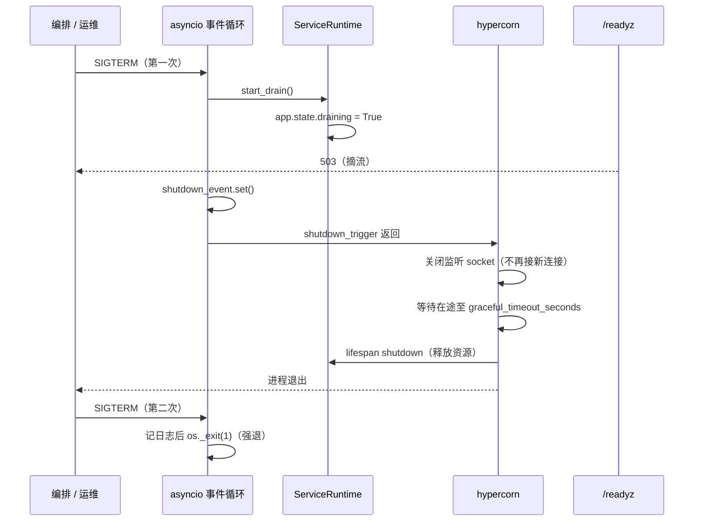

# HTTP/2 服务运行时（hypercorn）详细设计

> 后端基座与服务化地基 · 02 多服务骨架与仓库 · 04 HTTP/2 服务运行时 · 详细设计

[文档首页](../../../../../../文档首页.md) › [04 HTTP/2 服务运行时](../02_多服务骨架与仓库_04_HTTP2服务运行时.md) › 详细设计　|　[父任务：多服务骨架与仓库](../../02_多服务骨架与仓库.md) · [本阶段需求](../../../../需求/02_需求_多服务骨架与仓库.md#r02-4) · [阶段计划](../../../../计划/01_计划_后端基座与服务化地基.md)

## 1. 概述 <a id="overview"></a>

- **目标**：把基座统一服务运行时从 uvicorn 换成 **hypercorn**，使每个服务同时具备 HTTP/1.1 与 **HTTP/2（h2c prior knowledge / TLS ALPN）**，并保持既有「信号先摘流、再优雅停机」、探针、structlog 与单进程口径不变。
- **依据**：需求 [02-4](../../../../需求/02_需求_多服务骨架与仓库.md#r02-4)；msg 08B 需求 03-1（纯文本 `msg/msg文档/项目/08B_消息平台/需求/03_需求_传输与协议.md`）；《[uvicorn 技术介绍](../../../../../../资料/知识档案/后端核心/uvicorn技术介绍.md)》（HTTP/2 现状实测）；[02_02 服务运行与健康检查详细设计](../../02_多服务骨架与仓库_02_服务运行与健康检查/设计/02_详细设计_01_服务运行与健康检查.md)。
- **范围**：
  1. `bms_core/core/run.py` 启动器改 hypercorn；公开 API 改为 `build_config` / `serve_service` / `run_service`。
  2. `[server]` 增 `certfile` / `keyfile` / `graceful_timeout_seconds` 三个字段（TLS 可选、超时可配）。
  3. hypercorn 落 `bms_core` 依赖；bms 9 服务与 mdm 在役服务移除直接 uvicorn 依赖。
  4. 信号接管：第一次信号先摘流再优雅停机；第二次信号强退。
  5. 全产品回归：HTTP/1.1、h2c、TLS/ALPN、探针、SIGTERM、滚动重启。
  6. 文档与治理脚本同步。
- **不含**：msg 帧协议与 `/msg/*` 入口（msg 03 域）；网关 h2c 上游配置（部署任务）；HTTP/3；多 worker（仍一服务一容器横向扩容）；uvloop / httptools 性能优化（标准 asyncio，性能随 msg 03-1 基准评估）。

## 2. 现状与差距 <a id="gap"></a>

| 关注点 | 现状（02_02 交付后） | 差距（本任务目标） |
| --- | --- | --- |
| 服务器 | `uvicorn.Server` 子类 `ServiceServer`；`--http` 仅 h11 / httptools / zttp，无 HTTP/2 | 换 hypercorn；h2c 与 TLS ALPN 可用 |
| 信号 | `ServiceServer.handle_exit` 先 `start_drain` 再 `should_exit` | hypercorn 无 `handle_exit`；需自建信号接管 + `shutdown_trigger` |
| 配置 | `[server]` 仅 `host` / `port` / `workers` / `workers_by_service` | 增 `certfile` / `keyfile` / `graceful_timeout_seconds` |
| 依赖 | 9 服务各自 `uvicorn[standard]>=0.30` | hypercorn 落 `bms_core`，服务移除 uvicorn |
| 部署 | nginx 终止 TLS，上游 HTTP/1.1 | hypercorn 可自行终止 TLS（可选）；h2c 供内网 / 网关一跳 |
| 文档 | README / 规划 / 基类清单均写 uvicorn | 统一改为 hypercorn，并保留 uvicorn 历史说明 |

## 3. 交付物清单 <a id="tree"></a>

```text
backend/
├── libs/bms_core/
│   ├── pyproject.toml                    # 改：加 hypercorn 依赖（不装 uvloop）
│   ├── src/bms_core/
│   │   ├── core/
│   │   │   ├── run.py                    # 改：uvicorn → hypercorn；build_config / serve_service / run_service
│   │   │   └── config.py                 # 改：ServerSettings 增 certfile / keyfile / graceful_timeout_seconds
│   │   └── tests/core/
│   │       ├── test_run.py               # 改：配置映射 / 信号接管 / 强退 / serve 调用
│   │       └── test_config.py            # 改：TLS 同给同空 / 超时边界 / 环境变量
│   └── tests/core/test_http2_runtime.py  # 新：h2c / HTTP1.1 / TLS 冒烟（httpx 真网络）
├── services/ai|file|identity|notification|platform|report|search|tenant|txn/
│   └── pyproject.toml                    # 改：移除 uvicorn[standard]（共 9 个）
├── config.toml                           # 改：可选 TLS / 超时注释（默认保持空 / 30）
├── config.dev.toml / config.test.toml / config.prod.toml  # 改：如需覆盖超时
├── .env.example                          # 改：补 BMS_SERVER__CERTFILE / KEYFILE / GRACEFUL_TIMEOUT_SECONDS
├── README.md                             # 改：技术栈、启动命令、版本表
└── uv.lock                               # 改：依赖锁定

scripts/tools/governance/review_stage.py  # 改：backend README 期望串（uv run uvicorn → hypercorn）
bms文档/后端基类清单.md                    # 改：core/run.py 描述（ServiceServer → build_config / serve_service）
bms文档/规划/开发部署规划.md               # 改：后端运行命令
bms文档/规划/项目规划说明.md               # 改：技术栈摘要
mdm/backend/services/org/pyproject.toml    # 改：移除 uvicorn（mdm 在役服务回归）
```

## 4. 领域设计 <a id="design"></a>

### 4.1 配置字段 <a id="config"></a>

`ServerSettings`（`bms_core/core/config.py`）新增：

| 字段 | 类型 / 默认 | 语义 |
| --- | --- | --- |
| `certfile` | `str = ""` | TLS 证书路径；空 = 不启用 TLS |
| `keyfile` | `str = ""` | TLS 私钥路径；空 = 不启用 TLS |
| `graceful_timeout_seconds` | `int = 30`（`ge=1, le=600`） | 关闭监听后等待在途完成的上限（秒） |

校验（`model_validator(mode="after")`）：

- `certfile` 与 `keyfile` **同给或同空**，只给一个即 `ConfigError`（启动期失败，不进入运行）；
- 两者都给时，`build_config` 再校验文件存在且可读（`Path.is_file()`），失败报明确路径；
- 环境变量：`BMS_SERVER__CERTFILE` / `BMS_SERVER__KEYFILE` / `BMS_SERVER__GRACEFUL_TIMEOUT_SECONDS`（沿用 `BMS_` + 段双下划线口径）。

> 不新增 `http2` 开关：hypercorn 对有 TLS 的连接自动 ALPN 协商 h2，对明文连接自动识别 h2c prior knowledge；关掉 h2 没有业务理由。

### 4.2 启动器 API <a id="api"></a>

`bms_core/core/run.py` 公开三个符号（替换原 `ServiceServer` / `build_server`）：

| 符号 | 签名 | 语义 |
| --- | --- | --- |
| `build_config` | `(settings: Settings) -> hypercorn.Config` | 按 `[server]` 构造配置：`bind=[f"{host}:{port}"]`、TLS 两字段、`graceful_timeout`、`workers=1`、`accesslog=None`、`errorlog=None`、`loglevel` 取日志配置 |
| `serve_service` | `async (app: FastAPI, settings: Settings, *, on_drain: ServiceRuntime \| None = None) -> None` | 安装信号接管 → `await hypercorn.asyncio.serve(app, config, shutdown_trigger=event.wait)` → 恢复信号处理器 |
| `run_service` | `(factory: type[BaseApplicationFactory]) -> None` | `get_settings()` → `configure_logging` → `factory().create(None)` → 取 `app.state.service_runtime` → `asyncio.run(serve_service(...))` |

- **为什么不再包一层 `ServiceServer`**：hypercorn 通过 `shutdown_trigger` 驱动停机，没有可覆写的 `handle_exit`；保留同名类只会让调用方误以为仍是 uvicorn 语义。改名后调用点只有 `run_service` 与测试。
- `serve` 要求 `workers == 1`（多 worker 会告警且被忽略）；单进程口径不变，多副本由编排承担。
- `accesslog=None` / `errorlog=None`：关闭 hypercorn 自带日志处理器，统一走 structlog；启动时由 `serve_service` 打一条 `service_listening`（含 `service` / `host` / `port` / `tls` / `http2` 能力）。
- 响应头保持默认（`server: hypercorn-*`）；如需隐藏指纹另议，不在本任务改。

### 4.3 信号接管与优雅停机 <a id="shutdown"></a>



实现要点：

1. `serve_service` 在事件循环内创建 `asyncio.Event`，用 `loop.add_signal_handler` 注册 `SIGTERM` / `SIGINT` / `SIGBREAK`（存在才注册）；Windows 抛 `NotImplementedError` 时回退 `signal.signal`。
2. 处理器计数：第一次 → `on_drain.start_drain()`（同步、幂等）+ `shutdown_event.set()`；第二次 → 记 `service_force_exit` 日志后 `os._exit(1)`。
3. 信号处理器只做「置位 + 摘流」，不做 IO；`start_drain` 内部已有日志。
4. `graceful_timeout_seconds` 传给 hypercorn：监听关闭后最多等待该时长；超时后 hypercorn 取消剩余任务并执行 lifespan shutdown。
5. `finally` 恢复原信号处理器（测试可重复调用）；处理器安装失败（非主线程）时回退为「无摘流」并在启动日志告警——只允许 `run_service` 在主线程调用。

### 4.4 TLS 与 h2c / h2 <a id="tls"></a>

| 场景 | 配置 | 协议 |
| --- | --- | --- |
| 开发 / PoC 内网 | 不配 TLS | HTTP/1.1 + **h2c prior knowledge**（客户端直接发 HTTP/2 preface；不支持 `Upgrade: h2c`） |
| 生产直连 / 网关一跳 | `certfile` + `keyfile` | TLS 1.2+，ALPN 优先 `h2`、回落 `http/1.1` |
| 网关终止 TLS | 不配 TLS，网关到 broker 走 h2c | 同上第一行；网关需支持 h2c 上游（07-1 验证） |

- hypercorn `Config.create_ssl_context` 固定最小 TLS 1.2、禁用压缩、ALPN `["h2", "http/1.1"]`；本任务不覆写。
- 证书轮换需重启进程（无热加载）；生产由部署任务管理证书挂载。
- h2 相关默认值：`h2_max_concurrent_streams=100`、`h2_max_header_list_size=64 KiB`、`h2_max_inbound_frame_size=16 KiB`；msg 03-4 的并发流上限取同一口径。

### 4.5 探针、日志与身份 <a id="health"></a>

- `/healthz` / `/readyz` 仍由 `bms_core/api/health.py` 提供：`/readyz` 在 `draining` 或 `startup_complete=False` 时 503；信号第一次到达即置位，摘流先于排空。
- 日志：保留 `configure_logging` 与 `service` / `service_version` 上下文；hypercorn 自身日志关闭，启动 / 停机各一条 structlog 事件。
- 探针响应、鉴权、租户解析、中间件顺序均不变；hypercorn 走同一 ASGI app。

### 4.6 依赖与产品传递 <a id="deps"></a>

- `bms_core` 依赖加 `hypercorn>=0.18,<0.19`（0.18.0 支持 Python 3.14；`<0.19` 防未验升级）。
- bms 9 个服务 `pyproject` 删除 `uvicorn[standard]>=0.30`；mdm `services/org` 同步删除。
- 不装 `hypercorn[uvloop]`、不再装 `uvloop` / `httptools`（标准 asyncio）；HTTP/1.1 性能可能低于 uvicorn httptools，由 msg 03-1 基准评估，不达标再另议。
- 产品（mdm / biz / cw）经 `bms-core` 传递获得 hypercorn；biz / cw 未在役，随各自窗口验证。

### 4.7 回归与冒烟 <a id="regression"></a>

| 对象 | 冒烟内容 |
| --- | --- |
| bms 9 服务 | 启动、`/healthz` 200、`/readyz` 200/503 分支、HTTP/1.1 请求、h2c 握手 |
| mdm 在役服务 | 启动、探针、HTTP/1.1、h2c（经同一 `run_service`） |
| 停机 | SIGTERM 后 `/readyz` 先 503、在途请求完成、进程退出；第二次信号强退 |
| TLS | 自签证书启动，`httpx(http2=True, verify=False)` 协商到 HTTP/2 |

## 5. 失败分支与边界 <a id="failures"></a>

| 场景 | 处理 |
| --- | --- |
| `certfile` / `keyfile` 只给一个 | Settings 校验失败（`ConfigError`），启动即拒，不监听端口 |
| 证书 / 私钥文件不存在或不可读 | `build_config` 报明确路径并拒启 |
| 端口被占用 | hypercorn 启动失败，进程非 0 退出；由编排重试 / 告警 |
| 第一次信号 | 摘流 + 优雅停机；`start_drain` 幂等 |
| 第二次信号 | 记日志后 `os._exit(1)`；不执行 lifespan shutdown（明确取舍） |
| 信号处理器无法安装（非主线程） | 告警并跳过摘流；仅允许 `run_service` 主线程调用 |
| 在途请求超过 `graceful_timeout_seconds` | hypercorn 取消剩余任务后继续 lifespan shutdown；日志记录超时 |
| 明文误暴露公网 | 文档明确 h2c 只限内网 / 网关一跳；生产必须 TLS 或网关终止 |
| 多 worker | `serve` 忽略 `workers>1`；仍按一服务一容器横向扩容 |
| HTTP/1.1 性能下降 | 已知取舍（无 httptools）；由 msg 03-1 基准评估，不达标另立优化 |

## 6. 测试设计与验收映射 <a id="tests"></a>

Kiwi 用例先登记（本任务 **1 条**，分类「平台骨架」/ P2 / CONFIRMED / 自动化；编号以平台回读为准），代码用 `@pytest.mark.kiwi_id(<编号>)` 标注，多条断言共用同一编号。

| 用例 / 文件 | 类型 | 断言要点 |
| --- | --- | --- |
| `libs/bms_core/tests/core/test_run.py`（改） | 单元 | `build_config` 的 bind / TLS / `graceful_timeout` / `workers=1` / 日志关闭；第一次信号先 `start_drain` 再 set；第二次信号 `os._exit(1)`（monkeypatch）；`serve_service` 调用 hypercorn `serve` 的参数正确；`run_service` 构造应用并转交 |
| `libs/bms_core/tests/core/test_config.py`（改） | 单元 | TLS 同给同空校验；`graceful_timeout_seconds` 边界（1 / 600 / 越界）；环境变量覆盖 |
| `libs/bms_core/tests/core/test_http2_runtime.py`（新） | 集成 | 起真实端口：HTTP/1.1 请求成功；`httpx(http2=True)` 返回 `HTTP/2`；自签 TLS 下 `http2=True` 协商 h2；SIGTERM 后 `/readyz` 先 503 再退出 |
| `services/platform/tests/...`（改） | 集成 | 平台服务经 `run_service` 启动、探针与业务端点无回归 |
| mdm `services/org` 冒烟 | 手工 / 联调 | 启动、探针、HTTP/1.1、h2c；记入实施记录 |
| 既有全量回归 | 单元 + 集成 | `pytest` / `ruff` / `pyright` 全绿；`review_stage` 通过 |

验收映射：

| 完成标准（需求 02-4） | 验证方式 |
| --- | --- |
| 依赖含 hypercorn、9 服务无直接 uvicorn | `pyproject` / `uv.lock` 检查 + `test_run` 导入 |
| TLS 字段校验与两种 h2 握手 | `test_config.py` + `test_http2_runtime.py` |
| SIGTERM 先摘流再排空、二次强退 | `test_run.py` + 真网络停机用例 |
| bms 9 服务 + mdm 冒烟 | 逐服务启动脚本 / 实施记录 |
| 文档与治理脚本同步 | `review_stage` + docs 三项校验 |
| 覆盖率与静态门禁 | 推送预检 / CI |

## 7. 登记落点 <a id="registry-writeback"></a>

| 落点 | 内容 |
| --- | --- |
| 《[后端基类清单](../../../../../../后端基类清单.md)》 | 「服务运行时基座」：`ServiceServer` → `build_config` / `serve_service` / `run_service`，注明 hypercorn、h2c/TLS、信号先摘流 |
| 《[后端开发规范](../../../../../../规范/后端开发规范.md)》 | 若提及 uvicorn / 启动命令，同步为 hypercorn（以实际检索为准） |
| 《[开发部署规划](../../../../../../规划/开发部署规划.md)》 | 后端运行命令与端口说明 |
| 《[项目规划说明](../../../../../../规划/项目规划说明.md)》 | 技术栈摘要 uvicorn → hypercorn |
| `backend/README.md` | 技术栈、启动命令、版本表（hypercorn 0.18.x） |
| `scripts/tools/governance/review_stage.py` | `backend/README.md` 期望串改为 hypercorn |
| `.env.example` | `BMS_SERVER__CERTFILE` / `BMS_SERVER__KEYFILE` / `BMS_SERVER__GRACEFUL_TIMEOUT_SECONDS` |
| 计划 / 任务 / 需求 | 计划 §3 02_04 行（状态由计划承载）；任务完成标准回写；需求 02-4 状态由计划承载 |
| Kiwi TCMS | 登记 1 条并回读编号 |
| 实施 / 测试记录 | 任务目录 `实施/`、`测试/` 各一份 |

## 8. 边界与开放项 <a id="boundary"></a>

- **归 msg 03 域**：`/msg/*` 帧入口、h2 多 stream 业务语义、1 MiB 上限与 `350006`、基准脚本；本任务只提供传输能力。
- **归部署任务**：网关 h2c 上游、证书挂载与轮换、容器探针参数。
- **开放项**：
  1. HTTP/1.1 无 httptools，性能可能下降；以 msg 03-1 基准为准，不达标再评估 uvloop / granian（需另拍板）。
  2. 证书热轮换不做，重启生效。
  3. `workers > 1` 在 `serve` 下无效，维持一服务一容器。
  4. 响应头 `server: hypercorn-*` 是否隐藏另议（安全扫描口径）。
- **不改**：业务端点、鉴权、租户解析、中间件顺序、审计、迁移链与表集。

## 9. 实施步骤 <a id="steps"></a>


1. 读 Kiwi 部署说明，登记用例并回读编号。
2. `bms_core/pyproject.toml` 加 hypercorn；`ServerSettings` 加字段与校验；`.env.example` 补键位。
3. 重写 `core/run.py`：`build_config` / `serve_service` / `run_service`；删除 `ServiceServer` / `build_server`。
4. 9 服务与 mdm `pyproject` 移除 uvicorn；`uv lock` 更新。
5. 改写 `test_run.py` / `test_config.py`；新增 `test_http2_runtime.py`（httpx 真网络 + 自签证书）。
6. 逐服务启动冒烟（bms 9 + mdm），跑 HTTP/1.1 / h2c / 探针 / SIGTERM。
7. 同步 README、规划、基类清单、治理脚本；跑 `review_stage`。
8. 门禁：单文件 / 定向用例 + 变更模块覆盖率 100% + 静态全绿；文档 links / docs-scope / eol。
9. 回写计划、实施 / 测试记录，代码与文档分开提交。

关键命令（提交环 / 推送环口径，不跑全量）：

```bash
cd backend
uv sync --frozen
uv run pytest libs/bms_core/tests/core/test_run.py libs/bms_core/tests/core/test_config.py libs/bms_core/tests/core/test_http2_runtime.py -q --cov=bms_core --cov-branch
uv run ruff check libs/bms_core/src/bms_core/core/run.py libs/bms_core/src/bms_core/core/config.py
uv run ruff format --check libs/bms_core/src/bms_core/core/run.py libs/bms_core/src/bms_core/core/config.py
uv run pyright libs/bms_core/src/bms_core/core/run.py libs/bms_core/src/bms_core/core/config.py
uv run python -m bms_platform      # 启动冒烟；curl --http2-prior-knowledge 验 h2c
```

## 10. 决策记录（对齐记录） <a id="align"></a>

| # | 事项 | 结论 |
| --- | --- | --- |
| 1 | 服务器 | **hypercorn 0.18.x**（成熟 h2/h3 + ASGI；uvicorn 0.52 无 h2、0.53+ 实验性） |
| 2 | 公开 API | **`build_config` / `serve_service` / `run_service`**；删除 `ServiceServer` / `build_server` |
| 3 | TLS 字段 | `[server].certfile` / `keyfile`（同给或同空），TLS 下 ALPN h2 |
| 4 | 明文 | h2c prior knowledge；不支持 `Upgrade: h2c`；仅内网 / 网关一跳 |
| 5 | 优雅停机 | 第一次信号 `start_drain` + `shutdown_trigger`；`graceful_timeout_seconds` 默认 30 |
| 6 | 二次信号 | 记日志后 `os._exit(1)` 强退 |
| 7 | 事件循环 | **标准 asyncio**（不引 uvloop）；性能由 msg 03-1 基准评估 |
| 8 | 依赖 | hypercorn 落 `bms_core`；9 服务 + mdm 移除 uvicorn；不保留双运行时 |
| 9 | 工作进程 | 单进程；多副本由编排横向扩容 |
| 10 | 验证 | `httpx(http2=True)` 真网络断言 HTTP/2；自签证书验 TLS ALPN |
| 11 | Kiwi | **1 条**策展用例，覆盖启动器 / 信号 / TLS / h2c |

## 11. 参考文档 <a id="ref"></a>

- [需求 02-4 HTTP/2 服务运行时](../../../../需求/02_需求_多服务骨架与仓库.md#r02-4)、[需求 02-2 服务运行与健康检查](../../../../需求/02_需求_多服务骨架与仓库.md#r02-2)
- [02_02 服务运行与健康检查详细设计](../../02_多服务骨架与仓库_02_服务运行与健康检查/设计/02_详细设计_01_服务运行与健康检查.md)
- [后端基类清单](../../../../../../后端基类清单.md)「服务运行时基座」节
- [后端开发规范](../../../../../../规范/后端开发规范.md)「后端基座体系」节
- [开发部署规划](../../../../../../规划/开发部署规划.md)「后端开发运行」节
- bms《[uvicorn 技术介绍](../../../../../../资料/知识档案/后端核心/uvicorn技术介绍.md)》
- Hypercorn 官方文档（API usage / Configuration）：`https://hypercorn.readthedocs.io/`
- 《[KiwiTCMS 部署使用说明](../../../../../../资料/开发服务器/linux/KiwiTCMS部署使用说明.md)》「用例约定」节

---

> 本文档依《[文档生成规范](../../../../../../规范/文档生成规范.md)》编写 · 关键决策逐项确认 · 实施 / 测试以其为准
