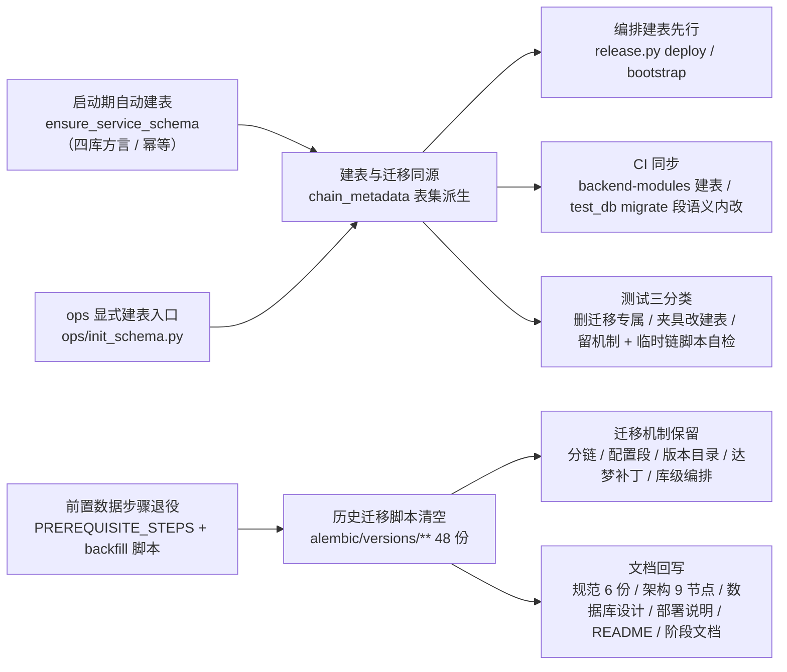

# 建表方式切换与迁移脚本清空实施记录

> 后端基座与服务化地基 · 06_数据拓扑升级 · 子任务 05 · 实施记录

[文档首页](../../../../../../文档首页.md) › [05 建表方式切换与迁移脚本清空](../06_数据拓扑升级_05_建表方式切换与迁移脚本清空.md) › 实施　|　[详细设计](../设计/01_详细设计_05_建表方式切换与迁移脚本清空.md) · [测试记录](../测试/01_测试_05_建表方式切换与迁移脚本清空.md)

## 1. 实施信息 

| 项 | 值 |
| --- | --- |
| 任务 | [05 建表方式切换与迁移脚本清空](../06_数据拓扑升级_05_建表方式切换与迁移脚本清空.md) |
| 对应需求 | [06-5](../../../../需求/06_需求_数据拓扑升级.md#r06-5) |
| 详细设计 | [01_详细设计_05_建表方式切换与迁移脚本清空](../设计/01_详细设计_05_建表方式切换与迁移脚本清空.md) |
| 实施日期 | 2026-10-18（代码 / 编排 / 测试 / 文档）；现场全量重建随同任务收口 |
| 实施人 | minjian |
| 实施环境 | 开发机（Windows，Python 3.14 / uv，后端 `.venv`）；部署机（Linux 容器栈，`/home/minjian/bms` 检出） |
| 提交 | 分笔提交：代码 / 编排 / 测试 / 文档（`type(scope): 中文描述`） |
| 结论 | **已完成**：改造与文档交付（后端 **2690 用例通过 / 51 跳过**、覆盖率**行 + 分支 100%**、`ruff check` / `ruff format --check` / `pyright` 零问题）；**现场全量重建与回归通过**（9 服务门禁全过、登录链路 200）、**缺陷 #103 已关单** |

## 2. 实施概览 

结果小结：建表与历史迁移解耦——重库（新库 / 删库重建 / 新服务接入）一律经**幂等建表**（`create_all(checkfirst=True)`，四库方言，只补不建改）得到当前表结构，不再依赖历史脚本与旧口径前置回填；迁移机制（分链注册 / 配置段 / 版本目录 / 达梦方言补丁 / 库级编排）整体保留，供将来 schema 演进时按新基线重启；编排与 CI 改「建表先行」；开发 / 演示库统一**删库重建**口径。

## 3. 实施过程 

1. **启动期自动建表（`db/bootstrap.py` 重写）**：去 `_is_sqlite` 方言限定与「有脚本才建表」门槛；`ensure_development_schema` 改中性名 **`ensure_service_schema`**（调用点与日志键同步）；新增共用建表函数 **`apply_chain_schema(chain, url, *, target, schema)`** 与结果契约 `SchemaOutcome`（表集大小 / 新建 / 已存在）——异步驱动走 `create_async_engine` + `run_sync(create_all)`，同步驱动（达梦）走 `create_engine` + `apply_session_schema` 后建表；建表前经 `inspect().get_table_names()` 统计已存在表，日志键 `schema_auto_create`（跳过分支 `schema_auto_create_skipped`）。启动期由 `ensure_service_schema(settings, factory=…)` 逐链逐库调用，同 URL 去重。
2. **开关语义升级（`core/config.py` / `config*.toml`）**：`[database].auto_create` 由「SQLite 专属」升为「**启动期建表总开关**」（开发 / 测试默认开、生产建议关，改走 ops 显式入口）；`config.toml` / `config.dev.toml` / `config.prod.toml` 注释同步；`[tenant].dev_tenants` 注释去 SQLite 限定。
3. **启动装配同步（`application.py`）**：调用改 `ensure_service_schema(settings, factory=…)`，完成日志键改 `schema_auto_create_done`；`db/registry.py` / `core/assembly.py` 相关注释同步。
4. **ops 显式建表入口（新增 `ops/init_schema.py`）**：与批量迁移**同构**（复用 `ops.migrate_tenants` 的任务解析与构建，抽出公共 `build_task_parser`）——`--target` / `--service` / `--code` / `--all-tenants` / `--db-key` / `--url` / `--schema` / `--dry-run`；逐库调 `apply_chain_schema`，输出「新建 N / 已存在 M（共 T）」与汇总（成功 / 跳过 / 失败 + 表数），单库失败不中断、存在失败退 1，空表集输出「无表集（跳过）」。
5. **历史脚本清空（48 份）**：`backend/alembic/versions/**` 全部 `.py` 删除，保留空壳目录（补齐 5 个空链目录的 `.gitkeep`）与 `alembic.ini` 全 7 配置段；`platform/archive/README.md` 保留。
6. **迁移机制保留（`db/migration.py`）**：链注册 / 配置段映射 / 版本目录 / `chain_url` / `has_revisions` / `head_revision` / `alembic_config` / `upgrade_chain` / `current_revision` / 达梦 `apply_session_schema` 全部保留，仅删除**前置数据步骤机制**（`PrerequisiteStep` / `PREREQUISITE_STEPS` / `pending_prerequisite_steps`）。
7. **批量迁移与租户初始化**：`ops/migrate_tenants.py` 删前置步骤提示（其余清单 / 幂等 / 汇总保留，脚本清空后各链输出「无脚本（跳过）」）；`ops/init_tenant.py` 三段改「**建库 → 建表 → 幂等种子**」（`InitResult` 字段改 `created_tables` / `existing_tables`）；`ops/backfill_tenant_id_columns.py` 与其用例整体删除。
8. **三库集成流程（`ops/test_db.py`）**：`migrate` 段**命令名保留、内部改建表**（调 `apply_chain_schema`；达梦用去模式段连接串 + 显式模式名）；`FLOW_STEPS` 步骤文案「迁移」→「建表」；对象 → 链映射注释同步。
9. **一键部署与数据引导（`scripts/tools/deploy/release.py`）**：`_migrate` 改 **`_init_schema`**（命令 `python -m ops.init_schema --service X [--code …]`）；`deploy` 文案「迁移先行」→「**建表先行**」；`bootstrap` 3/4 段改「建表（按服务）」；发布清单项 `migration_drill` 改名 `schema_drill`（值「人工确认（三库建表演练）」），同步 `deploy/ci/templates/backend-service.yml` 与 `test_release_cli.py`。
10. **CI 与部署资产（`.gitlab-ci.yml` / `deploy/**` / `backend/Dockerfile`）**：`backend-modules` 由 `alembic upgrade head` 改 `python -m ops.init_schema --service platform --target platform`；集成 job 注释与 `deploy/ci/verify/db`、`deploy/compose/services.yml`、`deploy/.env.example` 文案同步「建表」；Dockerfile 注释「迁移能力」→「建表能力：`alembic`（迁移机制，当前无脚本）+ 运维脚本」。
11. **测试三分类处置**：**删**（迁移专属）`test_alembic_drift.py` / `test_alembic_batch_rename.py` 与链完整性 / 前置步骤用例；**改**（夹具改建表）`tests/config/test_config_real.py`（`_run_migrations` → `_build_schema`，`test_migration_creates_sys_config` → `test_schema_creates_sys_config`）、`tests/config/test_config_edges.py`、`tests/listing/test_query_scheme_store.py`、`tests/ops/test_migration_ops.py`、`tests/ops/test_test_db.py`、`tests/core/test_application_startup_paths.py`（spy 函数名）、`tests/integration/test_three_db_integration.py`（`test_migration_head_and_tables` → `test_schema_tables_queryable`）；**留**（机制）链名派生与反解 / 表集派生 / 配置段映射 / 连接串解析 / 元数据子集 / 版本读取 / 达梦模式切换等，新增 `tests/ops/test_init_schema.py`。
12. **覆盖率承接（临时链脚本自检）**：仓库脚本清空后「有脚本才可达」的分支由用例在临时目录现场造最小链脚本驱动——`test_head_revision_driven_by_temp_chain_script`（`has_revisions` / `head_revision`）、`_temp_chain_env` + `test_upgrade_chain_runs_temp_chain`（真跑 `upgrade_chain` 到 head 并回读版本）、`test_upgrade_chain_passes_schema_x_arg`（`-x schema=` 传参口径）、`test_migrate_tenants_mechanism_with_temp_chain`（批量迁移「迁移完成 / 已是最新」分支）；**不开 `# pragma: no cover`、不减门禁**。
13. **文档回写**：按详设 §7 回写规范 6 份（数据库开发 / 部署发布 / AI开发 / 后端开发 / 代码评审 / 后端审计 / 测试 / 英文简称）、《架构设计 · 数据架构》「迁移策略」→「建表策略」及其余 9 个架构节点、《数据库设计总览》《数据规范》、42 份表文件「迁移」行 → 「建表」行（第 4 节标题同步）、部署说明（数据引导 / 一键部署 / 排障三条与 #103 补记口径改写）、`backend/README.md` 与 `alembic/README.md`、阶段需求 / 任务 / 计划 / 测试报告与关联阶段文档加注。

## 4. 问题与处置 

| # | 问题 | 处置 |
| --- | --- | --- |
| 1 | 启动期建表原经引擎注册表取引擎，达梦等同步方言不可用（`create()` 对 `SYNC_ONLY_DIALECTS` 抛错） | 建表改「一次性引擎」路径（异步 / 同步按驱动分流），`ensure_service_schema` 不再持有注册表；同步分支建表前经 `apply_session_schema` 切模式 |
| 2 | 达梦真库建表的模式依据缺失（迁移侧由 `-x schema=` 显式传） | 定「取连接串 `database` 段作 schema，建表前切换」；`ops/test_db` 侧仍用去模式段连接串 + 显式模式名（与迁移口径一致）；真库未实测登记为开放项 |
| 3 | 覆盖率门禁：`upgrade_chain` 在脚本清空后无消费方，行 576-579 掉出覆盖 | 以临时链脚本**真跑**一次 `upgrade_chain`（临时版本目录 + 最小脚本 + 临时 `alembic.ini`，`monkeypatch` 工程根 / 版本根），并以替身补齐 `-x schema=` 分支；不减门禁、不开 pragma |
| 4 | 裸无序集合护栏命中测试助手（`def _tables(...) -> set[str]`） | 测试助手返回改 `ConcurrentStableSet`（`test_init_schema.py` / `test_test_db.py`） |
| 5 | `pyright` 直呼 `.venv` 时解析不到依赖（数万条误报） | 与预检 / CI 同口径改用 `uv run pyright`（0 错误） |
| 6 | 发布清单键 `migration_drill` 语义过时 | 改名 `schema_drill`（值「人工确认（三库建表演练）」），同步 `release.py` / `deploy/ci/templates/backend-service.yml` / `tests/ops/test_release_cli.py` 三处 |
| 7 | 表文件「迁移」行普遍指向已清空脚本路径（42 份） | 统一改写为「**建表**：随 `{链}` 链幂等建表落地（脚本已随 06_05 清空，结构以模型为唯一事实源）…」；第 4 节标题「分片 / 归档 / 迁移」→「分片 / 归档 / 建表」（锚点不变），引用同步 |
| 8 | `ops/test_db` 真库集成 job 与 `backend-modules` 在脚本清空后会“迁移空转”致作业红（详设 §2.3 断点） | 两处同步改造：`backend-modules` 改调 `ops.init_schema`；集成流程 `migrate` 段语义内改为建表（命令名保留） |
| 9 | 现场 `bootstrap` 种子段报 `No module named ops.seed_dict`（旧口径残留：字典六表已随 02_09 拆除、脚本早已退役，宿主脚本仍在调用） | 删除 `release.py` bootstrap 的该步与死函数 `_tenant_url`（宿主脚本，不影响镜像）；`config.dev.toml` 注释同步；退役依据见 02_09 任务文档 |
| 10 | 现场 `notification` 启动即崩：`Unknown database 'bms_notification_acme'`——新口径放开真库后启动期建表会遍历 `dev_tenants`，暴露「部署机 `.env` 的 `BMS_DEPLOY_TENANTS=demo` 与镜像内 `dev_tenants=[demo,acme]` 不一致」 | 对齐部署租户集合为 `demo,acme`（与 `config.dev.toml` / `ops/seed_tenant.py` 种子 / `.env.example` / 09_02 设计一致，**保留双演示租户**），补建 9 个 acme 租户库；排障口径回写发布说明 |

## 5. 偏差与遗留 

- **现场全量重建已完成**（2026-10-18，见 §6 执行结果）：20 库 `mysqldump` 留痕 → drop 全部 `bms_*` 业务库（保留基础设施库）→ `bootstrap`（账号授权 → 建库 → 建表 → 种子）+ 手工补齐种子 → `deploy --all --tag a8b5dc73` **9 服务门禁全通过** → `admin@demo` 登录 200；结论已回写本记录与测试记录。
- **缺陷 #103**：原「现场回填 + 迁移」处置作废，按「删库重建」口径重记（见发布说明补记）；**现场全绿后已关单**（关闭评论记录 dump / drop / 重建 / 部署门禁 / 登录链路全链证据）。
- **开放项（登记，随详设 §8）**：① schema 演进能力（不可删库重建时按新基线重建迁移脚本）；② 存量数据搬迁（本阶段一律删库重建，不做搬迁）；③ **达梦真库建表实测**（方言 DDL 与大小写 / 注释差异，随三库集成或真机验证，结论回写方言特性文档）；④ 生产开关口径（`[database].auto_create` 生产建议关，走 ops 入口）；⑤ 覆盖率承接若仍有不可达分支则据实收窄（本次无 pragma 豁免、门禁未减）。
- **CI 侧实证（已完成）**：手动触发流水线 **#991**——`core-check`（前端）首跑因 `ui_ep::interaction-icon-code.spec.ts` 超时（5s）失败，本地复跑同用例 **14 passed** 判为环境 flaky（与本任务零关联），**重跑该 job 通过**（job 7803 success）→ **父流水线终态 `success`**，9 个服务子流水线全部 success（含镜像构建 / 推送 tag `a8b5dc73`）；同流水线的 **`integration-mysql` / `integration-postgres` / `txn-2pc` 均 success** —— 三库集成的 `ops.test_db create → migrate（语义为建表）→ pytest → drop` 路径已在 CI 实证；**达梦（`integration-dm8`）本轮未跑**，真库建表仍为开放项 ③（随三库集成按需触发时覆盖）。

## 6. 现场全量重建（执行结果） 

1. **备份留档**：20 个 `bms_*` 业务库逐个 `mysqldump` → 部署机 `deploy/backup/*-before-605-rebuild-20261018-125317.sql`（20/20 成功，256K）。
2. **删库**：drop 全部 `bms_*` 业务库（20 个）；drop 后仅剩基础设施库（`information_schema` / `mysql` / `performance_schema` / `sys` / `kiwi`）。
3. **检出与新镜像**：部署机检出 `git pull` 至 `a8b5dc73`；9 服务镜像 `a8b5dc73` 由 CI 子流水线构建推送（本地预热校验齐全）。
4. **重建**：`release.py bootstrap`（应用账号与授权 → 建库 → **建表** → 种子）；因 `ops.seed_dict` 残留（问题 #9）在种子段中断，**手工补齐 `seed_module` / `seed_tables` / `seed_tenant`** 后续跑；租户口径对齐 `demo,acme`。结果：**27 个 `bms_*` 库**（9 平台 + 18 租户）/ **130 张表**（`bms_platform_demo` 13、`bms_platform_acme` 13）/ `sys_tenant` 2 行 / `sys_tenant_database` 2 行。
5. **部署与门禁**：`release.py deploy --all --tag a8b5dc73` → **9 服务全部通过门禁**（建表先行 → 起容器 → `healthy` + `/readyz` 200 + 网关可达），版本台账 9 服务 `current.tag=a8b5dc73`。
6. **登录链路**：`admin@demo` 登录 **200**（令牌 618 字符）→ 用户态读服务目录清单 / 快照 **200** → 无凭证 / 伪造令牌 **401**；9 服务网关可达（401 = 可达）。
7. **缺陷单**：证据回写缺陷 #103 并由**已关闭**收口。

> 本文档按《[文档生成规范](../../../../../../规范/文档生成规范.md)》与《[AI开发规范](../../../../../../规范/AI开发规范.md)》编写 · 关键决策逐项确认
