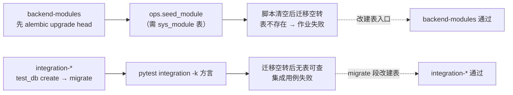
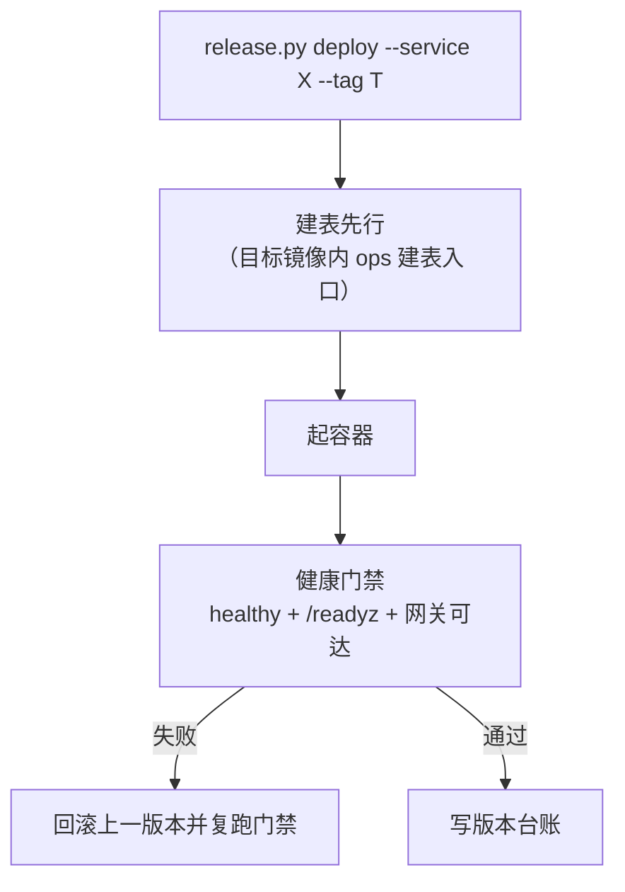

# 建表方式切换与迁移脚本清空详细设计

> 后端基座与服务化地基 · 06 数据拓扑升级 · 05 建表方式切换与迁移脚本清空 · 详细设计（开发核心文档）

[文档首页](../../../../../../文档首页.md) › [05 建表方式切换与迁移脚本清空](../06_数据拓扑升级_05_建表方式切换与迁移脚本清空.md) › 设计　|　[实施记录](../实施/01_实施_05_建表方式切换与迁移脚本清空.md) · [测试记录](../测试/01_测试_05_建表方式切换与迁移脚本清空.md)

## 1. 目标与边界 

**目标**：把「建表」与「历史迁移」解耦——重库（新库 / 删库重建 / 新服务接入）一律经**幂等建表**得到当前表结构，不再依赖历史迁移脚本与旧口径前置回填；同时把迁移机制（分链注册 / 配置段 / 库级编排）整体保留，供将来 schema 演进时按新基线重启。

**范围内**：

1. 启动期自动建表放开到四库方言（SQLite / MySQL / PostgreSQL / 达梦），表集由「服务 × 数据源」派生；开关语义由「SQLite 专属」升为「启动期建表总开关」。
2. 新建 **ops 显式建表入口**（与启动期共用同一表集派生点），供数据引导 / 一键部署 / CI 集成 / 首次接入调用。
3. 清空 `backend/alembic/versions/**` 全部历史迁移脚本，删除只服务于它们的测试与「迁移前置数据步骤」机制。
4. 编排与门禁改「建表先行」：数据引导、一键部署、三库集成流程（含 CI job 命令与文案）。
5. 口径与文档回写：开发 / 演示库一律删库重建；移除「旧口径存量数据」排障条目与「真库一律走迁移」表述。
6. 开发服务器全量重建并回归（缺陷 #103 的处置口径改写）。

**范围外**（登记归口，见 §8）：

- **schema 演进能力**：将来需要「既有库在线升级」时按新基线重建迁移脚本（机制保留，见 §4.3）——不在本任务。
- **存量数据搬迁 / 兼容**：本阶段无生产库，一律删库重建，不做数据搬迁。
- 表结构本身的增删改（本任务不动任何表字段）。

## 2. 现状与改造点 

### 2.1 现状

- **建表只走迁移**：`db/bootstrap.py::ensure_development_schema` 仅对 SQLite 生效，且只处理 `has_revisions(chain)` 为真的链——**没有脚本的链不建表**；真库（MySQL / PG / 达梦）完全依赖历史迁移脚本，`数据库开发规范`「迁移与建表口径」节亦写「真库一律走迁移」。
- **历史脚本 48 份**：`platform:platform` 10 / `platform:tenant` 16 / `tenant:platform` 7 / `tenant:tenant` 3 / `identity:platform` 3 / `identity:tenant` 6 / `txn:platform` 3；另有 10 个空链目录（`ai` / `file` / `notification` / `report` / `search` 各两条）与归档链空目录。
- **两处旧口径前置回填**：`platform:tenant` `0010`（字典父项 `parent_id` 由父 `value` 回填为父 `id`，原脚本已随表退役被删）、`identity:platform` `0003`（租户列由租户 `code` 回填为租户 `id`）；上一轮为此新增的 `PREREQUISITE_STEPS` 登记与批量迁移提示行即围绕它们。
- **门禁与流程依赖迁移建表**：CI `backend-modules` 先 `alembic upgrade head` 再 `ops.seed_module`；三库集成 job 走 `ops.test_db create → migrate → pytest → drop`；`release.py` 的 `deploy` / `bootstrap` 均以「迁移先行」起手。
- **测试夹具依赖迁移建表**：`tests/config/test_config_real.py`、`tests/listing/test_query_scheme_store.py` 用「跑迁移」当夹具建表。

### 2.2 改造点

| # | 改造对象 | 现状 | 改为 |
| --- | --- | --- | --- |
| 1 | `bms_core/db/bootstrap.py` | `_is_sqlite` 限定 + 「有脚本才建表」 | 去方言限定、去脚本门槛；函数改中性名并保留幂等 `create_all(checkfirst=True)` |
| 2 | `bms_core/core/config.py` | `[database].auto_create` 说明为 SQLite 专属 | 语义升为「启动期建表总开关」（生产建议关、走 ops 入口） |
| 3 | `bms_core/application.py` | 启动期调用并记 `sqlite_auto_create*` 日志 | 同步函数名与日志键 |
| 4 | **新增** `ops/init_schema.py` | — | ops 建表入口：按「服务 × 数据源」表集幂等建表，`--dry-run` / 单库 / 多库形态与批量迁移同构 |
| 5 | `backend/alembic/versions/**` | 48 份脚本 | 清空脚本，保留空壳目录与 `alembic.ini` 全 7 段（实测：无 `.py` 时 `head_revision()` 返回 `None`、`alembic upgrade head` 打印「暂无迁移脚本（跳过）」不报错） |
| 6 | `bms_core/db/migration.py` | 含 `PrerequisiteStep` / `PREREQUISITE_STEPS` / `pending_prerequisite_steps` | 删除前置步骤机制；链注册 / 配置段 / 连接串 / 版本读取等**机制组件保留** |
| 7 | `ops/migrate_tenants.py` | 打印前置步骤提示 | 删提示；其余（清单 / 幂等 / 汇总）保留，脚本清空后各链输出「无脚本（跳过）」 |
| 8 | `ops/test_db.py` | `migrate` 段跑分链迁移 | `migrate` 段改调建表入口（命令名保留、步骤文案改「建表」） |
| 9 | `ops/init_tenant.py` | 建库 → 迁移 → 种子 | 建库 → 建表 → 种子 |
| 10 | `ops/backfill_tenant_id_columns.py` + 用例 | 旧口径回填脚本 | 整体删除（无脚本即无前置回填） |
| 11 | `scripts/tools/deploy/release.py` | `_migrate` + 「迁移先行」文案 | 改建表步骤（`_init_schema`）+ 「建表先行」文案（`deploy` 与 `bootstrap` 两处） |
| 12 | `.gitlab-ci.yml` | `backend-modules` 先迁移；三库 job `migrate` | 前者改调建表入口；后者 `migrate` 段语义内改（命令名不变） |
| 13 | 迁移相关测试 | 迁移专属 + 夹具 + 机制三类混在一起 | 按 §4.5 三分类处置 |
| 14 | 部署编排与镜像说明 | 注释 / 文档写「迁移先行」「镜像含迁移能力」 | 措辞改「建表先行」「含建表能力」 |
| 15 | 护栏 | `check_backend_base` 迁移链项、`check_tables` 脚本表集项 | **保留**（空链自动跳过，将来重建脚本即自动生效） |

### 2.3 CI 断点（改造后必须同步）

## 3. 交付物清单 

| # | 交付物 | 落点 |
| --- | --- | --- |
| 1 | 启动期自动建表（去方言限定与脚本门槛，中性名） | `backend/libs/bms_core/src/bms_core/db/bootstrap.py`、`application.py`、`core/config.py` |
| 2 | ops 显式建表入口 | `backend/ops/init_schema.py` |
| 3 | 前置步骤机制删除 + 链注册保留 | `backend/libs/bms_core/src/bms_core/db/migration.py`、`backend/ops/migrate_tenants.py` |
| 4 | 历史迁移脚本清空（48 份；保留空壳目录） | `backend/alembic/versions/**` |
| 5 | 旧口径回填脚本与用例删除 | `backend/ops/backfill_tenant_id_columns.py`、`backend/libs/bms_core/tests/ops/test_backfill_tenant_id_columns.py` |
| 6 | 建库 → 建表 → 种子 / 三库集成改口径 | `backend/ops/init_tenant.py`、`backend/ops/test_db.py` |
| 7 | 一键部署与数据引导改「建表先行」 | `scripts/tools/deploy/release.py` |
| 8 | CI 建表切换（`backend-modules` / 三库 job） | `.gitlab-ci.yml` |
| 9 | 测试三分类处置 + 临时链脚本自检 | `backend/libs/bms_core/tests/alembic/**`、`tests/ops/**`、`tests/integration/**`、`tests/config/**`、`tests/listing/**` |
| 10 | 文档回写（规范 / 架构 / 数据库设计 / 部署说明 / README 与 alembic README） | 见 §7 |
| 11 | 现场全量重建与回归 | 开发服务器（部署机检出 + 容器） |
| 12 | 实施 / 测试记录 | 本任务 `实施/`、`测试/` |

## 4. 设计 

### 4.1 启动期自动建表 

- **表集派生不变**：仍取「服务 × 数据源」的表集（表归属登记派生）∩ 已有模型，与 `chain_metadata(chain)` 同源；**只是不再要求该链「有脚本」**。
- **方言无关**：去掉 SQLite 判定，直接对该服务的数据源连接执行 `metadata.create_all(checkfirst=True)`——该 API 生成方言适配 DDL（达梦经既有方言补丁），且**只补不删**（既有对象不动），满足「删库重建后一次建齐、重复启动无副作用」。
- **开关语义**：`[database].auto_create` 由「SQLite 专属」升为「启动期建表总开关」——开发 / 测试默认开，生产建议关（走 ops 显式入口，部署链上先建表后起服务）。
- **函数命名**：由 `ensure_development_schema` 改中性名（不再是「开发库专用」），调用点与日志键同步。

### 4.2 ops 显式建表入口 

- 新增 `backend/ops/init_schema.py`：与批量迁移同构的「服务 × 数据源 × 库」遍历（库键 / 连接串仍经基座库键派生），逐库对表集执行幂等建表，输出「新建 N 表 / 已存在 M 表」统计；支持 `--dry-run`、`--service`、`--db-key` / `--url` 单库形态。
- **单一来源**：与启动期建表共用同一表集派生函数，避免「两处表集漂移」；启动期是「服务自身库」的自动路径，ops 入口是「运维 / CI 指定库」的显式路径。
- 幂等与容错口径沿用批量迁移：缺库记错不阻断整批、末尾汇总、存在失败退非零。

### 4.3 迁移机制保留形态 

| 组件 | 处置 | 说明 |
| --- | --- | --- |
| `alembic.ini` 7 个配置段 + `versions/**` 目录结构 | **保留** | 实测无脚本时 `has_revisions=False` → `head_revision()` 为 `None`、`upgrade head` 打印「暂无迁移脚本（跳过）」不报错；将来重建基线只需补脚本 |
| `db/migration.py` 链注册 / 配置段映射 / 连接串 / 版本读取 / `upgrade_chain` | **保留** | 库级编排与「有脚本链」概念仍可用（当前恒为空集） |
| `ops/migrate_tenants.py` | **保留** | 脚本清空后逐链输出「无脚本（跳过）」，编排骨架与幂等语义不动 |
| `PREREQUISITE_STEPS` / 提示行 / `ops/backfill_tenant_id_columns.py` | **删除** | 前置数据步骤是「历史脚本 + 存量数据」的伴生机制，脚本清空后无适用对象 |
| 达梦方言 DDL 补丁（`alembic/env.py`） | **保留** | 建表同样走方言层；将来恢复迁移亦需 |

### 4.4 编排与门禁改「建表先行」 

- `bootstrap` 四段改为「应用账号与授权 → 建库 → **建表** → 种子」；建表段逐服务调 ops 建表入口（平台链 + 各服务租户链）。
- 三库集成流程：`ops.test_db plan / create / **migrate（内部改建表）** / drop` —— **命令名保留**，仅内部语义与文案改「建表」，以最小化 CI 与文档改动。
- `backend-modules` 作业把「先升级迁移」改为「先建表」，再跑服务目录种子与模块校验。

### 4.5 测试与覆盖率 

**三分类处置**：

1. **迁移专属（删）**：断言链头值 / 脚本内容 / 迁移漂移 / 迁移执行结果的用例（如链完整性、batch 改名扫描、演练全流程、迁移幂等与失败汇总等）。
2. **夹具改建表（改）**：仅把「跑迁移」当建表手段的用例（配置 / 查询方案等夹具）改为调建表入口或建表函数。
3. **机制保留（留 / 改）**：链名派生与反解、表集派生、配置段映射、连接串解析、元数据子集、`current_revision` 读版本等**与脚本存在无关**的机制用例保留；其中涉及「有脚本才建表」的用例按新口径改写。

**100% 覆盖率承接（临时链脚本自检）**：机制代码中「有脚本才可达」的分支（版本遍历 / 升级路径 / 链头判定）改由用例在临时目录**现场造出最小链脚本**驱动（与 `check_backend_base` 自检的临时脚本做法同源）——既不依赖仓库内脚本，也不放宽覆盖率门禁、不开 `# pragma: no cover` 先例。

### 4.6 现场全量重建 

- 步骤：停服务 → `drop` 全部 `bms_*` 业务库（各服务平台库 / 租户库 / 归档库 / 开发库；**保留基础设施库**：GitLab / Keycloak / MinIO 等）→ 经基座建库入口重建 → **建表** → 种子（服务目录 / 表归属 / 租户注册 / 字典 / 双租户）→ 全服务部署 + 健康门禁。
- 前置备份：重建前对将删库做一次 `mysqldump` 归档（部署机 `deploy/backup/`，不入库），仅作留痕与回退兜底（本阶段数据无保留价值）。
- 验收：各服务 `healthy`、`/readyz` 200、网关可达；重新建号并验证登录链路。
- **缺陷 #103 口径改写**：原「现场回填 + 迁移」处置作废，改为「删库重建」；缺陷单按新口径重记。

## 5. 测试与门禁 

| 门禁 | 口径 |
| --- | --- |
| 后端用例 | 受影响模块定向用例 + 全量 `pytest`（删 / 改用例后重算）全绿 |
| 覆盖率 | 行 + 分支 **100%**（`--cov-fail-under=100` 不打折）；机制分支由临时链脚本自检承接 |
| 静态 | `ruff check` / `ruff format --check` / `pyright`（0 错误） |
| 基座与边界 | `check_base` / `check_backend_base`（空链自动跳过）/ `check_tables` / `check_service_boundaries` |
| 编排与契约 | 网关配置零漂移 / 契约快照零漂移 / `check_contracts` / 事件契约零漂移 / api-types 零漂移 |
| 集成 | 三库集成流程经建表路径跑通（CI 按需触发） |
| 整体 | `check_preflight.py`（完整，含覆盖率门禁）全绿 |
| 现场 | 重建后各服务 `healthy` + `/readyz` 200 + 网关可达 + 门禁通过 |

## 6. 兼容与回滚 

- **兼容**：本阶段全部为开发 / 演示库，「删库重建」是既有认可口径（本仓既有表述：「本地开发库直接删库重建，不走搬迁脚本」），无存量数据兼容负担。
- **回滚（代码）**：本任务为「删脚本 + 改建表路径」，回滚即恢复脚本与迁移路径（git 回退）；因脚本清空不影响已重建库的正确性（表结构由模型派生），回滚成本低。
- **回滚（现场）**：重建前 dump 归档保留至验收通过后按需清理；重建失败可重跑（建库 + 建表 + 种子均幂等）。
- **风险点**：① 真库建表依赖方言层生成 DDL，达梦需实测（随三库集成覆盖）；② 启动期建表默认开关若在生产开启会掩盖「结构应经运维显式变更」的口径——故生产建议关，走 ops 入口（已入 §7 规范回写）。

## 7. 文档回写清单 

| # | 文档 / 章节 | 改什么 |
| --- | --- | --- |
| 1 | 《数据库开发规范》「迁移与建表口径」节 | 改写为「机制保留 + 脚本清空 + 启动期自动建表 + ops 建表入口」；删「真库一律走迁移」「零漂移（逐链 autogenerate）」与前置步骤登记条；补「开发 / 演示库删库重建」 |
| 2 | 《部署发布规范》「镜像与版本」「发布流程」「回滚」节 | 「迁移先行」改「建表先行」；「镜像含迁移能力」改「含建表能力」 |
| 3 | 《AI开发规范》「数据库与表设计」节、检查清单 | 「生成迁移脚本」步骤改「改模型（建表由启动期 / ops 幂等完成）」 |
| 4 | 《后端开发规范》「SQL 与数据访问规范」节、目录树注释 | 表结构变更口径改「改模型 + 建表」；`alembic/` 注释改「迁移机制（当前无脚本）」 |
| 5 | 《代码评审规范》「数据库变更」节、《后端审计规范》对应项 | 评审项由「迁移脚本三库可执行 / 幂等」改「模型与表集一致、建表幂等」 |
| 6 | 《测试规范》测试资产边界节 | 迁移用例口径改「建表 / 结构用例」 |
| 7 | 《架构设计 · 数据架构》「迁移策略」节 | 改写为「建表策略」并注明机制保留 |
| 8 | 《架构设计 · 总体架构》《架构设计 · 模块注册》《架构设计 · 多租户路由》对应节 | 迁移相关表述按新口径对齐 |
| 9 | 《数据库设计总览》《数据库设计 · 数据规范》「库划分与迁移归属」节 | 变更传导与归属口径改「模型驱动建表」 |
| 10 | 数据表设计表文件（约 30 份）「迁移」行 | 删除指向已清空脚本路径的表述，改「随建表落地（结构以模型为准）」 |
| 11 | 《服务编排与发布部署使用说明》「数据引导」「一键部署」「排障」节 | 建表先行；删「迁移停在 0010 / 0003」与「前置数据步骤提示」三条排障行 |
| 12 | `backend/alembic/README.md`、`backend/README.md`、`deploy/compose/services.yml` 注释、`deploy/ci/templates/backend-service.yml` 注释 | 脚本清空与建表口径、目录注释同步 |
| 13 | 阶段二需求 / 任务 / 计划与阶段测试报告 | 需求 06-5、任务 06_05 登记；本域任务数、统计与遗留项回写 |
| 14 | 关联阶段文档（域一 01_04 / 域六 06_02 / 域九 09_02 等） | 现状加注「迁移脚本已清空、改建表路径」 |

## 8. 开放项与偏差登记 

| # | 事项 | 归口 |
| --- | --- | --- |
| 1 | schema 演进能力（既有库在线升级）——将来按新基线重建迁移脚本 | 随首个「不可删库重建」环境（发布 / 生产）立项 |
| 2 | 存量数据搬迁能力（本阶段一律删库重建，不做搬迁） | 同上；届时应以「一次性数据脚本 + 校验」形态另行设计 |
| 3 | 达梦真库建表实测（方言 DDL 与大小写 / 注释差异） | 三库集成按需触发时覆盖，结论回写方言特性文档 |
| 4 | 生产开关口径（`[database].auto_create` 生产建议关，走 ops 入口） | 部署规范与部署说明回写后随发布阶段复核 |
| 5 | 覆盖率承接（临时链脚本自检）若不足以覆盖全部机制分支 | 实施中据实回写本设计与测试记录，必要时收窄不可达分支 |

> 本文档按《[文档生成规范](../../../../../../规范/文档生成规范.md)》与《[AI开发规范](../../../../../../规范/AI开发规范.md)》编写 · 关键决策逐项确认