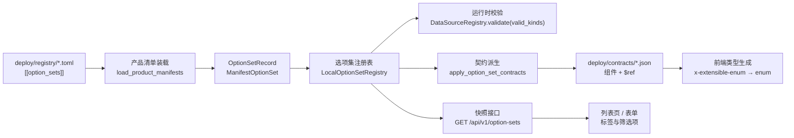

# 01 详细设计：选项集承载静态值域与契约派生

> 后端基座与服务化地基 · 09 多服务CI-CD与契约门禁 · 03 契约门禁 · 09-03-1

[文档首页](../../../../../../../文档首页.md) › [09-03-1 选项集承载静态值域](../09_多服务CI-CD与契约门禁_03_契约门禁_01_选项集承载静态值域.md) › 详细设计

## 1. 目标与范围 <a id="scope"></a>

**目标**：接口的静态值域只有**一份声明**（选项集配置），由它同时派生运行时校验、公开契约与前端类型；值域是否可增长由**业务语义**显式声明，而不是靠改基线绕过门禁。

**范围内**：

- `deploy/registry/*.toml` 的 `[[option_sets]]` 声明与装载；
- 运行时注册表（沿用 02-4-28 的 `option_set_registry` 端口，不新增端口）；
- 契约导出期的值域派生（`enum` / `x-extensible-enum` + 命名组件）；
- 只读快照接口 `GET /api/v1/option-sets`；
- 前端类型生成适配与列表页消费；首批三条值域切换。

**范围外**：数据权限在快照接口上的落地（后续任务，同一入口）；表单元数据下发与服务端动态校验（表单定制阶段）；新增护栏脚本。

## 2. 可增长性判据（强制口径） <a id="criterion"></a>

| 判据 | 集合性质 | `extensible` | 契约形态 | 加一个值的代价 |
| --- | --- | --- | --- | --- |
| 每个取值都要有对应业务处理（状态驱动动作、分支逻辑） | 闭集 | `false` | `enum` | 门禁报 `response-property-enum-value-added` → 人工确认 + 改业务代码 |
| 循环渲染 / 纯展示 / 筛选 / 透传 | 可增长 | `true` | `x-extensible-enum` | 只改配置（消费方走通用逻辑） |

**要点**：

- 可增长**不是**「允许静默兜底」的许可证。未知值处理必须显式：闭集未知识别即报错或标注「未知」；可增长未知可原样展示，但不得映射成某个真实取值（如未知状态显示成「启用」）。
- 判据按**消费方式**定，不按「改基线麻烦不麻烦」定；`bms.tenant.status` 因状态驱动停用 / 启用 / 注销 / 恢复，落闭集。
- 判据正文登记在《后端开发规范》「静态值域与选项集」节与《后端基类实现契约》选项集条，本任务只做首批落地。

## 3. 结构与时序 <a id="structure"></a>



**装载**：应用工厂在 `create()` 阶段读产品清单，把 `option_sets` 汇总为平台 + 产品两份，存 `app.state.platform_option_sets` / `product_option_sets` / `option_sets`；注册表工厂 `LocalOptionSetRegistryFactory` 按来源登记（产品登记 `bms.*` 或改写基座项仍按 02-4-28 的 40002 拒绝）。

**契约派生**：应用工厂包一层 `app.openapi()`，在 FastAPI 生成默认 schema 后调用 `apply_option_set_contracts(openapi, option_sets)`：

1. 递归找带 `optionSetKey` 的节点；
2. 命中已登记选项集时，移除标记键；
3. 有 `contract_name` → 生成 `components.schemas.<contract_name>`（`type: string` + 值域 + `title`），字段改为 `$ref`；
4. 无 `contract_name` → 就地写值域键；
5. 值域键按 `extensible` 取 `x-extensible-enum` 或 `enum`；
6. 未登记的 `optionSetKey` 直接剔除标记、不改写（不因缺登记把契约导出搞挂）。

**前端类型**：生成器 `frontend/scripts/api-types/generate.mjs` 在调用 `openapi-typescript` 前把 `x-extensible-enum` 回填成 `enum`（仅内存副本），使已知取值仍生成闭合联合；契约文件本身保持扩展键语义。

**快照接口**：`GET /api/v1/option-sets?keys=a,b`，`keys` 为空返回全部已登记；逗号项去空白 / 去重 / 忽略空项；未登记标识抛 `NotFoundError` 10002（不静默返回空集）。条目按选项集声明顺序、项内按 `sort` 升序。

## 4. 数据契约 <a id="contracts"></a>

| 名称 | 位置 | 说明 |
| --- | --- | --- |
| `OptionSetRecord` | `bms_core/optionset/manifest.py` | 清单层的值域记录（`option_set_key` / `name` / `contract_name` / `extensible` / `items`），冻结集合 |
| `ManifestOptionSet` | 同上 | 把记录适配到 `BaseOptionSet` 端口，供注册表登记与契约派生共用 |
| `OptionSetInfo` / `OptionItem` | `bms_core/optionset/base.py` | 注册表运行期视图（02-4-28 既有）；本任务补 `contract_name` / `extensible` 元数据 |
| `OptionSetItemResponse` / `OptionSetResponse` / `OptionSetListResponse` | `bms_core/schemas/option_set.py` | 快照接口响应（可空字段序列化为 `null`，前端归一为可选） |
| `ProductManifest.option_sets` | `bms_core/registry/products.py` | 清单解析入口；缺 `items` 数组属结构错误（`CatalogError`），启动即拒 |

**清单样例**：

```toml
[[option_sets]]
key = "bms.tenant.status"
name = "租户状态"
contract_name = "TenantStatus"
extensible = false          # 闭集：每个状态都要有业务动作
items = [
  { value = "provisioning", label = "开通中", color = "warning", sort = 10 },
  { value = "active", label = "启用", color = "success", sort = 20 },
  { value = "suspended", label = "停用", color = "info", sort = 30 },
  { value = "deleted", label = "已注销", color = "danger", sort = 40 },
]
```

## 5. 运行时校验 <a id="runtime"></a>

- `DataSourceRegistry.validate(*, valid_kinds)`：类型值域取自选项集 `bms.datasource.kind`，代码不再维护 `DataSourceKind` 枚举；`valid_kinds=None` 仅用于**未装载清单的极简环境**（无值域可校验，其余校验照常），不构成业务放行口子。
- 平台数据源接口按同一选项集校验 `?kind=`，非法值抛 `ParamError` 10001。
- 租户状态 / 模块状态响应字段由枚举改为 `str` + `optionSetKey`；服务层不再做枚举转换（撤掉 `cast`）。

## 6. 消费约定 <a id="consume"></a>

| 场景 | 闭集未知值 | 可增长未知值 |
| --- | --- | --- |
| 列表展示 | 显式「未知状态（value）」+ 危险色 | 原样展示 value |
| 筛选下拉 | 只出现配置项 | 只出现配置项 |
| 业务动作 | 无匹配分支即不展示动作 / 报错，**不得**默认成启用 | 走通用逻辑 |

前端 `optionLabelOf` 返回值缺失时由调用方决定展示，**不得**在工具函数里兜底成某个真实文案。

## 7. 兼容与迁移 <a id="migration"></a>

- 首批三条一次性切换：重导出 `deploy/contracts/*.json`、刷新 `tenant` / `platform` 基线；可增长两条自此不再因加值动基线，闭集一条加值仍会触发门禁（预期行为）。
- 契约版本不升（字段名 / 类型未变，仅值域表达方式变化；`tenant.status` 由内联 `enum` 改为 `$ref` 到同名组件，消费方取值集合不变）。
- 前端类型文件重新生成，联合成员与切换前一致。
- 选项集运行期只读、不落库、无写接口；数据权限落地时在快照入口统一判定。

## 8. 文件清单 <a id="files"></a>

```text
bms/backend/libs/bms_core/src/bms_core/
├── optionset/
│   ├── base.py                      # 选项集元数据补 contract_name / extensible
│   ├── contract.py                  # 契约派生（新增）
│   ├── local.py                     # 按清单登记平台 / 产品选项集
│   └── manifest.py                  # OptionSetRecord / ManifestOptionSet（新增）
├── registry/products.py             # 清单解析增 [[option_sets]]
├── datasource/registry.py           # 类型值域改由选项集提供
├── schemas/option_set.py            # 快照响应契约（新增）
├── schemas/datasource.py            # kind → str + optionSetKey
├── application.py                   # 装载清单、注册选项集、包 openapi()
└── core/assembly.py                 # 注册表工厂装配接线
bms/backend/services/platform/src/bms_platform/domains/platform_registry/api/
├── option_set.py                    # 快照接口（新增）
├── data_source.py                   # ?kind 走选项集校验
└── tenant_quotas.py                 # 配额类型读选项集
bms/frontend/
├── apps/desktop/src/api/optionSets.ts          # 快照拉取与字段归一（新增）
├── apps/desktop/src/views/system/TenantView.vue
├── apps/desktop/src/views/system/TenantRecordTab.vue
├── scripts/api-types/generate.mjs               # x-extensible-enum 回填
└── packages/api_types/src/{platform,tenant}.ts  # 重新生成
bms/deploy/registry/platform.toml                # 三条 [[option_sets]]
bms/deploy/contracts/{platform,tenant}.json      # 重导出
bms/deploy/contracts/baseline/{platform,tenant}.json
```

## 9. 决策记录 <a id="decisions"></a>

| # | 待决项 | 结论 |
| --- | --- | --- |
| 1 | 值域声明落点 | `deploy/registry/<仓>.toml` 的 `[[option_sets]]`，复用既有清单装载，不新建配置通道 |
| 2 | `bms.tenant.status` 可增长性 | 闭集（状态驱动业务动作，加值必须改代码；门禁报警是正确信号） |
| 3 | `bms.datasource.kind` 可增长性 | 可增长（展示 / 筛选 / 循环） |
| 4 | `bms.tenant.module_status` 可增长性 | 可增长（展示类） |
| 5 | 值域来源 | 选项集为唯一来源；删除 `ExtensibleStrEnum` 方案，不保留 Python 枚举副本 |
| 6 | 未知值处理 | 禁止静默兜底；闭集显式未知，可增长原样展示 |
| 7 | 快照入口 | `GET /api/v1/option-sets`，数据权限后续挂同一入口 |
| 8 | 判据沉淀 | 《后端开发规范》+《后端基类实现契约》 |

> 本文档依《文档生成规范》编写
