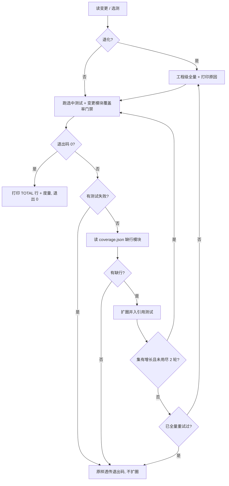

# 01 变更影响分析与细粒度选测 实施记录

> 后端基座与服务化地基 · 13 测试执行粒度与工程效能 · 子任务 01（需求 13-1）· 实施日期：2026-10-19

[文档首页](../../../../../../文档首页.md) › [13 测试执行粒度与工程效能](../../13_测试执行粒度与工程效能.md) › [01 变更影响分析与细粒度选测](../13_测试执行粒度与工程效能_01_变更影响分析与细粒度选测.md) › 实施记录　|　[详细设计](../设计/01_详细设计_01_变更影响分析与细粒度选测.md)　|　[测试记录](../测试/01_测试_01_变更影响分析与细粒度选测.md)

## 1. 实施信息 

| 项 | 值 |
| --- | --- |
| 需求 / 任务 | `13-1` / `13_01` |
| 设计依据 | [详细设计（定稿，13 项决策）](../设计/01_详细设计_01_变更影响分析与细粒度选测.md) |
| 代码提交 | `feat(preflight)`：选测器 + 扩圈执行器 + 预检与 CI 接入 + 前端镜像补 git/python3 |
| 文档提交 | `docs(13_01)`：实施 / 测试记录与计划回写 |
| 用例编号 | **Kiwi 2316**（选测器，22 条断言）；既有 **2311**（预检定向档）3 条断言改写 |
| 决策口径 | 选测器单一来源（预检与 CI 共用）、目录同构 + AST 双重收敛、测试文件数双阈值退化、扩圈最多 2 轮、前端 workspace 反向闭包、四 job 全接 |

## 2. 实施过程 

### 2.1 选测器：半成品修复与补全（`scripts/tools/preflight/test_selection.py`，1073 行）

接手时该文件已存在但为**未跟踪的半成品**（`git log` 无记录、无用例、未接入任何调用点），且一跑即崩。逐项修复：

| 缺陷 | 现象 | 处置 |
| --- | --- | --- |
| 集合类误用 | `changed_modules[project.name] = ...` / `picked[...] = ...` → `TypeError: 'ConcurrentStableDict' object does not support item assignment` | 全部改 `.set(key, value)`；`setdefault` 改「取值 + 判空 + set」 |
| 测试文件自身变更不生效 | `if rel in changed` 拿「相对仓库根」与「相对 backend」比较，恒不成立 | 统一基准：测试文件一律相对 `backend`，变更路径先归一 |
| 包 `__init__` 模块名错误 | `bms_core/db/__init__.py` → `bms_core.db.__init__`，`--cov` 无效 | 去 `.__init__` 后缀（与 import 名一致） |
| 跨工程污染 | AST 收敛遍历全工程的 `test_deps`，A 工程变更会选中 B 工程测试 | 只遍历本工程测试文件 |
| 前端缺失 | 无前端包推导 | 新增 `discover_frontend_packages` / `build_frontend_selection` / `--scope frontend --format packages` |
| 基准不可解析静默空选 | `git diff` 失败即返回空 → 「跳过 pytest」假绿 | `read_changed` 校验 `git rev-parse`，不可解析抛错；`run-selected` 捕获后显式退化全量，CLI 退出 1 提示 `--force-full` |

补全的推导规则（与详细设计 §5 一致）：

- **工程发现**：`backend/libs/*` + `backend/services/*`（须同时有 `src` 与 `tests`），新增工程自动纳入；
- **目录同构**：源包目录 ↔ 同构测试目录（含「仅源码有」→ 候选空、交给 AST 图）；
- **AST 图**：模块 → 直接导入 → 传递闭包；测试 → 导入闭包；变更模块命中即选中（跨目录引用、三层传递引用均覆盖）；
- **退化**：受影响测试文件 > 100 或占工程全量 > 60% ⇒ 工程级全量并打印命中模块；无引用者 / 全局变更（`pyproject` / `uv.lock` / `.gitlab-ci.yml` / `alembic` / `deploy` / `config*.toml`）/ 基准不可解析同理；
- **特殊路径**：`backend/ops/**` 只并入 `tests/ops`；`scripts/tools/preflight/**` 并入 3 个预检护栏用例（改选测器必须跑其用例）；测试文件自身变更必选。

### 2.2 覆盖率扩圈执行器（`scripts/tools/preflight/run-selected.py`，256 行）

「推导 → 跑 → 读缺口 → 扩圈 → 退化 → 度量」的唯一实现，预检与 CI 都只调它：

要点：

- **门禁目标不扩圈**（决策 11）：始终只对最初变更模块开 100%，扩圈只扩大「跑哪些测试」；
- 扩圈轮次上限 `--max-rounds`（缺省 2），不收敛退化工程级全量并打印轮次与缺行模块；
- **输出实时可见**（实施期补强）：`_run_pytest` 用 `Popen` 逐行读取并 `flush` 打印，而非 `capture_output` 一次性收集——后者在整轮结束前日志一片空白（全量实测 279s 期间无任何输出，易被误判卡死）；流式后 `TOTAL` 行照常落在日志里，GitLab `coverage:` 正则不受影响。

### 2.3 预检接入（`scripts/tools/preflight/check-preflight.py`）

| 改动 | 说明 |
| --- | --- |
| `_scope_targets` | 保留为**薄包装**（返回测试文件列表 + 覆盖率模块），内部委托 `test_selection.build_selection`；删除原工程级映射与 `_add_test_dir` / `_add_cov_target` |
| `_run_scoped` | 直接消费 `Selection`（需 reason / notes / total 度量）；变更清单落临时文件经 `--changed-file-list` 交给执行器，避免二次 git diff 口径漂移；执行入口改 `run-selected.py` |
| `_self_test` | 断言改为文件级（只选受影响工程、含 ops 用例、覆盖率只取包内源文件、纯文档/前端不引测试） |
| `_pytest_flags_from_ci` | 适配新写法：跳过 `--pytest-cmd` 行、只校验 `--pytest-arg` 透传值；无裸 pytest 时说明「选项由 run-selected 构造」 |

### 2.4 CI 接入（`.gitlab-ci.yml`）

| job | 改动 |
| --- | --- |
| `backend-test` | rules 增补 `scripts/tools/preflight/**/*`（改选测器必须跑其护栏用例）；script 改 `run-selected.py`：基准取 `CI_MERGE_REQUEST_DIFF_BASE_SHA` → `CI_COMMIT_BEFORE_SHA`，全 0 / 取不到即 `--force-full`；保留 `coverage.json` 归档 |
| `core-check` | `pnpm run check`（四包全量）→ 取 `$SELECTED_PACKAGES` 与本 job 负责的 4 包求交，逐包 `typecheck → lint → test`；无交集 early-exit |
| `desktop-check` | 无 `@bms/desktop` 即 early-exit；否则 `lint` + `test:cov` |
| `module-check` | 逐模块判断是否受影响，未受影响跳过；受影响跑 `lint → typecheck → test` |
| `.test-selection`（新增隐藏 job） | 前端三个 job 共用：取选测结果并 `export SELECTED_PACKAGES`；rules 不动（GitLab 无法表达依赖闭包，故在 job 内判断） |

### 2.5 前端 CI 镜像（`deploy/ci/Dockerfile.frontend`）

`node:22-slim` 不含 `git` / `python3`，而前端 job 需读 `git diff` 并调用 Python 选测器。按决策 13 固化进基础镜像：apt 源换清华、兼容 Debian 12 `sources.list` 与 13 `debian.sources` 两种格式，安装 `git` + `python3`（一次重建，后续全部前端 job 受益）。镜像随 `ci-base-build` 在 `Dockerfile.frontend` 变更时重建。

### 2.6 用例与文档

- 新增 `backend/libs/bms_core/tests/boundary/test_test_selection_guard.py`（22 条断言，Kiwi 2316）；
- 改写 `test_preflight_scoping_guard.py` 3 条 `_scope_targets` 断言（文件级；编号 2311 不变）；
- `scripts/tools/preflight/README.md` 增补选测器 / 执行器说明与「单一来源」约束第 6 条。

## 3. 问题与处置 

| # | 问题 | 处置 |
| --- | --- | --- |
| 1 | 半成品直接崩溃（集合类下标赋值） | 见 §2.1 表格，另修「测试文件自身基准不一致」「`__init__` 模块名」「跨工程污染」三处隐性缺陷（均由新用例锁定） |
| 2 | 前端镜像无 `git` / `python3` | `Dockerfile.frontend` 固化两者（决策 13）；不采用「前端另写 Node 版推导」以免口径分叉 |
| 3 | `ruff format` 把 `except (A, B)` 改写为 3.14 的 `except A, B`，而前端镜像 `python3` 为 3.11 | 拆成多个单类型 `except`（3.11 兼容、format 不再改写）；`ast.parse(feature_version=(3, 11))` 验证通过 |
| 4 | 裸集合护栏（`check-bare-collections`）拦截：测试用 `dict` 注解、执行器用 `list[str]` | 全部改 `ConcurrentStableList` / `ConcurrentStableSet`；测试参数改 `Iterable[tuple[str, str]]`（迭代协议不在护栏范围） |
| 5 | pyright 严格模式：`importlib` 动态加载的模块不能作类型注解 | 度量辅助函数参数/返回按 `Any` 处理（动态模块边界，显式标注理由） |
| 6 | CI `backend-test` 不再有裸 `uv run pytest`，预检的「pytest 选项校验」失效 | 改为校验 `--pytest-arg` 透传值；无裸 pytest 时打印「由 run-selected 构造」并通过 |
| 7 | 预检 `--fast` 失败两项：`check-base` 跨层引用 + 基座清单 209/210 | 跨层引用来自上一任务遗留的资料文档链接（改为纯文本路径）；清单补登本任务立项新增的评估文档 |
| 8 | 设计文档含进度类字样触发 `check-docs-scope` | 回写口径改为「状态 / 完成日期（唯一落点）」 |
| 9 | 临时工程单测试文件触发 60% 占比退化，导致用例误判 | 用例侧补 3 个无关测试文件（真实工程规模下占比正常）；无引用者用例把测试放子目录（避开包根同构） |
| 10 | 执行器用 `capture_output` 收集 pytest 输出 → 整轮结束前本地后台 / CI 日志无任何进度（全量 279s 空窗，误判卡死） | 改 `Popen` 逐行实时透传（`flush=True`）并同时收集全文；删除不再需要的 `_tail` / `_print_coverage_total` 死代码 |

## 4. 验证与结论 

### 4.1 静态与基座门禁

| 命令 | 结论 |
| --- | --- |
| `uv run ruff check ../scripts/tools/preflight .` | 通过 |
| `uv run ruff format --check ../scripts/tools/preflight libs/bms_core/tests/boundary` | 通过（11 文件） |
| `uv run pyright libs/bms_core/tests/boundary/test_test_selection_guard.py` | 0 错误 |
| `python scripts/tools/base-check/check-bare-collections.py` | 通过（新增违规 0） |
| `python scripts/tools/base-check/check-base.py` | 通过（清单 210 / 210、无跨层引用） |
| `python scripts/tools/base-check/check-docs-scope.py` | 通过（1609 份，违规 0） |
| `python scripts/tools/preflight/check-preflight.py --fast` | 通过（失败 0 项） |
| `python scripts/tools/preflight/check-preflight.py --self-test` | 7 项全通过 |

### 4.2 选测实测（本机，SQLite，`--no-cov` 基线见评估文档 §2.1）

| 变更 | 选中测试文件 | 占比 | 退化 | 耗时 / 覆盖率 |
| --- | --- | --- | --- | --- |
| `bms_core/db/bootstrap.py` | 33 / 394 | 8.4% | 否 | 9.57s，`bootstrap.py` 行 + 分支 100% |
| `bms_core/tests/boundary/test_test_selection_guard.py` | 1 / 394 | 0.3% | 否 | 21.14s（单文件用例） |
| `bms_core/core/exceptions.py` | 228 / 394（bms_core 全量） | 57.9% | 是（基础模块） | — |
| `deploy/compose/gateway.yml` | 394 / 394 | 100% | 是（全局变更） | — |
| `.gitlab-ci.yml`（退化全量端到端实测） | 394 / 394 | 100% | 是（全局变更） | **2909 passed / 57 skipped / 278.98s**，`picked=394/394 degraded=true rounds=1 cov=0` |
| 前端 `@bms/core` | 8 / 8 包 | 100% | 否 | — |
| 前端 `pnpm-lock.yaml` | 8 / 8 包 | 100% | 是（根配置） | — |

对照改造前「改 `bms_core` 任一文件 → 228 个测试文件 / 63.4s」：常见模块改动降到 **8.4% 测试量、约 1/7 耗时**，且覆盖率门禁仍为 100%。

### 4.3 结论

- 预检与 CI 两侧共用同一套推导（`test_selection.py`）与同一套执行（`run-selected.py`），口径分叉面归零；
- 退化路径均显式打印原因（基础模块 / 无引用者 / 全局变更 / 基准不可解析 / 扩圈不收敛）；
- 覆盖率门禁口径未变（变更模块行 + 分支 100%），漏测由「AST 闭包 + 扩圈 + 退化」三层兜底。

## 5. 遗留与归口 

| # | 遗留 | 归口 |
| --- | --- | --- |
| 1 | 运行时扩圈（真实仓库缺行 → 并入重跑）未构造实测：存量覆盖率恒 100%，无法在不改源码的前提下制造缺行；扩圈契约由 Kiwi 2316 的 `expand_from_coverage` 用例覆盖，循环为薄包装 | 13_02 并行档落地后如出现缺行场景再补实测 |
| 2 | 选测器在图构建上未做磁盘缓存（决策 6：0.36s 成本低于缓存失效风险） | 13_02 度量后评估 |
| 3 | `deploy/contracts/**` 变更未纳入前端包推导（由独立 `api-types-check` job 兜底） | 维持现状；若契约快照改动需前端重验，另行登记 |
| 4 | 并行执行（`-n auto`）与「`--self-test` 按需」不在本任务 | 13_02 |
| 5 | 「预检与 CI 同一来源」「新增工程必登记」「退化显式」「扩圈不静默」四项机器护栏的规范条款 | 13_03 |
| 6 | 既有 `test_run_once_guard.py` 已标注 Kiwi 2315 但平台未登记，本任务顺带补登（题面与代码对齐） | 已完成（无遗留） |

> 本记录依《[文档生成规范](../../../../../../规范/文档生成规范.md)》编写
