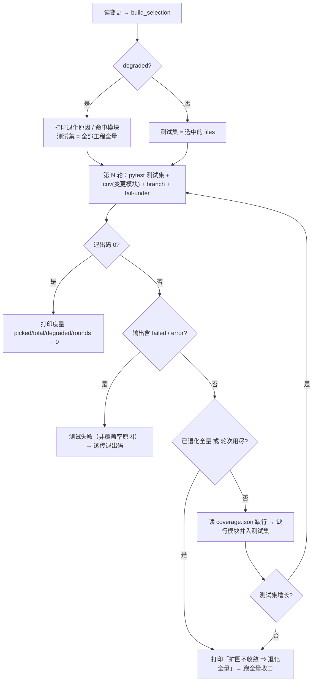

# 01 变更影响分析与细粒度选测 详细设计

> 后端基座与服务化地基 · 13 测试执行粒度与工程效能 · 子任务 01（需求 13-1）· 状态：**定稿（13 项决策已确认）**

[文档首页](../../../../../../文档首页.md) › [13 测试执行粒度与工程效能](../../13_测试执行粒度与工程效能.md) › [01 变更影响分析与细粒度选测](../13_测试执行粒度与工程效能_01_变更影响分析与细粒度选测.md) › 详细设计　|　[需求 13-1](../../../../需求/13_需求_测试执行粒度与工程效能.md#r13-1)　|　[计划](../../../../计划/01_计划_后端基座与服务化地基.md)

## 1. 背景与目标 <a id="goal"></a>

《测试规范》§2.1 第 2 条已强制「按变更范围只跑受影响的部分」，但预检与 CI 的范围推导都只到**工程级**：改 `backend/libs/bms_core/` 任一文件 → 整个 `libs/bms_core/tests`（230 个测试文件）；改 `backend/services/platform/` 任一文件 → 整个 `services/platform/tests`（89 个测试文件）；前端任一文件 → 四包全量（`pnpm run check`）。叠加覆盖率 100% 硬门禁后，表现为「为跑一个点必须跑全量」。

实测底稿见《[测试执行粒度与影响分析评估](../../../../../../资料/知识档案/工程化与质量/测试执行粒度与影响分析评估.md)》：目录同构性良好（`bms_core` 49 个同名目录可一对一映射）、AST 全图构建 0.36s、中位场景只需跑全量的 6%~29%。

**目标**：

1. **选测器单一来源**：一份「变更 → 受影响测试 / 受影响前端包」推导实现，预检与 CI 都只经命令行入口消费，禁止两侧各写规则。
2. **双重收敛**：先按目录同构取候选（含「仅源码有」「仅测试有」差集），再用 AST 导入图收敛到真实引用者（跨目录引用 + 传递依赖闭包）。
3. **基础模块显式退化**：受影响测试超过阈值即退化为工程级全量，并**打印原因与命中模块**，不做假精细。
4. **覆盖率门禁不降级**：选测后按覆盖率报告缺口扩圈重跑（最多 2 轮），不收敛则退化全量并显式说明；门禁口径仍为行 + 分支 100%。
5. **前端按包推导**：按 `workspace:*` 依赖反向闭包推导受影响包，替代「任一前端文件改动即四包全量」。

**边界（不在本任务）**：

- **并行执行**（`pytest -n auto`）、`--self-test` 按需、`backend-test` 与 `service-test` 重复面划界、预算护栏重标定归 [`13_02`](../13_测试执行粒度与工程效能_02_并行执行与重复步骤消除/13_测试执行粒度与工程效能_02_并行执行与重复步骤消除.md)。
- **规范条款与四项护栏断言**（同一来源 / 新增工程必登记 / 退化显式 / 扩圈不静默）归 [`13_03`](../13_测试执行粒度与工程效能_03_口径固化与机器护栏/13_测试执行粒度与工程效能_03_口径固化与机器护栏.md)；本任务只落实现与推导器自测用例。
- **AST 图磁盘缓存**本期不做（见决策 6）。
- **`api-types-check` job** 不接选测（其触发面是契约快照与生成包，规则已足够窄）。
- **`scripts/tools/base-check/**` 变更 → 其护栏用例**的映射不在本任务（存量缺口，登记于 §13）。

## 2. 现状实测 <a id="status"></a>

| 项 | 实测结论 |
| --- | --- |
| 选测器现状 | `scripts/tools/preflight/test_selection.py` **已存在但为半成品**：605 行、**未跟踪于 git**、无用例、未接入预检 / CI；`python scripts/tools/preflight/test_selection.py --changed-file ...` 直接 `TypeError: 'ConcurrentStableDict' object does not support item assignment`（`build_selection` 内 `changed_modules[project.name] = ...` 用了下标赋值，而基座集合类只提供 `.set()`） |
| 半成品第二处缺陷 | 测试文件自身变更判定 `if rel in changed`：`rel` 是「相对 `backend`」而 `changed` 是「相对仓库根」→ **永不成立**，改测试文件不会被选中 |
| 半成品第三处缺陷 | `picked.setdefault(...)`（`ConcurrentStableDict` 无 `setdefault`）、`_format` 中 `if True` 冗余；`ops` 并入后 `project_metrics` 的 `picked` 修正逻辑脆弱 |
| 预检推导 | `scripts/tools/preflight/check-preflight.py:406 _scope_targets` → 返回**测试目录**（工程级）：`backend/libs/bms_core/**` → `libs/bms_core/tests`；`backend/ops/**` → `libs/bms_core/tests/ops`；`backend/services/<服务>/**` → `services/<服务>/tests` |
| 预检执行 | `_run_scoped`（:439）：`uv run pytest -q <目录...> --cov=<变更模块> --cov-branch --cov-fail-under=100`，**无选测、无并行、无扩圈** |
| 预检自测 | `_self_test`（:466）断言上述**目录级**映射与预算护栏；对应护栏用例 `backend/libs/bms_core/tests/boundary/test_preflight_scoping_guard.py`（Kiwi **2311**，3 条 `_scope_targets` 断言 + 3 条预算断言） |
| 后端工程 | 10 个：`libs/bms_core`（测试文件 230 / 源 388）+ 9 服务（`ai` 5/12、`file` 6/11、`identity` 55/48、`notification` 7/12、`platform` 89/83、`report` 4/11、`search` 5/11、`tenant` 8/22、`txn` 8/19），测试文件合计 **417** |
| 前端工程 | 8 个 pnpm 工程：`packages` 四包（`@bms/api-types` / `@bms/core` / `@bms/vue` / `@bms/ui-ep`）+ `apps/desktop` + `modules` 三个（`@bms/module-demo` / `-sample` / `-slot-sample`）；依赖链 `@bms/core` ← `@bms/vue` ← `@bms/ui-ep` ← `desktop` / `modules`，`api-types` 被 `desktop` / `modules` 引用 |
| CI 现状 | `backend-test`：`backend/libs/**`、`ops/**`、`alembic/**`、`config*.toml`、`pyproject.toml`、`uv.lock`、`deploy/**`、`.gitlab-ci.yml` 变更即**全量 10 个 `--cov` 包**；`core-check` = `pnpm run check`（core + api-types + vue + ui-ep 四包）；`desktop-check` = 单包 lint + test:cov；`module-check` 遍历全部 modules |
| CI 镜像 | `ci-backend:py314` 已含 `git` / `python` / `node`（`Dockerfile.backend`）；`ci-frontend:node22` 基于 `node:22-slim`，**无 `git`、无 `python3`** |
| 基准变量写法 | `base-integrity` 已有范式：`--changed "${CI_MERGE_REQUEST_DIFF_BASE_SHA:-${CI_COMMIT_BEFORE_SHA:-origin/main}}"` |
| 覆盖率报告 | CI `backend-test` 已输出 `--cov-report=json:coverage.json` 并归档；预检定向档**未输出 json** |

## 3. 决策确认 <a id="decide"></a>

| # | 事项 | 决策 |
| --- | --- | --- |
| 1 | 选测器落点与形态 | 沿用 `scripts/tools/preflight/test_selection.py` 作**纯推导 CLI**（修复补全）；同目录新增 `run-selected.py` 封装「推导 → 跑 → 扩圈 → 度量」，预检与 CI 只调这两个入口 |
| 2 | 前端推导 | 纳入同一模块：`--scope frontend --format packages`，覆盖 `packages` / `apps` / `modules` 全部 pnpm 工程 |
| 3 | 基础模块退化阈值 | 受影响**测试文件数** > 100 **或** 占工程全量 > 60%，CLI 可覆盖 |
| 4 | 覆盖率扩圈 | 读 `coverage.json` 缺行 → 缺行所属模块并入选测集 → 重跑，最多 **2 轮**；不收敛退化工程级全量并打印原因 |
| 5 | CI 接入面 | `backend-test` + `core-check` + `desktop-check` + `module-check` 四个 job 全接；基准 MR 用 `CI_MERGE_REQUEST_DIFF_BASE_SHA`、main 直推用 `CI_COMMIT_BEFORE_SHA`，取不到即显式退化全量 |
| 6 | AST 图缓存 | 本期不做磁盘缓存（全图 0.36s）；结构留接口，13_02 度量后再定 |
| 7 | Kiwi 用例登记 | **1 条**（13_01 选测器，测试文本内列前后端 / 退化 / 扩圈全部覆盖范围） |
| 8 | 预检 `_scope_targets` | **保留作薄包装**（内部委托 `build_selection`，返回测试文件），既有 Kiwi 2311 的 3 条断言改写、编号不变 |
| 9 | 前端执行方式 | 逐包 `pnpm --filter <包> run <脚本>` 三连，不改各包 `package.json` |
| 10 | 前端收敛口径 | `workspace:*` 依赖反向闭包 + 根级配置变更退化为全部包 |
| 11 | 扩圈门禁目标 | **始终只对最初变更模块**开 100% 门禁；扩圈只扩大测试集 |
| 12 | 前端 job 空集 | rules 不动，job 内取包列表后 early-exit（打印原因、退出 0） |
| 13 | 前端 CI 镜像 | `Dockerfile.frontend` 固化 `git` + `python3`（apt 源换国内镜像），随 `ci-base-build` 重建一次 |

## 4. 交付物清单 <a id="deliver"></a>

### 4.1 后端与工具脚本

```text
bms/scripts/tools/preflight/
├── test_selection.py                               # 修复补全：后端双重收敛 + 前端包推导 + 特殊路径映射 + CLI
└── run-selected.py                                 # 新增：推导 → 跑 pytest → 读覆盖率 → 扩圈重跑 → 度量

bms/backend/libs/bms_core/tests/boundary/
├── test_test_selection_guard.py                    # 新增：推导器自测用例（Kiwi 编号待登记回读）
└── test_preflight_scoping_guard.py                 # 改：3 条 _scope_targets 断言改为「测试文件级」

bms/scripts/tools/preflight/check-preflight.py      # 改：_scope_targets 薄包装 / _run_scoped 调 run-selected / _self_test 断言
bms/scripts/tools/preflight/README.md               # 改：选测器与 run-selected 用法、退化与扩圈口径
```

任务附属三件套（本目录）：`设计/01_详细设计_01_变更影响分析与细粒度选测.md`（本文件）、`实施/01_实施_01_变更影响分析与细粒度选测.md`、`测试/01_测试_01_变更影响分析与细粒度选测.md`。

### 4.2 CI 与镜像

```text
bms/deploy/ci/Dockerfile.frontend                   # 改：apt 换国内源 + 安装 git / python3
bms/.gitlab-ci.yml                                  # 改：backend-test（选测 + 扩圈 + rules 补 preflight 脚本）
                                                    #     core-check / desktop-check / module-check（按包 + early-exit）
```

### 4.3 前端

**无源码改动**（仅 CI 执行面与镜像依赖）。

### 4.4 数据库

**无**（无表 / 列 / 索引 / 迁移）。

## 5. 推导设计 <a id="derive"></a>

### 5.1 后端工程发现 <a id="derive-project"></a>

`discover_projects(backend)`：遍历 `backend/libs/*` 与 `backend/services/*`，**同时含 `src/` 与 `tests/`** 才计入；工程名取 `src/` 下含 `__init__.py` 的首个目录名（通常唯一）。发现结果为空 → 抛 `RuntimeError`（CLI 退出码 1）。

**新增工程自动纳入**：不维护工程白名单，目录到位即被发现——这是 13_03「新增工程必登记」护栏的前提。

### 5.2 目录同构（第一重收敛） <a id="derive-iso"></a>

变更源文件 `src/<包>/<a>/<b>.py` → 同构测试目录 `tests/<a>/`（**包名之后**的目录层级一一对应）：

| 源路径形态 | 同构测试目录 |
| --- | --- |
| `src/<包>/core/exceptions.py` | `tests/core/`（递归取全部 `test_*.py`） |
| `src/<包>/core.py`（包根文件） | `tests/`（仅取该目录下 `*.py`，不递归） |
| `src/<包>/x/y/z.py` | `tests/x/y/`（递归） |

**差集口径（显式）**：

| 场景 | 实测规模 | 处理 |
| --- | --- | --- |
| 源码有目录、测试有同名目录 | `bms_core` 49 组 | 目录同构直接命中 |
| **仅源码有**（无同名测试目录） | `bms_core` 17 个 | 候选为空，**完全依赖 AST 图**收敛；若无任何测试引用且该工程无其他命中 → 走 §5.4 退化 |
| **仅测试有**（无同名源目录） | `bms_core` 4 个 | 目录同构永不命中；仅当**测试文件自身变更**或 AST 图命中时被选中（全量档始终覆盖） |

### 5.3 AST 导入图（第二重收敛） <a id="derive-ast"></a>

1. **模块表**：扫描各工程 `src/` 全部 `.py`（跳过 `__pycache__`），模块名 = 相对源码根的点分路径；`ast.parse` 取 `Import` / `ImportFrom`（相对导入按当前模块层级解析，`from A import b` 同时登记 `A` 与 `A.b`）。
2. **传递依赖闭包**：`closures[M]` = M 直接导入模块 + 其闭包（记忆化 DFS，环上截断，不抛错）。
3. **测试依赖集**：`test_deps[T]` = T 直接导入模块的全部传递闭包（跨工程亦可，模块表全局唯一）。
4. **收敛**：变更模块 `M` 命中条件 = `M ∈ test_deps[T]`（即 T 直接或**传递**引用了 M）→ T 入选。

覆盖率能力等价性：T 传递引用 M ⇒ 运行 T 会加载 M，因此 T 是 M 覆盖率缺口的合法补齐者；这是「选测后覆盖率仍能到 100%」的依据。

### 5.4 基础模块退化 <a id="derive-degrade"></a>

三个退化触发点，**均显式输出**（`degraded=true` + `reason` + `notes`）：

| 触发 | 判定 | 输出 |
| --- | --- | --- |
| 全局变更 | 命中 `backend/pyproject.toml`、`backend/uv.lock`、`.gitlab-ci.yml`（精确）；`backend/alembic/`、`deploy/`（前缀）；`backend/config*.toml`（`backend/config` 前缀 + `.toml` 后缀） | `reason=全局配置 / 迁移 / 部署变更 ⇒ 全量` |
| 基础模块 | 单工程受影响测试文件数 **> 100** 或 **> 工程全量 × 60%** | `notes=<工程>：受影响测试 N/M 超过基础模块阈值（100 个或 60%）⇒ 退化工程级全量` |
| 无引用者 | 该工程有变更模块但选中为空 | `notes=<工程>：变更模块无测试引用者 ⇒ 退化工程级全量` |

阈值可经 `--base-threshold` / `--base-ratio` 覆盖（默认 100 / 0.6）；13_03 的护栏用例改阈值构造退化场景。

### 5.5 特殊路径 <a id="derive-special"></a>

| 变更路径 | 处理 | 理由 |
| --- | --- | --- |
| `backend/ops/**` | 并入 `libs/bms_core/tests/ops` 全部用例；**不入覆盖率门禁** | 与预检现状口径一致；`ops` 脚本不在包内 |
| `backend/libs/<工程>/tests/**` 或 `services/<工程>/tests/**` | **该测试文件必选**（修 `rel` 基准不一致的 bug） | 改测试必须跑该测试 |
| `scripts/tools/preflight/**` | 并入 3 个护栏用例文件（`test_test_selection_guard.py`、`test_preflight_scoping_guard.py`、`test_run_once_guard.py`） | 改选测器 / 预检脚本必须跑其用例；常量 `_PREFLIGHT_TESTS` 单一来源 |
| 其他 `scripts/**`、`bms文档/**`、`frontend/**` | 不影响后端选测 | 非后端变更 |

### 5.6 前端包推导 <a id="derive-frontend"></a>

1. **包发现**：扫描 `frontend/packages/*/package.json`、`frontend/apps/*/package.json`、`frontend/modules/*/package.json`，取 `name` 与 `dependencies` 中值以 `workspace:` 开头的项作为工作区依赖边。目录 → 包名按**最长前缀**匹配。
2. **反向闭包**：初始受影响集 = 直接命中的包；迭代加入「工作区依赖集与受影响集有交集」的包，直至不再增长。例：改 `@bms/core` ⇒ `core` + `vue` + `ui-ep` + `desktop` + 全部 `modules`。
3. **根配置退化**：`package.json`、`pnpm-lock.yaml`、`pnpm-workspace.yaml`、`tsconfig.base.json`、`.npmrc`、根 `scripts/**` 任一变更 ⇒ **全部包**（`degraded=true`，理由「根级配置 / 共享脚本变更」）。
4. **空集**：非前端路径 ⇒ `packages=()`、`degraded=false`。

### 5.7 结果结构 <a id="derive-struct"></a>

```python
@dataclass(frozen=True)
class Selection:
    test_paths: tuple[str, ...]      # 相对 backend（posix）
    cov_modules: tuple[str, ...]     # 只含变更的包内源文件
    degraded: bool
    reason: str                      # 退化主因（空串=未退化）
    picked: int                      # 选中测试文件数
    total: int                       # 全部工程测试文件数
    projects: tuple[ProjectMetrics, ...]   # 逐工程 picked/total/degraded
    notes: tuple[str, ...]           # 逐条说明（退化模块 / ops 并入等）

@dataclass(frozen=True)
class FrontendSelection:
    packages: tuple[str, ...]        # 受影响包名（保 workspace 声明序）
    degraded: bool
    reason: str
    notes: tuple[str, ...]
```

## 6. 接口设计 <a id="api"></a>

### 6.1 `test_selection.py`（纯推导 CLI）

| 参数 | 说明 |
| --- | --- |
| `--root` | bms 仓库根（缺省按脚本位置定位） |
| `--scope` | `backend`（缺省）/ `frontend` |
| `--changed-from` | git 基准（如 `origin/main`、`$CI_COMMIT_BEFORE_SHA`） |
| `--changed-file` | 显式变更文件（可重复），与 `--changed-from` 取并集 |
| `--changed-file-list` | 从文件读变更清单（一行一个，供 CI 兜底） |
| `--force-full` | 强制退化全量（CI 基准不可解析时使用） |
| `--base-threshold` / `--base-ratio` | 退化阈值覆盖 |
| `--format` | `json` / `pytest-args` / `cov-args` / `projects` / `packages` |

输出契约（`--format json`，后端）：

```json
{
  "test_paths": ["libs/bms_core/tests/core/test_x.py"],
  "cov_modules": ["bms_core.core.exceptions"],
  "degraded": false,
  "reason": "",
  "picked": 13,
  "total": 417,
  "projects": {"bms_core": {"picked": 13, "total": 230, "degraded": false}},
  "notes": []
}
```

`--scope frontend --format json`：

```json
{
  "packages": ["@bms/core", "@bms/vue", "@bms/ui-ep", "@bms/desktop", "@bms/module-demo"],
  "degraded": false,
  "reason": "",
  "notes": ["@bms/core 变更 ⇒ workspace 反向闭包 5 个包"]
}
```

退出码：`0` 正常（含「无受影响」）；`1` 推导异常（工程发现为空、参数冲突）；`2` 不变（保留给调用方）。

### 6.2 `run-selected.py`（推导 → 跑 → 扩圈 → 度量）

| 参数 | 缺省 | 说明 |
| --- | --- | --- |
| `--root` | 脚本定位 | 仓库根 |
| `--changed-from` / `--changed-file` / `--changed-file-list` / `--force-full` | — | 透传选测器 |
| `--pytest-cmd` | `uv run pytest` | 执行器前缀（空格分词） |
| `--pytest-cwd` | `backend` | pytest 工作目录（相对 root） |
| `--pytest-arg` | — | 透传 pytest 参数（可重复；13_02 的 `-n auto` 由此传入） |
| `--no-cov` | 关 | 跳过覆盖率门禁 |
| `--cov-fail-under` | `100` | 门禁阈值 |
| `--max-rounds` | `2` | 扩圈轮次上限 |
| `--cov-json` | `backend/coverage.json` | 覆盖率报告落点（相对 root） |
| `--timeout` | 无 | 单轮 pytest 超时（秒） |

行为：



要点：

- **门禁目标恒为最初变更模块**（决策 11）：扩圈只扩大测试集，`--cov` 列表不变。
- **扩圈对象是缺行文件的所属模块**（不止变更模块）：运行时被加载的依赖模块若有缺行，其反向引用测试可能不在集内，并入后可补齐。
- **测试失败优先**：输出中出现 `failed` / `error` 计数即判定为测试失败，不进入扩圈（避免把真失败当覆盖率缺口反复重跑）。
- **退化全量只跑一次**：退化后不再扩圈，直接以最终退出码收口。
- 度量行固定格式（供 13_03 采集）：`[test-selection] picked=13/230 degraded=false rounds=1 cov=1 模块`。

## 7. 预检接入 <a id="preflight"></a>

### 7.1 `_scope_targets` 变薄包装

```python
def _scope_targets(backend, changes) -> tuple[ConcurrentStableList[str], ConcurrentStableList[str]]:
    """按变更推导：返回（测试文件列表, 覆盖率目标模块）——委托选测器（单一来源）。"""
    selection = test_selection.build_selection(backend, changes)
    return ConcurrentStableList(selection.test_paths), ConcurrentStableList(selection.cov_modules)
```

`test_selection` 与 `check-preflight.py` 同目录，`sys.path[0]` 已含脚本目录，直接 `import test_selection`。

### 7.2 `_run_scoped` 改调 `run-selected.py`

1. `changes = _changed_paths(root)`；`test_paths, covs = _scope_targets(backend, changes)`。
2. 打印度量：`选中 X/Y 测试文件（Z%）｜覆盖率目标 M 模块`；退化时打印 `reason` + 每条 `notes`。
3. `test_paths` 为空 → 打印「无后端变更 ⇒ 跳过 pytest」并返回（现状一致）。
4. 构造命令并交给 `_run`（预算护栏仍管单步 / 总体超时）：

```text
python scripts/tools/preflight/run-selected.py --root <root>
    --changed-from origin/main --pytest-cwd backend --pytest-cmd "uv run pytest"
    --cov-fail-under 100 --max-rounds 2 --cov-json backend/coverage.json
```

（`--no-cov` 时传 `--no-cov`；变更集合与选测器内部 `--changed-from origin/main` 同源，两次推导结果一致。）

### 7.3 `_self_test` 断言更新

| 断言 | 新口径 |
| --- | --- |
| 定向含基座测试文件 | 改 `bms_core/db/bootstrap.py` ⇒ 选中文件均以 `libs/bms_core/tests/` 开头，且 `picked < total` |
| 定向含服务测试文件 | 改 `bms_txn/services/recovery.py` ⇒ 选中文件均以 `services/txn/tests/` 开头 |
| ops 变更 | 改 `backend/ops/test_db.py` ⇒ 含 `libs/bms_core/tests/ops/` 下文件 |
| 覆盖率只取包内源文件 | `cov_modules == ("bms_core.db.bootstrap", "bms_txn.services.recovery")` |
| 纯文档 / 前端变更 | 无测试文件、无覆盖率目标 |
| 预算护栏 | 不变（零预算即耗尽） |

## 8. CI 接入 <a id="ci"></a>

### 8.1 基准提取（四处统一片段）

```bash
BASE="${CI_MERGE_REQUEST_DIFF_BASE_SHA:-${CI_COMMIT_BEFORE_SHA:-}}"
case "$BASE" in ""|0000000000000000000000000000000000000000) BASE="" ;; esac
if [ -z "$BASE" ]; then
  echo "[test-selection] 变更基准不可解析 ⇒ 显式退化全量"
  FORCE="--force-full"
fi
```

### 8.2 `backend-test`

保留库清理与 `uv sync --frozen --reinstall`，测试段改为：

```bash
cd "$CI_PROJECT_DIR"
python scripts/tools/preflight/run-selected.py --root . ${BASE:+--changed-from "$BASE"} $FORCE \
  --pytest-cwd backend --pytest-cmd "uv run pytest" --cov --cov-fail-under 100 \
  --max-rounds 2 --cov-json backend/coverage.json
```

- `artifacts.paths` 仍为 `backend/coverage.json`（扩圈各轮覆盖写最终轮）。
- `coverage:` 正则保留（`run-selected.py` 透传 pytest 的 `TOTAL` 行）。
- **rules 增补** `scripts/tools/preflight/**/*`（改选测器 / 预检脚本必须跑护栏用例；与 `tooling-lint` 的触发面互补）。

### 8.3 `core-check` / `desktop-check` / `module-check`

三个 job 统一前置：

```bash
PACKAGES=$(python3 scripts/tools/preflight/test_selection.py --root . --scope frontend \
  --format packages ${BASE:+--changed-from "$BASE"} $FORCE)
```

| job | 包范围 | 空集处理 | 执行 |
| --- | --- | --- | --- |
| `core-check` | `@bms/core` / `@bms/vue` / `@bms/ui-ep` / `@bms/api-types` 与本 job 的交集 | 打印「无受影响核心包」→ `exit 0` | 逐包 `typecheck` → `lint` → `test` |
| `desktop-check` | `@bms/desktop` | 同上 | `lint` → `test:cov` |
| `module-check` | `@bms/module-*` | 逐包判断、逐包跳过 | 逐包 `lint` → `typecheck` → `test` |

### 8.4 `Dockerfile.frontend`

```dockerfile
RUN sed -i 's|deb.debian.org|mirrors.tuna.tsinghua.edu.cn|g' /etc/apt/sources.list.d/debian.sources \
 && apt-get update \
 && apt-get install -y --no-install-recommends git python3 \
 && rm -rf /var/lib/apt/lists/*
```

镜像变更由 `ci-base-build`（`deploy/ci/Dockerfile.frontend` 在触发路径内）重建；`ci-base-build` 只对 main 生效，故**推送后需手动跑一次 web 流水线**确认前端 job 可用（登记于实施记录）。

## 9. 测试设计 <a id="test"></a>

### 9.1 用例与覆盖映射

用例文件：`backend/libs/bms_core/tests/boundary/test_test_selection_guard.py`（护栏用例与 `test_preflight_scoping_guard.py` 同目录，CI 与预检都能跑到）。

| 组 | 用例（函数） | 断言要点 |
| --- | --- | --- |
| A 工程发现 | `test_discover_projects_libs_and_services` | 10 个工程；`libs` 在前、服务按名排序；缺 `src`/`tests` 的目录被跳过 |
| A 目录同构 | `test_isomorphic_candidates_hit_same_named_dir` | `core/exceptions.py` ⇒ 选中的候选均落在 `tests/core/` |
| A 差集 | `test_isomorphic_candidates_empty_without_test_dir` | 构造不存在同名测试目录时候选为空（不抛错） |
| B AST 传递 | `test_transitive_import_pulls_test` | 临时包 `a → b → c`，测试仅 import `a`，变更 `c` 仍选中该测试 |
| B 跨目录 | `test_cross_directory_reference` | 真实仓库：变更 `core/exceptions.py` ⇒ `picked > 100` 且 `degraded=true` |
| B 测试自身 | `test_changed_test_file_always_selected` | 变更任意 `tests/...py` ⇒ 该文件在结果内（回归半成品 bug） |
| C 退化 | `test_degrade_over_threshold` | `--base-threshold=1` ⇒ `degraded=true` 且 `test_paths == 全量` |
| C 无引用者 | `test_degrade_when_no_referrer` | 临时工程 + 无引用模块 ⇒ `degraded=true`、`notes` 含原因 |
| C 全局 | `test_degrade_on_global_change` | `pyproject.toml` / `deploy/x.yml` / `backend/config.toml` ⇒ 全量 |
| C 显式 | `test_degrade_reason_visible` | `reason` 非空、`notes` 逐条可读（不静默） |
| D 特殊 | `test_ops_change_maps_to_ops_tests` | 仅 `backend/ops/` 变更 ⇒ 选中 `tests/ops/` 文件、`cov_modules` 为空 |
| D 特殊 | `test_preflight_script_change_selects_guards` | 改 `scripts/tools/preflight/run-selected.py` ⇒ 3 个护栏文件入选 |
| D 空集 | `test_docs_and_frontend_change_yields_empty` | 纯文档 / 前端 ⇒ `picked == 0` 且 `degraded=false` |
| E 前端发现 | `test_frontend_package_discovery` | 8 个包、名称与目录一致、workspace 依赖边正确 |
| E 前端闭包 | `test_frontend_dependency_reverse_closure` | 改 `@bms/core` ⇒ 含 `vue`/`ui-ep`/`desktop`/全部 modules |
| E 前端退化 | `test_frontend_root_config_degrades_all` | `pnpm-lock.yaml` ⇒ 全部包、`degraded=true` |
| E 前端空集 | `test_frontend_unrelated_change_empty` | `backend/**` ⇒ `packages=()` |
| F 扩圈 | `test_expand_adds_tests_for_missing_modules` | 构造 coverage.json（缺行模块 N）⇒ 返回 N 的反向引用测试 |
| F 扩圈 | `test_expand_no_growth_signals_full` | 无新增测试 ⇒ 返回空（调用方据此退化全量） |
| G 一致性 | `test_cli_json_matches_library` | 同一 `--changed-file` 集合：CLI JSON 与 `build_selection` 字段一致 |

### 9.2 验收映射

| 任务完成标准 | 落点 |
| --- | --- |
| 同一变更预检与 CI 推导一致 | 两侧同调 `test_selection.build_selection` / `run-selected.py`；`test_cli_json_matches_library` 锁定 |
| 常见变更测试量显著低于全量且无漏测 | `test_transitive_import_pulls_test` + `test_cross_directory_reference` + 实施记录实测中位数 |
| 覆盖率门禁仍为行 + 分支 100% | `--cov-branch --cov-fail-under=100` 两处保留；扩圈不收敛退化全量（`test_expand_no_growth_signals_full`） |
| 退化路径有显式输出 | `test_degrade_reason_visible` + 预检 / CI 打印度量行 |
| 推导器有自测用例并纳入预检 | 本用例文件 + 预检 `--self-test` 断言 + `backend-test` rules 增补 `scripts/tools/preflight/**` |

### 9.3 Kiwi 用例登记

按「一个任务一条」约定登记 **1 条**，分类沿用「平台骨架」、优先级 `P2`、状态 `CONFIRMED`、标签「自动化」；`text` 写覆盖范围（后端目录同构 / AST 收敛 / 退化 / ops / 前端闭包 / 扩圈）与自动化文件路径。**编号以平台回读为准**，登记后回填代码 `@pytest.mark.kiwi_id(<编号>)` 与任务测试记录。

## 10. 登记落点 <a id="register"></a>

| 落点 | 内容 |
| --- | --- |
| 计划表 | 13_01 进度（状态 / 完成日期，唯一落点） |
| 任务文档 | 不承载进度（仅关联需求不变） |
| `scripts/tools/preflight/README.md` | 选测器与 `run-selected.py` 用法、退化与扩圈口径、度量行格式 |
| 《测试规范》§2.1 | **不改**（条款固化归 13_03） |
| 文档索引 | `文档域路由索引.md` 由 `gen-doc-index.py` 重跑生成，不手改 |
| 实施 / 测试记录 | 本目录 `实施/`、`测试/` 各一份 |

## 11. 实施步骤 <a id="steps"></a>

1. 先登记 Kiwi 用例取得编号（平台回读），再写用例代码。
2. 修 `test_selection.py`：修 3 处半成品缺陷、补前端推导、特殊路径映射、`--scope` / `--force-full` / 新 format。
3. 新增 `run-selected.py`：推导 → pytest → 覆盖率缺口解析 → 扩圈 → 退化 → 度量。
4. 预检接入：`_scope_targets` 薄包装、`_run_scoped` 调 `run-selected.py`、`_self_test` 断言更新、`README.md`。
5. 用例：新增 `test_test_selection_guard.py`；改 `test_preflight_scoping_guard.py` 三条断言。
6. CI：`Dockerfile.frontend`、`.gitlab-ci.yml` 四个 job 与 `backend-test` rules。
7. 验证：定向用例 + 选测器自测 + `ruff check` / `ruff format --check` / `pyright` + 预检定向档。
8. 回写：计划表、实施记录、测试记录。

## 12. 边界与开放项 <a id="open"></a>

| # | 项 | 归口 |
| --- | --- | --- |
| 1 | 动态导入 / `importlib` / 字符串化导入 AST 抓不到 | 扩圈循环 + 显式退化兜底；13_03 护栏登记 |
| 2 | 并行执行 `-n auto` 与预算重标定 | 13_02 |
| 3 | `--self-test` 按需（19 个自测每轮全跑） | 13_02 |
| 4 | `backend-test` 与 `service-test` 重复面划界 | 13_02 |
| 5 | AST 图磁盘缓存 | 13_02 度量后再定 |
| 6 | `scripts/tools/base-check/**` 变更 → 其护栏用例映射 | 存量缺口，13_03 一并登记 |
| 7 | `api-types-check` 接选测 | 不在本任务（触发面已窄） |
| 8 | 预检定向档预算（单步 120s / 总体 180s）在退化全量时仍可能触发 | 13_02 重标定 |

## 13. 对齐记录 <a id="align"></a>

| 日期 | 事项 | 处置 |
| --- | --- | --- |
| 2026-10-19 | 半成品 `test_selection.py` 已存在（未跟踪、跑不通、无用例） | 采「修复沿用 + 新增薄包装」路线（决策 1），不重写、不迁移目录 |
| 2026-10-19 | 既有 Kiwi 2311 的 3 条 `_scope_targets` 断言基于目录级结果 | `_scope_targets` 保留为薄包装、断言改文件级，编号不变（决策 8） |
| 2026-10-19 | 前端镜像缺 `git` / `python3`，无法调 Python 选测器 | `Dockerfile.frontend` 固化两者（决策 13） |
| 2026-10-19 | 执行器 `capture_output` 收集输出 ⇒ 整轮结束前日志无进度（全量 279s 空窗） | 实施期补强：改 `Popen` 逐行实时透传（§6.2 行为不变，仅可观测性）；`TOTAL` 行仍在日志中，CI `coverage:` 正则不受影响 |
| 2026-10-19 | 预检执行路径直接消费 `Selection`（需 reason / notes / total 度量），`_scope_targets` 仅返回两列表 | `_run_scoped` 直接调 `build_selection`；`_scope_targets` 保留供护栏用例与自测（同一实现，无口径分叉） |
| 2026-10-19 | Python 3.11 兼容（`ruff format` 生成的 `except A, B` 为 3.14 语法，前端镜像 python3 为 3.11） | 拆成多个单类型 `except`；`ast.parse(feature_version=(3, 11))` 验证 |
