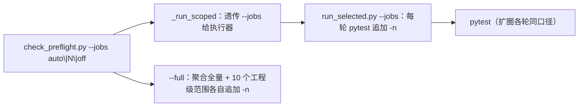

# 02 并行执行与重复步骤消除 详细设计

> 后端基座与服务化地基 · 13 测试执行粒度与工程效能 · 子任务 02（需求 13-2）· 状态：**定稿（13 项决策已确认）**

[文档首页](../../../../../../文档首页.md) › [13 测试执行粒度与工程效能](../../13_测试执行粒度与工程效能.md) › [02 并行执行与重复步骤消除](../13_测试执行粒度与工程效能_02_并行执行与重复步骤消除.md) › 详细设计　|　[需求 13-2](../../../../需求/13_需求_测试执行粒度与工程效能.md#r13-2)　|　[计划](../../../../计划/01_计划_后端基座与服务化地基.md)

## 1. 背景与目标 <a id="goal"></a>

`13_01` 已把「变更 → 受影响测试」收敛到**文件级**（预检与 CI 共用 `test_selection.py` + `run_selected.py`），但执行侧仍是**串行**：

- `pytest-xdist` 已在 `backend/pyproject.toml` 声明却从未启用（实测全量 279s → `-n auto` 44s）；
- 预检 7 个 `--self-test` 步（护栏自检）每轮全跑，与本次变更无关；
- CI `backend-test`（选测兜底）与 `service-test`（服务级）在共享底座变更时同时拉起，同一批用例跑两遍；
- 定向档预算（单步 120s / 总体 180s）**低于真实耗时**——本次实测已被单步超时中止（总 156.6s）。

**目标**：

1. **并行执行**：定向档与全量档均启 `-n auto`（`--jobs auto|N|off` 可配可关），并行下用例结果与串行一致；
2. **自测按需**：`--self-test` 只在变更触及对应脚本或其依赖时执行，`--fast` / `--full` 保持全跑；
3. **重复面划界**：`service-test` 仅在**本服务有直接变更**时跑测试；共享底座变更由 `backend-test` 兜底；
4. **预算对齐**：单步 / 总体上限按实测重新标定，不再因真实耗时被触发。

**边界（不在本任务）**：

- 规范条款与四项机器护栏（同一来源 / 新增工程必登记 / 退化显式 / 扩圈不静默）归 [`13_03`](../../13_测试执行粒度与工程效能_03_口径固化与机器护栏/13_测试执行粒度与工程效能_03_口径固化与机器护栏.md)；
- 选测推导规则、退化阈值、扩圈轮次不变（`13_01` 口径）；
- 全量覆盖率存量的 2276 行缺口属**基线状态**（见 §2.6），本任务不改覆盖面；
- 顺序依赖用例的用例级修复：本任务只保证「当前全部用例并行通过」，将来新增的顺序敏感用例由用例自身修（§12）。

## 2. 现状与实测 <a id="status"></a>

实测环境：本机 Windows / 16 逻辑核 / SQLite 文件库（`config.test.toml` 指向 `database/bms/test`）。

### 2.1 串行与并行耗时 <a id="status-time"></a>

| 范围 | 串行 | `-n auto` | 说明 |
| --- | --- | --- | --- |
| 后端全量（10 个 `testpaths`，无 cov） | 279s | **44s** | 2939 passed / 57 skipped，结果一致 |
| 后端全量（10 包覆盖率门禁） | 298s | **52s** | `-n 4` 与 `-n auto` 的 TOTAL 完全同值（合并正常） |
| `libs/bms_core/tests`（无 cov） | 63s | **26s** | 1778 passed |

### 2.2 并行失败与根因 <a id="status-fail"></a>

| 阶段 | 结果 | 结论 |
| --- | --- | --- |
| 首次 `-n auto`（未做任何隔离） | **67 failed**（集中在 `services/identity`） | 不可直接用 |
| `--dist loadfile` | 35 failed | 仍不可用 ⇒ 分发粒度不是根因 |
| identity 按目录打 `xdist_group` + 共享库 | 10~14 failed | 仍不可用 ⇒ 分组只是掩盖 |
| identity 全部用例绑定单 worker | 312 passed / **82s** | 全绿但拖慢全量（瓶颈） |
| **worker 级 SQLite 目录隔离** | **0 failed / 44s** | 根因命中，方案成立 |

**根因**：SQLite **文件库共享同一路径**（`database/bms/test/*.db`）。并行 worker 之间互相看到对方写入的行，随机破坏「用例内假设表为空 / 列表首行即新建行」这类断言。identity 用例最密集，故最先生效。会话级 `platform_db_url` 已用 `tmp_path_factory`（各 worker 独立），但**租户库 / 归档库**仍由配置 `sqlite_dir` 派生到同一目录。

**修复验证**：在测试基座按 `PYTEST_XDIST_WORKER` 注入独立 `BMS_DATABASE__SQLITE_DIR` 后，全量 `-n auto` **2939 passed / 44s / 0 failed**；串行行为不变（无 worker 变量时不注入，沿配置原值）。

### 2.3 覆盖率与并行 <a id="status-cov"></a>

| 命令 | TOTAL | 结论 |
| --- | --- | --- |
| 全量 10 包，串行 | 93.36%（2276 missed） | 基线 |
| 全量 10 包，`-n 4` | 93.34%（2281 missed） | 与串行同值 |
| 全量 10 包，`-n auto` | 93.34%（2281 missed） | 与串行同值 |

并行下 `pytest-cov` 的 worker 数据合并正常，缺口与「是否并行 / 并发度」无关。

### 2.4 定向档预算被真实耗时触发 <a id="status-budget"></a>

| 项 | 实测 |
| --- | --- |
| 定向档一次（改动 `bms_core.testing.fixtures`） | **单步 120s 超时中止**，整体 156.6s（静态约 40s + 定向测试 ≥120s） |
| `--fast` 档 | 35.8s（其中 7 个 `--self-test` 合计约 2.2s） |
| 静态段 | `ruff check` + `format --check` + `pyright`（pyright 约 23.6s）+ `scripts/tools` 两项 |

### 2.5 `--self-test` 步骤与依赖 <a id="status-selftest"></a>

| 步骤（脚本） | 仓内依赖（import / 读取） |
| --- | --- |
| `check_system_fields.py --self-test` | 无（纯标准库） |
| `check_env_example.py --self-test` | 无（自测用内置文本；正文读 `backend/.env.example`、`deploy/.env.example`） |
| `check_backend_base.py --self-test` | `bms_core.core.concurrent` / `bms_core.core.serialization` |
| `check_service_boundaries.py --self-test` | `bms_core.boundary.*` / `bms_core.core.concurrent` |
| `check_bare_collections.py --self-test` | `bms_core.core.concurrent` |
| `check_docs_scope.py --self-test` | `bms_core.core.concurrent` |
| `check_prototype_review.py --self-test` | `bms_core.core.concurrent` |

### 2.6 覆盖率缺口定位与修复 <a id="status-gap"></a>

全量 10 包覆盖率长期停在 **93.36%**（串行 / 并行同值，2261~2281 行缺口），集中在 `config.py`、
`exceptions.py`、`error_codes.py`、`core/objects/*` 等 —— **不是测试缺口，而是采集时机缺口**：

| 证据 | 结论 |
| --- | --- |
| `coverage run -m pytest`（解释器启动即追踪）跑同一批用例 | **29249 行 / 0 缺失 / 5056 分支 / 0 未覆盖 = 100%** |
| `pytest --cov`（探针在 `pytest_configure` 启动） | 93.36%（conftest 与 `-p` 插件在探针前导入被测模块） |
| 加一个 testpath（如 `services/txn/tests`）后 `error_codes.py` 从 100% 掉到 0% | 多加载一个服务 conftest 就把更多模块提前导入 |

**根因**：`addopts` 的 `-p bms_core.testing.plugin` 与 10 个服务 conftest 在
`pytest_load_initial_conftests` 阶段顶层导入应用与 `bms_core`，全部早于 pytest-cov 的探针启动，
这些模块的「导入期执行行」永久漏计。处置见 §5.5 与决策 15（采集前置），修复后全仓 **100%**。

### 2.7 CI 重复面 <a id="status-ci"></a>

| 变更形态 | `backend-test` | 服务子流水线 `service-test` | 重复 |
| --- | --- | --- | --- |
| 仅 `backend/services/<S>/**` | 不触发 | `<S>` 跑本服务全量 | 无 |
| 仅 `backend/libs/**`、`backend/ops/**`、`config*.toml` | 触发（选测：受影响文件） | 不触发 | 无 |
| `backend/uv.lock` / `backend/Dockerfile` | 触发（**退化全量**） | **9 个服务各跑全服务测试** | **有（主重复面）** |
| 同时改 `libs` + `services/<S>` | 触发（含 `<S>` 受影响测试） | `<S>` 跑本服务全量 | 有（次要） |

## 3. 决策确认 <a id="decide"></a>

| # | 事项 | 决策 |
| --- | --- | --- |
| 1 | 并行开关形态 | 预检与执行器**统一** `--jobs auto\|N\|off`，缺省 `auto`；两侧同一解析实现 |
| 2 | worker 级 SQLite 隔离落点 | 测试基座 `bms_core/testing/fixtures.py` 的 `isolate_settings` 注入（存量用例零改动） |
| 3 | 并行分发模式 | 默认 `--dist load`，不额外分组；将来顺序敏感用例由用例自身修 |
| 4 | 自测按需触发口径 | 「脚本自身 + 显式声明依赖前缀」映射表；命中即跑 |
| 5 | 自测跳过输出 | **逐条**打印「跳过（变更未触及 …）」，不静默 |
| 6 | CI 重复面划界 | `service-test` 判本服务是否有**直接变更**，无则跳过测试（`backend-test` 兜底）；build / release 照常 |
| 7 | `backend-test` 反向剔除 | **不剔除**，保持选测器全权决定 |
| 8 | 定向档预算 | 单步 **300s** / 总体 **420s** |
| 9 | 全量档预算 | 单步 **900s** / 总体 **1800s** |
| 10 | Kiwi 用例登记 | **1 条**（并入全部断言） |
| 11 | CI 并行取值 | 显式传 `--jobs auto`（与本地同口径） |
| 12 | 全量档工程级范围 | 也按 `--jobs` 并行 |
| 13 | 护栏用例落点 | 新增 `backend/libs/bms_core/tests/boundary/test_parallel_guard.py` |
| 14 | 插件入口覆盖率（**已撤销**） | 原「排除 `bms_core.testing.plugin`」在决策 15 落地后不再需要：采集前置后入口可观测，实测 100% |
| 15 | 覆盖率采集机制 | 测试启动插件在**被测模块导入前**启动采集（env 驱动），每进程一份数据；`coverage_gate.py` 合并 + 判定「行 + 分支 100%」；预检与 CI 共用（替代 `pytest --cov` 口径） |

## 4. 交付物清单 <a id="deliver"></a>

### 4.1 后端与工具脚本

```text
bms/scripts/tools/preflight/
├── parallel_jobs.py                     # 新增：--jobs 值 → pytest 参数（预检 / 执行器单一来源）
├── coverage_gate.py                     # 新增：合并并行采集数据 + 导出 JSON + 判定行/分支 100%
├── test_selection.py                    # 改：新增 changed_services() 与 --format changed-services
├── run_selected.py                      # 改：--jobs + 早启动采集（env）+ 门禁脚本判定（去 --cov）
├── check_preflight.py                   # 改：--jobs / 自测按需 / 预算标定 / 全量档并行与采集判定
└── README.md                            # 改：并行开关、自测按需、预算新值、重复面、采集口径

bms/backend/
├── bms_testing_plugin.py                # 新增：最早启动覆盖率采集 + 注册测试基座夹具（addopts 的 -p 入口）
└── pyproject.toml                       # 改：addopts 改 -p bms_testing_plugin

bms/backend/libs/bms_core/src/bms_core/testing/
├── fixtures.py                          # 改：worker_sqlite_dir() + isolate_settings 注入
└── plugin.py                            # 改：夹具注册 + basetemp（改为被启动插件调用）

bms/backend/libs/bms_core/tests/
├── boundary/test_parallel_guard.py      # 新增：并行 / 自测按需 / 预算 / 重复面 / 采集前置护栏（Kiwi 2318）
├── core/test_config.py                  # 改：2 处 sqlite_dir 断言排除并行注入
└── ops/test_ci_pipeline.py              # 改：service-test 断言改为采集 + 门禁脚本口径

bms/backend/services/platform/tests/permission/test_field_permission.py  # 改：补「未登记工厂 ⇒ 字段全开」分支用例

bms/deploy/ci/templates/backend-service.yml   # 改：service-test 判直接变更 + 采集/门禁脚本
bms/.gitlab-ci.yml                            # 改：backend-test 传 --jobs auto + coverage 正则
```

### 4.2 任务附属三件套（本目录）

`设计/01_详细设计_02_并行执行与重复步骤消除.md`（本文件）、`实施/01_实施_02_并行执行与重复步骤消除.md`、`测试/01_测试_02_并行执行与重复步骤消除.md`。

### 4.3 前端 / 数据库

**无**（无前端源码、无表 / 列 / 索引 / 迁移）。

## 5. 并行执行设计 <a id="parallel"></a>

### 5.1 开关语义 <a id="parallel-flag"></a>

`scripts/tools/preflight/parallel_jobs.py`（新增，预检与执行器共用）：

| 输入值 | 输出参数 | 说明 |
| --- | --- | --- |
| `auto`（缺省） | `-n auto` | 按逻辑核数启动 worker |
| 正整数（如 `4`） | `-n 4` | 固定并发 |
| `off` / `none` / `0` / 空串 | 空 | 串行（可关） |
| 其他 | `ValueError` | 预检捕获后按「参数非法」失败并提示合法取值 |

```python
def jobs_args(value: str) -> tuple[str, ...]:
    """把 --jobs 取值转换为 pytest 并行参数（空元组 = 串行）。"""
```

### 5.2 参数传递链路 <a id="parallel-chain"></a>



- 预检 `--jobs` 只解析一次，统一决定「定向档执行器参数」与「全量档两条 pytest 调用」；
- 扩圈重跑的每一轮都使用同一并行参数（不因轮次降级）；
- 日志显式打印档位：`[preflight] 并行：-n auto` / `串行（--jobs off）`，便于排障；
- `run_selected.py --jobs` 同时供 CI 直接调用。

### 5.3 worker 级 SQLite 库隔离 <a id="parallel-sqlite"></a>

`bms_core/testing/fixtures.py`：

```python
_SQLITE_BASETEMP: str = ""   # 由 plugin.pytest_configure 注入（xdist worker 的 basetemp）

def configure_sqlite_basetemp(value: str) -> None:
    """记录 pytest basetemp（xdist worker 下为 <basetemp>/popen-gwN）。"""

def worker_sqlite_dir() -> str:
    """返回本 worker 专属 SQLite 目录；串行（无 PYTEST_XDIST_WORKER）返回空串。

    目录 = <basetemp>/sqlite-<worker>（无 basetemp 时用系统临时目录下 bms-pytest-sqlite/<worker>）；
    首次解析自动建目录。
    """
```

注入点：`isolate_settings` 在清空 `BMS_` 环境变量后：

```python
sqlite_dir = worker_sqlite_dir()
if sqlite_dir:
    monkeypatch.setenv("BMS_DATABASE__SQLITE_DIR", sqlite_dir)
```

`bms_core/testing/plugin.py` 新增：

```python
def pytest_configure(config: pytest.Config) -> None:
    """xdist worker 的 basetemp 交给测试基座，派生 worker 专属 SQLite 目录。"""
    configure_sqlite_basetemp(config.option.basetemp or "")
```

**边界与理由**：

- 串行不注入（`PYTEST_XDIST_WORKER` 不存在）⇒ 本地 `pytest <目录>` 行为与改造前一致；
- 只改 `sqlite_dir`，平台 / 租户 / 归档三条 SQLite 目标全部随基址切换，不触碰连接串模板口径
  （《AI开发规范》「配置唯一来源」）；
- 会话级 `platform_db_url` 已用 `tmp_path_factory`，不受影响；MySQL / PostgreSQL / 达梦用例不读该键；
- 2 处存量断言（`test_config.py` 的 `sqlite_dir` 默认值）显式 `monkeypatch.delenv` 后断言，语义仍是「配置默认值」。

### 5.4 分发模式与稳定性结论 <a id="parallel-dist"></a>

- `--dist load`（缺省，按用例分发）负载最均衡；实测隔离库后全量 0 失败；
- 不引入 `xdist_group`：identity 绑单 worker 会带来 82s 串行瓶颈，且属掩盖症状；
- `--dist loadfile` 无需启用（不能替代根因修复）。

### 5.5 与覆盖率门禁的关系 <a id="parallel-cov"></a>

- `pytest-cov` 的 worker 数据由插件自动合并（实测 `-n 4` 与 `-n auto` TOTAL 同值）；
- 覆盖率门禁口径不变（变更模块行 + 分支 100%）；
- 扩圈各轮并行执行，扩圈判定读最终一轮 `coverage.json`（`13_01` 行为不变）；
- **采集前置（决策 15，替代原「插件入口排除」）**：
  1. 新增 `backend/bms_testing_plugin.py` 作为 `addopts` 的 `-p` 入口，**模块顶层只依赖标准库与 coverage**，
     在导入 `bms_core` 之前按 env（`BMS_COVERAGE_DATA` / `BMS_COVERAGE_SOURCE`）启动采集；
  2. 每个进程（含 xdist worker）落一份 `<data-file>.<pid>`，`pytest_sessionfinish` 与 `atexit` 双保险落盘；
  3. 结束后由 `scripts/tools/preflight/coverage_gate.py` 合并 → 导出 JSON → 判定「行 + 分支 100%」；
     预检定向 / 全量、CI `backend-test` / `service-test` 全部只经它判定；
  4. 效果：`bms_core.testing.fixtures` 与 `bms_core.testing.plugin` 均为 **100%**（不再需要任何排除），
     全仓 10 包由 93.36% 升至 **100%**（628 文件、0 缺行、0 缺分支）；
  5. 代价：`pytest --cov` 不再作为门禁口径（采集由插件负责，判定由 gate 负责）；`--jobs` 并行不受影响。

## 6. `--self-test` 按需设计 <a id="selftest"></a>

### 6.1 触发映射表 <a id="selftest-map"></a>

`check_preflight.py` 内以数据表登记（`_SelfTest(label, script, deps)`），`deps` 为「脚本自身 + 依赖路径前缀」：

| 步骤 | 脚本（相对仓库根） | 依赖前缀 |
| --- | --- | --- |
| `check_system_fields --self-test` | `scripts/tools/base_check/check_system_fields.py` | 脚本自身 |
| `check_env_example --self-test` | `scripts/tools/base_check/check_env_example.py` | 脚本自身 |
| `check_backend_base --self-test` | `scripts/tools/base_check/check_backend_base.py` | 脚本自身 + `backend/libs/bms_core/` |
| `check_service_boundaries --self-test` | `scripts/tools/base_check/check_service_boundaries.py` | 脚本自身 + `backend/libs/bms_core/` |
| `check_bare_collections --self-test` | `scripts/tools/base_check/check_bare_collections.py` | 脚本自身 + `backend/libs/bms_core/` |
| `check_docs_scope --self-test` | `scripts/tools/base_check/check_docs_scope.py` | 脚本自身 + `backend/libs/bms_core/` |
| `check_prototype_review --self-test` | `scripts/tools/base_check/check_prototype_review.py` | 脚本自身 + `backend/libs/bms_core/` + `bms文档/设计/原型设计/` |

判定（纯函数，便于护栏用例直接断言）：

```python
def self_test_selected(entry: _SelfTest, changes: tuple[str, ...]) -> bool:
    """变更集命中脚本自身或任一依赖前缀 ⇒ 执行该自测。"""
```

### 6.2 档位口径 <a id="selftest-mode"></a>

| 档位 | 自测执行 |
| --- | --- |
| 定向档（缺省） | **按需**（映射表命中才跑） |
| `--fast` | **全跑**（口径不变） |
| `--full` | **全跑**（口径不变） |

### 6.3 输出 <a id="selftest-output"></a>

- 执行：保持现有逐条步骤输出；
- 跳过：`[preflight] 基座：check_system_fields --self-test` + `  跳过（变更未触及 scripts/tools/base_check/check_system_fields.py 及其依赖）`；
- 变更基准不可解析（两个 git 命令均失败）⇒ **全跑**并打印「变更不可判定 ⇒ 自测全跑」，不静默跳过。

## 7. CI 重复面划界 <a id="ci"></a>

### 7.1 判定单一来源：`--format changed-services` <a id="ci-source"></a>

`test_selection.py` 新增**直接变更服务**输出（不含依赖闭包，与 `picked` 语义区分）：

```python
def changed_services(changes: Iterable[str]) -> tuple[str, ...]:
    """变更集中直接命中的后端服务名（backend/services/<服务>）。

    与 build_selection 的区别：不做目录同构 / AST 闭包展开，只回答「本服务是否被直接改动」，
    供 CI 服务子流水线判断「测试是否已由 backend-test 兜底」。
    """
```

CLI：`--scope backend --format changed-services`（缺席参数时输出空行，退出码 0）。

### 7.2 `service-test` 改动 <a id="ci-service-test"></a>

`deploy/ci/templates/backend-service.yml` 的 `service-test` 在清理测试库**之前**加判定：

```bash
BASE="${CI_MERGE_REQUEST_DIFF_BASE_SHA:-${CI_COMMIT_BEFORE_SHA:-}}"
case "$BASE" in ""|0000000000000000000000000000000000000000) BASE="" ;; esac
if [ -z "$BASE" ]; then
  echo "[service-test] 变更基准不可解析 ⇒ 保守执行本服务测试"
else
  if CHANGED=$(python3 scripts/tools/preflight/test_selection.py --root . --scope backend \
       --changed-from "$BASE" --format changed-services); then
    case " $CHANGED " in
      *" $SERVICE "*) echo "[service-test] $SERVICE 有直接变更 ⇒ 执行本服务测试" ;;
      *) echo "[service-test] $SERVICE 无直接变更（仅共享底座变更，测试与覆盖率由 backend-test 兜底）⇒ 跳过测试"
         exit 0 ;;
    esac
  else
    echo "[service-test] 选测判定失败 ⇒ 保守执行本服务测试"
  fi
fi
```

| 场景 | 行为 |
| --- | --- |
| `services/<S>/**` 直接变更 | 照常跑（含覆盖率门禁） |
| 仅 `uv.lock` / `Dockerfile` / `libs/**` 等共享路径 | 跳过测试、**退出 0**；`service-build` / `service-release` 仍按镜像档继续 |
| 基准不可解析 / 判定命令失败 | **保守跑**（不漏测） |
| 子流水线镜像 | `ci-backend:py314`（Python 3.14 + git，`13_01` 已统一），可直接调选测器 |

### 7.3 `backend-test` 改动 <a id="ci-backend-test"></a>

- `run_selected.py` 调用追加 `--jobs auto`（决策 11）；
- 其余 rules / 清理 / 归档不变；**不反向剔除**服务测试（决策 7）。

## 8. 预算护栏标定 <a id="budget"></a>

| 档位 | 现值（单步 / 总体） | 新值（单步 / 总体） | 依据 |
| --- | --- | --- | --- |
| 定向档（缺省） | 120s / 180s | **300s / 420s** | 静态约 40s + 定向测试 20~60s；最坏路径（退化全量 + 扩圈两轮）约 2~3 分钟，留余量 |
| 全量档（`--full`） | 600s / 1200s | **900s / 1800s** | 并行全量约 52s + 10 个工程级范围（并行）数分钟；CI 镜像 / 低配机器留余量 |

- 仍可用 `--step-seconds` / `--budget-seconds` 覆盖；
- 超时行为不变（立即中止、提示「全量交 CI」、计入失败）；
- `README.md` 与脚本 docstring 同步新值。

## 9. 测试设计 <a id="test"></a>

### 9.1 Kiwi 用例登记 <a id="test-kiwi"></a>

按「一个任务一条」登记 **1 条**：分类「平台骨架」、优先级 `P2`、状态 `CONFIRMED`、标签「自动化」；`text` 覆盖「并行开关与 worker 库隔离 / 自测按需 / 预算标定 / CI 重复面判定」。**编号以平台回读为准**，登记后回填 `@pytest.mark.kiwi_id(<编号>)` 与任务测试记录。

### 9.2 用例清单（`test_parallel_guard.py`） <a id="test-cases"></a>

| 组 | 用例 | 断言要点 |
| --- | --- | --- |
| A 并行参数 | `test_jobs_args_auto_and_numeric` | `auto` → `("-n","auto")`；`4` → `("-n","4")` |
| A 并行参数 | `test_jobs_args_off` | `off` / `none` / `0` / 空串 → 空元组 |
| A 并行参数 | `test_jobs_args_invalid` | 非法值抛 `ValueError`（提示合法取值） |
| A 预检默认 | `test_preflight_default_jobs_auto` | 预检常量 `_DEFAULT_JOBS == "auto"`；`--full` 两条 pytest 调用均带 `-n` |
| B 库隔离 | `test_worker_sqlite_dir_serial_empty` | 无 `PYTEST_XDIST_WORKER` ⇒ `""`（串行沿配置） |
| B 库隔离 | `test_worker_sqlite_dir_worker` | 设 `gw0` ⇒ 目录存在、含 `sqlite-gw0`、再次调用同值 |
| B 库隔离 | `test_isolate_settings_injects_sqlite_dir` | 设 `gw1` 后 `isolate_settings` 注入 `BMS_DATABASE__SQLITE_DIR`；串行不注入 |
| B 库隔离 | `test_plugin_configure_passes_basetemp` | `pytest_configure` 把 `option.basetemp` 交给基座（用假 config） |
| C 自测按需 | `test_self_test_selected_by_script` | 变更脚本自身 ⇒ 选中 |
| C 自测按需 | `test_self_test_selected_by_dependency` | 改 `backend/libs/bms_core/**` ⇒ 5 个依赖基座的自测选中，纯标准库两项不选 |
| C 自测按需 | `test_self_test_skipped_when_unrelated` | 只改前端 / 文档 ⇒ 全部不选（打印跳过） |
| C 自测按需 | `test_self_test_all_in_fast_and_full` | `--fast` / `--full` 档位判定为全跑 |
| D 预算 | `test_budget_defaults_calibrated` | 定向 300/420、全量 900/1800；且单步 > 实测静态耗时 |
| D 预算 | `test_budget_zero_exhausts` | 零预算即耗尽（既有护栏语义保留） |
| E 重复面 | `test_changed_services_direct_only` | `backend/uv.lock` ⇒ 空；`backend/services/txn/src/...` ⇒ `txn`；`backend/libs/**` ⇒ 空 |
| E 重复面 | `test_service_template_uses_changed_services` | 模板 `service-test` 脚本含 `--format changed-services` 与「跳过测试」分支 |
| E 重复面 | `test_backend_test_passes_jobs` | `.gitlab-ci.yml` 的 `backend-test` 调 `run_selected.py` 时带 `--jobs auto` |
| F 采集前置 | `test_coverage_collection_starts_before_test_package_import` | `addopts` 指向 `-p bms_testing_plugin`；启动调用位于任何 `from bms_core` 之前 |
| F 采集前置 | `test_run_selected_wires_coverage_gate` | 执行器设置 `BMS_COVERAGE_DATA`、不再拼 `--cov=`、调用 `coverage_gate.py` 判定 |

护栏用例与 `test_test_selection_guard.py` 同目录（`boundary`），预检 / CI 的选测覆盖 `scripts/tools/preflight/**` 变更时自动带上。

### 9.3 验收映射 <a id="test-accept"></a>

| 任务完成标准 | 落点 |
| --- | --- |
| 并行档下全部用例通过且结果与串行一致 | 全量 `-n auto` 实测 2939 passed / 57 skipped（与串行同数）；§2.2 记录三轮对照 |
| 预检定向档显著缩短 | 实施记录登记并行前后耗时（并行前单步超时中止） |
| `--fast` / `--full` 档口径不变 | `--fast` 仍跳 pytest 且自测全跑；`--full` 仍聚合全量 + 10 个工程级范围（仅加并行） |
| 预算护栏不再因真实耗时触发 | 新预算 ≥ 实测最坏路径；`test_budget_defaults_calibrated` 锁定 |
| 自测按需 | 映射表 + 跳过逐条打印 + `--fast` / `--full` 全跑 |
| 重复面划界 | `changed-services` + 模板判定 + 基准不可解析保守跑 |
| 全仓覆盖率 100%（行 + 分支） | 采集前置（决策 15）：全量 `--full` 实测 `files=628 missing_lines=0 partial_branches=0`；定向档门禁同口径 |

## 10. 登记落点 <a id="register"></a>

| 落点 | 内容 |
| --- | --- |
| 计划表 | 13_02 状态 / 完成日期（唯一落点） |
| 任务文档 | 不承载进度 |
| `scripts/tools/preflight/README.md` | `--jobs`、自测按需映射、预算新值、CI 重复面口径 |
| 《测试规范》 | **不改**（条款固化归 13_03） |
| 实施 / 测试记录 | 本目录 `实施/`、`测试/` 各一份 |

## 11. 实施步骤 <a id="steps"></a>

1. 先登记 Kiwi 用例取得编号（平台回读），再写用例代码。
2. 新增 `parallel_jobs.py`；`run_selected.py` 加 `--jobs`。
3. 测试基座：`fixtures.py` 的 `worker_sqlite_dir` + 注入，`plugin.py` 的 `pytest_configure`；同步改 `test_config.py` 两处断言。
4. 预检：`--jobs` 接入（定向 / 全量）、自测按需映射表、预算新值、日志档位行。
5. `test_selection.py` 新增 `changed_services` 与 `--format changed-services`。
6. CI：模板 `service-test` 判定、`.gitlab-ci.yml` 的 `backend-test` 加 `--jobs auto`。
7. 用例：新增 `test_parallel_guard.py`；本地跑并行稳定性（全量 `-n auto` 三轮）与定向档。
8. 覆盖率采集前置（决策 15）：新增 `backend/bms_testing_plugin.py` 与 `scripts/tools/preflight/coverage_gate.py`，
   `addopts` 改 `-p bms_testing_plugin`，`run_selected` / 预检 `--full` / CI `service-test` 改采集与判定链路；
   撤销决策 14 的排除，补 `checker.py` 缺失分支用例。
9. 验证：定向用例 + `ruff check` / `ruff format --check` / `pyright` + 预检定向档与 `--fast`；`--full` 全绿且覆盖率 100%。
10. 回写：计划表、实施记录、测试记录、README。

## 12. 边界与开放项 <a id="open"></a>

| # | 项 | 归口 |
| --- | --- | --- |
| 1 | 将来新增「顺序敏感」用例（依赖同 worker 内其它文件） | 由用例自身修（`--dist load` 下会暴露）；13_03 护栏登记 |
| 2 | CI runner 上 `-n auto` 的实际并行度与资源竞争 | 实测后如需调 `--jobs 4` 只改 CI 参数（无需改代码） |
| 3 | 子流水线里判定失败时的保守跑（可能有重复） | 有意选择「宁可重复不漏测」 |
| 4 | 规范条款（并行执行 / 自测按需 / 重复面口径 / 覆盖率采集前置） | 13_03 |
| 5 | 产品仓（mdm / biz）的 pytest 入口仍在 `bms_core.testing.plugin`（不早启动采集） | 产品仓自管；接入时按 `backend/bms_testing_plugin.py` 复制启动插件即可 |
| 6 | 前端 Vitest 并行（`--pool` / 线程数） | 不在需求 13-2 范围（需求只涉后端） |

## 13. 对齐记录 <a id="align"></a>

| 日期 | 事项 | 处置 |
| --- | --- | --- |
| 2026-10-19 | 并行首轮 67 failed（identity 为主） | 定位为 SQLite 文件库跨 worker 共享；采 worker 级目录隔离（决策 2），不采分组 / 串行回退 |
| 2026-10-19 | identity 单服务串行 82s 方案实测 | 否决：成为全量并行瓶颈，且未根除共享库问题 |
| 2026-10-19 | 2 处 `sqlite_dir` 配置断言被注入干扰 | 用例内显式 `delenv` 后断言配置默认值（语义不变） |
| 2026-10-19 | 评估文档记「19 个 `--self-test`」与现状不符 | 现为 7 个（逐条登记见 §2.5），本设计按现状收口 |
| 2026-10-19 | 全量覆盖率 93.36% 与并行无关（串行同值） | 初判为既存基线；后经 `coverage run` 对照证实是采集时机缺口，按决策 15 修复至 100% |
| 2026-10-19 | 定向档实测被单步 120s 中止 | 预算按实测重标定为 300/420（决策 8） |
| 2026-10-19 | 并行下 `bms_core.testing.fixtures` 仅 74%（模块顶层行早于覆盖率探针） | 一度用 `pytest_configure` 重载修复；决策 15 落地后该重载已移除（导入已在探针后） |
| 2026-10-19 | `bms_core.testing.plugin` 并行下恒 33%（插件入口早于探针加载） | 先按决策 14 排除；决策 15 落地后排除已撤销（入口 100%） |
| 2026-10-19 | `coverage run -m pytest` 同批用例为 100%（29249 行 0 缺失） | 证实缺口全为采集时机问题；采「启动插件前置 + 外部合并判定」（决策 15） |
| 2026-10-19 | xdist 下 `data_suffix=True` 的默认后缀多 worker 撞名（combine 跳过 23 份） | 后缀改为 `os.getpid()`，25 份全部合并（`files=628 / 0 / 0 / 100%`） |
| 2026-10-19 | 全量并行复验仅差 1 行 1 分支（`platform/permission/checker.py:182`，工厂未登记分支） | 补显式用例 `test_build_field_provider_none_without_factory`；全量 100% |

> 本文档按《[文档生成规范](../../../../../../规范/文档生成规范.md)》与《[AI开发规范](../../../../../../规范/AI开发规范.md)》编写 · 决策逐项确认后定稿
