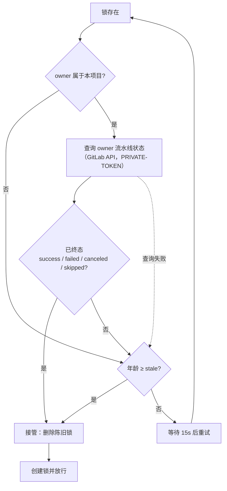

# 03 口径固化与机器护栏 详细设计

> 后端基座与服务化地基 · 13 测试执行粒度与工程效能 · 子任务 03（需求 13-3）· 状态：**定稿（13 项决策已确认）**

[文档首页](../../../../../../文档首页.md) › [13 测试执行粒度与工程效能](../../13_测试执行粒度与工程效能.md) › [03 口径固化与机器护栏](../13_测试执行粒度与工程效能_03_口径固化与机器护栏.md) › 详细设计　|　[需求 13-3](../../../../需求/13_需求_测试执行粒度与工程效能.md#r13-3)　|　[计划](../../../../计划/01_计划_后端基座与服务化地基.md)

## 1. 背景与目标 <a id="goal"></a>

`13_01`（选测器单一来源）与 `13_02`（并行执行与重复步骤消除）已把「按变更范围只跑受影响的部分」落到**文件级**，但两者都只把口径留在**脚本代码**里：

- 《测试规范》§2.1 只有一句强制原则（第 2 条），没有「怎么推导、什么时候退化、扩圈怎么收敛、预检与 CI 怎么保证同源」的可引用条款；
- 推导规则、退化阈值、扩圈轮次、并行档位、自测按需、重复面划界都没有机器护栏——一旦有人为省事把推导改回工程级、或新增工程 / 新增基座校验脚本未纳入映射，问题会**静默复发**；
- 选测度量（选中测试文件数 / 全量数 / 是否退化 / 扩圈轮次）散落在执行器子进程输出里，预检结论段看不到，复盘与度量要翻日志。

**目标**：

1. **规范补节**：《测试规范》§2.1 增补 2.1.1~2.1.5 五条执行细则（推导依据 / 双重收敛 / 退化条件 / 扩圈机制 / 两侧一致性），并按 `13_02` 遗留补 2.1.6「执行侧配套口径」（并行档位 / 自测按需 / 重复面划界 / 覆盖率采集前置）。
2. **四项机器护栏**：「同一来源」「新增工程必登记」「退化显式」「扩圈不静默」各成一组用例，落在既有护栏目录。
3. **度量可见**：预检定向段末尾汇总选测度量（picked / total / degraded / rounds / cov），与执行器度量行同源。
4. **补齐两处存量缺口**：`scripts/tools/base-check/**` 变更 → 其护栏用例的映射；CI 流水线锁在自动取消时悬空（`13_01` / `13_02` 共同遗留）。
5. **规范↔实现零漂移**：一条轻量断言锚定「规范五条 ↔ 实现五能力」，并让规范正文不写脚本文件名（改名不产生规范漂移）。

**边界（不在本任务）**：

- 推导规则本身（目录同构 / AST 图 / 阈值 / 前端闭包）**不改**，仍是 `13_01` 口径；本任务只固化与加护栏。
- 并行档位、自测按需映射、`service-test` 判定、预算取值**不改**，仍是 `13_02` 口径；本任务只补规范条款与护栏。
- 测试公共基座（`bms_core.testing`）归 `13_04`（已交付）。
- 顺序敏感用例的用例级修复、AST 图磁盘缓存、`api-types-check` 接选测：维持 `13_01` / `13_02` 的归口，本任务不碰。

## 2. 现状实测 <a id="status"></a>

| 项 | 实测结论 |
| --- | --- |
| 《测试规范》§2.1 | 4 条强制原则 + 判据一句话；**无**推导依据 / 退化条件 / 扩圈 / 两侧一致性条款 |
| 既有护栏用例 | `boundary/` 下 6 个文件：`test_test_selection_guard.py`（Kiwi 2316，22 条）、`test_parallel_guard.py`（2318，21 条）、`test_preflight_scoping_guard.py`（2311，7 条）、`test_run_once_guard.py`（2315，7 条）、`test_bare_collections_guard.py`（2224，3 条）、`test_boundary.py`（18 条）——`uv run pytest -q libs/bms_core/tests/boundary` 实测 **78 passed / 31.15s** |
| 四项护栏现状 | 「同一来源」只由 2316 的 `test_cli_json_matches_library` 间接覆盖（证明 CLI==库，不证明 CI 只经该入口）；「新增工程必登记」**零覆盖**；「退化显式」只覆盖 `reason` 非空（不覆盖预检 / 执行器是否打印）；「扩圈不静默」只覆盖 `expand_from_coverage` 契约（不覆盖循环不静默放弃） |
| 选测度量 | `run-selected.py` 的 `_print_metrics` 打印 `[test-selection] picked=X/Y degraded=… rounds=… cov=N 模块`；**预检结论段看不到**（`_run` 不向调用方回传输出行） |
| `base-check` 映射 | `scripts/tools/base-check/` 9 个脚本；改任一个**都不产生任何选中测试**（`_classify_change` 只认 `scripts/tools/preflight/`），是真实漏测面 |
| `base-check` ↔ 用例对应 | 有护栏用例的 4 个：`check-bare-collections.py`→`boundary/test_bare_collections_guard.py`、`check-env-example.py`→`core/test_basic_protection.py`、`check-backend-base.py`→`core/test_value_object_roots.py`、`check-service-boundaries.py`→`crosscut/test_module_boundary.py`；其余 5 个（`check-base` / `check-docs-scope` / `check-prototype-review` / `check-system-fields` / `check-links`）**无 pytest 用例**（只在 CI `base-integrity` 与预检里以脚本形态跑） |
| 预检工程登记 | `check-preflight.py` 的 `_ROOTS`（10 个工程目录）与 `_COVERAGE_PACKAGES`（10 个顶层包）是**手写常量**；`test_selection.discover_projects` 是**目录自动发现**——两者无对账，新增工程只落目录即「全量档漏跑 + 覆盖率范围漏计」 |
| CI 流水线锁 | `.gitlab-ci.yml` 的 `ci-queue-acquire` 只按 `at` 标签判陈旧（缺省 7200s）；同分支连推时被 auto-cancel 的流水线不执行 `.post` 的 `ci-queue-release`，锁 owner 仍是已取消流水线 ⇒ 后续流水线等满 stale 才接管（2026-10-19 实测 #1084 取消后 #1085 卡 acquire，人工 `docker rm -f ci-queue-lock` 恢复） |
| 注释与实现不一致 | 闸门注释称「持有者每条作业启动刷新 `at`」，实现中**无任何刷新逻辑**（`at` 只在 `docker create` 时写一次） |
| 闸门镜像工具 | `docker:27-cli`：有 `docker` / `wget`，**无** `curl` / `python3`（实测）；GitLab API 可经 `wget` + `PRIVATE-TOKEN` 访问，`CI_API_V4_URL` 与项目变量 `GITLAB_API_TOKEN` 在 job 内可用 |

## 3. 决策确认 <a id="decide"></a>

| # | 事项 | 决策 |
| --- | --- | --- |
| 1 | 规范补节编号 | §2.1 内新增 **2.1.1~2.1.5** 五个子节（推导依据 / 双重收敛 / 退化条件 / 扩圈机制 / 两侧一致性），全文章节号不动 |
| 2 | 规范条款详略 | **只写口径与强制要求**；脚本落点指向工程说明（`scripts/tools/preflight/README.md`），规范正文不写脚本文件名与 CLI 参数 |
| 3 | `13_02` 遗留条款 | **一并补**：§2.1 增 2.1.6「执行侧配套口径」（并行档位可配、自测按需、共享底座变更按影响集合放行、覆盖率采集须早于被测模块导入）；`13_02` 遗留第 5 项闭环 |
| 4 | 四项护栏落点 | 新增 `backend/libs/bms_core/tests/boundary/test_selection_contract_guard.py`，四项各成一组，登记**新 Kiwi 编号**（与 2316 / 2318 职责不重叠） |
| 5 | 「同一来源」判定 | **静态调用面 + 动态结果比对**组合：静态断言预检与 CI 只经共享入口、且无第二套路径映射规则；动态断言同一变更集合下 CLI 输出 == 库函数结果 |
| 6 | 「新增工程必登记」对账 | **三方对账**：`discover_projects` 自动发现 ↔ 预检 `_ROOTS` ↔ 覆盖率 `_COVERAGE_PACKAGES`；对账逻辑提为纯函数，护栏用假数据构造「未登记即失败」 |
| 7 | 选测度量形态 | 执行器度量行（既有）+ **预检定向段末尾汇总行**（picked / total / degraded / rounds / cov，轮次从执行器输出解析） |
| 8 | 实测数据归档 | 在《测试执行粒度与影响分析评估》**追加「落地实测」小节**，并把原结论标注为已落地 |
| 9 | Kiwi 登记条数 | **1 条**（四项护栏共用，题面内列覆盖范围），沿用「一个任务一条」约定 |
| 10 | `base-check` 变更映射 | **本次补齐**：`scripts/tools/base-check/<脚本>.py` → 其护栏用例；无对应用例的脚本并入 `boundary/` 全部护栏用例（宁多跑不漏测），映射表为单一来源并有「新增脚本必须登记」护栏 |
| 11 | CI 队列锁泄漏 | **本次一并修** `ci-queue-acquire` / `ci-queue-release`：以「owner 流水线是否已终态」为主判据（经 GitLab API 查询，仅本项目可查），stale 退为兜底；同时修正「每条作业刷新 `at`」的注释与实现不一致 |
| 12 | 规范↔实现零漂移 | **加一条轻量断言**：规范五条子节存在，且每条在实现侧有对应能力锚点；另断言规范 §2.1 小节内不出现脚本文件名 |
| 13 | 提交范围 | bms **两笔**（`feat` 代码 + 用例 / `docs` 文档 + 计划）+ test 仓**一笔**（Kiwi 用例输入与回读）；推送另行确认 |

## 4. 交付物清单 <a id="deliver"></a>

### 4.1 规范与文档

```text
bms/bms文档/规范/测试规范.md                                    # 改：§2.1 增 2.1.1~2.1.6 六个子节
bms/bms文档/资料/知识档案/工程化与质量/测试执行粒度与影响分析评估.md   # 改：追加「落地实测」小节 + 原结论标注
bms/bms文档/项目/02_后端基座与服务化地基/计划/01_计划_后端基座与服务化地基.md  # 改：13_03 收口回写（唯一进度落点）
```

### 4.2 代码与用例

```text
bms/scripts/tools/preflight/test_selection.py                   # 改：base-check 变更 → 护栏用例映射（单一来源常量）
bms/scripts/tools/preflight/check-preflight.py                  # 改：工程登记对账纯函数 + 定向段度量汇总行
bms/scripts/tools/preflight/README.md                           # 改：口径固化与护栏说明、base-check 映射、度量行
bms/backend/libs/bms_core/tests/boundary/test_selection_contract_guard.py   # 新增：四项护栏 + 零漂移 + 映射护栏
bms/.gitlab-ci.yml                                              # 改：ci-queue-acquire / release 的 owner 终态判定
```

### 4.3 任务附属三件套（本目录）

`设计/01_详细设计_03_口径固化与机器护栏.md`（本文件）、`实施/01_实施_03_口径固化与机器护栏.md`、`测试/01_测试_03_口径固化与机器护栏.md`。

### 4.4 前端 / 数据库

**无**（无前端源码、无表 / 列 / 索引 / 迁移）。

## 5. 规范补节设计 <a id="spec"></a>

### 5.1 小节结构与条款要点 <a id="spec-struct"></a>

在《测试规范》§2.1 现有 4 条原则**之后**追加六个子节（原 4 条不动，作为「原则」，子节作为「执行细则」）：

| 小节 | 标题 | 条款要点（强制） |
| --- | --- | --- |
| 2.1.1 | 变更影响分析：推导依据 | 变更 → 受影响测试 / 受影响前端包**只有一份共享推导实现**，预检与 CI 均只经其命令行入口取值；禁止任一侧另写映射规则。推导依据三类：目录同构（源目录 ↔ 同构测试目录）、导入关系（源模块被测试直接或传递引用）、工作区依赖（前端包 `workspace:` 依赖反向闭包）。工程与包一律**按目录自动发现**，不维护白名单——新增工程 / 新增包即自动纳入推导范围 |
| 2.1.2 | 双重收敛与差集口径 | 先按目录同构取候选，再用导入图收敛到真实引用者；两重缺一不可（只同构会漏跨目录引用，只导入图会漏「测试目录按目录组织但无显式导入」的覆盖）。差集必须显式处理：**仅源码有目录**（候选为空，交导入图兜底）、**仅测试有目录**（同构永不命中，仅当测试文件自身变更或导入图命中时选中）；测试文件自身变更**必须**选中自身 |
| 2.1.3 | 退化条件与显式输出 | 三类退化：**全局变更**（工程依赖清单 / 锁文件 / 迁移 / 部署与 CI 配置）、**基础模块**（受影响测试文件数超绝对阈值或占工程全量超占比阈值）、**无引用者**（有变更模块但选中为空）。退化即该工程跑全量，**必须显式打印原因与命中模块**；变更基准不可解析时**强制退化全量**，不得静默按空集跳过（空集会被当作「无变更」而假绿） |
| 2.1.4 | 覆盖率扩圈（门禁口径不降级） | 选测后覆盖率必然下降，须以「扩圈」补齐而非降低门禁：读覆盖率报告缺口行 → 反查缺口所属模块 → 并入其引用测试重跑，轮次有上限；无新增测试或轮次用尽 ⇒ 退化工程级全量重跑一次并显式说明。**门禁目标恒为最初变更模块**（扩圈只扩大测试集，不扩大门禁范围），覆盖率门槛与维度口径见《AI开发规范》「覆盖率要求」节，不因选测而打折 |
| 2.1.5 | 预检与 CI 两侧一致性 | 两侧**同一推导实现 + 同一执行入口**；变更基准两侧取同一来源（MR 用合并请求差异基准、直推用提交前基准），基准不可解析即两侧一致地显式退化全量。推导结果一致由护栏用例锁定；新增工程 / 新增前端包未纳入登记时护栏失败 |
| 2.1.6 | 执行侧配套口径 | ① **并行档位**可配（缺省自动、可关），并行下用例结果须与串行一致，不稳定由用例自身修而非整体退回串行；② **自测按需**：护栏脚本自检仅在变更触及对应脚本或其依赖时执行，全量档保留全跑；③ **重复面划界**：服务级测试仅在**本服务有直接变更**时执行，共享底座变更由共享层测试兜底，判定失败时保守执行（宁可重复不漏测）；④ **覆盖率采集前置**：采集必须在被测模块导入前启动，禁止用晚于测试框架初始化的探针口径（否则导入期执行行整片漏计，门禁假失败或假通过） |

### 5.2 写法约束 <a id="spec-style"></a>

- **不写脚本文件名与命令行参数**（决策 2）：条款只描述「做什么 / 必须满足什么」，落点写「工程说明见 `scripts/tools/preflight/README.md`」（纯文本路径，不写链接）。
- 不写具体阈值数值（100 个 / 60% / 2 轮）——阈值属实现参数，规范写「绝对阈值 / 占比阈值 / 轮次上限」并要求「可配」；避免调参即规范漂移。
- 不写进度类字样（进度唯一落点在阶段计划文档，见《计划文档规范》「排期唯一落点与边界」节，`docs-scope:allow` 引用规范节名）。
- 与《AI开发规范》「覆盖率要求」节的关系：覆盖率**数字**只在该节，§2.1.4 引用不复制。

## 6. 机器护栏设计 <a id="guard"></a>

### 6.1 用例文件与分组 <a id="guard-file"></a>

新增 `backend/libs/bms_core/tests/boundary/test_selection_contract_guard.py`（与 2316 / 2318 同目录，预检与 CI 的选测在变更 `scripts/tools/preflight/**` 时自动带上它——**需先把它加入预检护栏清单**，见 §8）。

| 组 | 用例 | 断言要点 |
| --- | --- | --- |
| A 同一来源（静态） | `test_preflight_delegates_to_selector` | `_scope_targets` 内部委托 `test_selection.build_selection`；预检源码**不存在**第二套路径映射字面量（工程级目录映射函数 / 测试目录拼接） |
| A 同一来源（静态） | `test_ci_uses_shared_entries_only` | `.gitlab-ci.yml` 的 `backend-test` 只经执行器入口；三个前端 job 只经选测器入口；CI 内不出现旧的「四包全量」写法 |
| A 同一来源（动态） | `test_cli_matches_library_on_same_change` | 同一变更集合：CLI JSON == 库函数结果（字段级全等） |
| B 新增工程必登记 | `test_discovered_projects_registered_in_preflight_roots` | 自动发现的 10 个工程测试目录 == 预检 `_ROOTS` 集合 |
| B 新增工程必登记 | `test_discovered_projects_registered_in_coverage_packages` | 自动发现的 10 个顶层包 == 预检 `_COVERAGE_PACKAGES` |
| B 新增工程必登记 | `test_unregistered_project_detected` | 对账纯函数：构造「目录有、登记无」的假工程 ⇒ 返回未登记项（非空）；登记齐备 ⇒ 空 |
| C 退化显式 | `test_degrade_reason_non_empty_for_all_triggers` | 四类触发（全局变更 / 绝对阈值 / 无引用者 / 强制全量）`reason` 均非空 |
| C 退化显式 | `test_degrade_notes_name_project` | 逐工程退化时 `notes` 含工程名与原因文本 |
| C 退化显式 | `test_degrade_printed_by_preflight_and_runner` | 预检与执行器源码均打印「退化：」+ 逐条 `notes`（不静默） |
| D 扩圈不静默 | `test_expand_loop_has_bound_and_fallback` | 执行器源码：轮次上限参数、无增长 / 轮次用尽两条路径都打印原因并退化全量重跑一次 |
| D 扩圈不静默 | `test_metrics_line_reports_rounds` | 度量行格式含 `picked` / `total` / `degraded` / `rounds` / `cov` 五项 |
| D 扩圈不静默 | `test_expand_returns_missing_modules_only` | 缺口模块才扩圈（已覆盖模块返回空，不重复重跑） |
| E 规范↔实现零漂移 | `test_spec_has_six_subsection_titles` | 《测试规范》§2.1 含 2.1.1~2.1.6 六个标题 |
| E 规范↔实现零漂移 | `test_spec_clauses_have_implementation_anchors` | 五条 ↔ 五能力：推导依据→自动发现 + 导入图；双重收敛→同构 + 导入闭包；退化→三类触发常量；扩圈→缺口反查；一致性→预检与 CI 同一入口 |
| E 规范↔实现零漂移 | `test_spec_section_has_no_script_names` | §2.1 正文（六子节范围）不含 `.py` 脚本文件名（改名不产生规范漂移） |
| F `base-check` 映射 | `test_base_check_change_selects_its_guard` | 改 `check-bare-collections.py` ⇒ 选中其护栏用例；改无对应用例的脚本（如 `check-base.py`）⇒ 选中 `boundary/` 全部护栏 |
| F `base-check` 映射 | `test_base_check_map_covers_every_script` | `scripts/tools/base-check/*.py` 全部在映射表内（新增脚本必须登记，否则失败） |

护栏自身的「被选中」保障：把新文件加入 `test_selection.py` 的预检护栏清单（`_PREFLIGHT_TESTS`），使「改选测器 / 预检脚本」时必跑它。

### 6.2 对账纯函数 <a id="guard-reconcile"></a>

`check-preflight.py` 新增（供护栏与 `--self-test` 共用，避免断言与实现两套逻辑）：

```python
def unregistered_projects(discovered: tuple[str, ...], roots: tuple[str, ...], packages: tuple[str, ...]) -> tuple[str, ...]:
    """自动发现的工程里，未登记到全量档范围 / 覆盖率范围的项（工程测试目录口径 + 顶层包口径）。"""
```

返回空表示登记齐备；非空即「新增工程未登记」。`--self-test` 增加一条对账断言（真实仓库应为空）。

## 7. 选测度量输出设计 <a id="metrics"></a>

### 7.1 现状与缺口 <a id="metrics-gap"></a>

执行器 `run-selected.py` 已打印度量行（`[test-selection] picked=…/… degraded=… rounds=… cov=… 模块`），但预检 `_run` 只回传成功 / 失败，**不向调用方回传输出行**，故预检结论段看不到轮次与最终测试量。

### 7.2 设计 <a id="metrics-design"></a>

1. `_run` 增加可选参数 `capture: ConcurrentStableList[str] | None = None`：把逐行透传的内容同时写入调用方提供的集合（既有行为不变，缺省不采集）。
2. `_run_scoped` 传入 capture，执行结束后解析最后一条 `[test-selection] picked=` 度量行。
3. 打印统一汇总行（固定格式，便于复盘取数）：

```text
[preflight] 选测度量：picked=33/394（8.4%）degraded=false rounds=1 cov=1 模块
```

4. 解析失败（执行器未跑到度量行，如提前失败 / 无测试）⇒ 打印 `[preflight] 选测度量：不可得（执行器未输出度量行）`，**不静默省略**。
5. 与 `13_01` 的执行器度量行**同一来源**（不另算一遍），避免「预检算一套、执行器算一套」。

## 8. `base-check` 变更映射设计 <a id="basecheck"></a>

### 8.1 单一来源常量 <a id="basecheck-map"></a>

`test_selection.py` 新增（与 `_PREFLIGHT_TESTS` 并列，同一风格）：

```python
_BASE_CHECK_PREFIX = "scripts/tools/base-check/"
"""基座校验脚本目录：改动须跑其护栏用例。"""

_BASE_CHECK_TESTS: tuple[tuple[str, str], ...] = (
    ("check-bare-collections.py", "libs/bms_core/tests/boundary/test_bare_collections_guard.py"),
    ("check-env-example.py", "libs/bms_core/tests/core/test_basic_protection.py"),
    ("check-backend-base.py", "libs/bms_core/tests/core/test_value_object_roots.py"),
    ("check-service-boundaries.py", "libs/bms_core/tests/crosscut/test_module_boundary.py"),
)
"""基座校验脚本 → 其护栏用例（相对 `backend`）。未登记的脚本并入 `boundary/` 全部护栏。"""
```

### 8.2 判定与并入口径 <a id="basecheck-apply"></a>

| 变更形态 | 处理 |
| --- | --- |
| `scripts/tools/base-check/<已登记脚本>` | 并入该脚本的护栏用例（精确） |
| `scripts/tools/base-check/<未登记脚本>`（含新增脚本） | 并入 `libs/bms_core/tests/boundary/` 下**全部**测试文件（宁多跑不漏测），并在 `notes` 打印原因 |
| `scripts/tools/base-check/` 下非 `.py`（说明文档等） | 同上按「目录级」处理（并入 `boundary/` 全部） |
| 其他 `scripts/**` | 不影响后端选测（现状不变） |

`_classify_change` 增 `basecheck` 类别；`build_selection` 在 `preflight_changed` 处理之后按同法并入（不产生覆盖率目标）。

### 8.3 与 `_PREFLIGHT_TESTS` 的关系 <a id="basecheck-relation"></a>

`_PREFLIGHT_TESTS`（改选测器 / 预检脚本 → 3 个预检护栏）与 `_BASE_CHECK_TESTS`（改基座校验脚本 → 其护栏）**职责不同、并存**：前者守「推导与执行链」，后者守「基座校验脚本」。新护栏文件加入 `_PREFLIGHT_TESTS`（改选测器必跑它）。

## 9. CI 流水线锁修复设计 <a id="cilock"></a>

### 9.1 根因 <a id="cilock-root"></a>

锁的存活判据只有 `at` 标签年龄（缺省 7200s）。同分支连推触发 `workflow.auto_cancel` 时，被取消的流水线**不执行** `.post` 阶段的 `ci-queue-release`（`.post` 在流水线早期取消时不保证调度），锁 owner 仍是那条已终止的流水线 ⇒ 后续流水线等满 stale 才接管。注释所称「持有者每条作业启动刷新 `at`」实现中并不存在（`at` 只在 `docker create` 时写一次），加剧了「必须等满 stale」。

### 9.2 修复口径 <a id="cilock-fix"></a>

以「**owner 流水线是否已终态**」为主判据、`at` 年龄为兜底：



要点：

1. **仅本项目可判定**：`owner` 形如 `<项目路径>#<流水线号>`；只有项目路径 == `CI_PROJECT_PATH` 时才查 API（跨项目 token 无权限，直接走 stale 兜底），避免引入跨项目凭据需求。
2. **查询失败一律保守**：无 `wget` / 无 token / 网络失败 / 状态未知 ⇒ 退回「按年龄等 stale」（与现状一致，不引入新的抢锁风险）。
3. **工具约束**：闸门镜像 `docker:27-cli` 无 `curl`、无 `python3`，用 `wget -q -O -`（实测可用）+ `sed` 做项目路径 URL 编码。
4. **token 不入日志**：`PRIVATE-TOKEN` 经变量传入 `--header`，不开 `set -x`；token 为项目 CI/CD 变量（masked，已就位）。
5. **`ci-queue-release` 同步增强**：锁不属于本流水线但 owner 已终态时也清理（避免下一条流水线白等），并打印原因。
6. **注释与实现对齐**：删除「每条作业启动刷新 `at`」的表述，改为准确描述（主判据 = owner 流水线终态；兜底 = `at` 年龄）。
7. **跨项目场景**（bms 与 mdm 共用 runner）：跨项目仍按 stale 兜底——这是有意的（不引入跨项目 token），并在注释写明该限制与人工兜底（`CI_QUEUE_FORCE=1`）。

### 9.3 验证方式 <a id="cilock-verify"></a>

- **静态**：`sh -n` 语法检查（脚本片段经 mjbk 上的 `sh` 校验）；YAML 解析（预检 CI 配置自检段）。
- **行为**：在 mjbk 上以假 `owner` 标签构造锁容器，分别验证「owner 已终态 ⇒ 立即接管」「owner 进行中 ⇒ 继续等待」「跨项目 owner ⇒ 按年龄兜底」三条分支（不改真实流水线）。
- **端到端**：推送后手动触发一次流水线观察（推送另行确认）；本任务不以此为完成前提，登记于实施记录。

## 10. 测试设计 <a id="test"></a>

### 10.1 Kiwi 用例登记 <a id="test-kiwi"></a>

按「一个任务一条」登记 **1 条**：分类「平台骨架」、优先级 `P2`、状态 `CONFIRMED`、标签「自动化」；`text` 覆盖四项护栏（同一来源 / 新增工程必登记 / 退化显式 / 扩圈不静默）+ 规范零漂移 + `base-check` 映射与 CI 锁口径。**编号以平台回读为准**，登记后回填 `@pytest.mark.kiwi_id(<编号>)` 与任务测试记录。

### 10.2 验收映射 <a id="test-accept"></a>

| 任务完成标准 | 落点 |
| --- | --- |
| 规范有对应条款且与实现一致 | §5 六子节落地；`test_spec_has_six_subsection_titles` + `test_spec_clauses_have_implementation_anchors` 锁定 |
| 护栏覆盖「同一来源」 | A 组 3 条（静态调用面 + 动态结果比对） |
| 护栏覆盖「新增工程必登记」 | B 组 3 条（三方对账 + 未登记即失败） |
| 护栏覆盖「退化显式」 | C 组 3 条（reason / notes / 两处打印） |
| 护栏覆盖「扩圈不静默」 | D 组 3 条（轮次上限 + 兜底打印 + 度量行） |
| 预检输出含选测度量 | §7 汇总行；实测截取登记于测试记录 |
| 文档与实现零漂移 | E 组 3 条（含「规范不写脚本名」） |
| `base-check` 漏测面闭环 | F 组 2 条 + 实测「改校验脚本 ⇒ 选中其护栏」 |

### 10.3 回归面 <a id="test-regress"></a>

- `uv run pytest -q libs/bms_core/tests/boundary`（含新增用例）；
- 预检 `--self-test`（含新增对账断言）、`--fast`；
- 定向档端到端（改 `check-bare-collections.py` ⇒ 选中其护栏；改 `test_selection.py` ⇒ 选中护栏清单含新文件）；
- 静态：`ruff check` / `ruff format --check` / `pyright`；
- 基座：`check-base` / `check-docs-scope` / `check-bare-collections`（新增代码不得用裸集合）。

## 11. 登记落点 <a id="register"></a>

| 落点 | 内容 |
| --- | --- |
| 计划表 | 13_03 收口（状态 / 完成日期，唯一进度落点；移入已完成表、统计行与排期图同步，`docs-scope:allow` 计划文档属允许落点） |
| 任务文档 | 不承载进度（仅关联需求不变） |
| `scripts/tools/preflight/README.md` | 口径固化条款与护栏、`base-check` 映射、度量汇总行、CI 锁主判据 |
| 《测试规范》§2.1 | 2.1.1~2.1.6（本任务主体交付） |
| 《测试执行粒度与影响分析评估》 | 追加「落地实测」小节 |
| 文档索引 | ~~`文档域路由索引.md` 由生成脚本重跑，不手改~~（**2026-10-19 已废止**：索引方式判定无效，索引文件与生成脚本均已删除，详见《[代码检索索引方式失效复盘](../../../../../../资料/知识档案/工程化与质量/代码检索索引方式失效复盘.md)》） |
| 实施 / 测试记录 | 本目录 `实施/`、`测试/` 各一份 |

## 12. 实施步骤 <a id="steps"></a>

1. 先登记 Kiwi 用例取得编号（平台回读），再写用例代码。
2. `test_selection.py`：`_BASE_CHECK_TESTS` 映射 + `basecheck` 类别 + 并入逻辑；`_PREFLIGHT_TESTS` 加入新护栏文件。
3. `check-preflight.py`：`unregistered_projects` 对账纯函数、`--self-test` 对账断言、`_run` 采集参数、定向段度量汇总行。
4. 新增 `test_selection_contract_guard.py`（A~F 六组）。
5. 《测试规范》§2.1 增补六子节；`README.md` 同步。
6. `.gitlab-ci.yml`：`ci-queue-acquire` owner 终态判定 + `ci-queue-release` 增强 + 注释校正。
7. 验证：定向用例 + `--self-test` + `--fast` + 定向档端到端 + 静态 + 基座门禁；CI 锁在 mjbk 上做三分支行为验证。
8. 回写：评估文档「落地实测」、计划表、实施记录、测试记录。

## 13. 边界与开放项 <a id="open"></a>

| # | 项 | 归口 |
| --- | --- | --- |
| 1 | 跨项目（bms ↔ mdm）锁仍按 stale 兜底（不引入跨项目 token） | 有意选择；人工兜底 `CI_QUEUE_FORCE=1`；如需根治另立（GitLab 原生 `resource_group` 需评估 runner 语义） |
| 2 | 规范条款与实现的「语义一致」无法全自动判定 | 本任务用「子节存在 + 能力锚点 + 不写脚本名」三重轻量断言；语义评审仍靠评审 |
| 3 | `base-check` 无 pytest 用例的 5 个脚本（并入 boundary 全部） | 属「宁多跑」保守口径；为它们补专用用例另立 |
| 4 | 扩圈在真实仓库仍无缺行场景（存量覆盖率恒 100%） | 沿用 `13_01` 归口；循环不静默由 D 组源码级断言锁定 |
| 5 | 顺序敏感用例、AST 图磁盘缓存、`api-types-check` 接选测 | 沿用 `13_01` / `13_02` 归口，不在本任务 |
| 6 | CI 锁端到端（真实 auto-cancel 场景） | 推送后手动触发一次流水线观察；本任务以三分支行为验证为准 |

## 14. 对齐记录 <a id="align"></a>

| 日期 | 事项 | 处置 |
| --- | --- | --- |
| 2026-10-19 | 闸门注释称「持有者每条作业启动刷新 `at`」，实现无刷新逻辑 | 本次一并修正：主判据改「owner 流水线终态」，`at` 退为兜底；注释改为准确表述（决策 11） |
| 2026-10-19 | `docker:27-cli` 无 `curl` / `python3`（实测） | 闸门查询用 `wget`（实测可用）+ `sed` 做 URL 编码，不新增镜像依赖 |
| 2026-10-19 | 规范若写脚本文件名，改名即漂移 | 规范只写口径，落点指向工程说明；零漂移断言反向锁「§2.1 不含 `.py`」（决策 2 / 12） |
| 2026-10-19 | `13_01` 遗留第 6 项（`base-check` 映射缺口）原拟「13_03 一并登记」 | 本次由「登记」升级为「补齐映射 + 映射表完整性护栏」（决策 10） |
| 2026-10-19 | 新护栏文件若未进预检护栏清单，改选测器时不会跑它 | 同步加入 `_PREFLIGHT_TESTS`，并由 F 组「映射表完整性」护栏反向锁定 |

> 本文档按《[文档生成规范](../../../../../../规范/文档生成规范.md)》与《[AI开发规范](../../../../../../规范/AI开发规范.md)》编写 · 决策逐项确认后定稿
