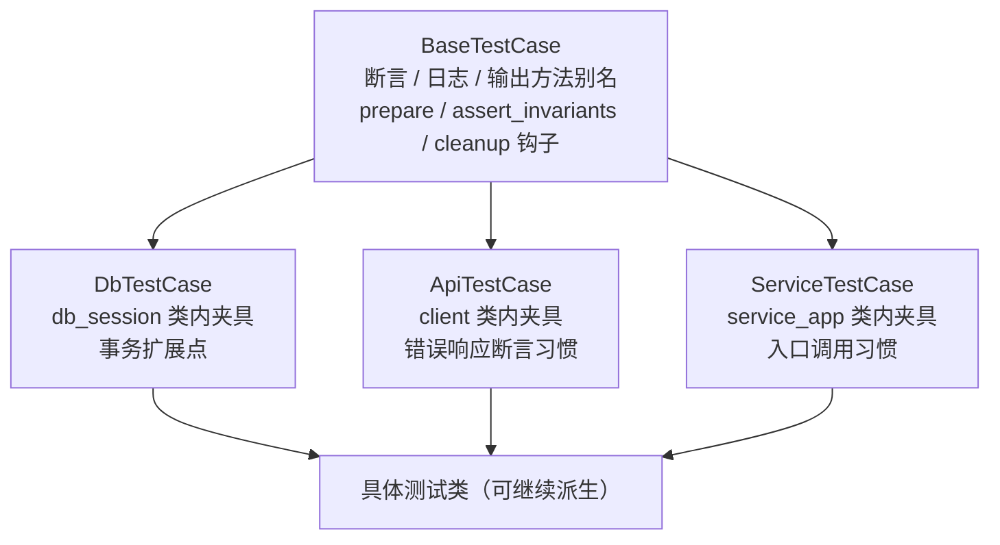
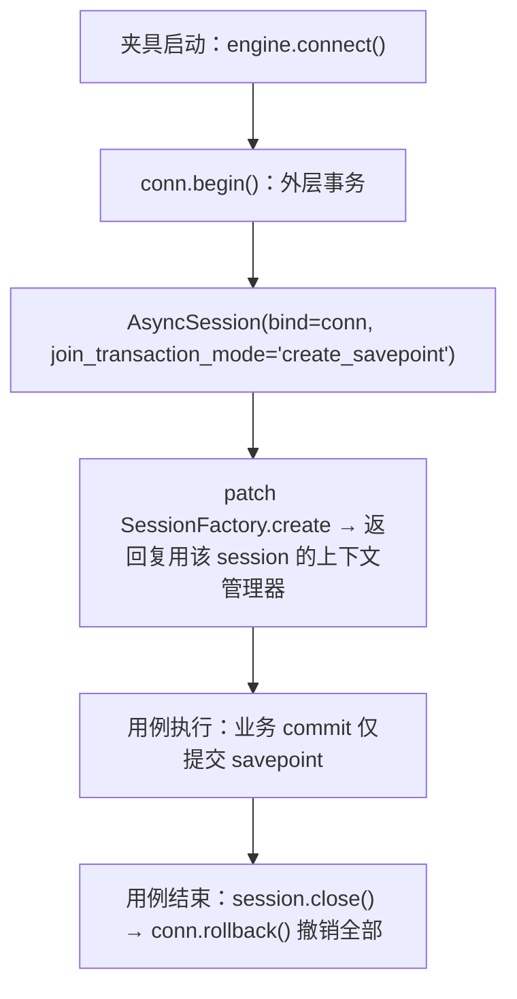

# 04 测试公共基座 详细设计

> 后端基座与服务化地基 · 13 测试执行粒度与工程效能 · 子任务 04（需求 13-4）· 状态：**定稿（11 项决策已确认）**

[文档首页](../../../../../../文档首页.md) › [13 测试执行粒度与工程效能](../../13_测试执行粒度与工程效能.md) › [04 测试公共基座](../13_测试执行粒度与工程效能_04_测试公共基座.md) › 详细设计　|　[需求 13-4](../../../../需求/13_需求_测试执行粒度与工程效能.md#r13-4)　|　[计划](../../../../计划/01_计划_后端基座与服务化地基.md)

## 1. 背景与目标 <a id="goal"></a>

后端测试的公共能力**没有单一来源**：同一段夹具在 10 个 `conftest.py` 各写一份，事务边界三种写法并存，错误断言与输出捕获全靠每处手写。后果不是「代码丑」，而是：改一处口径要改十个文件、用例间靠落盘 SQLite + 手工清表隐式隔离、**排查问题时断点无处可落**（每个测试类都得单独改）。

**目标**：

1. **单一来源**：重复夹具收编到 `bms_core.testing` 插件，改一处生效；存量夹具**同名同语义**，417 个用例零改动。
2. **统一事务**：回滚夹具（外层事务 + savepoint + patch 会话工厂），用例结束整体回滚，不落盘、无跨用例污染。
3. **统一调用**：报错断言 `assert_error`、日志 `log_events` / `assert_logged`、输出 `stdout_text` / `assert_output` / `run_cli` 各一处实现。
4. **可继承扩展**：三层测试基类（`BaseTestCase` → 能力层 → 具体类），**层次可按需继续派生**；测试类扩展的新方法可被同类测试继承。
5. **基座可复用**：落 `bms_core/testing/`（基座包内），产品仓（mdm / biz）直接 import，不再复制第二套。

**边界（不在本任务）**：

- **前端测试基座**（Vitest）——本任务只覆盖后端，前端另立任务。
- **存量用例体迁移**：417 个测试文件不改写；仅新增用例强制用统一 helper，存量按触及文件渐进。
- **数据工厂 / 假数据生成**：本任务只做「能力层」，不建实体工厂体系。
- **测试平台（Kiwi）集成改造**：沿用既有 `kiwi_id` marker。

## 2. 现状实测 <a id="status"></a>

| 项 | 实测 | 影响 |
| --- | --- | --- |
| `isolate_settings` | **10 份**（`libs/bms_core` + 9 服务，txn 为精简版） | 改口径要改 10 个文件 |
| `platform_db_url` + `platform_db` | **9 份** | 同上 |
| `reset_request_context` | **8 份** | 同上 |
| `service_app` + `client` | **8 份**（含 async 夹具） | 同上 |
| `fake_tenant_source` | **7 份** | 同上 |
| `clear_tenant_cache` | **8 份**复制 | 同上 |
| 事务写法 | `session_scope` ≈37 处、夹具手工 `commit()` ≈109 处、autouse 清表 **41 个文件** | 无「每用例回滚」；用例间隐式依赖 |
| 错误断言 | `pytest.raises` ≥700 处；`resp.json()["code"]` 260 处；`exc.value.code` 仅 2 处 | 无统一错误码断言 |
| 日志断言 | `caplog` 仅 3 处；主导为 capsys 读 structlog JSON，`_records()` 各写各的 | 解析器分散 |
| 输出捕获 | `capsys` 173 处（`ops` 测试最密集） | 无统一读取 / 断言 |
| 测试基类 / pytest 插件 | **0 / 0**（无 `pytest_plugins`、无 hook、无自定义基类） | 无公共扩展点 |
| 会话工厂 | `session_scope(registry, …)` 内 `SessionFactory().create(engine)()`（`bms_core/db/session.py:281-283`） | **patch 点唯一**：类方法 `SessionFactory.create` |

## 3. 决策确认 <a id="decide"></a>

| # | 决策 | 结论 |
| --- | --- | --- |
| 1 | 公共层形态 | **pytest 插件 + fixtures 为主，薄基类做方法别名与扩展点**（两者共存） |
| 2 | 基类层次 | **无限层、按需派生**；先落三层：`BaseTestCase` → `DbTestCase` / `ApiTestCase` / `ServiceTestCase` → 具体类 |
| 3 | 基类扩展点 | **模板方法钩子**（`prepare` / `assert_invariants` / `cleanup`）+ **非 autouse 类内夹具**（`db_session` / `client`） |
| 4 | 基类资源 | 基类**不持有**连接 / 会话；资源一律 fixture 注入 |
| 5 | 事务口径 | **新增回滚夹具**（外层事务 + savepoint），夹具内 patch `SessionFactory.create` 使被测代码复用同一外层 session；用例结束整体回滚 |
| 6 | 存量迁移 | **基座 + 10 个 conftest 去重**（同名同语义），存量用例零改动；新增用例强制用统一 helper |
| 7 | 落点 | **`backend/libs/bms_core/src/bms_core/testing/`**（基座包内，可被产品仓复用），纳入覆盖率门禁 |
| 8 | 错误断言 | 统一 `assert_error(target, code=…, status=…)`，自动识别异常 / 响应 / JSON |
| 9 | 日志断言 | `log_events(capsys)` 解析 structlog JSON + `assert_logged(...)` |
| 10 | 输出断言 | `stdout_text` / `stderr_text` / `assert_output(contains=…)` + `run_cli(*args)` |
| 11 | 投入 / 窗口 | 按计划表登记（本文件不复述进度数字） |

## 4. 交付物清单 <a id="deliver"></a>

### 4.1 数据库设计

**无**（不新增表 / 列 / 索引 / 迁移）。

### 4.2 后端

```text
bms/backend/libs/bms_core/src/bms_core/testing/
├── __init__.py        # 公共出口（基类 / 断言 / 日志 / 输出 / 夹具）
├── assertions.py      # assert_error / assert_no_error（异常-响应-JSON 三形态自动识别）
├── logs.py            # log_events / assert_logged（解析 structlog JSON 行）
├── output.py          # stdout_text / stderr_text / assert_output / CliResult / run_cli
├── fixtures.py        # 公共夹具：isolate_settings / platform_db_url / platform_db / reset_request_context
│                      #              / reset_plugin_registry / fake_tenant_source / service_app / client
├── transaction.py     # db_session 回滚夹具内核（外层事务 + savepoint + patch 工厂）
├── base.py            # BaseTestCase（模板方法钩子 + 方法别名）
├── db.py              # DbTestCase（db_session 类内夹具 + 事务扩展点）
├── api.py             # ApiTestCase（client + 错误响应断言习惯）
├── service.py         # ServiceTestCase（service_app + 入口调用习惯）
└── plugin.py          # pytest 插件入口（pytest_plugins 引用；夹具与 marker 汇总）

bms/backend/libs/bms_core/tests/testing/
├── test_assertions.py         # 断言三形态 + 失败信息
├── test_logs.py               # structlog JSON 解析 / 过滤 / 断言
├── test_output.py             # capsys 读取 / 断言 / run_cli 退出码
├── test_transaction.py        # 回滚夹具：写入后同用例可见、独立连接不可见、用例结束撤销
├── test_base.py               # 钩子调用顺序 / 方法别名 / 派生扩展
└── test_plugin_contract.py    # 插件夹具与 10 个 conftest 的「同名同语义」契约（静态 + 行为）
```

各服务 `backend/services/*/tests/conftest.py` 与 `backend/libs/bms_core/tests/conftest.py`：重复夹具改 `pytest_plugins = ["bms_core.testing.plugin"]` 引入，删除本地副本，只留服务专属覆盖（如 platform 的 `client` 鉴权头、identity 的 `_SeedTenantSource`）。

### 4.3 前端

**无**（前端测试基座不属本任务）。

## 5. 基座设计 <a id="base"></a>

### 5.1 继承体系



派生规则（写入《测试规范》补节）：

1. **层次可无限派生**：新增能力域基类直接继承 `BaseTestCase`（或更具体的层），不得绕过 `BaseTestCase` 另起炉灶。
2. **通用能力只放对应层**：断言 / 日志 / 输出只在 `BaseTestCase`；事务只在 `DbTestCase`；HTTP 客户端只在 `ApiTestCase`。
3. **测试类可再派生**：某测试类扩展的新方法（如「准备一条租户数据」）允许被同类测试继承，扩展点仍归基类层次。
4. **基类不持有资源**：`db_session` / `client` 由类内夹具提供，方法显式接收参数或使用注入值。

### 5.2 模板方法钩子

```python
class BaseTestCase:
    def prepare(self) -> None: ...          # 用例前置（子类覆写；基类空实现）
    def assert_invariants(self) -> None: ... # 用例后置不变量（失败即红）
    def cleanup(self) -> None: ...           # 资源外的自定义清理
    def setup_method(self) -> None:
        self.prepare()
    def teardown_method(self) -> None:
        try:
            self.assert_invariants()
        finally:
            self.cleanup()
```

- 子类**只覆写钩子**，不覆写 `setup_method` / `teardown_method`（否则会绕过基类逻辑；《测试规范》列为红线）。
- `assert_invariants` 在 `teardown` 中执行：用例体通过但数据不变式被破坏时同样判失败。

### 5.3 类内夹具

| 基类 | 夹具 | 类型 | 说明 |
| --- | --- | --- | --- |
| `DbTestCase` | `db_session` | async，非 autouse | 回滚会话（见 §6） |
| `ApiTestCase` | `client` | async，非 autouse | ASGI 测试客户端（默认无租户头） |
| `ServiceTestCase` | `service_app` | async，非 autouse | 服务应用实例 |

非 autouse：子类按需声明参数，不用的不付出建库 / 建应用成本；夹具名与 conftest 现有同名夹具**同语义**，不会出现两套行为。

### 5.4 插件入口与 conftest 收编

`plugin.py` 汇总夹具与 marker；各 conftest 只写一行：

```python
pytest_plugins = ["bms_core.testing.plugin"]
```

兼容矩阵（**同名同语义，存量零改动**）：

| 夹具 | 收编后来源 | 各 conftest 保留内容 |
| --- | --- | --- |
| `isolate_settings` | `testing/fixtures.py` | 仅服务额外环境变量覆盖（如 txn 的 health registry） |
| `platform_db_url` / `platform_db` | `testing/fixtures.py` | 无（platform 通过 hook 追加种子） |
| `reset_request_context` | `testing/fixtures.py` | 无 |
| `reset_plugin_registry` | `testing/fixtures.py` | 无 |
| `fake_tenant_source` | `testing/fixtures.py` | 无 |
| `service_app` / `client` | `testing/fixtures.py` | 鉴权头 / 租户覆盖（platform / identity） |
| `clear_tenant_cache` | `testing/fixtures.py`（函数） | 无 |

**扩展点**：插件的 `platform_db_url` 通过 `pytest_configure` / hook 暴露「种子钩子」，platform 的 `seed_modules` 改为登记钩子而非重写夹具。

## 6. 统一事务设计 <a id="tx"></a>

### 6.1 生命周期



### 6.2 patch 点选择（关键）

被测代码多为 `from bms_core.db import session_scope`（模块顶层导入），**patch 模块属性对已绑定的引用无效**。因此不 patch `session_scope` 本身，而 patch 其唯一下游工厂：

```python
# bms_core/db/session.py:281-283
session_factory = factory if factory is not None else SessionFactory()
async with session_factory.create(engine)() as session:
    yield session
```

`SessionFactory.create` 是**类方法**，patch 一次即覆盖所有调用方（无关导入形式），返回「复用外层 session、退出时不关闭」的异步上下文管理器。`_open_session`（请求级依赖）同样走该工厂，一并覆盖。

### 6.3 语义与限制

| 项 | 口径 |
| --- | --- |
| 隔离 | 用例结束整体回滚；其他连接（含另一个用例）读不到未提交数据 |
| `commit()` | 业务 `commit` 只提交 savepoint，外层仍可回滚 |
| 同步方言（达梦） | `registry.is_sync_only()` 分支不走 `SessionFactory`，**回滚夹具不覆盖**；三库集成用例仍用原有方式（显式标注） |
| 引擎创建 | 仍按 `Registry.get` 建 / 取引擎（SQLite 文件库，轻量）；不 patch 引擎 |
| 失败定位 | 回滚点在 `transaction.py` 一处，断点只落这里 |

### 6.4 与现存清表夹具的关系

新增用例用 `db_session` 后**不再需要**手写 `commit()` + `autouse` 清表；存量清理夹具保留（存量用例仍在用），随触及文件逐步移除。设计不强制一次性删除，避免 417 文件回归风险。

## 7. 统一 API <a id="api"></a>

### 7.1 报错断言

```python
def assert_error(
    target: BaseException | object,
    *,
    code: int | None = None,
    status: int | None = None,
    message: str | None = None,
) -> None: ...
```

| target 形态 | 取值方式 |
| --- | --- |
| `BaseError` 异常实例（`pytest.raises` 拿到） | `exc.code` / `exc.status_code` / `exc.message` |
| FastAPI `Response` / `TestClient` 响应 | `resp.status_code`；`resp.json()["code"]` |
| `dict`（已解析 JSON） | `d["code"]` / `d.get("status")` |

失败信息统一带 `code / status / message / 实际值`，不满足即 `AssertionError`。

### 7.2 日志断言

```python
def log_events(capsys: pytest.CaptureFixture[str]) -> list[dict[str, object]]: ...
def assert_logged(capsys, *, event: str, level: str | None = None, **fields) -> None: ...
```

- 逐行 `json.loads`（跳过非 JSON 行），返回事件字典列表（保序）。
- `assert_logged` 按 `event` 精确匹配，`fields` 子集匹配，失败时打印候选事件名便于定位。
- 兼容 `caplog`：`assert_logged` 也接受 `caplog` 对象（走 `caplog.records`）。

### 7.3 输出断言与 CLI

```python
def stdout_text(capsys) -> str: ...
def stderr_text(capsys) -> str: ...
def assert_output(capsys, *, contains: str = "", not_contains: str = "") -> None: ...
@dataclass(frozen=True)
class CliResult:
    exit_code: int
    stdout: str
    stderr: str
def run_cli(*args: str, cwd: Path | None = None) -> CliResult: ...
```

- `run_cli` 以 `sys.executable -m` 或脚本路径执行，统一捕获并返回 `CliResult`；提供 `assert_exit(result, 0)` 语义的 `result.ok`。
- 覆盖 `ops` 测试里「执行 CLI + 断言退出码 + 断言输出」的高频三段式。

## 8. 测试设计 <a id="test"></a>

### 8.1 用例与验收映射

| 验收点 | 用例 |
| --- | --- |
| 三形态错误断言（异常 / 响应 / dict）与失败信息 | `test_assertions.py::test_assert_error_*` |
| 日志解析（结构化行 / 非 JSON 行 / 级别 / 字段） | `test_logs.py::test_log_events_*` / `test_assert_logged_*` |
| 输出读取与断言、`run_cli` 退出码 | `test_output.py::test_stdout_*` / `test_run_cli_*` |
| 回滚夹具：同用例可见、独立连接不可见、结束撤销 | `test_transaction.py::test_rollback_*` |
| 基类钩子顺序与派生扩展 | `test_base.py::test_hooks_*` / `test_derive_*` |
| 10 个 conftest 同名同语义、插件夹具可用 | `test_plugin_contract.py::test_plugin_fixtures_*` |
| `bms_core.testing` 覆盖率 100% | 定向档 `--cov=bms_core.testing` |

### 8.2 Kiwi 用例登记

按「一个任务一条」登记 **1 条**（分类「平台骨架」、`P2`、`CONFIRMED`、标签「自动化」），`text` 列六组覆盖范围与自动化文件路径；**编号以平台回读为准**，登记后回填 `@pytest.mark.kiwi_id(<编号>)`。

## 9. 登记落点 <a id="register"></a>

| 落点 | 内容 |
| --- | --- |
| 计划表 | 13_04 进度（状态 / 完成日期，唯一落点） |
| 《测试规范》§3 或新增节 | 「测试公共基座」：继承体系、钩子红线（不覆写 `setup_method`）、事务回滚口径、统一断言 / 日志 / 输出用法 |
| 《后端开发规范》「架构铁律」 | 补一句：测试基座同属继承链口径（可无限派生），不进业务基类清单 |
| `scripts/tools/base-check/check-backend-base.py` | 无需改（测试基类不继承 `BaseObject`） |
| 实施 / 测试记录 | 本目录 `实施/`、`测试/` 各一份 |

## 10. 实施步骤 <a id="steps"></a>

1. 先登记 Kiwi 用例取得编号。
2. `bms_core/testing/` 落 `assertions` / `logs` / `output` / `fixtures` / `transaction` / `base` / `db` / `api` / `service` / `plugin`。
3. 10 个 conftest 改 `pytest_plugins`、删重复夹具；保持同名同语义，先跑受影响工程用例验证零改动。
4. 新增基座自身用例（`tests/testing/`），补齐 `bms_core.testing` 100% 覆盖率。
5. 验证：定向 pytest + `ruff` / `format` / `pyright` + `check-bare-collections` + `check-backend-base` + 预检定向档。
6. 回写：计划表、实施 / 测试记录、《测试规范》补节。

## 11. 边界与开放项 <a id="open"></a>

| # | 项 | 归口 |
| --- | --- | --- |
| 1 | 同步方言（达梦）分支不走 `SessionFactory`，回滚夹具不覆盖 | 设计明确；三库集成用例沿用原方式 |
| 2 | 存量 41 个 autouse 清表夹具未删除 | 随触及文件渐进；13_03 可加「新增用例不得手写清表」护栏 |
| 3 | 前端测试基座（Vitest） | 另立任务 |
| 4 | 数据工厂 / 实体构造器 | 本任务不做；基类留钩子即可扩展 |
| 5 | `bms_core.testing` 进覆盖率门禁后，新增 helper 必须带用例 | 常态约束（与基座包同口径） |

## 12. 对齐记录 <a id="align"></a>

| 日期 | 事项 | 处置 |
| --- | --- | --- |
| 2026-10-19 | 方案初稿曾考虑「只做 fixtures、不做基类」 | 按用户诉求改为「fixtures 为主 + 可无限派生的薄基类」：继承不仅复用，也为同类测试扩展新方法后互相继承（决策 1 / 2） |
| 2026-10-19 | 原计划 patch `session_scope` 函数 | 改为 patch `SessionFactory.create`：被测代码多为 `from … import session_scope`，patch 模块属性对已绑定引用无效（§6.2） |
| 2026-10-19 | 插件注册方式（`pytest_plugins`） | 实测 `pytest_plugins` 在「`-p` 加载的插件模块」中不被处理，且非顶层 conftest 禁止声明；改为 `plugin.py` 显式导入夹具 + 各 conftest 显式导入并列入 `__all__`（否则 ruff 以未使用删除） |
| 2026-10-19 | 公共隔离夹具与各 conftest 同名 | 公共夹具命名 `bms_isolate_settings`（`@pytest.fixture(name=…)`），conftest 的 `isolate_settings` 显式依赖它，保证「公共隔离 → 服务追加」顺序 |
| 2026-10-19 | 插件 autouse 夹具顺序不确定（跨目录令牌密钥被清空） | 插件夹具全部**非 autouse**，各 conftest 用 3 行 `_plugin_fixtures` 包装显式启用；`tenant` 首轮疑为跨目录顺序依赖，实为下一行的判定缺陷，修复后一并收编 |
| 2026-10-19 | `platform_db` 用 `request.fixturenames` 判断 `platform_db_url` 是否存在 | 该属性只含**已解析**夹具，判定恒假 ⇒ 库 URL 从不注入；改 `resolve_fixture`（`getfixturevalue` + 捕获 `FixtureLookupError`），并抽 `apply_platform_db` 便于单测（§6.1 平台库夹具） |
| 2026-10-19 | SQLite 回滚失效（savepoint 被当顶层事务提交） | `rollback_session` 对 SQLite 显式 `exec_driver_sql("BEGIN")`（依据：aiosqlite legacy 隔离模式延迟 BEGIN） |

> 本文档按《[文档生成规范](../../../../../../规范/文档生成规范.md)》与《[任务文档规范](../../../../../../规范/任务文档规范.md)》编写
