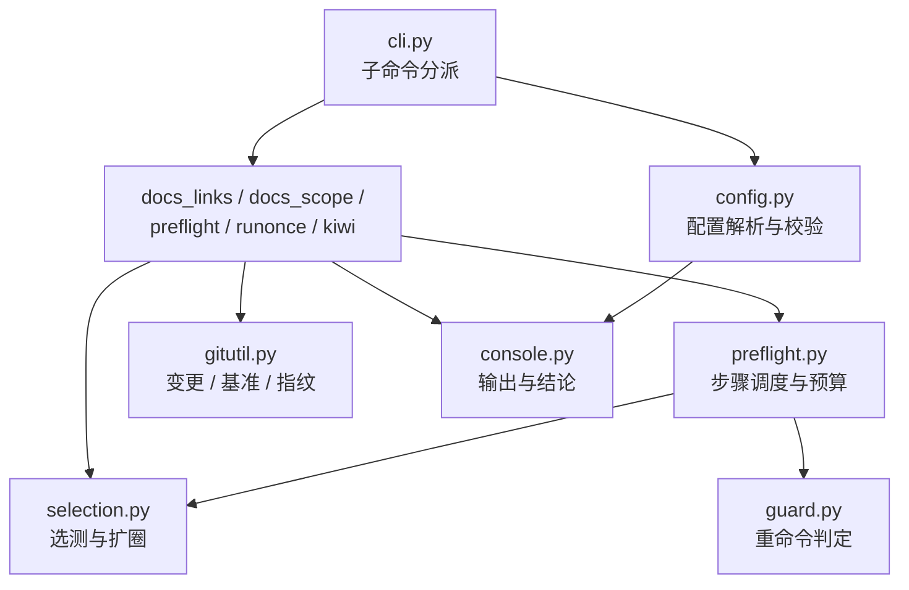

# 05 跨仓工程化工具包（`engkit`）详细设计

> 后端基座与服务化地基 · 13 测试执行粒度与工程效能 · 子任务 05（需求 13-5）· 状态：**定稿（15 项决策已确认）**

[文档首页](../../../../../../文档首页.md) › [13 测试执行粒度与工程效能](../../13_测试执行粒度与工程效能.md) › [05 跨仓工程化工具包](../13_测试执行粒度与工程效能_05_跨仓工程化工具包.md) › 详细设计　|　[需求 13-5](../../../../需求/13_需求_测试执行粒度与工程效能.md#r13-5)　|　[计划](../../../../计划/01_计划_后端基座与服务化地基.md)

## 1. 背景与目标 <a id="goal"></a>

护栏与开发脚本目前**只在 bms 仓内、且写死 bms 目录结构**：文档链接/锚点校验只 walk `bms文档/`、文档口径护栏只扫 `bms文档/`、预检与重命令包装的工程清单与路径按 bms 布局硬编码、Kiwi 用例登记两仓都只有文档模板没有脚本。在 mdm 仓的实测后果是：一次定向验证要手敲四条命令（`ruff` / `format` / `pyright` / `pytest --cov`），文档链接只能临时写脚本核对，文档口径无人守、存量长期漂移。若各仓各自复制一份，护栏会变成多份实现、口径必然分叉——与「选测器单一来源」的既有决策相悖。

**目标**：

1. **独立仓库与可安装包**：新仓 `engkit`（文档根 `engkit文档/`），Python 包 + 统一命令入口 `engkit <子命令>`；bms 侧只留行为零回退的薄包装。
2. **结构全配置化**：包内**不含任何仓名 / 目录字面**；各仓根一份 `engkit.toml`（路径、工程清单、选测映射、步骤命令、规则数据）即完成接入，新增仓库只加配置。
3. **四类能力迁入**：`links`（链接与锚点）、`docs-scope`（文档口径）、`preflight` / `run_once`（预检、选测、覆盖率门禁、预算、缓存回放、未包装拦截）、`kiwi`（用例批量登记与回读）。
4. **单一来源**：`13_01` 选测器、`13_02` 并行档位与自测按需映射、`13_03` 四项护栏随本次迁入，**全仓只有一份实现**；bms 侧命令名、参数、退出码与 CI 命令不变。
5. **各仓接入**：mdm 接入 `links` / `docs-scope` / `preflight` 并做存量文档整改；biz / cw 出接入说明。

**边界（不在本任务）**：

- **base_check 8 个校验器**（`check_base` / `check_backend_base` / `check_service_boundaries` / `check_bare_collections` / `check_system_fields` / `check_prototype_review` / `check_env_example` / `boundary_metrics` / `check_status`）的规则配置化与迁入归 **13_06**（需求 13-6，本次只登记基线）；本任务中它们仍留在 bms，`engkit preflight` 只在配置里声明「调用它们的命令」。
- **Kiwi 的 JSON-RPC 鉴权**（会话键传递口径未打通）不在本任务；`engkit kiwi` 走 SSH + Django shell（见决策 12）。
- **AST 图磁盘缓存**、**API 契约类门禁**、**前端镜像与依赖安装**均不改。

## 2. 现状实测 <a id="status"></a>

| 项 | 实测结论 |
| --- | --- |
| 迁移对象（bms `scripts/tools/`） | `preflight/check_preflight.py` 1202 行、`preflight/test_selection.py` 1198、`preflight/run_once.py` 391、`preflight/run_selected.py` 309、`preflight/coverage_gate.py` 301、`preflight/heavy_command_guard.py` 300、`preflight/full_test_guard.py` 210、`preflight/heavy_guard_boot.py` 89、`preflight/install_guard_hook.py` 169、`preflight/parallel_jobs.py` 77；`base_check/check_links.py` 88、`base_check/check_docs_scope.py` 217 |
| 预检档位 | 缺省 = 定向（`_run_scoped` 按 git 变更）；`--fast` = 只静态 + 基座/边界（自测全跑）；`--full` = 聚合全量 + 逐工程范围（`_ROOTS` 10 项） |
| 预检步骤 | 顺序硬编码在 `main()`，共 30 步：CI 配置自检 3 段、后端/工具静态 5 步、测试段（定向或全量）、基座/边界 7 步、7 个护栏自测、度量 1 步、`check_status`、网关 1、契约 3、前端 2 |
| 预算护栏 | 定向档单步 300s / 总体 420s；全量档 900s / 1800s（`--step-seconds` / `--budget-seconds` 可覆盖） |
| 覆盖率采集 | 环境变量 `BMS_COVERAGE_DATA` / `BMS_COVERAGE_SOURCE` + pytest 插件 `bms_testing_plugin`（`-p` 入口，早于被测模块导入启动采集），并发进程各落 `<data-file>.<pid>`，由 `coverage_gate.py` 合并判定 |
| 选测入口调用面 | 4 处：`check_preflight.py`（库内调用）、`run_selected.py`（库内调用）、`.gitlab-ci.yml:762`、`deploy/ci/templates/backend-service.yml:53`（均 CLI） |
| 硬编码面 | 12 个脚本含 bms 字面（`backend/`、`libs/bms_core`、`services/*`、`bms文档/`、`bms_*` 包名、`scripts/tools/`）；`check_docs_scope.py` 另有 9 条规则正则与 4 项白名单 |
| bms 内联检查 | `_yaml_parse`（CI / 编排 YAML 解析 + 关键资产存在性）、`_pytest_flags_from_ci`（`backend-test` 的 pytest 长选项校验）、`_gitlab_ci_lint`（GitLab CI Lint API）、`_frontend_typecheck`（按变更逐包 `pnpm run typecheck`）、`_frontend_api_types`（契约类型零漂移）——均为函数内联，需抽成 bms 独立脚本 |
| 选测器对 `bms_core` 的依赖 | `from bms_core.core.concurrent import ConcurrentStable*`（插入序集合类，5 个模块共 12 处）——迁入 engkit 需改为纯标准库实现（`tuple` / `list` / 保序 `dict`） |
| mdm 现状 | 默认镜像 `python:3.14-slim`、`uv sync --frozen`；`backend/pyproject.toml` 已以 git 源依赖锁 rev 引 `bms-core`（可照此引 `engkit`）；文档根 `mdm文档/`（含 `规范/ 规划/ 设计/ 项目/ 用户文档/ 资料/`） |
| mdm 文档口径 | 按 bms 现行 9 条规则实测：**违规 18 行 / 10 个文件**（bms 侧 0 违规） |
| GitLab | 分组 `bms` / `mjs` / `mj` / `xs`；`bms/engkit` 尚未创建；`deploy/.env` 的 `GITLAB_API_TOKEN` 为 admin PAT，可建仓 |
| Kiwi | JSON-RPC `Auth.login` 以**位置参数** `[用户名, 密码]` 可取会话键，但业务方法四种会话传递写法均 `Authentication failed`、网页登录 POST 403；SSH + `manage.py shell` 为文档已跑通口径 |
| 工作区 | 根仓只跟踪配置（`AGENTS.md` / `README.md` / `scripts/` / `.opencode/` / `.vscode/` / `.ignore` / `*.code-workspace`）；`bms/` 等仓目录由 `.gitignore` 全忽略 + `.ignore` 反消除；搭建脚本 `scripts/tools/workspace/setup_workspace.py`（含 `IGNORE_TEMPLATE`） |

## 3. 决策确认 <a id="decide"></a>

| # | 事项 | 决策 |
| --- | --- | --- |
| 1 | 仓库归属 | 新仓 `bms/engkit`（与 `bms/test` 同组，内网匿名只读口径沿用） |
| 2 | bms 侧取得 engkit | **平级克隆 + 路径探测**：先 `import engkit`，失败按 `ENGKIT_HOME` → 同级 `../engkit` 注入 `sys.path`；CI 各 job 按锁定 SHA 克隆一步 |
| 3 | 依赖边界 | **核心纯标准库 + 增强能力降级**：核心零三方依赖；增强能力缺装时打印「降级（缺 X）」并继续，不静默 |
| 4 | 预检边界 | **engkit 只做调度**：变更检测 / 选测 / 覆盖率门禁 / 预算 / 自测按需 / 缓存；步骤全由 `engkit.toml` 声明；bms 内联检查抽成 bms 独立脚本后在配置里声明 |
| 5 | 迁移范围 | 四类能力 + `run_once`（含重命令拦截）；base_check 8 个校验器不迁，另立 13_06 |
| 6 | 重命令拦截 | 统一为 engkit 内一套（判定 / 提示 / `.pth` 钩子 / pytest 插件两通道合并）；bms 安装入口改调 engkit |
| 7 | engkit 门禁 | `pytest` + `ruff` + `pyright` + 覆盖率**行 + 分支 100%** |
| 8 | 自举方式 | **双轨**：基础门禁直跑（必绿、不依赖 engkit）+ 自举烟雾 job（`engkit preflight --fast`，失败即阻断，不设软门禁） |
| 9 | 13_03 护栏用例 | 四项护栏整体迁入 `engkit/tests/`，bms 侧删除；Kiwi **2319** 编号沿用、用例位置改到 engkit |
| 10 | 规则数据落点 | 各仓根**单一** `engkit.toml`（路径 / 工程清单 / 选测映射 / 步骤命令 / `[rules.*]`），结构校验失败即报错 |
| 11 | mdm 接入面 | `links` + `docs-scope` + `preflight` 三项（本地 + CI）+ 存量文档整改 |
| 12 | kiwi 通道 | SSH + Django shell（凭据从各仓 `deploy/.env` 或环境变量取，不入库） |
| 13 | 工作区登记 | engkit 为**必选仓**；仓根建 `bms文档 → ../bms/bms文档` 软链；同步 `AGENTS.md` / `README.md` / `setup_workspace.py` / `.ignore` / `*.code-workspace` |
| 14 | biz / cw 说明 | 落 `engkit文档/资料/工具/接入说明/`，bms 任务文档只链接引用 |
| 15 | 后续任务 | 需求顺延 **13-6** + 嵌套子任务 **13_06**（规模与时间在计划表登记），本次只建基线 |

## 4. 交付物清单 <a id="deliver"></a>

### 4.1 新仓 `engkit`

```text
engkit/
├── pyproject.toml                    # 包元数据 + 入口 `engkit`（零运行期依赖；dev 组 pytest/ruff/pyright/pytest-cov）
├── README.md                         # 用法入口与接入指引
├── .gitignore                        # .cache / __pycache__ / .venv / .coverage*
├── .gitlab-ci.yml                    # 基础门禁（直跑）+ 自举烟雾 job
├── engkit.toml                       # engkit 自身配置（自举烟雾用）
├── bms文档 -> ../bms/bms文档          # 软链（仓根，不入库）
├── engkit文档/                        # 文档根
│   ├── 文档首页.md                    # 全量导航
│   ├── 概述/工程化工具包说明.md         # 定位、五个子命令、配置 schema 全表
│   ├── 规范/工具包开发约定.md           # 包内红线（无仓名字面 / 单一来源 / 覆盖率口径引用）
│   └── 资料/工具/接入说明/             # 新仓接入步骤 + bms / mdm 实例 + biz / cw 待办
├── src/engkit/
│   ├── __init__.py                   # 版本与公开 API
│   ├── __main__.py                   # `python -m engkit`
│   ├── cli.py                        # 子命令分派与退出码
│   ├── config.py                     # engkit.toml 解析 + dataclass 校验
│   ├── console.py                    # 输出（UTF-8）/ 进度 / 结论汇总
│   ├── gitutil.py                    # 变更清单 / 基准判定 / 工作区指纹
│   ├── docs_links.py                 # `links`
│   ├── docs_scope.py                 # `docs-scope`
│   ├── selection.py                  # 选测：后端双重收敛 + 前端反向闭包 + 覆盖率扩圈
│   ├── preflight.py                  # 预检引擎：步骤调度 / 预算 / 档位 / 度量
│   ├── runonce.py                    # `run_once` 缓存回放
│   ├── guard.py                      # 重命令判定 / 提示 / 钩子安装
│   ├── coverage_plugin.py            # pytest 入口插件：覆盖率采集（导入即启动）+ 守卫转调（唯一实现）
│   └── kiwi.py                       # `kiwi` 批量登记与回读
└── tests/                            # 与 src 同构的 pytest 用例（覆盖率 100%）
    ├── conftest.py                   # 迷你仓库夹具（tmp_path 造桩仓）
    ├── test_cli.py test_config.py test_gitutil.py
    ├── test_docs_links.py test_docs_scope.py
    ├── test_selection_backend.py test_selection_frontend.py test_selection_coverage.py
    ├── test_preflight.py test_runonce.py test_guard.py test_kiwi.py
    └── test_guards.py                # 13_03 四项护栏（Kiwi 2319，迁入）
```

### 4.2 bms 侧（薄包装 + 配置 + CI）

```text
bms/
├── engkit.toml                                   # 新增：bms 仓配置（唯一）
├── scripts/tools/preflight/
│   ├── check_preflight.py                        # 改：薄包装（转发 engkit preflight，参数/退出码不变）
│   ├── run_once.py                               # 改：薄包装（转发 engkit run_once）
│   ├── test_selection.py                         # 改：薄包装（转发 engkit 选测，5 种 --format 不变）
│   ├── run_selected.py                           # 改：薄包装（转发 engkit 定向执行，参数不变）
│   ├── coverage_gate.py                          # 改：薄包装（转发 engkit 覆盖率门禁）
│   ├── parallel_jobs.py                          # 改：薄包装（转发 engkit 并行档位）
│   ├── heavy_command_guard.py                    # 改：薄包装（转发 engkit guard）
│   ├── full_test_guard.py                        # 改：薄包装（併入 engkit guard）
│   ├── heavy_guard_boot.py                       # 改：薄包装（.pth 启动钩子转调 engkit）
│   ├── install_guard_hook.py                     # 改：薄包装（转调 engkit guard install-hook）
│   ├── check_ci_config.py                        # 新增：CI YAML 解析 / pytest 选项 / GitLab Lint / 资产存在性
│   ├── check_frontend_types.py                   # 新增：按变更逐包 typecheck
│   └── README.md                                 # 改：入口与配置口径、单一来源约束更新
├── scripts/tools/base_check/check_links.py       # 改：薄包装（转发 engkit links）
├── scripts/tools/base_check/check_docs_scope.py  # 改：薄包装（转发 engkit docs-scope，--self-test 保留）
├── backend/libs/bms_core/tests/boundary/
│   ├── test_test_selection_guard.py              # 改：断言改为「engkit 为唯一实现 + 本仓配置齐备」
│   ├── test_preflight_scoping_guard.py           # 改：同上（Kiwi 2311 编号不变）
│   ├── test_run_once_guard.py                    # 改：同上
│   └── test_selection_contract_guard.py          # 删：四项护栏迁 engkit（Kiwi 2319 随迁）
├── backend/bms_testing_plugin.py                 # 改：薄转发到 engkit.coverage_plugin（采集 + 守卫），保留基座夹具注册
└── .gitlab-ci.yml                                # 改：engkit 克隆步 + base-integrity / backend-test 等调用保持
```

### 4.3 mdm 侧

```text
mdm/
├── engkit.toml                                   # 新增：mdm 配置（links / docs-scope / preflight）
├── backend/pyproject.toml                        # 改：git 源依赖 `engkit` 锁 rev（与 bms-core 同构）
├── .gitlab-ci.yml                                # 改：docs-links / docs-scope / backend-test 接入
└── mdm文档/**                                    # 改：10 个文件的进度类字段清理（18 行）
```

### 4.4 工作区根仓

```text
AGENTS.md                          # 改：仓库清单 / 引用写法 / 工程化工具包小节
README.md                          # 改：从零搭建含 engkit
scripts/tools/workspace/setup_workspace.py   # 改：ENGS 常量 + IGNORE_TEMPLATE + 克隆与软链
.ignore                            # 改：补 `!engkit/`
bizs.code-workspace                # 改：folders 增 engkit
```

### 4.5 数据库

**无**（无表 / 列 / 索引 / 迁移）。

## 5. 包结构设计 <a id="package"></a>

### 5.1 分层与依赖方向 <a id="package-layers"></a>



- **只准上层依赖下层**；`config` 不依赖任何子命令模块，`console` / `gitutil` 不依赖业务模块。
- 包内**禁止**出现仓名与目录字面：所有路径、包名、命令、规则数据来自 `engkit.toml`；包内唯一允许的字面是**子命令名**、**配置键名**与**通用中文规则词**（进度类字段词面）。

### 5.2 集合类型口径 <a id="package-types"></a>

bms 侧原先用 `bms_core.core.concurrent.ConcurrentStable*`（插入序集合类）保证输出稳定。迁入 engkit 后**不引 bms_core**（跨仓依赖会破坏「独立安装包」），改为：

- 有序去重 → `dict.fromkeys(...)` 保持插入序；
- 不可变结果 → `tuple`；
- 需要集合语义处 → `set` 仅作中间态，输出前一律按发现序或路径序排序。

因此**输出顺序契约**（`test_paths` 按工程序、`packages` 按 workspace 声明序、违规清单按路径序）由 engkit 显式排序保证，bms 侧所有断言与度量行格式不变。

## 6. 配置设计（`engkit.toml`） <a id="config"></a>

### 6.1 结构总览 <a id="config-shape"></a>

各段职责与校验规则（**全部字段在 `config.py` 以 dataclass 承载，缺段 / 类型错 / 未知键即报错并退出码 2**）：

| 段 | 内容 | 缺省 |
| --- | --- | --- |
| `[repo]` | `name`（输出文案用，不参与探测） | 取仓库目录名 |
| `[docs]` | `root`（文档根）、`skip`（不参与校验的路径前缀，如本地凭据目录） | 必填 `root` |
| `[docs.scope]` | `allow_marker`、`whitelist_dirs`、`whitelist_files`、`plan_dir_pattern`、`extra_rules` | 包内通用 9 条规则 + 空白名单 |
| `[backend]` | `root`、`groups`、`test_prefix`、`projects`（全量档工程范围）、`coverage_packages` | 必填 `root` |
| `[frontend]` | `root`、`groups`、`workspace_protocol` | 可选（无前端则整段省略） |
| `[selection]` | `base_threshold`、`base_ratio` | `100` / `0.6` |
| `[rules.backend.global]` | `exact` / `prefixes` / `config_prefix` + `config_suffix` | 空 |
| `[[rules.backend.extra_tests]]` | `match_prefix` + （`test_dir_suffix` \| `test_files` \| `mapping` + `fallback_dir`）+ `coverage` | 空 |
| `[rules.frontend.global]` | `exact` / `prefixes` | 空 |
| `[coverage]` | `data_env`、`source_env`、`fail_under`、`plugin`、`pythonpath`、`data_file` | `fail_under=100` |
| `[pytest]` | `cmd`、`cwd`、`jobs_flag` | `--jobs` |
| `[preflight]` | `budget.scoped`、`budget.full`、`steps`、`self_tests` | — |
| `[kiwi]` | `host_env`、`user_env`、`container`、`env_file`、`manage` | — |

### 6.2 预检步骤声明 <a id="config-steps"></a>

`[[preflight.steps]]` 按声明序执行，字段：

| 字段 | 取值 | 说明 |
| --- | --- | --- |
| `label` | 文本 | 输出标签 |
| `type` | `command` / `scoped_tests` / `full_tests` / `project_tests` | 步骤类型（缺省 `command`） |
| `cmd` | 字符串数组 | `command` 类型必填；支持占位符 `{python}`（当前解释器）、`{root}`（仓库根）、`{config}`（配置文件） |
| `cwd` | 相对仓库根 | 缺省取 `[preflight].cwd`（缺省仓库根） |
| `preset` | `always` / `scoped` / `fast` / `full` | 缺省 `always`（`--fast` / `--full` / 定向档全执行）；`scoped` 仅定向档、`fast` 仅 `--fast`、`full` 仅 `--full` |
| `optional` | 布尔 | 命令不存在时打印「跳过（未安装）」而不计失败（缺省 `false`） |

`[[preflight.self_tests]]`：`label` + `cmd` + `deps`（触发前缀）——`--fast` / `--full` 全跑；定向档按变更命中执行，未命中逐条打印跳过；变更基准不可判定时全跑（不静默跳过）。

`type = "scoped_tests"` 的步骤由 `[pytest]` 与 `[coverage]` 驱动：读变更 → `selection.build` → 无测试即跳过 → 调执行器（pytest 命令 + 覆盖率门禁 + 扩圈 ≤2 轮 + 退化兜底）→ 打印 `[test-selection] picked=…/… degraded=… rounds=… cov=… 模块` 度量行。
`type = "full_tests"` 跑聚合全量 + 覆盖率门禁；`type = "project_tests"` 按 `[backend].projects` 逐工程跑。

### 6.3 bms 实例（节选） <a id="config-bms"></a>

```toml
[repo]
name = "bms"

[docs]
root = "bms文档"
skip = ["bms文档/用户文档/"]

[docs.scope]
whitelist_dirs = ["规范/", "资料/", "用户文档/"]
whitelist_files = ["规划/总体项目规划.md"]
plan_dir_pattern = "^项目/[^/]+/计划/"

[backend]
root = "backend"
groups = ["libs", "services"]
test_prefix = "test_"
projects = ["libs/bms_core", "services/txn", "services/platform", "services/identity",
            "services/tenant", "services/file", "services/notification",
            "services/search", "services/ai", "services/report"]
coverage_packages = ["bms_core", "bms_txn", "bms_platform", "bms_identity", "bms_tenant",
                     "bms_file", "bms_notification", "bms_search", "bms_ai", "bms_report"]

[frontend]
root = "frontend"
groups = ["packages", "apps", "modules"]

[rules.backend.global]
exact = ["backend/pyproject.toml", "backend/uv.lock", ".gitlab-ci.yml"]
prefixes = ["backend/alembic/", "deploy/"]
config_prefix = "backend/config"
config_suffix = ".toml"

[[rules.backend.extra_tests]]
match_prefix = "backend/ops/"
test_dir_suffix = "/tests/ops/"
coverage = false

[[rules.backend.extra_tests]]
match_prefix = "scripts/tools/preflight/"
test_files = ["libs/bms_core/tests/boundary/test_test_selection_guard.py",
              "libs/bms_core/tests/boundary/test_preflight_scoping_guard.py",
              "libs/bms_core/tests/boundary/test_run_once_guard.py"]

[[rules.backend.extra_tests]]
match_prefix = "scripts/tools/base_check/"
fallback_dir = "libs/bms_core/tests/boundary"
mapping = [
  { script = "check_bare_collections.py", test = "libs/bms_core/tests/boundary/test_bare_collections_guard.py" },
  { script = "check_env_example.py", test = "libs/bms_core/tests/core/test_basic_protection.py" },
  { script = "check_backend_base.py", test = "libs/bms_core/tests/core/test_value_object_roots.py" },
  { script = "check_service_boundaries.py", test = "libs/bms_core/tests/crosscut/test_module_boundary.py" },
]

[coverage]
data_env = "BMS_COVERAGE_DATA"
source_env = "BMS_COVERAGE_SOURCE"
fail_under = 100
plugin = "bms_testing_plugin"
pythonpath = ["backend"]
data_file = "backend/.coverage"

[pytest]
cmd = "uv run pytest"
cwd = "backend"

[kiwi]
env_file = "deploy/.env"
host_env = "MJBK_IP"
user_env = "MJBK_SSH_USER"
container = "bms-kiwi"
```

`[preflight]` 的 30 步逐条对应现行 `main()` 顺序（静态 5 步 → 测试段 1 步（`scoped_tests`）/ 全量段 2 步 → 基座与边界 7 步 → 自测 7 项 → 度量 1 步 → 文档 / 网关 / 契约 5 步 → 前端 3 步），实施记录逐条给出映射表。

### 6.4 mdm 实例（节选） <a id="config-mdm"></a>

```toml
[repo]
name = "mdm"

[docs]
root = "mdm文档"

[docs.scope]
whitelist_dirs = ["规范/", "资料/", "用户文档/"]
plan_dir_pattern = "^项目/[^/]+/计划/"

[backend]
root = "backend"
groups = ["services"]
projects = ["services/org"]
coverage_packages = ["mdm_org", "services", "ops"]

[pytest]
cmd = "uv run pytest"
cwd = "backend"

[coverage]
data_env = "MDM_COVERAGE_DATA"
source_env = "MDM_COVERAGE_SOURCE"
fail_under = 100         # 与其他仓统一（行 + 分支 100%，不设例外；缺口随接入一次补齐）
data_file = "backend/.coverage"
```

## 7. 子命令接口 <a id="api"></a>

### 7.1 `engkit links` <a id="api-links"></a>

```text
engkit links [根目录] [--config PATH] [--quiet]
```

- 扫描 `[docs].root` 下全部 `.md`，校验 Markdown 相对链接（文件存在）与锚点（`id="…"` 存在）。
- 跳过：`http` / `mailto` / `data:` 外部链接、行内代码里的内容、`[docs].skip` 前缀（本地凭据文档）。
- 输出：`链接自洽：断链 N 处，失效锚点 M 处（扫描根：…）`；有问题列前 50 条。
- 退出码：`0` 通过；`1` 存在问题；`2` 文档根缺失或配置非法。

### 7.2 `engkit docs-scope` <a id="api-scope"></a>

```text
engkit docs-scope [根目录] [--config PATH] [--self-test]
```

- 规则：包内 9 条通用规则（`工时` / `排期` / `里程碑` / `甘特` / `波次` / `工期` / `M{1,2}` 里程碑编号 / `{数字}h` 工时数字）；`[docs.scope].extra_rules` 可追加（正则 + 标签）。<!-- docs-scope:allow:列举护栏规则词面本身，非本仓进度数据 -->
- 白名单：`whitelist_dirs` / `whitelist_files` / `plan_dir_pattern`；行内含 `allow_marker`（缺省 `docs-scope:allow`）即豁免。
- `--self-test`：跑内置判定向量（与 pytest 用例同源，抽自现脚本 22 条断言），退出码 `0/1`。
- 退出码：`0` 零违规；`1` 有违规；`2` 文档根缺失。

### 7.3 `engkit preflight` <a id="api-preflight"></a>

```text
engkit preflight [根目录] [--config PATH] [--fast | --full] [--no-scope] [--no-cov]
                 [--jobs auto|N|off] [--budget-seconds N] [--step-seconds N] [--self-test]
```

- 档位：缺省定向；`--fast` 只跑 `preset=always|fast` 且跳过测试段；`--full` 跑 `always|full` 与全量测试段（`--no-scope` 跳过逐工程范围）。
- 预算：定向 `300/420`、全量 `900/1800`（配置可改，命令行优先）；超时即中止剩余步骤并在结论里登记失败项。
- 未包装拦截：本地非 CI 且未经 `run_once` 包装时打印拦截提示、退出码 `1`、命令零执行（逃生开关 `ENGKIT_ALLOW_UNWRAPPED=1`，兼容旧名 `BMS_ALLOW_UNWRAPPED`）。
- `--self-test`：定向推导 / 预算 / 自测登记 / 工程登记对账（原 15 条断言，抽到 `config` + `selection` 后可断言的保留，与 pytest 用例同源）。
- 退出码：`0` 全通过；`1` 有失败项或被拦截；`2` 配置非法。

### 7.4 `engkit run_once` <a id="api-runonce"></a>

```text
engkit run_once [--force] [--show] [--window-seconds N] [--cache-dir PATH] -- <命令...>
```

- 缓存键 = 命令 + 工作目录 + 工作区指纹（`HEAD` + 已跟踪变更与未跟踪文件内容哈希）；窗口缺省 1800 秒；命中即回放完整输出与退出码并标注「回放」。
- 缓存落 `[runonce].cache_dir`（缺省 `<仓库根>/.cache/run_once`，配置可覆盖，用例指向 `tmp_path` 防自污染）。
- 执行时向子进程注入 `ENGKIT_RUN_ONCE=1`（`guard` 据此放行）。
- 退出码：透传子进程退出码；选项错误 `2`。

### 7.5 `engkit kiwi` <a id="api-kiwi"></a>

```text
engkit kiwi register --cases FILE.toml [--dry-run] [--root R]
engkit kiwi list [--limit N] [--root R]
engkit kiwi ping [--root R]
```

- 传输：`ssh <user>@<host> "docker exec -i <container> /Kiwi/manage.py shell"`，脚本经 stdin 传入（不落盘进容器）。
- 凭据与主机：`[kiwi].env_file`（缺省 `deploy/.env`）读取 `host_env` / `user_env` 指定的键；环境变量优先；**任何值不打印、不入库**。
- 用例清单（TOML，纯标准库解析）：

```toml
[[case]]
summary = "13_05 engkit 跨仓工程化工具包"
category = "平台骨架"
priority = "P2"
status = "CONFIRMED"
tags = ["自动化"]
text = "覆盖范围…／自动化文件路径…"
```

- `--dry-run` 只打印将执行的 Python 脚本与用例条数，不连远端；`register` 回读并打印新用例号；`list` 打印最近 N 条 `(id, summary)`；`ping` 校验 SSH 与容器可达。
- 退出码：`0` 成功；`1` 远端失败 / 回读不一致；`2` 配置或凭据缺失。

### 7.6 `engkit guard` <a id="api-guard"></a>

```text
engkit guard check  [--config PATH] -- <命令...>   # 判定是否拦截（拦截退出 1）
engkit guard install-hook [--venv PATH] [--config PATH]
engkit guard check-hook   [--venv PATH]
engkit guard remove-hook  [--venv PATH]
```

- 判定类别：预检 / 基座校验 / 选测器脚本、超阈值目录级 pytest（≥20 个测试文件）、全量 pytest（无路径参数且非 `--help`）。CI 环境（`CI` / `GITLAB_CI`）与已包装环境放行。
- 钩子：向 venv `site-packages` 写 `engkit_heavy_guard.pth`（引导模块路径 + 硬退出），与 pytest 插件入口（`guard.pytest_configure`）两条通道共用同一 `classify()`。
- 旧入口兼容：bms 侧 `install_guard_hook.py` 保留 `--check` / `--remove` 语义，转发本组子命令。

## 8. bms 侧接入 <a id="bms"></a>

### 8.1 包定位（路径探测） <a id="bms-bootstrap"></a>

`scripts/tools/engkit_boot.py`（薄包装共用，约 40 行）：

```python
def ensure_engkit() -> None:
    """确保 `import engkit` 可用（已安装 → 直用；否则按 ENGKIT_HOME → 同级 ../engkit 注入 sys.path）。"""
```

- 顺序：`import engkit` 成功即返回 → 读环境变量 `ENGKIT_HOME`（目录存在即注入 `<home>/src`）→ 同级 `<仓库根>/../engkit` → 仍失败则打印安装指引并以退出码 `2` 结束。
- 包装脚本**不复制任何逻辑**：参数、帮助文本、退出码全部转发 engkit。

### 8.2 CI 接入 <a id="bms-ci"></a>

各需要的 job 前置一步（模板片段，写入 `.gitlab-ci.yml` 的 `.engkit-setup`）：

```bash
ENGKIT_REV="<锁定 SHA>"   # 流水线变量，与 bms 仓 engkit.toml 同步登记
if [ ! -d ../engkit ]; then
  git clone --quiet --no-checkout "${ENGKIT_REPO_URL:-${CI_SERVER_PROTOCOL}://gitlab-ci-token:${CI_JOB_TOKEN}@${CI_SERVER_HOST}/bms/engkit.git}" ../engkit
fi
git -C ../engkit checkout --quiet "$ENGKIT_REV"
export ENGKIT_HOME="$CI_PROJECT_DIR/../engkit"
```

- 影响 job：`base-integrity`、`backend-test`（含 `run_selected.py`）、前端三个选测 job（`test_selection.py`）、`tooling-lint`（ruff 覆盖 `scripts/tools` 时不吃 engkit，不需要克隆）。
- 命令原文不变（`python scripts/tools/...`），只有前置克隆一步。

### 8.3 行为零回退校验 <a id="bms-compat"></a>

| 入口 | 保底断言 |
| --- | --- |
| `check_preflight.py` | `--fast` / 定向 / `--full` / `--no-cov` / `--no-scope` / `--jobs` / `--budget-seconds` / `--step-seconds` / `--self-test` 全部可用；失败汇总格式与退出码不变 |
| `run_once.py` | `--force` / `--show` / `--window-seconds` 语义不变，回放标注不变 |
| `test_selection.py` | 5 种 `--format`（`json` / `pytest-args` / `cov-args` / `projects` / `packages`）+ `changed-services` 输出字段与顺序不变 |
| `run_selected.py` | 参数与退出码（含超时 `124`）不变，度量行格式不变 |
| `check_docs_scope.py` | `--self-test` 通过、退出码 `0/1/2` 不变 |
| `check_links.py` | 输出与退出码不变 |
| `install_guard_hook.py` | `--check` 缺/过期退出 `1`，`--remove` 幂等 |

## 9. mdm 接入与存量整改 <a id="mdm"></a>

1. `backend/pyproject.toml` 增 git 源依赖（与 `bms-core` 同构）：

```toml
[tool.uv.sources]
engkit = { git = "http://<GitLab>/bms/engkit.git", rev = "<SHA>" }
```

2. `mdm/engkit.toml`（§6.4 实例，`[preflight]` 步骤：`gate 冒烟` / `ruff check` / `ruff format --check` / `pyright` / `scoped_tests`）。
3. CI 接线：`lint` 阶段新增 `docs-links` 与 `docs-scope` 两步（并入 `gate-smoke` 或独立 job）；`backend-test` 改 `uv run engkit preflight`（定向档）。
4. **存量整改**：实测 18 行 / 10 个文件；按「进度类字段只在阶段计划登记」清理——可归并到 `mdm文档/项目/<阶段>/计划/` 的移入计划表；确属「引用规范原文」的行保留并加 `<!-- docs-scope:allow:理由 -->`；整改后 `engkit docs-scope` 零违规。
5. 验收：`engkit links` 零断链、`engkit docs-scope` 零违规、`engkit preflight` 一条命令跑出定向用例与覆盖率门禁。

## 10. 工作区模型同步 <a id="workspace"></a>

| 落点 | 改动 |
| --- | --- |
| `AGENTS.md` | 工作区模型仓库清单增 `engkit`（必选仓）；「依赖管理」「代码与文档检索」两节补 engkit 相关口径；新增「工程化工具包（engkit）」小节指向 `engkit文档/` |
| `README.md` | 「从零搭建工作区」补 engkit 克隆与 `bms文档` 软链 |
| `scripts/tools/workspace/setup_workspace.py` | `ENGKIT_NAME` 常量、`--engkit` 参数（缺省必选）、`IGNORE_TEMPLATE` 补 `!engkit/`、克隆与软链、核对段纳入 |
| `.ignore` | 补 `!engkit/`（五条反消除） |
| `bizs.code-workspace` | `folders` 增 `{ "path": "engkit", "name": "工程化工具包" }` |
| `bms/bms文档/文档首页.md` | 不改（engkit 文档不在 bms 内） |

## 11. 测试设计 <a id="test"></a>

### 11.1 engkit 用例（覆盖率 100%）

| 组 | 用例文件 | 断言要点 |
| --- | --- | --- |
| A 配置 | `test_config.py` | 各段解析、缺段 / 类型错 / 未知键报错、缺省值、`{python}` / `{root}` 占位符替换、`extra_rules` 追加 |
| B 变更 | `test_gitutil.py` | `diff` + 未跟踪合并、去重与 posix 化、基准不可判定、指纹随内容变化、命令失败降级 |
| C 链接 | `test_docs_links.py` | 断链 / 失效锚点 / 外部链接 / 行内代码 / `skip` 前缀 / 退出码 0·1·2 |
| D 口径 | `test_docs_scope.py` | 9 条规则命中与不命中、白名单三类、`allow_marker` 豁免、`extra_rules`、退出码 0·1·2 |
| E 选测-后端 | `test_selection_backend.py` | 工程发现、目录同构、AST 传递与跨目录、测试文件自身变更、退化三触发、`extra_tests` 三类、工程登记对账 |
| F 选测-前端 | `test_selection_frontend.py` | 包发现、workspace 反向闭包、根配置退化、空集 |
| G 覆盖率 | `test_selection_coverage.py` | 报告缺行解析、扩圈并集、不增长即退化、门禁判定（行 + 分支） |
| H 预检 | `test_preflight.py` | 四档位步骤集合、预算超时中止、`optional` 跳过、自测按需三态（命中 / 未命中 / 不可判定）、度量行解析、未包装拦截与逃生开关 |
| I 回放 | `test_runonce.py` | 命中回放（输出 + 退出码 + 标注）、指纹变化失效、`--force` / `--show` / 窗口、`tmp_path` 隔离 |
| J 拦截 | `test_guard.py` | 拦截类别判定、CI / 已包装 / 逃生放行、钩子安装 / 校验 / 卸载幂等 |
| K Kiwi | `test_kiwi.py` | 用例清单解析、`--dry-run` 不触网、SSH 命令拼装（假执行器）、凭据缺失退出 2、回读不一致退出 1、凭据不回显 |
| L 护栏 | `test_guards.py` | **13_03 四项**（Kiwi 2319）：同一来源（engkit 为唯一实现 + 包装脚本不含推导）、新增工程必登记、退化显式、扩圈不静默 |

### 11.2 bms 侧用例调整

| 文件 | 调整 |
| --- | --- |
| `test_test_selection_guard.py`（Kiwi 2316） | 断言选测结果与 engkit CLI 一致；新增「包装脚本不含推导规则（不出现 AST / 同构实现字样）」断言 |
| `test_preflight_scoping_guard.py`（Kiwi 2311） | 三条 `_scope_targets` 断言改为经 engkit 取值；预算两条断言改读 engkit 配置 |
| `test_run_once_guard.py`（Kiwi 2317） | 断言包装转发后缓存命中 / `--force` 行为不变 |
| `test_selection_contract_guard.py`（Kiwi 2319） | **删除**（用例整体迁 engkit `tests/test_guards.py`，编号沿用） |

### 11.3 验收映射

| 任务完成标准 | 落点 |
| --- | --- |
| `engkit` 可按 rev 安装且五个子命令可用 | `pyproject.toml` + `test_cli.py` 各子命令 `--help` 与退出码 |
| 包内无仓名字面（机器断言） | `test_guards.py`：扫 `src/engkit/**` 断言不含各仓文档根 / 源码根 / 包名字面 |
| bms 侧入口与 CI 命令行为不回退 | §8.3 表 + bms 侧 3 个护栏用例 + 实测四档位 |
| mdm 接入后零断链 / 零违规 / 一条命令 | mdm 侧实跑记录（`links` / `docs-scope` / `preflight`） |
| 13_01 选测器与 13_03 护栏只有一份实现 | `test_guards.py` 四项护栏 + bms 包装「无推导规则」断言 |
| 工作区文档与搭建脚本已含 engkit | 同步后实跑 `setup_workspace.py --help` 与 `rg engkit` 核对 |
| Kiwi 凭据只在 `deploy/.env` / 环境变量 | `test_kiwi.py` 凭据缺失 / 不回显断言 + 文档写明 |

### 11.4 Kiwi 用例登记

按「一个任务一条」登记 **1 条**（分类「平台骨架」、`P2`、`CONFIRMED`、标签「自动化」），`text` 写覆盖范围（配置化 / 五个子命令 / 单一来源 / 触碰 bms 与 mdm 两侧）与自动化文件路径；**编号以平台回读为准**，登记后回填 `@pytest.mark.kiwi_id(…)` 与任务测试记录。既有 **2319** 随用例迁入 engkit，编号不变。

## 12. 登记落点 <a id="register"></a>

| 落点 | 内容 |
| --- | --- |
| 计划表 | 13_05 状态 / 完成日期 / 资源（唯一落点）；13_06 基线登记 |
| 需求文档 | 顺延新增 **13-6**（base_check 校验器迁入与各仓规则对齐）+ 需求总览计数 |
| 任务树 | 新增嵌套子任务 **13_06**（挂 13 域，同级于 13_05） |
| `engkit文档/` | 概述（配置全表）、接入说明（bms / mdm / biz / cw）、开发约定 |
| `bms/scripts/tools/preflight/README.md` | 入口改为「转发 engkit」、单一来源约束第 6~9 条改写为跨仓口径 |
| `bms/bms文档/规范/测试规范.md` | §2.1 补一句「推导与护栏实现位于工程化工具包（engkit），本仓只保留薄包装」（不改条款口径） |
| 实施 / 测试记录 | 本目录 `实施/`、`测试/` 各一份 |

## 13. 实施步骤 <a id="steps"></a>

1. GitLab 建仓 `bms/engkit` + 本地克隆到工作区平级 + 包骨架 + `engkit文档/` 首页。
2. `config.py` / `console.py` / `gitutil.py` / `cli.py` 骨架与用例。
3. `docs_links` / `docs_scope` 迁入 + 用例；bms 两个包装入口切换。
4. `selection.py` 迁入（去 `bms_core` 依赖、配置化）+ `runonce` / `guard` 迁入 + 用例。
5. `preflight.py` 引擎 + `engkit.toml`（bms 全量 30 步）+ bms 内联检查抽成两个 bms 脚本 + 包装切换。
6. `kiwi.py` + 用例；bms 侧文档补用例清单模板。
7. bms 侧 CI 接 `engkit` 克隆步；四档位与护栏用例实跑。
8. mdm：配置 + 依赖 + CI + 存量整改 + 三项实跑。
9. 工作区：`AGENTS.md` / `README.md` / `setup_workspace.py` / `.ignore` / `*.code-workspace`。
10. 验证（engkit 基础门禁 + 自举烟雾、bms 预检定向档、mdm 三项）→ 回写 → 记录 → 分仓提交。

## 14. 边界与开放项 <a id="open"></a>

| # | 项 | 归口 |
| --- | --- | --- |
| 1 | base_check 8 个校验器规则配置化与迁入 | 13_06 |
| 2 | `check_base.py` → 护栏用例映射的存量缺口 | 13_06 一并补 |
| 3 | Kiwi JSON-RPC 会话鉴权 | 遗留（文档「用例登记」节已注明走 SSH） |
| 4 | engkit 自身 AST 图磁盘缓存 | 不做（全图 0.36s） |
| 5 | 前端镜像内 `git` / `python3` | 不涉（engkit 纯 Python，前端 job 已有） |
| 6 | engkit 版本升级流程（rev 同步） | 接入说明写明「改 `ENGKIT_REV` / `rev` 三处」；Renovate 接入另行评估 |
| 7 | biz / cw 实际接入 | 随各自窗口，按 `engkit文档/资料/工具/接入说明/` 执行 |

## 15. 对齐记录 <a id="align"></a>

| 日期 | 事项 | 处置 |
| --- | --- | --- |
| 2026-10-23 | 任务原口径「四类能力迁入」，用户要求 base_check 一并迁以实现各仓统一对齐 | 拆为 13_05（四类 + run_once）+ 13_06（base_check 迁入），15 项决策逐项确认 |
| 2026-10-23 | bms 侧如何取得 engkit（git 源依赖会牵动 uv.lock 与 CI 基础镜像重建） | 采「平级克隆 + 路径探测」，CI 按锁定 SHA 克隆一步（决策 2） |
| 2026-10-23 | engkit 覆盖率 100% 与「自己测自己」的关系 | 用例用迷你仓夹具直测实现；门禁双轨（基础门禁直跑 + 自举烟雾），缓存目录可配防自污染（决策 8） |
| 2026-10-23 | 13_03 四项护栏迁走后 bms 侧是否留断言 | 用例整体迁走、bms 侧删；改由「包装脚本不含推导规则」断言 + 选测结果一致性断言锁单一来源（决策 9） |
| 2026-10-23 | Kiwi JSON-RPC 实测：登录可取会话键，但业务方法鉴权四种写法均失败 | `engkit kiwi` 走 SSH + Django shell（决策 12），RPC 列遗留 |
| 2026-10-23 | mdm 实测 4 处断链全部指向含空格目录（链接写作 `%20`），目标文件真实存在 | 判定为 `links` 未做 URL 解码的缺口：解析前 `unquote`（路径与锚点同办），engkit 补 2 条用例（§7.1 口径不回退） |
| 2026-10-23 | mdm 接入 `preflight` 时发现「早于被测模块导入启动采集」的 pytest 插件只有 bms 有（`bms_testing_plugin`） | 新增 `engkit.coverage_plugin` 承担采集与守卫（唯一实现）；bms 插件退化为薄转发（保留 `bms_core.testing` 夹具注册），mdm 直接 `-p engkit.coverage_plugin` 接入（§4.1 增补、概述 §4.4） |
| 2026-10-23 | 并行档位缺省 `auto` 隐含「每个仓都必须装 pytest-xdist」 | `pytest-xdist` 改为 engkit 的运行期依赖（随包安装，各仓无需自装）；缺装时显式降级串行（不静默失败）。口径写入《工具包开发约定》§2「零三方依赖」唯一例外 |
| 2026-10-23 | `engkit selection` / `run_selected` 未显式给 `--changed-from` 时零变更（bms 既有脚本缺省为 `origin/main`，迁入后丢失） | 缺省改为取仓配置 `[preflight].since`（两处入口同口径）；预检内部本就走该配置，不受影响 |
