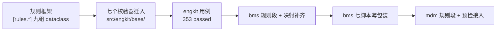
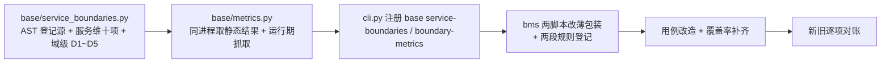

# 实施记录：06 基座校验器迁入与各仓规则对齐

> 后端基座与服务化地基 · 13 测试执行粒度与工程效能 · 子任务 06（需求 `13-6`）

## 1. 实施信息

| 项 | 值 |
| --- | --- |
| 详细设计 | [../设计/01_详细设计_06_基座校验器迁入与规则对齐.md](../设计/01_详细设计_06_基座校验器迁入与规则对齐.md) |
| Kiwi 用例 | **2361**（一任务一条，断言共用同一 `kiwi_id`） |
| engkit 版本 | 0.1.0 → **0.2.0**；rev `bb2199f` → **`a880f56`**（批次二 rev 随 engkit 推送后前移） |
| 落地批次 | 批次一：规则框架 + 7 器 + bms 薄包装 + mdm 三项；**批次二（已完成）**：`service-boundaries` / `boundary-metrics` 迁入 + bms 两器薄包装 + 覆盖率补齐 100% |

## 2. 实施过程

1. **规则框架**：`config.py` 增 `[rules.<名>]` 九组 dataclass；缺段 = 未启用、未知键 / 类型错即报错；`base/rules.py` 统一 `require()` 与登记源读取。
2. **七器迁入**：`base_docs`（六项）、`backend_base`（继承链 / 清单 / 直继承 / 数据类 / 错误码 / 迁移链）、`bare_collections`（白名单判定 + 基线）、`system_fields`、`prototype_review`、`env_example`、`docs_status`；原 `--self-test` 向量随实现迁入。
3. **CLI**：新增 `engkit base <名>` 组（`base` / `backend-base` / `bare-collections` / `system-fields` / `prototype-review` / `env-example` / `docs-status`）。
4. **bms 侧**：`engkit.toml` 增七段规则；`base_check/` 映射补至 9 个脚本；七脚本改薄包装（转发 + 透传）。
5. **mdm 侧**：三段规则；预检接入 `env-example` / `prototype-review`；`docs-status` 因存量 4 处硬规则偏差暂缓（`engkit.toml` 内已注明待启用命令）。

## 3. 问题与处置

| 问题 | 处置 |
| --- | --- |
| `check_base.py` 中 `except OSError, ValueError:` 在 3.13 及以下为语法错误 | 目标解释器为 Python 3.14（PEP 758 允许无括号多异常），非缺陷；engkit 侧沿用括号写法以兼容 `>=3.11` |
| bms 计划类与 mdm 计划类的表列数一致（6 / 8），可直接共用规则缺省 | 列数写入 `[rules.docs_status]`，mdm 未覆写 |
| `check_date`（H3 完成日期）在原脚本中定义但从未调用 | 迁入后保持不接线（行为零回退），函数保留并单独覆盖 |
| mdm 存量 4 处硬规则偏差（H6 三处漏登计划、H8 一处窗口文案） | 本次不接入 `docs-status` 步骤，已在 `mdm/engkit.toml` 注释登记待整改项 |

## 4. 验证

| 项 | 结果 |
| --- | --- |
| bms 预检 `--fast` | **全部通过**（168s） |
| bms 真仓逐条比对 | 清单 212/212、继承链 727、类形态 716、错误码 115、文档核对 391 项、集合基线 0 处、模板 2 份，均与原脚本一致 |
| bms 相关用例 | 29 passed（含 Kiwi 2351 / 2357 / 2213 / 2326 / 2361） |
| engkit 用例 / 静态 | 353 passed；`ruff` / `pyright` 0 错；覆盖率行+分支 92%（批次二补齐） |
| mdm | `links` 0 断链、`env-example` 通过 |

## 5. 偏差与遗留

| 项 | 归口 |
| --- | --- |
| `service-boundaries` / `boundary-metrics` 未迁（CLI 暂未注册这两项） | **批次二已完成**（见 §6） |
| engkit 覆盖率 92% → 100% 缺口（`backend_base` / `base_docs` / `prototype_review` / `rules`） | **批次二已补齐至 100%**（见 §6） |
| mdm `docs-status` 未接入（存量 4 处硬规则偏差） | mdm 文档整改后启用 |
| biz / cw 接入 | 随各自窗口，按 `engkit文档/资料/工具/接入说明/` |

## 6. 批次二：两器迁入（`service-boundaries` / `boundary-metrics`）

### 6.1 实施过程

1. **规则通用化（引擎侧新增 5 个键）**：原脚本把「包名去前缀得服务标识」「共享库归属平台」「域子包目录名」「平台共享表前缀」「不归业务域的表」写成常量，迁入时抽成配置键（`package_prefix` / `shared_lib_service` / `domain_subdir` / `shared_table_prefixes` / `ownership.no_domain_tables`），包内不留第二份仓数据。
2. **登记源仍读仓内**：`ownership.module` + `const`（`TABLE_OWNERSHIP`）与 `catalog.module` + `const`（`SERVICE_CATALOG`）经 `ast` 解析为内存视图（常量引用 / 枚举成员 / 字面量三种取值形态）；域布局、例外白名单、域级基线三份 JSON 只读；`--update-baseline` 写回规则段声明的仓内文件。
3. **判定等价**：SQL 分析（注释 / 引号 / schema 限定 / 关键字过滤）、越界判定（表级归属 + 域维 + 只读例外）、`ops` 运行镜像与导入闭包、运行期反向依赖、域级 D1~D5 与 `placement` 形态校验逐条对移植入。
4. **`boundary-metrics`**：改为**同进程**调用 `service-boundaries` 判定（原实现起子进程跑脚本），静态段结构、汇总口径与 `--out` 四段 JSON 不变。
5. **bms 侧零回退**：`check_service_boundaries.py` / `boundary_metrics.py` 改薄包装（`engkit_boot.pop_root` / `forward` 转发 + 退出码透传）；`engkit.toml` 增 `[rules.service_boundaries]`（含 `layers` / `ownership` / `catalog` / `ops` 四个子表 + 24 个计数键）与 `[rules.metrics]`（13 个越界计数键）。
6. **用例改造**：`test_boundary_metrics.py` 由「importlib 加载脚本内部函数」改为 CLI 级断言（退码 / 关键行 / `--out` 结构 / 端点降级 / 包装零逻辑 + 规则段齐备）；`test_base_check_wrappers.py` 纳入两个新包装并校验子命令可解析。

### 6.2 原常量 → 配置键（新增项）

| 原脚本常量 / 字面 | 配置键 | bms 取值 |
| --- | --- | --- |
| `package[4:] if startswith("bms_")` | `package_prefix` | `bms_` |
| `"bms_core"` → `"platform"` | `shared_lib_service` | `platform` |
| `parts[0] == "domains"` / `"/domains/<域>/"` | `domain_subdir` | `domains` |
| `prefix != "sys_"` / `startswith("sys_")` | `shared_table_prefixes` | `["sys_"]` |
| `NO_DOMAIN_TABLES = ("demo",)` | `ownership.no_domain_tables` | `["demo"]` |
| `Dockerfile` 的 `COPY libs/...` 等字面 | 由 `ops.dir` / `ops.dockerfile` + 包发现推导（无新增键） | 不变 |

### 6.3 问题与处置（批次二）

| 问题 | 处置 |
| --- | --- |
| 原脚本 `except OSError, SyntaxError:` 仅在 Python 3.14（PEP 758）合法 | engkit 侧用括号写法（`except (OSError, SyntaxError)`）保持 `>=3.11` 兼容；与批次一 `check_base.py` 判定一致 |
| 原脚本错误码「万位段 1~9」二次判断不可达（5 位整数首位恒为 1~9） | 迁入时删除该死分支；`system_fields` 同类不可达分支一并删除 |
| 原 `service_boundaries` 的 `--self-test` 用两个临时仓 + 子进程跑原脚本 | 改为**同一临时仓内 in-process 矩阵**（28 条断言：服务维十项 + 域级 D1~D5 + 基线 + 形态校验 + 输出），不再依赖子进程 |
| 包装脚本统一传 `--config`（配置所在目录即仓根），位置根被配置根覆盖 | 与批次一七器同口径：预检 / CI 传的根恒为本仓根，实际根取配置所在目录；已在用例中体现 |
| `boundary_metrics` 运行期降级文案含任务编号（`随 08_01`） | 改为「随可观测栈」（仓名 / 任务号不得进包），其余文案逐字保留 |
| 批次一遗留：`test_naming_guard.py` / `test_bare_collections_guard.py` 未过 `ruff format` | 本批一并格式化（纯格式，无逻辑改动） |

### 6.4 验证（批次二）

| 项 | 结果 |
| --- | --- |
| engkit 四门禁 | `pytest` **475 passed**；覆盖率**行 + 分支 100%**；`ruff check` / `ruff format --check` 0 违规；`pyright` 0 错 |
| bms 预检 `--fast` | **全部通过**（112s） |
| bms 缺省定向档（含定向用例 + 变更源覆盖率门禁） | **全部通过**（304s） |
| bms 相关用例 | 18 passed（度量 CLI 级 5 项 + 包装护栏 + 镜像包集合 + 模块边界） |
| 新旧逐项对账 | `counts` **24 键全等**（13 个越界键 + 其余 11 键），`passed` / `problems` 一致，文本输出逐行 `IDENTICAL`（见测试记录 §3.1） |
| `--self-test` 实跑 | `[check_service_boundaries self-test] 通过`（28 条断言） |

### 6.5 偏差与遗留（批次二）

| 项 | 归口 |
| --- | --- |
| 对账只能覆盖「零违规仓」：原脚本把表归属登记写死在 `bms_core`（不随 `--root` 变化），构造违规仓无法与 engkit（读仓内登记）同源比较 | 违规路径的等价性由 engkit 自检矩阵 28 条断言 + 各分支用例覆盖；后续如引入「登记源可注入」再补违规仓对账 |
| bms `pyproject.toml` / `ci/engkit_setup.sh` 的 engkit rev 尚未前移 | 待 engkit 推送确认后同批执行（设计 §12 ⑧），届时重跑 `uv lock` |
