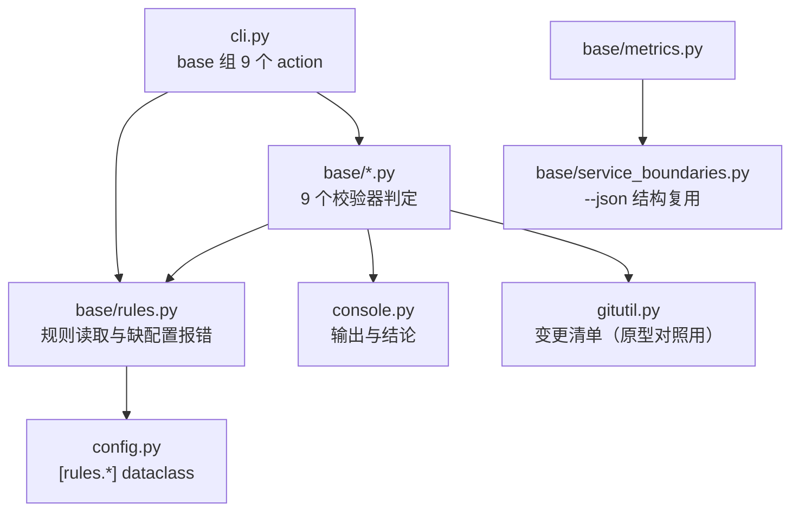

# 06 基座校验器迁入与规则对齐 详细设计

> 后端基座与服务化地基 · 13 测试执行粒度与工程效能 · 子任务 06（需求 `13-6`）· 状态：**定稿（12 项决策已确认）**

[文档首页](../../../../../../文档首页.md) › [13 测试执行粒度与工程效能](../../13_测试执行粒度与工程效能.md) › [06 基座校验器迁入与规则对齐](../13_测试执行粒度与工程效能_06_基座校验器迁入与规则对齐.md) › 详细设计　|　[需求 13-6](../../../../需求/13_需求_测试执行粒度与工程效能.md#r13-6)　|　[计划](../../../../计划/01_计划_后端基座与服务化地基.md)

## 1. 背景与目标 <a id="goal"></a>

`13_05` 把文档链接 / 文档口径 / 预检与重命令包装 / 用例登记四类能力收进跨仓工程化工具包 `engkit`，确立了「各仓只放配置、实现单一来源」。但**基座校验器仍只在 bms 仓内、规则写死 bms 结构**：标识符段、表前缀、业务码与错误码段、模块与边界清单、系统字段清单、原型目录、环境模板键位这些**规则数据**散落在脚本源码里，产品仓无法复用同一套基座口径——「平台基座有护栏、产品仓靠人眼」。各仓若各自复制一份，护栏又多出 N 份实现，与「单一来源」相悖。

**目标**：

1. **规则与判定分离**：9 个校验器的规则数据（含 `check_status` 与 `boundary_metrics`）抽到各仓 `engkit.toml` 的 `[rules.*]` 段，判定逻辑留实现侧。
2. **迁入 engkit**：以 `engkit base <名校验器>` 子命令提供，与 `[[preflight.steps]]` 声明式口径一致；包内**零仓名字面**。
3. **bms 侧零回退**：原脚本改薄包装，入口名 / 参数 / 输出 / 退出码 / CI 命令全部不变。
4. **各仓规则对齐**：mdm 登记本仓规则段并实跑通过；未登记项按「缺配置即报错」处理。
5. **存量缺口闭环**：`check_base` → 护栏用例映射补齐，映射表覆盖目录内全部脚本。

**边界（不在本任务）**：

- biz / cw 实际接入（随各自窗口，按 `engkit文档/资料/工具/接入说明/` 执行）；
- `check_links` / `check_docs_scope`（已于 `13_05` 迁入，本次只补其护栏用例与映射登记）；
- 前端（pnpm / eslint / vitest）能力边界，不在本包范围内。

## 2. 现状实测 <a id="status"></a>

### 2.1 迁入对象与规模

| 校验器 | 脚本 | 行数 | 现有参数 | 自检 |
| --- | --- | --- | --- | --- |
| `check_base` | `base_check/check_base.py` | 616 | `<root>`、`--self-test` | 4 例 + 命名 11 例 |
| `check_backend_base` | `base_check/check_backend_base.py` | 726 | `<root>`、`--self-test`、`--update-baseline` | 临时仓多场景 |
| `check_service_boundaries` | `base_check/check_service_boundaries.py` | 1637 | `<root>`、`--json`、`--update-baseline`、`--self-test` | 临时仓多场景 |
| `check_bare_collections` | `base_check/check_bare_collections.py` | 774 | `<root>`、`--json`、`--report`、`--update-baseline`、`--self-test` | 断言矩阵 |
| `check_system_fields` | `base_check/check_system_fields.py` | 477 | `<root>`、`--self-test` | 4 + 4 + 4 例 |
| `check_prototype_review` | `base_check/check_prototype_review.py` | 475 | `<root>`、`--changed [base]`、`--task <目录>`、`--self-test` | 7 例 |
| `check_env_example` | `base_check/check_env_example.py` | 137 | `<root>`、`--self-test` | 6 例 |
| `check_status` | `check_docs/check_status.py` | 465 | `--root`、`--stage`、`--all`、`--strict` | 无自检 |
| `boundary_metrics` | `governance/boundary_metrics.py` | 193 | `--root`、`--metrics-url`、`--out`、`--fail-on-violation` | 无自检 |

### 2.2 依赖面（决定迁入方式）

| 校验器 | 三方 / 仓内依赖 | 迁入处置 |
| --- | --- | --- |
| `check_base` / `check_system_fields` / `check_env_example` | 纯标准库 | 直接迁 |
| `check_status` / `check_prototype_review` | `bms_core.core.concurrent`（插入序集合） | 改 `dict` / `list` / `tuple` |
| `check_bare_collections` / `check_backend_base` | `bms_core.core.concurrent` + `core.serialization` | 同上（输出前显式排序） |
| `check_service_boundaries` | `bms_core.boundary.*`（6 模块）、`services.table_registry`、`core.concurrent` | 判定改标准库 AST；**登记源仍读仓内**（见 6.8） |
| `boundary_metrics` | `bms_core.core.concurrent` + 调用边界校验器 | 同进程调用 `base/service_boundaries` |

### 2.3 仓专属字面（迁入后须清零）

按 `backend/`、`bms_`、`scripts/tools`、`bms文档`、`frontend/`、`deploy/` 六类模式统计命中行数：

| 脚本 | 命中行数 |
| --- | --- |
| `check_service_boundaries.py` | 113 |
| `check_backend_base.py` | 42 |
| `check_bare_collections.py` | 39 |
| `check_base.py` | 33 |
| `check_env_example.py` | 27 |
| `check_prototype_review.py` | 14 |
| `boundary_metrics.py` | 10 |
| `check_status.py` | 8 |
| `check_system_fields.py` | 5 |

迁入后这些字面全部落 `[rules.*]`；engkit 侧由 `tests/test_guards.py` 的递归扫描机器断言兜住。

### 2.4 bms 现有调用面

| 面 | 现状 |
| --- | --- |
| CI `base-integrity` | 13 条命令，逐条 `python scripts/tools/base_check/check_X.py`（含 7 条 `--self-test`）、`boundary_metrics.py`、`check_status.py`——**原文不变** |
| 预检 `[[preflight.steps]]` | 7 条基座/边界步骤 + 1 条 `check_status` + 1 条 `boundary_metrics`，均调原脚本——**原文不变** |
| 预检 `[[preflight.self_tests]]` | 7 条 `--self-test`（`check_system_fields` / `check_env_example` / `check_backend_base` / `check_service_boundaries` / `check_bare_collections` / `check_docs_scope` / `check_prototype_review`）——**原文不变** |
| 用例映射 | `[[rules.backend.extra_tests]]`（`match_prefix = "scripts/tools/base_check/"`）mapping 仅 4 条，目录内实有 9 个脚本 |
| 直接加载脚本内部函数的用例 | `test_naming_guard` / `test_bare_collections_guard` / `test_basic_protection` / `test_value_object_roots` / `test_boundary_metrics`——脚本改薄包装后**导入即失败** |

### 2.5 mdm 现状

| 项 | 结论 |
| --- | --- |
| 阶段目录 | `mdm文档/项目/01_mdm 产品奠基`（目录名含空格，阶段名必须由配置给） |
| 原型 | 有 `mdm文档/设计/原型设计/`；前端仅 `frontend/packages/api-types`，无界面源码 |
| 环境模板 | 只有 `deploy/.env.example`，无 `backend/.env.example` |
| 既有门禁 | `ops.check_forms` / `ops.check_modules` 等自有门禁，与本次迁入的 `system-fields` 同类 |

## 3. 决策确认 <a id="decide"></a>

| # | 事项 | 决策 |
| --- | --- | --- |
| 1 | 子命令形态 | `engkit base <名>`：一个 `base` 组 + 9 个组内子命令 |
| 2 | 规则段组织 | 每校验器一段 `[rules.<名>]`；缺段即该校验器未启用（显式调用退 2 并给接入指引） |
| 3 | 边界校验规则源 | 登记源留仓内（AST 解析表归属 / 服务目录常量 + 读 `deploy/boundaries/*.json`），engkit 只做判定 |
| 4 | bms 受影响用例 | 函数级断言与自检向量随实现迁 engkit（Kiwi 编号沿用）；bms 留「包装零逻辑 + 规则段齐备」护栏 |
| 5 | 映射缺口补齐 | mapping 补至目录内全部 9 个脚本；3 个无专属用例的脚本各新增一条轻量护栏用例 |
| 6 | mdm 接入面 | `docs-status` + `prototype-review` + `env-example` |
| 7 | mdm 环境模板 | `[rules.env_example].templates` 清单化，mdm 只登记 `deploy/.env.example` |
| 8 | bms 预检步骤 | 保留原脚本调用（与 CI 命令逐字一致），薄包装只转发 |
| 9 | 包内布局 | `src/engkit/base/` 子包 + `test_guards.py` 仓名字面扫描改递归 |
| 10 | Kiwi 用例 | 平台骨架 / P2 / CONFIRMED / 自动化，一任务一条 |
| 11 | 包版本 | engkit 升 `0.2.0` |
| 12 | 提交粒度 | 按阶段分批提交（engkit 四条、bms 与 mdm 各分代码与文档），推送一次性确认 |

## 4. 交付物清单 <a id="deliver"></a>

### 4.1 engkit 侧

```text
engkit/
├── pyproject.toml                              # 改：version 0.1.0 → 0.2.0
├── engkit.toml                                 # 改：自举烟雾补 [rules.*] 最小段（或保持无段、子命令不启用）
├── engkit文档/
│   ├── 概述/工程化工具包说明.md                 # 改：§3 子命令表补 base 组、§4 配置全表补 [rules.*]
│   ├── 规范/工具包开发约定.md                   # 改：§1 红线补「规则数据只在仓配置」
│   └── 资料/工具/接入说明/01_接入步骤.md        # 改：新仓接入补 [rules.*] 登记步骤与各校验器启用方式
├── src/engkit/
│   ├── cli.py                                  # 改：新增 `base` 子命令组（9 个 action）
│   ├── config.py                               # 改：新增 9 个 [rules.<名>] dataclass 与解析（未知键 / 类型错报错）
│   └── base/                                   # 新增子包
│       ├── __init__.py                         # 子命令注册与统一结果类型
│       ├── rules.py                            # 规则读取与「未登记即报错」统一出口
│       ├── base_docs.py                        # check_base（清单元数据 + 跨层 + 命名 + 设计登记）
│       ├── backend_base.py                     # check_backend_base（继承链 + 直继承基线 + 错误码 + 迁移链）
│       ├── service_boundaries.py               # check_service_boundaries（10 项服务维 + 5 项域级）
│       ├── bare_collections.py                 # check_bare_collections（AST 集合声明白名单）
│       ├── system_fields.py                    # check_system_fields（form_key / data_source_key / kind）
│       ├── prototype_review.py                 # check_prototype_review（界面改动 → 原型对照）
│       ├── env_example.py                      # check_env_example（模板键位清单）
│       ├── docs_status.py                      # check_status（需求 / 任务 / 计划一致性）
│       └── metrics.py                          # boundary_metrics（复用 service_boundaries 判定）
└── tests/
    ├── conftest.py                             # 改：补「最小仓」夹具（造文档 / 后端 / 迁移树 / JSON 登记）
    ├── test_base_rules.py                      # 新增：配置解析与缺配置失败分支
    ├── test_base_base_docs.py … test_base_metrics.py   # 新增：9 个校验器用例（含自检向量矩阵）
    └── test_guards.py                          # 改：仓名字面扫描改递归（覆盖 base/ 子包）
```

### 4.2 bms 侧

```text
bms/
├── engkit.toml                                 # 改：新增 [rules.base] … [rules.metrics] 九段；映射表补至 9 条
├── scripts/tools/base_check/
│   ├── check_base.py                           # 改：薄包装 → engkit base base
│   ├── check_backend_base.py                   # 改：薄包装 → base backend-base
│   ├── check_service_boundaries.py             # 改：薄包装 → base service-boundaries
│   ├── check_bare_collections.py               # 改：薄包装 → base bare-collections
│   ├── check_system_fields.py                  # 改：薄包装 → base system-fields
│   ├── check_prototype_review.py               # 改：薄包装 → base prototype-review
│   ├── check_env_example.py                    # 改：薄包装 → base env-example
│   └── check_links.py / check_docs_scope.py    # 不动（13_05 已迁）
├── scripts/tools/check_docs/check_status.py    # 改：薄包装 → base docs-status
├── scripts/tools/governance/boundary_metrics.py# 改：薄包装 → base boundary-metrics
├── scripts/tools/preflight/README.md           # 改：入口表补 base 组与单一来源约束
└── backend/libs/bms_core/tests/
    ├── boundary/test_naming_guard.py           # 改：改断言「包装只转发 + 规则段齐备」
    ├── boundary/test_bare_collections_guard.py # 改：同上
    ├── core/test_basic_protection.py           # 改：同上（env-example 部分）
    ├── core/test_value_object_roots.py         # 改：同上（backend-base 部分）
    ├── ops/test_boundary_metrics.py            # 改：同上
    ├── boundary/test_base_check_forwarding.py  # 新增：9 条包装转发 + 无推导逻辑 + 规则段齐备
    └── boundary/test_docs_guard_wrappers.py    # 新增：check_links / check_docs_scope / check_prototype_review 三条护栏
```

### 4.3 mdm 侧

```text
mdm/
├── engkit.toml                                 # 改：新增 [rules.docs_status] / [rules.prototype] / [rules.env_example] + 预检步骤
├── backend/pyproject.toml                      # 改：engkit rev 升级
└── backend/uv.lock                             # 改：随 rev 重锁
```

### 4.4 数据库

**无**（无表 / 列 / 索引 / 迁移）。

## 5. 分层与依赖方向 <a id="layers"></a>



- **只准上层依赖下层**：`config` 不依赖任何校验器模块；`base/rules.py` 只依赖 `config`；校验器模块之间只有 `metrics → service_boundaries` 一处依赖。
- **包内零仓名字面**：所有路径、模块名、常量名、词表来自配置；包内唯一允许的字面是**子命令名**、**配置键名**、**判定用通用正则与标识符谓词**（如 `^[a-z][a-z0-9_]*$` 这类形态谓词属口径而非仓数据，保留在代码）。
- **集合类型**：不引 `bms_core`；有序去重用 `dict.fromkeys`，不可变结果用 `tuple`，仅在中间态用 `set`，输出前一律按发现序或路径序排序（与 `13_05` 包结构口径一致）。

## 6. 配置设计（`[rules.*]`） <a id="config"></a>

### 6.1 通用口径 <a id="config-common"></a>

| 项 | 口径 |
| --- | --- |
| 段命名 | `[rules.base]` / `[rules.backend_base]` / `[rules.service_boundaries]` / `[rules.bare_collections]` / `[rules.system_fields]` / `[rules.prototype]` / `[rules.env_example]` / `[rules.docs_status]` / `[rules.metrics]` |
| 未登记 | 该段缺失 = 该校验器**未启用**；显式 `engkit base <名>` 调用时打印「未登记规则：按《接入说明》登记 `[rules.<名>]`」并退出码 `2` |
| 结构非法 | 未知键 / 类型不符 / 数组元素类型错 → `ConfigError`，退出码 `2`（不靠缺省值掩盖，与既有配置口径一致） |
| 路径 | 一律**仓根相对**；跨仓平级路径用 `../` 表示（沿用 `[toolchain].ruff_configs` 口径） |
| 登记源缺失 | 规则中声明的文件 / 模块不存在 → 该校验器按各器口径报错（见 6.11），不静默跳过 |
| 与既有段的关系 | 与 `[rules.backend]` / `[rules.frontend]`（选测用）**同属 `rules` 段下的并列子段**，互不覆盖 |

### 6.2 `[rules.base]`（`check_base`） <a id="config-base"></a>

| 配置键 | 原常量 / 字面 | 内容 | 缺省 |
| --- | --- | --- | --- |
| `manifest` | `MANIFEST` | 基座文档清单路径（受第 3 项清单一致校验） | 必填 |
| `base_dirs` | `BASE_DIRS` | 基座扫描目录清单（交叉引用 / 措辞 / 清单数量） | 必填 |
| `local_only` | `LOCAL_ONLY` | 清单登记但不参与校验的前缀（本地凭据目录） | 空 |
| `cross_layer` | `CROSS_LAYER` | 禁止被基座文件相对链接的前缀 | 必填 |
| `bad_wording` | `BAD_WORDING` | 项目专属措辞残留词表 | 必填 |
| `design.dir` / `overview` | `DESIGN_DIR` / `OVERVIEW` | 数据库设计目录与总览文件 | 必填 |
| `design.table_subdir` / `dialect_subdir` | `TABLE_SUBDIR` / `DIALECT_SUBDIR` | 表文件 / 方言特性子目录名 | 必填 |
| `design.status_values` | `STATUS_VALUES` | 表状态四值枚举 | 必填 |
| `naming.tool_root` | `NAMING_TOOL_ROOT` | 工具链根（目录名与脚本名纳入登记面） | 必填 |
| `naming.package_roots` | `NAMING_PACKAGE_ROOTS` | 前端包根清单 | 空 |
| `naming.versions_root` | `NAMING_VERSIONS_ROOT` | 表结构变更清单根 | 可空 |
| `naming.dir_pattern` / `script_pattern` | `DIR_IDENT_RE` / `SCRIPT_STEM_RE` | 目录 / 脚本名形态 | 代码内（形态谓词） |
| `runtime[].path` / `runtime[].extract` | `RUNTIME_*` 常量 | 运行期登记值来源文件与提取方式（`widget_literal` / `ts_widgets` / `code_pattern` / `icon_pattern`） | 空 |
| `runtime[].expect_count` | `len(patterns) < 2` 判定 | 期望提取条数下限（业务码 / 动作码两处） | `1` |

### 6.3 `[rules.backend_base]`（`check_backend_base`） <a id="config-backend-base"></a>

| 配置键 | 原常量 | 内容 |
| --- | --- | --- |
| `manifest` | `MANIFEST` | 后端基类清单路径（直继承类须在清单文本出现） |
| `chain_doc` | `CHAIN_DOC` | 继承链与代码位置文档（§7 继承链 + 体系根白名单） |
| `source_dirs` | `SOURCE_DIRS` | 后端源码扫描面 |
| `error_codes` | `ERROR_CODES` | 错误码清单模块（段位校验） |
| `versions_dir` | `VERSIONS_DIR` | 迁移清单根（`versions/<域>/<数据源>/` 两级） |
| `direct_baseline` | `DIRECT_BASELINE` | 直继承存量基线 JSON |
| `root_bases_marker` | `ROOT_BASES_MARKER` | 体系根清单小节标记 |
| `value_object_root` / `framework_object_root` | `VALUE_OBJECT_ROOT` / `FRAMEWORK_OBJECT_ROOT` | 两条体系根类名（数据类语义断言） |
| `datasources` | `DATASOURCES` | 合法数据源段枚举（链名第二段） |
| `default_chain` | `DEFAULT_CHAIN_NAME` | 缺省链名（配置段指向它） |
| `domain_layout` | 经 `bms_core.boundary.domains` | 域布局 JSON 路径（迁移清单域目录须已登记） |

### 6.4 `[rules.docs_status]`（`check_status`） <a id="config-docs-status"></a>

| 配置键 | 原常量 | 内容 |
| --- | --- | --- |
| `project_dir` | `ROOT / "bms文档" / "项目"` | 阶段根目录 |
| `stage` | `--stage` 缺省值 | 缺省核对的阶段目录名（mdm 阶段名含空格，必须配置） |
| `statuses` / `todo_statuses` | `STATUSES` / `TODO_STATUSES` | 状态取值枚举（全量 / 剩余表允许值） |
| `req_id_pattern` / `task_id_pattern` / `plan_id_pattern` | `REQ_ID_RE` / `TASK_ID_RE` / `PLAN_ID_RE` | 三类编号形态 |
| `overview_glob` / `plan_glob` | `00_需求_*.md` / `01_计划_*.md` | 总览与计划文件形态 |
| `aid_dirs` | `("设计","测试","实施")` | 任务目录内的附属目录（不计为任务） |
| `plan_done_columns` / `plan_todo_columns` | `len(cells) == 6` / `== 8` | 计划文档两张任务表的列数契约 |
| `stats_pattern` / `effort_pattern` | `STATS_HEAD_RE` / `EFFORT_RE` | 计划头部计数与合计行形态 |
| `date_pattern` / `window_pattern` / `hours_pattern` | `DATE_RE` / 窗口正则 / `HOURS_RE` | 日期 / 窗口 / 数值形态 |
| `record_dirs` | `("实施",)` | 已完成任务的留痕目录要求（S3） |
| `heading` 族 | `REQ_HEADING_RE` 等二级标题 | 各节标题匹配（节名属口径，可留代码，键位保留覆盖能力） |

### 6.5 `[rules.system_fields]`（`check_system_fields`） <a id="config-system-fields"></a>

| 配置键 | 原常量 | 内容 |
| --- | --- | --- |
| `catalog.path` / `const` / `enum` | `CATALOG_PY` / `"FORM_CATALOG"` / `"FormKind"` | 表单清单模块、常量名、kind 枚举名 |
| `datasource.path` / `const` / `enum` | `DATASOURCE_PY` / `"DATA_SOURCE_CATALOG"` / `"DataSourceKind"` | 数据源清单模块、常量名、kind 枚举名 |
| `catalog.key_field` / `table_field` / `kind_field` | `form_key` / `table` / `kind` | 记录字段名 |
| `datasource.key_field` | `data_source_key` | 数据源标识字段名 |
| `table_dir` | `TABLE_DIR` | 数据表文件目录 |
| `key_pattern` | `KEY_RE` | 标识形态谓词（代码内，可覆盖） |
| `row_form_key` / `row_parent_id` | `ROW_FORM_KEY_RE` / `ROW_PARENT_ID_RE` | 表文件必须出现的行名 |

### 6.6 `[rules.env_example]`（`check_env_example`） <a id="config-env-example"></a>

| 配置键 | 原常量 | 内容 |
| --- | --- | --- |
| `templates[].path` | `backend/.env.example` / `deploy/.env.example` | 模板路径清单（**不再固定两份**，各仓按自有文件登记） |
| `templates[].required_keys` | `_BACKEND_SECURITY_KEYS` / `_DEPLOY_SECRET_KEYS` / `_DOCS_KEY` | 该模板必须齐备的键位 |
| `templates[].removed_keys` | `_REMOVED_KEYS` | 该模板不得残留的废弃键（对全部模板生效） |
| `private_key_marker` / `placeholder_marker` | `"PRIVATE KEY"` / `"..."` | 疑似真实私钥判定（含标记但无占位符即报） |

### 6.7 `[rules.prototype]`（`check_prototype_review`） <a id="config-prototype"></a>

| 配置键 | 原常量 | 内容 |
| --- | --- | --- |
| `record_pattern` | `RECORD_RE` | 测试记录路径正则（相对仓根） |
| `context_pattern` | `CONTEXT_RE` | 原型依据候选文本路径正则（设计 / 实施 / 测试） |
| `context_dirs` | `("设计","实施","测试")` | 任务目录下收文本的子目录 |
| `prototype_ref_pattern` | `PROTO_REF_RE` | 原型依据引用正则（页面原型 / 组件设计原型两类） |
| `ui_patterns` | `UI_CODE_PATTERNS` | 界面源码路径正则（改动命中即视为界面改动） |
| `section_heading` | `PROTO_SECTION_RE` | 原型对照节标题正则 |
| `table_header_keyword` | `"结论"` | 对照表表头须含的关键词 |
| `screenshot_pattern` | `PNG_RE` | 截图引用正则（须真实存在） |
| `unfinished_words` | `UNFINISHED_RE` | 未完成词表 |
| `not_applicable_word` / `min_reason_len` | `NOT_APPLICABLE_RE` / `MIN_REASON_LEN` | 「不适用」判定词与理由最小长度 |
| `base` | `--changed` 缺省 | 比较基准（缺省 `origin/main`） |

### 6.8 `[rules.service_boundaries]`（`check_service_boundaries`） <a id="config-boundaries"></a>

| 配置键 | 原常量 | 内容 |
| --- | --- | --- |
| `groups` | `("libs","services")` | 工作区包分组目录（相对 `[backend].root`）与「共享库 / 服务」归属 |
| `packages.shared_libs` / `packages.service` | `_RUNTIME_SERVICE_PACKAGES` / `_ALL_SERVICE_PACKAGES` | 共享库包名清单、服务包全集（运行期依赖断言与 `ci` 镜像包集） |
| `layers.shared` / `layers.service` | `_SHARED_LAYER_RULES` / `_SERVICE_LAYER_RULES` | 分层反向依赖黑名单（源子包 → 禁止依赖的目标子包） |
| `ownership.module` / `const` | `services/table_registry.py` / `TABLE_OWNERSHIP` | 表归属登记模块与常量（AST 解析，登记源仍是仓内唯一一份） |
| `ownership.owner_every_service` | `OWNER_EVERY_SERVICE` | 每服务自有哨兵（基础设施表） |
| `ownership.infrastructure_tables` | `infrastructure_tables()` | 基础设施表清单（每服务自有、放行） |
| `ownership.exempt_modules` | `_OWNERSHIP_REGISTRY_RELATIVE` / `_FORM_CATALOG_REGISTRY_RELATIVE` | 表名引用扫描豁免模块（按定义引用全表名） |
| `catalog.module` / `const` | `SERVICE_CATALOG` | 服务目录模块与常量（服务维清单来源） |
| `layout` / `exceptions` / `baseline` | `DEFAULT_LAYOUT_RELATIVE` / `DEFAULT_EXCEPTIONS_RELATIVE` / `DEFAULT_BASELINE_RELATIVE` | 域布局 / 读侧例外 / 域级基线三份 JSON |
| `shared_models_marker` | `_SHARED_MODELS_MARKER` | 共享模型子包标记（声明场景只校验「表已登记」） |
| `ops.dir` / `dockerfile` | `_OPS_RELATIVE` / `_DOCKERFILE_RE` | 运维脚本目录与镜像构建文件 |
| `ops.run_image_values` | `_RUN_IMAGE_VALUES` | `RUN_IMAGE` 合法取值 |
| `ops.image_packages` | `_IMAGE_PACKAGES` | 镜像 → 所含包集合（与 Dockerfile COPY 面对账） |
| `counters` | `counts` 初始化键 | 分类计数键清单（JSON 输出与度量消费的契约） |
| `sql_hints` / `write_operations` | `_SQL_HINTS` / `_WRITE_OPERATIONS` | SQL 语句识别与跨域写判定（可留代码，键位保留覆盖能力） |

**规则源原则**：表归属、服务目录、域布局、例外与基线是**仓内唯一事实源**（`ops` 播种、启动期守卫、迁移链表集派生同源），engkit 只读不写第二份。`--update-baseline` 写回的是 `baseline` 指向的仓内文件，不产生新落点。

### 6.9 `[rules.bare_collections]`（`check_bare_collections`） <a id="config-bare-collections"></a>

| 配置键 | 原常量 | 内容 |
| --- | --- | --- |
| `scan_targets` | `SCAN_TARGETS` | 扫描根清单（相对仓根） |
| `exclude_parts` | `_EXCLUDED_PARTS` | 剪枝目录名 |
| `whitelist` | `WHITELIST_FORMS` | 集合声明白名单（**命中即放行，未命中即违规**） |
| `banned.bare` / `banned.readonly` / `banned.ascending` | `BARE_CONTAINERS` / `READONLY_ABSTRACTIONS` / `ASCENDING_FORMS` | 违规形态三集 |
| `unregistered` | `UNREGISTERED_FORMS` | 未登记形态集（提示先登记白名单） |
| `tuple_forms` | `TUPLE_FORMS` | 元组形态（同构违规、固定元数豁免） |
| `protocol_forms` | `PROTOCOL_FORMS` | 迭代 / 调用协议（不查，类型参数仍递归） |
| `implementation_files` | `SYSTEM_IMPLEMENTATION_FILES` | 集合体系实现文件（不属约束对象） |
| `allow_marker` | `ALLOW_MARKER` | 行级豁免标记（须附理由） |
| `baseline` / `baseline_version` | `BASELINE_RELATIVE` / `BASELINE_VERSION` | 基线快照路径与格式版本 |
| `reasons` | `VIOLATION_REASON` / `UNREGISTERED_REASON` / `BANNED_REASON` | 四类处置提示文案 |
| `positions` | `POSITION_*` | 命中位置分类标识（JSON / 报告输出的键） |

### 6.10 `[rules.metrics]`（`boundary_metrics`） <a id="config-metrics"></a>

| 配置键 | 原常量 | 内容 |
| --- | --- | --- |
| `violation_keys` | `_VIOLATION_KEYS` | 越界计数键清单（总越界数 = 各键求和） |
| `cross_access_key` | `cross_service_access_violation` | 跨库访问计数键 |
| `registered_exceptions_key` | `registered_exceptions_total` | 例外登记条数键 |
| `metric_name` | `bms_boundary_cross_access_total` | 运行期指标名（`--metrics-url` 抓取） |
| `checker` | `service-boundaries` | 静态校验来源子命令（固定值，键位保留） |

### 6.11 失败分支 <a id="config-fail"></a>

| 场景 | 行为 | 退出码 |
| --- | --- | --- |
| `[rules.<名>]` 缺段 | 打印「未登记规则 `[rules.<名>]`：按《接入说明》登记后启用」+ 该器所需最小键清单 | `2` |
| 段内缺必填键 / 类型错 / 未知键 | `ConfigError`（含位置 `rules.<名>.<键>`） | `2` |
| 规则声明的登记源文件不存在 | 打印缺失路径清单（不静默跳过） | `2` |
| 规则声明的登记模块不可解析 / 常量为空 | 打印「登记源不可解析：`<模块>` → `<常量>`」 | `1` |
| 校验有违规 | 打印违规明细（前 50 条，其余计数） | `1` |
| 全部通过 | 打印原脚本结论行（文案不变） | `0` |

## 7. 子命令接口 <a id="api"></a>

### 7.1 总表 <a id="api-table"></a>

```text
engkit base <校验器> [<root>] [--root R] [--config PATH] [器专属参数]
```

| 子命令 | 对应脚本 | 器专属参数 | 退出码 |
| --- | --- | --- | --- |
| `base` | `check_base.py` | `--self-test` | `0` / `1` / `2` |
| `backend-base` | `check_backend_base.py` | `--self-test`、`--update-baseline` | `0` / `1` / `2` |
| `service-boundaries` | `check_service_boundaries.py` | `--json`、`--update-baseline`、`--self-test` | `0` / `1` / `2` |
| `bare-collections` | `check_bare_collections.py` | `--json`、`--report`、`--update-baseline`、`--self-test` | `0` / `1` |
| `system-fields` | `check_system_fields.py` | `--self-test` | `0` / `1` |
| `prototype-review` | `check_prototype_review.py` | `--changed [base]`、`--task <目录>`、`--self-test` | `0` / `1` / `2` |
| `env-example` | `check_env_example.py` | `--self-test` | `0` / `1` / `2` |
| `docs-status` | `check_status.py` | `--stage <名>`、`--all`、`--strict` | `0` / `1` / `2` |
| `boundary-metrics` | `boundary_metrics.py` | `--metrics-url`、`--out`、`--fail-on-violation` | `0` / `1` / `2` |

### 7.2 通用参数 <a id="api-common"></a>

| 参数 | 语义 |
| --- | --- |
| `--root R`（亦可位置参数给仓根） | 仓库根；缺省当前目录（与 bms 既有「首个位置参数即仓根」习惯一致） |
| `--config PATH` | 配置路径；缺省按仓根查找 `engkit.toml` |

### 7.3 输出契约 <a id="api-output"></a>

- **文案不变**：各校验器的结论行、违规行前缀（`[base-integrity]` / `[system-fields]` / `[check_env_example]` / `[check_prototype_review]` 等）与计数格式逐字保持，实施记录登记每器改动前后的输出样本对照。
- **JSON 结构不变**：`service-boundaries --json` 的 `counts` / `problems` / `passed`；`bare-collections --json` 的命中字段与基线字段；`boundary-metrics --out` 的 `collected_at` / `static` / `runtime` / `summary` 四段。
- **自检输出不变**：`--self-test` 的 `[OK]` / `[FAIL]` 行格式与用例计数文案保持（用例数可增，增时同步结论行计数）。

### 7.4 自检与写操作 <a id="api-self-test"></a>

- `--self-test` 随实现迁入 engkit（向量即原脚本内置断言），bms 侧预检 7 条自测步骤与 CI 7 条 `--self-test` 命令**原文不变**，由薄包装转发。
- `--update-baseline`（`service-boundaries` / `backend-base` / `bare-collections`）保留，写回目标是规则段声明的仓内基线文件；engkit 内不新增落点。
- 原型对照的 `--changed` / `--task` 语义不变（缺省基准取 `[rules.prototype].base`）。

## 8. bms 侧接入 <a id="bms"></a>

### 8.1 薄包装映射 <a id="bms-wrapper"></a>

| 原脚本 | 转发目标 | 参数处理 |
| --- | --- | --- |
| `check_base.py` | `base base` | 位置根 → `--root`；`--self-test` 透传 |
| `check_backend_base.py` | `base backend-base` | 同上 + `--update-baseline` |
| `check_service_boundaries.py` | `base service-boundaries` | 同上 + `--json` |
| `check_bare_collections.py` | `base bare-collections` | 同上 + `--json` / `--report` |
| `check_system_fields.py` | `base system-fields` | 位置根 → `--root`；`--self-test` |
| `check_prototype_review.py` | `base prototype-review` | `--changed [base]` / `--task` / `--self-test` 透传（多值参数按 `pop_root` 的 `value_options` 声明） |
| `check_env_example.py` | `base env-example` | 位置根 → `--root`；`--self-test` |
| `check_status.py` | `base docs-status` | `--root` / `--stage` / `--all` / `--strict` 透传 |
| `boundary_metrics.py` | `base boundary-metrics` | `--root` / `--metrics-url` / `--out` / `--fail-on-violation` 透传 |

- 包装脚本沿用 `scripts/tools/preflight/engkit_boot.py` 的 `pop_root` / `forward` / `config_path`，**不复制任何判定或推导**；`engkit_boot` 的 `value_options` 参数已能处理带值选项，若某器有多值选项则在包装内显式声明该选项名（不引入逻辑）。
- 退出码透传；`forward` 返回即退出，不另行包装。

### 8.2 CI 与预检零回退 <a id="bms-ci"></a>

| 面 | 约束 |
| --- | --- |
| `.gitlab-ci.yml` 的 `base-integrity` | 13 条命令**逐字不变**；不新增不删除 |
| `[[preflight.steps]]` | 9 条基座 / 边界 / 状态步骤**原文不变**（决策 8） |
| `[[preflight.self_tests]]` | 7 条自测步骤**原文不变** |
| 参数矩阵 | `--self-test` / `--json` / `--report` / `--update-baseline` / `--changed` / `--task` / `--stage` / `--all` / `--strict` / `--metrics-url` / `--out` / `--fail-on-violation` 全部可用 |

### 8.3 规则段与映射表 <a id="bms-rules"></a>

- `[rules.base]` … `[rules.metrics]` 九段按 §6 键表登记 bms 全量规则（值取自原脚本常量，逐键一一对应，实施记录登记「原常量 → 配置键」对照表）。
- `[[rules.backend.extra_tests]]`（`scripts/tools/base_check/`）mapping 补至 9 条：

| 脚本 | 护栏用例 |
| --- | --- |
| `check_base.py` | `libs/bms_core/tests/boundary/test_naming_guard.py` |
| `check_backend_base.py` | `libs/bms_core/tests/core/test_value_object_roots.py` |
| `check_service_boundaries.py` | `libs/bms_core/tests/crosscut/test_module_boundary.py` |
| `check_bare_collections.py` | `libs/bms_core/tests/boundary/test_bare_collections_guard.py` |
| `check_system_fields.py` | `libs/bms_core/tests/registry/test_form_catalog.py` |
| `check_prototype_review.py` | `libs/bms_core/tests/boundary/test_base_check_forwarding.py` |
| `check_env_example.py` | `libs/bms_core/tests/core/test_basic_protection.py` |
| `check_links.py` | `libs/bms_core/tests/boundary/test_docs_guard_wrappers.py` |
| `check_docs_scope.py` | `libs/bms_core/tests/boundary/test_docs_guard_wrappers.py` |

- `fallback_dir` 保留（防止后续新增脚本无人可跑），但目录内既有脚本不再依赖它。

## 9. mdm 接入 <a id="mdm"></a>

### 9.1 规则段 <a id="mdm-rules"></a>

| 段 | mdm 登记要点 |
| --- | --- |
| `[rules.docs_status]` | `project_dir = "mdm文档/项目"`；`stage = "01_mdm 产品奠基"`；编号与状态枚举与 bms 同口径 |
| `[rules.prototype]` | `record_pattern` / `context_pattern` 以 `mdm文档` 为根；`ui_patterns` 按 mdm 前端实际结构（`frontend/packages/*/src`）；原型目录 `设计/原型设计` |
| `[rules.env_example]` | `templates` 只登记 `deploy/.env.example`（决策 7），键位清单按 mdm 现有模板内容登记 |

### 9.2 预检步骤 <a id="mdm-steps"></a>

```toml
[[preflight.steps]]
label = "文档：docs-status（需求 / 任务 / 计划一致性）"
cmd = ["uv", "run", "engkit", "base", "docs-status", "--root", "{root}"]

[[preflight.steps]]
label = "界面：prototype-review（本次改动含界面源码须有原型对照）"
cmd = ["uv", "run", "engkit", "base", "prototype-review", "--root", "{root}", "--changed", "origin/main"]

[[preflight.steps]]
label = "基座：env-example（环境变量模板键位）"
cmd = ["uv", "run", "engkit", "base", "env-example", "--root", "{root}"]
```

### 9.3 依赖与验收 <a id="mdm-accept"></a>

- `backend/pyproject.toml` 的 `engkit` rev 随本次 engkit 提交升级，`uv lock` 重锁；
- 验收：三条子命令实跑通过并登记输出样本（`docs-status` 硬规则零不合规、`prototype-review` 通过、`env-example` 通过）；
- `system-fields` 不接入：mdm 已有 `ops.check_forms` 同类门禁，避免两套并行（决策 6）。

## 10. 测试设计 <a id="test"></a>

### 10.1 engkit 用例矩阵 <a id="test-engkit"></a>

| 组 | 用例文件 | 断言要点 |
| --- | --- | --- |
| R 规则 | `test_base_rules.py` | 九段解析、缺段 → 退 2 + 指引、未知键 / 类型错 → `ConfigError`、路径解析（含 `../`）、登记源缺失 → 退 2 |
| A 基座 | `test_base_base_docs.py` | 跨层引用 / 措辞残留 / 清单一致 / 跨文档编号引用 / 设计登记双向一致 / 命名形态（11 例向量随迁） |
| B 后端基类 | `test_base_backend_base.py` | 继承链对账、体系根白名单、直继承基线与递减、错误码段位、迁移链单 head 与分链、值对象 / 框架对象语义、`--update-baseline` |
| C 边界 | `test_base_service_boundaries.py` | 共享库不依赖服务、服务互不依赖、分层单向、私有引用、表名 / 前缀冲突、表归属越权、例外白名单、`ops` 镜像与导入闭包、运行期依赖、域级 D1~D5、基线只减不增、`--json` 结构 |
| D 集合 | `test_base_bare_collections.py` | 白名单命中 / 裸容器 / 抽象落点 / 升序形态 / 未登记形态 / `tuple` 分形态 / 协议不查 / 三类位置 / 行级豁免 / 实现文件豁免 / 基线语义 / `--report` / `--json` |
| E 系统字段 | `test_base_system_fields.py` | 清单 ↔ 表文件双向、全局唯一、`data_source_key` 闭合、`kind` 显式声明（12 例向量随迁） |
| F 原型 | `test_base_prototype_review.py` | 界面改动识别、记录缺失拦截、对照节 / 结论表 / 截图存在 / 未完成词、「不适用 + 理由」、原型依据在详细设计、基准不可解析即跳过（7 例向量随迁） |
| G 环境模板 | `test_base_env_example.py` | 多模板清单、缺键 / 废弃键残留 / 真实私钥、模板缺失退 2（6 例向量随迁并扩多模板） |
| H 文档状态 | `test_base_docs_status.py` | 编号集合双向、任务编号与关联需求、计划两表互斥、状态取值、窗口格式、软提示与 `--strict`、`--all` |
| I 度量 | `test_base_metrics.py` | 静态计数解析、越界求和、例外计数、运行期不可达降级、`--fail-on-violation`、`--out` 结构 |
| J 护栏 | `test_guards.py`（改） | 仓名字面扫描改 `rglob` 覆盖 `base/` 子包；新增「规则数据只在配置」断言（`src/engkit/base/**` 不含仓路径字面） |

覆盖率按《[AI开发规范](../../../../../../规范/AI开发规范.md)》「覆盖率要求」节，行 + 分支本地跑满再提交。

### 10.2 bms 用例改造 <a id="test-bms"></a>

| 用例 | 改造 |
| --- | --- |
| `test_naming_guard.py`（Kiwi 2351 / 2357） | 函数级断言随实现迁 engkit；本仓改为断言「包装转发可用 + `[rules.base]` 齐备 + 脚本内无判定逻辑」 |
| `test_bare_collections_guard.py`（Kiwi 2213 / 2326） | 同上（`[rules.bare_collections]`） |
| `test_basic_protection.py`（Kiwi 2226） | 环境模板部分改为断言包装退码与 `[rules.env_example]` 齐备；应用防护部分不动 |
| `test_value_object_roots.py` | 护栏比对改断言包装退码 0 + `[rules.backend_base]` 齐备 |
| `test_boundary_metrics.py`（Kiwi 2171） | 改为 CLI 级断言（退码 / 输出关键行）+ `[rules.metrics]` 齐备 |
| `test_base_check_forwarding.py`（新增） | 9 条包装：`--help` 可用、参数透传、退出码透传、脚本文本不含推导关键词（`ast` / `正则实现` / 判定名） |
| `test_docs_guard_wrappers.py`（新增） | `check_links` / `check_docs_scope` / `check_prototype_review` 三条：engkit 子命令可解析 + 包装零逻辑 + 规则段齐备（补齐映射缺口，决策 5） |

### 10.3 验收映射 <a id="test-accept"></a>

| 任务完成标准 | 落点 |
| --- | --- |
| 8 个校验器（含 `check_status`）可在 engkit 内配置驱动运行 | §6 配置键表 + §7 子命令表 + 10.1 各组用例 |
| 包内无仓名字面（机器断言） | `test_guards.py` 递归扫描（决策 9） |
| bms 侧入口与 CI 命令零回退 | §8.1 映射表 + §8.2 参数矩阵 + 逐条实跑（CI 13 条 + 预检 9 步 + 自测 7 条） |
| mdm 至少接入与自身相关校验并实跑通过 | §9 三项 + 输出样本登记 |
| 规则数据全部落配置、脚本内无仓专属字面 | `rg` 清零核对（§2.3 六类模式）+ 10.2 的「脚本无推导逻辑」断言 |
| `check_base` 映射缺口补齐、映射表覆盖目录内全部脚本 | §8.3 九条映射表 + 10.2 新增两条护栏用例 |
| engkit 侧 `pytest` + `ruff` + `pyright` + 覆盖率全绿 | 10.1 + 《工具包开发约定》「提交前自检」节 |

### 10.4 Kiwi 用例登记 <a id="test-kiwi"></a>

按「一个任务一条」登记：分类「平台骨架」、`P2`、`CONFIRMED`、标签「自动化」（决策 10），`text` 写覆盖范围（9 个校验器配置化、`base` 子命令组、bms 零回退、mdm 三项接入、映射缺口补齐）与自动化文件路径；清单落 `测试/*.cases.toml`，**编号以平台回读为准**，回填代码内 `@pytest.mark.kiwi_id(…)` 与测试记录。既有编号（2351 / 2357 / 2213 / 2326 / 2171 / 2226）随用例迁移沿用，不改派。

## 11. 登记落点 <a id="register"></a>

| 落点 | 内容 |
| --- | --- |
| `engkit文档/概述/工程化工具包说明.md` | §3 子命令表补 `base` 组；§4 配置全表补 `[rules.*]` 九段；§7 已知边界补「规则数据只在各仓配置」 |
| `engkit文档/资料/工具/接入说明/01_接入步骤.md` | 新仓接入补「按需登记 `[rules.<名>]` 段」步骤与各校验器启用方式 |
| `engkit文档/规范/工具包开发约定.md` | 红线补：规则数据（路径 / 词表 / 标识符段 / 枚举）只落仓配置，包内不留第二份 |
| `bms/scripts/tools/preflight/README.md` | 入口表补 9 条 `base` 转发，单一来源约束改写为跨仓口径 |
| `bms/bms文档/规范/测试规范.md` | §2.1 补一句「基座校验器实现位于工具包，本仓只保留薄包装」（不改条款口径） |
| 计划表 | 13_06 状态与资源回写（唯一落点） |
| 任务记录 | 本目录 `实施/`、`测试/` 各一份（含逐器「原常量 → 配置键」对照表、输出样本对照、门禁结果） |

## 12. 实施步骤 <a id="steps"></a>

| 批次 | 内容 | 完成判据 |
| --- | --- | --- |
| ① 规则框架 | `config.py` 九段 dataclass + `base/rules.py` + `cli.py` 的 `base` 组骨架 + `test_base_rules.py` | 缺段 / 未知键 / 类型错分支用例通过 |
| ② 轻校验器 | `base_docs` / `docs_status` / `system_fields` / `env_example` / `prototype_review` / `bare_collections` 迁入 + 用例 | 六器用例全绿、`--self-test` 向量随迁 |
| ③ 重校验器 | `backend_base` / `service_boundaries` / `metrics` 迁入 + 用例 | 三器用例全绿、`--json` 结构与基线写回契约不变 |
| ④ bms 改造 | 9 条薄包装 + `[rules.*]` 九段 + 映射表 9 条 + 用例改造与新增 | CI 13 条命令与预检 9 步逐条实跑通过 |
| ⑤ mdm 接入 | 三段规则 + 三条预检步骤 + rev 升级 | 三条子命令实跑通过 |
| ⑥ 门禁验证 | engkit 四门禁、bms 预检 `--fast` 与缺省定向档、mdm `preflight` | 全绿（重命令经 `run_once.py` 包装） |
| ⑦ 文档与回写 | §11 各落点 + 实施 / 测试记录 + Kiwi 登记 | 文档链接与口径零违规 |
| ⑧ 提交与 rev | engkit 四条提交 → 推送确认 → bms / mdm 改 `rev`（`pyproject.toml` + `scripts/tools/ci/engkit_setup.sh`）+ `uv lock` | 三仓提交完成、bms 定向档预检通过 |

## 13. 边界与开放项 <a id="open"></a>

| # | 项 | 归口 |
| --- | --- | --- |
| 1 | biz / cw 接入 `[rules.*]` 并启用校验器 | 随各自窗口，按 `engkit文档/资料/工具/接入说明/` |
| 2 | 前端（pnpm / eslint / vitest）护栏跨仓共享 | 不在本包边界，需另发 JS 共享包 |
| 3 | mdm 启用 `bare-collections` / `system-fields` | 前者需先吸收存量基线，后者需先决定是否以本包取代 `ops.check_forms` |
| 4 | 域级基线 `--update-baseline` 的人工审阅纪律 | 沿用《后端开发规范》「模块边界与数据所有权」节，工具不代审 |
| 5 | `check_status` 的软提示项是否升为硬规则 | 待各阶段文档收口后再议（现状 `--strict` 可选） |

## 14. 对齐记录 <a id="align"></a>

| 事项 | 处置 |
| --- | --- |
| 12 项待决事项（子命令形态 / 规则段组织 / 边界规则源 / bms 用例处置 / 映射缺口 / mdm 接入面 / 模板清单 / 预检指向 / 包内布局 / Kiwi 元数据 / 包版本 / 提交粒度） | 逐项确认，全部按推荐方案定稿 |
| `check_service_boundaries` 依赖 `bms_core.boundary.*` 与表归属登记模块 | 采「登记源留仓内 + engkit 只做判定」：AST 解析常量与读 JSON，规避两份事实源 |
| bms 5 个用例用 `importlib` 直接加载脚本内部函数 | 采「函数级断言迁 engkit、bms 留包装护栏」，与 `13_05` 用例迁移同口径 |
| mdm 无 `backend/.env.example` | 模板清单化，不为对齐而造文件 |

> 本文档按《[文档生成规范](../../../../../../规范/文档生成规范.md)》编写
