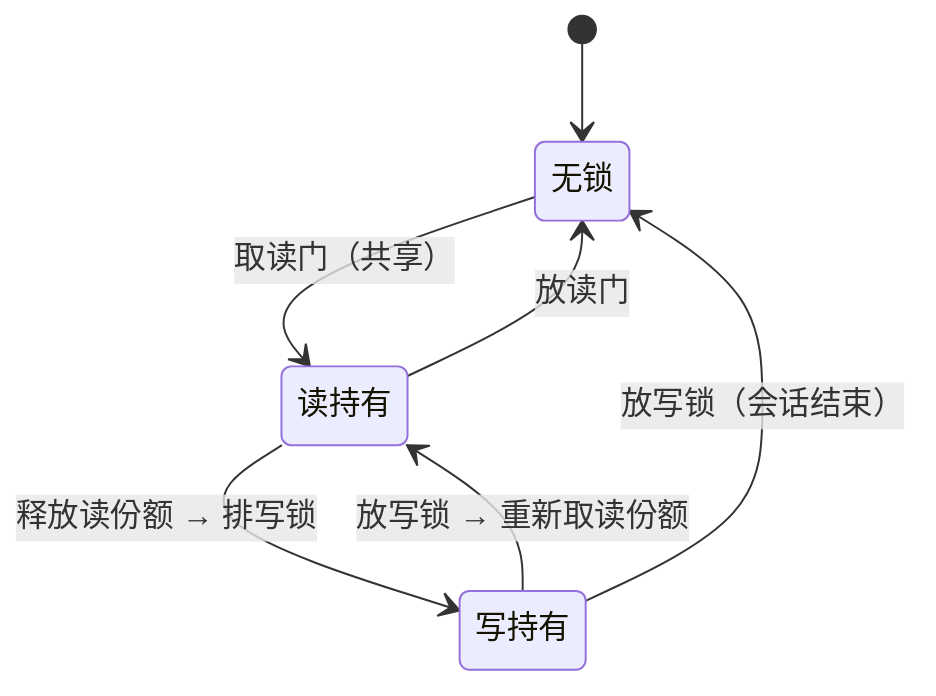

# 08 测试并发写模型与全量耗时治理 详细设计

> 后端基座与服务化地基 · 13 测试执行粒度与工程效能 · 子任务 08（需求 13-8）· 状态：**定稿（决策已确认）**

[文档首页](../../../../../../文档首页.md) › [13 测试执行粒度与工程效能](../../13_测试执行粒度与工程效能.md) › [08 测试并发写模型与全量耗时治理](../13_测试执行粒度与工程效能_08_测试并发写模型与全量耗时治理.md) › 详细设计　|　[需求 13-8](../../../../需求/13_需求_测试执行粒度与工程效能.md#r13-8)　|　[计划](../../../../计划/01_计划_后端基座与服务化地基.md)

## 1. 背景与目标 <a id="goal"></a>

推送预检在 bms 上整轮 765.3s 超出上限被拒，测试段占 682.2s。任务书已定位：慢的不是用例执行，而是**写临界区过长**——`platform_db_write_whole` 等夹具把「准备 → 调用 → 清理」整条用例圈进独占锁，24 个 worker 只能排一条队；另有 DDL 锁、权限种子锁、用例专用全局锁三个准备阶段的串行点。

业主给出的并发模型是「全局读写锁控制读写排队」：读并发、写独占、写者不被饿死、固定顺序不死锁、放弃事务隔离。本设计把这套模型落成可实现的跨进程锁，并替换现有模拟锁。

**目标**：

1. 数据库访问统一经一把跨进程读写门：读者共享、写者独占；
2. 读门与写门的作用域都是**一次数据库操作**（一次会话／一次请求），不再覆盖整条用例；
3. 进程被杀由操作系统回收锁，不再依赖心跳与陈旧判定；
4. 全量（含覆盖率采集）≤300s，推送环 ≤500s，并行与串行结果一致。

**边界（不在本任务）**：

- 覆盖率采集放大倍数的治理只做「只采集门禁模块 / 分轮」的策略调整，不降低 100% 门槛；
- 用例合规（自建库 / 清场 / 假等待）的存量清理按服务分批，本任务先做 platform；
- 预写日志是否启用单独确认，不并入本设计。

## 2. 现状与实测 <a id="status"></a>

### 2.1 现有锁的开销与语义 <a id="status-cost"></a>

现有 `bms_core/testing/locks.py` 用「`O_CREAT|O_EXCL` 创建锁文件 + 50ms 轮询 + 心跳线程 + 30s 陈旧判定」实现跨进程互斥：

| 项 | 实测 / 现状 |
| --- | --- |
| 取放一次 | 0.30ms（微基准，200 次均值） |
| 等锁粒度 | 50ms 轮询，平均多等 25ms |
| 残锁 | 进程被杀即留锁文件，靠心跳 + 30s 陈旧 + 180s 超时兜底 |
| 语义 | 只有互斥，没有读写之分 |

### 2.2 操作系统原生锁的实测 <a id="status-os"></a>

Windows `LockFileEx` 字节区间锁，本机实测：

| 实验 | 结果 |
| --- | --- |
| 共享锁取放 | 平均 0.0031ms（p95 0.0032ms） |
| 独占锁取放 | 平均 0.0030ms（p95 0.0031ms） |
| 3 个读者各持共享锁 20ms | 总耗时 21.2ms（真并发，未串行） |
| 读者持续请求时写者取独占锁 | 等待 3.3ms（写者未被饿死） |
| 写者持锁 20ms 时读者等待 | 20.55ms（阻塞语义准确，无轮询延迟） |

结论：原生锁比现有模拟锁快约 100 倍，且「多读并发 / 写者优先 / 阻塞准确」三项语义齐备，无需在应用层另造读写协议。

### 2.3 现有写锁的规模 <a id="status-scale"></a>

| 夹具 | 业务用例使用点 | 处置 |
| --- | --- | --- |
| `platform_db_write_whole` | 13 处 / 12 文件 | 删除 |
| `tenant_db_write_whole` | 2 处 | 删除 |
| `serial_db_write` | 0 处 | 删除 |
| `platform_db_write` | 0 处 | 删除 |
| `tenant_db_write` | 6 处 | 保留名称，语义改为「本用例需要写租户库」 |

### 2.4 数据库访问入口 <a id="status-entry"></a>

| 入口 | 位置 | 覆盖面 |
| --- | --- | --- |
| `_open_session` | `backend/libs/bms_core/src/bms_core/db/session.py:126` | API 请求级会话 |
| `session_scope` | `session.py:279` | 服务层会话，189 处调用 |
| `SessionFactory.create` | `session.py:56` | 上两者的唯一生产点；测试侧已在 `testing/transaction.py:96` patch |
| `shared_platform_engine` / `shared_tenant_engine` | `testing/fixtures.py:629` / `:649` | 43 / 44 个测试文件直连 |

读写区分：API 侧由中间件按 HTTP 方法自动设置只读标记（`api/middleware.py:282`）；服务层 189 处调用中仅 10 处显式 `read_only=True`。

### 2.5 回滚式隔离的规模 <a id="status-rollback"></a>

`rollback_session` 被 **55 个文件 / 124 处**调用，另有 6 个 `DbTestCase` 子类。该夹具的写事务从准备持有到清理，与「写锁只覆盖一次写操作」直接冲突。

## 3. 决策确认 <a id="decide"></a>

| 序号 | 决策 | 结论 |
| --- | --- | --- |
| 1 | 并发模型 | 业主方案：全局读写门，读并发、写独占、放弃事务隔离 |
| 2 | 读门作用域 | **一次读操作（一次会话）**：读会话进入取、结束放，多个读会话并发；**不采用「整条用例持读门」**——那会让写者等到所有并发读用例收尾，写延迟不可控 |
| 3 | 写门作用域 | **一次写操作（一次会话 / 一次请求）**：写会话进入取、结束放，不是整条用例；唯一例外见决策 13 |
| 4 | 升级方式 | 释放自己的读份额 → 排写锁 → 写完放写锁 → 重新取读份额；禁止持读锁原地升级 |
| 5 | 实现载体 | 操作系统原生字节锁（Windows `LockFileEx` / POSIX `fcntl.lockf`） |
| 6 | 服务层读写判定 | 默认按写锁（189 处中 179 处未标只读），后续对确认只读的调用点逐个补 `read_only=True` |
| 7 | 回滚式隔离 | 淘汰，改「命名空间隔离 + 会话入口门」；实测回滚夹具持门 = 用例体（应用装配已在门外）10~300ms。淘汰路径：共用同一会话的用例改 `write_session`（取门、不提交，门作用域＝一次会话），单次写用 `write_window`；「被测代码自建会话并需复用外层事务」的形态保留。进度：全仓已收口，仅剩 8 处登记保留（清单见实施记录 §2.14） |
| 8 | 现有 `file_lock` | 保留，仅用于非数据库的全局状态（权限种子 / 菜单元数据 / 国际化消息 / 平台默认键） |
| 9 | 预写日志 | 不并入本方案主线，单独确认 |
| 10 | 覆盖率门槛 | 口径不变（行 + 分支 100%），只改采集方式 |
| 11 | 直连共享引擎的取门（2026-11-18 补充，2026-11-19 修正） | **夹具不取门**（整条用例持读门与决策 2 冲突）；单次写事务用 `write_window(db_key)` 包住写段；回滚会话（`rollback_session`）进入时按引擎自带写门，**不得**再声明 `*_db_write`（声明只把门深度 +1） |
| 12 | 请求内读写会话混用（2026-11-18 补充） | 写端点不得注入只读会话依赖（`Depends(get_read_db)` 的读门覆盖整请求）；只读取数在依赖内 `session_scope(read_only=True)` 即开即关 |
| 13 | 整条用例持写门的豁免（2026-11-19 补充） | 仅两类可声明 `platform_db_write` / `tenant_db_write`：①**跨步全局状态**（共享库全局键的「复位 → 用例 → 复位」，如平台默认键）；②**全局扫描作业**（清理类作业按过期时间全表扫描，本用例造的过期行会被别的 worker 的清理处理掉，须「造行 → 执行 → 断言」整段独占）。其作用域是**整条用例**（夹具 setup 到 teardown，含同用例其它夹具的准备与清理），**不是**一次写操作。当前登记 4 处（平台默认键 2 + 清理作业 2）；新增须按上述判据登记，不得以「省事」为由声明 |

## 4. 交付物清单 <a id="deliver"></a>

### 4.1 后端代码

| 文件 | 类型 | 内容 |
| --- | --- | --- |
| `backend/libs/bms_core/src/bms_core/testing/rwlock.py` | 新增 | 跨进程读写门：平台分支、重入计数、超时诊断、异常同序释放 |
| `backend/libs/bms_core/src/bms_core/testing/gates.py` | 新增 | 门名常量、会话级 / 用例级上下文管理器、升级上下文管理器 |
| `backend/libs/bms_core/src/bms_core/testing/write_locks.py` | 改写 | 删四个夹具，`tenant_db_write` 改为写门声明 |
| `backend/libs/bms_core/src/bms_core/testing/plugin.py` | 改写 | 删 `pytest_runtest_call` 取锁钩子；用例级读门改在 `pytest_runtest_setup` / `teardown` |
| `backend/libs/bms_core/src/bms_core/db/session.py` | 修改 | `_open_session` / `session_scope` 按只读标记取读门或写门 |
| `backend/libs/bms_core/src/bms_core/testing/fixtures.py` | 修改 | `shared_*_engine` 增加用例级读门；补租户库写门夹具 |
| `backend/libs/bms_core/src/bms_core/testing/transaction.py` | 修改 | 回滚会话改为「写门内执行」，并标注为待淘汰 |

### 4.2 测试

| 文件 | 内容 |
| --- | --- |
| `backend/libs/bms_core/tests/testing/test_rwlock.py` | 门语义：多读并发、写独占、写者不被饿死、重入、异常释放、超时诊断 |
| `backend/libs/bms_core/tests/testing/test_gates.py` | 升级顺序、跨库固定顺序、用例级读门生命周期 |
| 存量用例改造 | 21 处写锁声明改新语义；回滚夹具按分批处理 |

### 4.3 文档

设计（本文）、实施记录、测试记录、护栏规则与《测试规范》对应节回写。

### 4.4 测量资产（T1，2026-11-19 补充）

| 文件 | 类型 | 内容 |
| --- | --- | --- |
| `scripts/tools/perf/test_perf_baseline.py` | 新增 | 入口：子命令 `batch` / `slow` / `micro` / `all`、`--self-test` |
| `scripts/tools/perf/perf_runner.py` | 新增 | 测试文件发现、字符预算分批、批执行（超时 + 批日志）、pytest 摘要解析、最慢项聚合 |
| `scripts/tools/perf/perf_phase_timer.py` | 新增 | 微型 pytest 插件：`pytest_runtest_logstart` / `logreport` 按阶段落 JSONL（每 worker 一份） |
| `scripts/tools/perf/perf_micro.py` | 新增 | 六项锁与写微基准（SQLite 文件库 + `NullPool`，各 200 次） |
| `scripts/tools/perf/perf_baseline.py` | 新增 | 基线 schema、环境指纹、写出 / 读取、对比渲染 |
| `scripts/tools/perf/README.md` | 新增 | 用法、三张表口径、退出码、与任务书 §2 口径的对应 |
| `deploy/perf/test_perf_baseline.json` | 新增 | 首版基线（入库、可 `git diff`） |
| `engkit.toml` | 修改 | 追加 `[[preflight.self_tests]]` 一条（`--self-test`，`deps` 指脚本目录） |

## 5. 读写门设计 <a id="gate"></a>

### 5.1 语义 <a id="gate-semantic"></a>



- **所有数据库操作一律先取读锁**：读操作持读锁执行；写操作先持读锁进来，再让出**自己这份**
  读份额、排队取写锁，写完放写锁并恢复自己的读份额；
- 读门之间共享，可同时多个持有者；写门与所有读门互斥，同一时刻只有一个写门持有者；
- 写门持有期间新读锁加不上，因此不存在「读到写了一半的数据」；
- 全仓只有一条取门路径（`gates.gate_scope`），没有「直接取写门」的第二种顺序；
- **作用域为一次会话**：读门覆盖读会话、写门覆盖写会话；不按整条用例持读门——读用例并行时写者会被迫等它们全部收尾，写延迟不可控；
- **直连共享引擎**（见 §6.1）：`shared_platform_engine` / `shared_tenant_engine` 只给引擎、不取门；单次写事务用 `write_window(db_key)` 包住写段，临界区即写段本身；`rollback_session` 进入时按引擎自带写门，用例不得再声明 `*_db_write`；
- **整条用例持写门的豁免**（决策 13）：只有「跨步全局状态」与「全局扫描作业」两类可声明 `platform_db_write` / `tenant_db_write`，持门区间含同用例其它夹具的 setup / teardown；当前登记 4 处（平台默认键 2 + 清理作业 2），不得新增；
- 升级顺序固定为「让读 → 取写 → 放写 → 取读」，异常路径同序执行。

### 5.2 平台实现 <a id="gate-platform"></a>

| 平台 | 加锁 | 解锁 | 超时 |
| --- | --- | --- | --- |
| Windows | `LockFileEx`（共享不带标志，独占带 `LOCKFILE_EXCLUSIVE_LOCK`） | `UnlockFileEx` | 非阻塞标志 + 退避重试，超时抛错 |
| POSIX | `fcntl.lockf`（`F_RDLCK` / `F_WRLCK`） | `F_UNLCK` | `LOCK_NB` + 退避重试 |

- 锁文件固定两个：`.cache/test/db-gate-platform.lock`、`db-gate-tenant.lock`，文件内容为空；
- 进程退出内核自动释放，**删除心跳线程、陈旧判定、放锁重试**；
- 读份额按 **token 记账**（每个取读者一份，记录持有它的 asyncio 任务）：释放只放自己那份、
  升级只让出本任务那份；**不得用进程级读深度**——同一进程里多个并发会话共用一个计数器时，
  一个会话的升级会把别人的份额一起放掉，对方的 SQLite 读事务还开着，写者提交被挡、读者又在
  等门，互等到 `busy_timeout`（实测的整轮卡死）；
- 写门内取的读门是**借用份额**（不取内核共享锁），写门释放后转「已退役」，调用方稍后释放只
  销账不报错（FastAPI 的 yield 依赖会把只读会话释放拖到响应结束）；
- 协程：等门在事件循环内 `await asyncio.sleep()` 轮询（0.5ms → 5ms 退避），**不走线程池**——
  `asyncio.to_thread` 在调用方被取消后线程仍会继续轮询，拿到锁却无人释放，锁会永久泄漏。

### 5.3 超时与诊断 <a id="gate-timeout"></a>

- 等门超过 10s 打印一行告警（门名、已等待时长、持有者进程号与获取时间），落 `gate-wait.log`；
- 等门超过 180s 抛 `TimeoutError`，消息含门名与等待时长；
- **卡住现场诊断**：`BMS_TEST_STACK_DUMP=1` 时，告警 / 超时会把本进程所有 asyncio 任务栈与
  线程栈落到 `.cache/test/gate-stacks-<pid>.log`（`BMS_TEST_STACK_DUMP_EVERY` 控制间隔，
  默认 10s）；默认关闭，零开销。实现见 `bms_core/testing/diagnostics.py`。

### 5.4 跨库顺序 <a id="gate-order"></a>

同时需要平台库与租户库写门的用例，固定「平台 → 租户」顺序；门的实现不提供「一次取两把」的便捷接口，由调用方按固定顺序嵌套，避免死锁。

## 6. 接入设计 <a id="hook"></a>

### 6.1 三类入口 <a id="hook-entry"></a>

取门只有 `bms_core.testing.gates.gate_scope(name, read_only=...)` 一个实现（先读后写），
下面这些入口都调它，不各自取门：

| 入口 | 取门方式 |
| --- | --- |
| `_open_session` / `session_scope` | 按 `read_only` 调 `gate_scope`；会话生命周期持有 |
| 测试基座 `write_session` / `rollback_session` | 按引擎推断门名后调 `gate_scope(read_only=False)` |
| `write_window(db_key)` | 同上（一次显式写段） |
| `shared_*_engine`（直连） | **不取门**：拿不到会话边界；整段独占显式声明 `platform_db_write` / `tenant_db_write`（内部同走 `gate_scope`） |

> 直连引擎的读不取门，与写门并发时靠 SQLite 快照 + `busy_timeout`（30s）兜底——与读写门引入前同一口径，不引入新的失败模式。

### 6.2 升级上下文 <a id="hook-escalate"></a>

```
async with tenant_write():        # 内部：放读份额 → 取写门 → 块 → 放写门 → 取回读份额
    ...
```

- 升级只在「已持读门」的上下文内有效；未持读门时直接取写门；
- 升级失败（超时）时恢复读门再抛出，保证用例结束时释放路径一致。

### 6.3 与现有夹具的对应 <a id="hook-fixture"></a>

| 旧夹具 | 新语义 |
| --- | --- |
| `tenant_db_write` | 用例内**直接取租户库写门**（保留名称，6 处不变）；不再「升级」——底座夹具已不取读门 |
| `platform_db_write` | 保留名称，直接取平台库写门（原为「业务用例 0 使用」，直连引擎用例仍需它） |
| `platform_db_write_whole` | 删除（13 处删除声明即可，读写门自动覆盖） |
| `tenant_db_write_whole` | 删除（2 处） |
| `serial_db_write` | 删除（0 处） |

> 实践教训（2026-11-18）：`shared_*_engine` 一旦整条用例持读门，任何「夹具持读门 + 用例内写库」都撞「禁止原地升级」——平台 `test_role_api.py` 14 条、`test_config_admin_api.py` 10 条实测全红。根因是 FastAPI 的 `Depends` yield 依赖生命周期延伸到响应结束，写端点里注入只读会话会让读门覆盖整个写请求。故：①直连夹具不取门；②写端点不得注入只读会话依赖（`_require_*` 护栏改为依赖内即开即关）。

## 7. 回滚式隔离处置 <a id="rollback"></a>

- 本任务：`services/platform` 下的回滚用例改为命名空间隔离（按 `ns.code()` 造数据 + `scoped()` 过滤），其余服务登记遗留；
- `rollback_session` 保留但标注「待淘汰」，其内部改为在写门内执行，避免与并发写冲突；
- 护栏新增「新增 `rollback_session` 需登记理由」，防止继续扩散。

## 8. 护栏与规范 <a id="guard"></a>

| 护栏 | 内容 |
| --- | --- |
| 整条用例持锁 | 拦 `*_whole` / `serial_db_write` 标识符，命中即失败 |
| 无声明直连写库 | `create_engine` / `create_all` / `TRUNCATE` / 内存库仍需 `own_db` 理由，规则扩围 |
| 门顺序 | 同一函数内同时取平台与租户写门时，断言平台在前 |

《测试规范》§2.1 第 9 条改写为「读写门 + 写操作级临界区」，§4「测试数据」补「回滚式隔离仅限登记用例」。

## 9. 测试设计 <a id="test"></a>

### 9.1 Kiwi 登记 <a id="test-kiwi"></a>

先登记一条策展用例（分类「平台骨架」、优先级 P2、状态 CONFIRMED、Tag「自动化」），覆盖门语义与接入行为；代码以 `@pytest.mark.kiwi_id(<编号>)` 标注。

### 9.2 用例清单 <a id="test-cases"></a>

| 用例 | 断言 |
| --- | --- |
| 多读并发 | 3 个协程同时持读门，总耗时显著小于串行之和 |
| 写独占 | 写门持有期间另一个写门请求阻塞，释放后立即获得 |
| 写者不被饿死 | 读者持续请求时写者能在阈值内获得写门 |
| 重入计数 | 同模式重复取放不重复走系统调用，计数归零后可切换模式 |
| 异常释放 | 持有期间抛异常，门按「先写后读」顺序释放，无残留 |
| 升级顺序 | 持读门升级写门，断言先让读再取写；超时后读门恢复 |
| 跨库顺序 | 平台 → 租户固定顺序，反序调用被护栏拦截 |
| 进程退出释放 | 子进程持门被杀，父进程能在阈值内取得门 |

### 9.3 验收映射 <a id="test-accept"></a>

| 验收项 | 对应断言 |
| --- | --- |
| 并行与串行结果一致 | 全量 `-n auto` 与 `-n 1` 对比 |
| 无「等待测试锁」与 `database is locked` | 全量日志扫描 |
| 整条用例持锁清零 | 护栏扫描 |
| 全量 ≤300s | 测量脚本（`batch` 合计 + 基线对比） |
| 测量脚本可复跑 | `--self-test` 全绿；两次运行出可 diff 的基线 JSON |

## 10. 登记落点 <a id="register"></a>

| 落点 | 内容 |
| --- | --- |
| 《测试规范》§2.1 / §4 | 读写门口径、回滚隔离边界 |
| 《后端基类清单》 | 若门实现进入基座公开面，登记基类归属 |
| 计划表 | 状态与完成日期（唯一落点） |
| 需求 13-8 | 不改正文，完成情况由计划表承载 |

## 11. 实施步骤 <a id="steps"></a>

| 步 | 内容 |
| --- | --- |
| 1 | 门实现与自测（`rwlock.py` / `gates.py` / 两个测试文件） |
| 2 | 接入 `_open_session` / `session_scope`，跑单文件用例验证 |
| 3 | 改造夹具与插件钩子，删 4 个夹具、改 `tenant_db_write` |
| 4 | 改造 21 处声明点，跑受影响文件 |
| 5 | platform 回滚用例改命名空间，其余登记遗留 |
| 6 | 护栏扩围与规范回写 |
| 7 | 全量验收与基线归档（T7；测量资产 T1 先落脚本与首版基线，见 §13） |

## 12. 边界与开放项 <a id="open"></a>

1. **协程内并发取门**：门按进程内计数重入，假定「同一时刻一条用例在跑」（pytest 事实）。若用例内部用 `asyncio.gather` 并发写同一库，需按任务拆分或加显式门，后续遇到再补。
2. **读门期间的写快照**：升级写门会重新取读份额，升级前后的读可能看到不同数据；这是「放弃事务隔离」的直接后果，用例断言语义需自知。
3. **服务层判定精度**：179 处默认按写门，并发度取决于后续补 `read_only=True` 的进度；本任务只保证正确性，不承诺并发上限。
4. **预写日志**：不并入本设计；若后续实测读仍被 SQLite 提交阻塞，再单独评估。
5. **回滚夹具遗留**：platform 之外的服务按批次收口，遗留清单在计划表「偏差与遗留」列跟踪。

## 13. 测量资产（T1） <a id="measure"></a>

### 13.1 目标与边界 <a id="measure-goal"></a>

把任务书 §2.1（分批全量耗时）、§2.2（最慢项）、§2.3（锁与写微基准）三项测量固化成可复跑脚本，产出三张表 + 基线 JSON，供 T5 后半（并行配额）、T7 验收（全量 ≤300s、卡点定位）与后续回归共用。

**边界**：不改测试基座、不改门实现、不改预检步骤表（只追加自测步骤）；不做自动门禁（默认只提示，`--fail-over` 才返回非零码）；基线的更新由人跑完一轮后显式覆盖，脚本不自动提交。

### 13.2 分批口径与守卫合规 <a id="measure-batch"></a>

| 项 | 口径 |
| --- | --- |
| 文件来源 | `engkit.toml` `[backend].projects` → `<工程>/tests/**/test_*.py`（配置驱动；产品仓复用时只换配置，不改脚本） |
| 分批 | 贪婪装箱，预算 `--batch-budget`（默认 6000，与 `engkit.preflight.pack_paths` 同值）；排序固定「工程声明序 + 路径字典序」，同一提交上分批稳定 |
| 传参形态 | 每批把该批**全部 `.py` 文件**逐个作为位置参数；开跑前自检「每个目标以 `.py` 结尾且存在」，不满足即拒绝执行 |
| 配置锚定 | 每批显式 `-c pyproject.toml --rootdir .`（cwd = `backend/`）。只传单工程文件时 pytest 会把 rootdir 落到该工程（如 `libs/bms_core`），插件集与 addopts 换成本工程配置——守卫失效、批次之间不可比（实施期实测） |
| 守卫合规 | 重命令守卫对「位置参数全为 `.py` / `::节点`」放行，全量守卫对 `.py` 目标放行 —— 不需要 `ENGKIT_ALLOW_UNWRAPPED` 等任何逃生开关；脚本本身也不设置它 |
| 串行 | 批间串行（前一批退出再起下一批）。`pytest_configure` 在非 xdist controller 上会清共享测试库，两个会话并发会互相删库（实施记录 §3「大面积 no such table」已实测） |
| 并发度 | 批内沿用 `addopts` 的 `-n auto`；`--jobs` 可覆盖（`off` = `-p no:xdist`） |
| 覆盖率 | 默认裸跑；`--coverage` 只设 `BMS_COVERAGE_DATA`（绝对 `.cache/coverage/.coverage`）与 `BMS_COVERAGE_SOURCE`（`[backend].coverage_packages` 顶层名去重），采集由 `bms_testing_plugin` → `engkit.coverage_plugin` 完成；不传 `--cov`、不设 `COVERAGE_FILE` |

分批的固有代价：每批起一次会话即执行一次 `clear_shared_db_files()`（删库 + 重建 + 播种）。实测近空批次 3.4s，故**每批耗时为「用例耗时 + 固定成本」**，表里不扣除、只在合计行注明。

### 13.3 三张表 <a id="measure-tables"></a>

| 表 | 列 | 口径 |
| --- | --- | --- |
| 分批耗时 | 批次 / 文件数 / 通过·失败·跳过 / 耗时(s) / 相对最慢批 | 末行合计；每批耗时含会话固定成本 |
| 最慢 N 项 | 用例 / 阶段 / 耗时(s) / 结果 | 阶段分 setup / call / teardown，与 §2.2「最慢 60 项几乎全是 setup」同口径；附「各阶段合计」与「≥1s 条数」 |
| 锁与写微基准 | 项目 / 平均 / p50 / p95（ms） | 各 200 次；p50 / p95 用最近秩法（第 ⌈q·n⌉ 个样本） |

`all` 子命令一次跑完三张表；`slow` 子命令从既有运行目录（`.cache/test/perf-<时间戳>/summary.json`）复算最慢项，不重跑用例。

### 13.4 微基准六项 <a id="measure-micro"></a>

| # | 项目 | 口径 |
| --- | --- | --- |
| 1 | 只取放文件写锁（无争用） | `bms_core.testing.locks.file_lock` 取放（旧口径原封，与 §2.3 第 1 项逐格可比） |
| 2 | 建表 + 写一行 + 提交（不持锁） | 每次新建 `NullPool` 引擎 → `CREATE TABLE` → `INSERT` → `COMMIT` → `dispose` |
| 3 | 建表 + 写一行 + 提交（持写门） | 同 #2，整段包在 `gates.gate_scope("perf-micro", read_only=False)` 内 |
| 4 | 已有表上 `BEGIN IMMEDIATE` + 写一行 | 表预先建好，每次 `BEGIN IMMEDIATE` → `INSERT` → `COMMIT`（直接对 SQLite，不依赖已删除的 `begin_write`） |
| 5 | 写门取放（`gate_scope`，含记账） | `gate_scope("perf-micro", read_only=False)` 空区间取放；含任务级持有登记与快照落盘，是当前实现的真实入口成本 |
| 6 | 只取放操作系统原生锁 | `rwlock` 后端 `try_acquire(write=True)` / `release()`（对照实施记录 §2.1 的 0.003ms） |

#1 / #4 是「实现无关」的历史口径，#3 / #5 / #6 覆盖当前门实现。微基准固定门名 `perf-micro`，不碰 `platform` / `tenant` 的真实门记账与持有者快照。

### 13.5 基线文件与对比口径 <a id="measure-baseline"></a>

落点 `deploy/perf/test_perf_baseline.json`（与 `deploy/boundaries/` 的静态护栏基线分家），入库、可 `git diff`。schema（`schema_version = 1`）：

| 段 | 内容 |
| --- | --- |
| `environment` | CPU 型号 / 逻辑核数 / 内存(GB) / OS / Python / 提交号 / 工作树是否干净 |
| `params` | `jobs` / `coverage` / `batch_budget` / `timeout` / `slowest` / `micro_count` |
| `batch` | 总耗时、文件数、批数、用例计数、逐批明细 |
| `slowest` | 最慢项列表（用例 / 阶段 / 秒 / 结果） |
| `phase_totals` | setup / call / teardown 各自合计秒数 |
| `micro` | 六项各自的次数 / 平均 / p50 / p95 |

**只存本次实测**：任务书 §2.1 / §2.3 的历史数字来自不同分批口径与不同改动阶段，留在任务书与实施记录（人读、带当时机器说明），不进 JSON —— 对比口径是「同一脚本两次运行的 diff」，不是与手抄历史数字相减。

`--baseline <文件>` 时在表上追加「本次 / 基线 / 增减%」三列（批数不同则逐批列显示 `—`，只比合计）；默认超阈值只提示，`--fail-over <百分比>` 才返回非零码。

### 13.6 日志与超时 <a id="measure-log"></a>

- 运行目录 `<bms>/backend/.cache/perf/<时间戳>/`：`batch-NN.log`（完整 stdout + stderr）、`phase-<worker>.jsonl`（逐用例阶段记录）。**不能放 `.cache/test/`**——测试会话启动会按「无后缀即目录」递归删除那里的条目，实测一整轮批日志与阶段记录被删光、只剩最后一批（见 §13.9）。
- 终端只打摘要与三张表，完整输出看批日志（与预检 `last-run.log` 同思路，避免终端淹没）。
- `--timeout <秒>`：到点杀**进程树**（Windows `taskkill /F /T`；POSIX 进程组 `SIGKILL`）——xdist worker 是子进程，只杀 controller 会留下占门进程。超时后打印该批「已开始未结束」的用例（插件 `logstart` 记录减去已完成项），这正是 T7「`platform/tests/api` 第 144 条卡住」的定位手段。
- 同一时刻只允许一个测量会话：运行目录下 `session.lock` 记录 pid，存活即拒绝启动（防两轮并发删库）。

### 13.7 自测与接入 <a id="measure-selftest"></a>

`--self-test` 只覆盖纯函数：分批切分（空 / 单文件 / 恰好预算 / 超预算 / 稳定序）、pytest 摘要解析、百分位统计、基线对比（新增项 / 缺失项 / 零基线 / 批数不同）、markdown 表渲染（列数一致）。不启动 pytest、不碰锁与数据库，毫秒级。登记进 `[[preflight.self_tests]]`（`deps` 指脚本目录），只在脚本改动时触发。

### 13.8 边界与开放项 <a id="measure-open"></a>

1. **批边界不可逐一对齐**：批数随文件名长度浮动，跨提交只比总数、分布与阶段合计；
2. **每批固定成本不扣除**：与预检真实行为一致，扣除反而失真；
3. **最慢项不跨机器可比**：基线记录环境指纹，换机器需重跑首版；
4. **门采样汇总不在本脚本内**：`BMS_TEST_GATE_HOLD=1` 的八列日志由 T7 定位时另行读取，本脚本只负责「批耗时 / 最慢项 / 微基准」；
5. **不自动更新基线**：覆盖基线是人的显式动作（跑完加 `--save`），避免回归跑一轮就把基线漂移掉。

### 13.9 实施期偏差与修正（回写） <a id="measure-deviation"></a>

首轮实跑暴露的七处偏差，已按「实测 → 回写设计 → 改实现」处置：

| 偏差 | 实测现象 | 修正 |
| --- | --- | --- |
| 运行目录放 `.cache/test/` | 测试基座按「无后缀即目录」递归删 `.cache/test` 下条目，整轮批日志与阶段记录被删光，只剩 `batch-08.log` | 运行目录、微基准目录、会话锁统一改落 `<backend>/.cache/perf/`（§13.6） |
| 阶段落点用 `BMS_PERF_PHASE_DIR` | 逐用例夹具 `clear_isolated_env` 删除所有 `BMS_` 前缀变量（只保留 `BMS_TEST_`），setup / call 阶段变量消失，只有 teardown 记到 | 改用 `BMS_TEST_PERF_PHASE_DIR` |
| 只传文件、未钉 rootdir | 单工程批量时 rootdir 落到该工程（如 `libs/bms_core`），插件集与 addopts 换成本工程配置：守卫不生效、批次之间口径不一致 | 每批显式 `-c pyproject.toml --rootdir .`（§13.2） |
| `--jobs off` 用 `-p no:xdist` | addopts 里的 `-n auto` 变成未知参数，命令直接报错 | 改 `-n 0`（关闭 xdist 子进程） |
| 微基准排在分批之后 | 全量跑完机器在 IO / CPU 高位，微基准比空闲态慢约 1.7 倍（文件锁 0.330 → 0.567ms），与 §2.3 历史口径不可比 | `all` 改为**先跑微基准、再跑分批** |
| 阶段插件在 xdist controller 上也记录 | controller 会收到 worker 的全部报告，重复记录导致用例数翻倍 | 插件在「xdist 已启用且本进程不是 worker」时整体关闭 |
| 微基准共用同一个库文件 | #2/#3 各建 200 张表后库变大，后续项的 fsync 成本被推高（`BEGIN IMMEDIATE` 从 3.3ms 涨到 7.5ms），与 §2.3 口径不可比 | 每项独立库文件（`no_gate.db` / `gated.db` / `begin.db`） |

> 上述偏差均属实现层落点，不改变 §13.1~§13.8 的口径；`BMS_TEST_GATE_HOLD` 的八列门采样仍不并入本脚本。

### 13.10 卡点定性与门的最终口径（T7，2026-11-20） <a id="measure-t7"></a>

**推翻 §2.20 的「单用例长期持门」判断**：那 30 秒等的是**门**，不是 SQLite 锁（把 `busy_timeout` 降到 2s 后门内实占仍是 30s）。真因与最终口径如下（取证与四轮观测见实施记录 §2.21）：

| 项 | 原设计 | 修正后 | 理由 |
| --- | --- | --- | --- |
| 门的粒度 | 按数据源各一把（平台 / 租户） | **全库一把**（`db-gate-all.lock`），门名只作诊断标签 | 一个请求常同时碰两个库，两个进程反向持门即 ABBA 互等（实测有完整互点名证据） |
| 升级写门时让出的读份额 | 写完「补回 + 另取一份新份额」 | 只补回，不另取 | 多取的那份无人释放，读者内核共享锁长期不放，写者必然等满上限 |
| 有其它任务在读时取写门 | 保留内核共享锁再取独占 | 先让出共享锁，释放写门后按剩余读份额重新取 | Windows 同一句柄重复加锁会把模式合并，一次解锁整体放掉（后续报 `ERROR_NOT_LOCKED`） |
| 写门等待上限 | 5s 硬上限 | **5s 告警 + 30s 硬上限**（与读门同） | 24 路下写门实占中位 39ms、p99 380ms，排队合计 281s——排队是并发量所致，不该判失败；长期持门仍由 30s 拦下并点名 |
| 接库初始化 | 每个应用 lifespan 都做（建表 / 归属登记 / 库存上报） | 测试基座置 `app.skip_db_init=true` 跳过（生产缺省不跳） | 共享库已由准备集一次性建好；每用例重做 1.4s，24 路下完全串行 |
| 测试辅助的直连 | 允许辅助模块自建引擎 | 统一 `tests_support/shared_access.py`（`gated_session` / `shared_window`），engkit G5 护栏拦新增 | 直连不取门的长事务会在 SQLite 层挡住走门的写者 |

**效果**：同组 15 文件 24 路从「18 失败 / 1 错误、4:44」变为「136 全过、1:49」；5 个 form_design 文件 73 条从「18 失败、4:44」变为「全过、1:10」。

**尚未做的（下一步）**：表单定制运行期改表结构。按「结构只能由数据初始化一次建好，测试与生产不得运行期改结构」的口径，`run_statement` / `create_probe_table` / `drop_probe_table` 与产品侧 `form_design.services.ddl.add_column` 需要改成「仅开发态可即时改」，探针表用例迁到独占临时库。

> 该项已在 §13.11 落地（2026-11-20），上文保留为当时的缺口记录。

### 13.11 运行期改表结构治理（T7 续，2026-11-20） <a id="measure-runtime-ddl"></a>

**口径（业主拍板）**：任何运行时改数据结构的测试用例都是错误的——生产不可能动数据结构，建表 / 加列只有「数据初始化」一次机会；测试与生产都只能通过数据初始化改，只有**开发态**允许即时改。

**产品侧**：

| 项 | 落点 | 说明 |
| --- | --- | --- |
| 开关 | `AppSettings.allow_runtime_ddl`（`BMS_APP__ALLOW_RUNTIME_DDL`） | 缺省 `false`；仅 `config.dev.toml` 置 `true`；测试基座显式置回 `false` |
| 请求路径 | `ExtFieldService._run_ddl` 关闭分支 | 不执行任何 DDL，行保持 `ddl_status=pending`（**不落 `failed`**、不告警为失败），等初始化补建列 |
| 初始化通道 | `ops.build_ext_columns`（`RUN_IMAGE=platform`） | 扫描 `pending` → 复用 `FormDdlExecutor` 建列 → 回写 `active`；列已存在即幂等命中；单条失败置 `failed` 且不中断；`--dry-run` 只扫描 |
| 装配注入 | `build_form_design_service` → `FormDesignService` → `ExtFieldService` | 开关按请求构造时读配置，域层不 import 配置（依赖方向不变） |

**测试侧**：

| 项 | 落点 | 说明 |
| --- | --- | --- |
| 守卫判据 | `bms_core.testing.transaction.gate_for_database` | 库文件名是 `platform` / `tenant` 即共享库；`tests_support/form_design.py` 的 `create_probe_table` / `drop_probe_table` / `run_statement` 一律先判，共享库直接抛 `RuntimeError` |
| 独占库 | `services/platform/tests/conftest.py::isolated_tenant` | 每用例一份 tmp 租户库（`prepare_tenant` 同源建表与参数种子）+ 只在该库打开 `allow_runtime_ddl`；平台库仍走共享库（命名空间隔离） |
| 迁移范围 | `test_field_ext_api.py` / `test_runtime_paths.py` | 两文件整体 `own_db`；文件内 `tenant_db` 夹具转发到独占库，既有用例签名零改动 |
| 待建列用例 | `test_field_ext_api.py::test_runtime_ddl_disabled_keeps_pending` | 开关关闭 → 接口返回 `pending` 且物理列不存在 |
| 脚本用例 | `test_build_ext_columns.py` | 建列 / 幂等 / 目标表缺失置 `failed` / `--dry-run` / 入口码 / 编码解析 / 注册库不可读回落 / 共享库守卫 |

**效果**：`form_design` 目录 83 条全过、1:05；共享库上再无运行期 DDL（护栏 `base test-db-isolation` 839 文件 16 辅助模块通过，存量基线仍 28 条）。

**遗留**：`ensure_models`（缺则建表）仍允许在共享库执行——它是「准备集已建好、缺则补建」的兜底，不是用例改结构；是否一起收口留到后续评估。

**T7 全量实测（同日）**：解卡后按默认口径跑 `all --save`，8 批全部完成、无批次超时，全量 655.6s / 839 文件 / 7427 通过 / 44 失败（1 条本次引入已修，43 条为存量护栏失同步，清单与归口见实施记录 §2.23）。**未达 ≤300s**：剩余主因是「每用例起一次应用」的 setup 成本与平台 api / i18n 批的写门排队，已登记为另立的「应用装配夹具作用域」思路任务。

**推送环执行形态（同日实测，见实施记录 §2.24）**：同一代码同一机器，推送环后端定向耗时 249.8s ～ 678.6s 摆动 2.7 倍，并偶发写门 / 乐观锁竞争——不稳定的是「单会话 × 630 文件 × 多 worker」这一形态，不是代码。拍板本轮不推送，另立任务把定向用例改成「分批 + 每批独立会话」（与 §13.2 的分批口径同形）并把单步预算按批计算。

## 14. 对齐记录 <a id="align"></a>

| 日期 | 事项 | 结论 |
| --- | --- | --- |
| 2026-11-18 | 业主给出并发模型 | 全局读写门，读并发、写独占、放弃事务隔离 |
| 2026-11-18 | 补充读锁与写锁作用域 | 读锁用例级、写锁写操作级；所有排队写完成才放行读 |
| 2026-11-18 | 服务层判定与回滚夹具 | 默认写门；回滚夹具淘汰、分批改命名空间 |
| 2026-11-18 | 原生锁可行性实测 | 多读并发 21.2ms、写者等待 3.3ms，语义满足 |
| 2026-11-18 | 实施期发现直连夹具读门与决策 2 冲突 | 直连夹具不取门；写声明直接取写门；写端点不得注入只读会话依赖（决策 11 / 12） |
| 2026-11-18 | 准备阶段串行点实测 | 单测装配期真实事件消费按消费组发起连接，`msg` 域名解析每次 2.7s × 8 次 = 21.5s，占单条 setup 86%；测试基座关闭 `[event_consumer].enabled` |
| 2026-11-19 | T1 测量资产的 16 项落点与口径 | 落 `scripts/tools/perf/`、单入口子命令、字符预算 6000 分批、显式 `.py` 批间串行、`--coverage` 走 engkit 采集插件、微基准六项（原四项 + 当前实现两项）、基线落 `deploy/perf/test_perf_baseline.json`、`--self-test` 进预检自测；本轮实跑一轮落首版基线 |

> 本文档按《[文档生成规范](../../../../../../规范/文档生成规范.md)》「详细设计」节编写
