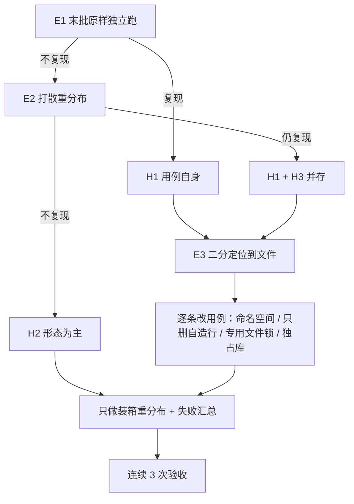
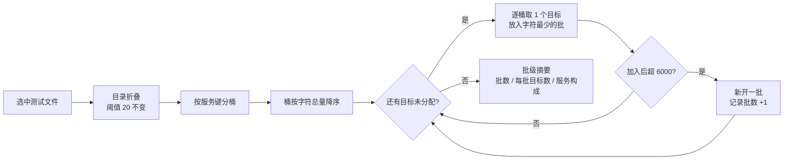

# 09 推送环定向分批判 详细设计

> 后端基座与服务化地基 · 13 测试执行粒度与工程效能 · 子任务 09（需求 13-9）· 2026-11-23

[文档首页](../../../../../../文档首页.md) › [13 测试执行粒度与工程效能](../../13_测试执行粒度与工程效能.md) › [09 推送环定向分批判](../13_测试执行粒度与工程效能_09_推送环定向分批判.md) › 详细设计　|　任务书　|　需求：[13-9](../../../../需求/13_需求_测试执行粒度与工程效能.md#r13-9)

## 1. 背景与目标 <a id="goal"></a>

**背景**：13_08 把共享测试库改成「一份库 + 读写门 + 操作级立即提交 + 0.1 秒忙等」后，推送环一度把 `database is locked` 压到 0（370.3s 那轮）。但同一份代码在后续轮次仍出现「全量选面下 11 failed + 12 errors 全为锁冲突」，且**只在定向档一次跑五六百个测试文件时复现**，同域 7 个文件在 `-n 0` / `-n 24` 下都全绿。

**目标**：把定向档治理到「同一提交集连续 3 次通过」，且不靠抬忙等、不靠降并行、不靠复制库、不改预算数值与既有规范条文。

**本设计的两条主线**：

1. **判据先于治法**：先用判别实验把「用例自身」与「执行形态」切开。13_08 的多轮实测反复出现同一教训——种子域三条失败、帮助锚点装载失败，最后都归到用例自身（预演不写库却被回滚撤销、共享库哨兵行与自然键冲突），不是门或库模型的问题。本任务沿用同一条推理路径。
2. **形态只做「重分布」**：批数、字符预算、并行档、预算数值全部不动，只改「哪些目标进哪一批」。这样做既拆掉末批写热点放大器，又不触碰任何既有标准。

## 2. 现状与实测 <a id="status"></a>

### 2.1 第五次推送预检的分批形态 <a id="status-batches"></a>

| 批 | 目标数 | 耗时 | 通过 | 失败 | 错误 | 每用例耗时 |
| --- | --- | --- | --- | --- | --- | --- |
| 1 | 150 | 240.15s | 4067 | 0 | 0 | 0.059s |
| 2 | 117 | 54.40s | 1269 | 0 | 0 | 0.043s |
| 3 | 60 | **139.36s** | 464 | **11** | **12** | **0.29s** |

- 645 个测试文件 →（目录聚合）327 个目标 → 3 批；单批字符预算 6000 未变。
- 整轮 564.3s / 600s；静态与护栏段 103.0s、测试段 452.0s。
- 第 3 批 487 条用例耗 139.36s，是前两批每用例耗时的 **5~7 倍**——同样的代码、同样的 24 路，只有「批内构成」不同，这是最直接的形态证据。

### 2.2 第 3 批的构成 <a id="status-batch3"></a>

第 3 批不是「随机残余」，而是可预期的产物：`collapse_to_dirs` 只折叠「目录内测试文件全被选中且不超过 20 个」的目录，于是

| 来源 | 未折叠原因 | 测试文件数 |
| --- | --- | --- |
| `services/platform/tests/api` | 35 > 折叠阈值 20 | 35 |
| `services/notification`（mail / notice / notification） | 父目录未全选中，只能逐个文件 | 6 |
| `services/file/tests/test_file_failures.py` 等 | 同上 | 1~2 |
| `services/identity/tests/auth` | 同上 | 1~2 |

写最密集的四域，被顺序装箱挤到**同一个末批**，由 24 个 worker 同时打同一份库。

### 2.3 失败栈位置 <a id="status-stack"></a>

报错全部在 teardown 清理阶段：

```
DELETE FROM sys_notice_read   WHERE notice_id IN (SELECT id FROM sys_notice WHERE title LIKE ?)
DELETE FROM sys_notice_i18n   WHERE notice_id IN (SELECT id FROM sys_notice WHERE title LIKE ?)
```

调用方是 `services/notification/tests/notice/conftest.py::_clean_own_notices`，走 `write_session(shared_tenant_engine, wait=GATE_CRITICAL_WAIT)`——**已在写门内**。持门写入仍被判 `database is locked`，说明冲突方不在门内：可能是门外的 SQLite 写者（连接关闭触发的 WAL 检查点、残余未取门写），也可能是用例本身对共享行做了跨命名空间的操作。**这条要靠探针确证，本设计不预设结论。**

### 2.4 既有预算语义（不改，只登记） <a id="status-budget"></a>

- `min(单步, 剩余)` 是**按批**下发：三批各拿到 300s 上限，总预算 420s 只在每步启动时判一次，因此测试段实耗 452s 可以越过 420s。
- 本轮**不动**这些数值与语义（不动清单第 1 条）；「预算硬化」不在本任务范围。

## 3. 决策确认与不动清单 <a id="decide"></a>

2026-11-23 逐项确认（10 项，见任务书 §2.4）。本设计只做两件事：**用例侧收口**与**装箱重分布 + 失败汇总**。

| 不动项 | 具体值 / 位置 | 复核方式 |
| --- | --- | --- |
| 定向档预算 | `[preflight.budget].scoped = [300, 420]` | `git diff` 该段无改动 |
| 推送硬上限 | `PUSH_MAX_TOTAL_SECONDS = 600` | `git diff engkit/src/engkit/preflight.py` 该常量无改动 |
| 强制并行 | `push.serial_reason()` 拒绝 `off` / `0` | 单测 + 手工 `--jobs off` 仍被拒 |
| 忙等与库模型 | `sqlite_busy_timeout_seconds()` 测试缺省 0.1s、一份库零复制 | `git diff bms_core/testing/` 无改动 |
| 覆盖率门限 | 行 + 分支 100% | 门禁照常执行 |
| 规范条文 | 《测试规范》《AI开发规范》、engkit 文档 | 无文档改动 |

## 4. 假设与判别实验 <a id="experiment"></a>

### 4.1 三个假设 <a id="hypotheses"></a>

| 编号 | 假设 | 若成立的证据形态 |
| --- | --- | --- |
| H1 | **用例自身**：末批若干用例对共享行做跨命名空间操作 / teardown 清理范围过宽，24 路下互相踩 | 末批**原样独立跑**（不打散、不改任何代码）就能复现失败；二分能定位到具体文件 |
| H2 | **执行形态**：写密集域被堆进同一批，24 个 worker 同时打同一把库门 | 末批原样独立跑**不复现**；打散到 3 批后不复现；而把写密集域重新聚成一批又复现 |
| H3 | **门外写残余**：连接关闭触发的 WAL 检查点或未取门写持有 SQLite 锁 >0.1s | 探针显示失败瞬间门内无其它持门者、门外有写语句或检查点 |

三者不互斥。**H1 优先验证**——若 H1 成立，H2 只是放大器，治法以用例为主、形态为辅。

### 4.2 四组判别实验 <a id="matrix"></a>

| 组 | 做法 | 判读 |
| --- | --- | --- |
| E1 | 末批 60 个目标**原样**独立跑，`-n 24`，3 轮 | 复现 ⇒ H1 成立（与「645 文件选面」无关）；不复现 ⇒ 转 E2 |
| E2 | 同一批目标**打散重分布**到 3 批跑，3 轮 | 不复现 ⇒ H2 成立（形态是主因）；仍复现 ⇒ H1+H3 |
| E3 | 末批内**按文件二分**（每次取一半），`-n 24` | 定位到最小失败文件集，逐条归因（命名空间 / 共享行 / 清理范围） |
| E4 | 最小失败集 `-n 0` 串行 | 通过 ⇒ 并发隔离问题（按 §6 判据处置）；不通过 ⇒ 功能缺陷，单独立项 |

取证工具：现成的 `BMS_TEST_LOCK_PROBE=1`（`bms_core/testing/lock_probe.py`），记录语句 / 连接号 / 库文件名 / 门区间；**不新增探针、不新增护栏口径**。每轮日志完整落盘后整体阅读，不用 `tail` / `grep` 截断判断。

### 4.3 结论如何改变治法 <a id="branch"></a>



- H1 成立 → 用例侧必须改（T2），装箱重分布保留（降低复发概率）。
- H2 成立 → 只做装箱重分布与失败汇总，用例不改。
- H3 成立 → 先按 G6「门外写」护栏口径收口具体位置；**不得**调 `busy_timeout`、不得加长门等待。
- 若 E3/E4 指向功能缺陷（串行也失败）→ 停在本任务边界外，单独立项，本任务只登记。

## 5. 交付物清单 <a id="deliver"></a>

### 5.1 engkit 代码 <a id="deliver-engkit"></a>

| 文件 | 改动 |
| --- | --- |
| `src/engkit/preflight.py` | 新增 `bucket_by_service()`（按服务键分桶）；`pack_paths()` 增可选「轮转装箱」路径（默认关闭、由 `run_selected` 显式启用）；`run_selected()` 批循环改为「失败记录、继续跑」并在末尾汇总；`_run_scoped_step()` 打印批级摘要 |
| `tests/test_preflight_pack.py`（新增） | 轮转 / 字符上限 / 集合等价 / 批数不增 / 边界（空输入、单文件超预算、单服务独占） |
| `tests/test_preflight_batches.py`（新增或并入既有） | 失败不早退、预算耗尽时报告未跑批次、全绿时不改变原有行为 |

> 装箱算法**只作用于定向档**（`preset = "scoped"`）；全量档与 CI 的分批口径不动（避免影响 CI 分片）。

### 5.2 bms 用例（按 T1 结论，条件性） <a id="deliver-bms"></a>

按 §6 判据逐条改，落点集中在：`services/notification/tests/notice/conftest.py` 与同域用例、`services/file/tests/test_file_failures.py`、`services/identity/tests/auth/test_session_service.py`、`services/platform/tests/api/*`（具体清单由 E3 二分结果确定）。

### 5.3 文档 <a id="deliver-docs"></a>

任务书、本详细设计、实施记录、测试记录、计划行、13_08 §2.30 补记。**不改**任何规范与 engkit 文档既有条文。

## 6. 用例侧收口判据 <a id="case-rules"></a>

| 现象 | 归属 | 处置（只允许这些手段） |
| --- | --- | --- |
| teardown 清理按 `title LIKE`/宽条件删子表，命中他人行 | 清理范围过宽 | 收敛到本用例主键或唯一后缀；或改按命名空间前缀 |
| 多个文件对同一全局行（平台租户、默认拓扑、能力授权基线）做「读现状 → 编排 → 断言」 | 跨用例共享行 | 接专用文件锁（`file_lock`，锁名语义化，同 `platform_tenant_serial` 做法） |
| 固定哨兵编码 / 自然键写进共享库 | 键冲突 | 编码按用例唯一后缀派生；整库口径的用例改独占库（`own_db` + `tmp_path`） |
| 24 路失败、`-n 0` 通过，且探针显示门内有其它持门者 | 并发隔离 | 按上三行处置；**禁止**调大忙等 / 门等待 / 超时 |
| 探针显示门内无他人、门外有写或检查点 | 门外写 | 改走 `write_session` / 共享引擎门代理；必要时把该写入纳入初始化阶段 |
| `-n 0` 也失败 | 功能缺陷 | 停在本任务外，单独立项并登记 |

红线：不得新增 `own_db` 豁免来「图干净」；不得把用例改成依赖空库；不得用 `sleep`/重试掩盖。

## 7. 装箱重分布设计 <a id="pack"></a>

### 7.1 现状算法与问题 <a id="pack-current"></a>

```
targets = collapse_to_dirs(files, threshold=20)   # 目录折叠（阈值属既有标准，不动）
batches = pack_paths(targets, budget=6000)        # 顺序贪婪装箱
```

`targets` 的顺序 = 目录目标（浅层在前）+ 未折叠文件（按路径序）。目录先被填满，未折叠的写密集文件全部落到最后一批。

### 7.2 目标算法：分桶轮转 + 最少字符优先 <a id="pack-target"></a>



**服务键推导**（不引入新配置）：路径首段是 `services/<名>/` → `<名>`；`libs/<名>/` → `libs-<名>`；其余 → `other`。分桶只影响装箱顺序，不改变「跑哪些用例」。

**不变量**（自测逐条断言）：

1. **集合等价**：输出各批的并集 == 输入集合，且无重复（无漏测、无重跑）。
2. **字符上限**：每批拼接长度 ≤ `argv_budget`（6000），单文件超预算时独占一批并在摘要里点明。
3. **批数不增**：批数 ≤ 现状算法结果 +1；若为 +1，摘要必须打印原因（碎片化）并由测试记录确认总耗时仍在预算内。
4. **服务分散**：服务目标数 ≥2 且批数 ≥2 时，同一服务至少分布到 2 批（写热点不聚堆）。
5. **确定性**：同一输入两次装箱结果一致（便于复现与对比）。

### 7.3 与「目录折叠」的关系 <a id="pack-collapse"></a>

折叠阈值 20 属既有标准，**不动**。重分布只解决「折叠残余全落末批」这一个副作用：残余文件按服务分桶后自然散到各批，不再形成单批写热点。

### 7.4 批级摘要（新增可见性） <a id="pack-summary"></a>

每批打印一行：批次序号 / 目标数 / 服务构成（前 3 个）/ 耗时 / 通过 / 失败 / `database is locked` 命中次数（从该批输出计数）。整段末尾再汇总一次，供「每用例耗时」对比与复盘。

## 8. 失败汇总设计 <a id="failfast"></a>

现状：`run_selected()` 的批循环里 `if code != 0: return code`——第一批失败就返回，后续批不跑，失败清单不完整（与「完整失败清单一次给全」纪律相悖）。

目标行为：

| 场景 | 行为 |
| --- | --- |
| 某批失败 | 记录该批退出码与失败摘要，**继续**下一批（除非剩余预算 ≤0） |
| 预算耗尽 | 停止后续批，标记「未跑批次」清单 |
| 全部跑完且有失败 | 不进入覆盖率判定与扩圈（数据不完整），返回 1，打印「失败批 / 通过批 / 未跑批」三行 |
| 全部通过 | 走原有覆盖率判定与扩圈逻辑（行为不变） |

预算语义不变：每批 `limit = min(step_seconds, remaining)`，不重标、不重新分配。失败后不再进入扩圈轮次，因此总耗时不会因「跑完再汇总」翻倍。

## 9. 测试设计 <a id="test"></a>

### 9.1 Kiwi 登记 <a id="test-kiwi"></a>

先登记、后编码；编号以平台自增为准，登记后回读核对再在代码里标 `@pytest.mark.kiwi_id(<编号>)`。预计 3 条：

| 序号 | 覆盖范围 | 自动化文件 |
| --- | --- | --- |
| 1 | 按服务轮转装箱：服务分散、集合等价、字符不越界、批数不增、确定性 | `engkit/tests/test_preflight_pack.py` |
| 2 | 失败汇总：一批失败不早退、跑完全部批、未跑批次可见、全绿行为不变 | `engkit/tests/test_preflight_batches.py` |
| 3 | 用例侧收口判别：命名空间 / 只删自造行 / 共享行专用锁（按 T1 结论落地的用例） | 由 E3 结果确定 |

### 9.2 验收映射 <a id="test-accept"></a>

| 完成标准 | 判定方式 |
| --- | --- |
| 连续 3 次失败 0 / locked 0 / 测试段 ≤440s | 同一提交集连跑 3 次，完整日志落盘后统计 |
| 选中与跳过数与改造前一致 | 对比 `[test-selection] picked=` 度量行与各批 passed/skipped 合计 |
| 末批每用例耗时 ≤0.10s/条 | 批级摘要（§7.4） |
| 失败清单完整 | 人工构造一次失败（临时改坏一条用例）验证「失败批 / 通过批 / 未跑批」 |
| 不动清单保持 | `git diff` 逐项核对 + `--jobs off` 仍被拒 |
| 完整性 | engkit `ruff` / `pyright` / 自测 / 覆盖率 100% |

## 10. 登记落点 <a id="register"></a>

| 落点 | 内容 |
| --- | --- |
| 需求 13-9 | 已完成（背景 / 内容 / 完成标准） |
| 需求总览与总清单 | 已完成（57 条、13 域 9 条、地图计数） |
| 13 域任务清单 | 已完成（09 行 + 风险段） |
| 阶段计划表 | 新增 13_09 行（状态 / 进度唯一落点） |
| 计划 §7 后续阶段待办 | 新增「perf 与推送环两份分批执行器合并」 |
| 13_08 实施记录 §2.30 | 补记 06:53 裸推事实 |
| engkit 文档 | **不改**（不动清单第 4 条） |

## 11. 实施步骤 <a id="steps"></a>

| 步 | 内容 | 出口条件 |
| --- | --- | --- |
| S1 | 跑 E1（末批原样 3 轮） | 拿到复现/不复现结论 + locked 次数 |
| S2 | 按需跑 E2 / E3 / E4 | 定位到文件级或确认形态为主因 |
| S3 | 装箱重分布 + 失败汇总实现（含自测） | engkit 自测全绿、覆盖率 100% |
| S4 | 用例侧收口（仅 H1 成立时） | 最小失败集 24 路连续 3 轮全绿 |
| S5 | 验收：同一提交集连续 3 次 | 失败 0 / locked 0 / ≤440s |
| S6 | 记录与回写 | 实施记录、测试记录、计划行、13_08 补记 |

## 12. 边界与开放项 <a id="open"></a>

| 项 | 说明 | 归口 |
| --- | --- | --- |
| 分批执行器两份实现 | `scripts/tools/perf/perf_runner.py` 与 engkit 各一套（前者杀进程树、后者只杀 controller） | 计划 §7 后续待办（本次合并会扩大改动面，按拍板不做） |
| 预算软约束 | 单步预算按批下发、总预算只在步骤启动时判一次；测试段 452s 可越过 420s | 本任务不动（不动清单第 1 条）；若后续要硬化，须先有新的预算数值口径 |
| 并发写不可见 | 共享平台库上另一 worker 并发写时，本会话 `flush` 后按主键读不回刚写的行 | 13_08 观察项 7（机制待查，治理前用例独占库） |
| 嵌套 `session_scope` 关闭调用方会话 | 配置取数与注册行共用同步会话 | 13_08 已登记「另立项」 |
| 若 T1 结论指向门 / 库模型 | 不动清单会挡住治法 | 停下回报，由业主重新拍板后再动 |

## 13. 对齐记录 <a id="align"></a>

| 日期 | 事项 | 结论 |
| --- | --- | --- |
| 2026-11-23 | 任务立项与需求顺延 | 13_09 + 需求 13-9（总览 56 → 57） |
| 2026-11-23 | 记录口径 | 13_08 补记 06:53 裸推；本任务写「成功率不稳」 |
| 2026-11-23 | 治法范围 | 用例侧为主、形态为辅；不动清单 4 条 |
| 2026-11-23 | 分批与失败处理 | 批数 / 字符预算不变；失败不早退、跑完再汇总 |
| 2026-11-23 | 并行与执行器 | 保持 `-n auto`；不合并 perf 执行器 |
| 2026-11-23 | 验收 | 连续 3 次：失败 0 / locked 0 / 测试段 ≤440s |

> 本文档按《[文档生成规范](../../../../../../规范/文档生成规范.md)》「详细设计」节编写
