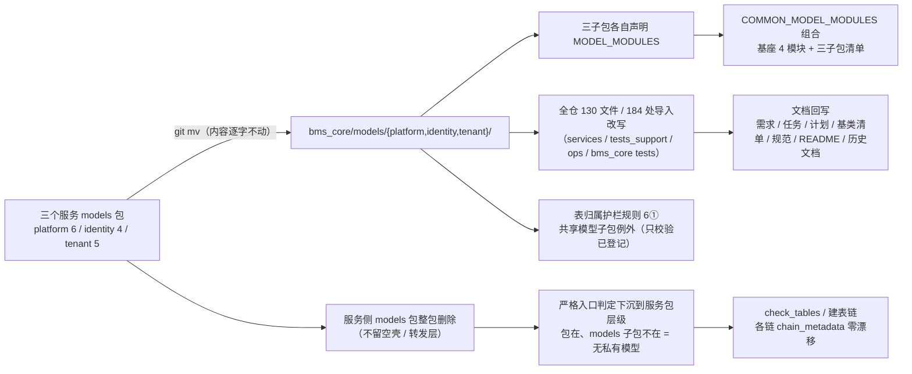

# 共享模型下沉基座实施记录

> 后端基座与服务化地基 · 14_平台模型下沉基座 · 子任务 01 · 实施记录

[文档首页](../../../../../../文档首页.md) › [01 共享模型下沉基座](../14_平台模型下沉基座_01_共享模型下沉基座.md) › 实施　|　[详细设计](../设计/01_详细设计_01_共享模型下沉基座.md) · [测试记录](../测试/01_测试_01_共享模型下沉基座.md)

## 1. 实施信息 <a id="meta"></a>

| 项 | 值 |
| --- | --- |
| 任务 | [01 共享模型下沉基座](../14_平台模型下沉基座_01_共享模型下沉基座.md) |
| 对应需求 | [14-1](../../../../需求/14_需求_平台模型下沉基座.md#r14-1) |
| 详细设计 | [01_详细设计_01_共享模型下沉基座](../设计/01_详细设计_01_共享模型下沉基座.md) |
| 实施日期 | 2026-10-22（代码 / 护栏 / 用例 / 文档同轮） |
| 实施人 | minjian |
| 实施环境 | 开发机（Windows，Python 3.14 / uv，后端 `.venv` 外置符号链接）；Kiwi TCMS 走内网开发服务器（用例登记） |
| 提交 | 分笔：`docs(14_01)` 详细设计 → `feat(14_01)` 代码 + 护栏 + 用例 → `docs(14_01)` 登记回写与实施 / 测试记录 |
| 结论 | **已完成**：三包 17 文件 / 38 表整包下沉、服务侧三 `models` 包删除、130 文件 / 184 处导入改写（旧路径残留 0）、两处登记同步、护栏适配 + 自测两例；preflight 全绿（定向 1652 passed、覆盖率 76 模块行 + 分支 100%）、后端全量 3402 用例通过、ruff / format / pyright 零问题 |

## 2. 实施概览 <a id="overview"></a>



结果小结：`bms_platform.models` / `bms_identity.models` / `bms_tenant.models` 三个服务侧包整体消失，共享表模型统一落在 `bms_core/models/<来源服务>/`，模型发现改由「三子包 `MODEL_MODULES` → `COMMON_MODEL_MODULES` → `import_models`」一条链完成；表归属、建表链表集与契约快照零漂移。

## 3. 实施过程 <a id="process"></a>

1. **整包搬迁（纯移动）**：`git mv` 17 个模型文件到 `backend/libs/bms_core/src/bms_core/models/{platform,identity,tenant}/`（platform 6 / identity 4 / tenant 5），文件内容**逐字不动**（仅 `catalog.py` / `menu.py` 文件头两处已失效的「本模块由平台服务在 `MODEL_MODULES` 声明」描述改为「登记在 `bms_core.models.platform::MODEL_MODULES`」）；`git rm` 三个服务侧 `models/__init__.py` 并删除整包目录（不留空壳、不留转发层）。
2. **三子包自声明清单（新增 `__init__.py` ×3）**：各自声明 `MODEL_MODULES`（新路径，共 15 条）并写明「代码位置不改表归属」「经 `COMMON_MODEL_MODULES` 纳入各链模型发现」「服务侧旧路径已删除」。
3. **基座清单组合（`bms_core/db/migration.py`）**：`COMMON_MODEL_MODULES` 由「基座 4 模块（`models.ownership` / `models.outbox` / `config.models` / `listing.models`）+ 三子包 `MODEL_MODULES` 展开」组成；模块文档说明补共享模型口径。
4. **严格入口语义调整（同文件）**：`service_model_modules()` 与 `require_service_model_modules()` 的缺失判定**下沉到服务包层级**——`{prefix}_{service}` 不存在才 `ConfigError`；服务包在、`models` 子包不在视为「无私有模型」返回空清单（platform / identity / tenant 删包后即此形态，`ops.check_tables` 零特例）。`models` 子包存在但未声明 `MODEL_MODULES` 仍报错（原文案同步改为「无私有模型可不建 models 子包」）。
5. **全仓引用同步**：按前缀映射批量改写 `bms_platform.models.` → `bms_core.models.platform.`、`bms_identity.models.` → `bms_core.models.identity.`、`bms_tenant.models.` → `bms_core.models.tenant.`，共 **130 文件 / 184 处**（服务 src / 各服务 tests / `tests_support` / `ops` / `bms_core/tests`）；随后 `ruff check --fix`（88 处导入排序等）+ `ruff format` 归一。
6. **表归属护栏适配（`scripts/tools/base-check/check-service-boundaries.py`）**：规则 6① 对 `bms_core/models/<来源服务>/` 子包内的 `__tablename__` 只校验「已登记」、不判归属越权（`_is_shared_model_subpackage`，按 `/libs/bms_core/src/bms_core/models/` 标记判定，根级 models 文件与访问侧判定不变）；规则 6② 对同一处的声明串不再重复计违规（`shared_declarations` 集合）；`--self-test` 增两例（共享模型子包声明他归属表放行 / `models` 根级声明他归属表拦截）。
7. **用例改写与新增**：`test_service_model_package.py` 的 platform 断言改「空清单 + 严格入口不报错」并新增 `txn` 非空断言（保留「服务自声明清单可解析」的正向覆盖）；`ops/test_check_tables.py` 的异常文案断言同步（服务包一级、不带 `.models` 后缀）；新增 `tests/alembic/test_common_model_modules.py`（4 例：子包清单与 `COMMON_MODEL_MODULES` 一致 / 38 表可导入且已登记 / 各链 `chain_metadata` 表数零漂移 / `planned` 的 `demo` 不进链）。
8. **顺带修复预置缺陷（平台测试隔离）**：并发选测集暴露「权限数据来源注册表最后登记者生效」的顺序依赖（平台用例随机 10007）——在 `services/platform/tests/conftest.py` 增 autouse 夹具 `isolate_permission_data_sources`：每例先 `reset_permission_data_sources()` 再重登记平台侧工厂（与身份侧 `test_identity_checker.py` 的 reset 隔离口径一致）；基座「按装配期 key 解析」的根治另立任务。
9. **文档回写**：需求 14-1（§2.3 两处登记 + 完成标准改「整包删除 / 严格入口下沉一级」）、任务 14_01（§2.2 引用实测口径、§2.3、§3 完成标准）、阶段计划（已完成表 + 剩余表 + 头部项数 + 合计自洽 + 图表注）、[后端基类清单](../../../../../../后端基类清单.md)（§9 新增共享模型行、`models/system.py` → `models/platform/system.py`）、[后端开发规范](../../../../../../规范/后端开发规范.md)（「模型模块按服务声明与链路派生」条补共享模型口径）、`backend/README.md`（目录注释）；历史任务文档中的模块路径引用一并改到新路径（11 份 / 15 处，描述「搬迁动作」的源路径保留）。

## 4. 关键命令 <a id="commands"></a>

```bash
# 搬迁与删除（bms 仓根）
git mv backend/services/platform/src/bms_platform/models/catalog.py backend/libs/bms_core/src/bms_core/models/platform/catalog.py
# …（17 个文件同法）…
git rm backend/services/{platform,identity,tenant}/src/*/models/__init__.py

# 静态与格式（改动面）
uv run --directory backend ruff check --fix libs services ops tests_support
uv run --directory backend ruff format libs services ops tests_support
uv run --directory backend pyright

# 基座与归属校验
python scripts/tools/base-check/check-service-boundaries.py          # 真实仓库
python scripts/tools/base-check/check-service-boundaries.py --self-test
uv run --directory backend python -m ops.check_tables --offline

# 用例与门禁
uv run --directory backend pytest -q --full                          # 全量（显式声明）
python scripts/tools/preflight/run-once.py -- python scripts/tools/preflight/check-preflight.py
```

## 5. 问题与处置 <a id="issues"></a>

| # | 问题 | 根因 | 处置 |
| --- | --- | --- | --- |
| 1 | 迁包后护栏报「跨服务表归属」（`sys_tenant` / `sys_client` 等在 `bms_core` 内声明） | 规则 6① 把 `bms_core` 一律折算成 `platform` 判归属 | 按定案加「共享模型子包」例外（只校验已登记），并补规则 6② 的重复计数抑制与两例自测 |
| 2 | `test_service_model_package.py` 的「platform 清单非空」断言随删包失效 | 语义变更（无私有模型） | 改断空清单 + 严格入口不报错；另用 `txn` 覆盖「自声明清单可解析」正向路径 |
| 3 | `ops/test_check_tables.py` 断言 `bms_zzz_ghost.models` 文案失败 | 异常文案改到服务包一级 | 断言改 `bms_zzz_ghost`（与严格入口新语义一致） |
| 4 | 新增用例触发 `check-bare-collections` 违规（模块级 `tuple[...]` 同构声明） | 护栏要求集合声明落 `ConcurrentStable*` | 清单改 `ConcurrentStableList` + 循环内联配对，去掉带注解的 tuple |
| 5 | `pyright` strict 报 `mapper.local_table` 恒非 None / `.name` 未知 | SQLAlchemy 类型签名 | 按 `ops/check_tables.py` 同法 `cast("Table \| None", …)` |
| 6 | 预检定向档连跑两轮各 2 个平台用例随机 10007（`platform 权限数据接口返回非法响应`） | `bms_core.permission.sources` 注册表「最后登记者生效」且 key 不止一个——并发 worker 内身份用例建过应用后，平台请求走到身份侧契约实现 | 经逐项确认：平台测试 conftest 加 autouse 隔离夹具（reset + 重登记平台工厂）；根治（按装配期 key 解析）另立任务 |
| 7 | 改根 `bms_core/models/__init__.py` 后覆盖率门禁红（`bms_core.models.base` 缺 4 行 1 分支） | 门禁按**包级**派生（改根 `__init__` ⇒ 整包计入分母），而 `to_stable_value` 的 `set` 分支只由未入选用例覆盖、扩圈器不识别包级模块 | 根 `__init__.py` 保持原样，说明改落三子包；缺口归 13_01（扩圈器补包级匹配） |
| 8 | 详细设计文档两处进度类字样触发 `check-docs-scope` | 进度类字段只允许落阶段计划 | 改「状态 / 完成日期 / 偏差列」表述 |
| 9 | 全量回归 `test_m2_closure.py::test_plan_closure_state` 失败（头部 46 项 vs 已完成表 47 行） | 计划头部计数未随本任务回写 | 头部改「已完成 47 项，剩余 4 项」；该用例复跑 4 passed |

## 6. 验证结论 <a id="verify"></a>

| 项 | 结论 |
| --- | --- |
| 旧路径残留 | `backend/**/*.py` 中 `bms_{platform,identity,tenant}\.models\.` **0 处**（脚本核验） |
| 服务侧包 | 三个 `models` 包（含 `__init__.py`）全部删除；`ops/check_tables --offline` 通过（清单 52 项 + 模型表对账 + 脚本表集） |
| 建表链 | `chain_metadata` 逐链表数：`platform:platform` 19 / `platform:tenant` 15 / `identity:platform` 4 / `identity:tenant` 6 / `tenant:platform` 8（迁包前口径，零漂移）；38 张共享模型表全部已登记，`planned` 的 `demo` 不进链 |
| 服务导入 | `python -c "import bms_platform.main, bms_identity.main, bms_tenant.main"` 通过（tenant 不再缺 `bms_platform`） |
| 静态 | `ruff check` / `ruff format --check` / `pyright`（strict，0 error） |
| 用例（定向） | 预检定向档 1652 passed / 31 skipped；覆盖率门禁 76 模块「行 + 分支 100%」 |
| 用例（全量） | 后端全量 3402 用例通过 / 57 skipped（唯一失败为计划收口断言，修正后复跑通过） |
| 护栏 | `check-service-boundaries`（真实仓库）通过 + `--self-test` 15 项全通过；`check-bare-collections` / `check-base` / `check-docs-scope` 通过 |
| 预检 | `check-preflight.py` 缺省定向档 **全部通过**（静态 / 基座与边界 / 定向用例 / 覆盖率 / 契约与事件快照 / api-types 零漂移） |
| Kiwi | 用例 **2341**（平台已登记，代码 `@pytest.mark.kiwi_id(2341)` 标注 4 处） |

## 7. 偏差与遗留 <a id="deviation"></a>

| # | 事项 | 归口 |
| --- | --- | --- |
| 1 | 「服务侧 models 包仅剩 `MODEL_MODULES` 与说明」定案改为「整包删除 + 严格入口判定下沉到服务包层级」 | 已回写需求 14-1 与任务 14_01 文本（本次） |
| 2 | 需求记「131 处引用」，实测 199 处（可改写 184 处 / 130 文件） | 已在任务文本与设计 §2.1 登记实测口径；验收按「0 处残留」判定 |
| 3 | 根 `bms_core/models/__init__.py` 的「共享模型分子包」说明未落地（覆盖率门禁按包派生 + 扩圈器不识别包级模块） | `13_01`（扩圈器补包级匹配）；说明已由三子包 `__init__.py` 承担 |
| 4 | 权限数据来源注册表「最后登记者生效」的顺序依赖（基座层语义） | 另立任务（本任务只做测试侧隔离，不改基座契约） |
| 5 | 38 张表的表文件「ORM 模型」列与《数据库设计总览》登记状态 | `14_02` |
| 6 | `ops` 非模型层跨包脚本（`bootstrap_platform` / `check_modules` / `check_plugins` / `txn_recovery`）运行镜像声明 | `14_03` |
| 7 | 开通编排内核与四种子下沉后对 `bms_core/models/tenant/` 的复用 | `14_04` |

## 8. 参考文档 <a id="ref"></a>

- 《[平台可扩展性规划](../../../../../../规划/平台可扩展性规划.md)》「总体模型：基座 + 平台 + 多产品三层分层」节
- 《[后端开发规范](../../../../../../规范/后端开发规范.md)》「依赖方向」节、「模型模块按服务声明与链路派生」条
- 《[后端基类清单](../../../../../../后端基类清单.md)》§9「跨阶段基座与能力域横切」
- [14_02 表归属与契约登记同步](../../14_平台模型下沉基座_02_表与契约登记同步/14_平台模型下沉基座_02_表与契约登记同步.md)、[14_04 开通编排内核下沉基座](../../14_平台模型下沉基座_04_开通编排内核下沉基座/14_平台模型下沉基座_04_开通编排内核下沉基座.md)

> 本文档按《[文档生成规范](../../../../../../规范/文档生成规范.md)》编写
