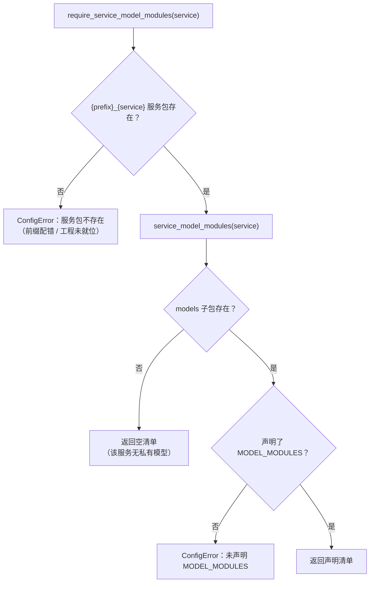

# 共享模型下沉基座详细设计

> 后端基座与服务化地基 · 14 平台模型下沉基座 · 01 共享模型下沉基座 · 详细设计（开发核心文档）

[文档首页](../../../../../../文档首页.md) › [01 共享模型下沉基座](../14_平台模型下沉基座_01_共享模型下沉基座.md) › 设计　|　[实施记录](../实施/01_实施_01_共享模型下沉基座.md) · [测试记录](../测试/01_测试_01_共享模型下沉基座.md)

## 1. 目标与边界 <a id="scope"></a>

**目标**：把 platform / identity / tenant 三个服务里承载**跨服务共享表**的 ORM 模型**整包**下沉到共享基座 `bms_core.models.{platform,identity,tenant}`，消除「服务镜像内的代码为读写共享表而依赖其他服务源码」的隐式耦合——本次缺陷的直接触发链是 tenant 镜像启动即 `ModuleNotFoundError: No module named 'bms_platform'`。

**范围内**：

1. **整包搬迁**：17 个模型文件 / 38 张表（platform 6 文件 29 表、identity 4 文件 4 表、tenant 5 文件 5 表），模型定义、表名、表前缀、字段、约束、模块级常量**逐字不动**，只改文件位置与导入路径。
2. **服务侧 models 包整包删除**（三个包），**不留 re-export 转发层**。
3. **两处登记同步**：`bms_core/db/migration.py::COMMON_MODEL_MODULES` 纳入 15 个新模块；服务侧 `MODEL_MODULES` 随包删除而消失。
4. **全仓引用同步**：`backend/**` 下 130 个文件 / 184 处导入改到基座新路径（三方实测数，见 §2.1）。
5. **严格入口语义下沉一级**：`require_service_model_modules()` 的「缺失」判定由「`models` 子包缺失」改为「服务包缺失」，使「无私有模型」成为正常形态而非故障。
6. **表归属护栏适配**：`check-service-boundaries.py` 规则 6① 对共享模型子包（`bms_core/models/<服务>/`）只校验「表已登记」，不判归属越权。
7. **文档回写**：需求 14-1 完成标准、任务 14_01、计划偏差列、《后端基类清单》、《后端开发规范》、`backend/README.md`，以及 `bms文档/` 下 10 份历史任务文档的旧路径。

**范围外**（归口见 §8）：

- `txn.models.ledger`（TM 私有账本，独立库，按「声明仅 txn 镜像运行」处理）——本任务不动；
- `services/*/src` 对 `ops` 的反向依赖、`ops` 运行镜像声明与导入闭包断言——归 `14_03`；
- 38 张表的表文件「ORM 模型」列、总览登记状态、契约快照与建表核对——归 `14_02`；
- 开通编排内核与四种子下沉——归 `14_04`；
- 表结构本身的任何增删改与 `TABLE_OWNERSHIP` 的 `owner` / `datasource`——**本任务零改动**。

## 2. 现状与改造点 <a id="current"></a>

### 2.1 现状（2026-10-22 实测）

- **三包零服务内交叉依赖**：17 个文件的模块级导入只有 `sqlalchemy`、`datetime` 与 `bms_core.models.base`（`StableJson`）、`bms_core.core.concurrent`；无 `relationship()`、无方法定义，纯声明式（29 + 4 + 5 = 38 张 `__tablename__`）。
- **引用面**：`backend/**` 含旧路径字面 133 个文件 / 199 处，其中 3 个服务 `models/__init__.py` 里的 15 条 `MODEL_MODULES` 条目随包删除消失，**实际需改写 130 个文件 / 184 处**（需求 14-1 登记的是估计值 131 处，差异在实施记录登记）。
  - platform 包：服务内 src 32 处、`tests` 44 处、`tests_support` 3 处、`ops` 11 处、`bms_core/tests` 5 处；
  - identity 包：src 11 处、tests 18 处；
  - tenant 包：src 13 处、tests 17 处。
- **两处登记**：`bms_core/db/migration.py::COMMON_MODEL_MODULES` 现为 4 条基座模块（`models.ownership` / `models.outbox` / `config.models` / `listing.models`）；三个服务包各自在 `models/__init__.py::MODEL_MODULES` 声明本包模块。
- **发现链**：`chain_metadata(chain)` = `chain_tables(service, datasource)`（归属登记派生）∩ `Base.metadata.tables`（模型已导入），模型的导入由 `import_models(service)` 完成（`COMMON_MODEL_MODULES` + 服务 `MODEL_MODULES`）。
- **严格入口**：`require_service_model_modules()` 现判定「`{prefix}_{service}.models` 包不存在即 `ConfigError`」——`ops/check_tables.py` 对每个已启用服务走严格入口。
- **护栏口径**：`check-service-boundaries.py` 规则 6① 把 `bms_core` 一律折算成 `platform` 判归属（`_service_of_package`），因此在 `bms_core` 内声明 `sys_tenant` / `sys_client` 等「非 platform 归属」表会被判「跨服务表归属」。

### 2.2 改造点

| # | 改造对象 | 现状 | 改为 |
| --- | --- | --- | --- |
| 1 | `services/platform/src/bms_platform/models/` | 6 模块 + `__init__.py`（`MODEL_MODULES` 6 条） | 整包删除；文件迁 `libs/bms_core/src/bms_core/models/platform/` |
| 2 | `services/identity/src/bms_identity/models/` | 4 模块 + `__init__.py`（4 条） | 整包删除；文件迁 `bms_core/models/identity/` |
| 3 | `services/tenant/src/bms_tenant/models/` | 5 模块 + `__init__.py`（5 条） | 整包删除；文件迁 `bms_core/models/tenant/` |
| 4 | 三子包 `__init__.py`（新建） | — | 各自声明 `MODEL_MODULES`（新路径）+ 归属说明 |
| 5 | `bms_core/models/__init__.py` | 说明「base.py 基类，模块文件 {模块}.py」 | 补一条：共享模型按**来源服务**分子包 `models/<服务>/` |
| 6 | `bms_core/db/migration.py::COMMON_MODEL_MODULES` | 4 条 | 4 条基座模块 + 三子包 `MODEL_MODULES` 展开 |
| 7 | `bms_core/db/migration.py::service_model_modules` / `require_service_model_modules` | 判定 `models` 子包缺失 | 判定服务包缺失；`models` 子包缺失视为「无私有模型」 |
| 8 | `catalog.py` / `menu.py` 文件头 | 写「本模块由平台服务在 `MODEL_MODULES` 声明」 | 改「共享模型，登记在 `bms_core.models.platform::MODEL_MODULES`」 |
| 9 | 130 个文件 / 184 处导入 | `bms_platform.models.*` / `bms_identity.models.*` / `bms_tenant.models.*` | `bms_core.models.platform.*` / `.identity.*` / `.tenant.*` |
| 10 | `check-service-boundaries.py` 规则 6① | 把 `bms_core` 当 `platform` 判声明归属 | 共享模型子包只校验「已登记」，不判归属越权；根级 models 文件口径不变 |
| 11 | `test_service_model_package.py` | 断 platform 清单非空且 `bms_platform.` 前缀 | 断 platform 空清单 + 严格入口不报错；另用 `txn` 断非空与前缀 |
| 12 | 新增共享模型登记一致性用例 | — | `COMMON_MODEL_MODULES` 与三子包清单一致、15 模块可导入、38 表已登记 |
| 13 | 文档 | 5 处活口径 + 10 份历史文档旧路径 | 见 §4.6 |

## 3. 交付物清单 <a id="deliverables"></a>

| # | 交付物 | 落点 |
| --- | --- | --- |
| 1 | 共享模型 17 文件 + 3 子包 `__init__.py` | `backend/libs/bms_core/src/bms_core/models/{platform,identity,tenant}/` |
| 2 | 服务侧三 `models` 包删除 | `backend/services/{platform,identity,tenant}/src/*/models/` |
| 3 | 清单登记与严格入口语义 | `backend/libs/bms_core/src/bms_core/db/migration.py`、`bms_core/models/__init__.py` |
| 4 | 全仓引用同步（130 文件 / 184 处） | `backend/**`（src / tests / tests_support / ops / bms_core tests） |
| 5 | 表归属护栏适配 + 自测用例 | `scripts/tools/base-check/check-service-boundaries.py` |
| 6 | 用例改写与新增 | `backend/libs/bms_core/tests/alembic/test_service_model_package.py`、`tests/alembic/test_common_model_modules.py`（新增） |
| 7 | 文档回写 | 见 §4.6 |
| 8 | 实施 / 测试记录 | 本任务 `实施/`、`测试/` |

## 4. 设计 <a id="design"></a>

### 4.1 搬迁落点与包结构 <a id="layout"></a>

```text
backend/libs/bms_core/src/bms_core/models/
├── __init__.py               # models 层说明（补：共享模型按来源服务分子包）
├── base.py                   # ORM 基类 BaseModel / StableJson（不动）
├── outbox.py                 # 发件箱三表（不动）
├── ownership.py              # 表归属登记表（不动）
├── platform/                 # 平台服务来源的共享模型（6 文件 / 29 表）
│   ├── __init__.py           # 新建：MODEL_MODULES
│   ├── catalog.py            # sys_module / sys_module_i18n / sys_product
│   ├── system.py             # sys_task / sys_task_log / sys_user_preference / sys_icon / sys_icon_i18n / sys_user_extension
│   ├── menu.py               # 业务码 / 动作码 / 权限码 / 菜单 / 表单 / 字段 / 按钮 + i18n 附表（12 表）
│   ├── role.py               # 角色 / 用户角色 / 角色授权 / 角色字段 / 数据范围（5 表）
│   ├── user.py               # sys_user / sys_account_lock
│   └── demo.py               # demo（五层示例表）
├── identity/                 # 认证与身份服务来源的共享模型（4 文件 / 4 表）
│   ├── __init__.py           # 新建：MODEL_MODULES
│   ├── client.py             # sys_client
│   ├── identity_provider.py  # sys_identity_provider
│   ├── session.py            # sys_session
│   └── user_identity.py      # sys_user_identity
└── tenant/                   # 租户与配置服务来源的共享模型（5 文件 / 5 表）
    ├── __init__.py           # 新建：MODEL_MODULES
    ├── tenant.py             # sys_tenant
    ├── tenant_database.py    # sys_tenant_database
    ├── tenant_module.py      # sys_tenant_module
    ├── tenant_quota.py       # sys_tenant_quota
    └── user_tenant.py        # sys_user_tenant
```

口径：

- **子包按「来源服务」命名**（`platform` / `identity` / `tenant`），与基座能力域目录（`bms_core/tenant/`、`bms_core/permission/` 等**机制域**）区分；后续产品服务的共享模型并行 `models/<product>/`，与需求 12-4「服务包模型名前缀参数化」同构。
- **`models/<服务>/` 的语义是「跨服务共用的表模型」**，不是「该服务的私有模型」——表的数据所有权仍由 `TABLE_OWNERSHIP` 的 `owner` 决定（《后端开发规范》「`owner` 语义」条：代码下沉不改归属）。
- 服务私有模型（如 txn 的账本表）**继续留在服务包** `{prefix}_{service}/models/`，不进基座。
- 文件搬迁用 `git mv` 保持历史，**内容逐字不动**；仅 `catalog.py` / `menu.py` 文件头两处失效的登记描述改写（见 §4.2.4）。

### 4.2 清单登记与建表链 <a id="registry"></a>

#### 4.2.1 三子包自声明清单

每个子包 `__init__.py` 形如（以 platform 为例）：

```python
"""共享模型子包：平台服务来源、跨服务共用的 ORM 模型（6 文件 / 29 表）。

- 数据所有权：表级归属见 `bms_core/services/table_registry.py::TABLE_OWNERSHIP`（代码位置不改归属）；
- 本子包模型经 `bms_core/db/migration.py::COMMON_MODEL_MODULES` 纳入各建表链的模型发现。
"""

from bms_core.core.concurrent import ConcurrentStableList

MODEL_MODULES: ConcurrentStableList[str] = ConcurrentStableList(
    (
        "bms_core.models.platform.catalog",
        "bms_core.models.platform.system",
        "bms_core.models.platform.menu",
        "bms_core.models.platform.role",
        "bms_core.models.platform.user",
        "bms_core.models.platform.demo",
    )
)
"""本子包模型模块清单（与目录内模块一一对应）。"""
```

**模块次序沿用原服务 `MODEL_MODULES` 次序**（catalog / system / menu / role / user / demo；client / identity_provider / session / user_identity；tenant / tenant_database / tenant_module / tenant_quota / user_tenant），避免「清单顺序」在 diff 里变成噪声。

#### 4.2.2 `COMMON_MODEL_MODULES` 组合

```python
from bms_core.models.identity import MODEL_MODULES as IDENTITY_MODEL_MODULES
from bms_core.models.platform import MODEL_MODULES as PLATFORM_MODEL_MODULES
from bms_core.models.tenant import MODEL_MODULES as TENANT_MODEL_MODULES

COMMON_MODEL_MODULES: ConcurrentStableList[str] = ConcurrentStableList(
    (
        "bms_core.models.ownership",
        "bms_core.models.outbox",
        "bms_core.config.models",
        "bms_core.listing.models",
        *PLATFORM_MODEL_MODULES,
        *IDENTITY_MODEL_MODULES,
        *TENANT_MODEL_MODULES,
    )
)
```

- **单一来源**：子包是「有哪些模型」的唯一登记点，`COMMON_MODEL_MODULES` 只做组合；漏加子包即「基座模型不进任何链」（`chain_metadata` 取不到 → 静默 0 表），由 §4.5 的一致性用例兜住。
- **无循环导入**：`bms_core.db.migration` 已依赖 `bms_core.models.base`；三个子包只依赖 `bms_core.models.base` / `bms_core.core.*`，不反向依赖 `db`。
- **不重复注册**：三个服务的 `MODEL_MODULES` 随包删除而消失，同一模块不会被两条路径重复导入（即使重复导入，`importlib` 亦幂等，但清单不重复是本次的验收项）。

#### 4.2.3 严格入口语义下沉一级



- **为什么下沉一级**：删除三个 `models` 包后，platform / identity / tenant 成为「有服务包、无私有模型」的常态形态；若仍以 `models` 子包缺失判失败，`ops/check_tables.py` 对已启用服务的严格校验会全体报错，且「无模型」被误报成「工程未就位」。
- **严格性不降级**：前缀配错 / 服务工程未就位仍快速失败（12_04 的原始意图保留）；`models` 子包存在却漏声明 `MODEL_MODULES` 仍报错。
- 错误文案由「服务包不存在：`bms_platform.models`（…）」改为「服务包不存在：`bms_platform`（…）」，用例同步（§4.5）。

#### 4.2.4 两处过时描述改写

| 文件 | 原文 | 改为 |
| --- | --- | --- |
| `models/platform/catalog.py` 文件头 | 「本模块由平台服务在 `models/__init__.py::MODEL_MODULES` 声明，迁移链按服务解析模型时导入（见 `bms_core/db/migration.py`）」 | 「本模块登记在 `bms_core.models.platform::MODEL_MODULES`，经 `COMMON_MODEL_MODULES` 纳入各链模型发现（见 `bms_core/db/migration.py`）」 |
| `models/platform/menu.py` 文件头 | 「本模块由平台服务在 `models/__init__.py::MODEL_MODULES` 声明，迁移链按服务解析模型时导入」 | 同上口径 |

其余 15 个文件**一字不改**（含 `归属` / `数据所有权` 段落——那描述的表归属本次不变，仍然正确）。

### 4.3 引用同步 <a id="refs"></a>

- **映射三分**（纯字面前缀替换，不做通配）：

| 旧 | 新 |
| --- | --- |
| `bms_platform.models.` | `bms_core.models.platform.` |
| `bms_identity.models.` | `bms_core.models.identity.` |
| `bms_tenant.models.` | `bms_core.models.tenant.` |

- **范围**：`backend/**/*.py`（服务 src / tests、`tests_support`、`ops`、`bms_core/tests`）；三个服务 `models/__init__.py` 整包删除，不参与改写。
- **导入排序**：替换后 `bms_core.*` 内部次序由 ruff 归一（`ruff check --fix` + `ruff format`），不手工调序。
- **不改写的位置**：`bms文档/` 中「描述搬迁动作」的句子（如需求 14-1「`services/platform/src/bms_platform/models/menu.py` → `models/platform/`」）保留源路径——删掉源路径会让搬迁叙述失去意义；只改写「指向当前实现位置」的引用（§4.6）。
- **不留转发层**：三个服务侧 `bms_{platform,identity,tenant}/models/` 直接删除，`git rm` 而非留空文件；验收断言 `rg 'from bms_(platform|identity|tenant)\.models' backend --type py` 为空。

### 4.4 表归属护栏适配 <a id="guard"></a>

**问题**：`_service_of_package("bms_core") == "platform"`，故 `bms_core/models/tenant/tenant.py` 声明 `sys_tenant`（owner `tenant`）会被规则 6① 判「跨服务表归属」。

**改法**：规则 6① 在判定前先识别「共享模型子包」——文件路径形如 `libs/bms_core/src/bms_core/models/<服务>/<模块>.py`（`models/` 下**再有一级子目录**）时：

1. **仍校验「表已登记」**（未登记照常报 `[表归属未登记]`）；
2. **跳过归属越权判定**（不判 `[跨服务表归属]`）。

**不豁免的部分**（边界收窄，防止豁免面外溢）：

- `bms_core/models/` 根级文件（`ownership.py` / `outbox.py` / `base.py`）口径不变——仍按 `platform` 判，其中 `outbox` 三表为「每服务自有」哨兵、本就放行；
- `bms_core` 其余目录（`config/` / `listing/` / `db/` …）不变；
- 规则的**访问侧**（规则 6②：原始 SQL / `ForeignKey` / 表名 token）不变。

**自测补充**（脚本 `--self-test`）：新增两条场景——共享模型子包内声明他归属表 → 放行；`bms_core/models/` 根级文件声明他归属表 → 仍拦截。这样「豁免确实只对子包生效」可机器验证。

### 4.5 用例设计 <a id="cases"></a>

| # | 用例 | 落点 | 断言 |
| --- | --- | --- | --- |
| 1 | 平台前缀下模型解析（改写既有） | `libs/bms_core/tests/alembic/test_service_model_package.py` | `service_model_modules("platform") == ()`；`require_service_model_modules("platform") == ()`（服务包在、无 models 子包不报错） |
| 2 | 服务自声明清单可解析（新增） | 同上 | `service_model_modules("txn")` 非空 且全部以 `bms_txn.` 开头；与严格入口一致 |
| 3 | 严格入口报错文案（改写既有） | 同上 | 消息含 `bms_zzz_ghost`（不再含 `.models`）与 `package_prefix` |
| 4 | 共享模型登记一致性（新增） | `libs/bms_core/tests/alembic/test_common_model_modules.py` | 三子包清单并集 == 15 条且全在 `COMMON_MODEL_MODULES`；逐模块可导入；导入后 38 张表全部落在 `TABLE_OWNERSHIP` 且 `Base.metadata` 表数一致 |
| 5 | 建表链表集含共享模型（新增） | 同上 | `chain_metadata` 对 `platform:platform` / `platform:tenant` / `identity:tenant` / `tenant:platform` 四链的表集与迁移前表集一致（表名集合固定断言，防静默漏表） |
| 6 | 护栏共享模型豁免（脚本自测） | `check-service-boundaries.py --self-test` | 子包内声明他归属表放行；根级声明仍拦截 |

用例 4 / 5 的 Kiwi 编号**先在平台登记取得**再回填（平台既有编号不复用、不改派）；1 / 2 / 3 为既有用例（Kiwi 2254）的改写与拆分，按平台口径登记新增项。

### 4.6 文档回写清单 <a id="docs"></a>

| # | 文档 / 章节 | 改什么 |
| --- | --- | --- |
| 1 | 《需求 14》「需求 14-1」完成标准第 3 条与内容第 3 条 | 「服务侧 models 包仅剩 MODEL_MODULES 与说明」改「服务侧 models 包整包删除，服务私有模型才建包；严格入口改按服务包层级判定」 |
| 2 | 任务 14_01 §2.3 / §3 | 同上口径，补「护栏规则 6① 共享模型子包豁免」 |
| 3 | 计划 §3 表 14_01 行 | 状态 / 工时 / 完成日期回写；「偏差与遗留」列登记「删包 + 严格入口语义调整」 |
| 4 | 《后端基类清单》§9 跨阶段基座与能力域横切 | 新增「共享模型（平台 / 身份 / 租户）」行 → `models/platform/`、`models/identity/`、`models/tenant/`；`models/system.py` 修为 `models/platform/system.py` |
| 5 | 《后端开发规范》「模型模块按服务声明与链路派生」条 | 补一句：跨服务共用的表模型落 `bms_core/models/<来源服务>/` 并在 `COMMON_MODEL_MODULES` 登记；服务 `MODEL_MODULES` 只声明**本服务私有**模型，无私有模型可不建 `models` 子包 |
| 6 | `backend/README.md` 目录注释 | 「ORM 基类 + 平台基础模型（sys_tenant / sys_module）」改「ORM 基类 + 共享模型子包（按来源服务分 `models/<服务>/`）」 |
| 7 | `bms文档/` 历史任务文档 10 份（06 / 07 / 09 / 12 域） | 指向当前实现位置的旧路径改新路径（26 处）；描述历史动作的句子保留 |
| 8 | 本任务 | 详细设计（本文）、实施记录、测试记录 |

### 4.7 覆盖率与验证 <a id="verify"></a>

- **覆盖率**：迁移后 38 表模型模块计入 `bms_core` 覆盖率分母；模型为纯声明式（无分支），导入即覆盖，实际由基座与三服务用例共同驱动。门禁口径仍是**行 + 分支 100%**（变更源文件范围）。
- **本地验证**（按确认口径）：

| 步骤 | 命令（在 `bms/` 仓根） | 通过标准 |
| --- | --- | --- |
| 静态 | `ruff check` / `ruff format --check` / `pyright`（定向 + 变更面） | 0 错 |
| 预检 | `python3 scripts/tools/preflight/check-preflight.py` | 缺省定向档全绿（含变更源文件覆盖率门禁） |
| 全量 | `python3 scripts/tools/preflight/run-once.py -- uv run pytest`（`backend/` 下） | 全绿 |
| 基座边界 | `python3 scripts/tools/base-check/check-service-boundaries.py`（含 `--self-test`） | 0 违规 |
| 表归属 | `uv run python -m ops.check_tables --offline` | 0 项 |
| 依赖 | `uv sync --frozen` | 无 `uv.lock` 漂移 |

- **`bms_core/pyproject.toml` 零改动**：模型只需 `sqlalchemy`（已在 `dependencies`）与标准库 `datetime`，实测无需补齐；各服务 `pyproject.toml` 不新增服务间源码依赖。此结论登记实施记录。

## 5. 测试设计与验收映射 <a id="accept"></a>

| 完成标准（任务 14_01 §3） | 验证手段 |
| --- | --- |
| 三个服务侧 `models` 包不再含已搬模块（本次为整包删除） | 目录不存在 + `rg --files backend/services/*/src/*/models` 仅剩服务私有模型工程 |
| 全仓 `from bms_*.models.*` 0 处（无转发层残留） | `rg` 断言（`backend` 全树，`.py`） |
| `ops` 模型层跨包导入归零 | `rg 'bms_(platform|identity|tenant)' backend/ops --type py` 仅剩「非模型层」跨包（归 14_03 登记） |
| `COMMON_MODEL_MODULES` 与 `models/{platform,identity,tenant}/` 一致 | 用例 4 |
| `uv sync --frozen` 通过 | §4.7 |
| `libs/bms_core` 与服务侧相关测试全绿 | 用例 1~5 + 三服务定向用例 |
| 覆盖率行 + 分支 100% | 预检覆盖率门禁 + 全量跑 |
| 38 张表能建出（与 14_02/14_04 联合验证） | 用例 5（表集断言）+ 14_02 建表核对 |

## 6. 兼容与回滚 <a id="rollback"></a>

- **兼容**：外部接口、表结构、`TABLE_OWNERSHIP`、契约快照、部署命令均不变；仅 Python 导入路径变化，仓内闭环，无跨仓影响（产品仓按 `bms-core` 依赖引用基座，未引用这三个服务包）。
- **回滚**：`git revert` 单一提交即可（搬迁与引用改写同批次，无中间态）；回滚后 `COMMON_MODEL_MODULES` 与 `MODEL_MODULES` 同步复原，无双注册风险。
- **风险与兜底**：
  - **漏改引用** → 测试收集期 `ModuleNotFoundError`，本地全量跑即可暴露；
  - **漏登记清单** → `chain_metadata` 静默少表，兜底为用例 4 / 5 + `ops.check_tables`；
  - **双注册** → 服务侧清单已随包删除，不存在同一表两条导入路径；
  - **护栏误伤** → 规则 6① 子包豁免配套自测，`--self-test` 与 CI 同口径。

## 7. 登记落点 <a id="register"></a>

| 落点 | 内容 |
| --- | --- |
| 代码 | `bms_core/models/{platform,identity,tenant}/`、`bms_core/db/migration.py`、`bms_core/models/__init__.py`、护栏脚本 |
| 清单 | 《后端基类清单》§9（新增共享模型行 + 修正 `models/system.py`） |
| 规范 | 《后端开发规范》「模型模块按服务声明与链路派生」条 |
| 计划 | 阶段二计划 §3 表 14_01 行（状态 / 工时 / 完成日期 / 偏差列） |
| 需求 / 任务 | 需求 14-1 完成标准、任务 14_01 文本 |
| 记录 | 本任务 `实施/`、`测试/` |
| Kiwi | 新增用例编号回填用例代码与测试记录 |

## 8. 偏差与开放项 <a id="open"></a>

| # | 事项 | 归口 |
| --- | --- | --- |
| 1 | 需求 14-1 记「131 处引用」，实测 199 处（可改写 184 处 / 130 文件） | 实施记录登记实测口径；需求侧不擅改数字，验收按「0 处残留」判定 |
| 2 | 38 张表的表文件「ORM 模型」列与总览登记状态 | `14_02` |
| 3 | `ops` 非模型层跨包（`bootstrap_platform` / `check_modules` / `check_plugins` / `txn_recovery`）运行镜像声明 | `14_03` |
| 4 | 开通编排内核与四种子下沉后 `bms_core/models/tenant/` 的复用关系 | `14_04`（内核只依赖基座，本任务已提供模型） |
| 5 | 产品服务共享模型（`models/<product>/`）是否随首个产品落地 | 首个产品服务接入时按本条口径顺延 |

## 9. 对齐记录 <a id="align"></a>

逐项确认（question 工具，2026-10-22）：

| # | 事项 | 定案 |
| --- | --- | --- |
| 1 | 三子包清单组织 | 子包各自声明 `MODEL_MODULES`，`COMMON_MODEL_MODULES` 组合 |
| 2 | 服务侧 models 包 | **整包删除**（不留空壳） |
| 3 | 模型文件改动幅度 | 纯移动 + 仅改 `catalog.py` / `menu.py` 两处过时描述 |
| 4 | 表归属护栏规则 6① | 豁免限定 `bms_core/models/<服务>/` 子包（只校验已登记，不判越权） |
| 5 | 严格入口语义 | 按服务包层级判定：服务包缺失报错，`models` 子包缺失视为无私有模型 |
| 6 | `test_service_model_package.py` | platform 改断空清单 + 新增 `txn` 非空断言 |
| 7 | 历史文档旧路径 | 一并改写（10 份 / 26 处） |
| 8 | 本地验证深度 | 定向预检 + 额外跑一次后端全量用例 |
| 9 | 需求 / 任务文本 | 回写为「删包 + 严格入口语义调整」 |
| 10 | 活口径文档回写范围 | 基类清单 + 后端开发规范 + `backend/README.md` |

> 本文档按《[文档生成规范](../../../../../../规范/文档生成规范.md)》与《[AI开发规范](../../../../../../规范/AI开发规范.md)》编写 · 关键决策逐项确认
