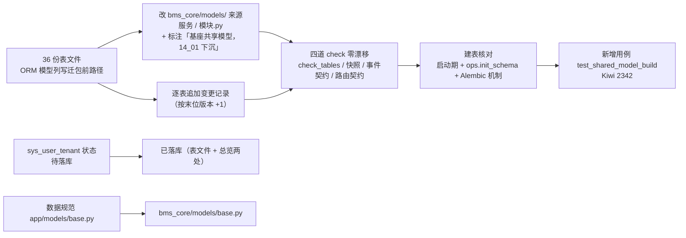

# 表归属与契约登记同步实施记录

> 后端基座与服务化地基 · 14_平台模型下沉基座 · 子任务 02 · 实施记录

[文档首页](../../../../../../文档首页.md) › [02 表归属与契约登记同步](../14_平台模型下沉基座_02_表与契约登记同步.md) › 实施　|　[详细设计](../设计/01_详细设计_02_表与契约登记同步.md) · [测试记录](../测试/01_测试_02_表与契约登记同步.md)

## 1. 实施信息 <a id="meta"></a>

| 项 | 值 |
| --- | --- |
| 任务 | [02 表归属与契约登记同步](../14_平台模型下沉基座_02_表与契约登记同步.md) |
| 对应需求 | [14-2](../../../../需求/14_需求_平台模型下沉基座.md#r14-2) |
| 详细设计 | [01_详细设计_02_表与契约登记同步](../设计/01_详细设计_02_表与契约登记同步.md) |
| 实施日期 | 2026-10-22（文档登记 / 建表核对 / 用例同轮） |
| 实施人 | minjian |
| 实施环境 | 开发机（Windows，Python 3.14 / uv，后端 `.venv` 外置符号链接）；建表核对用一次性临时 SQLite 目录（不动开发库）；Kiwi TCMS 走内网开发服务器 |
| 提交 | 分笔：`docs(14_02)` 详细设计 → `feat(14_02)` 建表核对用例 → `docs(14_02)` 表登记同步与记录回写 |
| 结论 | **已完成**：36 份表文件「ORM 模型」列改基座路径 + 逐表变更记录、`sys_user_tenant` 状态两处改「已落库」、四道 check 零漂移、启动期建表与 `ops.init_schema` 均建出 34 张 enabled 共享表（4 张 `planned` 缺席）、新增用例 Kiwi **2342**、预检缺省定向档全绿 |

## 2. 实施概览 <a id="overview"></a>



结果小结：表登记与实际模型 / 建表链重新对齐——38 张共享表中 36 张有表文件（全部指向基座共享路径）、2 张 `planned` 表无表文件（登记偏差）；`TABLE_OWNERSHIP` 的 `owner` / `datasource` 与契约归档**零改动**。

## 3. 实施过程 <a id="process"></a>

1. **表文件 ORM 列改写（36 份）**：按「表 → 基座模型文件 / 类名」映射（类名取自 `Base.registry.mappers` 实测，非按文件名推断）批量替换「ORM 模型」格，统一句式 `` `bms_core/models/<来源服务>/<模块>.py::<类>`（继承 `BaseModel`；基座共享模型，14_01 下沉） ``；`sys_account_lock` / `sys_icon` / `sys_user_extension` 的「登记于 `bms_platform/models/__init__.py::MODEL_MODULES`」改为 `bms_core/models/platform::MODEL_MODULES`；`sys_module` / `sys_product` / `sys_tenant` 保留原有历史括注（06_02 / 06_03 动作）并前置 14_01 下沉标注。
2. **逐表追加变更记录（36 条）**：版本号按**各文件末位版本 +1**（如 `sys_tenant` v6 → v7、`sys_user` v5 → v6、`sys_task` v1 → v2），内容记「ORM 模型落点迁基座共享（表名 / 字段 / 索引 / 归属不变）」；历史记录中的旧路径保留（描述当时的搬迁动作）。
3. **落库状态同步**：`sys_user_tenant` 由 `待落库` 改「已落库（随 `tenant:platform` 链幂等建表，2026-10-22 实测）」，表文件与《数据库设计总览》§7.3 两处同步，变更记录 v2 补记状态变化原因。
4. **通用约定路径修正**：《数据库设计 · 数据规范》§2 公共字段节 `app/models/base.py::BaseModel` → `bms_core/models/base.py::BaseModel`。
5. **四道 check 核对**（零漂移，不重新导出归档）：`ops.check_tables --offline`（清单 52 项）、`ops.contract_snapshot check`（9 服务）、`ops.event_contracts check`（23 条 / 订阅 0）、`ops.check_contracts`（9 服务路由）。
6. **建表核对（两路实测 + 一路机制）**：临时库目录下逐服务调 `ensure_service_schema`（3 服务 × 4 库键 = 12 库）；`ops.init_schema --target all --code demo`（19 目标：9 平台服务库 + 9 服务租户库 + 1 归档）；Alembic 五条链 `upgrade head` 均打印「暂无迁移脚本（跳过）」（脚本已随 06_05 清空，`env.py` 的 `target_metadata` 仍取 `chain_metadata`，与建表同源）。
7. **新增建表核对用例**：先在内网 Kiwi 登记用例取得编号 **2342**（分类「平台骨架」/ P2 / CONFIRMED / 标签「自动化」），再落 `backend/libs/bms_core/tests/alembic/test_shared_model_build.py`（逐链真实建表 + 表集 / 表数 / `planned` 缺席 / 归档空表集断言），代码以 `@pytest.mark.kiwi_id(2342)` 标注。
8. **登记回写**：需求 14-2（内容第 1 / 4 条与完成标准改「ORM 模型列」「34 张 enabled 共享表」口径）、任务 14_02（§2.1 / §2.4 / §3）、阶段计划（已完成表新增 14_02 行、剩余表移除该行、头部项数与累计投入自洽、§4 图注、§7 后续阶段待办新增第 51 项）、14_01 实施记录 §7 偏差 5 闭环。

## 4. 关键命令 <a id="commands"></a>

```bash
# 四道 check（在 backend/）
uv run python -m ops.check_tables --offline
uv run python -m ops.contract_snapshot check --root ..
uv run python -m ops.event_contracts check --root ..
uv run python -m ops.check_contracts

# 建表核对（一次性临时库目录，不动开发库）
BMS_DATABASE__SQLITE_DIR=<工作区>/tmp/14_02_bootstrap
BMS_APP__SERVICE=platform uv run python - <<'PY'   # identity / tenant 各一次
from bms_core.core.config import get_settings
from bms_core.db.bootstrap import ensure_service_schema
import asyncio
asyncio.run(ensure_service_schema(get_settings()))
PY
BMS_DATABASE__SQLITE_DIR=<工作区>/tmp/14_02_initschema uv run python -m ops.init_schema --target all --code demo

# Alembic 机制（缺省链用 [alembic] 段，其余链用全限定段名）
uv run alembic upgrade head
uv run alembic -n alembic:platform:platform upgrade head

# 用例与预检（在 bms/ 仓根跑预检）
uv run --directory backend pytest libs/bms_core/tests/alembic/test_shared_model_build.py -q
python scripts/tools/preflight/run-once.py -- python scripts/tools/preflight/check-preflight.py
```

## 5. 问题与处置 <a id="issues"></a>

| # | 问题 | 根因 | 处置 |
| --- | --- | --- | --- |
| 1 | 新增用例首版触发 `check-bare-collections`（5 项：`dict` / `set` 带注解声明与函数签名返回） | 护栏要求集合声明一律落 `ConcurrentStable*` | 用例改 `ConcurrentStableDict` / `ConcurrentStableSet`（含 `_tables()` 返回类型），护栏复跑 0 违规 |
| 2 | 首版用例 `pyright` 报「`set[Unknown]` 部分未知」（`set().union(*values)`） | 空 `set()` 字面量推断不出元素类型 | 改为显式 `ConcurrentStableSet` 循环 `update`，类型检查 0 error |
| 3 | `alembic -n alembic:platform:tenant upgrade head` 报 `No 'script_location' key found` | 缺省链（`platform:tenant`）的配置段是 `[alembic]`，全限定段名不是合法选链方式（设计既有口径） | 缺省链改 `alembic upgrade head`；其余链用 `-n alembic:{service}:{datasource}`；归档链无配置段（无表集、无脚本），不纳入 |
| 4 | `ops.init_schema` 汇总「跳过 1」 | 归档链表集为空（`platform:archive`），按设计不建连 | 属预期语义，测试记录登记「成功 18 / 跳过 1（归档）/ 失败 0」 |
| 5 | `check-status` 核出计划表两行格式缺陷：`13_02` 偏差单元格内的转义竖线 `\|` 被按列分隔符切分（8 列）、`13_03` 缺行尾竖线 → 两任务被判「未登记进计划」，且 S1 明细（46 项 / 投入 648）与头部不符 | 既有格式缺陷（13_02 / 13_03 交付时引入），非本轮引入 | 经逐项确认顺手修正：`13_02` 单元格内改用全角「｜」分隔、`13_03` 补行尾竖线；复跑 `check-status` 硬规则 **0**、软提示 3（既有 S2 提示，计划 §4 已注明「在排未列节点」） |

## 6. 验证结论 <a id="verify"></a>

| 项 | 结论 |
| --- | --- |
| 表文件旧路径残留 | 数据库设计体系内 `bms_{platform,identity,tenant}/models` 与 `app/models` **0 处**（仅 `sys_product.md` 变更记录保留历史动作描述） |
| 表文件改动规模 | 36 文件 / 72 insertions / 36 deletions（每文件恰好「ORM 列替换 + 变更记录新增」两行），行尾一致无混合换行 |
| 表归属登记 | `ops.check_tables --offline` 通过（清单 52 项 + 模型表对账 + 脚本表集）；`TABLE_OWNERSHIP`（`owner` / `datasource`）`git diff` 零改动 |
| 契约快照 | `contract_snapshot check` 通过（9 个启用服务，零漂移，未重新导出） |
| 事件契约 | `event_contracts check` 通过（契约 23 条 / 订阅 0 条，零漂移） |
| 路由契约 | `check_contracts` 通过（9 服务实现路由 ⊆ 公开契约） |
| 启动期建表 | 3 服务 × 4 库键 = 12 库；逐链表数 `platform:platform` 19 / `platform:tenant` 15 / `identity:platform` 4 / `identity:tenant` 6 / `tenant:platform` 8；**34 张 enabled 共享表全部建出**、4 张 `planned` 表不在任何库 |
| 运维建表 | `ops.init_schema --target all --code demo`：成功 18 / 跳过 1（归档无表集）/ 失败 0，新建 94 张；34 张 enabled 共享表全覆盖、`planned` 缺席；`--dry-run` 清单 19 目标 |
| Alembic 机制 | 五条链 `upgrade head` 均「暂无迁移脚本（跳过）」，`env.py` 元数据仍取 `chain_metadata`（与建表同源） |
| 用例 | 新增 `test_shared_model_build.py` 1 passed；与 14_01 的 `test_common_model_modules.py` 合并跑 5 passed |
| 静态 | `ruff check` / `ruff format --check` / `pyright`（strict，0 error） |
| 预检 | `check-preflight.py` 缺省定向档**全部通过**（选测 1/434、覆盖率门禁跳过＝无变更源文件、`check-bare-collections` / `check-base` / `check-docs-scope` / 契约与事件快照 / api-types 零漂移） |
| 阶段状态核对 | `check-status --stage 02_后端基座与服务化地基`：检查 471 项，硬规则 **0**、软提示 3（既有 S2 提示，计划 §4 已注明「在排未列节点」） |
| 文档基座 | `check-base` / `check-docs-scope`（1692 份，0 违规）/ `check-links`（断链 0、失效锚点 0）/ `check-bare-collections` 全部通过 |
| Kiwi | 用例 **2342**（平台已登记，代码 `@pytest.mark.kiwi_id(2342)` 标注 1 处） |

## 7. 偏差与遗留 <a id="deviation"></a>

| # | 事项 | 归口 |
| --- | --- | --- |
| 1 | 任务与需求原文「建出 38 张表（`planned` 表不计入）」口径不自洽：38 张是共享模型表总数，其中 4 张为 `planned`，实际建出 **34 张** | 已回写需求 14-2 与任务 14_02 文本（本次）；验收按「34 张 enabled 建出 + 4 张 `planned` 缺席」判定 |
| 2 | `sys_user_preference`（05-用户喜好）与 `demo`（五层示例表）有模型、**无表文件**（`planned`，38 张中缺 2 张） | 05-用户喜好阶段定稿 / 五层示例表口径；本任务不补表文件（不提前定稿字段结构） |
| 3 | 任务原文说「核对表文件『归属服务 / 模块』字段，模型归属标为基座共享」——该字段实际承载**表的数据所有权**，14_01 未改、本次也不得改 | 已在任务 §2.1 改写为「『ORM 模型』列改基座共享路径」，归属库保持原样 |
| 4 | 表文件「ORM 模型」列**无机器校验**（本轮 36 处陈旧全靠人工发现） | 计划 §7 后续阶段待办第 51 项（后续文档口径任务加校验规则，不并入 14_03） |
| 5 | `sys_user_tenant` 状态由 `待落库` 改 `已落库` 的依据是**幂等建表实测**（开发 / 演示库删库重建口径），不是真库迁移执行 | 表文件变更记录已写明依据；真库部署窗口执行时无需再改状态 |
| 6 | Alembic 归档链（`platform:archive`）无配置段与脚本，无法用 `-n` 选链 | 既有设计（归档库不服务化、表集为空），本任务按「五条有表链」核对 |
| 7 | 建表核对用一次性临时库目录，未落入 `database/bms` | 按「配置唯一来源」经 `BMS_DATABASE__SQLITE_DIR` 覆写，临时目录已清理，不入库 |
| 8 | 计划表 `13_02` / `13_03` 两行格式缺陷（既有，非本轮引入） | 本任务经确认顺手修正（§5 第 5 项）；如需 `check-status` 解析器支持单元格内转义竖线，另立 |

## 8. 参考文档 <a id="ref"></a>

- 《[数据库开发规范](../../../../../../规范/数据库开发规范.md)》「与数据库设计的关联与事实源」「迁移与建表口径」「数据表文件规范」节
- [02 详细设计](../设计/01_详细设计_02_表与契约登记同步.md)、[02 测试记录](../测试/01_测试_02_表与契约登记同步.md)
- [14_01 共享模型下沉基座](../../14_平台模型下沉基座_01_共享模型下沉基座/14_平台模型下沉基座_01_共享模型下沉基座.md)（前置契约：迁包结果）
- `bms_core/services/table_registry.py`（`TABLE_OWNERSHIP` 单一来源）、`bms_core/db/migration.py`（`COMMON_MODEL_MODULES` / `chain_metadata`）

> 本文档按《[文档生成规范](../../../../../../规范/文档生成规范.md)》编写
