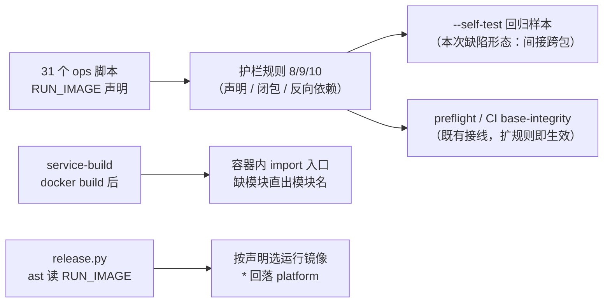

# 门禁固化与镜像边界校验实施记录

> 后端基座与服务化地基 · 14_平台模型下沉基座 · 子任务 03 · 实施记录

[文档首页](../../../../../../文档首页.md) › [03 门禁固化与镜像边界校验](../14_平台模型下沉基座_03_门禁固化与镜像边界校验.md) › 实施　|　[详细设计](../设计/01_详细设计_03_门禁固化与镜像边界校验.md) · [测试记录](../测试/01_测试_03_门禁固化与镜像边界校验.md)

## 1. 实施信息 <a id="meta"></a>

| 项 | 值 |
| --- | --- |
| 任务 | [03 门禁固化与镜像边界校验](../14_平台模型下沉基座_03_门禁固化与镜像边界校验.md) |
| 对应需求 | [14-3](../../../../需求/14_需求_平台模型下沉基座.md#r14-3) |
| 详细设计 | [01_详细设计_03_门禁固化与镜像边界校验](../设计/01_详细设计_03_门禁固化与镜像边界校验.md) |
| 实施日期 | 2026-10-22（设计 / 声明 / 护栏 / CI / 部署侧同轮） |
| 实施人 | minjian |
| 前置依赖 | [14_04](../../14_平台模型下沉基座_04_开通编排内核下沉基座/14_平台模型下沉基座_04_开通编排内核下沉基座.md) **2026-10-22 交付**：`services/*/src` 对 `ops` 导入已归零，本任务的反向断言才能「硬断言、不设例外」 |
| 提交 | 分笔：`docs(14_03)` 详细设计 → `feat(14_03)` RUN_IMAGE 声明 + 护栏三规则 + CI 导入自检 + release 按声明选镜像 → `docs(14_03)` 规范回写与记录 |
| 结论 | **已完成**：31 个 `ops` 脚本全部声明 `RUN_IMAGE`；护栏新增三项规则（运行镜像声明 / 导入闭包传递闭包 / 运行期反向依赖）+ 镜像包集合与 Dockerfile 一致性断言；`--self-test` 27 样例全通过（含本次缺陷回归样本）；`service-build` 构建期导入自检（缺模块直出模块名）；`release.py` 按声明选镜像；《部署发布规范》补冒烟诊断小节 |

## 2. 实施概览 <a id="overview"></a>



结果小结：镜像边界从「口头约定」变为**四道机器门禁**——静态声明完整性、导入闭包（含间接链）、运行期反向依赖、构建期导入自检；部署侧取镜像口径从注释解释变为**读声明**。

## 3. 实施过程 <a id="process"></a>

1. **`RUN_IMAGE` 声明（31 个脚本）**：按实测分类注入——`bootstrap_platform` → `tenant`（导入 `bms_tenant.services.*`）、`check_modules` / `check_plugins` → `ci`（导入 `bms_platform`，CI / 开发机全量工作区）、`txn_recovery` → `txn`、其余 27 个 → `*`（只依赖 `bms_core` + `ops`）。每个声明配一句 docstring 依据；首版误插到 import 之前触发 `E402`（326 项），已统一移到 import 块之后。
2. **护栏规则 8（运行镜像声明）**：跨包脚本未声明或声明值非法即失败；非跨包脚本声明可选（声明则须合法）。
3. **护栏规则 9（导入闭包）**：按 `ops` 模块图计算**传递闭包**（含 `ops` 内部互导），断言声明镜像所含包 ⊇ 闭包所需服务包；`*` 只覆盖 `bms_core` + `ops`；镜像包集合常量（`_IMAGE_PACKAGES`）与 `backend/Dockerfile` 的 COPY 面一致性断言。
4. **护栏规则 10（运行期反向依赖）**：`services/*/src` 导入 `ops` 即失败；非 platform 服务 `src` 导入 `bms_platform` 即失败（硬断言、无例外，`tests/` 不纳入）。
5. **`--self-test` 扩样例（新增 13 条）**：覆盖 `*` 闭包含服务包、`ci` 放行、`tenant` 声明但需要 platform、未声明、非法取值、**间接跨包（传递闭包）**、服务运行期导入 `ops`、非 platform 导入 `bms_platform`、platform 导入 `bms_platform` 放行、Dockerfile 漂移等；其中「间接跨包」即本次缺陷形态。
6. **`service-build` 构建期导入自检**：`docker build` 后 `docker run --rm --entrypoint python "$IMAGE" -c '<包装脚本>' "$SERVICE"`，容器内 `import bms_<service>.main`；`ModuleNotFoundError` 时打印 `[service-build] 镜像缺模块：<name>` 并退出 1；其它异常打印类型与消息；成功打印通过标记。`Dockerfile` 头部注释同步说明镜像边界与构建期自检。
7. **`release.py` 按声明选镜像**：新增 `_run_image_of(module)`（标准库 `ast` 静态读取，部署机无需后端 venv）+ `_ops_script_path`；`cmd_bootstrap` 的 `provision_tenant` / `seed_module` / `seed_tables` / `seed_tenant` 四处改按声明取镜像，`*` 回落 `platform`、`ci` 显式报错；删除原「按服务包 / 表归属挑镜像」的解释性注释。
8. **规范回写**：《部署发布规范》新增「冒烟失败与镜像边界」小节（两类失败根因与处置顺序、四道机器门禁、检查项）。
9. **用例**：`test_release_image_selection.py`（6 例：声明完整性 / 回落 / ci 拒绝 / 未声明与非法 / bootstrap 按声明 / 镜像包集合与 Dockerfile）、`test_service_build_selfcheck.py`（5 例：自检步骤存在与位置 / 可导入 / 缺模块打印名 / 其它异常 / Dockerfile 说明）。

## 4. 关键命令 <a id="commands"></a>

```bash
# 护栏全跑与自测（bms/ 仓根）
python scripts/tools/base-check/check-service-boundaries.py
python scripts/tools/base-check/check-service-boundaries.py --self-test
# 裸集合护栏（护栏脚本自身也在扫描面内）
python scripts/tools/base-check/check-bare-collections.py
# 定向用例
python scripts/tools/preflight/run-once.py -- \
  uv run --directory backend pytest libs/bms_core/tests/ops libs/bms_core/tests/boundary libs/bms_core/tests/tenant -q
# 预检与文档基座
python scripts/tools/preflight/run-once.py -- python scripts/tools/preflight/check-preflight.py --fast
python scripts/tools/base-check/check-base.py
python scripts/tools/base-check/check-docs-scope.py
python scripts/tools/base-check/check-links.py
```

## 5. 问题与处置 <a id="issues"></a>

| # | 问题 | 根因 | 处置 |
| --- | --- | --- | --- |
| 1 | `RUN_IMAGE` 首版插在模块 docstring 之后、import 之前，`ruff` 报 326 项 `E402` | 声明位置选错（模块级常量应在 import 块之后） | 统一移到 import 块之后（按 AST 找最后一条顶层 import），`ruff` 复跑 0 错 |
| 2 | 规则 9 首版用 `set.issubset`，`ConcurrentStableSet` 无此方法 | 基座集合类不提供内置集合的全部方法 | 改用集合差集运算（`docker_packages - packages`）判空 |
| 3 | 模块名解析出 `backend.ops.seed_user`（应为 `ops.seed_user`），导致闭包计算查不到依赖 | `_module_name_of` 保留了仓库内目录前缀 | 剥掉首段 `backend`，只保留可导入包路径 |
| 4 | 新增自检样例首版放在末尾，导致前 14 个既有样例全部变「不通过」 | 自检共享同一临时仓库：① 既有最后一样例留下**非法例外白名单**（`access=write`）；② 新增「Dockerfile 漂移」样例改坏了 Dockerfile；③ 既有样例残留 `ai/repository.py` 的跨库 SQL | 新样例移到最前 + 跑前复位白名单 + Dockerfile 漂移样例放最后并即时恢复；`run()` 失败时打印前 6 行明细便于定位 |
| 5 | 裸集合护栏报 1 项（护栏脚本内 `targets: list[ast.expr] = []`） | `scripts/tools` 在裸集合护栏扫描面内（长期强制口径、无内部工具豁免） | 改 `ConcurrentStableList`（含 `ConcurrentStableList(node.targets)` 构造） |
| 6 | `test_release_image_selection.py` 直接 `import release` 触发 pyright「无法解析导入」（11 项） | `release.py` 是部署侧脚本，只依赖标准库，不在 pyright `extraPaths` | 改 `importlib.util.spec_from_file_location` 按路径加载 + 显式 `Any`/`cast`，pyright 0 错 |
| 7 | `seed_tenant` 的运行镜像由 tenant 变为 platform（`*` 回落） | 14_04 后该脚本已只依赖 `bms_core`（惰性导入改基座路径），`*` 声明成立；按确认口径 `*` 回落 platform | 属**预期行为变更**，登记为偏差（§7 第 2 项）；镜像能力已验证（无 `bms_tenant` 依赖） |

## 6. 验证结论 <a id="verify"></a>

| 项 | 结论 |
| --- | --- |
| `RUN_IMAGE` 覆盖 | **31 / 31** 脚本声明，取值分布 `*` 27 / `ci` 2 / `tenant` 1 / `txn` 1，全部合法 |
| 护栏全跑（真仓） | **通过**，0 违规 |
| 护栏 `--self-test` | **27 样例全部通过**（原 14 + 新增 13），含本次缺陷回归样本（间接跨包） |
| 本次缺陷复现 | 临时仓库构造「`tenant_provisioning`（声明 tenant）→ `seed_platform`（导入 `bms_platform`）」→ 护栏报「导入闭包越界」；`services/tenant/src` 导入 `ops` → 报「运行期依赖运维通道」 |
| 构建期自检语义 | 三场景实测：可导入退出 0、缺模块退出 1 且打印 `bms_ghost_package`、其它异常退出 1 并打印异常类型 |
| `release.py` 取镜像 | `seed_module` / `seed_tables` / `seed_tenant` / `provision_tenant` / `init_schema` 均取到 `platform`（`*` 回落）；`bootstrap_platform` → `tenant`；`txn_recovery` → `txn`；`check_modules` → 报「ci 无部署镜像」 |
| 定向用例 | `libs/bms_core/tests/{ops,boundary,tenant}` **414 passed** |
| 裸集合护栏 | 通过（0 违规） |
| 静态 | `ruff check` / `ruff format --check`（`scripts/tools` + `ops`）/ `pyright` **0 错** |
| 预检 | `check-preflight.py --fast` **全部通过**（39.5s） |
| 文档基座 | `check-base` / `check-docs-scope`（1696 份）/ `check-links` **全部通过** |
| 阶段状态核对 | `check-status` 硬规则 **0**、软提示 1（既有 S2：13_05 在排未列，计划 §4 已注明） |
| Kiwi | 用例 **2345**（平台已登记并回读编号） |

## 7. 偏差与遗留 <a id="deviation"></a>

| # | 事项 | 归口 |
| --- | --- | --- |
| 1 | `release.py` 范围从「只改种子段」扩大到**全部 `ops` 调用点**（`provision_tenant` / `init_schema` 等同一取镜像入口） | 本轮决策；已回写任务 §2.7，避免两套取镜像口径并存 |
| 2 | **部署镜像变更**：`seed_tenant` 由 tenant 镜像改为 platform 镜像（`*` 回落口径） | 14_04 后该脚本只依赖 `bms_core`，platform 镜像可运行；部署侧行为变化已登记，随下次部署窗口观察 |
| 3 | `RUN_IMAGE` 覆盖**全部 31 个脚本**（仅跨包脚本未声明即失败） | 全量声明使「新脚本跨包化忘声明」也能被拦；与任务原文「每个脚本」一致 |
| 4 | 镜像包集合常量放护栏脚本（不进 `bms_core`） | 避免新模块进后端覆盖率分母；部署侧事实不必进共享基座 |
| 5 | `ops` 整体未纳入 `pyright`（`include = ["libs","services"]`；`migrate_tenants.py` 有 3 处既有 tuple 类型基线） | 另立任务；本任务不扩大范围 |
| 6 | 护栏 `--self-test` 依赖共享临时仓库的**执行顺序**（样例间会残留状态） | 已在新样例处显式复位（白名单 / Dockerfile / 清理 ops 脚本），并在 `run()` 失败时打印明细；如后续继续扩样例，建议改为「每样例独立临时目录」 |

## 8. 参考文档 <a id="ref"></a>

- 《[部署发布规范](../../../../../../规范/部署发布规范.md)》「冒烟失败与镜像边界」小节
- 《[后端开发规范](../../../../../../规范/后端开发规范.md)》§3.2「运行期代码不得依赖运维通道」
- [03 详细设计](../设计/01_详细设计_03_门禁固化与镜像边界校验.md)、[03 测试记录](../测试/01_测试_03_门禁固化与镜像边界校验.md)
- [14_04 开通编排内核下沉基座](../../14_平台模型下沉基座_04_开通编排内核下沉基座/14_平台模型下沉基座_04_开通编排内核下沉基座.md)（前置契约：`services/*/src` 对 `ops` 归零）

> 本文档按《[文档生成规范](../../../../../../规范/文档生成规范.md)》编写
