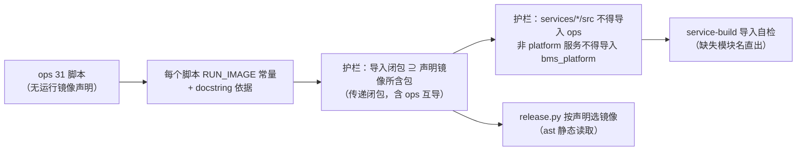

# 门禁固化与镜像边界校验详细设计

> 后端基座与服务化地基 · 14 平台模型下沉基座 · 03 门禁固化与镜像边界校验 · 详细设计（开发核心文档）

[文档首页](../../../../../../文档首页.md) › [03 门禁固化与镜像边界校验](../14_平台模型下沉基座_03_门禁固化与镜像边界校验.md) › 设计　|　[实施记录](../实施/01_实施_03_门禁固化与镜像边界校验.md) · [测试记录](../测试/01_测试_03_门禁固化与镜像边界校验.md)

## 1. 目标与边界 <a id="scope"></a>

**目标**：流水线 1188 `contract-smoke-tenant` 的根因是**导入链跨服务**，但既有护栏在任何早期环节都没拦住——静态检查、单元测试、镜像构建全过，只有容器真正启动才暴露。本任务把「镜像边界」从口头约定变成**机器门禁**：`ops` 跨包脚本声明运行镜像、护栏按镜像所含包断言导入闭包、服务运行期代码禁止导入 `ops`、镜像构建期做导入自检。

**范围内**：

1. **运行镜像声明**：`ops` 全部 31 个脚本声明 `RUN_IMAGE`（`platform` / `tenant` / `txn` / `ci` / `*`）并在 docstring 写明依据。
2. **导入闭包断言**：扩展 `check-service-boundaries.py`，断言「脚本声明镜像所含包 ⊇ 脚本导入闭包所需服务包」（含 `ops` 内部互导的**传递闭包**）。
3. **反向断言**：`services/*/src` 不得导入 `ops`；非 platform 服务的运行期代码不得导入 `bms_platform`。
4. **镜像包集合来源**：护栏内维护「镜像 → 包集合」常量，并断言与 `backend/Dockerfile` 的 `COPY` 行一致。
5. **镜像启动自检**：`deploy/ci/templates/backend-service.yml` 的 `service-build` 增加导入自检，失败时**直接打印缺失模块名**；`Dockerfile` 说明同步。
6. **冒烟门禁说明**：《部署发布规范》补小节——`contract-smoke` 失败语义与镜像边界的关系（「冒烟失败先看容器启动诊断」）。
7. **部署侧口径清理**：`release.py` 中「按服务包挑镜像」的注释与分支改为**读取脚本的运行镜像声明**（标准库 `ast` 静态读取）。
8. **护栏自测**：`--self-test` 以本次缺陷为回归样本（修复前版本失败、修复后通过）。

**范围外**：

- 14_04 已交付的「内核与四种子下沉」本身（本任务只在其结果上断言）；
- `ops` 脚本的业务逻辑调整（本任务只加声明与门禁，不改行为）；
- 把 `ops` 整体纳入 `pyright` 门禁（既有 3 处 tuple 类型基线，另立任务）。

## 2. 现状与改造点 <a id="current"></a>

### 2.1 现状（14_04 交付后实测，2026-10-22）

| 项 | 实测 |
| --- | --- |
| `ops` 脚本总数 | **31**（含 `__init__.py`；30 个可执行脚本 + 包说明） |
| 跨服务包脚本 | **4 个**：`bootstrap_platform` → `bms_tenant`（4 处）、`check_modules` → `bms_platform`（2 处）、`check_plugins` → `bms_platform.main`、`txn_recovery` → `bms_txn`（2 处） |
| `ops` 内部互导 | **10 个**脚本（`check_contracts` / `contract_gate` → `contract_snapshot`；`check_modules` / `check_tables` / `seed_menu` / `seed_module` / `seed_tables` → `seed_tenant`；`init_schema` / `init_tenant` / `provision_tenant` → `migrate_tenants`） |
| 只依赖 `bms_core` | **18 / 31** |
| `services/*/src` 导入 `ops` | **0 处**（14_04 已归零；`tests/` 内仍有，非运行期代码） |
| 现行护栏 | `check-service-boundaries.py` 七项规则，**全文不检查 `ops`**，也不拦服务反向依赖 `ops` |
| 镜像构建 | `service-build` 只 `docker build`，无导入自检；`Dockerfile` 无相关说明 |
| 部署侧 | `release.py:684` 硬编码挑镜像 + 解释性注释（`seed_module` / `seed_tables`→platform、`seed_tenant`→tenant） |
| 门禁接线 | 该护栏已接 `preflight`（定向 / `--fast` / `--full`）、CI `base-integrity`、`boundary_metrics`、`--self-test` |

### 2.2 改造点



## 3. 交付物清单 <a id="deliverables"></a>

| # | 交付物 | 落点 |
| --- | --- | --- |
| 1 | `RUN_IMAGE` 声明（31 个脚本 + docstring 依据） | `backend/ops/*.py` |
| 2 | 护栏三项新规则（运行镜像声明 / 导入闭包 / 反向依赖）+ 镜像包集合常量 + Dockerfile 一致性断言 | `scripts/tools/base-check/check-service-boundaries.py` |
| 3 | 护栏 `--self-test` 回归样本（本次缺陷形态） | 同上 |
| 4 | 镜像导入自检（构建期，失败打印缺失模块名） | `deploy/ci/templates/backend-service.yml`、`backend/Dockerfile`（说明） |
| 5 | 部署侧按声明选镜像 | `scripts/tools/deploy/release.py` |
| 6 | 冒烟失败诊断口径小节 | `bms文档/规范/部署发布规范.md` |
| 7 | 用例（护栏 + 部署侧 + 声明完整性） | `backend/libs/bms_core/tests/boundary/`、`backend/libs/bms_core/tests/ops/` |
| 8 | 登记回写 | 需求 14-3、任务 14_03、阶段计划、实施 / 测试记录 |

## 4. 设计 <a id="design"></a>

### 4.1 运行镜像声明 <a id="run-image"></a>

**形态**：每个 `ops` 脚本在模块级声明常量（**机器可读**），docstring 写明依据：

```python
RUN_IMAGE = "platform"
"""运行镜像：platform（本脚本导入 bms_platform 仓储 / 服务，仅平台镜像含该包）。"""
```

**取值与语义**（五值）：

| 取值 | 语义 | 镜像所含包 |
| --- | --- | --- |
| `platform` | 仅 platform 服务镜像 | `bms_core` + `bms_platform` + `ops` |
| `tenant` | 仅 tenant 服务镜像 | `bms_core` + `bms_tenant` + `ops` |
| `txn` | 仅 txn 服务镜像 | `bms_core` + `bms_txn` + `ops` |
| `ci` | CI / 开发机全量工作区（无镜像边界） | 全部包（含所有服务包） |
| `*` | 任意服务镜像（只需 `bms_core` + `ops`） | `bms_core` + `ops` + **目标服务自身**（见 §4.3） |

**声明清单**（按 14_04 后实测，31 个脚本）：

| RUN_IMAGE | 脚本 | 依据 |
| --- | --- | --- |
| `platform` | `bootstrap_platform` | 导入 `bms_tenant.services.*` 4 处（见 §4.5 偏差：实际镜像为 tenant，故取 `tenant`，见下） |
| `ci` | `check_modules` / `check_plugins` | 导入 `bms_platform.repositories` / `bms_platform.main`；CI / 开发机全量工作区，无镜像边界 |
| `txn` | `txn_recovery` | 导入 `bms_txn.repositories` / `bms_txn.services`；运维机 / txn 镜像 |
| `*` | 其余 27 个（含 14_04 下沉后的 `seed_platform` / `seed_rbac` / `seed_sso` / `seed_user` / `tenant_provisioning`） | 只依赖 `bms_core`（+ `ops` 内部互导），任意服务镜像可运行 |

> **`bootstrap_platform` 的取值修正**：任务原文写「tenant 镜像」，实测其导入的是 `bms_tenant.services.{platform_tenant,tenant_admin,tenant_module,tenant_quota}`，**只有 tenant 镜像含该包**——故声明 `tenant`（与原文一致，此处仅澄清依据）。

**未声明即失败**：护栏对**跨包脚本**（导入闭包含 `bms_core` 以外的服务包）强制要求声明；未声明或声明值非法即失败。

### 4.2 镜像包集合与 Dockerfile 一致性 <a id="image-packages"></a>

护栏内维护常量（**单一来源**，不新建 `bms_core` 模块以免进后端覆盖率分母）：

```python
_IMAGE_PACKAGES: dict[str, frozenset[str]] = {
    "platform": frozenset({"bms_core", "bms_platform", "ops"}),
    "tenant": frozenset({"bms_core", "bms_tenant", "ops"}),
    "txn": frozenset({"bms_core", "bms_txn", "ops"}),
    "ci": frozenset({"bms_core", *ALL_SERVICE_PACKAGES, "ops"}),
}
```

**与 Dockerfile 的一致性断言**：解析 `backend/Dockerfile` 的 `COPY libs/bms_core/src` 与 `COPY services/${SERVICE}/src` 两行，断言「镜像包集合 = `bms_core` + 目标服务 + `ops`」这一口径与 Dockerfile 实际 COPY 面一致（Dockerfile 改 COPY 而常量未改即失败）。

### 4.3 导入闭包断言 <a id="closure"></a>

**判定**：对每个 `ops` 脚本，计算其**传递导入闭包**（含 `ops` 内部互导），取闭包中出现的服务包集合 `needed`；断言：

```text
镜像所含包（按声明值展开，`*` 展开为「bms_core + ops + 任意单一目标服务」） ⊇ needed
```

- **`*` 的判定**：`needed ⊆ {bms_core, ops}` 时通过（任意镜像都含 `bms_core` + `ops`）；若 `needed` 含某服务包，则 `*` **不成立**（须改声明为该服务或 `ci`）；
- **`ci` 的判定**：`needed` 必须 ⊆ 全部包（CI 全量工作区，恒成立；但仍要求声明存在）；
- **传递闭包的必要性**：本次缺陷正是 `services/tenant → ops.tenant_provisioning → ops.seed_platform → bms_platform.models` 的**间接链**——只看直接导入会漏判同类问题。

### 4.4 反向断言 <a id="reverse"></a>

| 规则 | 判定 | 理由 |
| --- | --- | --- |
| `services/*/src` 不得导入 `ops` | AST 扫描 `services/*/src/**/*.py` 的 import 面，命中 `ops` 即失败 | 运维包被运行期代码依赖会使「服务独立构建」失效（本次缺陷根因） |
| 非 platform 服务不得导入 `bms_platform` | 除 `services/platform` 外的服务 `src` 命中 `bms_platform` 即失败 | 服务镜像不含其他服务源码 |

**硬断言、不设例外**：两条规则均无白名单（与「写侧硬禁无例外」同口径）；`tests/` 目录不纳入（非运行期代码）。

### 4.5 镜像启动自检（构建期） <a id="build-selfcheck"></a>

`service-build` 在 `docker build` 之后、推送之前增加一步：

```yaml
- docker run --rm --entrypoint python "$IMAGE" -c "<包装脚本>"
```

包装脚本语义：

1. `import bms_<service>.main`；
2. 捕获 `ImportError` / `ModuleNotFoundError`，**打印缺失模块名**（`exc.name`）后 `exit 1`；
3. 成功时打印一行通过标记。

**为什么不用裸 `python -c "import bms_x.main"`**：裸写法虽由解释器自然输出 `ModuleNotFoundError: No module named 'x'`，但退出码语义与「缺失模块名提取」依赖解析 stderr；包装脚本可**显式**打印 `[service-build] 镜像缺模块：<name>` 并给出定位提示，CI 日志一眼可读。

**Dockerfile 说明同步**：`backend/Dockerfile` 头部注释补一句——「镜像只装 `bms_core` + 目标服务 + `ops`；构建期由 `service-build` 做导入自检，缺模块即构建失败」。

### 4.6 部署侧按声明选镜像 <a id="release"></a>

`release.py` 的 `cmd_bootstrap` 种子段改为：**标准库 `ast` 静态读取** `backend/ops/<脚本>.py` 的 `RUN_IMAGE` 常量，按声明选运行镜像；`*` 回落 `platform`（与现状等价）。

- **为什么用 `ast` 而非导入**：部署机无需后端 venv（`release.py` 只依赖标准库），静态读取零依赖；
- **为什么不生成清单文件**：多一份生成物就多一条零漂移门禁；`ast` 直读天然同步；
- **范围**：任务原文只要求种子段（`seed_module` / `seed_tables` / `seed_tenant`）；**本轮决策顺带统一** `provision_tenant` / `init_schema` 等全部 `ops` 调用点（同一取镜像入口，避免两套口径）。

### 4.7 护栏自测（回归样本） <a id="self-test"></a>

`--self-test` 在临时仓库构造样例，覆盖本次缺陷形态：

| 样例 | 期望 |
| --- | --- |
| `ops` 脚本导入 `bms_platform` 但声明 `RUN_IMAGE = "tenant"` | **拦截**（闭包不满足） |
| 同上但声明 `ci` | 放行 |
| `ops` 脚本无 `RUN_IMAGE` 且跨包 | **拦截**（未声明） |
| `ops` 脚本 `RUN_IMAGE = "*"` 但闭包含 `bms_tenant` | **拦截**（`*` 不含服务包） |
| `services/tenant/src` 导入 `ops.tenant_provisioning` | **拦截**（反向依赖） |
| `services/identity/src` 导入 `bms_platform` | **拦截**（跨服务） |
| `services/platform/src` 导入 `bms_platform` | 放行（本服务） |
| 镜像包集合常量与 Dockerfile COPY 不一致 | **拦截** |

### 4.8 覆盖率与验证 <a id="verify"></a>

- **护栏脚本在 `scripts/tools/`**：不属后端覆盖率采集范围（`_COVERAGE_PACKAGES` 只含 `bms_core` + 服务包），**无覆盖率分母变化**；
- **新增用例**：`libs/bms_core/tests/boundary/test_service_boundaries_image.py`（护栏规则）与 `libs/bms_core/tests/ops/test_release_image_selection.py`（部署侧取镜像）——属测试文件，不计入分母；
- **验证命令**见 §6。

## 5. 测试设计与验收映射 <a id="accept"></a>

| 完成标准（任务 14_03 §3） | 验证手段 |
| --- | --- |
| 每个跨包 `ops` 脚本都有 `RUN_IMAGE` 且断言通过 | 护栏全跑 0 违规 + 用例逐脚本断言声明存在且取值合法 |
| `services/*/src` 导入 `ops` 归零、非 platform 服务导入 `bms_platform` 归零 | 护栏反向断言 + `rg` 复核 |
| `service-build` 导入自检生效（故意缺包时构建失败） | 用例断言模板含自检步骤 + 包装脚本语义单测（缺模块名打印、退出码 1） |
| 规范补入对应小节 | 《部署发布规范》diff |
| `--self-test` 通过且能复现本次缺陷 | `--self-test` 全跑（8 个样例，含本次缺陷形态） |
| 预检 `--fast` 与 CI `base-integrity` 纳入该护栏 | 预检已接入（既有），CI `base-integrity` 已含该脚本（既有），本次只扩规则 |

## 6. 验证命令 <a id="commands"></a>

| 步骤 | 命令（`bms/` 仓根） | 通过标准 |
| --- | --- | --- |
| 护栏全跑 | `python scripts/tools/base-check/check-service-boundaries.py` | 0 违规 |
| 护栏自测 | `python scripts/tools/base-check/check-service-boundaries.py --self-test` | 全部样例通过 |
| 新增用例 | `uv run --directory backend pytest libs/bms_core/tests/boundary libs/bms_core/tests/ops -q` | 全通过 |
| 静态 | `uv run --directory backend ruff check ../scripts/tools backend/ops` 等 | 0 错 |
| 预检 | `python scripts/tools/preflight/run-once.py -- python scripts/tools/preflight/check-preflight.py --fast` | 全绿 |
| 文档基座 | `check-base.py` / `check-docs-scope.py` / `check-links.py` | 0 违规 |

## 7. 兼容与回滚 <a id="rollback"></a>

- **兼容**：`ops` 脚本行为零变化（只加常量与 docstring）；CI 多一步导入自检（只读、秒级）；`release.py` 取镜像结果与现状等价（`*` 回落 platform）；
- **回滚**：`git revert` 本任务提交即可；无数据与部署面变更；
- **风险**：① 声明值与实际镜像不符 → 靠 `--self-test` 与 CI 导入自检双保险；② Dockerfile 与常量漂移 → 一致性断言拦截；③ `ast` 读取失败（脚本语法错误）→ 读取函数对异常显式报错并指出脚本名。

## 8. 登记落点 <a id="register"></a>

| 落点 | 内容 |
| --- | --- |
| 规范 | 《部署发布规范》补「冒烟失败先看容器启动诊断」小节 |
| 需求 / 任务 | 需求 14-3 内容与完成标准按本轮决策对齐；任务 14_03 §2 同步 |
| 计划 | 阶段二计划 §3 `14_03` 行（状态 / 完成日期） |
| 记录 | 本任务 `实施/`、`测试/` |
| Kiwi | 1 条（护栏规则与镜像边界用例，含自测回归样本） |

## 9. 偏差与开放项 <a id="open"></a>

| # | 事项 | 归口 |
| --- | --- | --- |
| 1 | 任务原文「`release.py` 只改种子段」，本轮决策**顺带统一全部 `ops` 调用点** | 已回写任务 §2.7；同一取镜像入口避免两套口径 |
| 2 | `RUN_IMAGE` 覆盖**全部 31 个脚本**（原文「每个 ops 脚本」），仅跨包脚本未声明即失败 | 全量声明让「新脚本跨包化忘声明」也能被拦（否则需先扫描跨包再要求声明，逻辑等价但要全量扫描） |
| 3 | `bootstrap_platform` 声明 `tenant`（任务原文口径），实测其导入 `bms_tenant.services.*` | 原文一致；本设计 §4.1 澄清依据 |
| 4 | 镜像包集合常量放护栏脚本（不进 `bms_core`） | 避免新模块进后端覆盖率分母（需同步补 100% 单测），且部署侧事实不必进共享基座 |
| 5 | `ops` 整体未纳入 `pyright`（既有 3 处 tuple 基线） | 另立任务；本任务不扩大范围 |

## 10. 对齐记录 <a id="align"></a>

逐项确认（question 工具，2026-10-22）：

| # | 事项 | 定案 |
| --- | --- | --- |
| 1 | 执行顺序 | 先做 14_04，再回来做 14_03（已按此执行） |
| 2 | `RUN_IMAGE` 覆盖面 | **全部 31 个脚本**都声明；仅跨包脚本未声明即失败 |
| 3 | `RUN_IMAGE` 取值 | `platform` / `tenant` / `txn` / `ci` / `*` 五值 |
| 4 | 镜像包集合来源 | 护栏脚本内常量 + 断言与 `backend/Dockerfile` COPY 一致 |
| 5 | 导入闭包深度 | **传递闭包**（含 `ops` 内部互导） |
| 6 | 反向断言机制 | **硬断言，不设例外** |
| 7 | 构建期导入自检 | `docker run` + 包装脚本**显式打印缺失模块名** |
| 8 | `release.py` 依据 | 标准库 **`ast` 静态读取**脚本声明 |
| 9 | `release.py` 范围 | **顺带统一** `provision_tenant` / `init_schema` 等全部 `ops` 调用 |
| 10 | `*` 默认镜像 | 回落 **platform** 镜像 |
| 11 | Kiwi 登记 | 内网登记并回读编号 |
| 12 | 验证深度 | 定向档（护栏全跑 + 预检 `--fast` + 文档基座） |

> 本文档按《[文档生成规范](../../../../../../规范/文档生成规范.md)》与《[AI开发规范](../../../../../../规范/AI开发规范.md)》编写 · 关键决策逐项确认
