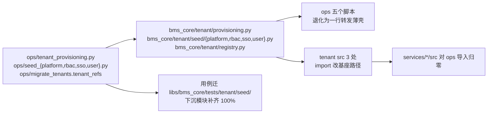

# 开通编排内核下沉基座实施记录

> 后端基座与服务化地基 · 14_平台模型下沉基座 · 子任务 04 · 实施记录

[文档首页](../../../../../../文档首页.md) › [04 开通编排内核下沉基座](../14_平台模型下沉基座_04_开通编排内核下沉基座.md) › 实施　|　[详细设计](../设计/01_详细设计_04_开通编排内核下沉基座.md) · [测试记录](../测试/01_测试_04_开通编排内核下沉基座.md)

## 1. 实施信息 <a id="meta"></a>

| 项 | 值 |
| --- | --- |
| 任务 | [04 开通编排内核下沉基座](../14_平台模型下沉基座_04_开通编排内核下沉基座.md) |
| 对应需求 | [14-4](../../../../需求/14_需求_平台模型下沉基座.md#r14-4) |
| 详细设计 | [01_详细设计_04_开通编排内核下沉基座](../设计/01_详细设计_04_开通编排内核下沉基座.md) |
| 实施日期 | 2026-10-22（设计 / 下沉 / 用例 / 覆盖率同轮） |
| 实施人 | minjian |
| 实施环境 | 开发机（Windows，Python 3.14 / uv，后端 `.venv` 外置符号链接）；用例一律 `tmp_path` 临时 SQLite（不动开发库）；Kiwi TCMS 走内网开发服务器 |
| 提交 | 分笔：`docs(14_04)` 详细设计 → `feat(14_04)` 内核与四种子下沉 + ops 薄壳 + 用例迁移 → `docs(14_04)` 登记回写与记录 |
| 结论 | **已完成**：5 个文件下沉 `bms_core.tenant`（+ 库名基解析 `tenant/registry.py`）、tenant src 3 处与 tests 4 文件切换、`services/*/src` 对 `ops` 导入归零、下沉模块覆盖率行 + 分支 **100%**、规划 / 规范 / 基类清单已回写、预检 `--fast` 全绿 |

## 2. 实施概览 <a id="overview"></a>



结果小结：tenant 服务启动链不再经过运维包——`bms_tenant.main → services.platform_tenant → bms_core.tenant.provisioning → bms_core.tenant.seed.*`，全链只依赖 `bms_core`；CLI 命令面零变化（`python -m ops.<script>` 与部署脚本调用照旧）。

## 3. 实施过程 <a id="process"></a>

1. **库名基解析下沉**（新增 `bms_core/tenant/registry.py`）：`TenantRef` / `tenant_refs` / `tenant_refs_sync` 自 `ops/migrate_tenants.py` 迁入，达梦同步分支改公开名便于直测；查询语句抽 `_statement()` 供同步 / 异步共用（避免两份 SQL）。
2. **四个种子下沉**（`bms_core/tenant/seed/{user,rbac,platform,sso}.py` + `__init__.py`）：按依赖序落文件（`user` 提供 `resolve_tenant_basis` / `resolve_tenant_url`，`rbac` 依赖它，`platform` / `sso` 独立），模块级常量与结果类型**逐字保真**（以 AST 比对 git 原文核验：5 文件常量缺失 / 变更 / 新增均为 0）。
3. **开通编排内核下沉**（`bms_core/tenant/provisioning.py`）：`ProvisionOutcome` / `enabled_tenant_services` / `provision_infrastructure` / `build_parser` / `main` 整体迁入；四个种子导入改基座路径。
4. **`ops` 退化为薄壳**：`tenant_provisioning` / `seed_platform` / `seed_sso` / `seed_user` 为「导入 `main` + `__main__` 转发」；`seed_rbac` 因 `main` 是 `async`（原脚本以 `asyncio.run(main(parser.parse_args()))` 启动），薄壳保留同构三行。
5. **`ops.migrate_tenants` 复用基座**：`tenant_refs` 改为转发 `bms_core.tenant.registry.tenant_refs`（保留同名函数，`ops.init_tenant` / `ops.provision_tenant` / `ops.seed_user` 零改动）；删除本地 `TenantRef` / `_tenant_refs_sync` / `_ref` 与随之无用的 sqlalchemy 导入。
6. **调用方切换**：tenant src 3 处（`platform_tenant.py` / `provisioning.py` / `api/tenant_admin.py`）与 tests 4 文件改 `bms_core.tenant.provisioning`；`provisioning.py` 模块 docstring 的 `ops.tenant_provisioning` 提法同步改基座路径。
7. **用例迁移**：`libs/bms_core/tests/ops/test_seed_user.py` → `libs/bms_core/tests/tenant/seed/test_user.py`；`services/platform/tests/seed/test_seed_rbac.py` 的基座实现用例 → `libs/bms_core/tests/tenant/seed/test_rbac.py`（该服务侧文件只保留菜单一致性用例）。
8. **新增用例补齐覆盖率**：`test_registry` / `test_provisioning` / `test_seed_platform` / `test_sso` / `test_cli_shell` / `test_main_paths` / `test_branches`，覆盖成功路径、失败逆序清理、dry-run、缺码去重、悬空权限码行、CLI 退出码、薄壳「无业务函数 / 不导入服务包」。
9. **登记回写**：《平台可扩展性规划》§3.2 补「开通所需默认数据种子归基座 + 不得承载业务运营逻辑」；《后端开发规范》§3.2 补「运行期代码不得依赖运维通道」；《后端基类清单》§9 登记；需求 14-4 / 任务 14_04 文本按本轮决策对齐；阶段计划与记录回写。

## 4. 关键命令 <a id="commands"></a>

```bash
# 基座用例（在 backend/）
uv run pytest libs/bms_core/tests/tenant -q
# 覆盖率（下沉 6 模块，行 + 分支 100%）
BMS_COVERAGE_DATA=$PWD/.coverage-t14_04 BMS_COVERAGE_SOURCE=bms_core PYTHONPATH=$PWD \
  uv run pytest -q -p bms_testing_plugin libs/bms_core/tests/tenant
uv run python ../scripts/tools/preflight/coverage_gate.py --data-file .coverage-t14_04 \
  --out cov14.json --fail-under 100 \
  --module bms_core.tenant.provisioning --module bms_core.tenant.registry \
  --module bms_core.tenant.seed.platform --module bms_core.tenant.seed.rbac \
  --module bms_core.tenant.seed.sso --module bms_core.tenant.seed.user
# tenant 服务用例
uv run pytest services/tenant/tests -q
# 静态与护栏
uv run ruff check ops libs/bms_core/src/bms_core/tenant libs/bms_core/tests/tenant services/tenant
uv run ruff format --check ops libs/bms_core/src/bms_core/tenant libs/bms_core/tests/tenant services/tenant
uv run pyright libs/bms_core/src/bms_core/tenant libs/bms_core/tests/tenant
# 反向依赖断言（应为 0 处）
rg "^\s*(from|import)\s+ops\b" backend/services/*/src
# 预检
python scripts/tools/preflight/run-once.py -- python scripts/tools/preflight/check-preflight.py --fast
```

## 5. 问题与处置 <a id="issues"></a>

| # | 问题 | 根因 | 处置 |
| --- | --- | --- | --- |
| 1 | 首版 `seed/rbac.py` 抄常量时漏了 `icon:*` / `permission:*` / `user:*` / `session:*` 等条目，迁移后用例断言失败 | 手工转录 44 条权限码清单，漏项 | 改为从 `git show HEAD:backend/ops/seed_rbac.py` **原文整段替换**（AST 常量比对复核：缺失 / 变更 / 新增均为 0） |
| 2 | `AUDIT_ADMIN_CODES = ()` 在 `ops` 内不报错，迁入 `bms_core` 后 `pyright` 报 `tuple[()]` 不可赋给 `ConcurrentStableList[str]` | `ops/` 不在 pyright 门禁 `include`（`["libs","services"]`）内，历史写法未被约束 | 改 `ConcurrentStableList()`（语义等价，空集合）；同类写法在迁移时统一按严格类型口径落 |
| 3 | `provision_infrastructure` 成功路径用例首版报 `no such table: sys_business` | 种子要读平台库 `sys_business` / `sys_permission`；部署期由「建表先行」落地，单测需自行预建 | 用例加 `_prepare_platform_service_db`（按 `chain_metadata` 真实建表），与部署期口径一致 |
| 4 | `seed_sso.main` 用例写成 `async def` 时报 `asyncio.run() cannot be called from a running event loop` | `main` 内部以 `asyncio.run` 启动（原脚本形态保留） | 用例改同步 `def`（与真实 CLI 调用形态一致） |
| 5 | `check-bare-collections` 报 4 项（测试内 `dict[str, int] = {}`） | 护栏要求集合声明落 `ConcurrentStable*` | 用例改 `ConcurrentStableDict` + `.set()` 写入，护栏复跑 0 违规 |
| 6 | `ops/migrate_tenants.py` 的 `_tenant_refs_sync` 改造后成为「无人访问的私有转发」 | 转发函数在改造后不再被本模块调用 | 直接删除（无测试引用），保留 `tenant_refs` 公开转发供 `init_tenant` / `provision_tenant` 使用 |
| 8 | 下沉后 `test_all_app_classes_inherit_a_base` 失败：`PlatformSeedOutcome` / `SeedOutcome` 无基类 | `ops/` 不在该用例扫描面（只扫 `bms_core/src` 与 `services/*/src`），迁入基座即暴露 | 按铁律改继承 `BaseDataContract`（累加式可变结果对象；`BaseValueObject` 要求 frozen，与累加冲突）；用例复跑 78 passed |
| 7 | `ops/migrate_tenants.py` 报 3 处 `tuple[str, ...]` 赋值错误 | **既有基线**（`git stash` 对照原文同样报 3 处），且 `ops/` 不在 pyright 门禁范围 | 不在本任务处置范围；登记为偏差（§7） |

## 6. 验证结论 <a id="verify"></a>

| 项 | 结论 |
| --- | --- |
| `services/*/src` 对 `ops` 导入 | **0 处**（命中项全部在 `tests/`，非运行期代码） |
| `bms_core` 反向依赖 | 对 `ops` 与任何服务包 **0 处**（全量 AST 扫描） |
| 常量保真 | 5 文件模块级常量与 git 原文**逐值一致**（缺失 0 / 变更 0 / 新增 0） |
| 基座用例 | `libs/bms_core/tests/tenant` **76 passed** |
| 覆盖率（下沉 6 模块） | 行 0 缺 / 分支 0 缺，**100%** |
| tenant 服务用例 | `services/tenant/tests` **89 passed / 1 skipped** |
| 静态 | `ruff check` / `ruff format --check` / `pyright`（基座与 tenant）**0 错** |
| 基座与边界护栏 | `check-service-boundaries` / `check-backend-base` / `check-bare-collections` **全部通过** |
| 四道 check | `check_tables --offline`（52 项）/ `contract_snapshot check`（9 服务）/ `check_contracts`（9 服务）/ `event_contracts check`（23 条）**全部通过、零漂移** |
| 预检 | `check-preflight.py --fast` **全部通过**（46.0s） |
| Kiwi | 用例 **2343**（下沉实现）/ **2344**（薄壳 CLI），平台已登记并回读编号 |

## 7. 偏差与遗留 <a id="deviation"></a>

| # | 事项 | 归口 |
| --- | --- | --- |
| 1 | **CLI 一并下沉**（本轮决策，与任务原文「薄壳只做参数解析」不同）：薄壳为一行转发，argparse 分支进覆盖率分母 | 已回写任务 §2.5 / 需求 14-4 内容第 4 条；详细设计 §4.3 与 §8 登记 |
| 2 | **库名基解析下沉 `tenant/registry.py`**（任务原文未列）：`ops.seed_user` 依赖 `ops.migrate_tenants.tenant_refs`，不下沉则种子无法脱离 `ops` | 本任务；`migrate_tenants` 其余批量迁移能力不下沉，保留同名转发 |
| 3 | **`PlatformSeedOutcome` / `SeedOutcome` 已改为继承 `BaseDataContract`**（原为无基类普通 dataclass）：下沉前它们在 `ops/`（不在 `test_all_app_classes_inherit_a_base` 扫描面），迁入 `bms_core/src` 后触发「工作区所有类必须继承基类」硬规则 | 按架构铁律改正：三者均为**累加式可变结果对象**（`roles_created += 1`），归 `BaseDataContract`（可变数据契约体系根），不用 `BaseValueObject`（后者要求 `frozen=True`，与累加语义冲突） |
| 4 | `ops` 薄壳的运行镜像声明（是否需声明、如何判定不跨包） | `14_03`（本任务只保证薄壳不导入服务包，已在 `test_cli_shell` 断言） |
| 5 | `ops/migrate_tenants.py` 的 3 处 `tuple` 类型错误为**既有基线**（`ops/` 不在 pyright 门禁范围） | 后续如需把 `ops` 纳入 pyright，须先批量修类型；本任务不扩大范围 |
| 6 | `services/platform/tests/seed/test_seed_rbac.py` 原在服务测试里覆盖基座代码（错位），本轮迁移纠正 | 本任务（§4.6）；该文件只保留菜单一致性用例 |

## 8. 参考文档 <a id="ref"></a>

- 《[平台可扩展性规划](../../../../../../规划/平台可扩展性规划.md)》§3.2「业务与平台能力的判定尺」（开通所需默认数据种子归基座）
- 《[后端开发规范](../../../../../../规范/后端开发规范.md)》§3.2（运行期代码不得依赖运维通道）
- 《[后端基类清单](../../../../../../后端基类清单.md)》§9（开通编排与默认数据种子登记）
- [04 详细设计](../设计/01_详细设计_04_开通编排内核下沉基座.md)、[04 测试记录](../测试/01_测试_04_开通编排内核下沉基座.md)
- [14_01 共享模型下沉基座](../../14_平台模型下沉基座_01_共享模型下沉基座/14_平台模型下沉基座_01_共享模型下沉基座.md)（前置契约：模型整包下沉）

> 本文档按《[文档生成规范](../../../../../../规范/文档生成规范.md)》编写
