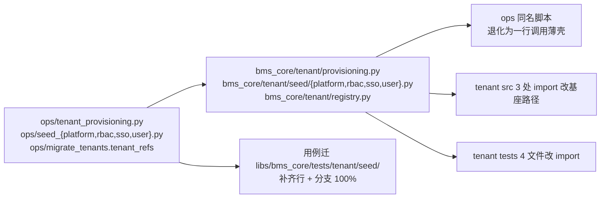

# 开通编排内核下沉基座详细设计

> 后端基座与服务化地基 · 14 平台模型下沉基座 · 04 开通编排内核下沉基座 · 详细设计（开发核心文档）

[文档首页](../../../../../../文档首页.md) › [04 开通编排内核下沉基座](../14_平台模型下沉基座_04_开通编排内核下沉基座.md) › 设计　|　[实施记录](../实施/01_实施_04_开通编排内核下沉基座.md) · [测试记录](../测试/01_测试_04_开通编排内核下沉基座.md)

## 1. 目标与边界 <a id="scope"></a>

**目标**：tenant 服务在**启动链**上模块级导入运维包 `ops.tenant_provisioning`（`services/platform_tenant.py:28`、`services/provisioning.py:25`），而该内核又模块级导入四个种子脚本、种子脚本再导入 platform / identity 的模型——这是流水线 1188 `contract-smoke-tenant` 镜像崩溃（`ModuleNotFoundError: No module named 'bms_platform'`）的**直接根因**。14_01 已把模型整包下沉到 `bms_core.models.*`，本任务把**开通编排内核 + 四个种子**一并下沉到 `bms_core.tenant`，使 `services/*/src` 对 `ops` 的导入归零、开通编排成为基座机制（任何服务 / 产品可复用）。

**范围内**：

1. **内核下沉**：`ops/tenant_provisioning.py` → `bms_core/tenant/provisioning.py`；公开接口 `ProvisionOutcome` / `provision_infrastructure` / `enabled_tenant_services` 与签名**不变**，行为（建库 → 逐链幂等建表 → 批量种子 → 失败逆序清理）不变。
2. **种子下沉**：`ops/seed_platform.py` / `seed_rbac.py` / `seed_sso.py` / `seed_user.py` → `bms_core/tenant/seed/{platform,rbac,sso,user}.py`；种子数据（内置管理员角色与互斥预授、菜单 / 权限码 / 表单、初始系统管理员、默认 IdP 占位、系统参数）**内容不变**。
3. **库名基解析下沉**：`ops/migrate_tenants.py` 的 `TenantRef` / `tenant_refs` / `_tenant_refs_sync` / `_ref` → `bms_core/tenant/registry.py`（`ops.seed_user` 曾依赖 `ops.migrate_tenants.tenant_refs`，不下沉则种子无法脱离 `ops`）。
4. **CLI 一起下沉**：`build_parser` / `main` 随实现下沉到基座（**本轮决策**），`ops/` 同名脚本退化为**一行调用**的薄壳；`python -m ops.<script>` 的命令、参数与退出码不变。
5. **调用方切换**：tenant `src` 三处 import 改基座路径；tenant `tests` 四个文件同改（含 `monkeypatch` 目标字符串）。
6. **用例迁移与覆盖率**：基座实现用例迁 `backend/libs/bms_core/tests/tenant/seed/`，并补齐下沉模块到**行 + 分支 100%**（口径见《[AI开发规范](../../../../../../规范/AI开发规范.md#coverage)》「覆盖率要求」节）。
7. **口径回写**：《平台可扩展性规划》三层模型节、《后端开发规范》分层依赖节、《后端基类清单》跨阶段基座表。

**范围外**（归口见 §8）：

- `ops` 运行镜像声明与导入闭包断言 → `14_03`（本任务只保证「下沉后 `services/*/src` 不再导入 `ops`」这一事实成立）；
- `ops.migrate_tenants` 其余能力（`MigrationTask` / `service_tasks` / `run_tasks` / `report` 等）**不下沉**——它是批量迁移运维通道，运行镜像为 CI / 运维机，不在 tenant 启动链上；
- 表结构、表归属（`TABLE_OWNERSHIP`）、契约快照：**零改动**；
- `scripts/tools/deploy/release.py`：**零改动**（其 bootstrap 只调 `seed_module` / `seed_tables` / `seed_tenant` / `provision_tenant` / `init_schema`，均不在本任务下沉集合内）。

## 2. 现状与改造点 <a id="current"></a>

### 2.1 现状（2026-10-22 实测）

| 项 | 实测 |
| --- | --- |
| tenant 服务反向依赖 | `services/tenant/src` **3 处**导入 `ops.tenant_provisioning`：`services/platform_tenant.py:28`（模块级）、`services/provisioning.py:25`（模块级）、`api/tenant_admin.py:459`（函数内惰性） |
| 内核自身依赖 | `ops/tenant_provisioning.py` 模块级导入 `ops.seed_platform` / `seed_rbac` / `seed_sso` / `seed_user`；另依赖 `bms_core.{config.seed, core.*, db.*, services.module_registry}` |
| 种子自身依赖 | `ops/seed_rbac.py:53-54` 依赖 `ops.seed_tenant.resolve_url` 与 `ops.seed_user.{resolve_tenant_basis,resolve_tenant_url}`；`ops/seed_user.py:43` 依赖 `ops.migrate_tenants.tenant_refs` |
| `bms_core` 反向依赖 | 对 `ops` 与任何服务包**零静态导入**（已全量 AST 扫描确认）——下沉后「`bms_core.tenant` 只依赖 `bms_core`」成立 |
| 现有测试 | `libs/bms_core/tests/ops/test_seed_user.py`（3 例，Kiwi 2243）、`services/platform/tests/seed/test_seed_rbac.py`（5 例）、`libs/bms_core/tests/ops/test_provision_tenant.py`（8 例）、`libs/bms_core/tests/ops/test_tenant_ops.py`（3 例，Kiwi 1019）等直接 `import ops.*` |
| 覆盖率现状 | `ops/` **不在**覆盖率采集范围（`_COVERAGE_PACKAGES` 只含 `bms_core` + 9 服务）；下沉 5 文件实测：`tenant_provisioning` 0%（109 语句 / 22 分支）、`seed_platform` 0%（136 / 30）、`seed_sso` 0%（110 / 28）、`seed_rbac` 74%（缺 39 行 / 17 分支）、`seed_user` 79%（缺 20 行 / 9 分支） |
| 护栏约束 | `check-backend-base` 只查「直继承 `BaseObject`」与「值对象须 `@dataclass(frozen=True)` / 框架对象不得为 dataclass」；**无「必须继承基类」扫描**。`check-bare-collections` 扫描含 `backend/ops` 与 `scripts/tools`，5 文件仅 1 处 `frozenset(...)`（非声明形态，不违规） |

### 2.2 改造点



## 3. 交付物清单 <a id="deliverables"></a>

| # | 交付物 | 落点 |
| --- | --- | --- |
| 1 | 租户注册库解析（`TenantRef` / `tenant_refs` / 同步分支） | `backend/libs/bms_core/src/bms_core/tenant/registry.py`（新增） |
| 2 | 开通编排内核（`ProvisionOutcome` / `enabled_tenant_services` / `provision_infrastructure` + CLI） | `backend/libs/bms_core/src/bms_core/tenant/provisioning.py`（新增） |
| 3 | 四个种子（含 CLI） | `bms_core/tenant/seed/{__init__,platform,rbac,sso,user}.py`（新增 5 文件） |
| 4 | `ops` 薄壳（5 个脚本退化为一行调用） | `backend/ops/{tenant_provisioning,seed_platform,seed_rbac,seed_sso,seed_user}.py`（改写） |
| 5 | `ops.migrate_tenants` 改为复用基座 `tenant_refs`（保留 re-export 供 `init_tenant` / `provision_tenant` 零改动） | `backend/ops/migrate_tenants.py` |
| 6 | tenant 调用方切换（src 3 处 / tests 4 文件） | `backend/services/tenant/**` |
| 7 | 基座用例（迁移 + 补齐） | `backend/libs/bms_core/tests/tenant/seed/`（新增目录） |
| 8 | 登记回写 | 规划、后端开发规范、后端基类清单、需求 14-4、任务 14_04、阶段计划、实施 / 测试记录 |

## 4. 设计 <a id="design"></a>

### 4.1 落点与包结构 <a id="layout"></a>

```text
backend/libs/bms_core/src/bms_core/tenant/
├── __init__.py          # 既有（租户自助与品牌能力域说明）
├── base.py              # 既有
├── db.py                # 既有
├── membership.py        # 既有
├── membership_remote.py # 既有
├── null.py              # 既有
├── registry.py          # 新增：租户注册库解析（TenantRef / tenant_refs）
├── provisioning.py      # 新增：开通编排内核（建库 → 建表 → 种子 → 失败清理）
└── seed/                # 新增：开通所需默认数据种子
    ├── __init__.py      # 导出四个入口（seed_platform_rbac / seed_rbac / seed_identity_provider / seed_user）
    ├── platform.py      # 平台租户 RBAC（platform_admin / platform_ops）
    ├── rbac.py          # 三类内置管理员角色与授权
    ├── sso.py           # 演示 IdP 行与可选用户映射
    └── user.py          # 初始系统管理员账号
```

**落点理由**：租户能力域（`tenant/`）已承载租户自助 / 品牌 / 关系数据源等机制，开通编排是**租户生命周期**的机制，归此域；不放 `db/`（`db` 只放数据库机制，种子含平台内置数据）。种子单独 `seed/` 子包，避免与自助 / 品牌实现混层。

**不建 `models` 子包**：本任务无新模型（模型已随 14_01 下沉到 `bms_core.models.*`）。

### 4.2 接口契约 <a id="contract"></a>

公开符号与签名**逐字不变**（迁移只改模块路径）：

| 基座模块 | 公开符号 | 签名 / 语义 |
| --- | --- | --- |
| `tenant/registry.py` | `TenantRef` | `@dataclass(frozen=True)`：`code`（当前编码）/ `db_basis`（库名基，缺对照行回落编码） |
| | `tenant_refs(registry_url)` | `async` → `ConcurrentStableList[TenantRef]`；达梦（同步驱动）走 `asyncio.to_thread` |
| | `tenant_refs_sync(url)` | 同步分支（原 `_tenant_refs_sync`，改公开名以便单测直接覆盖） |
| `tenant/provisioning.py` | `ProvisionOutcome` | `@dataclass(frozen=True)`（`BaseValueObject`）：`db_basis` / `services` / `created_databases` / `seeded` / `roles_created` / `admin_username` / `initial_password` |
| | `enabled_tenant_services()` | → `ConcurrentStableList[str]`（服务目录 enabled 服务 + 已启用模块所属服务；`platform` 恒在首位） |
| | `provision_infrastructure(*, db_basis, initial_password="", admin_username="admin", admin_name="系统管理员", platform=False)` | `async` → `ProvisionOutcome`；失败逆序 `drop_database` 后抛出 |
| | `build_parser()` / `main(argv=None)` | CLI 契约不变（`--code` / `--name` / `--domain` / `--password` / `--dry-run`） |
| `tenant/seed/platform.py` | `PLATFORM_ADMIN_ROLE_CODE` / `PLATFORM_OPS_ROLE_CODE` / `PLATFORM_TENANT_MENU_PATH` / `PLATFORM_BUSINESS_CODES` / `PLATFORM_OPS_PERMISSION_CODES` / `PlatformSeedOutcome` | 常量与结果类型**内容不变** |
| | `seed_platform_rbac(*, platform_code, assign_user="")` | `async` → `PlatformSeedOutcome` |
| | `build_parser()` / `main(argv=None)` | CLI 契约不变（`--code` / `--assign-user` / `--dry-run`） |
| `tenant/seed/rbac.py` | `ROLE_SYSTEM_ADMIN` / `ROLE_SECURITY_ADMIN` / `ROLE_AUDIT_ADMIN` / `SECURITY_ADMIN_CODES` / `SYSTEM_ADMIN_CODES` / `SYSTEM_ADMIN_EXCLUDED_CODES` / `AUDIT_ADMIN_CODES` / `BUILTIN_ADMIN_ROLES` / `DEFAULT_ASSIGN_ACCOUNT` / `SeedOutcome` | 常量与结果类型**内容不变** |
| | `seed_rbac(*, tenant_url, platform_url, assign_user="", dry_run=False)` | `async` → `SeedOutcome` |
| | `build_parser()` / `main(argv=None)` | CLI 契约不变（`--tenant` / `--service` / `--tenant-url` / `--platform-url` / `--assign-user` / `--dry-run`） |
| `tenant/seed/sso.py` | `DEFAULT_IDP_KEY` / `DEFAULT_CLIENT_ID` | 常量不变 |
| | `seed_identity_provider(url, *, status="enabled")` | `async` → `tuple[int, int]` |
| | `seed_user_mapping(url, *, tenant, user_id, external_id)` | `async` → `tuple[int, int]` |
| | `build_parser()` / `main(argv=None)` | CLI 契约不变（`--url` / `--platform-url` / `--tenant` / `--map-user-id` / `--map-external-id` / `--dry-run`） |
| `tenant/seed/user.py` | `DEFAULT_TENANT` / `DEFAULT_USERNAME` / `DEFAULT_NAME` / `DEFAULT_SERVICE` / `MIN_PASSWORD_LENGTH` / `SeedOutcome` | 常量与结果类型**内容不变** |
| | `resolve_tenant_basis(code)` / `resolve_tenant_url(basis, override, service)` | 解析口径不变 |
| | `seed_user(*, url, username, name, password="", reset_password=False)` | `async` → `SeedOutcome` |
| | `build_parser()` / `main(argv=None)` | CLI 契约不变（`--tenant` / `--username` / `--name` / `--password` / `--service` / `--reset-password` / `--url` / `--dry-run`） |

**结果类型形态**：`PlatformSeedOutcome` / `SeedOutcome`（rbac / user 各一）为**累加式可变结果对象**（种子过程以 `outcome.roles_created += 1` 累计），继承 **`BaseDataContract`**（可变数据契约体系根）——不用 `BaseValueObject`（该体系根要求 `@dataclass(frozen=True)`，与累加语义冲突）。`ProvisionOutcome` / `TenantRef` 保持既有 `BaseValueObject` + `frozen=True`。

### 4.3 CLI 薄壳（本轮决策：CLI 一并下沉） <a id="shell"></a>

`build_parser` / `main` **随实现下沉**，`ops/` 同名脚本只保留**一行调用**：

```python
"""租户开通编排内核 CLI 薄壳（实现与参数解析已下沉 `bms_core.tenant.provisioning`；14_04）。"""

from bms_core.tenant.provisioning import main

if __name__ == "__main__":
    raise SystemExit(main())
```

- `python -m ops.<script>` 命令、参数、退出码**零变化**（`main` 的签名与返回值语义不变）；
- `ops/__init__.py` 不动；
- 薄壳**不重复声明** `RUN_IMAGE`（声明落在基座模块，`ops` 薄壳由 `14_03` 的护栏按「调用基座」判定为不跨包——具体口径在 14_03 落地时登记，本任务不预设）。

**为什么 CLI 一起下沉**：`main` 内的 URL 解析逻辑（`resolve_tenant_basis` / `resolve_tenant_url` / `EngineFactory(allow_cross_service=True)`）本身是基座能力；留在 `ops` 会让薄壳重新引入对 `bms_core` 的解析调用与分支，`ops` 与基座两份实现并存更易漂移。一并下沉后「薄壳 = 一行调用」可被 14_03 的护栏直接判定。

**代价（已在 §8 登记）**：`argparse` 参数解析分支进入覆盖率分母，须以 CLI 用例覆盖 `--dry-run` / 正常 / 参数非法三类分支。

### 4.4 调用方切换 <a id="callers"></a>

| 位置 | 原 | 改 |
| --- | --- | --- |
| `services/tenant/src/bms_tenant/services/platform_tenant.py:28` | `from ops.tenant_provisioning import provision_infrastructure` | `from bms_core.tenant.provisioning import provision_infrastructure` |
| `services/tenant/src/bms_tenant/services/provisioning.py:25` | `from ops.tenant_provisioning import ProvisionOutcome, provision_infrastructure` | `from bms_core.tenant.provisioning import ProvisionOutcome, provision_infrastructure` |
| `services/tenant/src/bms_tenant/api/tenant_admin.py:459` | `from ops.tenant_provisioning import enabled_tenant_services` | `from bms_core.tenant.provisioning import enabled_tenant_services` |
| `services/tenant/tests/tenant/{test_platform_tenant,test_tenant_admin,test_tenant_branch_fill,test_tenant_extra_branches}.py` | `from ops.tenant_provisioning import ProvisionOutcome` | `from bms_core.tenant.provisioning import ProvisionOutcome` |
| 文档字符串（`services/provisioning.py:4`） | 「（`ops.tenant_provisioning` 内完成）」 | 「（`bms_core.tenant.provisioning` 内完成）」 |

**只改导入路径**：`monkeypatch.setattr("bms_tenant.services.platform_tenant.provision_infrastructure", ...)` 等补丁目标仍指向**服务模块属性**，无需改动；断言与行为零变。

### 4.5 依赖方向 <a id="direction"></a>

- `bms_core/tenant/{registry,provisioning}.py` 与 `tenant/seed/*` **只导入 `bms_core`**（`bms_core.models.*` / `db.*` / `config.*` / `core.*` / `services.module_registry` / `security.pbkdf2`）与标准库 + sqlalchemy；
- **禁止** `bms_core` 反向导入 `ops` 或任何服务包（`check-service-boundaries` 规则 1 既有断言覆盖；`bms_core` 对 `ops` 无规则，故以本任务完成后 `rg` 断言 + 14_03 的闭包断言双保险）；
- `ops/` 薄壳依赖基座（方向合法：运维包 → 基座）；
- `services/tenant` 依赖基座（方向合法：服务 → 基座），**不再依赖 `ops`**。

### 4.6 覆盖率与用例迁移 <a id="coverage"></a>

**采集口径**：下沉后 5 个实现文件进入 `bms_core` 覆盖率分母（`_COVERAGE_PACKAGES` 含 `bms_core`，无需改配置）；`ops` 薄壳不在采集范围（一行调用，无分支）。

**用例迁移**（口径：测什么放哪里，避免服务测试覆盖基座代码导致工程级覆盖率误报）：

| 原位置 | 新位置 | 处理 |
| --- | --- | --- |
| `libs/bms_core/tests/ops/test_seed_user.py`（3 例，Kiwi 2243） | `libs/bms_core/tests/tenant/seed/test_user.py` | 迁 + 改 import；补 CLI 分支用例 |
| `services/platform/tests/seed/test_seed_rbac.py`（5 例） | `libs/bms_core/tests/tenant/seed/test_rbac.py` | 迁 + 改 import（纠正「基座代码由服务测试覆盖」的错位） |
| `libs/bms_core/tests/ops/test_provision_tenant.py`（8 例） | **不迁**（测 `ops/provision_tenant.py`，本任务未下沉） | 仅确认 import 不涉本任务符号 |
| `libs/bms_core/tests/ops/test_tenant_ops.py`（3 例，Kiwi 1019） | **不迁**（测 `ops/seed_tenant.py`，未下沉） | 同上 |

**补齐到 100% 的用例清单**（新增 `libs/bms_core/tests/tenant/seed/`）：

| 文件 | 覆盖对象 | 关键断言 |
| --- | --- | --- |
| `test_registry.py` | `tenant/registry.py` | `tenant_refs` 读两表左联取 `db_basis`；缺对照行回落编码；软删租户不返回；达梦分支走同步函数（monkeypatch `make_url` 后端名 + 同步函数打桩） |
| `test_provisioning.py` | `tenant/provisioning.py` | `enabled_tenant_services` 去重与 `platform` 首位；`provision_infrastructure` 成功路径（临时 SQLite：建库 → 建表 → 种子）；失败路径逆序 `drop_database` 被调用；无启用服务抛 `ConfigError`；CLI `--dry-run` 不建连、正常路径打印、参数非法退出码 |
| `test_seed_platform.py` | `tenant/seed/platform.py` | 角色 / 授权 / 绑定幂等（两跑全跳过）；`assign_user` 命中与未命中；`--dry-run` 不写库；CLI 退出码 |
| `test_rbac.py` | `tenant/seed/rbac.py` | 三角色与授权幂等；平台库缺码记 `missing_codes` 且不产生授权；`--assign-user` 绑定与三权互斥拒绝（`assign_conflicts`）/ 未解析（`assign_unresolved`）；`dry_run=True` 回滚；CLI 打印与退出码 |
| `test_sso.py` | `tenant/seed/sso.py` | IdP 行新建 / 更新（配置变化即更新、无变化不更新）；`seed_user_mapping` 新建 / `user_id` 变化更新 / 无变化跳过；CLI `--dry-run` 与 `--map-user-id` 分支 |
| `test_user.py` | `tenant/seed/user.py` | 建号幂等、重置口令清失败计数与锁定、不改账号状态；`resolve_tenant_basis` 命中 / 回落；`resolve_tenant_url` 覆盖与模板解析；CLI 过短口令退出码 2、`--dry-run`、正常路径 |

**口径**：全部用例用 `tmp_path` 下临时 SQLite（不连真库、不动 `database/bms`）；集合声明一律 `ConcurrentStable*`（`check-bare-collections`）；`pyright` strict 零 error。

### 4.7 文档回写清单 <a id="docs"></a>

| 文档 | 改动 |
| --- | --- |
| 《平台可扩展性规划》「总体模型：基座 + 平台 + 多产品三层分层」节 | 补边界：基座**可承载「开通所需的默认数据种子」**（开通编排内核 + 种子属基座机制，供任何服务 / 产品复用），但**不得承载业务运营逻辑** |
| 《后端开发规范》「依赖方向」相关节（§3.2） | 补一句：开通编排内核与默认种子归基座 `bms_core.tenant`，服务运行期**不得导入 `ops`** |
| 《后端基类清单》§9 跨阶段基座表 | 新增一行：开通编排与默认种子（`tenant/provisioning.py`、`tenant/registry.py`、`tenant/seed/{platform,rbac,sso,user}.py`） |
| 需求 14-4 / 任务 14_04 | 按本轮决策（CLI 一并下沉、库名基解析下沉 `tenant/registry.py`、用例迁基座）对齐文本 |
| 阶段计划 §3 / §7 | 14_04 行状态与完成日期回写；「后续阶段待办」按需登记 |
| 本任务 `实施/`、`测试/` | 各一份记录 |

### 4.8 验证命令 <a id="verify"></a>

| 步骤 | 命令（`bms/` 仓根或 `backend/`） | 通过标准 |
| --- | --- | --- |
| 定向用例 | `uv run --directory backend pytest libs/bms_core/tests/tenant/seed -q` | 全通过 |
| 覆盖率 | `BMS_COVERAGE_DATA=... BMS_COVERAGE_SOURCE=bms_core uv run pytest ...` + `coverage_gate.py --module bms_core.tenant` | 行 + 分支 100% |
| tenant 服务用例 | `uv run --directory backend pytest services/tenant/tests -q` | 全通过（导入切换无回退） |
| 反向依赖断言 | `rg "from ops\.|import ops" backend/services/*/src` | **0 处** |
| 静态 | `ruff check` / `ruff format --check` / `pyright`（定向文件） | 0 错 |
| 基座与边界 | `check-service-boundaries.py`（含 `--self-test`）、`check-backend-base.py`、`check-bare-collections.py` | 全通过 |
| 预检 | `run-once.py -- check-preflight.py --fast` | 全绿 |
| 文档基座 | `check-base.py` / `check-docs-scope.py` / `check-links.py` | 0 违规 |

**临时库约束**：一律经 `tmp_path` 或环境变量 `BMS_DATABASE__SQLITE_DIR` 指向一次性目录，**不动** `database/bms`。

## 5. 测试设计与验收映射 <a id="accept"></a>

| 完成标准（任务 14_04 §3） | 验证手段 |
| --- | --- |
| `python -c "import bms_tenant.main"` 在仅含 `bms_core` + `bms_tenant` + `ops` 环境通过 | 构造仅含三包的临时 `sys.path`（排除其他服务源码）后导入并断言成功；`contract-smoke-tenant` 语义同源 |
| `services/*/src` 对 `ops` 的导入归零 | `rg` 断言 0 处 + 14_03 护栏规则（后续任务） |
| 四个 `ops` 种子脚本为薄壳（仅一行调用） | 文件内容断言（行数与 import 面）+ 代码评审 |
| `python -m ops.<script>` 与部署脚本行为不回退 | 五个 CLI 的 `--dry-run` / 正常路径 / 参数非法用例（Kiwi 登记的第 2 条） |
| `bms_core/tenant/` 无 `ops` / 服务包导入 | AST 扫描断言（用例内） |
| 规划与规范已回写 | 文档 diff |
| 相关测试迁移到 `libs/bms_core/tests` 且全绿 | 定向用例 + 覆盖率 100% |

## 6. 兼容与回滚 <a id="rollback"></a>

- **兼容**：CLI 命令 / 参数 / 退出码、种子数据内容、`ProvisionOutcome` 字段、部署脚本调用面全部零变化；`services/tenant` 对外契约与表结构零变化。
- **回滚**：`git revert` 本任务提交即可（模块路径回迁，无数据迁移、无表结构变更）。
- **风险与兜底**：
  - **覆盖率不达标**（argparse 分支多）→ 用例按 §4.6 清单逐项覆盖；`coverage_gate --module bms_core.tenant` 定向判定，缺口明细直接给出模块名；
  - **`ops` 薄壳丢失 CLI 行为**（如 `main` 返回值语义变化）→ 以五个 CLI 用例逐条对齐退出码与关键输出；
  - **`bms_core` 反向依赖**（误把 `ops` 辅助函数一起搬进基座）→ `rg` 断言 + `check-service-boundaries` 规则 1；
  - **循环导入**（`tenant/seed/user.py` 与 `tenant/registry.py` 互相引用）→ `registry.py` 只放注册库解析、不导入 `seed`；`seed/user.py` 单向导入 `registry`。

## 7. 登记落点 <a id="register"></a>

| 落点 | 内容 |
| --- | --- |
| 规划 | 《平台可扩展性规划》三层模型节补「基座可承载开通用默认种子」边界 |
| 规范 | 《后端开发规范》§3.2 补「服务运行期不得导入 `ops`」一句 |
| 清单 | 《后端基类清单》§9 新增「开通编排与默认种子」行 |
| 需求 / 任务 | 需求 14-4 内容与完成标准按本轮决策对齐；任务 14_04 §2 同步 |
| 计划 | 阶段二计划 §3 `14_04` 行（状态 / 完成日期）+ §7 后续阶段待办（如需） |
| 记录 | 本任务 `实施/`、`测试/` |
| Kiwi | 2 条用例编号（下沉函数用例 + 薄壳 CLI 行为用例），先登记后回填 |

## 8. 偏差与开放项 <a id="open"></a>

| # | 事项 | 归口 |
| --- | --- | --- |
| 1 | **CLI 一并下沉**（本轮决策，与任务原文「薄壳只做参数解析」略有差异）：原文预期薄壳内保留 argparse；本轮为「薄壳 = 一行调用」更彻底。代价是 argparse 分支进覆盖率分母，需 CLI 用例覆盖 | 已回写任务 §2.4 与需求 14-4 内容第 3 条；本设计 §4.3 说明 |
| 2 | **库名基解析下沉 `tenant/registry.py`**（任务原文未列此项）：`ops.seed_user` 依赖 `ops.migrate_tenants.tenant_refs`，不下沉则种子无法脱离 `ops`；下沉后 `ops.migrate_tenants` 改为复用基座并保留 re-export（`init_tenant` / `provision_tenant` 零改动） | 本任务（§4.2）；`migrate_tenants` 其余能力不下沉 |
| 3 | `PlatformSeedOutcome` / `SeedOutcome` **改继承 `BaseDataContract`**（原设计拟「保持无基类普通 dataclass」）：下沉前位于 `ops/`（不在 `test_all_app_classes_inherit_a_base` 扫描面），迁入 `bms_core/src` 后触发「工作区所有类必须继承基类」硬规则 | **实施中改正**：三者均为累加式可变结果对象，归 `BaseDataContract`（可变数据契约体系根）；`BaseValueObject` 要求 `frozen=True`，与累加语义冲突，故不适用 |
| 4 | `ops` 薄壳的 `RUN_IMAGE` 声明口径（薄壳是否需声明、如何判定不跨包） | `14_03`（本任务不预设，只保证薄壳不导入服务包） |
| 5 | 任务原文「`scripts/tools/deploy/release.py` 零改动」仍成立：其 bootstrap 不含本次下沉的 5 个脚本 | 已验证（§1 范围外） |
| 6 | `services/platform/tests/seed/test_seed_rbac.py` 原位于服务测试却覆盖基座代码，本轮迁移纠正 | 本任务（§4.6） |

## 9. 对齐记录 <a id="align"></a>

逐项确认（question 工具，2026-10-22）：

| # | 事项 | 定案 |
| --- | --- | --- |
| 1 | 覆盖率策略 | 补齐到 **100%**，新写用例覆盖下沉函数（不用 `pragma: no cover`、不排除采集范围） |
| 2 | 下沉粒度 | **连 `build_parser` / `main` 一起下沉**，`ops` 只留一行调用 |
| 3 | 库名基解析落点 | 下沉为 `bms_core.tenant.registry`（单一来源） |
| 4 | 用例迁移落点 | 基座用例迁 `libs/bms_core/tests/tenant/seed/` |
| 5 | `tenant/` 布局 | `provisioning.py` + `seed/{platform,rbac,sso,user}.py`（任务原文） |
| 6 | 规范回写范围 | 《平台可扩展性规划》+《后端开发规范》各一处，**另加**《后端基类清单》§9 登记 |
| 7 | tenant 服务侧 | 只改导入路径（src 3 处 + tests 4 文件） |
| 8 | Kiwi 登记 | **2 条**（下沉函数用例 + 薄壳 CLI 行为用例） |

> 本文档按《[文档生成规范](../../../../../../规范/文档生成规范.md)》与《[AI开发规范](../../../../../../规范/AI开发规范.md)》编写 · 关键决策逐项确认
