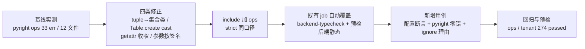

# ops 类型门禁纳入实施记录

> 后端基座与服务化地基 · 14_平台模型下沉基座 · 子任务 05 · 实施记录

[文档首页](../../../../../../文档首页.md) › [05 ops 类型门禁纳入](../14_平台模型下沉基座_05_ops类型门禁纳入.md) › 实施　|　[详细设计](../设计/01_详细设计_05_ops类型门禁纳入.md) · [测试记录](../测试/01_测试_05_ops类型门禁纳入.md)

> **状态：已实施**（2026-10-22）。`backend/ops/` 12 文件 33 处严格模式缺口全部修正、`[tool.pyright] include` 扩至 `ops`、门禁用例落地；验证与回填结果见 §6 与[测试记录](../测试/01_测试_05_ops类型门禁纳入.md)。

## 1. 实施信息 <a id="meta"></a>

| 项 | 值 |
| --- | --- |
| 任务 | [05 ops 类型门禁纳入](../14_平台模型下沉基座_05_ops类型门禁纳入.md) |
| 对应需求 | [14-5](../../../../需求/14_需求_平台模型下沉基座.md#r14-5) |
| 详细设计 | [01_详细设计_05_ops类型门禁纳入](../设计/01_详细设计_05_ops类型门禁纳入.md) |
| 立项日期 | 2026-10-22（立项基线：需求 / 任务 / 详细设计 / Kiwi 登记） |
| 实施日期 | 2026-10-22 |
| 实施人 | minjian |
| 前置契约（已交付） | [14_03](../../14_平台模型下沉基座_03_门禁固化与镜像边界校验/14_平台模型下沉基座_03_门禁固化与镜像边界校验.md) 偏差第 5 项登记本缺口；`ops` 全脚本已声明 `RUN_IMAGE` |
| Kiwi | **2346**（已登记并回读编号） |

## 2. 实施概览 <a id="overview"></a>



## 3. 实施过程 <a id="process"></a>

### 3.1 基线实测 <a id="baseline"></a>

`cd backend && uv run pyright ops`（`ops` 尚在 `include` 之外，显式传目录同样按 `[tool.pyright]` 的 `strict` 口径判定）⇒ **33 errors / 0 warnings / 12 文件**，逐文件分布与设计 §2.1 一致：

| 文件 | 处数 | 文件 | 处数 |
| --- | --- | --- | --- |
| `check_contracts.py` | 8 | `contract_snapshot.py` | 2 |
| `seed_tenant.py` | 6 | `check_budget.py` | 1 |
| `init_schema.py` | 3 | `contract_gate.py` | 1 |
| `migrate_tenants.py` | 3 | `gateway_config.py` | 1 |
| `seed_oidc_client.py` | 3 | `provision_tenant.py` | 1 |
| `test_db.py` | 3 | `seed_menu.py` | 1 |

### 3.2 四类逐处修正 <a id="fixes"></a>

**① `tuple` 赋给集合类字段 / 返回集合类（9 处）**——按「集合声明一律落插入序集合类」口径，改为直接返回已有 `ConcurrentStableList` 或按集合类构造：

| 位置 | 修正 |
| --- | --- |
| `init_schema.py:136` | `SchemaSummary(succeeded=succeeded, skipped=skipped, failed=failed, …)`（去掉 `tuple(...)`） |
| `migrate_tenants.py:383` | `MigrationSummary(succeeded=succeeded, skipped=skipped, failed=failed)`（同上） |
| `seed_menu.py:240` | `_derive_action_seeds` 由 `return tuple(result)` 改 `return result`，docstring 返回标注同步 |
| `test_db.py:212/219` | `account_statements` 由元组字面量改 `ConcurrentStableList([...])` / 空分支 `ConcurrentStableList()` |
| `test_db.py:372` | `_scopes` 由三元元组改 `ConcurrentStableList([...])` |

**② `sqlalchemy Table.create` 类型未知（6 处）**——与 `bms_core` / 服务测试既有写法同构，显式 `cast`：

```python
await connection.run_sync(cast("Table", SysTenant.__table__).create, checkfirst=True)
```

落点：`seed_tenant.py:122/123`（`SysTenant` / `SysTenantDatabase`）、`seed_oidc_client.py:103`（`SysClient`）；两文件补 `from sqlalchemy import Table` 与 `typing.cast`。

**③ 动态 `getattr` 取值导致类型丢失（8 处）**——先 `callable` 判定，再把取到的属性显式收窄为具体 `Callable` 签名后调用（保留「鸭子类型兼容 dict 与基座集合类」的原语义）：

```python
items = getattr(openapi, "items", None)
if callable(items):
    for key, value in cast("Callable[[], ItemsView[str, Any]]", items)():
        contract.set(str(key), value)
```

`check_contracts.py:71`（`items`）/`:89`（`keys`，收窄为 `Callable[[], KeysView[str]]`），新增 `collections.abc` 的 `Callable` / `ItemsView` / `KeysView` 导入。
`contract_snapshot.py:169/173` 同类问题表现为「集合元素类型部分未知」：`actual` 由 `{…} if … else set()` 改为 `ConcurrentStableSet[str]` 声明 + 命中才 `update`，与 `expected` 求差集后仍走 `sorted`。

**④ 参数类型按被调方签名修正（10 处）**：

| 位置 | 修正 |
| --- | --- |
| `check_budget.py:71` | `services` 由 `tuple(dict.fromkeys(...))` 改 `ConcurrentStableList(dict.fromkeys(...))`（对齐 `pool_budget_rows` 签名） |
| `contract_gate.py:414` | `services` 由 `list` 改 `ConcurrentStableList([…])`（对齐 `check(services=…)` 签名） |
| `gateway_config.py:95` | `default_text` 声明由 `str \| None` 改 `str = ""`（「给缺省串」口径；仅 `default_bytes is not None` 分支读取，语义不变） |
| `provision_tenant.py:271` | `refs` 显式注解 `ConcurrentStableList[TenantRef]`（消除 `Never \| TenantRef` 联合推断） |

### 3.3 门禁接线 <a id="wiring"></a>

`backend/pyproject.toml`：

```toml
[tool.pyright]
typeCheckingMode = "strict"
include = ["libs", "services", "ops"]
ignore = ["alembic"]
```

`extraPaths` 未改（`ops` 与 `pyright` 执行目录同级）；`ignore` 未加 `ops`；未新增 CI job——`backend-typecheck`（`cd backend && uv run pyright`）与预检「后端静态：pyright」自动覆盖。

### 3.4 新增用例 <a id="cases"></a>

`backend/libs/bms_core/tests/ops/test_ops_type_gate.py`（Kiwi 2346，3 个测试函数）：

1. `test_pyright_include_covers_ops`——读 `pyproject.toml`，断言 `include` 含 `ops` 且仍含 `libs` / `services`、`typeCheckingMode == "strict"`、`ignore` 不含 `ops`（防配置回退）；
2. `test_ops_pyright_reports_zero_errors`——子进程跑 `pyright ops`，断言退出码 0 且输出含 `0 errors`（覆盖「已接线」+「当前零错」两个事实）；
3. `test_ops_has_no_unjustified_pyright_ignore`——扫描 `backend/ops/**/*.py`，`# pyright: ignore` 须在**同行尾注**或**紧邻上一行注释**给出理由（否则报出 `文件:行`）。

## 4. 关键命令 <a id="commands"></a>

```bash
# 类型检查（修正前后对照）
cd backend && uv run pyright ops
# 静态与格式（改动面）
cd backend && uv run ruff check ops libs/bms_core/tests/ops/test_ops_type_gate.py
cd backend && uv run ruff format --check ops libs/bms_core/tests/ops/test_ops_type_gate.py
# 新增用例单跑
cd backend && uv run pytest libs/bms_core/tests/ops/test_ops_type_gate.py -q
# 回归（多目录，经重命令包装）
python scripts/tools/preflight/run-once.py -- \
  uv run --directory backend pytest libs/bms_core/tests/ops libs/bms_core/tests/tenant -q
# 集合护栏（用例新增注解须命中白名单）
python scripts/tools/base-check/check-bare-collections.py .
# 预检缺省定向档（含后端静态 pyright / ruff、受影响用例与覆盖率门禁、基座与文档校验）
python scripts/tools/preflight/run-once.py -- python scripts/tools/preflight/check-preflight.py
```

## 5. 问题与处置 <a id="issues"></a>

| # | 问题 | 处置 |
| --- | --- | --- |
| 1 | 新增用例首跑失败：`test_db.py:390/397` 存在两处既有 `# pyright: ignore[reportPrivateUsage]` 且无理由文本 | 判定口径细化为「同行尾注**或紧邻上一行注释**」；两处各补一行理由（`URL._replace` 去库名无公开方法，`set(database=None)` 表示不改），保留 ignore（设计预期 0 处 → 实际 2 处带理由，见 §7 第 2 项） |
| 2 | 首轮预检 2 项失败：`check-bare-collections` 报用例 `-> dict[str, Any]` 为裸容器注解，连带 `boundary/test_bare_collections_guard.py` 两个用例红 | 用例返回值改 `ConcurrentStableDict[str, Any]`（`cast("Mapping[str, Any]", …)` 收窄后构造），护栏复跑 0 违规 |
| 3 | 集合类返回值是否破坏既有断言（`account_statements(...) == ()`） | 实测 `ConcurrentStableList() == ()` 为 `True`（集合类按序列语义比较），既有用例零改动；`len` / 下标 / 迭代用法同样兼容 |
| 4 | 重命令守卫拦截多目录 pytest / 全仓 pyright / 预检 | 一律经 `run-once.py` 包装执行；单文件 `pyright ops`、单文件 `ruff`、单个用例文件放行直跑 |
| 5 | 类型修正是否误改语义 | 改动仅限类型标注与集合构造方式：`summary` 字段由运行期元组改为集合类但字段声明本就为集合类；`default_text` 空串缺省只在「编排缺省值缺件」分支被忽略；`getattr` 收窄只是把 `callable` 判定后的调用标注清楚。`ops` / `tenant` 回归 274 passed 兜底 |

## 6. 验证结论 <a id="verify"></a>

| 验收项（[任务 §3](../14_平台模型下沉基座_05_ops类型门禁纳入.md#accept)） | 结论 |
| --- | --- |
| `pyright`（`include` 含 `ops`）0 error | **达标**：`uv run pyright ops` 由 **33 err → 0 err**；全仓 `uv run pyright` 0 err（预检「后端静态：pyright」通过） |
| `ops` 无滥用 `# pyright: ignore` | **达标**：`ops` 内仅 2 处 ignore，均带理由（用例扫描通过） |
| 既有 `ops` 用例全通过（CLI 零回退） | **达标**：`libs/bms_core/tests/ops` + `libs/bms_core/tests/tenant` **274 passed / 1 warning**（93.91s；warning 为既有 aiosqlite 线程收尾噪声） |
| CI 与预检覆盖 `ops` | **达标**：`include` 扩容即生效（`backend-typecheck` 与预检同口径），用例另做配置断言防回退 |
| 预检缺省定向档全绿 | **达标**：`check-preflight.py` 定向档全部通过（含基座 / 边界 / 文档与覆盖率门禁） |
| 静态与格式 | **达标**：`ruff check` / `ruff format --check` 改动面全通过；`check-bare-collections` 0 违规 |

## 7. 偏差与遗留 <a id="deviation"></a>

| # | 事项 | 归口 |
| --- | --- | --- |
| 1 | **`scripts/tools/` 不纳入类型门禁**（实测 2536 处 / 55 文件）：开发辅助工具链，不属后端开发内容，纳入会形成「工具检查自己」的口径混乱 | 本任务范围外（用户明确不做）；工具脚本静态检查维持 `ruff`（CI `tooling-lint`） |
| 2 | **`ops` 内保留 2 处 `# pyright: ignore[reportPrivateUsage]`**（`test_db.py` 的 `URL._replace` 去库名；SQLAlchemy 无公开的去字段方法），均按用例口径注明理由；设计原预期 0 处 | 已就地说明；若上游提供公开 API 再替换 |
| 3 | `check_contracts` / `contract_snapshot` 的「动态 `getattr` 收窄」为类型层改动，**运行时行为不变**（仍按鸭子类型接受 dict / 集合类） | 已按设计 §4.2 ③ 落地 |
| 4 | 不新增 CI job，复用 `backend-typecheck` | 设计 §8 第 3 项 |
| 5 | `ops` 的 `alembic` 相关代码不纳入（`ignore = ["alembic"]` 既有口径不变） | 既有口径 |

## 8. 参考文档 <a id="ref"></a>

- 《[测试规范](../../../../../../规范/测试规范.md)》「CI 执行策略」节
- 《[后端开发规范](../../../../../../规范/后端开发规范.md)》§4（Python 编码规范）
- [05 详细设计](../设计/01_详细设计_05_ops类型门禁纳入.md)、[05 测试记录](../测试/01_测试_05_ops类型门禁纳入.md)

> 本文档按《[文档生成规范](../../../../../../规范/文档生成规范.md)》编写
