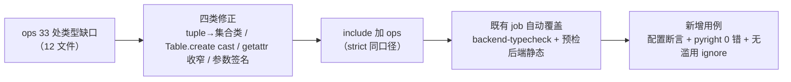

# ops 类型门禁纳入实施记录

> 后端基座与服务化地基 · 14_平台模型下沉基座 · 子任务 05 · 实施记录

[文档首页](../../../../../../文档首页.md) › [05 ops 类型门禁纳入](../14_平台模型下沉基座_05_ops类型门禁纳入.md) › 实施　|　[详细设计](../设计/01_详细设计_05_ops类型门禁纳入.md) · [测试记录](../测试/01_测试_05_ops类型门禁纳入.md)

> **状态：实施未开始**（本文档随「立项基线」先行提交，实施完成后按 §3 起逐节补齐）。当前仅完成立项与详细设计定稿；`backend/ops/` 的 33 处类型缺口尚未修正、`include` 尚未扩容。

## 1. 实施信息 <a id="meta"></a>

| 项 | 值 |
| --- | --- |
| 任务 | [05 ops 类型门禁纳入](../14_平台模型下沉基座_05_ops类型门禁纳入.md) |
| 对应需求 | [14-5](../../../../需求/14_需求_平台模型下沉基座.md#r14-5) |
| 详细设计 | [01_详细设计_05_ops类型门禁纳入](../设计/01_详细设计_05_ops类型门禁纳入.md) |
| 立项日期 | 2026-10-22（立项基线：需求 / 任务 / 详细设计 / Kiwi 登记） |
| 实施日期 | 待实施 |
| 实施人 | minjian |
| 前置契约（已交付） | [14_03](../../14_平台模型下沉基座_03_门禁固化与镜像边界校验/14_平台模型下沉基座_03_门禁固化与镜像边界校验.md) 偏差第 5 项登记本缺口 |
| Kiwi | **2346**（已登记并回读编号） |

## 2. 实施概览 <a id="overview"></a>



（实施完成后按实际过程改写本节。）

## 3. 实施过程 <a id="process"></a>

待实施。设计 §4.2 已给出四类修正口径与代表位置，实施时按类逐文件修正并记录逐处处置。

## 4. 关键命令 <a id="commands"></a>

```bash
# 类型检查（修正前后对照）
uv run --directory backend pyright ops
uv run --directory backend pyright
# 回归
python scripts/tools/preflight/run-once.py -- \
  uv run --directory backend pytest libs/bms_core/tests/ops libs/bms_core/tests/tenant -q
# 预检与文档基座
python scripts/tools/preflight/run-once.py -- python scripts/tools/preflight/check-preflight.py
python scripts/tools/base-check/check-base.py
```

## 5. 问题与处置 <a id="issues"></a>

待实施。

## 6. 验证结论 <a id="verify"></a>

待实施。验收口径见设计 §5（`pyright` 0 error、无滥用 ignore、既有用例全通过、CI 与预检覆盖 `ops`、预检定向档全绿）。

## 7. 偏差与遗留 <a id="deviation"></a>

| # | 事项 | 归口 |
| --- | --- | --- |
| 1 | **`scripts/tools/` 不纳入类型门禁**（实测 2536 处 / 55 文件）：开发辅助工具链，不属后端开发内容，纳入会形成「工具检查自己」的口径混乱 | 本任务范围外（用户明确不做）；工具脚本静态检查维持 `ruff`（CI `tooling-lint`） |
| 2 | 既有 33 处不留基线豁免 | 本任务一次修完（设计 §8 第 2 项） |
| 3 | 不新增 CI job，复用 `backend-typecheck` | 设计 §8 第 3 项 |

## 8. 参考文档 <a id="ref"></a>

- 《[测试规范](../../../../../../规范/测试规范.md)》「CI 执行策略」节
- 《[后端开发规范](../../../../../../规范/后端开发规范.md)》§4（Python 编码规范）
- [05 详细设计](../设计/01_详细设计_05_ops类型门禁纳入.md)、[05 测试记录](../测试/01_测试_05_ops类型门禁纳入.md)

> 本文档按《[文档生成规范](../../../../../../规范/文档生成规范.md)》编写
