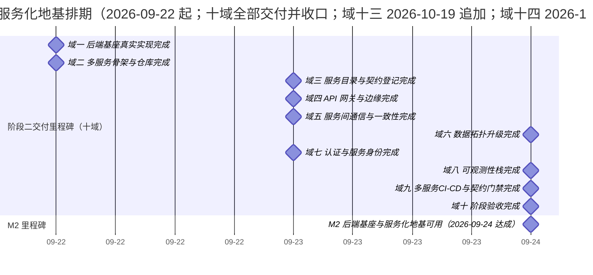

# 后端基座与服务化地基计划

[文档首页](../../../文档首页.md) › 后端基座与服务化地基计划　|　[任务基线 →](../任务/01_后端基座真实实现/01_后端基座真实实现.md)　[需求基线 →](../需求/00_需求_后端基座与服务化地基.md)

## 1. 计划说明 

- **排期对象**：阶段二 52 条需求，十域各建父任务与子任务（域 01 后端基座真实实现、域 02 多服务骨架与仓库、域 03 服务目录与契约登记、域 04 API 网关与边缘、域 05 服务间通信与一致性、域 06 数据拓扑升级、域 07 认证与服务身份、域 08 可观测性栈、域 09 多服务 CI-CD 与契约门禁、域 10 阶段验收），另有追加域 11 组织服务退役、域 12 产品服务接入、域 13 测试执行粒度与工程效能、域 14 平台模型下沉基座。
- **顺序口径**：域 01 → 02 → 03 → 04 → 05 → 06 → 07 → 08 → 09 → 10 收口；域六内先 06_03 平台层表归属与按服务拆分。
- **排期口径**：自 2026-09-22 起串行；工期由基线 4 周重估为 8 周、再重估为 10 周（服务化地基与域六前置并入）。
- **工时**：已完成 714h；剩余 16h；阶段合计 730h。
- **里程碑锚点**：M2 = 后端基座与服务化地基可用（《总体项目规划》「里程碑」节）。
- **负责人**：minjian（兼职，单人）。

## 2. 已完成任务（2026-09-22 ~ 2026-09-24） 

| 编号 | 任务 | 工时（重估） | 完成日期 | 任务文件 | 偏差与遗留 |
| --- | --- | --- | --- | --- | --- |
| 01_01 | 数据访问底座落库 | 12h | 2026-09-22 | [01_01](../任务/01_后端基座真实实现/01_后端基座真实实现_01_数据访问底座落库/01_后端基座真实实现_01_数据访问底座落库.md) | 遗留：预存在 6 条用例失败另行归口（阶段收口） |
| 01_02 | 多租户数据拓扑落库与实测 | 10h | 2026-09-22 | [01_02](../任务/01_后端基座真实实现/01_后端基座真实实现_02_多租户数据拓扑落库与实测/01_后端基座真实实现_02_多租户数据拓扑落库与实测.md) | 无 |
| 01_03 | BaseRepository 异步与 BaseModel 落库 | 10h | 2026-09-22 | [01_03](../任务/01_后端基座真实实现/01_后端基座真实实现_03_BaseRepository 异步与 BaseModel 落库/01_后端基座真实实现_03_BaseRepository 异步与 BaseModel 落库.md) | 无 |
| 01_04 | Alembic 迁移与排序 DB 侧 | 10h | 2026-09-22 | [01_04](../任务/01_后端基座真实实现/01_后端基座真实实现_04_Alembic 迁移与排序 DB 侧/01_后端基座真实实现_04_Alembic 迁移与排序 DB 侧.md) | 无 |
| 01_05 | 三库真库集成与达梦实测 | 10h | 2026-09-22 | [01_05](../任务/01_后端基座真实实现/01_后端基座真实实现_05_三库真库集成与达梦实测/01_后端基座真实实现_05_三库真库集成与达梦实测.md) | 遗留：达梦复合唯一多 NULL 差异兜底（信创适配阶段定案）、JSON 读回字符串适配、`init_tenant` 达梦种子路径（详见任务测试记录 §6）；范围澄清：补达梦运行期同… |
| 02_01 | monorepo 多服务工程与共享基座库 | 12h | 2026-09-22 | [02_01](../任务/02_多服务骨架与仓库/02_多服务骨架与仓库_01_monorepo 多服务工程与共享基座库/02_多服务骨架与仓库_01_monorepo 多服务工程与共享基座库.md) | 遗留：ops 暂留根、平台基础模型暂随库（详见任务实施记录 §7）；范围澄清：只落工作区骨架 + 共享基座库 + 1 平台服务（业务拆分留 02_03） |
| 02_02 | 服务运行与健康检查 | 6h | 2026-09-22 | [02_02](../任务/02_多服务骨架与仓库/02_多服务骨架与仓库_02_服务运行与健康检查/02_多服务骨架与仓库_02_服务运行与健康检查.md) | 无 |
| 02_03 | 单体重构为分布式 | 16h | 2026-09-22 | [02_03](../任务/02_多服务骨架与仓库/02_多服务骨架与仓库_03_单体重构为分布式/02_多服务骨架与仓库_03_单体重构为分布式.md) | 范围澄清：能力域实现留 bms_core、服务目录登记归 03_01、运行时跨库校验归 05_02 |
| 03_01 | 服务目录与注册要素登记 | 8h | 2026-09-22 | [03_01](../任务/03_服务目录与契约登记/03_服务目录与契约登记_01_服务目录与注册要素登记/03_服务目录与契约登记_01_服务目录与注册要素登记.md) | 无 |
| 03_02 | 启动与 CI 唯一性校验 | 6h | 2026-09-23 | [03_02](../任务/03_服务目录与契约登记/03_服务目录与契约登记_02_启动与 CI 唯一性校验/03_服务目录与契约登记_02_启动与 CI 唯一性校验.md) | 无 |
| 03_03 | 服务目录只读接口 | 4h | 2026-09-23 | [03_03](../任务/03_服务目录与契约登记/03_服务目录与契约登记_03_服务目录只读接口/03_服务目录与契约登记_03_服务目录只读接口.md) | 无 |
| 04_02 | 边缘认证与请求净化 | 8h | 2026-09-23 | [04_02](../任务/04_API网关与边缘/04_API网关与边缘_02_边缘认证与请求净化/04_API网关与边缘_02_边缘认证与请求净化.md) | 偏差：`global_rules` 的 `headers.set` 被路由级 `proxy-rewrite` 丢弃（标记置入移至路由级，已回写设计与 APISIX 说明） |
| 04_03 | 限流与服务发现 | 6h | 2026-09-23 | [04_03](../任务/04_API网关与边缘/04_API网关与边缘_03_限流与服务发现/04_API网关与边缘_03_限流与服务发现.md) | 偏差：限流 Redis 端口 / 库改整数字面量（环境变量替换致 schema 校验失败，已回写设计）；遗留：用户 / 租户维度限流归 07_03、指标抓取与日志采集归 08… |
| 05_01 | 服务契约与同步调用 | 10h | 2026-09-23 | [05_01](../任务/05_服务间通信与一致性/05_服务间通信与一致性_01_服务契约与同步调用/05_服务间通信与一致性_01_服务契约与同步调用.md) | 无 |
| 05_02 | 数据所有权与边界硬校验 | 8h | 2026-09-23 | [05_02](../任务/05_服务间通信与一致性/05_服务间通信与一致性_02_数据所有权与边界硬校验/05_服务间通信与一致性_02_数据所有权与边界硬校验.md) | 无 |
| 05_03 | Outbox 与幂等消费 | 14h | 2026-09-23 | [05_03](../任务/05_服务间通信与一致性/05_服务间通信与一致性_03_Outbox 与幂等消费/05_服务间通信与一致性_03_Outbox 与幂等消费.md) | 无 |
| 05_04 | 事件契约与 Saga 基座（**Saga 部分 2026-10-10 删除**） | 8h | 2026-09-23 | [05_04](../任务/05_服务间通信与一致性/05_服务间通信与一致性_04_事件契约与 Saga 基座/05_服务间通信与一致性_04_事件契约与 Saga 基座.md) | 无 |
| 06_01 | 每服务每租户建库与路由 | 22h | 2026-09-23 | [06_01](../任务/06_数据拓扑升级/06_数据拓扑升级_01_每服务每租户建库与路由/06_数据拓扑升级_01_每服务每租户建库与路由.md) | 范围澄清：并入 06_03 遗留 2（服务目录快照契约 + 启动接库校验改经契约 + `catalog` 非必需项降级），工时 12h → 20h |
| 06_03 | 平台层表归属与按服务拆分 | 20h | 2026-09-23 | [06_03](../任务/06_数据拓扑升级/06_数据拓扑升级_03_平台层表归属与按服务拆分/06_数据拓扑升级_03_平台层表归属与按服务拆分.md) | 无 |
| 06_02 | 多服务多库迁移与连接预算 | 28h | 2026-09-23 | [06_02](../任务/06_数据拓扑升级/06_数据拓扑升级_02_多服务多库迁移与连接预算/06_数据拓扑升级_02_多服务多库迁移与连接预算.md) | 无 |
| 07_01 | OIDC IdP 接入 | 8h | 2026-09-23 | [07_01](../任务/07_认证与服务身份/07_认证与服务身份_01_OIDC IdP 接入/07_认证与服务身份_01_OIDC IdP 接入.md) | 偏差：客户端以 authlib 的 JOSE 拆分包 joserfc + httpx 实现（authlib httpx 集成模块弃用告警）；遗留：外部身份映射 / JIT 建号归阶… |
| 07_02 | 双类 JWT | 8h | 2026-09-23 | [07_02](../任务/07_认证与服务身份/07_认证与服务身份_02_双类 JWT/07_认证与服务身份_02_双类 JWT.md) | 遗留：网关 `openid-connect` 接线与服务 JWT 入站校验归 07_03 |
| 07_03 | 网关认证接线与服务身份 | 6h | 2026-09-23 | [07_03](../任务/07_认证与服务身份/07_认证与服务身份_03_网关认证接线与服务身份/07_认证与服务身份_03_网关认证接线与服务身份.md) | 偏差：APISIX 无 `$jwt_claim_*`、`openid-connect` 仅产 `X-Userinfo`，04_02 预留写法作废）；遗留：完整登录链路 / 用户 c… |
| 08_01 | 可观测性栈接入 | 10h | 2026-09-23 | [08_01](../任务/08_可观测性栈/08_可观测性栈_01_可观测性栈接入/08_可观测性栈_01_可观测性栈接入.md) | 遗留：SLO / 告警与阶段度量归 08_02、服务容器化按服务抓取归 09、真实 Celery 埋点实测归任务调度阶段、`prometheus-client` 多进程模式与 pr… |
| 08_02 | 按服务归因与健康就绪 | 10h | 2026-09-24 | [08_02](../任务/08_可观测性栈/08_可观测性栈_02_按服务归因与健康就绪/08_可观测性栈_02_按服务归因与健康就绪.md) | 遗留：CI 推送发布 / 契约度量归 09、服务容器化后抓取与探针目标切 DNS 归 09、告警内部接口格式转换归通知阶段、业务链路 SLO 规则实体随端点实现、容量水位监控归运维… |
| 09_01 | 父-子流水线 | 10h | 2026-09-24 | [09_01](../任务/09_多服务CI-CD与契约门禁/09_多服务CI-CD与契约门禁_01_父-子流水线/09_多服务CI-CD与契约门禁_01_父-子流水线.md) | 遗留：Compose 编排 / 不可变标签 / 回滚 / 健康门禁归 09_02（已于 09_02 交付闭环），契约门禁归 09_03，Trivy DB 缓存加速 / 非 root… |
| 09_02 | 不可变镜像与回滚 | 6h | 2026-09-24 | [09_02](../任务/09_多服务CI-CD与契约门禁/09_多服务CI-CD与契约门禁_02_不可变镜像与回滚/09_多服务CI-CD与契约门禁_02_不可变镜像与回滚.md) | 遗留：K8s 迁移 / 非 root 与瘦身 / Trivy DB 缓存 / 真实主从归运维阶段 |
| 09_03 | 契约门禁 | 8h | 2026-09-24 | [09_03](../任务/09_多服务CI-CD与契约门禁/09_多服务CI-CD与契约门禁_03_契约门禁/09_多服务CI-CD与契约门禁_03_契约门禁.md) | 遗留：完整登录链路冒烟随认证 / E2E |
| 06_04 | 租户解析与库键派生健壮性 | 6h | 2026-09-24 | [06_04](../任务/06_数据拓扑升级/06_数据拓扑升级_04_租户解析与库键派生健壮性/06_数据拓扑升级_04_租户解析与库键派生健壮性.md) | 遗留：共享基座变更下冒烟覆盖口径归 09 域（§7 第 33 项）、其余 8 服务 CI 实证随下次变更命中（详见任务实施记录 §6） |
| 10_01 | 阶段验收门禁核对与测试报告 | 8h | 2026-09-24 | [10_01](../任务/10_阶段验收/10_阶段验收_01_阶段验收门禁核对与测试报告/10_阶段验收_01_阶段验收门禁核对与测试报告.md) | 无 |
| 11_01 | 组织服务工程退役与登记清理 | 8h | 2026-10-07 | [11_01](../任务/11_组织服务退役/11_组织服务退役_01_组织服务工程退役/11_组织服务退役_01_组织服务工程退役.md) | 遗留：`bms_org_{code}` 租户库 DROP（运维）、11_02 契约迁出与前端切换、网关联调归 mdm 部署联调 |
| 11_02 | 组织只读出口契约迁出与前端切换 | 6h | 2026-10-08 | [11_02](../任务/11_组织服务退役/11_组织服务退役_02_组织只读出口契约迁出与前端切换/11_组织服务退役_02_组织只读出口契约迁出与前端切换.md) | 遗留：真实网关联调（前端经网关 `/api/mdm/v1/org/...` 打真实 mdm 服务 + 令牌 / 三库）归部署联调与 11_03 收口 |
| 11_03 | 门禁回归与阶段收口 | 4h | 2026-10-08 | [11_03](../任务/11_组织服务退役/11_组织服务退役_03_门禁回归与阶段收口/11_组织服务退役_03_门禁回归与阶段收口.md) | 遗留：真实网关联调（令牌 / 三库）随部署 |
| 12_01 | 产品注册机制（R4.1） | 12h | 2026-10-07 | [12_01](../任务/12_产品服务接入/12_产品服务接入_01_产品注册机制/12_产品服务接入_01_产品注册机制.md) | 偏差：产品档案落点与校验口径按稿时现状回写详设… |
| 12_03 | 共享基座产品服务装配支持 | 8h | 2026-10-07 | [12_03](../任务/12_产品服务接入/12_产品服务接入_03_共享基座产品服务装配支持/12_产品服务接入_03_共享基座产品服务装配支持.md) | 偏差：产品维度校验取注入记录而非合并清单（见 §7 第 43 项）；遗留：产品档案 / 路由映射的产品侧注入不做、库数指标与契约声明扫描口径维持平台侧、真实 git 源安装与端到端… |
| 05_05 | 达梦 XA 自定义方言（DBMS_XA） | 16h | 2026-10-06 | [05_05](../任务/05_服务间通信与一致性/05_服务间通信与一致性_05_达梦XA自定义方言/05_服务间通信与一致性_05_达梦XA自定义方言.md) | 无 |
| 05_06 | 分布式事务方案评估（三库同步 2PC / 跨服务 TM） | 20h | 2026-10-06 | [05_06](../任务/05_服务间通信与一致性/05_服务间通信与一致性_06_分布式事务方案评估/05_服务间通信与一致性_06_分布式事务方案评估.md) | 遗留：自研 TM 运行时 / 悬挂自动回收 / 屏障在权限链路真实接线归后续（详见任务实施记录 §6） |
| 12_04 | 产品服务接入基座补充（表归属注入 + 服务包模型前缀 + 产品种子） | 12h | 2026-10-07 | [12_04](../任务/12_产品服务接入/12_产品服务接入_04_产品服务接入基座补充/12_产品服务接入_04_产品服务接入基座补充.md) | 遗留：产品侧表归属清单声明与装载调用（归 mdm `01-2`）、产品侧自建归属校验 ops（产品仓按需）、菜单与字段种子（mdm `01-4`）、产品契约基线与破坏性门禁… |
| 12_02 | 产品服务接入（R4.2） | 20h | 2026-10-07 | [12_02](../任务/12_产品服务接入/12_产品服务接入_02_产品服务接入/12_产品服务接入_02_产品服务接入.md) | 偏差：校验入口随 `ModuleRegistry.validate()` 一并执行（非 `ops/check_modules.py` 显式接线）、映射校验只拒 `disabled`… |
| 04_01 | 网关接入与声明式配置 | 28h | 2026-10-08 | [04_01](../任务/04_API网关与边缘/04_API网关与边缘_01_网关接入与声明式配置/04_API网关与边缘_01_网关接入与声明式配置.md) | 遗留：真机「超限 413 + 分片不受影响」实测随部署联调（证据补入 04-1-2 测试记录） |
| 06_05 | 建表方式切换与迁移脚本清空 | 16h | 2026-10-18 | [06_05](../任务/06_数据拓扑升级/06_数据拓扑升级_05_建表方式切换与迁移脚本清空/06_数据拓扑升级_05_建表方式切换与迁移脚本清空.md) | 无 |
| 13_04 | 测试公共基座（统一事务 / 日志 / 输出 / 报错） | 16h | 2026-10-19 | [13_04](../任务/13_测试执行粒度与工程效能/13_测试执行粒度与工程效能_04_测试公共基座/13_测试执行粒度与工程效能_04_测试公共基座.md) | 遗留：tenant / txn 收编、存量 autouse 清表渐进迁移、前端基座另立 |
| 05_07 | 跨服务事务管理器（强一致专项） | 128h | 2026-10-18 | [05_07](../任务/05_服务间通信与一致性/05_服务间通信与一致性_07_跨服务事务管理器强一致专项/05_服务间通信与一致性_07_跨服务事务管理器强一致专项.md) | 遗留：达梦 CI 作业真跑（待 CI 变量 `DM8_SYSDBA_PASSWORD`，见 §7） |
| 13_01 | 变更影响分析与细粒度选测 | 12h | 2026-10-19 | [13_01](../任务/13_测试执行粒度与工程效能/13_测试执行粒度与工程效能_01_变更影响分析与细粒度选测/13_测试执行粒度与工程效能_01_变更影响分析与细粒度选测.md) | 遗留：运行时扩圈缺行场景未实测（由 `expand_from_coverage` 用例覆盖）、前端镜像 `git`/`python3` 待 `ci-base-build` 重建、并… |
| 13_02 | 并行执行与重复步骤消除 | 6h | 2026-10-19 | [13_02](../任务/13_测试执行粒度与工程效能/13_测试执行粒度与工程效能_02_并行执行与重复步骤消除/13_测试执行粒度与工程效能_02_并行执行与重复步骤消除.md) | 遗留：CI runner 并行度待首次带代码推送观察 |
| 13_03 | 口径固化与机器护栏 | 4h | 2026-10-19 | [13_03](../任务/13_测试执行粒度与工程效能/13_测试执行粒度与工程效能_03_口径固化与机器护栏/13_测试执行粒度与工程效能_03_口径固化与机器护栏.md) | 遗留：CI 锁真实连推场景待推送后观察、跨项目仍按年龄兜底 |
| 14_01 | 共享模型下沉基座 | 24h | 2026-10-22 | [14_01](../任务/14_平台模型下沉基座/14_平台模型下沉基座_01_共享模型下沉基座/14_平台模型下沉基座_01_共享模型下沉基座.md) | 偏差：① 「服务侧 models 包仅剩 MODEL_MODULES」定案改为「整包删除 + 严格入口下沉一级」（已回写需求 14-1 与任务文本） |
| 14_02 | 表归属与契约登记同步 | 10h | 2026-10-22 | [14_02](../任务/14_平台模型下沉基座/14_平台模型下沉基座_02_表与契约登记同步/14_平台模型下沉基座_02_表与契约登记同步.md) | 偏差：① 任务文本「建出 38 张表（planned 不计入）」口径不自洽，实测为 34 张 enabled 建出 + 4 张 planned 缺席 |
| 14_04 | 开通编排内核下沉基座 | 16h | 2026-10-22 | [14_04](../任务/14_平台模型下沉基座/14_平台模型下沉基座_04_开通编排内核下沉基座/14_平台模型下沉基座_04_开通编排内核下沉基座.md) | 偏差：① CLI 一并下沉（薄壳为一行转发，argparse 分支进覆盖率分母） |
| 14_03 | 门禁固化与镜像边界校验 | 12h | 2026-10-22 | [14_03](../任务/14_平台模型下沉基座/14_平台模型下沉基座_03_门禁固化与镜像边界校验/14_平台模型下沉基座_03_门禁固化与镜像边界校验.md) | 偏差：① `release.py` 范围扩至全部 `ops` 调用点 |
| 14_05 | ops 类型门禁纳入 | 4h | 2026-10-22 | [14_05](../任务/14_平台模型下沉基座/14_平台模型下沉基座_05_ops类型门禁纳入/14_平台模型下沉基座_05_ops类型门禁纳入.md) | 偏差：① `test_db` 两处既有 `# pyright: ignore[reportPrivateUsage]`（`URL._replace` 去库名无公开方法）保留并逐条注… |
| 13_05 | 跨仓工程化工具包（`engkit`） | 24h | 2026-10-23 | [13_05](../任务/13_测试执行粒度与工程效能/13_测试执行粒度与工程效能_05_跨仓工程化工具包/13_测试执行粒度与工程效能_05_跨仓工程化工具包.md) | 遗留：biz / cw 接入随各自窗口（engkit 接入说明已备） |

## 3. 剩余任务排期（自 2026-09-22） 

| 编号 | 任务 | 状态 | 工时 | 依赖 | 排期窗口 | 备注 | 偏差与遗留 |
| --- | --- | --- | --- | --- | --- | --- | --- |
| 13_06 | [基座校验器迁入与各仓规则对齐](../任务/13_测试执行粒度与工程效能/13_测试执行粒度与工程效能_06_基座校验器迁入与规则对齐/13_测试执行粒度与工程效能_06_基座校验器迁入与规则对齐.md) | 未开始 | 16h | `13_05`（包骨架 / 配置化 / 薄包装机制）；`13_03`（四项护栏作用对象随迁） | 2026-10-26 ~ 2026-10-28 | 2026-10-23 立项（域十三补充需求 `13-6`）：8 个基座校验器（`check_base` / check-backend-b… | 无 |

## 4. 排期甘特图 

## 5. M2 验收门禁 

门禁定义见《[总体项目规划](../../../规划/总体项目规划.md)》「阶段内容与完成标准」节（阶段二行）与《[微服务演进规划](../../../规划/微服务演进规划.md)》「服务化地基要求与门禁」节（S1~S7）；**逐项结论与证据索引见下表（14 行）**，阶段汇总见《[阶段测试报告](../01_测试报告_后端基座与服务化地基.md)》。判定口径：本阶段门禁判「机制与产物就位」，真实业务链路随后续阶段实证的项在结论后以「（限定：…）」注明归口；**14 行全部达标，无未达标项**（2026-09-24 收口）。

| 验收点 | 对应任务 | 达成路径（结论与证据索引） |
| --- | --- | --- |
| 数据访问真实落库 | 01_01 ~ 01_05 | **达标（2026-09-24）**：`bms_core/db/` 引擎 / 会话工厂 / UoW / 仓储真实落库（01_01，Kiwi 984）；全量 pytest **1337 passed / 37 skipped**；`bms_core` 覆盖 96.7% |
| 三库拓扑可路由、租户隔离与批量迁移正确 | 01_01 / 01_02 / 06_01 / 06_02 | **达标（2026-09-24）**：库键 / 库名派生（`bms_core/db/keys.py`）与解析链中间件（Kiwi 1019）+ `ops/{provision_tenant,migrate_tenants,init_tenant}` 编排（Kiwi 2177 / 2178）；三库真库演练 9 / 9 / 13 例通过（06_02 测试记录 §3.2，计划 §7 第 18 项已闭环） |
| 模块注册接库校验生效、BaseModel 落库与排序 DB 侧生效 | 01_03 / 01_04 | **达标（2026-09-24）**：`SERVICE_CATALOG` 16 行（9 启用服务）+ 启动唯一性校验 `CatalogError` 40003（Kiwi 2162 / 2163）；`BaseModel` 四库类型映射 + ORDER BY 白名单 / NULL 恒末位 / 分页限深（Kiwi 1050 / 1078） |
| 基类异步切换完成 | 01_03 | **达标（2026-09-24）**：`BaseDbRepository` 真实异步 CRUD 与 DB 实现（Kiwi 1050） |
| 三库真库集成与达梦方言实测通过 | 01_05 | **达标（2026-09-24）**：达梦四项方言实测（schema 与大小写 / 复合唯一多 NULL / 布尔与 `JSON` 读回 / `VARCHAR2` 计长）+ 运行期同步门面（Kiwi 1156）；06_02 三库演练再验并按服务分链迁移。**（限定：CI `integration-dm8` 岗位因达梦环境加密模块问题 `when: never` → 计划 §7 第 8 项）** |
| **服务化地基 S1 服务边界与契约** | 03_01 / 05_01 / 09_03 | **达标（2026-09-24）**：服务目录登记 + 每服务公开契约快照 + `deploy/contracts/baseline/` 9 份基线入 Git + oasdiff `breaking` 拦截与 Schemathesis 打真实服务冒烟（Kiwi 2162 / 2168 / 2186）；预检 `contract_snapshot check` 零漂移 |
| **服务化地基 S2 数据所有权** | 05_02 / 06_03 / 06_01 | **达标（2026-09-24）**：边界静态硬校验 + 运行时守卫 + 越界度量（Kiwi 2170 / 2171）；`TABLE_OWNERSHIP` 39 条表归属登记与双向对账（06_03 / 06_02）；每服务独立库键契约与库名派生（06_01） |
| **服务化地基 S3 事件与一致性** | 05_03 / 05_04 | **达标（2026-09-24）**：Outbox 三表双链 + 幂等消费 + 重放 / 死信（Kiwi 2172 / 2173）；事件契约 23 条 + 快照零漂移 + Saga 三态执行器与审计链分条键（Kiwi 2174 / 2175；**Saga 三态执行器 2026-10-10 作废**，跨服务写改走 TM + XA）。**（限定：RocketMQ 真实投递归阶段十 → 计划 §7 第 13 / 17 项）** |
| **服务化地基 S4 服务身份与认证** | 04_02 / 07_01 ~ 07_03 | **达标（2026-09-24）**：网关 `forward-auth` → `/api/v1/auth/introspect` + 双类 JWT（`aud=api` / `aud=service`）+ `ServiceJwtEdgeTrust` 只信服务 JWT（Kiwi 2166 / 2179 ~ 2181）；mjbk 六项实测通过。**（限定：完整登录链路 / `X-User-Id` / RBAC → 阶段六 / 阶段七）** |
| **服务化地基 S5 运行时无状态与外部化** | 02_02 / 02_03 | **达标（2026-09-24）**：9 服务 `/healthz` `/readyz` + 配置加载 + 本地一键拉起（Kiwi 1205）；单体重构为多服务、会话 / 缓存 / 文件 / 任务外部化（Kiwi 1206） |
| **服务化地基 S6 分布式可观测** | 08_01 / 08_02 | **达标（2026-09-24）**：OTel 全链路（跨服务同 trace 用例 + 双服务冒烟）+ 指标采集端点 + Loki 日志聚合 + Grafana 面板与 SLO 规则锚点（Kiwi 2182 / 2183）。**（限定：真实 Celery 埋点 → 计划 §7 第 28 项）** |
| **服务化地基 S7 度量与门禁** | 05_02 / 08_02 / 09_01 ~ 09_03 | **达标（2026-09-24）**：越界度量 + `bms_contract_breaking_total` / `bms_release_total` 推送通道与面板（Kiwi 2171 / 2183 / 2184）+ 契约门禁两 job 阻断（Kiwi 2186）+ 9 服务发布与一键回滚实测（Kiwi 2185） |
| 多服务本地一键拉起、每服务独立库迁移验证通过 | 02_01 / 02_02 / 06_03 / 06_01 / 06_02 | **达标（2026-09-24）**：`deploy/compose/services.yml` 9 服务（Compose DNS `{service_key}:8000`）+ bootstrap 建库 / 分链迁移 / 种子；`up{job="bms-services"}` 9/9、`probe_success` 18/18（09_02 测试记录） |
| 阶段验收留痕 | 10_01 | **达标（2026-09-24）**：本表 14 行结论与证据索引 + [阶段测试报告](../01_测试报告_后端基座与服务化地基.md)（六节 + 附录）归档 + 三类文档状态一致 + 收口断言用例（Kiwi 2188） |

**里程碑对照**（《总体项目规划》「里程碑」节）：

| 里程碑 | 基线（《总体项目规划》§15） | 本计划实际 | 说明 |
| --- | --- | --- | --- |
| M2 后端基座与服务化地基可用 | 阶段二 10 周（累计 15 周） | **2026-09-24 达成**（自 2026-09-22 起实际投入 3 日） | 14 行门禁全部达标（含服务化地基 S1~S7）；阶段测试报告归档；阶段二 31 项 / 316h 全部完成 |

## 6. 风险与对策 

| 风险 | 影响 | 对策 |
| --- | --- | --- |
| 服务化地基新增面广、单人兼职投入不稳 | M2 延期 | 串行保守排期（8 周）；基座先行（域一）保底，服务化各域可顺延 |
| 每服务每租户库数量爆炸、迁移编排复杂 | 数据拓扑升级受阻 | 建库 / 迁移自动化与幂等；库数量监控；必要时评估分库策略（不锁死） |
| 强一致场景跨库后正确性风险 | 一致性缺陷 | 审计链按服务×租户分条、财务收敛单一账务服务、Outbox + 幂等、默认排除 2PC/XA（确需跨服务原子写经专项立项启用强一致，见 bms `05_07`） |
| 服务边界切错（退化为分布式单体） | 返工 | 按限界上下文划分 + 边界硬校验 CI 逐阶段判定 |
| 网关 / Tempo / Loki 等新增组件单机资源占用 | 单机资源吃紧 | 组件按需最小化、保留期 / TTL 配置、资源水位告警；触顶按演进路线迁 k3s |
| 达梦方言细节（SKIP LOCKED / 唯一 NULL 语义 / async 驱动）未定 | 实现返工 | 01_05 已实测并登记结论（唯一 NULL 语义差异见下「后续阶段待办」；async 驱动经同步门面落地；SKIP LOCKED 归事件 / 任务阶段实测） |
| 服务目录与注册要素取值未定 | 登记阻塞 | 本阶段只定机制与分组，取值随实施登记清单逐域确定 |

## 7. 后续阶段待办 

| # | 事项 | 来源 | 归口 |
| --- | --- | --- | --- |
| 1 | 达梦复合唯一 `(唯一字段, deleted_at)` 的多 NULL 语义差异兜底（达梦视 NULL 相等 → 未删行不能共存）：先排查达梦实例 / 建库选项能否恢复多 NULL… | 01_05 真库实测（差异取证见任务测试记录 §3.3） | 信创适配阶段（定案前不改平台统一口径与表结构） |
| 2 | 达梦 `JSON` 列经 dmPython 读回为字符串的适配（模块若直接下标访问 JSON 字段需处理） | 01_05 真库实测 | 按影响面后续（业务模块接入时评估） |
| 3 | `ops/init_tenant.py` 在达梦下的种子路径需经同步门面（现 `_seed` 走异步引擎） | 01_05 实施发现 | 租户管理阶段 / 达梦生产化 |
| 4 | 真实主从复制与只读副本谓词（现仅验证副本路由决策，未搭主从） | 01_05 范围确认 | 后续（读写分离真实化） |
| 5 | 游标排序键类型范围扩展（`Decimal` 等） | 01_04 遗留 | 按需 |
| 6 | 骨架表（`sys_task` / `sys_notification` / `sys_icon` / `ai_chat_log` 等）迁移 | 01_04 / 01_05 归口 | 各所属阶段 |
| 7 | 分片表按月预创建与分片路由真实落地 | 01_05 范围确认 | 任务调度阶段 |
| 8 | CI `integration-dm8` 临时关闭（`-70089` 加密模块加载失败） | 02_03 CI 运行发现 | 已闭环（2026-10-18） |
| 9 | ~~平台 / 能力域模型与落库实现迁出 `bms_core`~~ **已立项为任务 06_03**（2026-09-23 专项决策：路线「表归属 → 逐表迁出 → 拆库」，需求 0… | 05_02 决策确认（2026-09-23） | 已闭环 |
| 10 | 发件箱 / 消费幂等 / 死信三表保留期清理与归档（`delivered` 记录、已处置死信）；跨租户全局死信看板视图与每服务库按库投递编排 | 05_03 决策确认（2026-09-23） | 任务调度 / 归档阶段 |
| 11 | 服务级事件契约与服务级订阅声明（本期平台默认契约 23 条 + 机制就位，订阅注册表为空集）；跨仓库（产品侧）消费方订阅无法自动校验，靠登记流程与契约快照留痕 | 05_04 决策确认（2026-09-23） | 消费方实现阶段 |
| 12 | 事件清单文档（架构《接口与集成》「事件模型清单」）与契约注册表的对账脚本（事件批量落地后评估） | 05_04 实施登记 | 后续（事件批量落地） |
| 13 | topic 命名域（`bms.log.*` / `bms.event.*` 等）与已登记事件域对齐 | 05_04 命名整改发现 | 阶段十 M10 集成消息 |
| 14 | 开发库自动建表（`ensure_development_schema`）不写 Alembic 版本号：已自动建表的库遇新增迁移会「表已存在」冲突（05_04 实测租户演示库停留 0… | 05_04 实施发现 | 01_04 后续 / 运维 |
| 15 | `sys_tenant.db_key` **物理删列**（现为可空废弃列，06_01 起不再写入）：列定义 / 表文件 / 模型三处同步删除 | 06_01 决策确认（2026-09-23） | 后续数据库治理任务（另立） |
| 16 | ~~服务目录快照接口 `GET /api/v1/modules/snapshot` 入契约快照与 oasdiff 基线；`catalog` 健康项与 catalog_degrad… | 06_01 登记落点（2026-09-23） | —（已闭环） |
| 17 | 其余服务（identity / org / file / notification / search / ai / report）的基础设施表（发件箱三表）迁移脚本：现只建空目录… | 06_02 决策确认（2026-09-23） | M10 事件总线真实投递 / 该服务首次发事件 |
| 18 | ~~三库真库建库迁移演练（MySQL / PG / 达梦各一轮：建测试库 → 按服务建库 → 分链迁移 → 校验 → 清理）~~ **已完成**（2026-09-23，主机 192… | 06_02 测试记录 §3.2 | — |
| 19 | ~~Kiwi TCMS 本任务用例登记（原预计 2178）~~ **已完成**：用例 **2178**（平台骨架 / P2 / CONFIRMED / 自动化），新增 5 个用例文… | 06_02 测试记录 §1 | — |
| 20 | 分链形态变更后既有 SQLite 开发库 / CI 临时库须重建（`alembic_version` 存量取值不在新链中）；口径已写入 `alembic/README.md` 与《… | 06_02 实施发现（2026-09-23） | 开发 / 运维（文档已就位，无需专项） |
| 21 | 完整登录链路（授权码回调 / state / nonce / PKCE）、用户 JWT 租户等 claims 映射（Keycloak mappers）与 `X-User-Id` 内… | 07_03 遗留 | 阶段六 |
| 22 | RBAC 权限码细粒度校验（`require_permission` 接入路由） | 07_03 遗留 | 阶段七 |
| 23 | 认证内部端点 `/api/v1/auth/introspect` 独立鉴权（内网令牌 / mTLS）与 `forward-auth` 平移 ext_authz；Linkerd 自动… | 07_03 登记（2026-09-23） | K8s / 运维阶段 |
| 24 | 票据校验结果缓存与网关服务 JWT 短期缓存优化（不改契约） | 07_03 登记（2026-09-23） | 性能阶段 |
| 25 | 可观测组件镜像国内加速：daocloud 对部分镜像限速、`otel/opentelemetry-collector-contrib:0.116.0` 曾为坏副本（缺加载器，改用… | 08_01 真机冒烟（2026-09-23） | 运维（文档与工具已就位） |
| 26 | ~~Prometheus 抓取目标：当前服务未容器化，用 `host.docker.internal:8000`；服务容器化后改 `{service_key}:8000`（Comp… | 08_01 实施（2026-09-23） | — |
| 27 | `prometheus-client` 多进程（multiprocess）模式随「每服务多 worker / 多副本」评估；prod 采样率与 Tempo 保留期随压测 / 容量复… | 08_01 设计开放项（2026-09-23） | 性能 / 运维阶段 |
| 28 | 真实 Celery 运行时链路埋点实测（当前依赖与钩子就位，无 Celery 运行时可导入即降级） | 08_01 实施（2026-09-23） | 任务调度阶段 |
| 29 | CI 推送阶段度量至 Pushgateway——**发布成功率 `bms_release_total{service,result}` 已随 09_01 接入**（服务子流水线 r… | 08_02 实施（2026-09-24） | —（已闭环） |
| 30 | 业务链路 SLO 规则实体（登录成功率 / 审批提交成功率 / Socket.IO 推送延迟 / 备份每日成功；锚点已在 08_02 规则文件留位登记）与阈值随压测复核；容量水位监… | 08_02 设计（2026-09-24） | 对应业务阶段（认证 / 工作流 / 实时推送 / 运维）与阶段十四压测 |
| 31 | 告警内部接口格式转换（企业微信 / 钉钉 webhook 转 BMS 内部接口）与短信通道（`sys_sms_template`）——08_02 已交付 webhook recei… | 08_02 实施（2026-09-24） | 通知阶段 |
| 32 | ~~另立任务：修复 dev 环境 5xx~~ 已立项为任务 [06_04](../任务/06_数据拓扑升级/06_数据拓扑升级_04_租户解析与库键派生健壮性/06_数… | 09_03 实施发现（2026-09-24） | —… |
| 33 | 共享基座变更下的契约冒烟覆盖：`contract-smoke-<服务>` 与 `trigger-<服务>` 的 `rules:changes` 现只认 backend/servi… | 06_04 决策确认（2026-09-24） | 09 域后续（CI 容量 / runner 并发评估） |
| 34 | ~~**开放自动缺陷单 27 条**（`defect-auto`，对应流水线 #248 ~ #306，属阶段二之前）未随修复流转关闭~~ **已闭环（2026-09-24）**：经… | 10_01 缺陷核对（2026-09-24） | —（已闭环） |
| 35 | ~~测试资产仓《Kiwi 用例台账》§2 缺 984 / 1204 / 1205 / 1206 四条登记~~ 已取消（2026-10-13 拍板：台账停记，编号与批次以… | 10_01 编号核对（2026-09-24，与平台对账发现） | 已取消 |
| 36 | 缺陷单「修复即流转关闭」治理脚本：按缺陷单对应岗位扫描后续 main 流水线是否转绿，达条件时输出关闭建议 / 半自动关闭，替代人工逐条核对（本次 27 条为人工批量核销） | 10_01 缺陷核对（2026-09-24，自第 34 项拆分） | 缺陷治理（阶段收口窗口 / 运维） |
| 37 | `defect-capture` 现场数据归档缺口：dump 步骤报 mysqldump: Got error: 1049: Unknown database 'bms_test… | 10_01 证据复核（2026-09-24） | CI 与测试库治理（运维窗口） |
| 38 | **前端网关接入改造**（外部路径前缀自 `/api/v1` 变更为 `/api/{service_key}/v1`）：请求层 baseURL / 服务前缀映射收敛、请求适配器装配… | 04_01 已登记消费方（原归口表述「08 / 09_需求」不对口，2026-09-25 前端影响评估修正） | 已完成 |
| 39 | ~~网关 nginx `client_max_body_size` 未配置（默认 1m）与文件上传 20MB / 分片策略潜在冲突；APISIX 侧无请求体限制~~ | 04_01 网关骨架与文件策略（2026-09-25 前端影响评估发现） | 已闭环（2026-10-08） |
| 40 | **12_01 实施偏差登记（已回写详设对齐记录）**：① 详设交付物 3 写的 ORM 落点 `bms_core/models/platform.py` 随 06_02 分链已不… | 12_01 实施 / 测试记录（2026-10-07） | 已闭环 |
| 41 | 12_01 遗留归口：① ~~产品档案 HTTP 只读出口（`GET /api/v1/products` 形态）归 12_02~~ 已闭环（12_02，2026… | 12_01 实施 / 测试记录（2026-10-07） | ① —（已闭环）/ ③ 组织域已闭环（余域随 mdm 接入）/ ④ —（已闭环） |
| 42 | **12_02 实施偏差与遗留归口**：偏差（已回写详设 §13.2 对齐记录 9~12）——① 产品级路由映射校验入口由 `ops/check_modules.py` 显式接线改… | 12_02 实施 / 测试记录（2026-10-07）与二次收口复核（2026-10-08） | ③ mdm 产品接入（持续性）/ ④ 阶段十开放接口管理 / ⑥⑦ 后续数据库治理 |
| 43 | **12_03 实施偏差与遗留归口**：偏差——① 产品维度校验的入参取**注入记录**（`service_records()` 产物）而非应用级合并清单（合并清单含平台行，按产品… | 12_03 实施 / 测试记录（2026-10-07） | 产品可观测 / mdm 01_01 / 后续数据库治理 |
| 44 | **12_04 遗留归口与计划回写修正**：① **计划回写修正（2026-10-08）**——该任务 2026-10-07 交付当日登记回写仅落到统计行，未把任务行移入已完成且*… | 12_04 实施 / 测试记录（2026-10-07）与本次回写修正（2026-10-08） | mdm `01-2` / `01-3` / `01-4`、产品仓按需、后续数据库治理 |
| 45 | **05_07（跨服务事务管理器强一致专项）评审决策点**：① **同步引擎策略**——2PC 分支仅同步引擎可用（SQLAlchemy 异步 API 不暴露两阶段），而现有服务写… | 需求域 05 追加子任务 05_07 详细设计定稿（2026-10-09） | 已交付（2026-10-18） |
| 46 | 达梦 CI 作业**真跑**前置：CI/CD 变量 `DM8_SYSDBA_PASSWORD`（值＝实例 SYSDBA 密码；达梦测试库以 `SYSDBA` 承载，无独立测试账号）… | 05_07 批次一（2026-10-18） | 已闭环（2026-10-18） |
| 47 | mdm 服务在场的**跨仓真机联调**（用户 / 角色保存编排经 mdm 参与端点的端到端挂接，需模块宿主与 mdm 服务环境） | 05_07 批次二（2026-10-18） | 跨仓联调窗口 |
| 48 | 强一致告警规则本体（Alertmanager 规则、悬挂 / 启发式完成告警通道）——本轮已落五项 `bms_txn_*` 指标与结构化日志 | 05_07 批次二（2026-10-18） | 08 域可观测性 |
| 49 | 覆盖率扩圈器 `expand_from_coverage` 只匹配 `x.py` / `x/__init__.py`，**不识别包级模块**（如 `bms_core.models… | 14_01 实施发现（改根 `models/__init__.py 必然红） | 13_01 后续（选测与扩圈器维护） |
| 50 | `bms_core.permission.sources` 数据来源注册表「最后登记者生效」且 key 不止一个——同一进程内其他服务装配后，本服务请求会走到别的实现（并发用例随机… | 14_01 预检暴露（本任务只做平台测试侧隔离） | 另立任务：改为按装配期声明的当前 key 解析 |
| 51 | 表文件「ORM 模型」列**无机器校验**（本轮 36 份仍写迁包前旧路径，靠人工发现）：模型搬迁 / 改包名后表文件不会自动报警 | 14_02 实施发现 | 后续文档口径任务（在文档基座校验中加「表文件 ORM 路径须指向现存模型模块」规则 |
