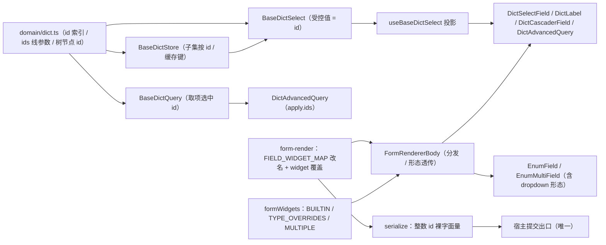
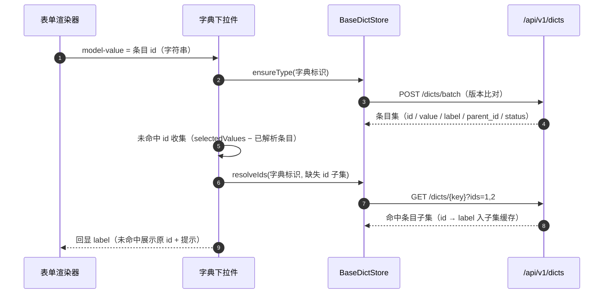
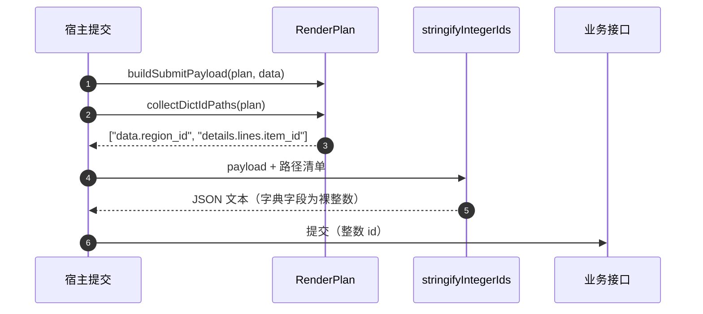

# 01 详细设计 · 字典字段绑定 ID 返工

> 前端组件库 · 06 字段类 · 09 字典字段绑定 ID 返工（需求 02-59）· 详细设计

[文档首页](../../../../../../文档首页.md) › [06 字段类](../../06_字段类.md) › [09 字典字段绑定 ID 返工](../06_字段类_09_字典字段绑定ID返工.md) › 详细设计　|　[← 任务](../06_字段类_09_字典字段绑定ID返工.md)

## 1. 设计目标与范围 <a id="goal"></a>

交付[任务 09](../06_字段类_09_字典字段绑定ID返工.md) 与[需求 02-59](../../../../../01_项目骨架/需求/02_需求_后端基座.md#r02-59) 的前端口径返工：字典字段（`dict` / `dict_multi`）**取值与回显一律按条目 `id`**，存量「条目 `value` 当键」的实现整体换轨；同时字段类型 `select` / `multi_select` 更名 `option` / `option_multi`，删除「枚举类型 + 字典标识」优先分发字典件的分支。**不动后端、不改已冻结契约签名。**

### 1.1 已确认口径 <a id="decisions"></a>

| # | 事项 | 结论 |
| --- | --- | --- |
| 1 | 受控值内部表示 | 统一**字符串 id**（雪花 63 位超 JS 安全整数，不得落 `number`）；提交出口以**裸数字字面量**序列化（精度无损、契约零变更） |
| 2 | `dropdown` / `dropdown-multi` | `option → radio`、`option_multi → checkbox`（与后端默认一致）；新增语义键 `dropdown` / `dropdown-multi` 供字段属性层；`FieldRenderAttrs` 新增 `widget` 覆盖 |
| 3 | 缓存索引 / `labelOf` / `itemOf` / 子集键 | 统一字符串 id（`{locale}:{type}:{id}`） |
| 4 | 旧语义键 | **彻底删除** `select` / `multi_select` / `multi-select`，不保留别名 |
| 5 | 覆盖率门禁 | `@bms/core` / `@bms/ui-ep` 各补 `test:cov`（`vitest run --coverage`）与 100% 阈值，与 `apps/desktop` 同口径 |
| 6 | 发布方式 | 前端独立提交并推送，与后端 `02-14` 同窗次第落地，任务文档登记一致性核对 |
| 7 | 用例登记 | Kiwi 先登记后编码，回读编号回填代码标记与测试记录 |
| 8 | 原型对照结论 | 写「不适用 + 理由」（无可见界面形态变更，引两个原型节点作语义依据） |

### 1.2 与相邻任务的边界 <a id="boundary"></a>

- **后端 `02-14`（已交付）**：`GET /dicts/{key}?ids=1,2`（整数、逗号分隔）、`POST /dicts/batch` 不变、`DictItem.id` 字符串输出、字段值只收整数。本任务只消费，不改后端。
- **`06_06` 字典字段族**：受控值语义换轨；组件对外 Props / 插槽 / `data-test` 形状**除取值语义外不变**（`data-test` 中的值片段由条目 value 改为条目 id，属本次口径变更）。
- **`06_02` 枚举字段**：新增下拉形态入口（`dropdown` / `dropdown-multi`），选项集来源仍只有注册表选项集。
- **`08_06` 表单渲染器**：删除字典优先分发分支，新增字段属性 `widget` 覆盖。
- **导入导出**：前端导入导出件不承载字典反查（后端按字段类型分流），无改动；列表批量翻译与表单回显按 id。

## 2. 交付物清单 <a id="deliver"></a>

| # | 交付物 | 落点 |
| --- | --- | --- |
| 1 | 字典领域换轨（id 索引 / 线参数 `ids` / 树节点 id / 条目 id 必填） | `core/src/domain/dict.ts` |
| 2 | 缓存能力换轨（子集按 id 回填、子集键、合并去重） | `core/src/capabilities/dict-store.ts` |
| 3 | 选择族换轨（受控值 / 占位 / 候选保留 / 选项源值） | `core/src/capabilities/dict-select.ts` |
| 4 | 高级查询换轨（取项选中值改条目 id） | `core/src/capabilities/dict-query.ts` |
| 5 | 字段分发改名 + `widget` 覆盖 + 字典 id 字段收集 | `core/src/domain/form-render.ts` |
| 6 | 字段属性 `widget` 与自建字段类型白名单改名 | `core/src/domain/form-layout.ts` |
| 7 | 查询区字段类型改名 | `core/src/domain/filter.ts` |
| 8 | 整数 id 序列化豁免（裸数字字面量） | `core/src/domain/serialize.ts` |
| 9 | 核心导出面登记 | `core/src/index.ts` |
| 10 | 契约套件按 id 换轨（桩补 `id`、`ids` 子集、断言） | `core/testing/dict.ts` |
| 11 | 契约用例样例类型改名 | `core/testing/{form-render,form-layout,query-scheme}.ts` |
| 12 | 控件映射与多选集合改名 | `ui-ep/src/utils/formWidgets.ts` |
| 13 | 表单渲染协同（删字典优先分支、枚举形态透传、`dataSourceKey` 仅字典件） | `ui-ep/src/components/form-render/FormRendererBody.vue` |
| 14 | 枚举多选件新增下拉形态 | `ui-ep/src/components/field/EnumMultiField.vue` |
| 15 | 字典下拉件 / 标签件 / 级联件 / 高级查询件按 id | `ui-ep/src/components/field/{DictSelectField,DictLabel,DictCascaderField,DictAdvancedQuery}.vue` |
| 16 | 查询区类型与语义键改名 | `ui-ep/src/components/data/QueryFilter.vue` |
| 17 | 投影面注释与回显调用改名 | `ui-ep/src/composables/useBaseDictSelect.ts`、`ui-ep/src/utils/dictTranslator.ts` |
| 18 | 核心 / 插件用例更新 + 新增序列化用例 | `core/tests/*`、`ui-ep/tests/*` |
| 19 | 覆盖率门禁固化 | `core/{package.json,vitest.config.ts}`、`ui-ep/{package.json,vitest.config.ts}` |
| 20 | 宿主核对页样例与桩换轨 | `apps/desktop/src/dev/{DictCheck,FormRenderCheck,DataDisplayCheck,FormDesignCheck}.vue` |
| 21 | 登记回写（基类清单如涉 / 任务 / 计划 / 实施与测试记录） | 见第 6 节 |



```text
core/
├── src/
│   ├── domain/
│   │   ├── dict.ts                  # 修改：id 索引 / ids 线参数 / 树节点 id / 条目 id 必填
│   │   ├── form-render.ts           # 修改：语义键改名 + dropdown / widget 覆盖 + 字典 id 字段收集
│   │   ├── form-layout.ts           # 修改：EXT_FIELD_TYPES / EXT_OPTION_TYPES 改名 + FieldRenderAttrs.widget
│   │   ├── filter.ts                # 修改：查询类字段类型与语义键改名
│   │   └── serialize.ts             # 修改：新增整数 id 裸字面量序列化
│   ├── capabilities/
│   │   ├── dict-store.ts            # 修改：resolveIds / 子集键 / 合并去重按 id
│   │   ├── dict-select.ts           # 修改：受控值 / 占位 / 选项源值按 id
│   │   └── dict-query.ts            # 修改：selectedIds 取条目 id
│   └── index.ts                     # 修改：新增符号导出
├── testing/
│   ├── dict.ts                      # 修改：契约桩补 id + ids 子集 + 断言
│   ├── form-render.ts               # 修改：样例类型 select → option
│   ├── form-layout.ts               # 修改：自建字段样例改名
│   └── query-scheme.ts              # 修改：查询字段样例改名
└── tests/                           # 修改 / 新增（见第 5 节）

ui-ep/
├── src/
│   ├── utils/
│   │   ├── formWidgets.ts           # 修改：BUILTIN_WIDGETS / TYPE_OVERRIDES / MULTIPLE_WIDGETS
│   │   └── dictTranslator.ts        # 修改：按 id 回填
│   ├── composables/
│   │   └── useBaseDictSelect.ts     # 修改：注释与回显调用按 id
│   └── components/
│       ├── form-render/FormRendererBody.vue   # 修改：删字典优先分支 + 形态透传
│       ├── data/QueryFilter.vue               # 修改：类型与语义键改名
│       └── field/
│           ├── DictSelectField.vue            # 修改：id 键与候选值
│           ├── DictLabel.vue                  # 修改：id 键与未命中提示
│           ├── DictCascaderField.vue          # 修改：路径键按 id
│           ├── DictAdvancedQuery.vue          # 修改：apply 载荷 ids
│           └── EnumMultiField.vue             # 修改：新增 dropdown 形态
└── tests/                           # 修改（见第 5 节）
```

## 3. 契约与数据结构 <a id="contract"></a>

### 3.1 值语义换轨（唯一口径） <a id="value-semantics"></a>

| 项 | 变更前 | 变更后 | 失败分支 |
| --- | --- | --- | --- |
| 字典条目索引键 | 条目 `value` | 条目 `id`（字符串化雪花） | 条目 `id` 为空 → 归一剔除（无法绑定） |
| 字段受控值 | 条目 `value` | 条目 `id`；多值为 id 数组 | 空串 / 空数组 → 归一为未设置 |
| 子集回填参数 | `values`（逗号分隔 value） | `ids`（逗号分隔整数 id） | 非纯数字 id 不出现在请求中（本地剔除空串） |
| 子集缓存键 | `{locale}:{type}:{value}` | `{locale}:{type}:{id}` | — |
| 级联树节点值 | 条目 `value` | 条目 `id` | 孤儿节点提升顶层（既有语义不变） |
| 表格列翻译入参 | 列值 = 条目 `value` | 列值 = 条目 `id` | 未命中 → 展示原 id 并触发一次子集回填 |
| 高级查询取项回填 | `values`（条目 value） | `ids`（条目 id） | 无结果 → 空数组 |
| 条目缺失 / 停用回显 | 回显原 value | 回显原 id，并标注「条目不存在或已停用」 | 不阻断渲染 |

- **条目归一**：`DictItem.id` 由 `readDictId` 读取并必填；`value` 缺失时回落 `id`（仅展示用途），`label` 缺失回落 `value` 再回落 `id`。
- **本地搜索**：仍按 `label` / `value` / `code` 模糊匹配（`id` 不参与搜索，避免雪花串命中噪声）。
- **公开面名称**：`normalizeDictValues` / `applyDictSelection` / `removeDictValue` / `selectedValues` / `getLabel` 等**名称保留**（语义为「值列表 = 条目 id 列表」），仅参数名与注释改为 `id`；**必须改名**的只有子集参数 `values → ids` 与 `resolveValues → resolveIds`、高级查询 `selectedValues() → selectedIds()` / `apply.values → apply.ids`。

### 3.2 线参数契约（对齐后端 `02-14`） <a id="wire"></a>

| 接口 | 前端产出 | 说明 |
| --- | --- | --- |
| `GET /api/v1/dicts/{data_source_key}` | `?ids=1,2` | `DictTypeQuery.ids: readonly string[]` → `params.ids = ids.join(',')`；空数组不传该参数 |
| `GET /api/v1/dicts/{data_source_key}` | `?parent_id={上级条目 id}` | 既有语义不变（`'0'` = 顶层） |
| `POST /api/v1/dicts/batch` | `{types, version?, locale?}` | 不变 |

- 前端不清洗 ids 的数值格式（后端非法值返回业务码 `10001`），仅剔除空串与去重。
- 契约快照与 `@bms/api-types` 已由后端 `02-14` 重生成（平台契约 `0.3.0`），本次**不重新生成**；`preflight` 的 `api-types --check` 应保持零漂移。

### 3.3 字段分发与形态映射 <a id="dispatch"></a>

| 字段类型 | 默认语义键 | 默认控件 | 可覆盖语义键 | 覆盖后控件 |
| --- | --- | --- | --- | --- |
| `option` | `radio` | `EnumField`（`form=radio`） | `button` / `segmented` / `dropdown` | `EnumField`（`form=button/segmented/select`） |
| `option_multi` | `checkbox` | `EnumMultiField`（`form=checkbox`） | `tag` / `dropdown-multi` | `EnumMultiField`（`form=tag/dropdown`） |
| `dict` | `dict-select` | `DictSelectField` | —（字典固定下拉语义） | — |
| `dict_multi` | `dict-multi` | `DictSelectField`（`multiple`） | — | — |

- `FormWidget` 增 `dropdown` / `dropdown-multi`，删 `select` / `multi-select`；`FIELD_WIDGETS` 全量同步，`FIELD_WIDGET_MAP` 删 `select` / `multi_select` 键。
- `resolveFieldWidget(type)` 语义不变（类型 → 默认语义键）；新增属性覆盖：`buildFieldPlan` 优先取 `attrs.widget`，值不在 `FIELD_WIDGETS` 内或为 `plain` 时回退类型默认（非法值由表单定制侧以 `40408` 拦截，前端不静默修正语义）。
- **分发分支删除**：`FormRendererBody` 的 `isDictReferenced` 只保留 `dict-select` / `dict-multi`；`option` / `option_multi` 即使带 `dataSourceKey` 也不再分发字典件（该属性对枚举类型无意义）。
- `MULTIPLE_WIDGETS`：删 `multi-select`，增 `dropdown-multi`（`dict-multi` / `checkbox` / `transfer` / `tags` / `org-select` / 上传件保留）。
- `TYPE_OVERRIDES`：`radio → EnumField`、`multi_select → EnumMultiField` 改名为 `option → EnumField`、`option_multi → EnumMultiField`；`dropdown` / `dropdown-multi` 在内建映射中指向 `SelectInput`（无字段类型细分时的兜底）。
- 形态透传：`FormRendererBody.extraProps` 对 `option` / `option_multi` 下发 `form`（由语义键映射：`radio→radio`、`button→button`、`segmented→segmented`、`dropdown→select`、`checkbox→checkbox`、`tag→tag`、`dropdown-multi→dropdown`）。

### 3.4 提交序列化豁免 <a id="serialize"></a>

后端字段值只收**整数**，而雪花 id 必超 JS 安全整数；前端受控值为字符串，序列化时不得经 `JSON.stringify` 的数字转换。

- 新增 `stringifyIntegerIds(payload: unknown, paths: readonly string[]): string`（`core/src/domain/serialize.ts`）：
  - 路径语法：`data.customer_id`（主表）、`details.lines.item_id`（明细数组自动展开到每行）；
  - 命中路径的值为**纯十进制字符串**时，输出**裸数字字面量**（`"customer_id":1234567890123456789`），数组逐项处理；
  - 空串 / `undefined` / `null` 按标准 JSON 输出（不产生非法字面量）；
  - 命中路径但值不是纯数字串、或数组元素非法 → 抛 `Error`（文案含字段路径），**不静默降级**为字符串；
  - 未命中路径走标准 `JSON.stringify`。
- 新增 `collectDictIdPaths(plan: RenderPlan): string[]`（`core/src/domain/form-render.ts`）：按渲染计划收集 `dict` / `dict_multi` 字段路径（主表 `data.{key}`、明细 `details.{detailKey}.{key}`），作为序列化入参的唯一来源。
- **接入点**：`buildSubmitPayload` 仍是提交载荷构造的单一出口；宿主发送 HTTP 时以 `stringifyIntegerIds(payload, collectDictIdPaths(plan))` 产出请求体（宿主核对页演示该用法）。本任务不改既有宿主提交代码（当前无真实业务提交页）。

### 3.5 未命中与停用回显 <a id="fallback"></a>

- `BaseDictSelect`：未命中项以 `{ id, value: id, label: id, status: 'enabled' }` 占位（保持 `selectedItems` 长度与受控值一致，不丢值）。
- `DictSelectField` 只读态：未命中项照常展示原始 id，并在字段下方给出「条目不存在或已停用」提示（`data-test="dict-missing-hint"`）；多选混排时逐项标注。
- `DictLabel`：未命中项以原 id 展示，并在标签上加 `title`（同文案）；`data-test="dict-label-item-{id}"`。
- 停用条目：编辑态候选 `disabled`（既有语义），只读态正常展示 label 并带停用标记（既有语义不变）。

## 4. 关键流程 <a id="flow"></a>





## 5. 测试设计与验收映射 <a id="test"></a>

用例先登记 Kiwi TCMS 取得编号后回填本表（编号列为登记回读结果）。

| # | 用例 | 覆盖 | 验收项 | Kiwi |
| --- | --- | --- | --- | --- |
| 1 | 领域按 id：取值 / 翻译 / 合并去重 / 子集键 / 树节点值 | `domain/dict.ts` | 取值与回显全部按 id | 待登记 |
| 2 | 线参数：`ids` 子集拼装（含空数组不传、去重） | `buildDictTypeQuery` | `?ids=` 契约切换 | 待登记 |
| 3 | 缓存：按 id 子集一次回填、二次零请求、并发去重、LRU 与本地二次缓存 | `BaseDictStore` | 批量回填按 id | 待登记 |
| 4 | 选择族：受控值 / 占位 / 候选保留 / 选项源值 / 多选上限 / 级联父值 | `BaseDictSelect` | 受控值 = id | 待登记 |
| 5 | 字段分发：`option→radio`、`option_multi→checkbox`、旧名回退 `plain` | `form-render` | 类型改名生效 | 待登记 |
| 6 | `widget` 覆盖：合法覆盖生效、非法值回退默认、`dict` 仍分发字典件 | `buildFieldPlan` | 字段属性层形态可配 | 待登记 |
| 7 | 渲染协同：枚举件收到 `form`、`option + dataSourceKey` 不再分发字典件 | `FormRendererBody` | 旧兼容分支删除 | 待登记 |
| 8 | 序列化豁免：19 位 id 裸字面量、明细数组、非法值报错、未命中路径原样 | `stringifyIntegerIds` | 提交精度保持 | 待登记 |
| 9 | 契约套件：`describeDictStoreContract` / `describeDictSelectContract` 按 id 断言 | `core/testing/dict.ts` | 跨实现同契约 | 待登记 |
| 10 | HTTP 数据源：`?ids=` 线参数与错误码透传 | `dictSource` | 真实接口口径 | 待登记 |
| 11 | 高级查询：取项应用载荷为 id 列表 | `DictAdvancedQuery` | 条目回填按 id | 待登记 |
| 12 | 查询区：字段类型改名后操作符与筛选载荷不变 | `QueryFilter` / `filter.ts` | 查询侧无回归 | 待登记 |

- **覆盖率**：`core` / `ui-ep` 各自 `test:cov` 覆盖行 + 分支 100%（口径见《[AI开发规范](../../../../../../规范/AI开发规范.md#coverage)》「覆盖率要求」节）。
- **门禁命令**（在 `bms/` 仓根）：`pnpm -r lint` / `pnpm -r typecheck` / `pnpm -r test`，以及 `pnpm --filter @bms/core run test:cov`、`pnpm --filter @bms/ui-ep run test:cov`。
- **联调**：后端 `02-14` 真实接口按 id 端到端（含 `?ids=` 回填、非法 id 业务码 `10001`），结论登记测试记录。
- **原型对照**：不适用（仅组件内部取值口径、分发表与属性层覆盖，无可见形态 / 布局变更）；语义依据引《[组件设计 · 字典字段](../../../../../../设计/组件设计/06_字段类/01_组件设计_字典字段/01_组件设计_字典字段.md)》「字典下拉件语义」节与《[组件设计 · 开关与枚举字段](../../../../../../设计/组件设计/06_字段类/08_组件设计_开关与枚举字段/08_组件设计_开关与枚举字段.md)》「形态由字段属性决定」节。

## 6. 登记落点 <a id="registry"></a>

| 对象 | 是否变更 | 说明 |
| --- | --- | --- |
| 《[前端基类清单](../../../../../../前端基类清单.md)》 | 核对 | `BaseDictStore` / `BaseDictSelect` 条目已写「条目 id 子集 / 绑定条目 id」，本次为实现对齐；如语义补充（未命中回显、`resolveIds`）则就地补 |
| 《[组件设计 · 字典字段](../../../../../../设计/组件设计/06_字段类/01_组件设计_字典字段/01_组件设计_字典字段.md)》 | 核对 | 「受控值 = 条目 id」「批量翻译按 id 子集」已是新口径，无需改 |
| 《[组件设计 · 选项集字段](../../../../../../设计/组件设计/06_字段类/14_组件设计_选项集字段/14_组件设计_选项集字段.md)》 | 核对 | 形态表已含 `dropdown`；无需改 |
| 任务 `06_09` | 回写 | 协同契约、开放项收口、一致性核对结论 |
| 父任务 `06_字段类` | 核对 | 口径返工说明已登记 |
| 计划表 `01_计划_前端组件库.md` | 回写 | 状态 / 完成日期 / 偏差与遗留 |
| 实施 / 测试记录 | 新增 | `实施/01_实施_09_字典字段绑定ID返工.md`、`测试/01_测试_09_字典字段绑定ID返工.md` |

## 7. 边界与开放项 <a id="open"></a>

- **不在本任务范围**：后端改动与契约签名变更；真实业务页面提交接线（当前无提交页，提供序列化出口与演示）；移动端实现（同契约多实现后续跟进）；迁移脚本（后端已确认不适用）。
- **已收口开放项**：任务书第 5 节「受控值字符串 vs 后端整数」与「雪花精度」由第 1.1 节第 1 项 + 第 3.4 节方案闭合（字符串受控值 + 提交裸字面量序列化，契约零变更）。
- **风险与缓解**：序列化出口若被宿主绕过（直接 `JSON.stringify`）会丢精度 → 由 `collectDictIdPaths` + 用例锁定，并在实施记录标注唯一出口；测试记录登记宿主核对页演示结论。
- **对齐记录**：本设计与后端 `02-14`（契约 `0.3.0`）逐项对齐——`ids` 整数逗号分隔、字段值整数、`DictItem.id` 字符串输出、`option/option_multi` 默认 widget、旧类型名无别名；不一致项为零。

> 本文档依《文档生成规范》编写
