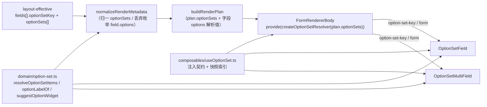
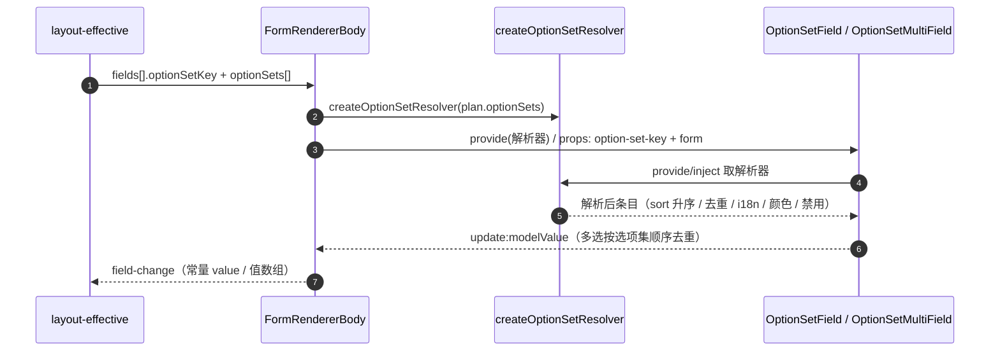

# 01 详细设计 · 选项集字段返工

> 前端组件库 · 06 字段类 · 10 选项集字段返工（需求 06-9）· 详细设计

[文档首页](../../../../../../文档首页.md) › [06 字段类](../../06_字段类.md) › [10 选项集字段返工](../06_字段类_10_选项集字段返工.md) › 详细设计　|　[← 任务](../06_字段类_10_选项集字段返工.md)

## 1. 设计目标与范围 <a id="goal"></a>

交付[任务 10](../06_字段类_10_选项集字段返工.md) 与[需求 06-9](../../../../需求/06_需求_字段类.md#r06-9) 的前端口径返工：选项集件**去掉字段层直传选项**、只消费 `optionSetKey`，选项由**注入式解析器**按表单元数据下发的 `optionSets` 快照解析后注入（控件不取数、零请求）；补齐 `dropdown` / `dropdown-multi` 两个下拉形态；实现侧件名统一为 `OptionSetField` / `OptionSetMultiField`，测试按开关 / 选项集拆两文件。

**不动后端**（选项集注册基座 `02-28` 已交付且无 HTTP 接口）；字段类型映射（`option` / `option_multi`，旧 `select` / `multi_select` 已删）由 `06_09` 落地，本任务只做**核对 + 用例锁定**。

### 1.1 已确认口径 <a id="decisions"></a>

| # | 事项 | 结论 |
| --- | --- | --- |
| 1 | 选项注入方式 | provide/inject 注入式解析器：件只收 `optionSetKey`，库内无全局状态 |
| 2 | 元数据形状 | `layout-effective` 增 `optionSets` 快照集（`{ optionSetKey, items[] }`），字段只带 `optionSetKey` |
| 3 | 解析器装配 | `FormRendererBody` 由 `plan.optionSets` 内建 provide，宿主零装配 |
| 4 | 形态取值 | `form` 值 = 语义键；单：`radio` / `button` / `segmented` / `dropdown`，多：`checkbox` / `tag` / `dropdown-multi`；删 `select` 与多选旧 `dropdown` |
| 5 | 选项 > 8 | 纯函数 `suggestOptionWidget()` 给建议（不下发行为），组件形态恒由 `widget` 决定 |
| 6 | i18n | 可选 `translate(labelKey)` 注入回调，缺翻译回退 `label`；不引入 `vue-i18n` |
| 7 | 缺项告警 | 仅开发态 `console.warn` + 件根 `data-missing="true"`，不阻断 |
| 8 | 空态降级 | 缺 key / 未解析 / 解析为空统一禁用 + `data-empty` + 占位「暂无可选枚举」，零请求 |
| 9 | 代码落点 | 纯函数 `core/src/domain/option-set.ts`；契约套件 `core/testing/option-set.ts` |
| 10 | 旧 `field.options` | `option` / `option_multi` 归一即丢弃（开发态告警），校验改按选项集解析结果 |
| 11 | 用例编号 | 拆 `field-switch.spec.ts`（沿用 Kiwi 969）+ `field-option-set.spec.ts`（新登记一条） |
| 12 | 覆盖率 | 变更源文件行 + 分支 100%（沿用 `06_09` 口径） |
| 13 | 原型对照 | 对照《14_原型设计_选项集字段.html》六形态逐项比对 + 截图落 `tmp/`，结论入测试记录 |
| 14 | 渲染器文档 | 一并回写 `08_06` 枚举件口径，并登记 `layout-effective` 增 `optionSets` 上游变更 |
| 15 | 定制件范围 | `ExtFieldDialog` / `FieldPropertyPanel` 本轮不改，登记协同与遗留 |

### 1.2 与相邻任务的边界 <a id="boundary"></a>

- **后端 `02-28`（已交付）**：选项集**装载时注册、运行期只读、无写接口**；本任务只消费其契约语义（`value` 唯一真值、`sort` 升序、同 `value` 去重、`labelKey` 回退、`color` / `disabled`），不改后端。
- **`06_02` / `11_03`（枚举件历史交付）**：件名与类型名由本任务统一为 `OptionSet*`；历史文档（`06_02` / `06_09` / `08_06` / `11_03`）按新名回写。
- **`06_09` 字典件**：字典字段（`dict` / `dict_multi`）继续走 `DictSelectField` / `DictCascaderField` 并绑定条目 `id`；选项集件**不复用**字典取数 / 缓存 / 版本比对，两族互不 import。
- **`08_06-2` 表单渲染器**：由渲染器装配解析器并把 `optionSetKey` 透传给件；渲染器不再对枚举件下发 `options`。
- **`08_06-1` 表单设计器 / 表单定制**：字段属性面板「选项集」由自由录入改为只引用 `optionSetKey`（本轮不改，登记协同契约与遗留）。
- **列表 / 查询区 / 导入导出**：值映射口径不变（常量 `value`、多选顿号展示），无改动。

## 2. 交付物清单 <a id="deliver"></a>

| # | 交付物 | 落点 |
| --- | --- | --- |
| 1 | 选项集领域纯函数（解析 / 回显 / 缺项 / 建议形态） | `core/src/domain/option-set.ts` |
| 2 | 选项集契约套件（解析器契约，PC / 移动端同跑） | `core/testing/option-set.ts` |
| 3 | 字段属性与元数据承载位（`optionSetKey` / `optionSets` / 旧 options 丢弃） | `core/src/domain/form-layout.ts`、`core/src/domain/form-render.ts` |
| 4 | 核心导出面登记 | `core/src/index.ts`、`core/testing/index.ts` |
| 5 | 注入式解析器（provide/inject + 快照索引工厂 + 解析投影） | `ui-ep/src/composables/useOptionSet.ts` |
| 6 | 选项集单选件（radio / button / segmented / dropdown） | `ui-ep/src/components/field/OptionSetField.vue`（`EnumField.vue` 改名） |
| 7 | 选项集多选件（checkbox / tag / dropdown-multi） | `ui-ep/src/components/field/OptionSetMultiField.vue`（`EnumMultiField.vue` 改名） |
| 8 | 控件映射与多选集合 | `ui-ep/src/utils/formWidgets.ts` |
| 9 | 对外导出面（组件 + 类型 + 解析器工具） | `ui-ep/src/index.ts` |
| 10 | 渲染协同（装配解析器 / 透传 `optionSetKey` / 不下发 options / 形态映射） | `ui-ep/src/components/form-render/FormRendererBody.vue` |
| 11 | 开发态核对页（六形态 + 单 / 多选下拉 + 只读 + 缺项，页面级 provide） | `apps/desktop/src/dev/FieldCheck.vue` |
| 12 | 护栏断言改名 | `apps/desktop/tests/guard-library-components.spec.ts` |
| 13 | 用例拆分与新增 | `ui-ep/tests/field-switch.spec.ts`、`ui-ep/tests/field-option-set.spec.ts` |
| 14 | 既有用例改名与协同断言 | `ui-ep/tests/interaction-form-renderer.spec.ts`、`ui-ep/tests/interaction-style.spec.ts`、`core/tests/option-set.spec.ts`、`core/tests/domain-form-render.spec.ts`、`core/tests/field-input-contract.spec.ts` |
| 15 | 登记回写（任务 / 计划 / 父任务 / `08_06` 渲染器设计 / 历史记录 / 实施与测试记录） | 见第 6 节 |



```text
core/
├── src/
│   ├── domain/
│   │   ├── option-set.ts            # 新增：类型 / 解析 / 回显 / 缺项 / 建议形态
│   │   ├── form-layout.ts           # 修改：FieldRenderAttrs.optionSetKey、LayoutEffective.optionSets、options 注释收窄
│   │   └── form-render.ts           # 修改：归一 optionSets、枚举丢 options、计划带 optionSetKey 与解析选项
│   └── index.ts                     # 修改：选项集领域导出
├── testing/
│   ├── option-set.ts                # 新增：describeOptionSetResolverContract
│   └── index.ts                     # 修改：套件导出
└── tests/
    ├── option-set.spec.ts           # 新增：领域纯函数 + 契约套件自验
    └── domain-form-render.spec.ts   # 修改：optionSetKey / optionSets 归一与计划

ui-ep/
├── src/
│   ├── composables/
│   │   └── useOptionSet.ts          # 新增：解析器注入契约 / 快照索引工厂 / 解析投影
│   ├── components/
│   │   ├── field/
│   │   │   ├── OptionSetField.vue       # EnumField.vue 改名并重写（六形态 / 注入式选项）
│   │   │   └── OptionSetMultiField.vue  # EnumMultiField.vue 改名并重写
│   │   ├── form-render/FormRendererBody.vue  # 修改：装配解析器 + 透传 key + 形态映射
│   │   └── input/CheckboxInput.vue      # 修改：注释按新名
│   ├── utils/formWidgets.ts         # 修改：导入与 TYPE_OVERRIDES 改名
│   └── index.ts                     # 修改：导出改名 + 解析器工具
└── tests/
    ├── field-switch.spec.ts         # 新增（由 field-switch-enum.spec.ts 拆出：开关三件）
    ├── field-option-set.spec.ts     # 新增（选项集六形态 / 去重 / i18n / 禁用 / 缺项 / 上下限）
    ├── field-switch-enum.spec.ts    # 删除（用例逐条迁移，不删减）
    ├── interaction-form-renderer.spec.ts  # 修改：OptionSetField 与 optionSetKey 协同断言
    └── interaction-style.spec.ts    # 修改：件路径改名

apps/desktop/
├── src/dev/FieldCheck.vue           # 修改：六形态 + 页面级 provide + 变量 / data-test 改名
└── tests/guard-library-components.spec.ts  # 修改：替代件提示改名
```

## 3. 契约与数据结构 <a id="contract"></a>

### 3.1 选项集领域类型与解析口径 <a id="domain"></a>

`core/src/domain/option-set.ts` 新增（纯函数、不触 DOM、不请求、同输入同输出）：

| 符号 | 语义 |
| --- | --- |
| `OptionSetItem` | `{ value: string; label: string; labelKey?: string; color?: string; disabled?: boolean; sort?: number }`——契约级最小结构，`value` 为唯一真值 |
| `OptionSetSnapshot` | `{ optionSetKey: string; items: readonly OptionSetItem[] }`——表单元数据下发的选项集快照 |
| `OptionSetResolveOptions` | `{ translate?: (labelKey: string) => string \| undefined }` |
| `OPTION_SET_DROPDOWN_THRESHOLD` | `8`（选项数超过即建议下拉） |
| `OPTION_EMPTY_TEXT` / `OPTION_MULTI_SEPARATOR` | `—` / `、` |
| `resolveOptionSetItems(items, options?)` | 解析：**按 `sort` 升序（同序保稳定）→ 相同 `value` 去重（保留首个）→ 空 `value` 剔除 → `labelKey` 经 `translate` 翻译、缺翻译 / 空翻译回退 `label` → `label` 仍为空回退 `value` → `color` / `disabled` 归一** |
| `buildOptionSetIndex(sets, options?)` | 快照集 → `Record<string, OptionSetItem[]>`（同 key 保留首个；每项走 `resolveOptionSetItems`） |
| `optionLabelOf(items, value)` | 取展示文本（未命中返回 `undefined`，由调用方回退原值） |
| `optionLabelsOf(items, values)` | 多选回显：**按选项集顺序**取 label、缺项回退原值、`、` 分隔；空数组返回 `''` |
| `missingOptionValues(items, values)` | 缺项清单（值不在选项集内，去重保序）——件层据此告警与打标 |
| `suggestOptionWidget(fieldType, count)` | 建议形态：`option` 且 `count > 8` → `'dropdown'`；`option_multi` 且 `count > 8` → `'dropdown-multi'`；其余返回 `undefined` |

- **不重复实现注册与冲突判定**：冲突（同 value 异 label 等）由后端注册基座在装载期拦截；前端只做「已下发条目的解析」，遇到冲突项按「保留首个 + 开发态告警」降级，不抛错阻断页面。
- **值域判定**：`value` 比较一律字符串化后严格相等（与后端 `OptionItem.value: str` 一致）。

### 3.2 元数据与渲染计划承载位 <a id="meta"></a>

| 层 | 变更 | 失败分支 / 边界 |
| --- | --- | --- |
| `FieldRenderAttrs` | 新增 `optionSetKey?: string`（仅 `option` / `option_multi` 消费；与 `dataSourceKey` 互斥）；`options` 注释收窄为「仅静态选项类字段（穿梭 / 标签 / 级联）消费」 | 非枚举类型带 `optionSetKey` → 忽略（不影响渲染） |
| `LayoutEffective` | 新增 `optionSets?: readonly OptionSetSnapshot[]`（只增不改；缺省即未下发） | 快照缺失 / 空 → 选项集空态降级 |
| `normalizeField` | 保留 `optionSetKey`（非空字符串）；`option` / `option_multi` 的 `options` **归一即丢弃**并开发态告警一次 | 丢弃后校验改按选项集（见下） |
| `normalizeRenderMetadata` | 归一 `optionSets`：非数组 → `[]`；逐项 `optionSetKey` 非空、`items` 归一（`value` 必填、`label` 缺省回退 `labelKey` / `value`、`sort` 非数值按 `0`）；同 key 保留首个 | 非法项剔除，不阻断装载 |
| `RenderPlan` | 新增 `optionSets: OptionSetSnapshot[]`（归一后快照，供渲染器造解析器） | — |
| `RenderFieldPlan` | 新增 `optionSetKey?: string`；`options` 对枚举字段改为**按快照解析值**（`{ value, label }`，供核心校验与只读回显） | 快照无该 key → `options = []`（空态降级） |

- **校验口径**：`validateFieldValue` / `validateFormData` 的「选项集」判定沿用 `options`——对枚举字段该值来自 `optionSets` 解析，不再是字段直传；解析为空时不产选项集错误（空态由件层降级）。
- **不静默修正配置**：前端只丢弃，不替用户补值；非法配置（`optionSetKey` 未登记、`minItems > maxItems`）由表单定制侧按 `40408` 拦截。

### 3.3 注入式解析器契约 <a id="resolver"></a>

`ui-ep/src/composables/useOptionSet.ts`：

| 符号 | 语义 |
| --- | --- |
| `OptionSetResolver` | 结构化契约：`resolve(optionSetKey: string): readonly OptionSetItem[] \| undefined` |
| `OPTION_SET_RESOLVER` | `InjectionKey<OptionSetResolver>`（注入令牌） |
| `provideOptionSetResolver(resolver)` | 上层装配入口（渲染器 / 核对页 / 宿主页面按需） |
| `createOptionSetResolver(sets)` | 由快照集造解析器（内部 `buildOptionSetIndex`，O(1) 查表） |
| `useOptionSet(input)` | 件层投影：输入 `optionSetKey` 与 `translate`（getter），输出 `items`（解析后）/ `empty` / `labelOf` / `labelsOf` / `missing` |

- **未注入解析器**：`items = []` → 空态降级（禁用 + 占位），**零请求**；不抛错。
- **未下发快照**（后端未就绪）：同上，符合「注入式占位」口径。
- **契约套件**（`core/testing/option-set.ts`）：`describeOptionSetResolverContract(name, create)` 断言「已知 key 返回解析后条目（排序 / 去重 / i18n 回退 / 颜色 / 禁用）、未知 key 返回 `undefined`、同一 key 稳定返回」。PC 解析器（`createOptionSetResolver`）自验跑该套件；移动端后续同契约复用。

### 3.4 字段件契约（六形态） <a id="props"></a>

| 件 | 受控值 | Props（除通用） | Events |
| --- | --- | --- | --- |
| `OptionSetField` | `string \| number \| undefined` | `optionSetKey` / `form: 'radio' \| 'button' \| 'segmented' \| 'dropdown'`（缺省 `radio`）/ `defaultValue` / `required` / `translate` | `update:modelValue` / `change` / `invalid` |
| `OptionSetMultiField` | `(string \| number)[]` | `optionSetKey` / `form: 'checkbox' \| 'tag' \| 'dropdown-multi'`（缺省 `checkbox`）/ `minItems` / `maxItems` / `required` / `translate` | `update:modelValue` / `change` / `exceed` / `invalid` |

- 通用 Props：`modelValue` / `disabled` / `readonly` / `placeholder` / `errorMessage`；**无 `options`**。
- 形态渲染：单选 `dropdown` → `SelectInput`（`searchable` / `clearable`）；`radio` / `button` / `segmented` → `RadioInput`；多选 `dropdown-multi` → `SelectInput`（`multiple` / `searchable` / `clearable` / `collapseTags`）；`checkbox` / `tag` → `CheckboxInput`。控件本体不做取数。
- 写回归一：多选去重后**按选项集顺序**排序输出（与勾选顺序无关）；单选取字符串化值。
- `data-test`：`option-set-readonly` / `option-set-multi-readonly` / `field-error`；件根属性 `data-form` / `data-empty` / `data-missing` / `data-invalid`。
- 校验：单选必填（未设置判未填）、值不在选项集判非法；多选必填与 `minItems` / `maxItems` 越限派发 `exceed` 并回退原值；外部 `errorMessage` 优先。
- 只读回显：单选取 label、缺项回退原值、未设置 `—`；多选按选项集顺序、顿号分隔、缺项回退原值、空数组 `—`（颜色标签由状态标签节点渲染，本件不自绘）。

### 3.5 i18n / 缺项 / 空态 / 建议下拉 <a id="edges"></a>

| 场景 | 处置 |
| --- | --- |
| `labelKey` 有翻译 | 展示翻译文本 |
| `labelKey` 无翻译 / `translate` 未注入 / 翻译为空串 | 回退 `label`；`label` 仍空回退 `value` |
| 回显值不在选项集 | 回退原值展示，件根 `data-missing="true"`，仅开发态 `console.warn` 一次（同一 key + 值不重复刷屏） |
| 缺 `optionSetKey` / 解析器未注入 / 解析为空 | 禁用 + `data-empty="true"` + 占位「暂无可选枚举」，不报错、零请求 |
| 选项 > 8 | 仅由 `suggestOptionWidget()` 给建议（表单定制侧提示或自动填 `widget`），件形态不变 |

## 4. 关键流程 <a id="flow"></a>



- **零请求**：全链路无 HTTP；后端未就绪（无 `optionSets`）时件层空态降级。
- **缺项**：件层 `missingOptionValues` 判定 → 回显原值 + 开发态告警 + `data-missing`。

## 5. 测试设计与验收映射 <a id="test"></a>

用例先登记 Kiwi TCMS 取得编号后回填本表（编号列为登记回读结果）。

| # | 用例 | 覆盖 | 验收项 | Kiwi |
| --- | --- | --- | --- | --- |
| 1 | 选项集解析：`sort` 升序 / 同 `value` 去重保留首个 / 空值剔除 / `labelKey` 翻译与三级回退 / 颜色与禁用保留 | `domain/option-set.ts` | 解析口径（节点 §5） | 待登记 |
| 2 | 回显与缺项：单选 label / 多选按选项集顺序顿号 / 缺项回退原值 / `missingOptionValues` 去重保序 | `optionLabelOf` / `optionLabelsOf` | 只读回显与缺项回退 | 待登记 |
| 3 | 建议形态：`option` / `option_multi` 超过 8 项建议下拉、未超返回 `undefined`、非枚举类型不参与 | `suggestOptionWidget` | 选项 > 8 建议下拉 | 待登记 |
| 4 | 解析器契约套件自验：已知 key 解析结果稳定 / 未知 key 返回 `undefined` / 未注入降级 | `describeOptionSetResolverContract` | 跨端同契约 | 待登记 |
| 5 | 元数据归一与计划：`optionSetKey` 保留 / `optionSets` 归一 / 枚举 `field.options` 丢弃 / 计划带解析选项与 `optionSetKey` | `normalizeRenderMetadata` / `buildRenderPlan` | 去自由选项、只消费 key | 待登记 |
| 6 | 单选四形态：`radio` / `button` / `segmented` / `dropdown` 渲染、值回传、必填与值域校验、默认值 | `OptionSetField` | 六形态（单选） | 待登记 |
| 7 | 多选三形态：`checkbox` / `tag` / `dropdown-multi` 渲染、去重保序、数量上下限 `exceed` | `OptionSetMultiField` | 六形态（多选）+ 上下限 | 待登记 |
| 8 | 只读回显：缺项回退原值 + `data-missing`、空值 `—`、多选顿号 | 两件 | 缺项回退与只读 | 待登记 |
| 9 | 空态降级：缺 key / 无解析器 / 解析为空 → 禁用 + `data-empty` + 零请求 | 两件 | 注入式占位 | 待登记 |
| 10 | 渲染协同：枚举件收到 `option-set-key` 与 `form`、不再收到 `options`、`dropdown` / `dropdown-multi` 形态透传、字典件不受影响 | `FormRendererBody` + `formWidgets` | 与字典分支完全独立 | 待登记 |
| 11 | 开关三件用例（三态 / 内联切换 / 乐观值 / 版本冲突 / 只读）逐条迁移 | `field-switch.spec.ts` | 拆分不删减 | 969 |

- **覆盖率**：`core` / `ui-ep` 变更源文件行 + 分支 100%（口径见《[AI开发规范](../../../../../../规范/AI开发规范.md#coverage)》「覆盖率要求」节；整包存量缺口按 `06_09` 遗留另立任务）。
- **门禁命令**（在 `bms/` 仓根）：`pnpm --filter @bms/core run lint` / `typecheck` / `test`、`pnpm --filter @bms/ui-ep run lint` / `typecheck` / `test`、`pnpm --filter @bms/desktop run test`；覆盖率按变更文件 `--coverage.include=<变更文件>` + 阈值 100 实测。
- **原型对照**：对照《[14_原型设计_选项集字段.html](../../../../../../设计/组件设计/06_字段类/14_组件设计_选项集字段/14_原型设计_选项集字段.html)》六形态逐项比对（radio / button / segmented / dropdown / checkbox / tag / dropdown-multi），截图落工作区 `tmp/`，结论入测试记录。
- **联调**：后端 `02-28` 无 HTTP 接口，联调口径为「元数据契约 `optionSets` 下发 + 件层零请求」，以注入式快照用例锁定；真实 `layout-effective` 下发随表单定制阶段回补。

## 6. 登记落点 <a id="registry"></a>

| 对象 | 是否变更 | 说明 |
| --- | --- | --- |
| 《[前端基类清单](../../../../../../前端基类清单.md)》 | 核对 | `BaseOptionSource` 条目已写「选项集随表单元数据下发」；本轮为纯函数 + 组合式，不新增基类，无需改 |
| 《[组件设计 · 选项集字段](../../../../../../设计/组件设计/06_字段类/14_组件设计_选项集字段/14_组件设计_选项集字段.md)》 | 核对 | 第 4 / 5 / 6 节口径已定案（六形态、只消费 `optionSetKey`、控件不取数），无需改 |
| 《[概要设计 · 表单定制](../../../../../../设计/概要设计/36_概要设计_表单定制.md)》 | 登记 | `layout-effective` 增 `optionSets` 快照集（上游变更，登记项①） |
| `08_06` 表单渲染器详细设计 | 回写 | 「枚举件收 `options` / `dropdown → select`」改为「收 `optionSetKey` + 注入式解析器 / `form` 值即语义键」 |
| 历史记录 `06_02` / `06_09` / `11_03` | 回写 | 件名与 `data-test` 按新名（`OptionSetField` / `OptionSetMultiField`） |
| 任务 `06_10` / 父任务 `06_字段类` | 回写 | 协同契约、完成情况 |
| 计划表 `01_计划_前端组件库.md` | 回写 | 状态 / 工时 / 完成日期 / 偏差与遗留 |
| 实施 / 测试记录 | 新增 | `实施/01_实施_10_选项集字段返工.md`、`测试/01_测试_10_选项集字段返工.md` |

## 7. 边界与开放项 <a id="open"></a>

- **不在本任务范围**：后端改动；表单设计器 / 字段属性面板的自由选项录入改造（`ExtFieldDialog` / `FieldPropertyPanel`，归 `08_06-1` 与表单定制阶段）；真实 `optionSets` 下发接口（归表单定制阶段，本任务先冻结前端契约）；移动端 `ui-vant` 同契约实现；导入导出件（后端按字段类型分流）。
- **协同契约（交下游）**：① 表单定制必须按「值域运行期是否变化」直接选字段类型，`option` / `option_multi` 只发 `optionSetKey`、不发 `options`；② `layout-effective` 需下发字段引用的全部 `optionSets` 快照（含 `sort` / `color` / `disabled` / `labelKey`）；③ 字段属性面板的「选项集」只能引用已登记标识，不提供自由录入。
- **风险与缓解**：宿主若绕过渲染器直接用件，必须自行 `provideOptionSetResolver`（否则空态降级）——由核对页示范 + 用例锁定，实施记录标注装配点；`optionSets` 未下发会导致整表枚举空态，属预期占位（不报错、零请求）。
- **偏差与遗留**：见实施记录 §6。

## 8. 决策记录 <a id="decision"></a>

| # | 决策项 | 结论 |
| --- | --- | --- |
| 1 | 选项注入方式 | 注入式解析器（provide/inject），不设全局单例、不保留 `options` prop |
| 2 | 选项数据来源 | `layout-effective` 的 `optionSets` 快照集；前端不重复注册判定 |
| 3 | 解析器装配 | 渲染器内建 provide，宿主零装配 |
| 4 | 形态取值 | `form` 值即控件语义键；旧 `select` / 多选 `dropdown` 删除不保留别名 |
| 5 | 选项 > 8 | 纯函数建议，件不改形态 |
| 6 | i18n | `translate` 注入回调 + 三级回退，不引 `vue-i18n` |
| 7 | 缺项 / 空态 | 开发态告警 + `data-missing` / `data-empty`，不阻断、零请求 |
| 8 | 代码落点 | 纯函数进 `core`、契约套件进 `core/testing`、注入与件进 `ui-ep` |
| 9 | 旧 options | 枚举字段归一即丢弃（开发态告警），校验改按选项集 |
| 10 | 用例与覆盖率 | 拆两文件、新登记一条 Kiwi、变更源文件 100% |
| 11 | 原型对照 | 六形态逐项比对 + 截图留证 |

> 本文档依《文档生成规范》编写
