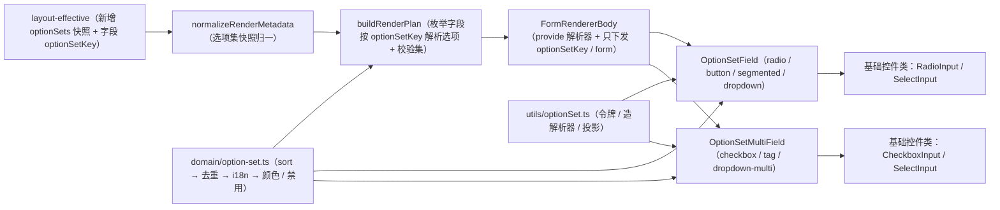
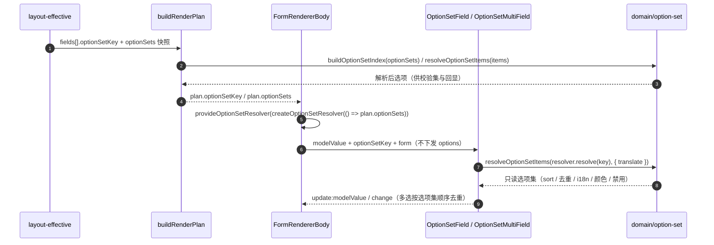
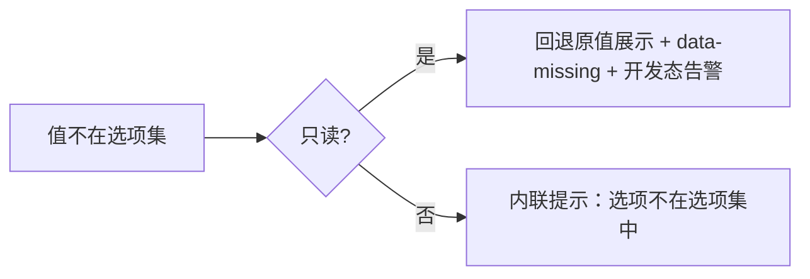

# 01 详细设计 · 选项集字段返工

> 前端组件库 · 06 字段类 · 10 选项集字段返工（需求 06-9）· 详细设计

[文档首页](../../../../../../文档首页.md) › [06 字段类](../../06_字段类.md) › [10 选项集字段返工](../06_字段类_10_选项集字段返工.md) › 详细设计　|　[← 任务](../06_字段类_10_选项集字段返工.md)

## 1. 设计目标与范围 <a id="goal"></a>

把 `06_02` 交付的枚举件整体换到定稿口径：**去自由选项**（只消费 `optionSetKey`，选项由注入式解析器提供、控件不取数）、**六种形态**（radio / button / segmented / dropdown，checkbox / tag / dropdown-multi）、**与字典件彻底独立**、**实现侧命名统一为 `OptionSetField` / `OptionSetMultiField`**，并把开关用例与选项集用例拆成两份测试文件。

类型映射（`select → option`、`multi_select → option_multi`、删字典优先分发分支）已由 `06_09` 落地，本任务只做**核对与用例锁定**，不重复实现。

### 1.1 已确认口径 <a id="decisions"></a>

| # | 事项 | 结论 |
| --- | --- | --- |
| 1 | 选项注入方式 | **provide/inject 注入式解析器**：件只收 `optionSetKey`，库内无全局状态，多表单 / 多租户天然隔离 |
| 2 | 元数据形状 | `layout-effective` 增 **`optionSets` 快照集**（`{optionSetKey, items[]}`），字段只带 `optionSetKey` |
| 3 | 解析器装配 | **`FormRendererBody` 内建 provide**（由 `plan.optionSets` 造解析器），宿主零装配 |
| 4 | 形态取值 | form 值 = 语义键（`radio` / `button` / `segmented` / `dropdown`；`checkbox` / `tag` / `dropdown-multi`），**删旧 `select` 与多选旧 `dropdown`** |
| 5 | 选项 > 8 | 纯函数 `suggestOptionWidget()` 给建议，**组件不自动切形态** |
| 6 | i18n | 件与纯函数接受可选 `translate(labelKey)`，缺翻译回退 `label`；不引 `vue-i18n` |
| 7 | 缺项告警 | 仅开发态 `console.warn` + 件根 `data-missing="true"`，不阻断；生产静默 |
| 8 | 空态降级 | 缺 key / 未登记标识 / 未注入解析器 / 解析为空 **统一禁用 + `data-empty` + 零请求** |
| 9 | 代码落点 | 纯函数 `core/src/domain/option-set.ts`、契约套件 `core/testing/option-set.ts`；解析注入工具 `ui_ep/src/utils/optionSet.ts` |
| 10 | 旧 `field.options` | `option` / `option_multi` 归一**丢弃**（开发态告警一条），校验改按选项集解析结果 |
| 11 | 用例编号 | `field-switch.spec.ts` 沿用 **Kiwi 969**；`field-option-set.spec.ts` 新登记 **Kiwi 2337** |
| 12 | 覆盖率 | **变更源文件行 + 分支 100%**（整包存量缺口另立任务） |
| 13 | 原型对照 | 对照《14_原型设计_选项集字段.html》六形态逐项比对 + 截图落 `tmp/` |
| 14 | 渲染器文档 | 一并回写 08_06 枚举件口径，并登记 `layout-effective` 增 `optionSets` 的上游变更 |
| 15 | 定制件范围 | `ExtFieldDialog` / `FieldPropertyPanel` 本轮不改，登记协同与遗留 |

### 1.2 与相邻任务的边界 <a id="boundary"></a>

- **`06_09` 已交付部分（核对，不重做）**：`FormWidget` 增 `dropdown` / `dropdown-multi`、删 `select` / `multi-select`；`FIELD_WIDGET_MAP` 中 `option → radio`、`option_multi → checkbox`；`FormRendererBody` 删「枚举类型 + 字典标识」优先分发分支；`FieldRenderAttrs.widget` 覆盖。本任务在其上补「选项集来源」与形态取值统一。
- **`06_06` 字典字段**：`DictSelectField` / `DictCascaderField` 绑定条目 `id`，取数 / 缓存 / 版本比对归字典件；选项集件不复用其中任何一环。
- **`08_06` 表单渲染器**：分发与形态透传在本任务改造（枚举件只收 `optionSetKey`、不下发 `options`），渲染器设计文档同步回写。
- **`06_02` 枚举件**：对外契约（Props / Events / `data-test`）**除选项来源与形态取值外不变**；件名与类型名按本任务统一。
- **表单定制件（`08_06-1`）**：属性面板与自建字段对话框的「自由选项录入」不在本任务范围，登记协同（改引 `optionSetKey`）。

## 2. 交付物清单 <a id="deliver"></a>

| # | 交付物 | 落点 |
| --- | --- | --- |
| 1 | 选项集领域纯函数与类型（解析 / 回显 / 缺项 / 建议形态） | `core/src/domain/option-set.ts`（新增） |
| 2 | 选项集解析器契约套件 | `core/testing/option-set.ts`（新增）、`core/testing/index.ts`（导出） |
| 3 | 字段属性 `optionSetKey` 与元数据 `optionSets` 归一；枚举字段丢弃内联 `options` | `core/src/domain/form-layout.ts`、`core/src/domain/form-render.ts` |
| 4 | 计划结构：`RenderFieldPlan.optionSetKey` / `RenderPlan.optionSets`，枚举字段选项由快照解析 | `core/src/domain/form-render.ts` |
| 5 | 校验改按计划内选项集（自由选项不再参与） | `core/src/domain/form-render.ts` |
| 6 | 解析注入工具（令牌 / 造解析器 / provide / 投影 / 开发态标记） | `ui_ep/src/utils/optionSet.ts`（新增） |
| 7 | 选项集单选件（四形态、只读、缺项回退） | `ui_ep/src/components/field/OptionSetField.vue`（新增，替代 `EnumField.vue`） |
| 8 | 选项集多选件（三形态、数量上下限、顿号回显） | `ui_ep/src/components/field/OptionSetMultiField.vue`（新增，替代 `EnumMultiField.vue`） |
| 9 | 控件映射与导出面改名 | `ui_ep/src/utils/formWidgets.ts`、`ui_ep/src/index.ts` |
| 10 | 渲染协同：内建 provide、枚举件只下发 `optionSetKey` 与形态 | `ui_ep/src/components/form_render/FormRendererBody.vue` |
| 11 | 开关 / 选项集用例拆分与新增用例 | `ui_ep/tests/field-switch.spec.ts`、`ui_ep/tests/field-option-set.spec.ts` |
| 12 | 领域 / 渲染 / 契约用例 | `core/tests/option-set.spec.ts`、`core/tests/domain-form-render.spec.ts`、`ui_ep/tests/interaction-form-renderer.spec.ts` |
| 13 | 开发态核对页与守卫断言改名 | `apps/desktop/src/dev/FieldCheck.vue`、`apps/desktop/tests/guard-library-components.spec.ts` |
| 14 | 样式护栏清单改名 | `ui_ep/tests/interaction-style.spec.ts` |
| 15 | 登记回写（任务 / 计划 / 父任务 / 08_06 设计 / 历史记录）与实施测试记录 | 见第 6 节 |



```text
core/
├── src/domain/
│   ├── option-set.ts          # 新增：选项集类型 / 解析 / 回显 / 缺项 / 建议形态
│   ├── form-layout.ts         # 修改：FieldRenderAttrs.optionSetKey、LayoutEffective.optionSets
│   ├── form-render.ts         # 修改：快照归一 / 计划选项与 optionSetKey / 丢弃内联选项 / 校验按选项集
│   └── index.ts               # 修改：新增导出
├── testing/
│   ├── option-set.ts          # 新增：解析器契约套件
│   └── index.ts               # 修改：导出
└── tests/
    ├── option-set.spec.ts     # 新增（Kiwi 2337）
    └── domain-form-render.spec.ts  # 修改：选项集字段分组

ui_ep/
├── src/
│   ├── utils/
│   │   ├── optionSet.ts       # 新增：注入令牌 / 造解析器 / provide / 投影 / 开发态标记
│   │   └── formWidgets.ts     # 修改：件名与类型改名
│   ├── components/
│   │   ├── field/
│   │   │   ├── OptionSetField.vue       # 新增（四形态）
│   │   │   ├── OptionSetMultiField.vue  # 新增（三形态）
│   │   │   └── EnumField.vue / EnumMultiField.vue  # 删除
│   │   ├── form_render/FormRendererBody.vue  # 修改：provide + 只下发 optionSetKey
│   │   └── input/CheckboxInput.vue           # 修改：注释改新名
│   └── index.ts               # 修改：导出改名
└── tests/
    ├── field-switch.spec.ts       # 新增（开关三件，Kiwi 969）
    ├── field-option-set.spec.ts   # 新增（选项集，Kiwi 2337）
    ├── field-switch-enum.spec.ts  # 删除（用例逐条迁移）
    ├── interaction-form-renderer.spec.ts  # 修改：选项集协同用例
    └── interaction-style.spec.ts          # 修改：护栏件名

apps/desktop/
├── src/dev/FieldCheck.vue                  # 修改：件名 / 变量 / data-test / 六形态
└── tests/guard-library-components.spec.ts   # 修改：替代件说明改名
```

## 3. 契约与数据结构 <a id="contract"></a>

### 3.1 选项集数据契约（随元数据下发） <a id="data"></a>

| 结构 | 字段 | 说明 |
| --- | --- | --- |
| `OptionSetItem` | `value` / `label` / `labelKey` / `color` / `disabled` / `sort` | 与后端 `OptionItem` 同构（`label_key ↔ labelKey`）；`value` 为唯一真值来源 |
| `OptionSetSnapshot` | `optionSetKey` / `items` | 一个已解析选项集的快照（后端注册表 `OptionSetInfo` 的前端投影） |
| `LayoutEffective.optionSets` | `readonly OptionSetSnapshot[]` | **只增可选**：`layout-effective` 下发的选项集快照集；缺省为空数组 |
| `FormField.optionSetKey` | `string` | **只增可选**：枚举字段引用的选项集标识；与字典字段的 `dataSourceKey` 互斥 |

- **元数据形状**（示例，字段只带标识、选项集集中下发）：

```json
{
  "fields": [
    { "key": "priority", "label": "优先级", "type": "option", "optionSetKey": "bms.demo.priority", "widget": "button" }
  ],
  "optionSets": [
    { "optionSetKey": "bms.demo.priority", "items": [
      { "value": "low", "label": "低", "sort": 3, "color": "info" },
      { "value": "high", "label": "高", "labelKey": "option.priority.high", "sort": 1, "disabled": true }
    ] }
  ]
}
```

- **旧口径处理**：`option` / `option_multi` 字段若仍带内联 `options`，归一阶段**丢弃**（开发态告警一条），不再参与渲染与校验；配置错误由表单定制侧以 `40408` 拦截（前端不静默修正语义）。
- **字典字段**：`dict` / `dict_multi` 仍用 `dataSourceKey`，`optionSets` 与其无关；两类字段互不读取对方标识。

### 3.2 解析与回显纯函数 <a id="pure"></a>

| 函数 | 签名（简化） | 语义 |
| --- | --- | --- |
| `resolveOptionSetItems` | `(items, { translate? }) => OptionSetItem[]` | **解析**：`sort` 升序（同序保声明顺序）→ 同 `value` 去重保留首个 → 空值剔除 → `labelKey` 经 `translate` 翻译、缺翻译回退 `label`、`label` 仍空回退 `value` → 归一 `color` / `disabled` |
| `optionLabelOf` | `(items, value) => string \| undefined` | 单值回显（未命中 `undefined`，由调用方回退原值） |
| `optionLabelsOf` | `(items, values) => string` | 多选回显：按选项集顺序、去重、**顿号分隔**、缺项回退原值；空值返回空串 |
| `missingOptionValues` | `(items, values) => string[]` | 缺项清单（去重保序），供 `data-missing` 与开发态告警 |
| `buildOptionSetIndex` | `(sets) => Record<string, OptionSetItem[]>` | 快照集 → 索引（同 key 保留首个、空 key 跳过），供解析器 O(1) 查表 |
| `suggestOptionWidget` | `(fieldType, count) => FormWidget \| undefined` | 选项数 > 8 时单选建议 `dropdown`、多选建议 `dropdown-multi`；非枚举类型返回 `undefined` |

- **值语义**：单选为标量、多选为数组；多选写回按选项集顺序去重（与勾选顺序无关）。
- **缺项**：回显回退原值 `value`（不丢值），件根置 `data-missing="true"`，开发态告警一次。
- **颜色**：随选项透传给基础控件（只读色标签由状态标签节点渲染，本任务不自绘）。

### 3.3 注入式解析器 <a id="resolver"></a>

| 项 | 契约 |
| --- | --- |
| 令牌 | `OPTION_SET_RESOLVER`（`InjectionKey<OptionSetResolver>`） |
| 解析器 | `OptionSetResolver.resolve(optionSetKey): readonly OptionSetItem[] \| undefined`（未登记返回 `undefined`） |
| 构造 | `createOptionSetResolver(() => plan.optionSets)`（按需取值，支持响应式快照） |
| 装配 | `FormRendererBody` 内 `provideOptionSetResolver(...)`；宿主脱离渲染器直用件时自行 provide |
| 投影 | `useOptionSet({ optionSetKey, translate })` → `{ items, empty, labelOf, labelsOf }` |
| 开发态 | `isOptionSetDevMode()` / `setOptionSetDevMode()`（构建期取 `import.meta.env.DEV`，测试可覆盖） |

- **零请求**：解析器只读元数据快照，不发请求、不缓存、不比对版本（与字典件彻底分离）。
- **降级**：无解析器 / 无 key / 未登记 / 解析为空 → `items` 为空数组，件层空态。

### 3.4 组件契约 <a id="props"></a>

| 件 | 形态（`form`） | 受控值 | Props（除通用） | Events |
| --- | --- | --- | --- | --- |
| `OptionSetField` | `radio`（默认）/ `button` / `segmented` / `dropdown` | `string \| number \| undefined` | `optionSetKey` / `form` / `defaultValue` / `required` / `translate` | `update:modelValue` / `change` / `invalid` |
| `OptionSetMultiField` | `checkbox`（默认）/ `tag` / `dropdown-multi` | `(string \| number)[]` | `optionSetKey` / `form` / `minItems` / `maxItems` / `required` / `translate` | `update:modelValue` / `change` / `exceed` / `invalid` |

- 通用：`modelValue` / `disabled` / `readonly` / `placeholder` / `errorMessage`。
- **不再接受 `options`**：件内无选项入参，选项只来自注入的解析器（渲染器不下发 `options`）。
- `data-test`：`option-set-readonly` / `option-set-multi-readonly`；件根 `data-form` / `data-empty` / `data-missing` / `data-invalid`。
- 形态取值与控件语义键一一对应（`form` 即 `widget`），跨端（移动端同契约实现）同口径。

### 3.5 字段分发与形态映射（核对 06_09） <a id="dispatch"></a>

| 字段类型 | 默认语义键 | 控件 | 可覆盖语义键 | 件层 `form` |
| --- | --- | --- | --- | --- |
| `option` | `radio` | `OptionSetField` | `button` / `segmented` / `dropdown` | 同名直传 |
| `option_multi` | `checkbox` | `OptionSetMultiField` | `tag` / `dropdown-multi` | 同名直传 |
| `dict` | `dict-select` | `DictSelectField` | — | — |
| `dict_multi` | `dict-multi` | `DictSelectField`（`multiple`） | — | — |

- `FIELD_WIDGET_MAP` / `FIELD_WIDGETS` 已是新类型与新语义键（06_09 落地），本任务用例锁定：`option → radio`、`option_multi → checkbox`、`select` / `multi_select` 回退 `plain`。
- `FormRendererBody.extraProps`：枚举字段只下发 `form` 与 `optionSetKey`，**不再下发 `options`**；字典字段只下发 `dataSourceKey`。
- `TYPE_OVERRIDES`：`option → OptionSetField`、`option_multi → OptionSetMultiField`；`dropdown` / `dropdown-multi` 内建映射仍指 `SelectInput`（无字段类型细分时的兜底）。

### 3.6 校验与降级矩阵 <a id="edge"></a>

| 场景 | 处置 |
| --- | --- |
| 缺 `optionSetKey` / 未登记 / 未注入解析器 / 解析为空 | 空态：控件禁用 + 占位「暂无可选枚举」+ `data-empty=true`；零请求、不报错 |
| 单选必填未填 | 内联「该字段为必填项」并派发 `invalid` |
| 编辑态值不在选项集 | 内联「选项不在选项集中」（要求重选） |
| 只读态值不在选项集 | **不校验**：回退原值展示 + `data-missing` + 开发态告警 |
| 多选数量越限（交互） | 派发 `exceed` 并回退原值，界面与值恒一致 |
| 多选存量值越限（配置变更） | 只读提示「最多 / 至少 N 项」，不丢值、不阻断回显 |
| 外部 `errorMessage` 非空 | 优先展示外部文案 |
| `defaultValue` 不在值域 | 件层不静默修正；由定制侧 `40408` 拦截 |

## 4. 关键流程 <a id="flow"></a>





## 5. 测试设计与验收映射 <a id="test"></a>

用例已登记 Kiwi TCMS（2337 为本任务选项集主用例；969 为开关主用例，逐条迁移不删减）。

| # | 用例 | 覆盖 | 验收项 | Kiwi |
| --- | --- | --- | --- | --- |
| 1 | 选项集解析：sort 升序 / 同值去重 / 空值剔除 / i18n 回退 / 颜色与禁用 | `core/src/domain/option-set.ts` | 解析口径 | 2337 |
| 2 | 回显与缺项：单选 label / 多选顿号顺序 / 缺项回退 / 缺项清单 | 同上 | 只读回显与缺项 | 2337 |
| 3 | 建议形态：> 8 建议 dropdown / dropdown-multi，非枚举不参与 | `suggestOptionWidget` | 建议下拉 | 2337 |
| 4 | 契约套件自验：已知 key 稳定解析、未知 key `undefined` | `core/testing/option-set.ts` | 跨端同契约 | 2337 |
| 5 | 元数据与计划：`optionSetKey` 保留 / `optionSets` 归一 / 内联 `options` 丢弃 / 计划选项与校验 | `normalizeRenderMetadata` / `buildRenderPlan` / `validateFieldValue` | 元数据口径 | 2337 |
| 6 | 单选四形态渲染与值回传（含下拉宽类型回传） | `OptionSetField` | 六形态可用 | 2337 |
| 7 | 多选三形态渲染与值回传（含 `null` / `undefined` / 单值归一） | `OptionSetMultiField` | 六形态可用 | 2337 |
| 8 | 去重保序、只读回显、缺项回退、i18n 翻译与回退 | 两件 | 值语义与回显 | 2337 |
| 9 | 空态降级（缺 key / 未登记 / 未注入解析器）与零请求 | 两件 | 占位零请求 | 2337 |
| 10 | 数量上下限 `exceed`、存量超限提示、受控值变化归一、开发态告警静默 | `OptionSetMultiField` / 开发态标记 | 上下限与告警 | 2337 |
| 11 | 渲染协同：只下发 `optionSetKey`、不下发 `options`、下拉形态透传、字典分支独立 | `FormRendererBody` | 与字典件拆开 | 2337 |
| 12 | 开关三态 / 内联切换 / 乐观值 / 版本冲突（逐条迁移） | `SwitchField` / `InlineSwitchCell` / `TriStateSwitch` | 开关不回归 | 969 |

- **覆盖率**：口径见《[AI开发规范](../../../../../../规范/AI开发规范.md#coverage)》「覆盖率要求」节（本任务按变更源文件行 + 分支 100% 验收）。
- **门禁命令**（在 `bms/` 仓根）：`pnpm --filter @bms/core run lint / typecheck / test`、`pnpm --filter @bms/ui_ep run lint / typecheck / test`、`pnpm --filter @bms/desktop run lint / test`；覆盖率按 `--coverage.include=<变更文件> --coverage.thresholds.*=100` 定向跑。
- **联调**：后端 `02_28`（选项集注册与校验基座）无 HTTP 接口，本任务按**注入式占位**先行（不伪造快照），元数据 `optionSets` 下发随表单定制阶段接通；真实联调结论登记测试记录。
- **原型对照**：对照《[14_原型设计_选项集字段](../../../../../../设计/组件设计/06_字段类/14_组件设计_选项集字段/14_原型设计_选项集字段.html)》六形态逐项比对，截图落 `tmp/`，结论入测试记录。

## 6. 登记落点 <a id="registry"></a>

| 对象 | 是否变更 | 说明 |
| --- | --- | --- |
| 任务 `06_10` | 核对 | 任务书 §2.7 命名对齐已列，实施后回写协同契约与开放项 |
| 父任务 `06_字段类` | 回写 | §3 口径返工说明补 06_10 交付进展 |
| 计划表 `01_计划_前端组件库.md` | 回写 | 状态 / 工作量 / 完成日期 / 偏差与遗留 |
| 《[组件设计 · 表单渲染器](../../../../../../设计/组件设计/08_交互类/12_组件设计_表单渲染器/12_组件设计_表单渲染器.md)》 | 回写 | 枚举件「收 `optionSetKey` + 注入解析器」；登记 `layout-effective` 增 `optionSets` 快照 |
| 《[概要设计 · 表单定制](../../../../../../设计/概要设计/36_概要设计_表单定制.md)》 | 核对 | `optionSetKey` 承载位已定；补「选项集快照随渲染元数据下发」一句 |
| 《[组件设计 · 选项集字段](../../../../../../设计/组件设计/06_字段类/14_组件设计_选项集字段/14_组件设计_选项集字段.md)》 | 核对 | 形态 / 候选来源 / 只读回显口径一致，无需改 |
| 《[前端基类清单](../../../../../../前端基类清单.md)》 | 核对 | 不新增基类（解析注入走工具层，纯函数入领域）；无改动 |
| 历史记录 `06_02` / `06_09` / `08_06` / `11_03` | 回写 | 旧件名 `EnumField` / `EnumMultiField` 统一为 `OptionSetField` / `OptionSetMultiField` |
| 实施 / 测试记录 | 新增 | `实施/01_实施_10_选项集字段返工.md`、`测试/01_测试_10_选项集字段返工.md` |

## 7. 边界与开放项 <a id="open"></a>

- **不在本任务范围**：表单定制属性面板与自建字段对话框（自由选项录入改引 `optionSetKey`，归 `08_06-1` / 表单定制阶段）；真实 `layout-effective` 的 `optionSets` 下发（后端表单定制未开工，按注入式占位）；移动端 `ui_vant` 同契约实现；导入导出的 label ↔ value 反查（归导入导出域）。
- **已收口**：选项注入方式、元数据形状、装配落点、形态取值、i18n、告警、空态、代码落点、旧 `options`、用例编号、覆盖率、原型对照、渲染器文档、定制件范围共 15 项经用户拍板（2026-10-21），见 §1.1。
- **风险与缓解**：宿主若绕过渲染器直用件而未 provide 解析器 → 件层空态降级（不报错、不请求），核对页演示了 provide 用法；`optionSets` 未下发时渲染为空选项而非脏值，避免静默错配。
- **对齐记录**：与后端 `02_28` 逐项对齐——`OptionItem` 字段同构、解析顺序（sort → 去重）一致、注册与冲突判定只在后端（前端不重复实现）、不设接口（零请求）。

## 8. 参考文档 <a id="ref"></a>

- [任务 10](../06_字段类_10_选项集字段返工.md)、[需求 06-9](../../../../需求/06_需求_字段类.md#r06-9)
- 《[组件设计 · 选项集字段](../../../../../../设计/组件设计/06_字段类/14_组件设计_选项集字段/14_组件设计_选项集字段.md)》《[组件设计 · 开关字段](../../../../../../设计/组件设计/06_字段类/08_组件设计_开关字段/08_组件设计_开关字段.md)》《[组件设计 · 字典字段](../../../../../../设计/组件设计/06_字段类/01_组件设计_字典字段/01_组件设计_字典字段.md)》
- 《[前端基类清单](../../../../../../前端基类清单.md)》、《[组件设计 · 选项源能力](../../../../../../设计/组件设计/02_基础组件类/02_能力类/12_组件设计_选项源能力/12_组件设计_选项源能力.md)》
- 后端《[选项集注册与校验基座详细设计](../../../../../01_项目骨架/任务/02_后端基座/02_后端基座_04_跨阶段基座/02_后端基座_04_跨阶段基座_28_选项集注册与校验基座/设计/28_详细设计_01_选项集注册与校验基座.md)》

> 本文档依《[文档生成规范](../../../../../../规范/文档生成规范.md)》编写
