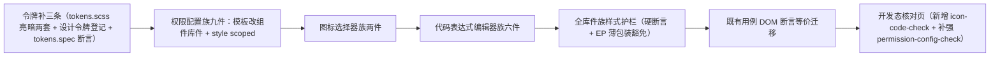

# 01 实施 · 交互类件族样式补齐

> 前端组件库 · 11 组件样式补齐 · 子任务 01（需求 11-1）· 实施记录

[文档首页](../../../../../../文档首页.md) › [11 组件样式补齐](../../11_组件样式补齐.md) › [01 交互类件族样式补齐](../11_组件样式补齐_01_交互类件族样式补齐.md) › 实施记录　|　[← 任务](../11_组件样式补齐_01_交互类件族样式补齐.md)　[详细设计 →](../设计/01_详细设计_01_交互类件族样式补齐.md)

## 1. 实施信息 <a id="meta"></a>

| 项 | 值 |
| --- | --- |
| 任务 | [01 交互类件族样式补齐](../11_组件样式补齐_01_交互类件族样式补齐.md) |
| 对应需求 | [11-1](../../../../需求/11_需求_组件样式补齐.md#r11-1) |
| 详细设计 | [01 详细设计](../设计/01_详细设计_01_交互类件族样式补齐.md)（设计提交 `b68e3f63c`） |
| 实施日期 | 2026-10-14 |
| 实施人 | minjian |
| 实施环境 | 本地开发机（Node v24.20.0 / pnpm 11.x，npmmirror；Element Plus 2.14.6） |
| Kiwi 用例 | **2295**（登记于实施前，代码 `// kiwi_id: 2295` 标注） |
| 结论 | 完成（全库样式护栏按设计持续红，见 §7） |

## 2. 实施概览 <a id="overview"></a>



## 3. 实施过程 <a id="process"></a>

1. **Kiwi 先登记**：实施前经 mjbk `bms-kiwi` Django shell 登记用例（编号 **2295**，分类「平台骨架」/ 优先级 `P2` / 状态 `CONFIRMED` / 标签「自动化」），回读核对一致。
2. **令牌补三条**（`frontend/apps/desktop/src/styles/tokens.scss`，亮 / 暗两套）：`--bms-perm-detached-color`（未挂接 / 停用标记字色）、`--bms-perm-readonly-bg`（来源只读标记底）、`--bms-perm-invalid-color`（匹配非法标记字色）；同时补登记设计令牌文档缺失的 `--bms-font-family-mono`（等宽字体，设计令牌 §3 已定义、工程侧未登记，代码族与图标 key 展示消费）；《[设计令牌](../../../../../../设计/布局设计/02_布局设计_设计令牌.html)「权限配置令牌」节登记；`apps/desktop/tests/tokens.spec.ts` 补三条新令牌存在性断言（亮 / 暗各一处）。
3. **权限配置族九件**（自下而上）：`PermissionTree`（`el-input` 搜索 + `el-checkbox` 三态 + `el-button` 展开 / 标签 + 未挂接标记消费 `--bms-perm-detached-color`）→ `ActionPermissionPanel`（`el-checkbox` + 来源只读标记消费 `--bms-perm-readonly-bg`）→ `FieldPermissionPanel`（**引入 `el-table`** 四列矩阵：字段 / 可见 / 可编辑 / 来源，开关改 `el-switch`；工具栏 `el-input` + `el-checkbox` + `el-button`）→ `MenuPermissionPanel` / `FormPermissionPanel`（左右分栏 + 子页签改 `el-tabs` + 表单列表改可点列表 + 卡片化）→ `DataScopePanel`（四子页签改 `el-tabs` + 明细改 `el-table`：数据选择多选 / 区域两列 / 匹配三列 / 扩展两列，匹配非法消费 `--bms-perm-invalid-color`）→ `DynamicDictPicker`（候选改 `el-checkbox` / `el-radio`）→ `RoleAssignPanel`（弹窗改 `el-dialog` + `el-checkbox` 候选 + `el-button`）→ `PermissionConfig`（四页签改 `el-tabs` + 降级 / 错误条样式）。
4. **图标选择器族两件**：`IconPicker`（触发框改 `el-input` + 弹层改 `el-popover` + 分类改 `el-tag` + 8 列网格样式）→ `IconLibrary`（工具栏改 `el-input` + `el-radio-group` + `el-button`；网格卡片化；自定义图标列表改 `el-table`）。
5. **代码表达式编辑器族六件**：`CodeEditor`（宿主壳边框 + 降级文本域等宽样式 + 诊断按 `data-severity` 语义色）→ `CodeMirrorHost`（**只补宿主壳，不写 `.cm-*` 主题规则**）→ `CodeViewer`（容器边框 + 头栏 `el-button` + 行号槽 / 代码区等宽 + 折叠）→ `CronEditor`（段输入改 `el-input` + 模板改 `el-button` + 描述 / 校验态）→ `ExpressionEditor`（工具栏 `el-button` + 左右分栏 + 令牌面板卡片化）→ `SqlEditor`（工具栏 `el-button` + 左右分栏 + 字段清单卡片化）。
6. **全库件族样式护栏**（`ui-ep/tests/interaction-style.spec.ts`，Kiwi 2295）：全库真裸骨架件**硬断言**含非空 `<style scoped>`（不留批次豁免）+ EP 薄包装 10 件显式豁免清单（逐件理由）+ 豁免清单与实际一致性校验 + 全库样式无硬编码色值 + fixture 拦截（色值 / 空样式块）+ 根元素识别自检。
7. **既有用例 DOM 断言等价迁移**：`interaction-permission.spec.ts`（勾选改 `el-checkbox` 的 `update:modelValue`、字段矩阵改 `el-table` 的 `el-switch` 断言并补 tick、匹配输入改 `el-input` 内层 input、角色分配弹窗改 `el-dialog` 的 `append-to-body` 文档查询）、`interaction-icon-code.spec.ts`（图标弹层改 `el-popover` 的 teleport 与 `display: none` 关闭语义）、宿主 `role-permission-config.spec.ts`（两处菜单勾选改 `el-checkbox`）。`interaction-placeholder.spec.ts` 无需改动（占位与页签断言不涉模板结构）。
8. **开发态核对页**：新增 `apps/desktop/src/dev/{IconCodeCheck.vue,iconCodeCheck.ts}` + `icon-code-check.html`（图标选择器族 + 代码表达式编辑器族真实组装 + 亮暗切换）；补强 `PermissionConfigCheck.vue`（页面级样式 + 亮暗切换按钮）；`.vscode/launch.json` 选页清单两处（工作区根 + `bms/`）登记。
9. **既有缺陷修正（实施期发现，经用户拍板）**：`PermissionConfig` 向 `DataScopePanel` 传 `dict-types` / `selected-dict-type-id`，而该件声明 `dataSourceKeys` / `selectedDataSourceKey` → 传参未落到 props，**数据权限页签字典列表恒为空**（`git show HEAD` 已确认原文件即如此，非本次引入）。**处置**：本任务内修正为 `data-source-keys` / `selected-data-source-key`（不改件对外契约，`DataScopePanel` 的 props 名本就如此）；核对页实测字典列表恢复显示（截图 `实现-权限配置-数据权限页签.png`）。

## 4. 关键命令 <a id="commands"></a>

```bash
# 门禁（工作区根为 bms/）
pnpm --filter @bms/ui-ep run lint && pnpm --filter @bms/ui-ep run typecheck
pnpm --filter @bms/ui-ep run test          # 除全库样式断言外全绿（该断言按设计红，见 §7）
pnpm --filter @bms/desktop run test:cov    # 覆盖率 100%
pnpm --filter @bms/desktop run lint && pnpm --filter @bms/desktop exec vue-tsc -b
pnpm run core:test && pnpm run core:typecheck && pnpm run core:lint && pnpm run api-types:gen:check
python3 scripts/tools/base-check/check-links.py && python3 scripts/tools/base-check/check-docs-scope.py
python3 scripts/tools/base-check/check-prototype-review.py . --task "bms文档/项目/04_前端组件库/任务/11_组件样式补齐/11_组件样式补齐_01_交互类件族样式补齐"
python3 scripts/tools/preflight/check-preflight.py --fast

# 实现侧截图对照（宿主 dev 5173）
pnpm --filter @bms/desktop run dev
# 权限配置族（亮 / 暗 / 数据权限页签）
playwright-cli open http://localhost:5173/permission-config-check.html
playwright-cli resize 1440 1000 && playwright-cli screenshot --filename=perm-light.png
playwright-cli run-code "async page => await page.click('[data-test=\"check-theme\"]')"   # 暗色
playwright-cli run-code "async page => await page.click('[data-test=\"permission-tab-data\"]')"  # 数据权限
# 图标选择器族 + 代码表达式编辑器族（亮 / 暗 / 弹层）
playwright-cli open http://localhost:5173/icon-code-check.html
playwright-cli run-code "async page => await page.click('[data-test=\"trigger\"]')"       # 图标弹层
```

## 5. 问题与处置 <a id="issues"></a>

| # | 问题 / 现象 | 原因 | 处置 |
| --- | --- | --- | --- |
| 1 | `vue-tsc` 报 `DefaultRow` 不能赋给 `RegionRow` / `MatchRow` / `ExtensionRow` / `CustomIcon` | `el-table` 插槽 `row` 为宽松 `DefaultRow` 类型 | 模板内显式 `row as RegionRow` 等收窄（`DataScopePanel` 四处、`IconLibrary` 三处） |
| 2 | `FieldPermissionPanel` 对象字面量重复属性报错 | 迁移时 `data-test` 与 `data-test="field-name"` 并存于同一 span | 保留行钩子 `field-row-<id>`，去掉重复项 |
| 3 | 菜单勾选断言失效（`setValue` on LABEL） | 裸 `<input type="checkbox">` 改 `el-checkbox` 后根为 `label` | 改经 `findComponent(ElCheckbox).vm.$emit('update:modelValue', true)` 上抛 |
| 4 | 字段矩阵断言查不到元素 | `el-table` 表体在挂载后一个 tick 才渲染 | 断言前 `await flushPromises()`，并按列序读 `el-switch` 的 `modelValue` |
| 5 | 匹配输入 `setValue` 报空 DOMWrapper | `el-input` 把 `data-test` **透传到内层原生 `input`**（非包裹 div） | 直接对 `[data-test="match-pattern"]` 元素 `setValue` / `trigger('change')` |
| 6 | 角色分配弹窗断言失败 | `el-dialog` 默认 `append-to-body`，内容不在组件子树 | 改查 `document.querySelector`，并以原生 `click()` 驱动 |
| 7 | 图标弹层断言失败 | `el-popover` 内容 teleport 到 body；关闭后节点保留、以 `display: none` 隐藏 | 挂 `attachTo: document.body` 并查文档树；关闭断言改 `popper.style.display === 'none'` |
| 8 | 数据权限页签字典列表为空 | **既有缺陷**：容器传 `dict-types` / `selected-dict-type-id`，件声明 `dataSourceKeys` / `selectedDataSourceKey` | 经用户拍板**本次一并修正**为 `data-source-keys` / `selected-data-source-key`（§3-9） |
| 9 | 图标核对页出现「图标不可用：custom:*」告警 | 自定义图标样例仅传入 `customIcons`（清单数据），未登记进图标注册表 | 核对页把自定义图标一并 `registry.register`（`custom:{code}`），告警消除 |
| 10 | 护栏初版 `templateOf(...).splitlines()` 报错 | 误用 Python 方法 | 改 `split('\n')`；并跳过 `<template>` 开标签行再取根元素 |

## 6. 验证结果 <a id="verify"></a>

| 验证点 | 方法 | 结果 |
| --- | --- | --- |
| 类型检查 | `@bms/ui-ep` `vue-tsc` / `@bms/desktop` `vue-tsc -b` | 通过 |
| Lint | `@bms/ui-ep` / `@bms/desktop` `eslint --max-warnings 0` | 通过（0 告警） |
| 单测（ui-ep） | `pnpm --filter @bms/ui-ep run test` | **995 通过 / 1 按设计红**（71 文件；红项即全库样式护栏，见 §7） |
| 单测（desktop） | `pnpm --filter @bms/desktop run test:cov` | 通过，**覆盖率 100%**（行 + 分支 + 函数 + 语句） |
| 单测（core） | `pnpm run core:test` | 通过（1317 用例） |
| 契约类型 | `pnpm run api-types:gen:check` | 通过（9 份零漂移） |
| 链接 / 文档范围 | `check-links.py` / `check-docs-scope.py` | 断链 0 / 失效锚点 0；违规 0 |
| 推送前预检 | `check-preflight.py --fast` | 全部通过 |

## 7. 偏差与遗留 <a id="deviations"></a>

- **偏差（完成标准口径冲突，经用户拍板 2026-10-14）**：任务 §3 完成标准要求「`ui-ep` 与宿主 `vue-tsc` / ESLint / Vitest **全通过**」，而需求 §2.5 与父任务 §3 又明确「件族样式护栏落地后**门禁持续红**，直至全库真裸骨架件补齐」。按用户口径**保持全库硬断言、不留批次豁免**——本批补 17 件，其余 **49 件**真裸骨架随 `11_02` ~ `11_04` 补齐，`interaction-style.spec.ts` 的「全库真裸骨架件均含非空 `<style scoped>`」断言**按设计持续红**；本批验收以「定向用例 + 覆盖率 + 原型对照」为准。**按用户口径，全库补齐前不推送。**
- **偏差（既有缺陷修正）**：`PermissionConfig` → `DataScopePanel` 传参名不匹配（§3-9、§5-8），本任务内一并修正。
- **遗留**：① 全库件族样式护栏在 `11_02` ~ `11_04` 补齐前持续红（期间不推送）；② 编辑内核（CodeMirror）主题细粒度色板随品牌化任务（本任务只补宿主壳样式）；③ 扩展权限参数对话框由扩展功能注册提供（本期空注册即隐藏）；④ 移动端 `ui-vant` 本阶段范围外。
- **下游消费方**：`11_02` ~ `11_04` 沿用本批沉淀的**全库件族样式护栏**与**权限域令牌命名口径**（`--bms-{域}-{语义}`）；`11_03` 需补 `input/CheckboxInput` / `input/PasswordInput`（真裸骨架，本批实测确认）。

> 本文档依《[文档生成规范](../../../../../../规范/文档生成规范.md)》编写
