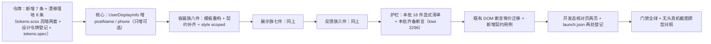

# 02 实施 · 容器与展示反馈件族样式补齐

> 前端组件库 · 11 组件样式补齐 · 子任务 02（需求 11-1）· 实施记录

[文档首页](../../../../../../文档首页.md) › [11 组件样式补齐](../../11_组件样式补齐.md) › [01 容器与展示反馈件族样式补齐](../11_组件样式补齐_02_容器与展示反馈件族样式补齐.md) › 实施记录　|　[← 任务](../11_组件样式补齐_02_容器与展示反馈件族样式补齐.md)　[详细设计 →](../设计/01_详细设计_02_容器与展示反馈件族样式补齐.md)

## 1. 实施信息 <a id="meta"></a>

| 项 | 值 |
| --- | --- |
| 任务 | [02 容器与展示反馈件族样式补齐](../11_组件样式补齐_02_容器与展示反馈件族样式补齐.md) |
| 对应需求 | [11-1](../../../../需求/11_需求_组件样式补齐.md#r11-1) |
| 详细设计 | [02 详细设计](../设计/01_详细设计_02_容器与展示反馈件族样式补齐.md)（设计提交 `baba87e7e`） |
| 实施日期 | 2026-10-14 |
| 实施人 | minjian |
| 实施环境 | 本地开发机（Node v24.20.0 / pnpm 11.x，npmmirror；Element Plus 2.14.6） |
| Kiwi 用例 | **2296**（登记于实施前，代码 `// kiwi_id: 2296` 标注） |
| 结论 | 完成（全库样式护栏按既有口径持续红，见 §7） |

## 2. 实施概览 <a id="overview"></a>



## 3. 实施过程 <a id="process"></a>

1. **Kiwi 先登记**：实施前经 mjbk `bms-kiwi` Django shell 登记用例（编号 **2296**，分类「平台骨架」/ 优先级 `P2` / 状态 `CONFIRMED` / 标签「自动化」），回读核对一致。
2. **令牌**（`frontend/apps/desktop/src/styles/tokens.scss`）：**新增 7 条**语义令牌（`--bms-diff-add-bg` / `--bms-diff-del-bg` / `--bms-diff-add-color` / `--bms-diff-del-color` / `--bms-qr-mask-bg` / `--bms-file-preview-mask-bg` / `--bms-color-mask-bg`）+ **漂移落地 8 条**（`--bms-scrollbar-size` / `-radius` / `-thumb` / `-thumb-hover` / `-track`、`--bms-color-text-inverse`、`--bms-illustration-size`、`--bms-fullscreen-bg`），亮 / 暗两套；《[设计令牌](../../../../../../设计/布局设计/02_布局设计_设计令牌.html)「容器与展示反馈令牌」节登记 + 两处既有漂移节标注已落地 + `tokens.spec.ts` 补存在性断言。
3. **核心扩展**（`frontend/packages/core/src/capabilities/user-display.ts`）：`UserDisplayInfo` **只增可选字段** `postName?` / `phone?`，并补 `BaseUserDisplay` 两个 getter；`capabilities-batch3.spec.ts` 补字段透传与花名册合并断言。
4. **容器族八件**（`container/`，自下而上）：
   - `AspectRatioContainer`：补 `fit`（`fill`/`contain`/`cover`/`none`）+ `maxWidth` + `minHeight` + 占位底与填充模式样式；
   - `AutoHeightContainer`：补 `maxHeight` / `scroll` / `recalcDelay`（经 `observeResize` + `debounce` 去抖派发 `recalc`）+ 暴露 `recalculate()`；
   - `LazyContainer`：补 `placeholder` 插槽（默认内置骨架）+ 占位动画样式；
   - `FullscreenContainer`：补 `showHint` / `hint` / `hint` 插槽（3s 自动隐藏、可点击关闭）+ 全屏背景令牌；
   - `ScrollContainer`：补 `reach-top` 事件 + `el-scrollbar` 外壳与滚动条令牌样式（移动端媒体查询隐藏自绘）；
   - `SectionContainer`：补 `description` / `divider` / `padding`（四档）+ 折叠钮改 `el-button` `link` + 轻量分区深度定制；
   - `StatusContainer`：补 `variant`（`mask`/`skeleton`/`spin`）+ `skeleton` 插槽 + 四态遮罩 / 旋转指示样式；
   - `VirtualListContainer`：补 `itemKey` / `reachThreshold` / `reach-bottom` + 暴露 `scrollToIndex()` + 行分隔样式。
5. **展示族七件**（`display/`）：
   - `QrCode`：补 `scanning` / `confirmed` / `failed` 三态遮罩（补齐五态）+ 暴露 `imageData()`；按钮改 `el-button`；
   - `QuickEntry`：入口项改 `el-tooltip` + 自绘可点容器（`role="button"` + 键盘触发）；补 `loading` 骨架 / `routes` 路由拦截 / 暴露 `visibleEntries`；宫格与角标样式；
   - `UserAvatar`：尺寸档位 / 形状 / 状态点三态语义色 / 角标 / 组合头像（+N）/ 稳定默认色样式（脱敏登记遗留）；
   - `UserInfo`：`linkTo` 生效（派发 `navigate`）+ 悬浮卡片补岗位 / 状态 / 联系方式；胶囊与浮层样式；
   - `WatermarkOverlay`：补 `font` 结构化 / `width` / `height` + 暴露 `exportImage()`；平铺层不可选中样式；
   - `AuditDiff`：补筛选区（时间范围必填分片键门控）+ 列表改 `el-table`（链状态 `el-tag`）+ 差异面板改 `el-drawer` + 增删行语义色；按钮改 `el-button`；
   - `FilePreview`：补 `mode`（`overlay`/`drawer`/`inline`）/ `thumbs` + PDF 翻页（`#page=N`）+ 键盘 ←/→/Esc；按钮改 `el-button`。
6. **反馈族三件**（`feedback/`）：`EmptyState`（补 `action` 含权限码 + `size` 档位）、`ErrorPage`（补「联系管理员」+ `contact` 事件）、`LoadingMask`（补 `fullscreen` 整页遮罩档位）。
7. **护栏扩展**（`ui-ep/tests/interaction-style.spec.ts`）：头部补 `// kiwi_id: 2296`；新增本批 18 件**显式清单**与「本批齐备」「本批 18 件均含非空 `<style scoped>`」两项断言；全库硬断言口径不变。
8. **既有用例迁移 + 新契约用例**：按详细设计 §6.2 等价迁移受模板变更影响的断言；为 21 处契约补齐新增用例（`container-basics` / `container-ability` / `container-status` / `display-light` / `display-preview-audit` / `display-placeholder` / `feedback`）。
9. **开发态核对页**：新增 `container-check.html`（容器族八件）+ `display-feedback-check.html`（展示族七件 + 反馈族三件），各配 `Vue` 入口与 `styles/index` 引入；`.vscode/launch.json` 选页清单两处（工作区根 + `bms/`）登记。
10. **实施期发现并修复两处既有缺陷（经用户拍板，详见 §5-1 / §5-2）**。

## 4. 关键命令 <a id="commands"></a>

```bash
# 门禁（工作区根为 bms/）
pnpm --filter @bms/ui-ep run lint && pnpm --filter @bms/ui-ep run typecheck
pnpm --filter @bms/ui-ep run test          # 除全库样式断言外全绿（该断言按设计红，见 §7）
pnpm --filter @bms/desktop run test:cov    # 覆盖率 100%
pnpm --filter @bms/desktop run lint && pnpm --filter @bms/desktop exec vue-tsc -b
pnpm run core:test && pnpm run core:typecheck && pnpm run core:lint && pnpm run api-types:gen:check
python3 scripts/tools/check-docs/check-status.py --stage 04_前端组件库 --strict
python3 scripts/tools/base-check/check-links.py && python3 scripts/tools/base-check/check-docs-scope.py
python3 scripts/tools/base-check/check-prototype-review.py . --task "bms文档/项目/04_前端组件库/任务/11_组件样式补齐/11_组件样式补齐_02_容器与展示反馈件族样式补齐"
python3 scripts/tools/preflight/check-preflight.py --fast

# 实现侧截图对照（宿主 dev 5173）
pnpm --filter @bms/desktop run dev
playwright-cli open http://localhost:5173/container-check.html
playwright-cli resize 1440 2600 && playwright-cli screenshot --filename=容器族-亮色.png
playwright-cli run-code "async page => await page.click('[data-test=\"check-theme\"]')"   # 暗色
playwright-cli open http://localhost:5173/display-feedback-check.html
playwright-cli run-code "async page => await page.click('[data-test=\"record-r1\"]')"    # 审计差异抽屉
playwright-cli run-code "async page => await page.click('[data-test=\"preview-open\"]')" # 文件预览
```

## 5. 问题与处置 <a id="issues"></a>

| # | 问题 / 现象 | 原因 | 处置 |
| --- | --- | --- | --- |
| 1 | **既有缺陷（非本批引入）**：`check-status --strict` 域 11 报 12 项硬规则违规（H5 ×8 / H6 ×4）——「任务编号未识别 `11-1`~`11-4`」+「域总览/计划列出而任务文档缺失」 | 域 11 四个任务文档「编号」写作 `11-1`~`11-4`（其它域为两位序号），`check-status.py` 把 `\d{2}-\d+` 判为**嵌套子任务** → 不进计划编号集合，集合对账两侧皆空导致 12 项违规 | 经用户拍板**按其它域口径改为 `01`~`04`**（需求编号 `11-1` 保持不变）；12 项归零 |
| 2 | **既有缺陷（非本批引入）**：上项修复后仍余 4 项 H5「任务文档未登记进域总览：`11_01`~`11_04`」 | `任务/` 下 `11_前端合规修复`（早先首审修复任务，**无「子任务清单」节**）与 `11_组件样式补齐` **同用域号 `11`**；`check-status` 按 `域_序号` 全局登记，两目录序列号集合碰撞 | 经用户拍板**把合规修复任务域号改为 `12`**（`git mv` 目录与主文档、同步计划表 / README / 17 处引用与文档内编号）；4 项归零，`check-status --strict` 全绿 |
| 3 | 详细设计初稿称「`desktop` 覆盖率可能统计 ui-ep 源码、需在宿主 spec 补断言」 | 初稿未实测覆盖率统计范围 | 实施期实测更正：`desktop` 覆盖率报告**只统计 `apps/desktop/src`**（`coverage-summary.json` 中 ui-ep 条目为 0）→ 新契约用例落 **ui-ep 自身**、宿主 spec 实测无需改动；已回写设计 §6.1 与 §12-10 |
| 4 | `visit` 断言失效：入口项改为自绘容器后 `findAll('button.bms-quick-entry__item')` 命中 0 | `QuickEntry` 入口项由裸 `<button>` 改 `el-tooltip` + 自绘 `div[role=button]`（与原型一致） | 断言改 `.bms-quick-entry__item` + 补 `role="button"` 校验（§6 迁移表） |
| 5 | `AuditDiff` 字段差异与链字段断言取不到元素 | 差异面板改入 `el-drawer`（与原型一致）、列表改 `el-table`：内容挂载后一个 tick 才渲染 | 断言前 `await flushPromises()`；抽屉内容在组件子树内（未 teleport）故仍可 `wrapper.find` |
| 6 | 链字段断言在无 `diff` 时抽屉不展开 | 抽屉初版仅在 `diff` 非空时展开，而链字段是独立维度 | 改为「有字段差异**或**链字段即视为已选中」`drawerVisible`（`watch([diff, showChain])`） |
| 7 | `StatusContainer` 骨架形态断言 `findComponent({name:'ElSkeleton'})` 未命中 | 测试内对 `ElSkeleton` 用了自定义 stub，组件名不匹配 | 断言改 `find('.el-skeleton')`（stub 渲染出的类名） |
| 8 | `QuickEntry` 暴露 `visibleEntries` 断言 `exposed.visibleEntries.value` 为 undefined | `defineExpose` 暴露 ref 时经脚本代理**自动解包**为值 | 断言改 `exposed.visibleEntries.map(...)` |
| 9 | `display-store` 核对页预览遮罩 `mode="overlay"` 铺满视口遮挡整页截图 | `overlay` 形态为 `position: fixed`，核对页默认打开即遮挡 | 核对页默认 `visible=false` + `mode='inline'`，点「打开预览」再核；审计差异抽屉同理默认关闭、点行再开 |
| 10 | 核对页审计差异抽屉打开后无字段差异行 | 模板误写 `:diff="[]"`（字面量），未绑定响应式 ref | 改 `:diff="auditDiffItems"`（选中行后写入样例） |

## 6. 既有用例 DOM 断言迁移对照 <a id="migrate"></a>

| 件 | 原断言 | 新断言 | 原因 |
| --- | --- | --- | --- |
| `QuickEntry` | `findAll('button.bms-quick-entry__item')` | `findAll('.bms-quick-entry__item')` + `attributes('role') === 'button'` | 入口项改自绘可点容器（原型一致） |
| `SectionContainer` | 仅标题 / 折叠断言 | 补 `data-padding` / `is-divider` / 描述文案断言 | 新增三契约项 |
| `ScrollContainer` | 仅 `reach-bottom` | 补 `reach-top` 触发与去重断言 | 新增触顶通知 |
| `AuditDiff`（记录列表） | `find('[data-test="record-r1"]')` 直接断言 | 前置于 `await flushPromises()` | 列表改 `el-table`，表体延迟一 tick |
| `AuditDiff`（字段差异 / 链字段） | 直接断言 `diff-*` / `prev-hash` | 前置 `await flushPromises()` | 面板改入 `el-drawer` |
| `AuditDiff`（查询） | 直接点 `query` 断言上抛 | 先经 `ElDatePicker` 补时间范围再用 `query` | 时间范围为分片键、必填门控 |
| `FilePreview` | 仅图片缩放 / 旋转 / 文本 / 降级 | 补形态 / 缩略图 / PDF 翻页 / 键盘用例 | 新增四契约项 |

> 迁移原则（详细设计 §6.2）：**对外契约面顶层 `data-test` 钩子保留原名**（`section-toggle` / `status-*` / `qr-*` / `entry-*` / `user-*` / `avatar-*` / `watermark-layer` / `empty-title` / `error-*` / `loading-mask` / `preview-*` / `diff-*` / `record-*` / `chain-panel` 等），仅因 EP 件替换导致查询方式变化处改断言。

## 7. 验证结果 <a id="verify"></a>

| 验证点 | 方法 | 结果 |
| --- | --- | --- |
| 类型检查 | `@bms/ui-ep` `vue-tsc` / `@bms/desktop` `vue-tsc -b` / `@bms/core` `tsc` | 通过 |
| Lint | `@bms/ui-ep` / `@bms/desktop` / `@bms/core` `eslint --max-warnings 0` | 通过（0 告警） |
| 单测（ui-ep） | `npx vitest run` | **1029 通过 / 1 按设计红**（71 文件；红项即全库样式护栏，见 §8） |
| 单测（desktop） | `npx vitest run --coverage` | 通过，**覆盖率 100%**（行 / 分支 / 函数 / 语句） |
| 单测（core） | `pnpm run core:test` | 通过（1319 用例，109 文件） |
| 契约类型 | `pnpm run api-types:gen:check` | 通过（9 份零漂移） |
| 链接 / 文档范围 | `check-links.py` / `check-docs-scope.py` | 断链 0 / 失效锚点 0；本次改动 0 违规 |
| 阶段文档一致性 | `check-status.py --stage 04_前端组件库 --strict` | **硬规则 0 / 软提示 0**（修复两处既有缺陷后） |
| 原型对照门禁 | `check-prototype-review.py --task <本任务>` | 通过（见测试记录 §5） |
| 推送前预检 | `check-preflight.py --fast` | 业务项全绿（`ruff` 未安装、生成索引 `代码落点索引.md` 的既有字样 2 处为环境 / 生成物项，详见 §8） |

## 8. 偏差与遗留 <a id="deviations"></a>

- **偏差（完成标准口径冲突，沿用 `11_01` 决策 7）**：任务 §3 完成标准要求「`ui-ep` 与宿主全通过」，而需求 §2.5 与父任务 §3 又明确「件族样式护栏落地后**门禁持续红**，直至全库真裸骨架件补齐」。按用户口径**保持全库硬断言、不留批次豁免**——本批补 18 件后全库仍有 **31 件**真裸骨架未补（随 `11_03` / `11_04`），`interaction-style.spec.ts` 的全库断言**按设计持续红**；本批验收以「定向用例 + 覆盖率 + 原型对照」为准。**按用户口径，全库补齐前不推送。**
- **偏差（本批范围较任务书扩大）**：任务书 §2 名义范围「只改模板结构与样式」，实施前逐件比对《组件设计》节点发现 **21 处契约缺口**，经用户逐项确认**本批一并补齐**（只增不改，既有消费方零影响）；任务书 §2.4「不改对外形状」口径按其自洽解释为「不破坏既有形状」（已回写任务 §2.4）。
- **偏差（两处既有缺陷）**：域 11 任务文档编号口径错 + 任务域号冲突（§5-1 / §5-2），均**非本批引入**（已 stash 本批改动在基线复现），经用户拍板一并修正。
- **环境项（非本次改动引入，未阻断本次交付）**：① `check-preflight.py --fast` 报「`ruff check` / `ruff format --check` 无法执行」——本机 `uv` 环境未预置 `ruff`（`Failed to spawn: ruff`），与本次改动无关；② `check-docs-scope.py` 报 2 处违规，均在**已 gitignore 的本地生成物** `bms文档/代码落点索引.md`（版本标签字样），非本次改动文件。
- **遗留**：① 全库件族样式护栏在 `11_03` / `11_04` 补齐前持续红（期间不推送）；② `UserAvatar` 脱敏（设计节点 §3 末条，需接入权限指令能力，归跨能力域任务）；③ `QuickEntry` 路由未注册处理为「保留入口 + 拦截跳转 + 控制台告警」（节点为「不渲染并告警」，差异已登记测试记录 §5）；④ `WatermarkOverlay` 保留自研平铺层（已有防篡改与定时刷新，`el-watermark` 无此能力；差异已登记）；⑤ `FilePreview` PDF 翻页经 iframe `#page=N` 片段（浏览器内置阅读器能力所限，节点已允许「视浏览器能力，必要时自绘」）；⑥ 移动端 `ui-vant` 本阶段范围外。
- **下游消费方**：`11_03` / `11_04` 沿用本批的**全库件族样式护栏**与**域语义令牌命名口径**（`--bms-{域}-{语义}`）；`11_03` 需补 `input/CheckboxInput` / `input/PasswordInput`。

> 本文档依《[文档生成规范](../../../../../../规范/文档生成规范.md)》编写
