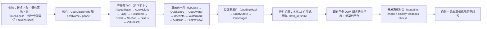

# 02 容器与展示反馈件族样式补齐 详细设计

> 前端组件库 · 11 组件样式补齐 · 子任务 02（需求 11-1）· 第二批（18 件）· 状态：**定稿（36 项决策已确认）**

[文档首页](../../../../../../文档首页.md) › [11 组件样式补齐](../../11_组件样式补齐.md) › [02 容器与展示反馈件族样式补齐](../11_组件样式补齐_02_容器与展示反馈件族样式补齐.md) › 详细设计　|　[任务](../11_组件样式补齐_02_容器与展示反馈件族样式补齐.md)　|　[计划](../../../../计划/01_计划_前端组件库.md)

## 1. 设计目标与范围 <a id="goal"></a>

`frontend/packages/ui-ep/src/components/` 下三族 **18 件**阶段四只交付了结构与交互逻辑，**无 `<style scoped>` 块、模板以裸原生元素承载**（`<button>` / `<ul>` / `<li>`），宿主消费处呈**裸骨架**，与《组件设计》对应节点的可交互原型差距显著：

- **容器族八件**（`container/`）：宽高比 / 自适应高度 / 全屏 / 懒加载 / 滚动 / 分区 / 四态 / 虚拟列表容器——基础结构件，被页面广泛消费；
- **展示族七件**（`display/`）：审计差异 / 文件预览 / 二维码 / 快捷入口 / 用户头像 / 用户信息 / 水印；
- **反馈族三件**（`feedback/`）：空状态 / 错误页 / 加载遮罩（骨架屏为 EP 薄包装，入护栏豁免清单、不补样式）。

本任务按《组件设计》[04 容器组件类](../../../../../../设计/组件设计/04_容器组件类/)（节点 02 ~ 09）与[07 展示类](../../../../../../设计/组件设计/07_展示类/)（节点 05 / 08 / 09 / 11 / 12 / 13 / 14）自带原型，为 18 件**重构模板为组件库件承载 + 逐件补 `<style scoped>`**，使三族可真实呈现。

**范围修正（本任务较任务书扩大，经用户逐项确认）**：实施前逐件比对设计节点契约，发现 **21 处「设计节点有、实现缺」的契约缺口**（§10 决策 11 ~ 36）。经拍板**本批一并补齐**，故本任务不止「补样式」，还含**只增不改的契约补齐**。任务书 §2.4「不改各组件 Props / 事件 / 插槽 / 暴露方法对外形状」按**「不破坏既有形状」**解——允许**新增可选** props / 事件 / 插槽 / 暴露方法（既有消费方零影响），**不删不改**既有项（决策 15）。该澄清须回写任务书 §2.4 与需求 11-1 §2.4。

**边界（不在本任务）**：

- 其余两批（字段与基础控件 17 件 / 专题件族 14 件）归 `11_03` / `11_04`；
- **UserAvatar 脱敏**（设计节点 §3 末条，需接入权限指令能力，属跨能力域扩展）——本批不补，登记遗留（决策 26）；
- 真实后端联调（审计取数 / 预签名 / 链校验接口、扫码登录轮询与换取会话、文件预签名与 Range 分段）归对应后端任务；
- 移动端 `ui-vant` 本阶段范围外；
- 编辑内核主题化（ECharts / CodeMirror 等）归品牌化任务。

## 2. 现状实测 <a id="status"></a>

**全库盘点**（`frontend/packages/ui-ep/src/components/`，2026-10-14 复测）：共 **175 件**，其中**无样式件 59 件**——`11_01` 补齐 17 件后，余 **59 件**待补（与 `11_02` ~ `11_04` 三批 18 + 17 + 14 = 49 件不符，见下「盘点口径偏差」）。

| 族 | 件数 | 无样式件 | 本批范围 |
| --- | --- | --- | --- |
| container | 8 | **8** | 8（全部） |
| display | 9 | **7** | 7（`SsoQrLoginPanel` / `SysInfoPanel` 已有样式） |
| feedback | 4 | **4** | 3（`SkeletonBlock` 为 EP 薄包装、豁免） |
| field | 33 | 15 | —（`11_03`） |
| input | 9 | 9 | —（`11_03`：2 件真裸骨架 + 7 件豁免） |
| chart | 2 | 1 | —（`11_04`） |
| form-design | 4 | 4 | —（`11_04`） |
| form-render | 2 | 2 | —（`11_04`） |
| i18n | 4 | 1 | —（`11_04`） |
| import-export | 5 | 5 | —（`11_04`） |
| modal | 3 | 2 | —（`11_04`） |
| report | 5 | 1 | —（`11_04`） |
| **合计** | **175** | **59** | **18** |

**盘点口径偏差（实测结论，须回写）**：父任务 §1 与需求 §1 的盘点表为「真裸骨架 66 件 + EP 薄包装 10 件 = 76 件无样式」，而 2026-10-14 实测为「无样式 59 件」。差额 **17 件** = `11_01` 已补齐的 17 件交互类（`interaction/` 现有 27 件、**全部已有样式**）。故：**76 = 59（待补）+ 17（已补）**，两份盘点表按「立项时点」口径正确、按「当前时点」口径需注明已补 17 件；本设计按**当前时点**口径记录，并在 §12 登记对齐结论。

| 项 | 实测结论 |
| --- | --- |
| 本批 18 件 | `container/` 8 件 + `display/` 7 件 + `feedback/` 3 件**全部无 `<style scoped>`**，模板根均为自绘 `div` / `section` |
| 裸原生交互元素实测 | `SectionContainer`（1 `<button>` 折叠钮）、`QuickEntry`（1 `<button>` 入口项）、`AuditDiff`（5 `<button>` + 2 `ul/li`）、`FilePreview`（7 `<button>`）、`QrCode`（3 `<button>`）——共 **17 处裸原生交互元素 + 2 处自绘列表** |
| EP 薄包装实测（本批 1 件） | `SkeletonBlock`（根元素即 `el-skeleton`，无自绘 DOM）——与 `11_01` 豁免清单一致，**文档无需修正** |
| 样式口径 | ui-ep 既有带样式件统一为**纯 CSS** `<style scoped>`（**无** `lang="scss"`），色 / 间距 / 圆角 / 字号 / 阴影消费 `var(--bms-*)` |
| 令牌护栏 | `ui-ep/tests/guard-tokens.spec.ts` 扫描 `src/**`（豁免 `src/assets`）：**硬编码色值（`#hex` / `rgb()` / `hsl()`）即失败**；色值无豁免 |
| 令牌源 | `frontend/apps/desktop/src/styles/tokens.scss`（宿主权威源，亮 / 暗两套 + size / density 档位 + `--el-*` 映射）；ui-ep 仅**消费**变量、不持有令牌 |
| 令牌缺口 | ① 审计差异增删行语义底与字色（4 条）；② 二维码过期遮罩底；③ 文件预览遮罩底；④ 加载遮罩底（4 条）——共 **7 条新增**（§11） |
| 令牌漂移（文档已登记、工程侧缺失） | `--bms-scrollbar-size` / `-radius` / `-thumb` / `-thumb-hover` / `-track`（《设计令牌》「滚动条令牌」节）、`--bms-color-text-inverse` / `--bms-illustration-size`（「反白文字与图形尺寸」节）——**7 条全缺**（`tokens.scss` 检索零命中），本批一并落地（决策 4） |
| 契约缺口 | 逐件比对设计节点：**21 处**「节点有、实现缺」（§10 决策 16 ~ 36），本批一并补齐 |
| 既有用例 | `container-basics.spec.ts`（139 行）/ `container-ability.spec.ts`（141）/ `container-status.spec.ts`（120）/ `display-light.spec.ts`（181）/ `display-preview-audit.spec.ts`（113）/ `display-placeholder.spec.ts`（220，含 AuditDiff 断言）/ `feedback.spec.ts`（112）——均为**结构 / 交互断言，不断言样式**；模板重构后需同步更新 DOM 断言 |
| 宿主消费面 | `SectionContainer`（`views/SysUserDetailView.vue`）、`EmptyState`（用户 / 角色 / 占位等 8 处）、`ErrorPage`（403/404/500 + `ModuleBoundary`）——其余 14 件**宿主尚未消费**（无路由页 / 无 store） |
| 核对页现状 | 宿主**无**容器族 / 展示族 / 反馈族核对页（`data-display-check.html` 属 `07_05` 数据呈现，非本批；`error-views` 不存在——任务书 §2.7 措辞与实际不符，须回写） |
| 基线门禁 | `ui-ep` 71 文件 / 996 用例（**995 通过 / 1 按设计红**，红项即全库样式护栏，见 `11_01` 遗留）；`desktop` 覆盖率 100%（行 / 分支 / 函数 / 语句）；`core` 104 文件 / 1317 用例 |

## 3. 交付物清单 <a id="deliver"></a>

```text
frontend/packages/ui-ep/src/components/container/          # 8 件：模板重构 + 契约补齐 + 补 <style scoped>
├── AspectRatioContainer.vue    # 补 fit / maxWidth / minHeight + 占位底与填充模式样式
├── AutoHeightContainer.vue     # 补 maxHeight / scroll / recalcDelay + recalculate 暴露与 recalc 事件
├── FullscreenContainer.vue     # 补 showHint / hint + hint 插槽（首次 Esc 退出提示）+ 全屏背景令牌
├── LazyContainer.vue           # 补 placeholder 插槽（默认内置骨架）+ 占位样式
├── ScrollContainer.vue         # 补 reach-top 事件 + el-scrollbar 外壳与滚动条令牌样式
├── SectionContainer.vue        # 补 description / divider / padding + 折叠钮改 el-button + 深度定制
├── StatusContainer.vue         # 补 variant（mask/skeleton/spin）+ skeleton 插槽 + 四态遮罩样式
└── VirtualListContainer.vue    # 补 itemKey / reachThreshold / reach-bottom / scrollToIndex + 行样式

frontend/packages/ui-ep/src/components/display/            # 7 件：模板重构 + 契约补齐 + 补 <style scoped>
├── AuditDiff.vue               # 补筛选区 + 列表改 el-table + 差异面板改 el-drawer + 增删行语义色
├── FilePreview.vue             # 补 mode / thumbs + PDF 翻页 + 键盘操作 + 遮罩形态样式
├── QrCode.vue                  # 补 scanning/confirmed/failed 三态遮罩 + 暴露取图片数据地址
├── QuickEntry.vue              # 入口项改 el-tooltip + 自绘可点容器；补 loading / routes / visibleEntries
├── UserAvatar.vue              # 尺寸 / 形状 / 状态点 / 角标 / 头像组样式（脱敏登记遗留）
├── UserInfo.vue                # linkTo 生效 + 悬浮卡片完整字段（岗位 / 状态 / 联系方式）
└── WatermarkOverlay.vue        # 补 font 结构化 / width / height + 导出水印图 + 平铺层样式

frontend/packages/ui-ep/src/components/feedback/           # 3 件：模板重构 + 契约补齐 + 补 <style scoped>
├── EmptyState.vue              # 补 action（含权限码）/ size 档位 + 插画 / 文案 / 动作排布
├── ErrorPage.vue               # 补「联系管理员」操作与事件 + 插画 / 标题 / 说明 / 操作栏
└── LoadingMask.vue             # 补 fullscreen 整页遮罩档位 + 遮罩 / 旋转指示样式

frontend/packages/core/src/capabilities/user-display.ts    # 扩展：UserDisplayInfo 增 postName? / phone?（只增可选）
frontend/packages/core/tests/capabilities-batch3.spec.ts   # 更新：两字段存在性与透传断言

frontend/apps/desktop/src/styles/tokens.scss               # 令牌：新增 7 条 + 漂移落地 7 条（亮 / 暗两套）
frontend/apps/desktop/tests/tokens.spec.ts                 # 更新：14 条令牌存在性断言

frontend/packages/ui-ep/tests/interaction-style.spec.ts    # 更新：本批 18 件显式清单 + 「本批齐备」断言（kiwi_id 2296）
frontend/packages/ui-ep/tests/container-basics.spec.ts     # 更新：模板重构后 DOM 断言等价迁移 + 新契约用例
frontend/packages/ui-ep/tests/container-ability.spec.ts    # 更新：同上
frontend/packages/ui-ep/tests/container-status.spec.ts     # 更新：同上
frontend/packages/ui-ep/tests/display-light.spec.ts        # 更新：同上
frontend/packages/ui-ep/tests/display-preview-audit.spec.ts # 更新：同上
frontend/packages/ui-ep/tests/display-placeholder.spec.ts  # 更新：AuditDiff 断言迁移
frontend/packages/ui-ep/tests/feedback.spec.ts             # 更新：同上
frontend/apps/desktop/tests/error-views.spec.ts            # 更新（如需）：ErrorPage 新增操作按钮后断言复核
frontend/apps/desktop/tests/sys-user-detail-view.spec.ts   # 更新（如需）：SectionContainer 模板变更后断言复核

frontend/apps/desktop/src/dev/ContainerCheck.vue           # 新增：开发态核对页（容器族 8 件真实组装 + 亮暗切换）
frontend/apps/desktop/src/dev/containerCheck.ts            # 新增：核对页入口
frontend/apps/desktop/container-check.html                 # 新增：核对页 HTML 入口
frontend/apps/desktop/src/dev/DisplayFeedbackCheck.vue     # 新增：开发态核对页（展示族 7 + 反馈族 3 + 亮暗切换）
frontend/apps/desktop/src/dev/displayFeedbackCheck.ts      # 新增：核对页入口
frontend/apps/desktop/display-feedback-check.html          # 新增：核对页 HTML 入口
.vscode/launch.json                                        # 选页清单登记（工作区根 + bms/ 两处）
```

任务附属三件套：本设计、`实施/01_实施_02_容器与展示反馈件族样式补齐.md`、`测试/01_测试记录_02_容器与展示反馈件族样式补齐.md`。

## 4. 设计要点 <a id="design"></a>

### 4.1 样式落点与口径（强制） <a id="style-base"></a>

- 样式一律入**各件 `<style scoped>`**（纯 CSS，与 ui-ep 既有件同口径），**不落全局文件**。
- 类名 **kebab-case**（BEM 简化），沿用件现有 `bms-<件名>__<元素>` 前缀；模板重构后新增元素按同规则命名。
- 色 / 间距 / 圆角 / 字号 / 阴影一律 `var(--bms-*)`；**色值零硬编码**（`guard-tokens.spec.ts` 强制，色值无豁免）；EP 内部结构经 `--el-*` 覆盖时同样只写令牌。
- 尺寸硬编码白名单（《前端开发规范》「尺寸硬编码白名单」）：① `1px` 描边 / 分隔线；② 媒体查询断点；③ 树形递归缩进；④ JS 运行时计算的内联值（弹层坐标、虚拟列表行偏移等）；⑤ 件内置图形与骨架尺寸。**间距 / 圆角 / 字号 / 结构尺寸一律走令牌**。
- **样式深度（决策 1）**：**自绘外壳件深度定制 + 纯结构包裹件最小必要**——与 `11_01`、阶段七 `06_01` 布局族同口径。

| 分档 | 件 | 深度 |
| --- | --- | --- |
| **纯结构包裹件（最小必要）** | `AspectRatioContainer` / `AutoHeightContainer` / `FullscreenContainer` / `LazyContainer` | 只补**占位底、降级态、内部滚动、全屏背景**等结构必需样式，**不重写**组件库 / 浏览器原生外观 |
| **自绘外壳件（深度定制）** | `ScrollContainer`（EP 外壳对齐）/ `SectionContainer` / `StatusContainer` / `VirtualListContainer` / `AuditDiff` / `FilePreview` / `QrCode` / `QuickEntry` / `UserAvatar` / `UserInfo` / `WatermarkOverlay` / `EmptyState` / `ErrorPage` / `LoadingMask` | 按原型完整还原分区结构、交互形态与列表 / 网格 / 遮罩形态 |

### 4.2 容器族（8 件） <a id="container"></a>

原型：[02 滚动](../../../../../../设计/组件设计/04_容器组件类/02_组件设计_滚动容器/02_原型设计_滚动容器.html) / [03 懒加载](../../../../../../设计/组件设计/04_容器组件类/03_组件设计_懒加载容器/03_原型设计_懒加载容器.html) / [04 全屏](../../../../../../设计/组件设计/04_容器组件类/04_组件设计_全屏容器/04_原型设计_全屏容器.html) / [05 自适应高度](../../../../../../设计/组件设计/04_容器组件类/05_组件设计_自适应高度容器/05_原型设计_自适应高度容器.html) / [06 虚拟列表](../../../../../../设计/组件设计/04_容器组件类/06_组件设计_虚拟列表容器/06_原型设计_虚拟列表容器.html) / [07 加载遮罩](../../../../../../设计/组件设计/04_容器组件类/07_组件设计_加载遮罩容器/07_原型设计_加载遮罩容器.html) / [08 分区](../../../../../../设计/组件设计/04_容器组件类/08_组件设计_分区容器/08_原型设计_分区容器.html) / [09 宽高比](../../../../../../设计/组件设计/04_容器组件类/09_组件设计_宽高比容器/09_原型设计_宽高比容器.html)；对齐《[布局设计 · 设计令牌](../../../../../../设计/布局设计/02_布局设计_设计令牌.html)》。

- **`AspectRatioContainer`（宽高比容器）**：**补 `fit`（`fill`/`contain`/`cover`/`none`，缺省 `cover`）/ `maxWidth` / `minHeight`**（决策 16）。根 `div` 保留 `data-degraded` 降级标记；`__inner` 加 `data-fit` 属性，经 `:deep()` 对内层直接媒体元素施加 `object-fit` 与 `max-width/height`（替换元素才认 `object-fit`，非替换内容按 `display: flex` + 对齐方式近似）；**占位底** `background: var(--bms-color-bg-page)` + `--bms-radius-sm` + `overflow: hidden`（对齐《设计令牌》「媒体与比例」节）。
- **`AutoHeightContainer`（自适应高度容器）**：**补 `maxHeight` / `scroll`（缺省 `true`，内部滚动）/ `recalcDelay`（缺省 100ms）**，并**暴露 `recalculate()` + 派发 `recalc` 事件**（决策 17）。高度仍由 CSS `calc(100% - offset)` 承担（无 JS 计算）；JS 侧经 `observeResize` 观察自身尺寸变化，**去抖 `recalcDelay` 后**派发 `recalc`（供图表重算等消费方接入），并暴露 `recalculate()` 供内容异步变化后手动触发。样式：`overflow: auto | hidden`（随 `scroll`）+ `min-height: 0`。
- **`FullscreenContainer`（全屏容器）**：**补 `showHint`（缺省 `true`）/ `hint`（缺省「按 Esc 退出全屏」）+ `hint` 插槽**（决策 18）。进入全屏后显示提示条，定时 3s 自动隐藏，点击可提前关闭。**全屏背景**消费 `--bms-fullscreen-bg`（《设计令牌》「媒体与比例」节既有覆盖点，本批一并登记落地，决策 4）。样式：`:fullscreen` 时 `background: var(--bms-fullscreen-bg)` + `width/height: 100%` + `overflow: auto`；降级态 `.is-degraded` 固定定位铺满视口 + `--bms-color-bg` 底。
- **`LazyContainer`（懒加载容器）**：**补 `placeholder` 插槽**（决策 19），默认保留内置轻量骨架。样式：`__placeholder` 占位底 `var(--bms-color-fill)` + `--bms-radius-md` + 居中次要色 + 骨架动画；占位高度经 `placeholderHeight` 内联（白名单④）。`--bms-lazy-min-height` 覆盖点登记（《设计令牌》「骨架与占位」节）。
- **`ScrollContainer`（滚动容器）**：**补 `reach-top` 事件**（决策 20）。模板保留 `el-scrollbar`（`native` 时原生滚动）；样式**对齐 `el-scrollbar` 外壳**——容器 `overflow: hidden` + `position: relative` + `height/maxHeight`，`:deep(.el-scrollbar)` 高度 100%，滚动条消费新增落地的 `--bms-scrollbar-size` / `-radius` / `-thumb` / `-thumb-hover` / `-track`（`scrollbar-width: thin` + `scrollbar-color` + `::-webkit-scrollbar-*` + `:deep(.el-scrollbar__thumb)`）；**移动端媒体查询隐藏自绘滚动条**（触屏原生滚动）。
- **`SectionContainer`（分区容器）**：**补 `description` / `divider`（缺省 `true`）/ `padding`（`none`/`small`/`default`/`large`，缺省 `default`）**（决策 11）；折叠钮改 **`el-button` `link`**（`data-test="section-toggle"` 保留，箭头字符沿用）。样式：`section` 无边框无阴影（**轻量分区**，区别于布局组件类「卡片」）+ `bordered` 时才加 `1px` 边框；`__header` flex + `align-items: center` + `gap` + 可折叠时 `cursor: pointer` + `user-select: none`；`__title` 字重 600；`__description` 次要色 + `--bms-font-size-sm`；`__extra` 右对齐 + `margin-left: auto`；`divider` 时 `__header` 下 `1px` 分隔线；`__body` 内边距档位映射 `none → 0` / `small → --bms-space-2` / `default → --bms-space-3` / `large → --bms-space-6`（对齐《设计令牌》「容器内边距与分隔」节）；`__footer` 上分隔线。
- **`StatusContainer`（四态容器）**：**补 `variant`（`mask`/`skeleton`/`spin`，缺省 `mask`）+ `skeleton` 插槽**（决策 11）。四态互斥与延迟显示逻辑不变；样式：`__state` 居中 + 最小高度 `--bms-loading-min-height`（《设计令牌》「容器内边距与分隔」节覆盖点，本批登记）；`variant="mask"` 时 `__state` 绝对定位铺满 + 遮罩底 `var(--bms-color-mask-bg)`；`variant="spin"` 时旋转指示器（CSS `@keyframes` + `--bms-color-primary` 上边 + `--bms-color-border` 环）；`variant="skeleton"` 时经 `skeleton` 插槽渲染（缺省复用 `SkeletonBlock`）；`__actions` 居中 + `gap`。
- **`VirtualListContainer`（虚拟列表容器）**：**补 `itemKey`（缺省 `'id'`）/ `reachThreshold`（缺省 24）+ `reach-bottom` 事件 + `scrollToIndex(index)` 暴露**（决策 21）。样式：`__spacer` `position: relative`；`__item` 行分隔 `1px` + 内边距 + `box-sizing: border-box`；行高经 `itemStyle` 内联（白名单④）。

### 4.3 展示族（7 件） <a id="display"></a>

原型：[09 审计差异](../../../../../../设计/组件设计/07_展示类/09_组件设计_审计差异查看/09_原型设计_审计差异查看.html) / [08 文件预览](../../../../../../设计/组件设计/07_展示类/08_组件设计_文件预览/08_原型设计_文件预览.html) / [13 二维码](../../../../../../设计/组件设计/07_展示类/13_组件设计_二维码/13_原型设计_二维码.html) / [11 快捷入口](../../../../../../设计/组件设计/07_展示类/11_组件设计_快捷入口/11_原型设计_快捷入口.html) / [12 头像与用户信息](../../../../../../设计/组件设计/07_展示类/12_组件设计_头像与用户信息/12_原型设计_头像与用户信息.html) / [14 水印](../../../../../../设计/组件设计/07_展示类/14_组件设计_水印/14_原型设计_水印.html)。

- **`AuditDiff`（审计差异）**：**补筛选区 + 记录列表改 `el-table` + 差异面板改 `el-drawer`**（决策 22 / 35）。筛选区：表名 `el-select`（`filterOptions` 候选）+ 记录 ID `el-input` + 操作人 `el-input` + 时间范围 `el-date-picker`（`daterange`）+ 查询 `el-button` `primary` + 重置 `el-button`；**时间范围为分片键、必填**——缺失时禁用查询并提示（对齐节点 §4「91002」）；新增 `filter-change` 事件与 `tableName` / `recordId` / `operator` / `range` / `filterOptions` props。记录列表改 **`el-table`**（列：表名 / 记录 ID / 变更字段数 / 操作人 / 时间 / 链状态 `el-tag`），`data-test="record-<id>"` 经 `row-class-name` 或单元格 `data-test` 等价迁移；表头 / 边框 / 悬停经 `--el-table-*` 映射令牌（与 `11_01` 同口径）。字段差异移入 **`el-drawer`**（`data-test="diff-drawer"`，宽 `620px`），`diff-panel` 钩子迁入抽屉内；链校验面板（`prev_hash` / `record_hash` 等宽缩写 + 复制 `el-button` + 校验结果 + 篡改定位）保留在抽屉内。样式：`__toolbar` flex 换行 + `gap`；**增删行语义色**——新增行底 `var(--bms-diff-add-bg)` + 字色 `var(--bms-diff-add-color)`、删除行底 `var(--bms-diff-del-bg)` + 字色 `var(--bms-diff-del-color)`（新增 4 条令牌，§11）；`__old` / `__new` 等宽 + 自动换行；`__chain` 等宽 `--bms-font-family-mono`；空态居中次要色。
- **`FilePreview`（文件预览）**：**补 `mode`（`overlay`/`drawer`/`inline`，缺省 `overlay`）/ `thumbs`（缺省 `true`）+ PDF 翻页 + 键盘操作**（决策 23）。工具栏按钮全部改 **`el-button`**（`link` / 默认，`data-test` 全保留）；多图时显示**缩略图条**（`data-test="thumbs"`，当前项主色边框）；**PDF 翻页**：上一页 / 下一页 `el-button` + 页码显示（`data-test="pdf-prev"` / `pdf-next"` / `pdf-page`），经 iframe `#page=N` 片段驱动（Chrome / Edge 支持；节点明确「缺省用浏览器内置阅读器」）；**键盘**：`←` / `→` 切换文件、`Esc` 关闭（经 `onGlobalKeydown`，仅 `visible` 时生效）。样式：`mode="overlay"` 时 `position: fixed` + `inset: 0` + `background: var(--bms-file-preview-mask-bg)` + `z-index`；`mode="drawer"` 时右侧固定面板；`mode="inline"` 时相对定位卡片；`__stage` 居中 + 溢出隐藏；图片过渡动画；`__toolbar` flex + 间距 + 分隔线；文本区等宽 + 深色底 + 横向滚动；错误态居中。
- **`QrCode`（二维码）**：**补其余三态遮罩 + 暴露 `imageData()`**（决策 24 / 34）。`scanning`（「已扫码，请在移动端确认」）/ `confirmed`（成功态）/ `failed`（失败 + 重试）三态遮罩与既有 `expired` 同口径，插槽 `scanning` / `confirmed` / `failed` 可选覆盖；暴露 `imageData()` 返回当前图片数据地址（对齐节点「对外语义」）。样式：`__canvas` `1px` 边框 + `--bms-radius-lg` + `--bms-color-bg` 底 + 内边距；`__logo` 居中叠加 + `--bms-color-bg` 底 + 内边距；`__mask` 绝对定位铺满 + `background: var(--bms-qr-mask-bg)` + 居中；`__actions` flex 居中 + `gap`；空态 / 生成中 / 失败居中次要色。
- **`QuickEntry`（快捷入口）**：入口项改 **`el-tooltip` + 自绘可点容器**（决策 12，与原型一致——原型即 `div.qitem` + `el-tooltip`；用 `el-button` 会带入 EP 内边距与按钮悬停底、破坏宫格卡片形态；库内自绘有《前端开发规范》豁免，不违规）。自绘容器加 `role="button"` + `tabindex="0"` + `Enter` / `Space` 键盘触发。**补 `loading`（加载态骨架）+ `routes`（已注册路由清单）+ 暴露 `visibleEntries`**（决策 25）：`loading` 为真时渲染 `SkeletonBlock` 骨架；`routes` 非空且入口 `route` 不在清单内时**不跳转并告警**（节点 §4「路由未注册不渲染并告警」——为避免与「不渲染」冲突，实现为**保留入口但拦截跳转 + 控制台告警**，差异登记 §5）；`visibleEntries` 为既有 `computed` 直接暴露。样式：`__grid` CSS Grid + `gap` + 列数经 `data-columns` 联动；`__item` 图标上名称下的等高宫格 + 悬停底 `--bms-color-fill` + 过渡；`__icon` 方形底 `--bms-color-primary-light` + `--bms-radius-md` + 主色 + 居中；`__label` 次要字号 + 居中 + 省略；`__badge` 绝对定位右上 + `--bms-notice-badge-bg` + 反白字色 `--bms-color-text-inverse`（新增落地令牌）；`__group-title` 跨列 + 次要色；`__remove` 编辑态删除角标；空态居中次要色。
- **`UserAvatar`（用户头像）**：**不补脱敏**（决策 26，登记遗留）。样式：尺寸档位 `xs 20` / `sm 28` / `md 32` / `lg 40`（对齐节点 §3 与《设计令牌》「图标与图片」节；件内置图形尺寸走白名单⑤）；`__image` `object-fit: cover` + `width/height: 100%`；`__initial` / `__member` 底色经内联 `--bms-avatar-color`（`hsl(${hash} 65% 45%)` 动态计算值，`guard-tokens` 白名单 `hsl(${`）+ 反白字色；形状 `circle` / `square`；`__status` 右下角状态点 + `1px` 白边 + 三态语义色（`active` → success / `disabled` → info / `locked` → warning）；`__badge` 右上角标；`__member` 叠加负外边距 + 白边；`__overflow` 次要底 + `+N`。
- **`UserInfo`（用户信息）**：**linkTo 生效 + 悬浮卡片完整字段**（决策 27 / 32）。点击时除既有 `open` 外，`linkTo` 非空则派发 **`navigate: [linkTo]`**（库内不依赖路由，由宿主接线）；悬浮卡片补 **岗位 / 状态 / 联系方式**（状态经 `el-tag` 语义色、联系方式受脱敏由调用方保证）。数据来源：`@bms/core` 的 `UserDisplayInfo` **只增可选字段 `postName?` / `phone?`**（决策 32，向后兼容、既有消费方零影响）。样式：`__body` 行内 flex + 列向（名称主字色 / 部门次要色 + `--bms-font-size-xs`）；`__popover` 绝对定位 + `--bms-color-bg` 底 + `1px` 边框 + `--bms-radius-md` + `--bms-shadow-sm` + 内边距 + `z-index`；空用户 / 已删除用户次要色；`data-size` 档位联动字号。
- **`WatermarkOverlay`（水印）**：**保留自研平铺层**（决策 14——自研层已有防篡改 DOM 监听自动恢复 + 时间戳分钟级刷新 + 动态重绘，`el-watermark` 无这些能力，替换会丢设计节点要求的行为）。**补 `font`（`{ fontSize?, fontWeight?, fontFamily? }`）/ `width` / `height` + 暴露 `exportImage()`**（决策 28）：`font` 与单个水印尺寸作用于既有平铺 SVG 生成；`exportImage()` 返回平铺水印图数据地址。样式：`__layer` 不可选中（`user-select: none`）+ `pointer-events: none`（已在 style 内联，改为样式块统一）+ 层级；容器 `position: relative`（局部）/ 全屏经内联 `position: fixed`。

### 4.4 反馈族（3 件） <a id="feedback"></a>

原型：[05 异常与空状态](../../../../../../设计/组件设计/07_展示类/05_组件设计_异常与空状态/05_原型设计_异常与空状态.html)；对齐《[布局设计 · 异常与空状态](../../../../../../设计/布局设计/12_布局设计_异常与空状态.html)》。

- **`EmptyState`（空状态）**：**补 `action`（`{ text, perm? }`）+ `size`（`default`/`compact`）+ `action` 事件**（决策 29）。`action.perm` 经既有 `useBaseAccess` 能力判定（无权限不渲染按钮，对齐节点 §4「引导按钮权限码」）；`action` 插槽优先级高于内置按钮。样式：容器居中 + 列向 + `gap`；`__image` 尺寸 `var(--bms-illustration-size)`（新增落地令牌，决策 4）；`__title` 字重 600；`__description` 次要色 + `--bms-font-size-sm`；`__actions` 居中；`size="compact"` 时插画缩小 + 间距收紧（表格内 / 卡片内）。
- **`ErrorPage`（错误页）**：**补「联系管理员」操作与 `contact` 事件**（决策 30，对齐节点 §3 表格 403 缺省操作「返回首页 / 联系管理员」）。按钮全部为 `el-button`（既有），`data-test` 保留；新增 `data-test="error-contact"`。样式：容器居中 + 列向 + `gap` + 内边距；`__image` 尺寸 `var(--bms-illustration-size)`；`__code` 大字重 + 主色；`__title` 字重 600；`__description` 次要色；`__actions` flex 居中 + 换行 + `gap`；**不展示技术堆栈**（安全规范）。
- **`LoadingMask`（加载遮罩）**：**补 `fullscreen`（整页遮罩）档位**（决策 31）。`fullscreen` 为真时遮罩 `position: fixed` + 铺满视口（`z-index` 提升），否则仅覆盖包裹内容区（既有语义）。样式：`__overlay` 绝对 / 固定定位 + `display: flex` 居中 + `background: var(--bms-color-mask-bg)`（新增落地令牌）+ `--bms-radius-md`；`__spinner` 旋转指示器（CSS `@keyframes` + `--bms-color-primary` / `--bms-color-border`）；`__text` 次要色 + `--bms-font-size-sm`。

### 4.5 主题与响应式（强制） <a id="theme"></a>

- **主题**：颜色全部走 `--bms-color-*` / `--bms-color-fill` / `--bms-color-bg-page` / 域语义令牌 + `--el-*` 映射 → 亮 / 暗主题经 `[data-theme='dark']` 令牌自动切换，三族**不写 dark 专用规则**。
- **响应式**：容器族按容器宽度自适应（`AspectRatioContainer` 宽度随容器 + `maxWidth` 限制；`AutoHeightContainer` 高度随父容器）；展示族宫格件（`QuickEntry`）列数经 `columns` / `auto`（`< 320px` 降 3 列）；`FilePreview` 窄屏（`max-width: 768px`）遮罩形态工具栏换行、抽屉形态占满宽度（对齐《原型审查规范》§4.4）；`AuditDiff` 抽屉窄屏占满宽度；**不承担页面级折叠 / 抽屉职责**。

## 5. 原型依据与对照口径 <a id="prototype"></a>

**原型依据（界面类任务强制登记）**：

| 族 | 组件设计节点（含自带可交互原型） |
| --- | --- |
| 容器族 | [02 滚动容器](../../../../../../设计/组件设计/04_容器组件类/02_组件设计_滚动容器/02_组件设计_滚动容器.md)、[03 懒加载容器](../../../../../../设计/组件设计/04_容器组件类/03_组件设计_懒加载容器/03_组件设计_懒加载容器.md)、[04 全屏容器](../../../../../../设计/组件设计/04_容器组件类/04_组件设计_全屏容器/04_组件设计_全屏容器.md)、[05 自适应高度容器](../../../../../../设计/组件设计/04_容器组件类/05_组件设计_自适应高度容器/05_组件设计_自适应高度容器.md)、[06 虚拟列表容器](../../../../../../设计/组件设计/04_容器组件类/06_组件设计_虚拟列表容器/06_组件设计_虚拟列表容器.md)、[07 加载遮罩容器](../../../../../../设计/组件设计/04_容器组件类/07_组件设计_加载遮罩容器/07_组件设计_加载遮罩容器.md)、[08 分区容器](../../../../../../设计/组件设计/04_容器组件类/08_组件设计_分区容器/08_组件设计_分区容器.md)、[09 宽高比容器](../../../../../../设计/组件设计/04_容器组件类/09_组件设计_宽高比容器/09_组件设计_宽高比容器.md) |
| 展示族 | [05 异常与空状态](../../../../../../设计/组件设计/07_展示类/05_组件设计_异常与空状态/05_组件设计_异常与空状态.md)、[08 文件预览](../../../../../../设计/组件设计/07_展示类/08_组件设计_文件预览/08_组件设计_文件预览.md)、[09 审计差异查看](../../../../../../设计/组件设计/07_展示类/09_组件设计_审计差异查看/09_组件设计_审计差异查看.md)、[11 快捷入口](../../../../../../设计/组件设计/07_展示类/11_组件设计_快捷入口/11_组件设计_快捷入口.md)、[12 头像与用户信息](../../../../../../设计/组件设计/07_展示类/12_组件设计_头像与用户信息/12_组件设计_头像与用户信息.md)、[13 二维码](../../../../../../设计/组件设计/07_展示类/13_组件设计_二维码/13_组件设计_二维码.md)、[14 水印](../../../../../../设计/组件设计/07_展示类/14_组件设计_水印/14_组件设计_水印.md) |
| 反馈族 | [05 异常与空状态](../../../../../../设计/组件设计/07_展示类/05_组件设计_异常与空状态/05_组件设计_异常与空状态.md)（错误页 / 空状态 / 骨架屏 / 内容遮罩） |
| 布局依据 | [《布局设计 · 设计令牌》](../../../../../../设计/布局设计/02_布局设计_设计令牌.html)、[《布局设计 · 异常与空状态》](../../../../../../设计/布局设计/12_布局设计_异常与空状态.html) |

**对照口径（按《原型审查规范》§4.9）**：交付前以**无头真机截图 + 识图**逐项对照，基准为**组件设计节点自带原型 + 布局设计**，对照结论登记测试记录：

- 逐项核对：原型依据已登记 / 无裸骨架 / 结构对齐（分区头与折叠、滚动区、四态遮罩、虚拟列表行、审计列表与差异抽屉、预览遮罩与缩略图、二维码画布与遮罩、宫格与悬停、头像形态与溢出、水印层）/ 交互态样式齐备（激活 / 悬停 / 只读 / 过期 / 非法 / 加载）/ 主题与响应式（暗色经令牌、窄容器自适应）/ 去实现命名（界面可见文本无 `AspectRatioContainer` 等类名 / 文件路径）。
- **对照载体（决策 5）**：新增 `container-check.html`（容器族 8 件）+ `display-feedback-check.html`（展示族 7 件 + 反馈族 3 件）——两页并行覆盖三族，真实组装件 + 亮暗切换。
- **差异说明（决策 9）**：原型为「Element Plus 默认外观 + 内联色值」的形态示意（如原型内联 `#e6a23c` / `rgba(0,0,0,.82)`），**实现侧不逐像素照抄**——色 / 圆角 / 间距一律取设计令牌，**只对齐分区结构、交互形态与列表 / 网格 / 遮罩形态**；令牌取色与原型内联色的差异**不算偏离**。
- **登记差异项**（实施期须逐条登记测试记录）：① `QuickEntry` 路由未注册处理为「保留入口 + 拦截跳转 + 告警」（节点为「不渲染并告警」，差异理由：节点同句要求「未注册路由不渲染并告警（防白屏）」，实现取「不白屏 + 不静默跳转」的折中，保留入口便于用户看到配置问题）；② `WatermarkOverlay` 保留自研平铺层而非 `el-watermark`（决策 14，防篡改与定时刷新能力差异）；③ `FilePreview` PDF 翻页经 iframe `#page=` 片段（浏览器内置阅读器能力受限，节点已允许「视浏览器能力，必要时自绘」）。

## 6. 测试设计 <a id="test"></a>

### 6.1 用例清单 <a id="cases"></a>

| 用例 | 覆盖点 | 落点 | 编号 |
| --- | --- | --- | --- |
| 全库件族样式齐备护栏 | 全库**真裸骨架件**均含非空 `<style scoped>`（**硬断言、不留豁免**）；**本批 18 件显式清单 + 「本批齐备」断言**（决策 6）；EP 薄包装 11 件以显式清单豁免（附理由） | `ui-ep/tests/interaction-style.spec.ts`（更新） | **2296** |
| 令牌消费护栏 | 本批 18 件样式块无硬编码色值（复用既有扫描口径 + fixture 拦截 + 正向） | 同上 | 同上 |
| 豁免清单一致性 | 豁免清单 = 实测 11 件 EP 薄包装（`11_01` 十件 + 本批 `SkeletonBlock`）；清单漂移即失败 | 同上 | 同上 |
| 容器族契约与结构 | 8 件：宽高比填充模式 / 自适应高度重算与内部滚动 / 全屏提示与背景 / 懒加载占位插槽 / 滚动触顶 / 分区描述与内边距档位与折叠 / 四态加载形态 / 虚拟列表键与触底与滚动到索引 | `ui-ep/tests/container-basics.spec.ts`、`container-ability.spec.ts`、`container-status.spec.ts`（更新） | 既有 761 / 762 / 764 |
| 展示族契约与结构 | 7 件：审计筛选与表格与抽屉与增删色 / 预览形态与缩略图与 PDF 翻页与键盘 / 二维码五态与取图地址 / 入口骨架与可见入口与路由拦截 / 头像尺寸与状态点与角标与头像组 / 用户胶囊跳转与悬浮卡片字段 / 水印字体与尺寸与导出 | `ui-ep/tests/display-light.spec.ts`、`display-preview-audit.spec.ts`、`display-placeholder.spec.ts`（更新） | 既有 972 / 973 / 971 |
| 反馈族契约与结构 | 3 件：空态引导按钮权限码与尺寸档位 / 错误页联系管理员 / 遮罩整页档位与延迟防闪 | `ui-ep/tests/feedback.spec.ts`（更新） | 既有 760 |
| 核心用户展示字段 | `UserDisplayInfo` 增 `postName?` / `phone?` 的透传与花名册合并 | `core/tests/capabilities-batch3.spec.ts`（更新） | 既有 |
| 令牌存在性 | 14 条令牌（新增 7 + 漂移落地 7，亮 / 暗两套）+ 域语义断言 | `apps/desktop/tests/tokens.spec.ts`（更新） | 既有 |
| 宿主消费面复核 | `ErrorPage` 新增操作后 403/404/500 断言复核；`SectionContainer` 模板变更后 `sys-user-detail-view` 断言复核 | `apps/desktop/tests/error-views.spec.ts`、`sys-user-detail-view.spec.ts`（更新） | 既有 |
| 原型对照 | §5 逐项核对结论 + 无头截图 | 测试记录 | — |

**覆盖率口径**：见《[AI开发规范](../../../../../../规范/AI开发规范.md)》「覆盖率要求」节（行 + 分支 = 100%，本地不打折）。本任务含**组件 TS 逻辑变更**（21 处契约补齐新增分支），故**不适用** `11_01` 的「纯样式无缺口」口径——`ui-ep` 与 `desktop` 覆盖率须实测达标；`tokens.scss` 由宿主令牌用例断言（存在性）。

> **desktop 覆盖率实测（实施期更正）**：本设计初稿判断「`desktop` 覆盖率可能统计到 ui-ep 源码、需在宿主 spec 补断言」。实施期实测更正：`desktop` 覆盖率报告**只统计 `apps/desktop/src`**，ui-ep 源码**未被计入**（`coverage-summary.json` 中 ui-ep 条目数为 0），故本批不会拉低宿主覆盖率。为避免新契约分支无覆盖，新契约用例统一落在 **ui-ep 自身**的 `container-*` / `display-*` / `feedback.spec.ts`；`desktop` 侧仅在模板变更影响既有断言时复核（实测 `error-views.spec.ts` / `sys-user-detail-view.spec.ts` **无需改动**）。**口径不变：不达标不得推送。**

**门禁（须全绿；全库样式护栏的全库断言按既有口径持续红——见 §9）**：

```bash
# 工作区根为 bms/
pnpm --filter @bms/ui-ep run lint && pnpm --filter @bms/ui-ep run typecheck
pnpm --filter @bms/ui-ep run test          # 除全库样式断言外全绿（该断言按设计红，见 §9）
pnpm --filter @bms/desktop run test:cov    # 覆盖率 100%
pnpm --filter @bms/desktop run lint && pnpm --filter @bms/desktop exec vue-tsc -b
pnpm run core:test && pnpm run core:typecheck && pnpm run core:lint && pnpm run api-types:gen:check
python3 scripts/tools/check-docs/check-status.py --stage 04_前端组件库 --strict
python3 scripts/tools/base-check/check-links.py && python3 scripts/tools/base-check/check-docs-scope.py
python3 scripts/tools/base-check/check-prototype-review.py . --task "bms文档/项目/04_前端组件库/任务/11_组件样式补齐/11_组件样式补齐_02_容器与展示反馈件族样式补齐"
python3 scripts/tools/preflight/check-preflight.py --fast
```

### 6.2 既有用例的 DOM 断言迁移 <a id="migrate"></a>

**决策 8（`data-test` 允许按新结构重命名，用例全面改写）**——迁移原则：

1. **对外契约面（`data-test` 顶层钩子）优先保留**：`section-toggle` / `section-container__header` / `status-loading` / `status-empty` / `status-error` / `status-retry` / `qr-*` / `entry-*` / `user-*` / `avatar-*` / `watermark-layer` / `empty-title` / `error-*` / `loading-mask` / `preview-*` / `diff-*` / `record-*` / `chain-panel` / `placeholder` 等**尽量保留原名**（下游宿主用例与核对页依赖）。
2. **仅当 EP 件替换导致查询方式变化时改断言**：
   - 裸 `<button>` → `el-button` 后，`trigger('click')` 改经 `findComponent(ElButton).vm.$emit('click')` 或对渲染出的原生 `button` 触发（EP 按钮根即 `button`，多数情况 `.trigger('click')` 仍可用，实施期逐条实测）；
   - 自绘 `ul/li` → `el-table` 后，行查询改 `await flushPromises()` 后按 `el-table` 表体行读取（与 `11_01` 的 `FieldPermissionPanel` 迁移同口径）；
   - 行内差异 → `el-drawer` 后，抽屉内容默认 `append-to-body`，改查 `document.querySelector`（与 `11_01` 的 `RoleAssignPanel` 迁移同口径）。
3. **受影响断言逐条登记**：实施记录 §问题与处置列「原断言 → 新断言」对照；测试记录 §问题与处置列同步。
4. **禁止**为迁就旧断言保留裸原生元素（与原型 / 规范冲突）。

## 7. 登记落点 <a id="register"></a>

| 落点 | 内容 |
| --- | --- |
| 设计令牌 | 新增 7 条 + 漂移落地 7 条（「令牌落地」节 + 域语义节，§11） |
| `tokens.scss` | 14 条令牌（亮 / 暗两套，漂移项按《设计令牌》既有取值落地） |
| 宿主 `tokens.spec.ts` | 14 条新令牌存在性断言 |
| `ui-ep/tests/interaction-style.spec.ts` | 本批 18 件显式清单 + 「本批齐备」断言（Kiwi 编号 2296 回填头部标注） |
| `@bms/core` | `UserDisplayInfo` 增 `postName?` / `phone?`（只增可选，向后兼容）；`capabilities-batch3.spec.ts` 补断言 |
| 组件设计节点 | 九节点（容器 02 ~ 09 / 展示 05·08·09·11·12·13·14）**核对是否需回写**——本批只补样式与契约缺口，不改语义；如实施中发现结构语义偏差，回写对应节点「职责与组成」/「交互与契约语义」行 |
| 任务文档 / 需求 | 任务 §2.4 与需求 §2.4「不改对外形状」**回写澄清为「不破坏既有形状、允许只增不改」**（决策 15）；任务 §2.7 核对页措辞回写为实际载体（`container-check` / `display-feedback-check`）；任务 §1 依赖补「02_02 组件根令牌属性协议 / 02_06 设计令牌」；**本批范围较任务书扩大（含 21 处契约补齐）登记为偏差** |
| 父任务 / 需求盘点表 | 盘点口径偏差（76 = 59 待补 + 17 已补）在父任务 §1 与需求 §1 补注「截至 2026-10-14，`11_01` 已补 17 件」 |
| 计划 | 进度仅在计划表（本任务结束时按一条龙回写） |

## 8. 实施步骤 <a id="steps"></a>



1. 补 14 条令牌（§11）+ 《设计令牌》登记 + `tokens.spec.ts` 断言。
2. 扩展核心 `UserDisplayInfo`（`postName?` / `phone?`）+ 核心用例断言。
3. 实施容器族 8 件（模板重构 + 契约补齐 + `<style scoped>`；按上序自下而上）。
4. 实施展示族 7 件（同口径）。
5. 实施反馈族 3 件（同口径）。
6. 扩展 `interaction-style.spec.ts` 护栏（本批 18 件显式清单 + 「本批齐备」断言；全库硬断言口径不变）。
7. 更新既有用例（§6.2 迁移原则）+ 补新契约用例。
8. 新增开发态核对页两页（`container-check` / `display-feedback-check`）+ `.vscode/launch.json` 选页清单两处。
9. 跑门禁（§6.1）并留痕；按 §5 无头真机截图（亮 / 暗）对照原型，结论入测试记录。
10. 回写：设计令牌文档、任务 §2.4 / §2.7、父任务 / 需求盘点口径、计划（进度与遗留）；落实施 / 测试记录。

## 9. 边界与开放项 <a id="open"></a>

- **口径冲突（`11_01` 决策 7 沿用）**：任务 §3 完成标准要求「`ui-ep` 与宿主 `vue-tsc` / ESLint / Vitest **全通过**」，而需求 §2.5 与父任务 §3 又明确「护栏落地后**门禁持续红**，直至全库真裸骨架件补齐」——全库硬断言下本批交付后仍有 **31 件**未补（59 − 18 − 10 豁免），护栏断言必红。**处置：保持全库硬断言（用户口径），接受门禁红**；本批验收以「定向用例 + 覆盖率 + 原型对照」为准。
- **范围扩大（本批新增）**：任务书名义范围「只改模板结构与样式」，实施前逐件比对设计节点发现 **21 处契约缺口**，经用户逐项确认**本批一并补齐**（只增不改）。任务书 §2.4 口径澄清与范围偏差须回写；投入口径与进度一律只在计划表回写，本文档不承载。
- **实施期发现并修复的两处既有缺陷（非本批引入，经用户拍板一并修正；详见实施记录 §5）**：① **域 11 任务文档编号口径错**——域 11 四个任务文档「编号」写作 `11-1`~`11-4`（其它域为两位序号 `01`~`04`），`check-status.py` 把 `\d{2}-\d+` 判为嵌套子任务 → 12 项硬规则违规（H5 ×8 / H6 ×4）；已按其它域口径改为 `01`~`04`（需求编号 `11-1` 保持不变）。② **任务域号冲突**——`任务/` 下 `11_前端合规修复`（早先首审修复任务，无「子任务清单」节）与 `11_组件样式补齐` 同用域号 `11`，`check-status` 按 `域_序号` 全局登记致序列号碰撞 → 4 项 H5 违规；已把合规修复任务域号改为 `12`（目录 / 文件 / 计划表 / README / 17 处引用同步）。修复后 `check-status --strict` **零违规**。两处均为**全库唯一样本**（已全库扫描确认）。
- **`UserAvatar` 脱敏未覆盖**：设计节点 §3 末条要求「姓名受字段脱敏 / 明文动作权限约束时按权限指令口径掩码」，需在本件接入权限指令能力（跨能力域扩展），本批**不补**，登记遗留（决策 26）。
- **不在本任务**：其余两批（`11_03` / `11_04`）；真实后端联调（审计取数 / 链校验、文件预签名与 Range 分段、扫码登录轮询与换取会话）；移动端 `ui-vant`；编辑内核主题化。
- **遗留**：① 全库件族样式护栏在 `11_03` / `11_04` 补齐前持续红（按用户口径期间不推送）；② `UserAvatar` 脱敏（归权限指令能力接入任务）；③ `QuickEntry` 路由未注册「不渲染」语义（本批为拦截 + 告警，归宿主路由能力接入时评估）；④ `FilePreview` 自绘 PDF 渲染统一体验（节点已登记为可选评估项）；⑤ 移动端三族同契约实现。
- **Kiwi 用例编号 2296**（2026-10-14 登记，回读一致）；已回填用例文件头部 `// kiwi_id: 2296` 与实施 / 测试记录。

## 10. 决策确认（36 项，2026-10-14 定稿） <a id="decide"></a>

| # | 事项 | 结论 |
| --- | --- | --- |
| 1 | 样式深度 | **分层：自绘外壳件深度定制 + 纯结构包裹件最小必要**（与 `11_01`、阶段七 `06_01` 同口径，§4.1 分档表） |
| 2 | 模板承载 | **裸原生交互元素改用组件库件（`el-button` 等）**，`data-test` 与用例断言等价迁移 |
| 3 | 令牌缺口 | **新增 7 条语义令牌**（审计差异 4 + 二维码过期遮罩 1 + 文件预览遮罩 1 + 加载遮罩 1，§11） |
| 4 | 既有令牌漂移 | **一并补落地 7 条**（`--bms-scrollbar-*` 5 条 + `--bms-color-text-inverse` + `--bms-illustration-size`）到 `tokens.scss` + `tokens.spec.ts` 断言 |
| 5 | 原型对照载体 | **新增 `container-check.html`（容器族）+ `display-feedback-check.html`（展示族 + 反馈族）**；任务 §2.7 措辞回写为实际载体 |
| 6 | 护栏扩展 | **`interaction-style.spec.ts` 增本批 18 件显式清单与「本批齐备」断言**；全库硬断言口径不变 |
| 7 | Kiwi 用例登记 | **已登记：编号 2296**（分类「平台骨架」/ 优先级 `P2` / 状态 `CONFIRMED` / 标签「自动化」，2026-10-14 经容器内 Django shell 登记并回读一致）；用例文件头部标注 `// kiwi_id: 2296` |
| 8 | 契约与用例口径 | **`data-test` 允许按新结构重命名，用例全面改写**；对外契约**不破坏既有形状**、允许只增不改（§6.2） |
| 9 | 原型差异口径 | **只对齐分区结构、交互形态与列表 / 网格 / 遮罩形态**；色 / 圆角 / 间距一律取令牌，令牌取色与原型内联色差异不算偏离 |
| 10 | 既有缺陷处置 | **先登记、逐项确认后本批一并修正**（沿用 `11_01` 处置方式） |
| 11 | 契约缺口（总） | **本批一并补齐**（逐件比对设计节点，共 21 处） |
| 12 | `QuickEntry` 入口项承载 | **按原型：`el-tooltip` + 自绘可点容器**（`el-button` 会带入 EP 内边距与按钮悬停底、破坏宫格卡片形态；库内自绘有规范豁免） |
| 13 | `AuditDiff` 列表承载 | **引入 `el-table`** 承载变更记录列表（与原型一致；表头 / 边框 / 悬停经 `--el-table-*` 映射令牌） |
| 14 | `WatermarkOverlay` 承载 | **保留自研平铺层**（已有防篡改 DOM 监听自动恢复 + 时间戳分钟级刷新 + 动态重绘，`el-watermark` 无这些能力）；只补样式并登记差异说明 |
| 15 | 「不改对外形状」口径冲突 | **按「不破坏既有形状」解，允许只增不改**（新增可选 props / 事件 / 插槽 / 暴露方法；不删不改既有项）；任务 / 需求文档回写该澄清 |
| 16 | `AspectRatioContainer` | **补齐** `fit`（`fill`/`contain`/`cover`/`none`）+ `maxWidth` + `minHeight` + 占位底 |
| 17 | `AutoHeightContainer` | **三项全补**：`maxHeight` + `scroll`（内部滚动）+ `recalcDelay`（重算节流，经 `observeResize` 去抖派发 `recalc` + 暴露 `recalculate()`） |
| 18 | `FullscreenContainer` | **补首次提示**（`showHint` / `hint` / `hint` 插槽）+ **全屏背景令牌** `--bms-fullscreen-bg` 落地 |
| 19 | `LazyContainer` | **补 `placeholder` 插槽**（默认保留内置骨架） |
| 20 | `ScrollContainer` | **补触顶通知**（`reach-top` 事件） |
| 21 | `VirtualListContainer` | **三项全补**：`itemKey`（项唯一键）+ `reachThreshold` / `reach-bottom`（触底）+ `scrollToIndex()`（滚动到索引） |
| 22 | `AuditDiff` 范围 | **连筛选区与详情抽屉一并补齐**（筛选区含时间范围必填分片键校验；差异面板改 `el-drawer`） |
| 23 | `FilePreview` 范围 | **形态（`overlay`/`drawer`/`inline`）+ 缩略图条 + PDF 翻页 + 键盘（←/→ / Esc）一并补齐** |
| 24 | `QrCode` 暴露方法 | **补对外暴露取图片数据地址**（`imageData()`） |
| 25 | `QuickEntry` 范围 | **三项全补**：加载态骨架（`loading`）+ 可见入口读取（暴露 `visibleEntries`）+ 路由未注册拦截告警（`routes`，实现为保留入口 + 拦截跳转 + 告警） |
| 26 | `UserAvatar` 脱敏 | **本批不补，登记遗留**（需接入权限指令能力，属跨能力域扩展） |
| 27 | `UserInfo` 范围 | **`linkTo` 生效（派发 `navigate`）+ 悬浮卡片完整字段（岗位 / 状态 / 联系方式）一并补** |
| 28 | `WatermarkOverlay` 范围 | **三项全补**：`font` 结构化 + 单个水印尺寸（`width` / `height`）+ 导出水印图（暴露 `exportImage()`） |
| 29 | `EmptyState` | **补引导按钮（含权限码 `action.perm`，经 `useBaseAccess` 判定）+ 尺寸档位（`size`）** |
| 30 | `ErrorPage` | **补「联系管理员」操作与 `contact` 事件**（对齐节点 §3 表格 403 缺省操作） |
| 31 | `LoadingMask` | **补整页遮罩档位**（`fullscreen`） |
| 32 | `UserInfo` 悬浮卡片数据 | **扩展核心 `UserDisplayInfo`**（只增可选 `postName?` / `phone?`，向后兼容） |
| 33 | 遮罩令牌 | **分两条**（更正过程见 §12-6）：加载遮罩底 + 文件预览遮罩底——两者原型取值不同（浅色洗白 vs 深色背衬），单一通用令牌无法兼顾 |
| 34 | `QrCode` 状态机 | **补齐其余三态遮罩**（`scanning` / `confirmed` / `failed`） |
| 35 | `AuditDiff` 差异面板 | **改入 `el-drawer`**（与原型一致：原型为 `el-drawer` 承载详情差异 + 链字段） |
| 36 | 决策过程更正 | 第 3 项原表述「二维码过期遮罩底 + 文件预览遮罩底」经第 33 项更正为「加载遮罩底 + 文件预览遮罩底」，`--bms-qr-mask-bg` 保留、新增 `--bms-color-mask-bg` |

## 11. 新增与漂移落地令牌清单 <a id="tokens"></a>

```scss
/* frontend/apps/desktop/src/styles/tokens.scss（:root，亮色）——本批新增（2026-10-14 登记，前端组件库 11_02） */
--bms-diff-add-bg: #f0fff4;            /* 审计差异「新增 / 修改」行底（success 浅底） */
--bms-diff-del-bg: #fff5f5;            /* 审计差异「删除」行底（danger 浅底） */
--bms-diff-add-color: #1a7f37;         /* 审计差异新增值字色 */
--bms-diff-del-color: #cf222e;         /* 审计差异旧值 / 删除值字色 */
--bms-qr-mask-bg: rgba(255, 255, 255, 0.9);   /* 二维码过期 / 已扫 / 失败遮罩底 */
--bms-file-preview-mask-bg: rgba(0, 0, 0, 0.82); /* 文件预览遮罩形态背衬底 */
--bms-color-mask-bg: rgba(255, 255, 255, 0.8);   /* 通用内容遮罩底（四态容器 / 加载遮罩） */

/* 漂移落地（《设计令牌》已登记、工程侧缺失；按文档既有取值落地） */
--bms-scrollbar-size: 8px;                              /* 滚动条宽度 */
--bms-scrollbar-radius: var(--bms-radius-sm);            /* 滚动条圆角 */
--bms-scrollbar-thumb: var(--bms-color-border);          /* 滑块底 */
--bms-scrollbar-thumb-hover: var(--bms-color-text-secondary); /* 滑块悬停底 */
--bms-scrollbar-track: transparent;                      /* 轨道底 */
--bms-color-text-inverse: #ffffff;                       /* 深色底反白文字（角标 / 激活标签） */
--bms-illustration-size: 96px;                           /* 空态 / 错误页插画尺寸 */
--bms-fullscreen-bg: var(--bms-color-bg);                /* 全屏容器背景（覆盖点，本批登记） */

/* [data-theme='dark']（新增项暗色取值；漂移项按文档口径沿用基础令牌、不重复定义） */
--bms-diff-add-bg: #12261a;            /* 深色 success 浅底 */
--bms-diff-del-bg: #2a1416;            /* 深色 danger 浅底 */
--bms-diff-add-color: #6fcf97;         /* 深色提亮对比度 */
--bms-diff-del-color: #f89898;         /* 深色提亮对比度 */
--bms-qr-mask-bg: rgba(29, 30, 31, 0.9);          /* 深色遮罩底 */
--bms-file-preview-mask-bg: rgba(0, 0, 0, 0.82);  /* 深色下与亮色同值（深色背衬） */
--bms-color-mask-bg: rgba(29, 30, 31, 0.8);       /* 深色内容遮罩底 */
```

> 命名沿用既有域语义族口径（`--bms-{域}-{语义}`，如 `--bms-perm-detached-color` / `--bms-file-marker-invalid-color`）；新增项均**只在对应件消费**，不复制令牌值到件内。`--bms-fullscreen-bg` 为《设计令牌》「媒体与比例」节既有覆盖点，本批一并登记为正式令牌。

## 12. 对齐记录 <a id="align"></a>

| # | 事项 | 结论 |
| --- | --- | --- |
| 1 | 全库盘点（无样式 59 件 = 本批 18 + 其余 41） | 已复测；父任务 / 需求盘点表为立项时点口径（76 = 59 + `11_01` 已补 17），**须补注当前时点** |
| 2 | EP 薄包装清单（`11_01` 十件 + 本批 `SkeletonBlock` = 11 件） | 已实测一致 |
| 3 | 令牌缺口（新增 7 条） | 已确认（决策 3 / 33 / 36、§11） |
| 4 | 既有令牌漂移（7 条） | 已确认一并落地（决策 4、§11） |
| 5 | 契约缺口（21 处） | 已逐件比对设计节点并逐项确认（决策 11 ~ 36） |
| 6 | 遮罩令牌更正 | 首轮误判「两个遮罩值相同」，经复测原型取值不同（预览 `rgba(0,0,0,.82)` / 加载 `rgba(255,255,255,.7~.8)`），**更正为分两条**（决策 33 / 36） |
| 7 | 「不改对外形状」口径冲突 | 已确认按「不破坏既有形状」解、允许只增不改（决策 15） |
| 8 | 核对页措辞与实际不符 | 任务 §2.7 的 `data-display-check`（实为 `07_05` 数据呈现）/ `error-views`（不存在）**须回写**为 `container-check` / `display-feedback-check`（决策 5） |
| 9 | `UserAvatar` 脱敏（跨能力域） | 已确认本批不补、登记遗留（决策 26） |
| 11 | 域 11 任务文档编号口径错（`11-1`~`11-4`）| 实施期发现并修复（12 项 check-status 违规归零）；既有缺陷、非本批引入（§9） |
| 12 | 任务域号冲突（`11_前端合规修复` 与 `11_组件样式补齐` 同号）| 实施期发现并修复：合规修复改域号 `12`（4 项 H5 违规归零）；既有缺陷、非本批引入（§9） |
| 10 | `desktop` 覆盖率口径 | 初稿判断有误（以为会统计 ui-ep 源码）；实施期实测**只统计 `apps/desktop/src`**，ui-ep 未计入——故新契约用例落 ui-ep 自身，宿主 spec 实测无需改动（§6.1） |

> 本文档依《[文档生成规范](../../../../../../规范/文档生成规范.md)》与《[AI开发规范](../../../../../../规范/AI开发规范.md)》编写 · 关键决策逐项确认
