# 03 实施 · 字段与基础控件件族样式补齐

> 前端组件库 · 11 组件样式补齐 · 子任务 03（需求 11-1）· 实施记录

[文档首页](../../../../../../文档首页.md) › [11 组件样式补齐](../../11_组件样式补齐.md) › [03 字段与基础控件件族样式补齐](../11_组件样式补齐_03_字段与基础控件件族样式补齐.md) › 实施记录　|　[← 任务](../11_组件样式补齐_03_字段与基础控件件族样式补齐.md)　[详细设计 →](../设计/01_详细设计_03_字段与基础控件件族样式补齐.md)

## 1. 实施信息 <a id="meta"></a>

| 项 | 值 |
| --- | --- |
| 任务 | [03 字段与基础控件件族样式补齐](../11_组件样式补齐_03_字段与基础控件件族样式补齐.md) |
| 对应需求 | [11-1](../../../../需求/11_需求_组件样式补齐.md#r11-1) |
| 详细设计 | [03 详细设计](../设计/01_详细设计_03_字段与基础控件件族样式补齐.md)（设计提交 `e47e89858`） |
| 实施日期 | 2026-10-14 |
| 实施人 | minjian |
| 实施环境 | 本地开发机（Node v24.20.0 / pnpm 11.7.0，npmmirror；Element Plus 2.14.6） |
| Kiwi 用例 | **2297**（登记于实施前，代码 `// kiwi_id: 2295, 2296, 2297` 标注） |
| 结论 | 完成（全库样式护栏按既有口径持续红，见 §8） |

```mermaid
flowchart LR
    T["令牌：字段族 13 条<br/>（tokens.scss 亮暗两套 + 设计令牌登记 + tokens.spec）"] --> G["ui-ep 全局样式落点<br/>components.css + 入口 import"]
    G --> S["sanitizeHtml 按消费场景分档<br/>（richtext 放宽 5 处 / strict 不变）"]
    S --> C["core：time 语义键 + decimal 新函数 + 4 份契约套件"]
    C --> N["新增 4 件：TimeField / PercentField / EnumMultiField / TriStateSwitch"]
    N --> F["字段族 15 件：模板改件 + 契约缺口 + style scoped"]
    F --> I["基础控件族 2 件：同口径"]
    I --> M["formWidgets 映射修正 + index.ts 导出补齐"]
    M --> R["护栏：本批 17 件显式清单（kiwi 2297）"]
    R --> U["既有 DOM 断言等价迁移 + 新契约用例"]
    U --> P["开发态核对页两页 + launch.json 两处登记"]
    P --> V["门禁全绿 + 无头真机截图原型对照"]
```

## 2. 实施概览 <a id="overview"></a>



## 3. 实施过程 <a id="process"></a>

1. **Kiwi 先登记**：实施前经 mjbk `bms-kiwi` Django shell 登记用例（编号 **2297**，分类「平台骨架」/ 优先级 `P2` / 状态 `CONFIRMED` / 标签「自动化」），回读核对一致；首轮因 `summary` 超 255 字符上限被数据库拒绝，压缩后重登成功。
2. **令牌**（`frontend/apps/desktop/src/styles/tokens.scss`）：**新增 13 条**字段族语义令牌（`--bms-field-error-color` / `--bms-field-readonly-bg` / `--bms-field-readonly-border` / `--bms-field-suggest-bg` / `--bms-field-suggest-hover-bg` / `--bms-richtext-toolbar-bg` / `--bms-richtext-content-bg` / `--bms-richtext-border` / `--bms-richtext-code-bg` / `--bms-i18n-marker-bg` / `--bms-i18n-missing-color` / `--bms-tristate-bg` / `--bms-tristate-color`），亮 / 暗两套；《[设计令牌](../../../../../../设计/布局设计/02_布局设计_设计令牌.html)》新增「2.10 字段族令牌」节登记 + `tokens.spec.ts` 补存在性断言。
3. **ui-ep 全局样式落点**（`frontend/packages/ui-ep/src/styles/components.css`，**新增**）：承载跨件共用契约面（本批首项为全库 22 个字段件共用的 `.bms-field-error`）；`ui-ep/src/index.ts` 顶部 `import './styles/components.css'`，任意宿主 / 运行时模块引 `ui-ep` 即得样式；`guard-tokens.spec.ts` 扫描面扩到 `.css`（全局落点同受「色值零硬编码」约束）。
4. **`sanitizeHtml` 按消费场景分档**（`utils/sanitizeHtml.ts`）：新增 `SanitizeProfile = 'strict' | 'richtext'`，**缺省 `strict`（既有调用零影响）**；`richtext` 档按《组件设计 · 富文本字段》§4 修正 5 处白名单偏差——补块级 `div`、行内 `sub` / `sup`，`style` 属性级白名单（仅 `text-align` / `text-indent` / `width` / `height` / `max-width`，剥离 `expression()` / `url(...)`），**禁止 `data:` 图片**，放行附件卡片 `data-file-id` / `data-file-name` / `data-file-size`，`a` 强制 `rel="noopener noreferrer"`、`img` 强制 `referrerpolicy="no-referrer"`。**实施期实测发现**：DOMPurify 内建不拦 `data:` URI（`img` 属其 `DATA_URI_TAGS` 默认放行集）、也不清洗 `style` 取值，故经 `afterSanitizeAttributes` 钩子收口（钩子用完即 `removeHook`，避免跨调用串扰）。
5. **核心扩展**：
   - `core/src/domain/form-render.ts`：新增 **`time` 语义键**（`FormWidget` 联合 + `FIELD_WIDGETS` + `FIELD_WIDGET_MAP` 的 `time: 'time'`）；
   - `core/src/domain/decimal.ts`：新增 4 个定点纯函数——`decimalPlaces`（**文本位数判定**，替代浮点乘法）、`padDecimal`（按精度补齐、不四舍五入）、`formatDecimal`（**字符串分组千分位**，不经浮点）、`toChineseUpper`（金额中文大写，节拆分 + 节权位 + 节间补零 + 角分）；
   - `core/testing/field-input.ts`（**新增**）：字段族基础契约套件（单值 / 多值两段，驱动新增 4 件）；`core/tests/field-input-contract.spec.ts`（**新增**）以最小驱动器跑通套件全部断言。
6. **新增 4 件**（逐件含 `<style scoped>` + 契约套件驱动）：
   - `field/TimeField.vue`：`el-time-picker`；`format`（`HH:mm` / `HH:mm:ss`）/ `min` / `max` / `step`（经 `disabledMinutes` / `disabledSeconds` 实现，**实测 EP 无 `step` prop**）/ `readonly` 纯文本回显；**不涉及时区换算**（节点 §6）；
   - `field/PercentField.vue`：`el-input` + `#append` 固定 `%`；`scale`（`percent` 缺省 / `ratio`）/ `precision` / `min` / `max`（按口径缺省 0~100 或 0~1）/ `allowNegative` / `readonly`；
   - `field/EnumMultiField.vue`：**复用 `CheckboxInput`**（节点 §2 继承链口径）；`form`（`checkbox` / `tag`）/ `minItems` / `maxItems` / `exceed` 事件 / 只读**顿号**回显；选项集解析（`sort` 升序 → `value` 去重保留首个）+ 去重保序（按选项集顺序输出）；
   - `input/TriStateSwitch.vue`：**自绘三态开关**（EP 2.14.7 `el-switch` 无 `indeterminate`，已核 `switch.d.ts` 零命中）；`aria-checked` 三态（`true` / `false` / `mixed`）+ `Enter` / `Space` 键盘触发 + 尺寸档位 + 三态语义色令牌。
7. **字段族 15 件**（模板改组件库件 + 契约缺口「只增不改」+ `<style scoped>`）：
   - `AmountField`：补 `unit` / `allowNegative` / `upperCase`（中文大写）；**修正展示侧浮点缺陷**（`formatAmount(Number(current))` → `formatDecimal` 定点字符串分组）+ 币种符号前缀 + 只读回显；
   - `NumberField`：**修正精度浮点误判**（`Number.isInteger(current * 10 ** precision)` → `decimalPlaces` 文本位数）+ `unit` / `stepAligned` + 只读回显；
   - `DateTimeField`：补 `time` 形态（转 `TimeField`）/ 快捷键六项 / `rangeSeparator`（缺省 `~`，EP 缺省为 `-`）/ `defaultTime` / 只读「起 ~ 止」回显；
   - `EnumField`：补 `segmented` 形态 / 选项集解析（`sort` 去重）/ `readonly` 生效 / 只读回显 / `defaultValue`；**修正 select 分支传原始 `options` 未走解析结果**（实施期发现）；
   - `SwitchField`：三态承载改 `TriStateSwitch` + `size` 档位 + `beforeChange` 前置判定 + `clearable` 清空入口 + `cancel` / `clear` 事件 + 只读回显（是 / 否 / `—`）；
   - `InlineSwitchCell`：补**乐观值**（原为悲观更新）+ `confirm` 二次确认 + `size` 紧凑档位 + 版本冲突分支（`refresh` 事件 + 「数据已被他人修改」）；
   - `CascadeField` / `TreeSelectField` / `TransferField`：重试 `<button>` 改 `el-button`；分别补路径展示 / 展开触发 / 可清除 / `emitPath` 显式化 / 加载态 / 失败重放 / 暴露方法、仅叶子 / 排除子树（含子树）/ **`checkStrictly` 缺省修正为父子独立** / 多选折叠 / `node-click`、字段名可配 / 变化明细 / 只读顿号 / 失效标记 / 暴露方法 / 空态；`placeholder` 死代码接 `EmptyState`；
   - `TagInputField`：`<input>` 改 `el-input`、建议项改 `el-button`；补分隔符触发（**中英文逗号**）/ 退格删除末尾 / 只读顿号回显 / 历史脏值归一 / 粘贴补中文逗号 / 变化明细 / 暴露方法；
   - `RichTextField`：源码框改 `TextareaInput`；补**只读统一排版样式**（标题 / 表格 / 代码块 / 引用 / 图片自适应）+ 字数统计展示 + **只读代码高亮**（`highlight.js` 按 `language-*` 白名单）+ 空值占位 + `focus` / `blur`；**修正 `table` 误加 `display: block` 破坏表格布局**（实施期截图对照发现）；
   - `RichTextEditor`：补外壳样式 + 占位（自绘层实现，**不新增 TipTap Placeholder 依赖**）；
   - `MultilingualNameField` / `MultilingualTextField`：`<input>` / `<textarea>` 改 `TextInput` / `TextareaInput`、图标按钮改 `el-button`；补只读态隐藏按钮 / 降级置灰（**修正原 `disabled && !localeDegraded` 使降级反而可点的逻辑错**）/ 清单无默认标记快速失败 / 暴露方法；TextField 另补外壳 `:dir` RTL；
   - `MultilingualDetailDialog`：**改 `el-dialog` + `el-table` 承载**（两列「语言 / 文案」行内编辑）+ 关键字 `TextInput` + 筛选 `el-radio-group` + `el-button` 取消 / 确定；补**脏数据二次确认**（有改动点取消 → 放弃 / 继续编辑）+ Esc 关闭 + 缺省回退提示改入输入占位。
8. **基础控件族 2 件**：`CheckboxInput` 补 `<style scoped>` + `readonly` 只读顿号回显；`PasswordInput` 补 `<style scoped>`（强度条三档语义色 + 33% / 66% / 100% 宽度）+ `minLength` 最小长度校验（独立于强度计算，`data-strength` 断言不受影响）。
9. **接线补齐**：`utils/formWidgets.ts` 修正 `percent` → `PercentField`、`multi_select` → `EnumMultiField`（**原误映射为 `EnumField` 致多选退化为单选并取首值**）、新增 `time` → `TimeField`、补 `i18n-name` / `i18n-text` → 多语言两件；`ui-ep/src/index.ts` 导出新增 4 件 + 多语言三件（**原未导出，无法经表单渲染器使用**）。
10. **护栏扩展**（`ui-ep/tests/interaction-style.spec.ts`）：头部补 `// kiwi_id: 2295, 2296, 2297`；新增本批 17 件**显式清单** + 新增 4 件 + 全局样式落点三项断言；全库硬断言口径不变。
11. **既有用例迁移 + 新契约用例**：按详细设计 §6.2 等价迁移（§6 对照表）；新增契约用例覆盖全部新增能力。
12. **开发态核对页**：新增 `field-check.html`（字段族 15 + 新增 3）+ `input-check.html`（基础控件 2 + 豁免 7 + 三态开关），各配 `Vue` 入口与 `styles/index` 引入；`.vscode/launch.json` 选页清单两处（工作区根 + `bms/`）登记。
13. **实施期发现并修复依赖环境缺陷**（详见 §5-1，**非本批引入**）。

## 4. 关键命令 <a id="commands"></a>

```bash
# 门禁（工作区根为 bms/）
pnpm --filter @bms/ui-ep run lint && pnpm --filter @bms/ui-ep run typecheck
pnpm --filter @bms/ui-ep run test          # 除全库样式断言外全绿（该断言按设计红，见 §8）
pnpm --filter @bms/desktop run test:cov    # 覆盖率 100%
pnpm --filter @bms/desktop run lint && pnpm --filter @bms/desktop exec vue-tsc -b
pnpm run core:check && pnpm run api-types:gen:check
python3 scripts/tools/check-docs/check-status.py --stage 04_前端组件库 --strict
python3 scripts/tools/base-check/check-links.py && python3 scripts/tools/base-check/check-docs-scope.py
python3 scripts/tools/base-check/check-prototype-review.py . --task "bms文档/项目/04_前端组件库/任务/11_组件样式补齐/11_组件样式补齐_03_字段与基础控件件族样式补齐"
python3 scripts/tools/preflight/check-preflight.py --fast

# 依赖环境修复（§5-1；经用户拍板）
bash scripts/tools/deps/还原依赖.sh
rm -rf frontend/packages/ui-ep/node_modules frontend/packages/vue/node_modules frontend/packages/api-types/node_modules
pnpm install --frozen-lockfile
bash scripts/tools/deps/外置依赖.sh

# 实现侧截图对照（宿主 dev 5173）
pnpm --filter @bms/desktop run dev
playwright-cli open http://localhost:5173/field-check.html
playwright-cli resize 1440 2600 && playwright-cli screenshot --filename=field-亮色.png
playwright-cli run-code "async page => { await page.click('[data-test=\"check-theme\"]'); }"   # 暗色
playwright-cli open http://localhost:5173/input-check.html
playwright-cli run-code "async page => { await page.click('[data-test=\"open-detail\"]'); }"  # 多语言明细弹框
```

## 5. 问题与处置 <a id="issues"></a>

| # | 问题 / 现象 | 原因 | 处置 |
| --- | --- | --- | --- |
| 1 | **既有环境缺陷（非本批引入）**：`@bms/desktop` 测试 **36 失败 / 638**（`user-record-tab` 28 例 + `user-view` 4 例 + `user-assign-slot` 4 例），报 `injection "Symbol(tabsRootContextKey)" not found`，覆盖率门禁无法产出结论 | **依赖外置仓被跨工作区污染**：`bms` 外置仓中 `packages/ui-ep` 的 **17/17** 依赖链接、`packages/vue` 与 `packages/api-types` 各 1 个链接**指向 `mdm` 工作区的 pnpm store**；导致 `ui-ep` 解析到 `element-plus@2.14.7`（mdm store）而 `apps/desktop` 解析到 `2.14.6`（bms store，与 `bms/pnpm-lock.yaml` 一致）→ **同进程双 Element Plus 实例**，`el-tabs` / `el-tab-pane` 的 `provide/inject` 跨实例失败 | 经用户拍板**重装 bms 外置依赖仓**：`还原依赖.sh` → 删 3 个受污染 `node_modules` → `pnpm install --frozen-lockfile` → `外置依赖.sh`。**关键点**：仅跑 `重装依赖.sh` 无效（pnpm 报 `Already up to date`，因污染链接被当作已安装内容），须先删受污染目录。修复后 desktop **638/638 全通过、覆盖率 100%**；双端 element-plus 均解析到 `2.14.6`，全工作区 mdm 污染归零。**已 `git stash` 实测确认基线同样 36 失败**，非本批引入；污染链接时间戳 `10-14 12:18`（早于本会话） |
| 2 | DOMPurify 未拦 `data:` 图片、未清洗 `style` 取值（`url(javascript:...)` 原样保留） | `img` 属 DOMPurify `DATA_URI_TAGS` 默认放行集；`style` 为属性级内容，DOMPurify 不解析 | 经 `afterSanitizeAttributes` 钩子按节点 §4 口径收口（协议拦截 + `style` 属性级白名单 + 危险函数剥离 + 安全属性强制）；钩子用完即 `removeHook` |
| 3 | `el-time-picker` **无 `step` prop**（与设计节点「固定步长」契约不符） | EP 时间件步长经禁用刻度实现 | 以 `disabledMinutes` / `disabledSeconds` 按步长禁用非步长刻度实现 |
| 4 | `TagInputField` typecheck 报 TS2322（`keydown` 回调签名窄于 EP 事件类型） | `el-input` 的 `keydown` 事件类型为 `Event \| KeyboardEvent` | 回调入参收窄为 `Event \| KeyboardEvent` 内部断言 |
| 5 | `EnumField` 选项集解析断言失败（`丙 / 甲 / 甲重复 / 乙` 原样透出） | select 分支传原始 `options`，未走 `resolvedOptions` | 改传解析结果（**实施期发现的真实缺陷**） |
| 6 | `TriStateSwitch` 单次点击触发消费方保存流程两次（`InlineSwitchCell` 版本冲突用例 `refresh` 派发 2 次） | 受控 prop 同步（`watch` → `setValue`）经 `onValueChange` 回抛 `update:modelValue`，形成自回显环 | 改为**仅在用户交互时上抛**（受控同步不回抛） |
| 7 | 富文本只读态表格渲染为纵向堆叠块 | `table` 误加 `display: block`（为横向滚动）破坏表格布局 | 去掉 `display: block`，改 `table-layout: auto`（**截图对照发现**） |
| 8 | `MultilingualDetailDialog` 改 `el-dialog` 后既有断言取不到元素 | `el-dialog` 默认 `append-to-body`，内容挂 body；`el-table` 表体再延一帧 | 按 `11_01` `RoleAssignPanel` 迁移口径改 `document.querySelector` + `flushPromises` / `nextTick` 多轮落定（§6） |
| 9 | Kiwi 用例登记首次被数据库拒绝（`Data too long for column 'summary'`） | `summary` 列上限 255 字符，首稿 276 字符 | 压缩摘要至 254 字符重登成功 |
| 10 | `RichTextField` 只读渲染出现重复 `v-html` 放行注解 | 外层容器与内层内容区各留一处 | 内层保留、外层移除；`guard-vhtml-sanitize.spec.ts` 全绿 |

## 6. 既有用例 DOM 断言迁移对照 <a id="migrate"></a>

| 件 | 原断言 | 新断言 | 原因 |
| --- | --- | --- | --- |
| `CascadeField` | `[data-test="cascade-retry"]` 触发即派发 `retry` | 补 `load` 重放次数断言（`toHaveBeenCalledTimes(2)`） | 重试改为「重放请求 + 派发 `retry`」 |
| `CascadeField` | — | 补 `showAllLevels` / `clearable` / `emitPath` / `expandTrigger` / `data-loading` / `selectedNodes` 断言 | 新增契约 |
| `TreeSelectField` | `checkStrictly` 缺省 `false` | `checkStrictly` 缺省 **`true`**（父子独立） | 节点 §4 明确「默认独立」 |
| `TreeSelectField` | — | 补仅叶子 / 排除子树 / 折叠 / `node-click` / `clear` 断言 | 新增契约 |
| `TagInputField` | `wrapper.find('[data-test="tag-input"]')` + `setValue` | 同一钩子（`el-input` stub 透传 attrs 到原生 `input`），触发方式不变 | 裸 `<input>` → `el-input` |
| `TagInputField` | 建议项 `trigger('mousedown')` | `trigger('click')` | 裸 `<button>` + `@mousedown.prevent` → `el-button` + `@click` |
| `TagInputField` | 只读态断言 `.el-tag` 数量与 `data-type` | 只读断言 `[data-test="tag-readonly"]` 顿号纯文本；编辑态另立用例断言颜色映射 | 只读改纯文本（节点 §3/§4） |
| `SwitchField` / `InlineSwitchCell` | `[data-test="switch"]`（`ElSwitchStub`） | `[data-test="tri-state-switch"]`（真实自绘件） | 三态承载改 `TriStateSwitch` |
| `SwitchField` | — | 补前置判定 / 清空 / 只读回显 / 尺寸断言 | 新增契约 |
| `InlineSwitchCell` | — | 补乐观值 / 版本冲突 / 二次确认断言 | 新增契约 |
| `EnumField` | 空选项断言 `findComponent(ElSelectStub).props('disabled')` | 保留；新增解析顺序断言改查渲染出的 `.el-option` 文本 | `SelectInput` 以子件渲染选项、不透传 `options` |
| `EnumField` | — | 补 segmented / 只读 / 默认值断言 | 新增契约 |
| `MultilingualDetailDialog` | `wrapper.get('[data-test="multilingual-detail-required"]')` 等 | `document.querySelector(...)`（`attachTo: document.body` + 多轮 `flushPromises` / `nextTick`） | 改 `el-dialog`（`append-to-body`）+ `el-table` |
| `MultilingualDetailDialog` | `[data-code="en-US"]` 文本含「缺省回退：」 | 断言 `en-US` 输入件 `placeholder` 含「缺省回退：」 | 回退提示改入输入占位（节点 §4/§10） |
| `RichTextField` | `[data-test="rich-source"]` 直接 `setValue` | 同一钩子（`TextareaInput` stub），另补只读排版 / 字数 / 白名单分档断言 | 裸 `<textarea>` → `TextareaInput` |
| `AmountField` / `NumberField` | 千分位断言 `'1,000'` | 保留；新增定点分组 / 大写 / 单位 / 只读 / 精度边界断言 | 新增契约 + 浮点缺陷修正 |
| `DateTimeField` | — | 补 `time` 形态 / 快捷键六项 / 分隔符 `~` / `defaultTime` / 只读五种回显断言 | 新增契约 |
| `TransferField` | — | 补字段名可配 / 变化明细 / 只读顿号 / 失效标记 / 空态 / 暴露断言 | 新增契约 |
| `input-text` / `input-select` | — | 补 `PasswordInput` 最小长度三例 + `CheckboxInput` 只读三例 | 新增契约 |
| 宿主 `user-view.spec.ts` | `switchOf` 查 `SwitchInput` | 改查 `TriStateSwitch` | `InlineSwitchCell` 三态承载变更 |

> 迁移原则（详细设计 §6.2）：**对外契约面顶层 `data-test` 钩子保留原名**（`field-error` / `cascade-*` / `tree-*` / `transfer-*` / `tag-*` / `rich-*` / `multilingual-*` / `password-strength` / `checkbox-*` 等），仅因 EP 件替换导致查询方式变化处改断言。

## 7. 验证结果 <a id="verify"></a>

| 验证点 | 方法 | 结果 |
| --- | --- | --- |
| 类型检查 | `@bms/ui-ep` `vue-tsc` / `@bms/desktop` `vue-tsc -b` / `@bms/core` `tsc` | 通过 |
| Lint | `@bms/ui-ep` / `@bms/desktop` / `@bms/core` `eslint --max-warnings 0` | 通过（0 告警） |
| 单测（ui-ep） | `pnpm --filter @bms/ui-ep run test` | **1090 通过 / 1 按设计红**（71 文件；红项即全库样式护栏，见 §8） |
| 单测（desktop） | `pnpm --filter @bms/desktop run test:cov` | **638 全通过，覆盖率 100%**（行 / 分支 / 函数 / 语句） |
| 单测（core） | `pnpm run core:check` | 通过（**1336 用例**，110 文件） |
| 契约类型 | `pnpm run api-types:gen:check` | 通过（9 份零漂移） |
| 链接 / 文档范围 | `check-links.py` / `check-docs-scope.py` | 断链 0 / 失效锚点 0；违规 0 处 |
| 阶段文档一致性 | `check-status.py --stage 04_前端组件库 --strict` | **硬规则 0 / 软提示 0** |
| 原型对照门禁 | `check-prototype-review.py --task <本任务>` | 通过（见测试记录 §5） |
| 推送前预检 | `check-preflight.py --fast` | **全部通过** |

## 8. 偏差与遗留 <a id="deviations"></a>

- **偏差（完成标准口径冲突，沿用 `11_01` 决策 7 / `11_02`）**：任务 §3 完成标准要求「`ui-ep` 与宿主全通过」，而需求 §2.5 与父任务 §3 又明确「件族样式护栏落地后**门禁持续红**，直至全库真裸骨架件补齐」。按用户口径**保持全库硬断言、不留批次豁免**——本批补 17 件后全库仍有 **14 件**真裸骨架未补（归 `11_04`：图表卡 1 / 表单设计器 4 / 表单渲染器 2 / i18n 1 / 导入导出 5 / 报表设计器 1），`interaction-style.spec.ts` 的全库断言**按设计持续红**；本批验收以「定向用例 + 覆盖率 + 原型对照」为准。**按用户口径，全库补齐前不推送。**
- **偏差（本批范围较任务书大幅扩大）**：任务书 §2 名义范围「只改模板结构与样式」，实施前逐件比对《组件设计》节点发现 **约 178 处契约缺口**，另暴露 **4 类独立件缺失**与 **4 处既有缺陷**，经用户逐项确认**本批一并补齐（只增不改）并新增 4 件**；任务书 §2.3「不改对外形状」口径按其自洽解释为「不破坏既有形状」（已回写任务 §2.3）。
- **偏差（依赖环境缺陷，非本批引入）**：`bms` 外置依赖仓被 `mdm` 工作区污染，致 desktop 36 用例失败；经用户拍板重装修复（§5-1）。修复属本次任务范围外的环境操作，登记为实施期发现的既有缺陷。
- **遗留**：① 全库件族样式护栏在 `11_04` 补齐前持续红（期间不推送）；② 富文本内核能力（工具栏档位 / 内容能力开关 / 目录导航 / 轻 Markdown 实时预览 / 附件卡片 / 公式 / HTML 长度兜底上限）归编辑器域任务（决策 4）；③ `DateTimeField` 时区换算与 locale 展示口径归 i18n 横切任务（决策 21）；④ `TreeSelectField` 数据源标识 / 整树缓存 / 失效 / `include_children` 归宿主组织数据能力接入；⑤ `TransferField` / `CascadeField` / `TreeSelectField` / `TagInputField` 的候选分页 / 远程搜索 / 防抖 300ms 归异步候选源接入（`utils/debounce.ts` 已存在可复用）；⑥ `EnumField` 字典引用 `dictKey` 归字典能力接入（`useBaseOptionSource` 已存在）；⑦ 数值 / 金额区间件归 `data/` 族任务（决策 3）；⑧ 界面文案 i18n 归全库横切任务（决策 21，全库未接入 `vue-i18n`）；⑨ 移动端 `ui-vant` 本阶段范围外。
- **下游消费方**：`11_04` 沿用本批的**全库件族样式护栏**、**ui-ep 全局样式落点 `components.css`**（跨件共用类登记于此）与**字段族语义令牌命名口径**（`--bms-{域}-{语义}`）；新增 4 件已进 `ui-ep` 根出口与 `formWidgets` 映射，表单渲染器可直接消费。

> 本文档依《[文档生成规范](../../../../../../规范/文档生成规范.md)》编写
