# 03 字段与基础控件件族样式补齐 详细设计

> 前端组件库 · 11 组件样式补齐 · 子任务 03（需求 11-1）· 第三批（17 件 + 新增 4 件）· 状态：**定稿（23 项决策已确认）**

[文档首页](../../../../../../文档首页.md) › [11 组件样式补齐](../../11_组件样式补齐.md) › [03 字段与基础控件件族样式补齐](../11_组件样式补齐_03_字段与基础控件件族样式补齐.md) › 详细设计　|　[任务](../11_组件样式补齐_03_字段与基础控件件族样式补齐.md)　|　[计划](../../../../计划/01_计划_前端组件库.md)

## 1. 设计目标与范围 <a id="goal"></a>

`frontend/packages/ui-ep/src/components/` 下两族 **17 件**阶段四只交付了结构与交互逻辑，**无 `<style scoped>` 块、模板以裸原生交互元素承载**（`<input>` / `<button>` / `<textarea>`），宿主与表单渲染器消费处呈**裸骨架**，与《组件设计》对应节点的可交互原型差距显著：

- **字段族十五件**（`field/`）：金额 / 级联 / 日期时间 / 枚举 / 行内开关单元格 / 多语言明细弹框 / 多语言文案字段 / 多语言文本字段 / 数字 / 富文本编辑器 / 富文本展示 / 开关 / 标签输入 / 穿梭框 / 树选择；
- **基础控件族两件**（`input/`）：复选组 / 密码框（其余七件 EP 薄包装入护栏豁免清单、不补样式）。

本任务按《组件设计》[06 字段类](../../../../../../设计/组件设计/06_字段类/)与[05 基础控件类](../../../../../../设计/组件设计/05_基础控件类/)各节点自带原型，为 17 件**重构模板为组件库件承载 + 逐件补 `<style scoped>`**，使两族可真实呈现。

**范围修正（本任务较任务书大幅扩大，经用户逐项确认）**：实施前逐件比对设计节点，发现 **约 178 处「设计节点有、实现缺」的契约缺口**（§10 决策 1），并暴露 **4 类独立件缺失**（时间件 / 百分比件 / 枚举多选件 / 自绘三态开关件）与 **4 处既有缺陷**（§9）。经拍板：**本批一并补齐契约缺口（只增不改）并新增 4 件**（决策 1 ~ 3、8），任务书 §2.3「不改各件 Props / 事件 / 插槽 / 暴露方法」按**「不破坏既有形状」**解——允许**新增可选** props / 事件 / 插槽 / 暴露方法（既有消费方零影响），**不删不改**既有项（决策 1）。该澄清须回写任务书 §2.3 与需求 11-1 §2.4。

**边界（不在本任务）**：

- 第四批（专题件族 14 件）归 `11_04`；
- **富文本内核能力**（工具栏档位 / 内容能力开关 / 目录导航 / 轻 Markdown 实时预览 / 附件卡片 / 公式）归编辑器域任务（决策 4）——本批只补**只读统一排版样式 + 字数统计展示 + 外壳样式 + 只读代码高亮**；
- **数值 / 金额区间件**归 `data/` 族任务（决策 3）——本批只登记遗留；
- **i18n 接入**（`vue-i18n` + 语言包运行时拉取）属全库横切能力，本批**不引入**（决策 21），硬编码文案登记遗留；
- **字段权限（`visible` / `editable`）** 仍由 `FormRenderer` 判定，字段件**不感知权限**（决策 22）；
- 移动端 `ui-vant` 本阶段范围外。

## 2. 现状实测 <a id="status"></a>

**全库盘点**（`frontend/packages/ui-ep/src/components/`，2026-10-14 复测）：共 **175 件**，其中**无样式件 41 件**——`11_01` 补交互类 17 件、`11_02` 补容器与展示反馈 18 件后余 41 件（真裸骨架 31 件 + EP 薄包装 10 件）。

| 族 | 件数 | 无样式件 | 本批范围 |
| --- | --- | --- | --- |
| field | 33 | **15** | 15（全部） |
| input | 9 | **9** | 2 件真裸骨架（`CheckboxInput` / `PasswordInput`）+ 7 件豁免 |
| chart | 2 | 1 | —（`11_04`） |
| form-design | 4 | 4 | —（`11_04`） |
| form-render | 2 | 2 | —（`11_04`） |
| i18n | 4 | 1 | —（`11_04`） |
| import-export | 5 | 5 | —（`11_04`） |
| modal | 3 | 2 | —（`11_04`） |
| report | 5 | 1 | —（`11_04`） |
| feedback | 4 | 1 | —（`SkeletonBlock` EP 薄包装、已豁免） |
| **合计** | **175** | **41** | **17** |

| 项 | 实测结论 |
| --- | --- |
| 本批 17 件 | 字段族 15 件 + 基础控件族 2 件**全部无 `<style scoped>`** |
| 裸原生交互元素实测 | 共 **17 处**（模板行数）：`MultilingualDetailDialog` 6（含 `v-for` 3 项，实际 8 个元素）、`MultilingualNameField` 3、`MultilingualTextField` 2、`TagInputField` 2、`CascadeField` 1、`RichTextField` 1、`TransferField` 1、`TreeSelectField` 1 |
| 契约缺口实测 | **约 178 处**（缺失 97 / 部分实现 47 / 安全偏差 5 / 接线缺失 2），远超 `11_02` 的 21 处（§10 决策 1） |
| 独立件缺失实测 | ① 时间件（节点 06_02 §2/§6 明确列有）；② 百分比件（节点 06_03 §2/§6 明确列有，现被回落 `AmountField`）；③ 枚举多选件（节点 06_08 §2 明确列有）；④ 三态开关件（EP `el-switch` 无 `indeterminate`，节点 06_08 §4 要求三态） |
| 既有缺陷实测（非本批引入） | ① `NumberField.vue:78` 精度浮点误判（`0.29 * 100 = 28.999999999999996` → 误报超精度）；② Element Plus **2.14.7** `el-switch` **不支持 `indeterminate`**（`switch.d.ts` 零命中）→ 三态无视觉；③ `formWidgets.ts:70` 把 `multi_select` 映射到无多选能力的 `EnumField`，多选退化为单选并取首值；④ `sanitizeHtml` 5 处白名单偏差（§9） |
| `bms-field-error` 实测 | 全库 **22 件**使用该 class，**全前端无任何 CSS 定义**（错误文案当前无样式） |
| ui-ep 全局样式落点实测 | `packages/ui-ep/src/` 下**无任何 `.css` / `.scss` 文件**，**无样式入口**（既有全局样式落点为宿主 `apps/desktop/src/styles/index.ts`） |
| i18n 实测 | **全库未接入**：无 `vue-i18n` 依赖、`ui-ep` 无 `useI18n`、宿主无 `createI18n` |
| 样式口径 | ui-ep 既有带样式件统一为**纯 CSS** `<style scoped>`（**无** `lang="scss"`），色 / 间距 / 圆角 / 字号 / 阴影消费 `var(--bms-*)` |
| 令牌护栏 | `ui-ep/tests/guard-tokens.spec.ts` 扫描 `src/**`（豁免 `src/assets`）：**硬编码色值（`#hex` / `rgb()` / `hsl()`）即失败**；色值无豁免 |
| 令牌源 | `frontend/apps/desktop/src/styles/tokens.scss`（宿主权威源，亮 / 暗两套 + size / density 档位 + `--el-*` 映射）；ui-ep 仅**消费**变量、不持有令牌 |
| 宿主消费面 | 宿主 `src/` 仅消费 `InlineSwitchCell`（`views/system/user/UserView.vue`）；其余 16 件经 `form-render` 渲染路径（`utils/formWidgets.ts`）消费 |
| 核对页现状 | 宿主**无**字段族 / 基础控件族核对页（既有 `org-check` / `dict-check` / `captcha-check` / `file-check` 只覆盖各自子族） |
| 基线门禁 | `ui-ep` 71 文件 / **1030 用例**（1029 通过 / 1 按设计红——红项即全库样式护栏，见 §9）；`desktop` 覆盖率 **100%**；`core` 109 文件 / 1319 用例 |

## 3. 交付物清单 <a id="deliver"></a>

```text
frontend/packages/ui-ep/src/components/field/               # 15 件：模板重构 + 契约补齐 + 补 <style scoped>
├── AmountField.vue              # 补 unit / allowNegative / 大写提示 + 定点展示（去浮点）+ 只读回显
├── CascadeField.vue             # 重试改 el-button + 补 pathDisplay / expandTrigger / clearable / 暴露 + 加载态
├── DateTimeField.vue            # 补 time 形态 / 快捷键 / 范围分隔符 ~ / 只读「起 ~ 止」回显
├── EnumField.vue                # 补 segmented 形态 / 选项集解析（sort 去重）/ 只读回显 / readonly 生效
├── InlineSwitchCell.vue         # 乐观值 + 二次确认 + 紧凑尺寸 + 版本冲突分支
├── MultilingualDetailDialog.vue # 改 el-dialog + el-table 承载 + 脏数据二次确认 + Esc + 裸元素改件
├── MultilingualNameField.vue    # 只读态隐藏按钮 + 快速失败 + submitPayload 接线 + 裸元素改件
├── MultilingualTextField.vue    # 同上 + 外壳 RTL
├── NumberField.vue              # 修正精度浮点误判 + 补 unit / step 对齐校验
├── RichTextEditor.vue           # 外壳样式 + 占位生效（Placeholder 扩展）
├── RichTextField.vue            # 只读统一排版样式 + 字数统计展示 + 代码高亮 + 源码框改件
├── SwitchField.vue              # 三态改 TriStateSwitch + 尺寸档位 + 前置判定 + 只读回显
├── TagInputField.vue            # 裸元素改件 + 补分隔符触发 / 退格删除 / 只读顿号回显 / 脏值归一
├── TransferField.vue            # 重试改 el-button + 字段名可配 / 变化明细 / 只读顿号 / 失效标记
└── TreeSelectField.vue          # 重试改 el-button + 补 onlyLeaf / excludeSubtree / 多选折叠 / 默认独立

frontend/packages/ui-ep/src/components/field/               # 新增 3 件
├── TimeField.vue                # 时间件（el-time-picker；时分 / 可选秒 + 最小最大 + 固定步长）
├── PercentField.vue             # 百分比件（el-input + % 后缀；比值 / 已乘 100 口径 + 范围 + 精度）
└── EnumMultiField.vue           # 枚举多选件（复用 CheckboxInput；checkbox / tag 形态 + 数量上下限）

frontend/packages/ui-ep/src/components/input/                # 2 件补齐 + 新增 1 件
├── CheckboxInput.vue            # 补 <style scoped> + 只读回显
├── PasswordInput.vue            # 补 <style scoped> + 强度条样式 + 最小长度校验
└── TriStateSwitch.vue           # 新增：自绘三态开关件（未设置 / 开 / 关），替代 el-switch 承载三态

frontend/packages/ui-ep/src/styles/components.css            # 新增：ui-ep 全局样式落点（bms-field-error 等全库共用）
frontend/packages/ui-ep/src/index.ts                         # 顶部 import './styles/components.css' + 导出新增 4 件

frontend/packages/core/src/domain/form-render.ts             # 新增 time 语义键（FORM_WIDGETS + FIELD_WIDGET_MAP）
frontend/packages/ui-ep/src/components/input/types.ts        # InputOption 只增可选 color / sort（选项集解析用）
frontend/packages/core/testing/field-input.ts                # 新增：字段族基础契约套件（4 件驱动）
frontend/packages/core/tests/field-input-contract.spec.ts     # 新增：契约套件用例
frontend/packages/ui-ep/src/utils/formWidgets.ts             # 修正 percent / multi_select / time 指向

frontend/packages/ui-ep/src/utils/sanitizeHtml.ts            # 白名单按消费场景分档（富文本档放宽 5 处）
frontend/packages/ui-ep/src/utils/searchHighlight.ts         # 保持严格档（不动）
frontend/packages/ui-ep/src/utils/aiMarkdown.ts              # 保持严格档（不动）
frontend/packages/ui-ep/src/components/interaction/IconRenderer.vue  # 保持严格档（不动）

frontend/apps/desktop/src/styles/tokens.scss                 # 字段族语义令牌（亮 / 暗两套，§11）
frontend/apps/desktop/tests/tokens.spec.ts                   # 更新：新增令牌存在性断言

frontend/packages/ui-ep/tests/interaction-style.spec.ts      # 更新：本批 17 件显式清单 + 「本批齐备」断言（kiwi_id 2297）
frontend/packages/ui-ep/tests/guard-tokens.spec.ts           # 更新（如需）：全局样式落点纳入扫描口径
frontend/packages/ui-ep/tests/guard-vhtml-sanitize.spec.ts   # 更新：白名单分档后的 v-html 放行复核
frontend/packages/ui-ep/tests/field-amount.spec.ts           # 更新：定点 / 单位 / 大写 / 精度边界
frontend/packages/ui-ep/tests/field-datetime.spec.ts         # 更新：time 形态 / 快捷键 / 只读回显
frontend/packages/ui-ep/tests/field-cascade.spec.ts          # 更新：路径展示 / 触发 / 清除 / 暴露
frontend/packages/ui-ep/tests/field-tree-select.spec.ts      # 更新：onlyLeaf / 排除子树 / 折叠 / 默认独立
frontend/packages/ui-ep/tests/field-transfer.spec.ts         # 更新：字段名 / 明细 / 只读 / 失效
frontend/packages/ui-ep/tests/field-tag-input.spec.ts        # 更新：分隔符 / 退格 / 只读 / 归一
frontend/packages/ui-ep/tests/field-switch-enum.spec.ts      # 更新：三态件 / 乐观值 / 枚举多选 / 只读
frontend/packages/ui-ep/tests/field-richtext.spec.ts         # 更新：只读排版 / 字数 / 高亮 / 白名单
frontend/packages/ui-ep/tests/field-placeholder.spec.ts      # 更新（如需）：占位契约复核
frontend/packages/ui-ep/tests/multilingual-name.spec.ts      # 更新：el-dialog + el-table 断言迁移
frontend/packages/ui-ep/tests/input-text.spec.ts             # 更新：PasswordInput 样式与校验
frontend/packages/ui-ep/tests/input-select.spec.ts           # 更新：CheckboxInput 只读回显
frontend/packages/ui-ep/tests/input-boolean-checkbox.spec.ts # 更新（如需）：豁免件复核

frontend/apps/desktop/src/dev/FieldCheck.vue                 # 新增：开发态核对页（字段族 15 件 + 新增 3 件 + 亮暗切换）
frontend/apps/desktop/src/dev/fieldCheck.ts                  # 新增：核对页入口
frontend/apps/desktop/field-check.html                       # 新增：核对页 HTML 入口
frontend/apps/desktop/src/dev/InputCheck.vue                 # 新增：开发态核对页（基础控件族 2 件 + 豁免件对照 + 亮暗切换）
frontend/apps/desktop/src/dev/inputCheck.ts                  # 新增：核对页入口
frontend/apps/desktop/input-check.html                       # 新增：核对页 HTML 入口
.vscode/launch.json                                          # 选页清单登记（工作区根 + bms/ 两处）
```

任务附属三件套：本设计、`实施/01_实施_03_字段与基础控件件族样式补齐.md`、`测试/01_测试记录_03_字段与基础控件件族样式补齐.md`。

## 4. 设计要点 <a id="design"></a>

### 4.1 样式落点与口径（强制） <a id="style-base"></a>

- 样式一律入**各件 `<style scoped>`**（纯 CSS，与 ui-ep 既有件同口径），**不落全局文件**；**唯一例外**为跨件共用契约面 `bms-field-error`（决策 11，见 §4.2）。
- 类名 **kebab-case**（BEM 简化），沿用件现有 `bms-<件名>__<元素>` 前缀；模板重构后新增元素按同规则命名。
- 色 / 间距 / 圆角 / 字号 / 阴影一律 `var(--bms-*)`；**色值零硬编码**（`guard-tokens.spec.ts` 强制，色值无豁免）；EP 内部结构经 `--el-*` 覆盖时同样只写令牌。
- 尺寸硬编码白名单（《前端开发规范》「尺寸硬编码白名单」）：① `1px` 描边 / 分隔线；② 媒体查询断点；③ 树形递归缩进；④ JS 运行时计算的内联值（弹层坐标、虚拟列表行偏移等）；⑤ 件内置图形与骨架尺寸。**间距 / 圆角 / 字号 / 结构尺寸一律走令牌**。
- **样式深度（决策 1 沿用 `11_01` 决策 9 / `11_02` 决策 1）**：**自绘外壳件深度定制 + 纯结构包裹件最小必要**。

| 分档 | 件 | 深度 |
| --- | --- | --- |
| **薄封装件（最小必要）** | `AmountField` / `NumberField` / `DateTimeField` / `TimeField` / `PercentField` / `EnumField` / `EnumMultiField` / `SwitchField` / `InlineSwitchCell` / `CascadeField` / `TreeSelectField` / `TransferField` / `CheckboxInput` / `PasswordInput` | 字段壳（列向 + `gap`）、错误位、只读回显底；控件本体经 `--el-*` 对齐令牌，**不重写** Element Plus 外观 |
| **自绘外壳件（深度定制）** | `TagInputField`（标签 + 建议面板）/ `RichTextField` + `RichTextEditor`（内容区排版）/ `MultilingualNameField` + `MultilingualTextField`（外壳行 + 图标按钮）/ `MultilingualDetailDialog`（`el-dialog` + `el-table` 明细）/ `TriStateSwitch`（自绘三态） | 按原型完整还原分区结构、交互形态与列表 / 网格 / 面板形态 |

### 4.2 全局样式落点（决策 11 / 16） <a id="global-style"></a>

实测 `bms-field-error` 被全库 **22 件**引用但**全前端无任何定义**，且 `packages/ui-ep/src/` 下**无任何全局样式落点**。处置：

- 新增 **`frontend/packages/ui-ep/src/styles/components.css`**，承载**跨件共用契约面**样式（本批首项为 `.bms-field-error`）；在 **`ui-ep/src/index.ts` 顶部 `import './styles/components.css'`**，使任意宿主 / 运行时模块引 `ui-ep` 即得样式（与既有 `utils/vueFlow.ts` 引 `@vue-flow` 样式的先例同口径）。
- 该落点**只放跨件共用类**；件级样式仍一律 `<style scoped>`（不因新增落点而放宽）。
- 落点须在《[前端基类清单](../../../../../../前端基类清单.md)》登记；`guard-tokens.spec.ts` 的扫描面已覆盖 `src/**`，`components.css` 自动纳入（含色值零硬编码口径）。

### 4.3 字段族（15 件 + 新增 3 件） <a id="field"></a>

原型：[02 日期时间](../../../../../../设计/组件设计/06_字段类/02_组件设计_日期时间字段/02_原型设计_日期时间字段.html) / [03 数值与金额](../../../../../../设计/组件设计/06_字段类/03_组件设计_数值与金额字段/03_原型设计_数值与金额字段.html) / [04 树选择](../../../../../../设计/组件设计/06_字段类/04_组件设计_树选择字段/04_原型设计_树选择字段.html) / [07 富文本](../../../../../../设计/组件设计/06_字段类/07_组件设计_富文本字段/07_原型设计_富文本字段.html) / [08 开关与枚举](../../../../../../设计/组件设计/06_字段类/08_组件设计_开关与枚举字段/08_原型设计_开关与枚举字段.html) / [09 穿梭框](../../../../../../设计/组件设计/06_字段类/09_组件设计_穿梭框/09_原型设计_穿梭框.html) / [11 标签输入](../../../../../../设计/组件设计/06_字段类/11_组件设计_标签输入/11_原型设计_标签输入.html) / [12 级联选择](../../../../../../设计/组件设计/06_字段类/12_组件设计_级联选择/12_原型设计_级联选择.html) / [13 多语言文案](../../../../../../设计/组件设计/06_字段类/13_组件设计_多语言文案字段/13_原型设计_多语言文案字段.html)。

- **`AmountField`（金额字段）**：补 **`unit`（元 / 万元，展示用）/ `allowNegative`（缺省 `true`）/ `upperCase`（中文大写提示）**（决策 1）；大写经 `@bms/core` 新增纯函数 `toChineseUpper`（定点字符串入口，**不引入浮点**）。**修正展示侧浮点缺陷**——`display` 现用 `formatAmount(Number(current))`，改为**定点字符串入口**（`formatDecimal` / 字符串移位），对齐节点 §3「前端不以浮点数做累加运算」与详细设计 `06_02` §3.1「全程以字符串 / BigInt 运算，不引入浮点」。样式：字段壳列向 + `gap`；`__upper` 大写提示次要色 + `--bms-font-size-sm`；错误位消费全局 `.bms-field-error`。
- **`NumberField`（数值字段）**：**修正精度浮点误判**（决策 7）——`Number.isInteger(current * 10 ** precision)` 改为**定点字符串位数比较**（`normalizeDecimal` 往返相等判定），`0.29` 配 `precision=2` 不再误报；补 **`unit`** 与 **`step` 对齐校验**（节点 §7）。样式同 `AmountField`。
- **`DateTimeField`（日期时间字段）**：**新增 `time` 形态**（节点 §2/§6，转 `TimeField`，决策 2）；补**快捷键**（今天 / 昨天 / 最近 7 天 / 最近 30 天 / 本月 / 上月，`shortcuts` 属性，缺省开启，文案走常量）；补 **`rangeSeparator`（缺省 `~`）**（节点 §5，EP 缺省为 `-`）；补 **`defaultTime`**（日期时间型补齐默认时分，节点 §4）；补**只读回显「起 ~ 止」**（节点 §5/§7，`readonly` 时渲染纯文本而非禁用控件）。**时区换算登记遗留**（需语言上下文能力接入，归 i18n 横切任务，见 §9）。样式：字段壳列向；`__readonly` 只读回显底 `--bms-field-readonly-bg` + 描边 `--bms-field-readonly-border` + 内边距。
- **`TimeField`（新增，时间件）**：按节点 §2/§6 实现——`el-time-picker`；`format`（`HH:mm` / `HH:mm:ss`）/ `min` / `max` / `step` / `readonly`（纯文本回显）/ `required` / `disabled` / `placeholder` / `errorMessage`；事件 `update:modelValue` / `change` / `invalid`；**不涉及时区换算**（纯时刻，节点 §6）。样式：字段壳列向 + 只读回显。
- **`PercentField`（新增，百分比件）**：按节点 §2/§6 实现——`el-input` + `#append` 固定 `%` 后缀；**口径 `ratio`（比值，`0.1234` → `12.34%`）/ `percent`（已乘 100，缺省）**；`precision`（缺省 2）/ `min` / `max`（按口径缺省 `0~100` 或 `0~1`）/ `allowNegative` / `readonly`（纯文本走 `formatPercent`）/ `required` / `disabled` / `placeholder` / `errorMessage`。样式：`__suffix` 次要色；字段壳列向。
- **`EnumField`（枚举字段）**：补 **`segmented` 形态**（`RadioInput` 已支持，件未透出，节点 §6.1）；**新增选项集解析**（节点 §6.2：按 `sort` 升序 → 同 `value` 去重保留首个 → 产出只读选项集），为此 `InputOption` **只增可选 `color?` / `sort?`**；补 **`readonly` 生效**（现为死 prop）与**只读回显**（单选取 label，未设置 `—`，缺 label 回退原值）；补 `default`（字段属性默认值预填，节点 §7）。样式：字段壳列向 + 只读回显。
- **`EnumMultiField`（新增，枚举多选件）**：按节点 §2/§6.1/§6.3 实现——**复用 `CheckboxInput`**（已具备 checkbox / tag 形态 + `min` / `max`）；props `modelValue`（数组）/ `options` / `form`（`checkbox` / `tag`）/ `minItems` / `maxItems` / `required` / `disabled` / `readonly`（**顿号分隔**纯文本回显，节点 §8）/ `errorMessage`；事件 `update:modelValue` / `change` / `invalid` / **`exceed`**（超限，节点 §6.3）。样式：字段壳列向 + 只读顿号回显。
- **`SwitchField`（开关字段）**：三态承载**改 `TriStateSwitch`**（决策 8，EP `el-switch` 无 `indeterminate`）；补 **`size`（`default` / `compact`）档位**（节点 §4，表格内紧凑）；补 **`beforeChange`（切换前置判定）**（节点 §4，不允许则撤销切换）；补 **`clearable` + 暴露 `clear()`**（三态清空入口，节点 §4）；补**只读回显**（置禁用 + 文案变体；无文案按「是 / 否」；未设置 `—`，节点 §8）。样式：字段壳列向。
- **`TriStateSwitch`（新增，自绘三态开关件）**：自绘 `div[role="switch"]` + `<style scoped>`，三态（未设置 / 开 / 关）；`modelValue?: boolean`（`undefined` 未设置）/ `disabled` / `loading` / `activeText` / `inactiveText` / `indeterminateText`（缺省 `—`）；事件 `update:modelValue` / `change`；`aria-checked` 三态（`true` / `false` / `mixed`）+ `tabindex` + `Enter` / `Space` 键盘触发。样式：轨道 / 滑块 / 文案三态语义色（`--bms-tristate-*` 令牌）；**不重写 EP 开关**，`SwitchInput` 保持 EP 薄包装与豁免清单不变。
- **`InlineSwitchCell`（行内开关单元格）**：补**乐观值**（节点 §5：先按切换后状态展示，失败回滚原值；现为悲观更新）；补 **`confirm`（危险开关二次确认，危险按钮样式）**；补 **`size` 紧凑档位**；补**乐观锁版本冲突分支**（节点 §5/§12：冲突时提示「数据已被他人修改」并派发 `refresh` 事件，由宿主刷新该行）；失败文案改经 `errorMessage` 覆盖。样式：单元格行内对齐。
- **`CheckboxInput`（复选组）**：补 `<style scoped>`；补**只读回显**（节点 05_07 §4：只读态展示已选标签 / 勾选）。样式：列向 / 行内换行 + `gap`；全选行次要色。
- **`PasswordInput`（密码框）**：补 `<style scoped>`（强度条：轨道 `--bms-tristate-bg` + 三档语义色，宽度按档位百分比）；补**最小长度校验**（节点 05_03 §3：最小长度约束参与校验，缺省 8）。样式：字段壳列向；`__strength` 高 `6px`（白名单⑤件内置图形尺寸）+ `--bms-radius-sm`。
- **`CascadeField`（级联选择）**：重试 `<button>` **改 `el-button` `link`**（`data-test="cascade-retry"` 保留）；补 **`pathDisplay`（路径展示开关，透传 `show-all-levels`，节点 §3）**；补 **`expandTrigger`（`click` / `hover`，节点 §3/§4）**；补 **`clearable`（节点 §3）**；补 **`emitPath` 显式化**（节点 §3/§5，避免依赖 EP 版本默认值漂移）；补**懒加载加载态**；补**懒加载失败重放请求**（现仅 `emit('retry')` 不重放，与 `TransferField` 口径统一）；补 `defineExpose`（`setValue` / `clear` / `selectedNodes`，节点 §3「内容操作」）。
- **`TreeSelectField`（树选择字段）**：重试 `<button>` **改 `el-button` `link`**；补 **`onlyLeaf`（仅叶子可选）**（节点 §4/§6）；补 **`excludeSubtree`（排除节点含子树，选上级防环）**（节点 §4/§5）；补 **`checkStrictly` 缺省语义修正为「父子独立」**（节点 §4 明确「默认独立」；现缺省 `false` 为父子联动，语义相反）；补**多选折叠回显「标签1 等 M 项」**（透传 `collapse-tags`，节点 §7）；补**节点点击事件 `node-click`**（节点 §4「值变化通知含节点点击」）。
- **`TransferField`（穿梭框）**：重试 `<button>` **改 `el-button` `link`**；补 **`fieldNames`（取值 / 展示字段名可配，节点 §3）**（现硬编码 `key` / `label` / `disabled`）；补 **`change` 变化明细**（节点 §3/§10：新增 / 移除项，经第二参 `{ direction, movedKeys }`）；补**只读回显「label、label」顿号分隔**（节点 §4，现为平铺 `span`）；补**已选项失效标记「已失效」**（节点 §5/§9）；补 **`defineExpose`**（`setValue` / `refresh` / `clear`，节点 §3「内容操作」）；**修正 `placeholder` 死代码**（声明未使用）——空态接 `EmptyState`（节点 §4「空态」）。
- **`TagInputField`（标签输入）**：`<input>` **改 `el-input`**（`data-test="tag-input"` 保留于 wrapper，用例断言改 `[data-test="tag-input"] input`）、建议项 `<button>` **改 `el-button` `link`**；补**分隔符触发创建**（**中英文逗号**，节点 §3/§4：现仅 Enter）；补**退格删除末尾**（节点 §4）；补**只读回显「a、b、c」顿号纯文本**（节点 §3/§4，现仍渲染 `el-tag`）；补**历史脏值归一**（节点 §5：去空白 / 去空串 / 去重，回显路径同样归一）；补**粘贴正则补中文逗号**（现 `/,;\n/` 缺 `，`）与**超限时不再 `break` 丢弃余项**；补 **`defineExpose`**（`add` / `remove` / `clear` / `setValue`，节点 §3「内容操作」）；补 **`change` 变化明细**（节点 §3/§10）。
- **`RichTextField`（富文本字段）**：源码框 `<textarea>` **改 `input/TextareaInput.vue`**（`data-test="rich-source"` 保留）；**补只读统一排版样式**（决策 4，节点 §2/§9：标题层级 / 表格边框 / 代码块 / 引用 / 图片 `max-width: 100%` / 表格横向滚动）；**补字数统计展示**（节点 §6「其他」：`已用 n / m 字`，`m` 为 `maxLength`）；**补只读代码高亮**（决策 23，节点 §4/§6：`pre > code` 经 `highlight.js` 按 `class="language-*"` 白名单着色）；补**空值占位**（节点 §9：`—` / 「暂无内容」）；补**只读态不渲染 HTML 的列表摘要档**（节点 §9/§13：`summary` 模式取纯文本截断）；补 `focus` / `blur` 事件（节点 §5）。**内核能力（工具栏 / 内容开关 / 目录 / 轻 Markdown / 附件卡片 / 公式）登记遗留**（决策 4）。
- **`RichTextEditor`（富文本内核宿主）**：补 `<style scoped>` 外壳（内容区底 / 描边 / 圆角 / 内边距 / 最小高度）；**修正 `placeholder` 死代码**——接入 TipTap `Placeholder` 扩展使占位生效（节点 §5）。**不写 `.cm-*` 类内核主题规则**（沿用 `11_01` 口径）。
- **`MultilingualNameField`（多语言文案字段）**：`<input>` / `<textarea>` **改 `input/TextInput.vue` / `input/TextareaInput.vue`**，图标按钮 `<button>` **改 `el-button`**（`data-test="multilingual-name-input"` / `-action` / `-error` 保留）；**补只读态隐藏「多语言」按钮**（节点 §4/§10，现恒渲染且可点）；**修正语言清单降级时的按钮禁用逻辑**（现 `disabled && !localeDegraded` 使降级时反而可点，应为降级即置灰，节点 §4）；补**清单无默认语言标记时快速失败并提示**（节点 §4/§9，现静默回落 `locales[0]`）；补 **`submitPayload` 接线**（节点 §2/§5：启用语言去空 + 停用语言存量值透传）；补 **`defineExpose`**（`setNames` / `setName` / `missingLocales` / `openDetail` / `closeDetail` / `validate`，节点 §3「内容操作」）；补**变更事件带语言标识**（节点 §3）。
- **`MultilingualTextField`（多语言文本字段）**：同 `MultilingualNameField` 口径；另补**外壳 `:dir` RTL**（节点 §8/§9，现仅明细行有）。
- **`MultilingualDetailDialog`（多语言明细弹框件）**：**改 `el-dialog` + `el-table` 承载**（决策 5，节点 §2/§7.1：原型即 `el-dialog` + `el-table` 两列「语言 / 文案」行内编辑）；关键字 / 筛选 / 文案输入件与取消 / 确定按钮**全部改组件库件**；补**脏数据二次确认**（节点 §4/§9：有改动点取消或 Esc → 「放弃 / 继续编辑」二次确认）；补 **Esc 关闭**；补**缺省回退提示改入输入占位**（节点 §4/§10，现为输入下方独立 `<p>`）；补**筛选态经基类承载**（`api.setFilter`，节点 §3）。样式：明细表经 `--el-table-*` 映射对齐令牌。

### 4.4 主题与响应式（强制） <a id="theme"></a>

- **主题**：颜色全部走 `--bms-color-*` / `--bms-color-fill` / `--bms-color-bg-page` / 域语义令牌 + `--el-*` 映射 → 亮 / 暗主题经 `[data-theme='dark']` 令牌自动切换，两族**不写 dark 专用规则**。
- **响应式**：字段族按容器宽度自适应（字段壳 `width: 100%` + `min-width: 0` 防溢出）；左右分栏件（`TransferField`）窄屏（`max-width: 992px`，与 `useResponsive` 缺省同值）改为纵向堆叠；`MultilingualDetailDialog` 窄屏弹框占满宽度；`TagInputField` 建议面板随字段宽；**不承担页面级折叠 / 抽屉职责**。

### 4.5 白名单分档（决策 20） <a id="sanitize"></a>

`sanitizeHtml` 现被 **4 处**消费（`field/RichTextField.vue`、`field/RichTextEditor.vue`、`composables/useRichTextEditor.ts`、`interaction/IconRenderer.vue`、`utils/aiMarkdown.ts`、`utils/searchHighlight.ts`）。修正 5 处白名单偏差时**按消费场景分档**：

| 档位 | 消费方 | 白名单 |
| --- | --- | --- |
| `richtext`（放宽档） | `RichTextField` / `RichTextEditor` / `useRichTextEditor` | 补块级 `div`、行内 `sub` / `sup`；`style` 属性级白名单（仅 `text-align` / `text-indent` / `width` / `height` / `max-width`，禁 `expression()` / `url(...)`）；**禁止 `data:` 图片**（节点 §4）；放行附件卡片 `data-file-id` / `data-file-name` / `data-file-size`；`a` 强制 `rel="noopener noreferrer"`、`img` 强制 `referrerpolicy="no-referrer"` |
| `strict`（严格档，缺省） | `IconRenderer` / `aiMarkdown` / `searchHighlight` | 保持现状（`ALLOW_DATA_ATTR: false`、`style` 整属性禁用、无 `div` / `sub` / `sup`） |

`sanitizeHtml(source, { profile })` 缺省 `strict`（**既有调用零影响**）；`richtext` 档为**只增能力**。

## 5. 原型依据与对照口径 <a id="prototype"></a>

**原型依据（界面类任务强制登记）**：

| 族 | 组件设计节点（含自带可交互原型） |
| --- | --- |
| 字段族（15 件 + 新增 3 件） | [02 日期时间字段](../../../../../../设计/组件设计/06_字段类/02_组件设计_日期时间字段/02_组件设计_日期时间字段.md)、[03 数值与金额字段](../../../../../../设计/组件设计/06_字段类/03_组件设计_数值与金额字段/03_组件设计_数值与金额字段.md)、[04 树选择字段](../../../../../../设计/组件设计/06_字段类/04_组件设计_树选择字段/04_组件设计_树选择字段.md)、[07 富文本字段](../../../../../../设计/组件设计/06_字段类/07_组件设计_富文本字段/07_组件设计_富文本字段.md)、[08 开关与枚举字段](../../../../../../设计/组件设计/06_字段类/08_组件设计_开关与枚举字段/08_组件设计_开关与枚举字段.md)、[09 穿梭框](../../../../../../设计/组件设计/06_字段类/09_组件设计_穿梭框/09_组件设计_穿梭框.md)、[11 标签输入](../../../../../../设计/组件设计/06_字段类/11_组件设计_标签输入/11_组件设计_标签输入.md)、[12 级联选择](../../../../../../设计/组件设计/06_字段类/12_组件设计_级联选择/12_组件设计_级联选择.md)、[13 多语言文案字段](../../../../../../设计/组件设计/06_字段类/13_组件设计_多语言文案字段/13_组件设计_多语言文案字段.md) |
| 基础控件族（2 件） | [03 密码框](../../../../../../设计/组件设计/05_基础控件类/03_组件设计_密码框/03_组件设计_密码框.md)、[07 复选](../../../../../../设计/组件设计/05_基础控件类/07_组件设计_复选/07_组件设计_复选.md) |
| 能力依据 | [字段壳能力](../../../../../../设计/组件设计/02_基础组件类/02_能力类/10_组件设计_字段壳能力/10_组件设计_字段壳能力.md) |
| 布局依据 | [《布局设计 · 设计令牌》](../../../../../../设计/布局设计/02_布局设计_设计令牌.html)、[《布局设计 · 表单页》](../../../../../../设计/布局设计/08_布局设计_表单页.html)、[《布局设计 · 表格明细》](../../../../../../设计/布局设计/09_布局设计_表格明细.html) |

**对照口径（按《原型审查规范》§4.9）**：交付前以**无头真机截图 + 识图**逐项对照，基准为**组件设计节点自带原型 + 布局设计**，对照结论登记测试记录：

- 逐项核对：原型依据已登记 / 无裸骨架 / 结构对齐（字段壳与错误位、只读回显、枚举形态、穿梭双栏、级联路径、标签建议面板、富文本内容区排版、多语言外壳与明细弹框）/ 交互态样式齐备（悬停 / 只读 / 禁用 / 非法 / 加载 / 超限）/ 主题与响应式（暗色经令牌、窄容器自适应）/ 去实现命名（界面可见文本无 `AmountField` 等类名 / 文件路径）。
- **对照载体（决策 12）**：新增 `field-check.html`（字段族 15 件 + 新增 3 件）+ `input-check.html`（基础控件族 2 件 + 豁免件对照）——两页并行覆盖两族，真实组装件 + 亮暗切换。
- **差异说明（沿用 `11_02` 决策 9）**：原型为「Element Plus 默认外观 + 内联色值」的形态示意，**实现侧不逐像素照抄**——色 / 圆角 / 间距一律取设计令牌，**只对齐分区结构、交互形态与列表 / 网格 / 面板形态**；令牌取色与原型内联色的差异**不算偏离**。
- **登记差异项**（实施期须逐条登记测试记录）：① `RichTextField` 内核能力（工具栏 / 目录 / 轻 Markdown / 附件 / 公式）本批不补（决策 4，归编辑器域任务）；② `DateTimeField` 时区换算未接（决策 21，归 i18n 横切任务）；③ `TreeSelectField` 数据源标识 / 整树缓存 / `include_children` 未接（归宿主组织数据能力接入）；④ `TransferField` 候选分页 / 远程搜索未接（归异步候选源接入）；⑤ 界面文案 i18n 未接（决策 21，全库遗留）。

## 6. 测试设计 <a id="test"></a>

### 6.1 用例清单 <a id="cases"></a>

| 用例 | 覆盖点 | 落点 | 编号 |
| --- | --- | --- | --- |
| 全库件族样式齐备护栏 | 全库**真裸骨架件**均含非空 `<style scoped>`（**硬断言、不留豁免**）；**本批 17 件显式清单 + 「本批齐备」断言**（决策 1）；EP 薄包装 11 件以显式清单豁免（附理由） | `ui-ep/tests/interaction-style.spec.ts`（更新） | **2297** |
| 令牌消费护栏 | 本批 17 件 + 新增 4 件样式块无硬编码色值；**全局样式落点 `components.css` 纳入扫描**（决策 16） | 同上 + `guard-tokens.spec.ts`（更新） | 同上 |
| 豁免清单一致性 | 豁免清单 = 实测 11 件 EP 薄包装（`11_01` 十件 + `SkeletonBlock`）；`SwitchInput` **仍为豁免件**（三态走新增 `TriStateSwitch`，决策 17）；清单漂移即失败 | 同上 | 同上 |
| 字段族基础契约 | 4 份新契约套件驱动：`TimeField` / `PercentField` / `EnumMultiField` / `TriStateSwitch` 的受控值 / 三态 / 校验 / 只读回显 / 事件 | `core/testing/field-input.ts`（新增）+ `core/tests/field-input-contract.spec.ts`（新增） | 既有 |
| 金额与数值 | 定点保真（`0.29` 精度不再误判，决策 7）/ 单位 / 大写提示 / `allowNegative` / 千分位 / 范围 | `ui-ep/tests/field-amount.spec.ts`（更新） | 既有 969 |
| 日期时间与时间件 | `time` 形态 / 快捷键六项 / 范围分隔符 `~` / `defaultTime` / 只读「起 ~ 止」/ 区间顺序校验 | `ui-ep/tests/field-datetime.spec.ts`（更新） | 既有 |
| 级联选择 | 路径展示开关 / 展开触发 / 可清除 / `emitPath` / 加载态 / 失败重放 / 暴露方法 | `ui-ep/tests/field-cascade.spec.ts`（更新） | 既有 |
| 树选择 | 仅叶子 / 排除子树 / 默认父子独立 / 多选折叠 / 节点点击 / 只读路径 | `ui-ep/tests/field-tree-select.spec.ts`（更新） | 既有 |
| 穿梭框 | 字段名可配 / 变化明细 / 只读顿号 / 失效标记 / 暴露方法 / 空态 | `ui-ep/tests/field-transfer.spec.ts`（更新） | 既有 |
| 标签输入 | 分隔符（中英文逗号）/ 退格删除 / 只读顿号 / 脏值归一 / 粘贴中文逗号 / 暴露方法 | `ui-ep/tests/field-tag-input.spec.ts`（更新） | 既有 |
| 开关与枚举 | 三态开关件（`aria-checked="mixed"`）/ 尺寸档位 / 前置判定 / 清空入口 / 只读回显 / 乐观值 / 版本冲突 / 枚举多选（形态 + 上下限 + `exceed` + 顿号只读）/ 选项集解析（sort 去重） | `ui-ep/tests/field-switch-enum.spec.ts`（更新） | 既有 |
| 富文本 | 只读排版（标题 / 表格 / 代码块）/ 字数统计展示 / 代码高亮 / 空值占位 / 摘要档 / 白名单分档（`data:` 拦截 + `div` / `sub` / `sup` / style 属性级 / `data-file-*`）/ 占位生效 | `ui-ep/tests/field-richtext.spec.ts`（更新） | 既有 970 |
| 多语言 | `el-dialog` + `el-table` 承载 / 脏数据二次确认 / Esc / 只读隐藏按钮 / 降级置灰 / 快速失败 / `submitPayload` / 暴露方法 / 外壳 RTL | `ui-ep/tests/multilingual-name.spec.ts`（更新） | 既有 |
| 基础控件族 | `PasswordInput` 强度条三档 + 最小长度；`CheckboxInput` 只读回显 | `ui-ep/tests/input-text.spec.ts`、`input-select.spec.ts`（更新） | 既有 2234 |
| 令牌存在性 | 字段族语义令牌（亮 / 暗两套）+ 域语义断言 | `apps/desktop/tests/tokens.spec.ts`（更新） | 既有 |
| 原型对照 | §5 逐项核对结论 + 无头截图 | 测试记录 | — |

**覆盖率口径**：见《[AI开发规范](../../../../../../规范/AI开发规范.md)》「覆盖率要求」节（行 + 分支 = 100%，本地不打折）。本任务含**大量组件 TS 逻辑变更**（约 178 处契约补齐新增分支 + 4 个新件 + 映射修正 + 白名单分档），故**不适用** `11_01` 的「纯样式无缺口」口径——`ui-ep` / `core` 覆盖率须实测达标；`tokens.scss` 由宿主令牌用例断言（存在性）。

**门禁（须全绿；全库样式护栏的全库断言按既有口径持续红——见 §9）**：

```bash
# 工作区根为 bms/
pnpm --filter @bms/ui-ep run lint && pnpm --filter @bms/ui-ep run typecheck
pnpm --filter @bms/ui-ep run test          # 除全库样式断言外全绿（该断言按设计红，见 §9）
pnpm --filter @bms/desktop run test:cov    # 覆盖率 100%
pnpm --filter @bms/desktop run lint && pnpm --filter @bms/desktop exec vue-tsc -b
pnpm run core:test && pnpm run core:typecheck && pnpm run core:lint && pnpm run api-types:gen:check
python3 scripts/tools/check-docs/check-status.py --stage 04_前端组件库 --strict
python3 scripts/tools/base-check/check-links.py && python3 scripts/tools/base-check/check-docs-scope.py
python3 scripts/tools/base-check/check-prototype-review.py . --task "bms文档/项目/04_前端组件库/任务/11_组件样式补齐/11_组件样式补齐_03_字段与基础控件件族样式补齐"
python3 scripts/tools/preflight/check-preflight.py --fast
```

### 6.2 既有用例的 DOM 断言迁移 <a id="migrate"></a>

**决策 6（顶层钩子优先保留原名，仅查询方式变化处改断言）**——迁移原则：

1. **对外契约面（`data-test` 顶层钩子）优先保留原名**：`field-error` / `cascade-readonly` / `cascade-retry` / `tree-readonly` / `tree-retry` / `transfer-readonly` / `transfer-retry` / `tag-input` / `tag-suggestions` / `suggest-<item>` / `tag-<tag>` / `rich-source` / `rich-readonly` / `rich-editor` / `multilingual-name` / `multilingual-name-input` / `multilingual-name-action` / `multilingual-name-error` / `multilingual-text` / `multilingual-text-input` / `multilingual-text-error` / `multilingual-detail` / `multilingual-detail-*` / `password-strength` / `checkbox-all` / `check-<value>` 等**尽量保留原名**（下游宿主用例与核对页依赖）。
2. **仅当 EP 件替换导致查询方式变化时改断言**：
   - 裸 `<button>` → `el-button` 后，`.trigger('click')` 多数情况仍可用（EP 按钮根即 `button`），实施期逐条实测；
   - 裸 `<input>` → `el-input` 后，非 prop attrs **落到 wrapper div**，`wrapper.find('[data-test="tag-input"]')` 需改 `wrapper.find('[data-test="tag-input"] input')`（或保留钩子于 wrapper 并同步改断言）；
   - 自绘 `div[role=dialog]` + `ul/li` → `el-dialog` + `el-table` 后，内容默认 `append-to-body`，改查 `document.querySelector`，并按 `11_01` 的 `RoleAssignPanel` 迁移口径（`await flushPromises()` + 抽屉 / 弹框内容在组件子树外）；
   - 建议项 `<button>` 的 `@mousedown.prevent` → `el-button` 后改 `@click`，同步改用例触发方式。
3. **受影响断言逐条登记**：实施记录 §问题与处置列「原断言 → 新断言」对照；测试记录 §问题与处置列同步。
4. **禁止**为迁就旧断言保留裸原生元素（与原型 / 规范冲突）。

## 7. 登记落点 <a id="register"></a>

| 落点 | 内容 |
| --- | --- |
| 设计令牌 | 字段族语义令牌新增（「令牌落地」节 + 域语义节，§11） |
| `tokens.scss` | 字段族语义令牌（亮 / 暗两套） |
| 宿主 `tokens.spec.ts` | 新增令牌存在性断言 |
| `ui-ep/src/styles/components.css` | **新增全局样式落点**（跨件共用类；`bms-field-error` 首项） |
| 《前端基类清单》 | 登记 `ui-ep` 全局样式落点 + 新增 4 件（`TimeField` / `PercentField` / `EnumMultiField` / `TriStateSwitch`）落点与继承链 |
| `core/testing` | 新增字段族基础契约套件（4 件驱动） |
| `core/src/domain/form-render.ts` | 新增 `time` 语义键（`FORM_WIDGETS` + `FIELD_WIDGET_MAP`） |
| `ui-ep/src/utils/formWidgets.ts` | 修正 `percent` → `PercentField`、`multi_select` → `EnumMultiField`、新增 `time` → `TimeField` |
| `ui-ep/src/index.ts` | 顶部 import 全局样式 + 导出新增 4 件与多语言三件（**接线缺失修正**：`MultilingualNameField` / `MultilingualTextField` / `MultilingualDetailDialog` 现未导出） |
| `ui-ep/tests/interaction-style.spec.ts` | 本批 17 件显式清单 + 「本批齐备」断言（Kiwi 编号 2297 回填头部标注） |
| 《概要设计 · 表单定制》 | `time` 组件类型与百分比口径登记（上游变更建议，按《文档生成规范》「引用与追溯」节先同步上游） |
| 组件设计节点 | 九节点（字段 02 / 03 / 04 / 07 / 08 / 09 / 11 / 12 / 13 + 基础控件 03 / 07）**核对是否需回写**——本批补样式与契约缺口、不改语义；如实施中发现结构语义偏差，回写对应节点「职责与组成」/「交互与契约语义」行 |
| 任务文档 / 需求 | 任务 §2.3「不改对外形状」**回写澄清为「不破坏既有形状、允许只增不改」**（决策 1）；任务 §2.1 件数回写为「15 件补样式 + 新增 3 件」；任务 §2.2 回写为「2 件真裸骨架 + 7 件豁免」；**本批范围较任务书大幅扩大（约 178 处契约缺口 + 4 处既有缺陷）登记为偏差** |
| 父任务 / 需求盘点表 | 盘点口径补注：截至本批交付，全库真裸骨架**余 14 件**（41 − 17 − 10 豁免） |
| 计划 | 进度与投入口径仅在计划表（本任务结束时按一条龙回写）；按实际范围重估并顺延窗口（决策 15） |

```mermaid
flowchart LR
    T["令牌：字段族语义令牌<br/>（tokens.scss + 设计令牌登记 + tokens.spec）"] --> G["ui-ep 全局样式落点<br/>components.css + 入口 import"]
    G --> S["sanitizeHtml 按消费场景分档<br/>（richtext 放宽 / strict 不变）"]
    S --> C["core：time 语义键 + 4 份契约套件"]
    C --> N["新增 4 件：TimeField / PercentField / EnumMultiField / TriStateSwitch"]
    N --> F["字段族 15 件：模板改件 + 契约缺口 + style scoped"]
    F --> I["基础控件族 2 件：同口径"]
    I --> M["formWidgets 映射修正 + index.ts 导出补齐"]
    M --> R["护栏扩展：本批 17 件显式清单（kiwi 2297）"]
    R --> U["既有 DOM 断言等价迁移 + 新契约用例"]
    U --> P["开发态核对页两页 + launch.json 两处登记"]
    P --> V["门禁全绿 + 无头真机截图原型对照"]
```

## 8. 实施步骤 <a id="steps"></a>



1. 补字段族语义令牌（§11）+ 《设计令牌》登记 + `tokens.spec.ts` 断言。
2. 新增 ui-ep 全局样式落点 `components.css`（`bms-field-error` 等）+ `index.ts` 顶部 import + 《前端基类清单》登记。
3. `sanitizeHtml` 按消费场景分档（`richtext` 放宽 5 处 / `strict` 保持）；`guard-vhtml-sanitize.spec.ts` 与 `field-richtext.spec.ts` 同步。
4. 核心：新增 `time` 语义键 + 4 份契约套件（`core/testing/field-input.ts`）+ 契约用例。
5. 新增 4 件（`TimeField` / `PercentField` / `EnumMultiField` / `TriStateSwitch`），逐件含 `<style scoped>` 与契约套件驱动。
6. 实施字段族 15 件（模板改组件库件 + 契约缺口只增不改 + `<style scoped>`；按 §4.3 逐件口径）。
7. 实施基础控件族 2 件（同口径）。
8. `formWidgets.ts` 映射修正（`percent` / `multi_select` / `time`）+ `index.ts` 导出补齐（新增 4 件 + 多语言三件）。
9. 扩展 `interaction-style.spec.ts` 护栏（本批 17 件显式清单 + 「本批齐备」断言；全库硬断言口径不变）。
10. 更新既有用例（§6.2 迁移原则）+ 补新契约用例。
11. 新增开发态核对页两页（`field-check` / `input-check`）+ `.vscode/launch.json` 选页清单两处。
12. 跑门禁（§6.1）并留痕；按 §5 无头真机截图（亮 / 暗）对照原型，结论入测试记录。
13. 回写：设计令牌文档、任务书 §2.1 / §2.2 / §2.3、父任务 / 需求盘点口径、计划表（投入口径重估 + 窗口顺延 + 偏差与遗留）；落实施 / 测试记录。

## 9. 边界与开放项 <a id="open"></a>

- **口径冲突（`11_01` 决策 7 / `11_02` 决策沿用，决策 14）**：任务 §3 完成标准要求「`ui-ep` 与宿主 `vue-tsc` / ESLint / Vitest **全通过**」，而需求 §2.5 与父任务 §3 又明确「护栏落地后**门禁持续红**，直至全库真裸骨架件补齐」——全库硬断言下本批交付后仍有 **14 件**未补（41 − 17 − 10 豁免），护栏断言必红。**处置：保持全库硬断言（用户口径），接受门禁红**；本批验收以「定向用例 + 覆盖率 + 原型对照」为准。**按用户口径，全库补齐前不推送。**
- **范围大幅扩大（本批新增，决策 1）**：任务书名义范围「只改模板结构与样式」，实施前逐件比对设计节点发现**约 178 处契约缺口 + 4 类独立件缺失 + 4 处既有缺陷**，经用户逐项确认**本批一并补齐并新增 4 件**（只增不改）。任务书 §2.3 口径澄清与范围偏差须回写；投入口径与进度一律只在计划表回写，本文档不承载。
- **实施期发现的四处既有缺陷（非本批引入，经用户拍板一并修正；详见实施记录 §5）**：① `NumberField.vue:78` 精度浮点误判（决策 7）；② EP 2.14.7 `el-switch` 无 `indeterminate` 致三态无视觉（决策 8 / 17）；③ `formWidgets.ts:70` `multi_select` 误映射为单选并取首值（决策 3 / 19）；④ `sanitizeHtml` 5 处白名单偏差（决策 9 / 20）。
- **本批明确不补（登记遗留）**：
  - **富文本内核能力**（工具栏档位 / 内容能力开关 / 目录导航 / 轻 Markdown 实时预览 / 附件卡片 / 公式 / HTML 长度兜底上限）——归编辑器域任务（决策 4）；
  - **时区换算与 locale 展示口径**（`DateTimeField`）——需语言上下文能力接入，归 i18n 横切任务；
  - **数据源标识 / 整树缓存 / 失效 / `include_children`**（`TreeSelectField`）——归宿主组织数据能力接入；
  - **候选分页 / 远程搜索 / 防抖 300ms**（`TransferField` / `CascadeField` / `TreeSelectField` / `TagInputField`）——归异步候选源接入（`utils/debounce.ts` 已存在，可直接复用）；
  - **字典引用 `dictKey`**（`EnumField`）——归字典能力接入（`useBaseOptionSource` 已存在）；
  - **数值 / 金额区间件**（节点 06_03 §9）——归 `data/` 族任务（决策 3）；
  - **i18n 接入**（界面文案走全局语言能力）——全库横切能力，本批不引入（决策 21）；
  - **移动端 `ui-vant`** 本阶段范围外。
- **`UserAvatar` 脱敏**（`11_02` 遗留）不受本批影响，仍归权限指令能力接入任务。
- **Kiwi 用例编号 2297**（2026-10-14 登记，回读一致）；已回填用例文件头部 `// kiwi_id: 2295, 2296, 2297` 与实施 / 测试记录。

## 10. 决策确认（23 项，2026-10-14 定稿） <a id="decide"></a>

| # | 事项 | 结论 |
| --- | --- | --- |
| 1 | 本批范围 | **样式补齐 + 契约缺口「只增不改」一并补齐**（约 178 处；沿用 `11_02` 决策 15 口径，允许新增可选 props / 事件 / 插槽 / 暴露方法，不删不改既有项） |
| 2 | 缺失件（一） | **本批新增 `TimeField` + `PercentField`**（两节点 §2 明确列有，现缺或误回落） |
| 3 | 缺失件（二） | **本批补 `EnumMultiField` + 修正 `multi_select` 映射**；**数值 / 金额区间件登记遗留**（归 `data/` 族） |
| 4 | 富文本深度 | **补只读统一排版样式 + 字数统计展示 + 外壳样式 + 只读代码高亮**；内核能力（工具栏 / 目录 / 轻 Markdown / 附件 / 公式）**登记遗留** |
| 5 | 多语言弹框 | **改 `el-dialog` + `el-table` 承载**，并补脏数据二次确认与 Esc |
| 6 | 用例迁移 | **顶层钩子优先保留原名，仅查询方式变化处改断言**（沿用 §6.2 迁移原则） |
| 7 | 既有缺陷①精度 | **本批修正为整数 / 字符串比较**（`0.29` 配 `precision=2` 不再误判） |
| 8 | 既有缺陷②三态 | **自绘三态开关件替代 `el-switch`**（`SwitchField` / `InlineSwitchCell` 改指新件） |
| 9 | 既有缺陷④白名单 | **本批修正全部 5 处**（禁 `data:` + `style` 属性级白名单 + 补 `div` / `sub` / `sup` + 放行附件卡片 `data-*`） |
| 10 | 令牌 | 按「**新增先登记后使用**」补字段族语义令牌（§11） |
| 11 | `bms-field-error` | **落 ui-ep 全局样式层**，一次定义全库共用 |
| 12 | 原型对照载体 | 新增 **`field-check.html` + `input-check.html`** 两页并行 |
| 13 | Kiwi 用例登记 | **登记 1 条：编号 2297**（分类「平台骨架」/ 优先级 `P2` / 状态 `CONFIRMED` / 标签「自动化」，2026-10-14 经容器内 Django shell 登记并回读一致） |
| 14 | 完成标准口径冲突 | **保持全库硬断言、不留批次豁免，接受门禁红**；本批验收以「定向用例 + 覆盖率 100% + 原型对照」为准；全库补齐前不推送 |
| 15 | 投入口径与窗口 | **按实际范围重估投入口径并顺延窗口**，回写计划表（偏差登记「偏差与遗留」列） |
| 16 | 全局样式机制 | ui-ep 新增 **`src/styles/components.css`，经 ui-ep 入口 `index.ts` import**（与既有 `vueFlow.ts` 引 `@vue-flow` 样式同口径） |
| 17 | 自绘三态落点 | 新建独立件 **`TriStateSwitch.vue`**；`SwitchInput` **保持 EP 薄包装与豁免清单不变**（豁免护栏零影响） |
| 18 | 新件命名与落点 | 均放 **`field/`**：`TimeField` / `PercentField` / `EnumMultiField`；`TriStateSwitch` 放 **`input/`** |
| 19 | core 映射 | **补 core 映射 + 新增 `time` 语义键 + 修正 `percent` / `multi_select` 指向**；语义键变更回写《前端基类清单》与《概要设计 · 表单定制》 |
| 20 | 白名单范围 | **按消费场景分档**：富文本档放宽（`richtext`）、其余 3 个消费方保持严格（`strict` 为缺省，既有调用零影响） |
| 21 | i18n | **登记遗留，本批不引入**（全库未接入 `vue-i18n`，属横切能力） |
| 22 | 字段壳 / 权限 | **权限仍由 `FormRenderer` 判定**（已接 `useBaseFieldPerm`），字段件**只补只读回显**、不感知权限（符合架构铁律「行为在链上层维护」） |
| 23 | 契约套件与只读高亮 | **新增 4 份契约套件**（`core/testing`，驱动新增 4 件）+ 只读富文本接 **`highlight.js` 代码高亮** |

## 11. 新增字段族语义令牌清单 <a id="tokens"></a>

```scss
/* frontend/apps/desktop/src/styles/tokens.scss（:root，亮色）——字段族（2026-10-14 登记，前端组件库 11_03） */
--bms-field-error-color: #cf222e;          /* 字段错误文案字色（danger 深阶） */
--bms-field-readonly-bg: #f5f7fa;          /* 只读回显底 */
--bms-field-readonly-border: #dcdfe6;      /* 只读回显描边 */
--bms-field-suggest-bg: #ffffff;           /* 标签建议面板底 */
--bms-field-suggest-hover-bg: #f5f7fa;     /* 标签建议项悬停底 */
--bms-richtext-toolbar-bg: #f5f7fa;        /* 富文本工具条底 */
--bms-richtext-content-bg: #ffffff;        /* 富文本内容区底 */
--bms-richtext-border: #dcdfe6;            /* 富文本描边 */
--bms-richtext-code-bg: #f6f8fa;           /* 富文本代码块底 */
--bms-i18n-marker-bg: #f5f7fa;             /* 多语言明细语言标记底 */
--bms-i18n-missing-color: #e6a23c;         /* 多语言「缺失」标记字色（warning 语义） */
--bms-tristate-bg: #dcdfe6;                /* 三态开关未设置轨道底 */
--bms-tristate-color: #909399;             /* 三态开关未设置字色 */

/* [data-theme='dark']（底随深色调整对比度；字色提亮） */
--bms-field-error-color: #f89898;
--bms-field-readonly-bg: #262727;
--bms-field-readonly-border: #4c4d4f;
--bms-field-suggest-bg: #1d1e1f;
--bms-field-suggest-hover-bg: #262727;
--bms-richtext-toolbar-bg: #262727;
--bms-richtext-content-bg: #1d1e1f;
--bms-richtext-border: #4c4d4f;
--bms-richtext-code-bg: #232324;
--bms-i18n-marker-bg: #262727;
--bms-i18n-missing-color: #e6a23c;
--bms-tristate-bg: #4c4d4f;
--bms-tristate-color: #a3a6ad;
```

> 命名沿用既有域语义族口径（`--bms-{域}-{语义}`，如 `--bms-perm-detached-color` / `--bms-dict-tag-bg` / `--bms-captcha-image-bg`）；新增项均**只在字段族消费**，不复制令牌值到件内。`--bms-field-error-color` 由全局样式落点 `components.css` 消费（全库 22 件共用）。

## 12. 对齐记录 <a id="align"></a>

| # | 事项 | 结论 |
| --- | --- | --- |
| 1 | 全库盘点（无样式 41 件 = 本批 17 + 其余 24） | 已复测；`11_01` 补 17 件、`11_02` 补 18 件后口径一致；父任务 / 需求盘点表**须补注当前时点**（本批交付后余 14 件真裸骨架） |
| 2 | EP 薄包装清单（11 件） | 已实测一致；本批**不新增豁免件**（`TriStateSwitch` 为自绘真裸骨架、需补样式） |
| 3 | 裸原生交互元素（17 处） | 已逐处实测（含行号），改组件库件后 `data-test` 钩子按决策 6 处置 |
| 4 | 契约缺口（约 178 处） | 已逐件比对设计节点（3 份分析报告交叉核对），经决策 1 拍板一并补齐 |
| 5 | 独立件缺失（4 类） | 已确认：时间件 / 百分比件 / 枚举多选件本批新增（决策 2 / 3）；三态开关件自绘新增（决策 8 / 17）；**区间件登记遗留**（决策 3） |
| 6 | 既有缺陷（4 处） | 已实测复现（含 EP 2.14.7 `switch.d.ts` 零命中、`0.29 * 100` 浮点实测），经决策 7 / 8 / 9 / 19 拍板一并修正 |
| 7 | `bms-field-error` 无定义（22 件引用） | 已确认落 ui-ep 全局样式层（决策 11 / 16） |
| 8 | ui-ep 无全局样式落点 | 已实测（`src/` 下无 `.css` / `.scss`）；新增 `src/styles/components.css` + 入口 import（决策 16） |
| 9 | i18n 全库未接入 | 已实测（无 `vue-i18n` 依赖 / 无 `useI18n` / 无 `createI18n`）；**登记遗留**（决策 21） |
| 10 | 字段权限归属 | 已确认权限由 `FormRenderer` 判定（`useBaseFieldPerm` 已接），字段件只补只读回显（决策 22，符合架构铁律） |
| 11 | 白名单共用面（4 处消费） | 已实测消费方清单；按消费场景分档、`strict` 为缺省（决策 20，既有调用零影响） |
| 12 | 多语言三件未导出 | 实测 `ui-ep/src/index.ts` 未导出 `MultilingualNameField` / `MultilingualTextField` / `MultilingualDetailDialog`，`formWidgets` 亦无 `i18n-name` / `i18n-text` 映射（core 已登记两键）——本批**接线补齐**（决策 1 范围内） |
| 13 | Kiwi 登记 | 编号 **2297** 已登记并回读一致（决策 13） |

> 本文档依《[文档生成规范](../../../../../../规范/文档生成规范.md)》与《[AI开发规范](../../../../../../规范/AI开发规范.md)》编写 · 关键决策逐项确认
