# 04 实施 · 专题件族样式补齐

> 前端组件库 · 11 组件样式补齐 · 子任务 04（需求 11-1）· 实施记录

[文档首页](../../../../../../文档首页.md) › [11 组件样式补齐](../../11_组件样式补齐.md) › [04 专题件族样式补齐](../11_组件样式补齐_04_专题件族样式补齐.md) › 实施记录　|　[← 任务](../11_组件样式补齐_04_专题件族样式补齐.md)　[详细设计 →](../设计/01_详细设计_04_专题件族样式补齐.md)

## 1. 实施信息 <a id="meta"></a>

| 项 | 值 |
| --- | --- |
| 任务 | [04 专题件族样式补齐](../11_组件样式补齐_04_专题件族样式补齐.md) |
| 对应需求 | [11-1](../../../../需求/11_需求_组件样式补齐.md#r11-1) |
| 详细设计 | [04 详细设计](../设计/01_详细设计_04_专题件族样式补齐.md)（设计提交 `ab656420a`） |
| 实施日期 | 2026-10-14 |
| 实施人 | minjian |
| 实施环境 | 本地开发机（Node v24.20.0 / pnpm 11.7.0，npmmirror；Element Plus 2.14.6） |
| Kiwi 用例 | **2298**（登记于实施前，代码 `// kiwi_id: 2295, 2296, 2297, 2298` 标注） |
| 结论 | 完成（**域 11 收口**：全库件族样式护栏转绿，前三批「按设计红」偏差闭环） |

```mermaid
flowchart LR
    T["令牌：专题件族 16 条<br/>（tokens.scss 亮暗两套 + 设计令牌登记 + tokens.spec）"] --> G["ui-ep 全局样式落点<br/>components.css 补两项共享占位类"]
    G --> I["导入导出族 5 件<br/>三步对话框 + 拖拽区 + 错误明细表"]
    I --> D["表单设计器族 4 件<br/>三栏 grid + 画布栅格与选中态 + 属性分组"]
    D --> R["表单渲染器族 2 件<br/>分区 / 栅格 / 明细 / 只读态"]
    R --> C["图表卡 1 件<br/>卡头工具条 + 画布区 + 四态占位"]
    C --> N["i18n 编辑器 1 件<br/>工具栏 + 页签 + 清单 + 网格区"]
    N --> P["报表设计器 1 件<br/>工具栏 + 三栏 grid"]
    P --> H["护栏：本批 14 件显式清单（kiwi 2298）+ 全库断言转绿"]
    H --> U["既有 DOM 断言等价迁移 + 核对页迁移"]
    U --> K["六页核对页亮暗切换 + 本批样式自检项"]
    K --> V["门禁全绿 + 无头真机截图（亮暗 × 六页）原型对照"]
```

## 2. 实施概览 <a id="overview"></a>



## 3. 实施过程 <a id="process"></a>

1. **Kiwi 先登记**：实施前经 mjbk `bms-kiwi` Django shell 登记用例（编号 **2298**，分类「平台骨架」/ 优先级 `P2` / 状态 `CONFIRMED` / 标签「自动化」），回读核对一致（`2298 | 11-04 专题件族样式补齐… | CONFIRMED | P2 | ['自动化']`）；首次 `summary` 长度 146 字符（≤ 255），一次通过。
2. **令牌**（`frontend/apps/desktop/src/styles/tokens.scss`）：**新增 16 条**专题件族语义令牌，按域分三组，亮 / 暗两套——
   - 导入导出域 6 条：`--bms-import-step-bg` / `--bms-import-step-active-color` / `--bms-import-drop-bg` / `--bms-import-drop-border` / `--bms-import-drop-active-border` / `--bms-import-summary-bg`；
   - 表单设计器域 7 条：`--bms-designer-panel-bg` / `--bms-designer-canvas-bg` / `--bms-designer-section-border` / `--bms-designer-cell-bg` / `--bms-designer-cell-border` / `--bms-designer-cell-selected-bg` / `--bms-designer-cell-selected-border`；
   - 报表设计器域 3 条：`--bms-report-panel-bg` / `--bms-report-canvas-bg` / `--bms-report-chart-selected-border`。
   《[设计令牌](../../../../../../设计/布局设计/02_布局设计_设计令牌.html)》新增「2.11 专题件族令牌」节登记 + `tokens.spec.ts` 补存在性断言（新增 1 用例）。
3. **ui-ep 全局共享占位类**（`frontend/packages/ui_ep/src/styles/components.css`，**更新**）：**实施前实测发现** `.bms-interaction-placeholder`（**11 件**引用）与 `.bms-display-placeholder`（**9 件**引用）**全前端无任何 CSS 定义**——即各件「数据通路未就绪」降级占位此前**完全无样式**（与 `11_03` 发现的 `.bms-field-error` 同性质）。按决策 2 落既有全局样式落点：交互类占位用「虚线描边 + 填充底 + 次要字色」（与 `11_01` `permission-config__degrade` 同形态），展示类占位用「居中 + 次要字色」（不描边，避免小卡内过重）；一处定义受益面含**非本批 13 件**。
4. **导入导出族 5 件**（逐步改件 + 补 `<style scoped>`，自下而上）：
   - `ExportProgress`：裸 `<button>` 改 `el-button link`，补状态矩阵语义色（running 主色 / done 成功 / error 危险）+ `font-variant-numeric: tabular-nums`；
   - `ImportErrorReport`：自绘 `<table>` 改 **`el-table`** 三列（行号 / 列·字段 / 原因）+ 汇总改**三宫格**（数值 `--bms-font-size-lg` 强调，失败行 `data-tone="danger"`）+ 分页改 `el-button link` 组 + 截断提示警示底 + 下载改 `el-button primary`；
   - `ImportDialogBody`：裸 `<progress>` 改 **`el-progress`**（解析阶段 `:indeterminate`）+ 说明条 / 提示 / 文件级错误位；
   - `ImportDialog`：**改 `el-dialog` 三步对话框**（宽 `640px`、禁点遮罩关闭、`before-close` 拦截上传 / 解析中关闭）+ **`el-steps` 三步步骤条** + **`el-upload` `drag` 拖拽区** + 底部 `el-button` 组；
   - `ExportButton`：卡头工具条形态 + 导出改 `el-button primary plain` + 脱敏 / 异步**提示条**（警示底 + 圆角）。
5. **表单设计器族 4 件**：
   - `ExtFieldDialog`：**改 `el-dialog`** + `el-form` + `el-input` / `el-select` / `el-input type="textarea"`；列名预览改等宽字体只读框；DDL 状态按 `data-status` 分档着色（pending 警示 / active 成功 / failed 危险）；
   - `FieldPropertyPanel`：改 **`el-form` `label-position="top"`** + `el-checkbox` / `el-select` / `el-input-number`，并按原型分**四组属性分区**（字段 / 基本属性 / 校验与控件 / 显隐）+ 分区属性组 + 画布属性组（分组标题 + 分隔线）；
   - `FormDesignerCanvas`：视图切换改 `el-radio-group` + 列数改 `el-select` + 删除 / 跨列改 `el-button`（`link` / `danger`）+ 已用标记改 `el-tag`；分区容器**虚线描边** + 字段单元格**虚线描边 + 浅底 + 悬停 / 选中主色**；
   - `FormDesigner`：工具栏（层级改 `el-radio-group` + 动作 `el-button`）+ **三栏 grid `220px minmax(0,1fr) 260px`** + 三面板卡片化（面板标题 + 分隔线）+ 字段面板项 `el-button` + 空态虚线框。
6. **表单渲染器族 2 件**：
   - `FormRendererBody`：**分区容器虚线描边 + 分区标题下边框** + **栅格经既有内联 `--bms-cols` 驱动 `grid-template-columns: repeat(var(--bms-cols,1), minmax(0,1fr))`**（此前变量已传但无 CSS 消费、栅格未生效）+ `[data-colspan]` 跨整行 + 分组 `fieldset` + **只读态字段壳只读回显底** + 明细页签改 `el-radio-group` + 明细行内编辑 `el-input` 改件 + 明细行操作 `el-button`；
   - `FormRenderer`：回退 / 只读**提示条**（警示底）+ 空态虚线框 + 汇总次要色 + 提交 / 重试改 `el-button`。
7. **图表卡 1 件**：`ChartCard` 改**卡片形态**（`1px` 描边 + 圆角 + 纵向 flex + 溢出裁剪）+ 卡头（标题 + 操作组改 `el-button link`）+ 画布区 + 脚注（上边框 + 次要色）；**`ChartRenderer` 三态占位补样式**（`position: absolute; inset: 0` 遮罩 + `--bms-color-mask-bg` 底；加载转圈 + 主色 `border-top-color`；错误态危险色 + `el-button` 重试）。**不主题化 ECharts 内核**（决策 5）。
8. **i18n 编辑器 1 件**：`I18nMessageEditor` 工具栏（动作 `el-button` + 保存 `primary` + 重试 `link`）+ 语言清单条改 **`el-tag`**（启用 / 停用分档 + `closable`）+ 页签改 **`el-radio-group`**；网格区 / 语言管理区容器卡片化。**三子件（`LocaleList` / `MessageFilter` / `MessageGrid`）已有样式、不重写外观**（只补父件容器使布局成立）。
9. **报表设计器 1 件**：`ReportDesigner` 工具栏（动作 `el-button`，保存 / 发布 / 预览分色）+ **三栏 grid `240px minmax(0,1fr) 280px`** + 三区面板卡片化（面板标题 + 分隔线 + 画布底 `--bms-report-canvas-bg`）+ 数据集列表项改 `el-button`（选中 / 停用态）。**不主题化 gridstack 内核**（决策 5）。
10. **护栏扩展**（`ui_ep/tests/interaction-style.spec.ts`）：头部改 `// kiwi_id: 2295, 2296, 2297, 2298`；新增本批 14 件**显式清单** + 「本批齐备」+ 「本批 14 件均含非空 `<style scoped>`」两条断言；全局落点断言扩为**三类共用类**（`bms-field-error` + 两项占位类）；全库硬断言失败文案改「域 11 已由 `11_01` ~ `11_04` 补齐，不应再有残留」。**用例数 15 → 17，全绿**。
11. **既有用例 DOM 断言迁移**（按详细设计 §6.2 决策 7）：`interaction-import-export.spec.ts`（5 例迁移）、`interaction-placeholder-2.spec.ts`（1 例迁移）、`interaction-form-designer.spec.ts`（6 例迁移）、`interaction-i18n-editor.spec.ts`（1 例迁移）；`interaction-form-renderer.spec.ts` / `display-chart.spec.ts` / `display-placeholder.spec.ts` **零迁移**（钩子保留原名且未改承载元素）。逐条对照见 §6。
12. **核对页迁移与补强**（六页）：
    - **六页均补亮暗切换**（`data-test="check-theme"`；`chart-check` 原有 `toggleDark` 保留）+ 工具栏样式；
    - **六页均补本批样式自检项**（导入导出 16 项 / 表单设计器 14 项 / 表单渲染器 14 项 / i18n 14 项 / 报表 14 项 / 图表卡 15 项），实机全部通过（见测试记录 §5）；
    - **导入导出与表单设计器两页按新结构迁移**：新增「先作用域、再 body 兜底」查询助手（`el-dialog` 默认 `append-to-body` → 内容挂 body）、`el-upload` 内层原生 input 选择、EP `el-select` / `el-checkbox` / `el-input` 组件级设值助手（含 popper 异步等待）。
13. **实施期发现并修正的缺陷**（§5-1）。

## 4. 关键命令 <a id="commands"></a>

```bash
# 门禁（工作区根为 bms/）
pnpm --filter @bms/ui_ep run lint && pnpm --filter @bms/ui_ep run typecheck
pnpm --filter @bms/ui_ep run test          # 全绿（含全库样式护栏转绿）
pnpm --filter @bms/desktop run test:cov    # 覆盖率 100%
pnpm --filter @bms/desktop run lint && pnpm --filter @bms/desktop exec vue-tsc -b
pnpm run core:check && pnpm run api_types:gen:check
python3 scripts/tools/check_docs/check_status.py --stage 04_前端组件库 --strict
python3 scripts/tools/base_check/check_links.py && python3 scripts/tools/base_check/check_docs_scope.py
python3 scripts/tools/base_check/check_prototype_review.py . --task "bms文档/项目/04_前端组件库/任务/11_组件样式补齐/11_组件样式补齐_04_专题件族样式补齐"
python3 scripts/tools/preflight/check_preflight.py --fast

# 实现侧截图对照（宿主 dev 5173）
pnpm --filter @bms/desktop run dev
playwright-cli open http://localhost:5173/form-design-check.html
playwright-cli resize 1440 1700 && playwright-cli screenshot --filename=表单设计器-亮色.png
playwright-cli run-code "async page => { await page.evaluate(() => { document.documentElement.dataset.theme = 'dark' }); }"  # 暗色
```

## 5. 问题与处置 <a id="issues"></a>

| # | 问题 / 现象 | 原因 | 处置 |
| --- | --- | --- | --- |
| 1 | **既有缺陷（非本批引入）：全局共享占位类无定义**——`.bms-interaction-placeholder`（11 件引用）与 `.bms-display-placeholder`（9 件引用）全前端**零 CSS 定义**，各件「数据通路未就绪」降级占位此前完全无样式 | 阶段四交付时样式项未进交付物清单；与 `11_03` 发现的 `.bms-field-error` 同性质（跨件共用契约面缺落点） | 按决策 2 落 ui-ep 全局样式落点 `components.css`，一处定义修好 20 个引用件（含非本批 13 件）；`guard-tokens` 扫描面已覆盖 `.css`，自动纳入「色值零硬编码」约束 |
| 2 | `ImportDialog` 改用 `el-dialog` 后既有断言取不到元素 | `el-dialog` 默认 `append-to-body` → 内容挂 body；且 `rendered` 惰性渲染需多轮微任务 | 按 `11_01` `RoleAssignPanel` / `11_03` `MultilingualDetailDialog` 迁移口径：`attachTo: document.body` + `document.querySelector` + 多轮 `flushPromises` / `nextTick`；新增 `settleDialog()` 与 `beforeEach` 弹框残留清理（防用例间断言串味） |
| 3 | `pickFile` 改 `el-upload` 后 `find('[data-test="file-input"]')` 命中不到 input | `el-upload` 将 `data-test` 置于外层 wrapper，原生 input 在内层 | 改查 `[data-test="file-input"] input` 并经 `document`（弹框挂 body） |
| 4 | `el-upload` `:limit="1"` 下**再选第二个文件静默无反应**（触发不了换文件） | EP `limit` 命中时不触发 `change`，仅派发 `exceed` | **按节点 §3.3「更换文件视为新导入（新幂等键）」补 `on-exceed` 处理**：显式替换文件 + 重新派生幂等键（实施期发现的真实契约缺口） |
| 5 | `ImportErrorReport` 汇总断言 `'总 100'` 失效 | 汇总改三宫格（数值 `100` + 标签 `总行数`） | 断言改 `toContain('100') && toContain('总行数')`，并补 `data-tone="danger"` 语义断言 |
| 6 | `FieldPropertyPanel` 集中断言 `setValue()` 报 `cannot be called on DIV/SPAN` | 表单件由裸 `input` / `select` 改 `el-input` / `el-select` / `el-checkbox` | 改经 EP 组件 `vm.$emit('update:modelValue', v)` 上抛（`findComponent({ name: 'ElXxx' })`） |
| 7 | `I18nMessageEditor` 页签断言 `data-active` 失效 | 页签由自绘 `button` 改 `el-radio-group` | 改断言 `ElRadioGroup` 的 `modelValue`，并经组件 `$emit` 驱动切换（保留「脏数据拦截 → 确认后放行」语义） |
| 8 | 表单设计器核对页 ⑥（列数）/ ⑦（必填）/ ⑧⑨（自建字段）失效 | 同上（`el-select` / `el-checkbox` / `el-dialog` 迁移）；EP 下拉经 popper **异步挂载** | 核对页新增 `setSelectValue`（点击展开 + 轮询等 popper 就绪后点选项）/ `setInputValue` / `setTextareaValue`（原生 setter + `input` 事件）助手；`el-dialog` 内容走 body 兜底查询 |
| 9 | 核对页 ⑭（属性面板分组 + 降级占位）最初判失败 | 就绪态**不渲染**降级占位（占位仅降级态出现），原判据不成立 | 判据改为「属性面板分组标题存在 + 字段单元格选中态底非透明（令牌生效）」 |
| 10 | 截图时点「亮暗切换」按钮无效 | 导入导出核对页注入了就绪弹框，遮罩层拦截了点击 | 暗色截图改经 `document.documentElement.dataset.theme = 'dark'` 直接置根属性（等效且稳定），并实测 `getComputedStyle(body)` 确认背景 / 字色随令牌切换 |

## 6. 既有用例 DOM 断言迁移对照 <a id="migrate"></a>

| 件 | 原断言 | 新断言 | 原因 |
| --- | --- | --- | --- |
| `ImportDialog` | `wrapper.find('[data-test="file-input"]')` + 原生 input 注入 | `document.querySelector('[data-test="file-input"] input')`（`pickFile` 改 `document` 级 + `settleDialog`） | 改 `el-upload`（内层原生 input）+ `el-dialog`（`append-to-body` 挂 body） |
| `ImportDialog` | `wrapper.find('[data-test="submit"]').trigger('click')` | `(document.querySelector('[data-test="submit"]') as HTMLButtonElement).click()` | 同上（弹框内容在组件子树外） |
| `ImportDialog` | `wrapper.find('[data-test="close"]').attributes('disabled')` | `(document.querySelector('[data-test="close"]') as HTMLButtonElement).disabled` | EP 按钮 `disabled` 为 DOM 属性 |
| `ImportErrorReport` | `text()).toBe('总 100')` / `'失败 2'` | `toContain('100')` + `toContain('总行数')`；补 `data-tone="danger"` | 汇总改三宫格（数值强调，节点 §3.5） |
| `FieldPropertyPanel` | `setValue('left')` / `setValue(true)` / `setValue('扩展信息')` | `findComponent({ name: 'ElSelect' / 'ElCheckbox' / 'ElInput' }).vm.$emit('update:modelValue', v)` | 改 `el-select` / `el-checkbox` / `el-input` 承载 |
| `ExtFieldDialog` | `dialog.find('[data-test="ext-name"]').setValue(...)` | `findComponent({ name: 'ElInput' }).vm.$emit(...)` + `document.querySelector` 断言 | 改 `el-dialog` + `el-input` / `el-select` |
| `FormDesigner` | `wrapper.find('[data-test="ext-dialog"]').exists()` | `document.querySelector('[data-test="ext-dialog"]')`（+ `settleDialog`） | 自建字段对话框改 `el-dialog`（`append-to-body`） |
| `I18nMessageEditor` | `attributes('data-active') === 'false'` + `trigger('click')` | `findComponent({ name: 'ElRadioGroup' }).props('modelValue')` + `vm.$emit('update:modelValue', ...)` | 页签改 `el-radio-group` |
| `ChartCard` / `ChartRenderer` / `FormRenderer` / `FormRendererBody` / `ReportDesigner` | — | **零迁移** | `data-test` 钩子保留原名，且未改其承载元素（仅补样式与容器） |

> 迁移原则（详细设计 §6.2 决策 7）：**`data-test` 钩子按新结构重命名、用例全面改写**；顶层容器钩子保留语义化原名，元素级钩子按新承载元素迁移；受影响断言逐条登记本表。

## 7. 验证结果 <a id="verify"></a>

| 验证点 | 方法 | 结果 |
| --- | --- | --- |
| 类型检查 | `@bms/ui_ep` `vue-tsc` / `@bms/desktop` `vue-tsc -b` | 通过 |
| Lint | `@bms/ui_ep` / `@bms/desktop` `eslint --max-warnings 0` | 通过（0 告警） |
| 单测（ui-ep） | `pnpm --filter @bms/ui_ep run test` | **1093 全通过 / 71 文件**（含全库样式护栏 17 项**转绿**） |
| 单测（desktop） | `pnpm --filter @bms/desktop run test:cov` | **639 全通过，覆盖率 100%**（行 / 分支 / 函数 / 语句） |
| 单测（core） | `pnpm run core:check` | 通过（1336 用例） |
| 契约类型 | `pnpm run api_types:gen:check` | 通过（9 份零漂移） |
| 链接 / 文档范围 | `check_links.py` / `check_docs_scope.py` | 断链 0 / 失效锚点 0；违规 0 处（1595 份文档） |
| 阶段文档一致性 | `check_status.py --stage 04_前端组件库 --strict` | **硬规则 0 / 软提示 0** |
| 原型对照门禁 | `check_prototype_review.py --task <本任务>` | 通过（见测试记录 §5） |
| 推送前预检 | `check_preflight.py --fast` | **全部通过** |
| 核对页实机自检 | 六页无头真机（Playwright） | **六页全部通过**（导入导出 16 / 表单设计器 14 / 表单渲染器 14 / i18n 14 / 报表 14 / 图表卡 15） |

## 8. 偏差与遗留 <a id="deviations"></a>

- **偏差闭环（前三批「护栏持续红」已消解）**：`11_01` ~ `11_03` 均登记「全库件族样式护栏按设计持续红，全库补齐前不推送」偏差。本批即域 11 收口批（剩余 14 件 = 全批），交付后 **`interaction-style.spec.ts` 全库硬断言转绿**，`ui-ep` 1093 用例**全通过**，任务 §3「`ui-ep` 与宿主 `vue-tsc` / ESLint / Vitest 全通过」**得以真正满足**，按用户口径（2026-10-14 决策 9）**解除「全库补齐前不推送」限制**。EP 薄包装 10 件豁免清单**保留**（不补样式，理由不变）。
- **偏差（本批范围沿用「只增不改」口径）**：任务书名义范围「只改模板结构与样式」，按用户拍板沿用 `11_02` / `11_03` 口径——**「不破坏既有形状、允许只增不改」**，一并补齐设计节点契约缺口（逐族登记于详细设计 §4.3 ~ §4.8）；任务书 §2.7 口径须按此澄清回写。
- **偏差（实施期发现既有缺陷，非本批引入）**：全局共享占位类 `.bms-interaction-placeholder` / `.bms-display-placeholder` 全前端零定义（§5-1），经决策 2 落全局样式落点修复，受益面含非本批 13 件。
- **偏差（实施期发现的契约缺口）**：`el-upload` `:limit="1"` 命中时不触发 `change`，导致「更换文件」静默失效；按节点 §3.3 补 `on-exceed` 显式换文件 + 重新派生幂等键（§5-4）。
- **遗留**：① 图表内核（ECharts）与网格内核（gridstack）主题化归品牌化任务（决策 5）；② 真实后端联调（导入执行 / 导出取数 / 数据集运行 / i18n 保存与缓存失效 / 报表保存发布）归各后端窗口；③ `FormDesigner` 字段面板搜索与拖拽源细化（节点 §4）、组件类型值兼容性校验（节点 §5）归表单定制域后续任务；④ 界面文案 i18n 归全库横切任务（全库未接入 `vue-i18n`）；⑤ 移动端 `ui_vant` 本阶段范围外（六族均为管理端能力）。
- **下游消费方**：域 11 收口后 `interaction-style.spec.ts` 转为**全库绿的常态护栏**——后续新增件须自带 `<style scoped>`（护栏自动拦截）；`components.css` 为跨件共用类**唯一落点**（当前三类），新增共享类须登记《前端基类清单》。

> 本文档依《[文档生成规范](../../../../../../规范/文档生成规范.md)》编写
