# 04 专题件族样式补齐 详细设计

> 前端组件库 · 11 组件样式补齐 · 子任务 04（需求 11-1）· 第四批（14 件，域 11 收口批）· 状态：**定稿（11 项决策已确认）**

[文档首页](../../../../../../文档首页.md) › [11 组件样式补齐](../../11_组件样式补齐.md) › [04 专题件族样式补齐](../11_组件样式补齐_04_专题件族样式补齐.md) › 详细设计　|　[任务](../11_组件样式补齐_04_专题件族样式补齐.md)　|　[计划](../../../../计划/01_计划_前端组件库.md)

## 1. 设计目标与范围 <a id="goal"></a>

`frontend/packages/ui-ep/src/components/` 下六族 **14 件**阶段四只交付了结构与交互逻辑，**无 `<style scoped>` 块、模板以裸原生交互元素承载**（`<button>` / `<input>` / `<select>` / `<textarea>` / `<progress>` / 自绘 `<table>`），宿主核对页呈**裸骨架**（已实机截图确认），与《组件设计》对应节点的可交互原型差距显著：

- **导入导出族五件**（`import-export/`）：`ExportButton` / `ExportProgress` / `ImportDialog` / `ImportDialogBody` / `ImportErrorReport`；
- **表单设计器族四件**（`form-design/`）：`ExtFieldDialog` / `FieldPropertyPanel` / `FormDesigner` / `FormDesignerCanvas`；
- **表单渲染器族两件**（`form-render/`）：`FormRenderer` / `FormRendererBody`；
- **图表卡一件**（`chart/ChartCard`）；
- **国际化文案编辑器一件**（`i18n/I18nMessageEditor`）；
- **报表设计器一件**（`report/ReportDesigner`）。

本任务按《组件设计》对应六节点自带原型，为 14 件**重构模板为组件库件承载 + 逐件补 `<style scoped>`**，使六族可真实呈现；并**收口全库件族样式护栏**（本批即域 11 最后 14 件，交付后护栏转绿）。

**边界（不在本任务）**：

- **图表内核（ECharts）与网格内核（gridstack）不主题化**（决策 5）——只补宿主壳 / 画布容器 / 四态占位样式；内核外观归品牌化任务。
- **真实后端联调**（导入执行 / 导出取数 / 数据集运行 / i18n 保存与缓存失效 / 报表保存发布）归各后端窗口——本批不改注入式契约，仅补模板与样式。
- **移动端 `ui-vant`** 本阶段范围外（六族均为管理端能力，移动端不提供导入 / 设计器）。

**范围口径（决策 1）**：沿用 `11_02` / `11_03` 口径——**只改模板结构与样式 + 契约缺口「不破坏既有形状、允许只增不改」一并补齐**（任务书 §2.7「不改各件 Props / 事件 / 插槽 / 暴露方法」按其自洽解释为「不破坏既有形状」）。

## 2. 现状实测 <a id="status"></a>

**全库盘点**（`frontend/packages/ui-ep/src/components/`，2026-10-14 复测）：共 **175 件**，其中**无样式件 24 件**——`11_01` 补交互类 17 件、`11_02` 补容器与展示反馈 18 件、`11_03` 补字段与基础控件 17 件后余 24 件（**真裸骨架 14 件 + EP 薄包装 10 件**），与父任务 / 需求当前时点口径**完全一致**。

| 族 | 件数 | 无样式件 | 本批范围 |
| --- | --- | --- | --- |
| import-export | 5 | **5** | 5（全部） |
| form-design | 4 | **4** | 4（全部） |
| form-render | 2 | **2** | 2（全部） |
| chart | 2 | 1 | 1（`ChartCard`；`ChartRenderer` 已有样式） |
| i18n | 4 | 1 | 1（`I18nMessageEditor`；三子件已有样式） |
| report | 5 | 1 | 1（`ReportDesigner`；四子件已有样式） |
| **合计** | **175** | **24** | **14** |

| 项 | 实测结论 |
| --- | --- |
| 本批 14 件 | **全部无 `<style scoped>`**；模板根为自绘 `div`（含裸原生 `<button>` / `<input>` / `<select>` / `<textarea>` / `<progress>` / 自绘 `<table>`） |
| 裸原生交互元素实测 | 共 **75 处**（模板行）：`FieldPropertyPanel` 12 / `I18nMessageEditor` 10 / `FormDesigner` 8 / `ExtFieldDialog` 7 / `FormDesignerCanvas` 7 / `ReportDesigner` 7 / `ImportDialog` 7 / `ChartCard` 6 / `FormRendererBody` 5 / `ImportErrorReport` 3（含自绘 `table` 全表）/ `ExportButton` 2 / `ExportProgress` 2（含 `<progress>`）/ `FormRenderer` 2 / `ImportDialogBody` 1（`<progress>`） |
| **全局共享占位类缺口（新发现，决策 2）** | `.bms-interaction-placeholder` 被 **11 件**引用（本批 7 件）、`.bms-display-placeholder` 被 **9 件**引用（本批 3 件，`ChartCard` / 经 `ChartRenderer`），**全前端无任何 CSS 定义**——与 `11_03` 发现的 `.bms-field-error` 同性质（跨件共用契约面缺落点） |
| 子件样式衔接 | `chart/ChartRenderer`、`i18n/` 三子件、`report/` 四子件**均已有 `<style scoped>`**；但**父件无样式导致布局塌陷**（核对页已实测：i18n 网格被压成堆叠、报表三区未分栏、图表卡高度不生效） |
| 核对页现状 | **六族核对页均已存在**（`import-export-check` / `form-design-check` / `form-render-check` / `chart-check` / `i18n-editor-check` / `report-design-check`，各含 12 项自检）；但 **5 页不含亮暗切换**（仅 `chart-check` 有 `toggleDark`） |
| 样式口径 | ui-ep 既有带样式件统一为**纯 CSS** `<style scoped>`（**无** `lang="scss"`），色 / 间距 / 圆角 / 字号 / 阴影消费 `var(--bms-*)` |
| EP 引入口径 | ui-ep 内 EP 件**显式具名 import**（`import { ElButton, ElDialog } from 'element-plus'`，如 `modal/FormDialog.vue`），**非 auto-import**；本批沿用 |
| 令牌护栏 | `ui-ep/tests/guard-tokens.spec.ts` 扫描 `src/**`（豁免 `src/assets`，含 `.vue` / `.scss` / `.css`）：**硬编码色值即失败**；色值无豁免 |
| 令牌源 | `frontend/apps/desktop/src/styles/tokens.scss`（宿主权威源，亮 / 暗两套 + size / density 档位 + `--el-*` 映射）；ui-ep 仅**消费**变量、不持有令牌 |
| 全局样式落点 | `frontend/packages/ui-ep/src/styles/components.css`（`11_03` 新增，经 `src/index.ts` 顶部 import），当前仅 `.bms-field-error` 一项 |
| 宿主消费面 | 宿主 `src/` **仅 `dev/` 核对页消费**这六族（`src/views` / `src/components` / `src/layouts` 未消费）；宿主 `apps/desktop/tests/` **无**针对这 14 件的用例（影响面全在 `ui-ep/tests/`） |
| 基线门禁 | `ui-ep` 71 文件 / **1091 用例**（1090 通过 / **1 按设计红**——红项即全库样式护栏，恰好列出本批 14 件）；`desktop` 77 文件 / **638 用例全通过、覆盖率 100%**；`core` 110 文件 / 1336 用例；`preflight --fast` 全绿；`check-status --stage 04_前端组件库 --strict` 硬规则 0 / 软提示 0 |

## 3. 交付物清单 <a id="deliver"></a>

```text
frontend/packages/ui-ep/src/components/import-export/     # 5 件：模板重构 + 契约缺口 + 补 <style scoped>
├── ExportButton.vue            # 导出触发件（卡头工具条形态 + 脱敏 / 异步提示 + 进度接线）
├── ExportProgress.vue          # 导出进度件（el-progress 承载 + 状态矩阵 + 取消 / 重试）
├── ImportDialog.vue            # 导入对话框（el-dialog + el-steps 三步 + el-upload 拖拽区）
├── ImportDialogBody.vue        # 导入主体（步骤内容 + el-progress + 结果汇总卡）
└── ImportErrorReport.vue       # 错误报告件（el-table 明细 + el-pagination + 下载）

frontend/packages/ui-ep/src/components/form-design/       # 4 件：模板重构 + 契约缺口 + 补 <style scoped>
├── ExtFieldDialog.vue          # 自建字段对话框（el-dialog + el-form + el-select）
├── FieldPropertyPanel.vue      # 字段属性面板（el-form + el-checkbox / el-switch + 属性分组）
├── FormDesigner.vue            # 设计器总容器（三栏 grid + 工具栏 + 层级切换）
└── FormDesignerCanvas.vue      # 布局画布（分区容器 + 栅格 + 选中态 + 拖拽落点）

frontend/packages/ui-ep/src/components/form-render/       # 2 件：模板重构 + 契约缺口 + 补 <style scoped>
├── FormRenderer.vue            # 渲染容器（三态提示 + 分区汇总 + 操作区）
└── FormRendererBody.vue        # 渲染主体（分区 / 分组 / 栅格 + 明细区 + 只读态）

frontend/packages/ui-ep/src/components/chart/ChartCard.vue    # 图表卡（卡头工具条 + 画布区 + 四态占位 + 脚注）
frontend/packages/ui-ep/src/components/i18n/I18nMessageEditor.vue  # i18n 编辑器（工具栏 + 页签 + 语言清单 + 筛选与网格区）
frontend/packages/ui-ep/src/components/report/ReportDesigner.vue   # 报表设计器（工具栏 + 三栏 grid：数据集 / 画布 / 配置）

frontend/packages/ui-ep/src/styles/components.css         # 更新：新增全局共享占位类（决策 2）
frontend/apps/desktop/src/styles/tokens.scss              # 新增各族域语义令牌（亮 / 暗两套，§11）
frontend/apps/desktop/tests/tokens.spec.ts                # 更新：新增令牌存在性断言
frontend/apps/desktop/src/dev/ImportExportCheck.vue       # 补强：亮暗切换 + 本批样式自检项
frontend/apps/desktop/src/dev/FormDesignCheck.vue         # 补强：同上
frontend/apps/desktop/src/dev/FormRenderCheck.vue         # 补强：同上
frontend/apps/desktop/src/dev/I18nEditorCheck.vue         # 补强：同上
frontend/apps/desktop/src/dev/ReportDesignCheck.vue       # 补强：同上
frontend/apps/desktop/src/dev/ChartCheck.vue              # 补强：本批样式自检项（已有亮暗切换）

frontend/packages/ui-ep/tests/interaction-style.spec.ts   # 更新：本批 14 件显式清单 + 「本批齐备」+ 全库断言转绿（kiwi_id 2298）
frontend/packages/ui-ep/tests/guard-tokens.spec.ts        # 更新（如需）：全局落点扫描口径复核
frontend/packages/ui-ep/tests/interaction-import-export.spec.ts  # 更新：模板改件后 DOM 断言迁移 + 新契约
frontend/packages/ui-ep/tests/interaction-form-designer.spec.ts  # 更新：同上
frontend/packages/ui-ep/tests/interaction-form-renderer.spec.ts  # 更新：同上
frontend/packages/ui-ep/tests/interaction-i18n-editor.spec.ts    # 更新：同上
frontend/packages/ui-ep/tests/interaction-report-designer.spec.ts # 更新：同上
frontend/packages/ui-ep/tests/display-chart.spec.ts              # 更新：同上
frontend/packages/ui-ep/tests/display-placeholder.spec.ts        # 更新（如需）：占位类相关复核
frontend/packages/ui-ep/tests/interaction-placeholder-2.spec.ts  # 更新（如需）：同上
frontend/packages/ui-ep/tests/interaction-placeholder-3.spec.ts  # 更新（如需）：同上

.vscode/launch.json                                       # 选页清单核对（六页已登记，本批核对即可）
```

任务附属三件套：本设计、`实施/01_实施_04_专题件族样式补齐.md`、`测试/01_测试记录_04_专题件族样式补齐.md`。

## 4. 设计要点 <a id="design"></a>

### 4.1 样式落点与口径（强制） <a id="style-base"></a>

- 样式一律入**各件 `<style scoped>`**（纯 CSS，与 ui-ep 既有件同口径），**不落全局文件**；**唯一例外**为跨件共用占位类 `.bms-interaction-placeholder` / `.bms-display-placeholder`（决策 2，见 §4.2）。
- 类名 **kebab-case**（BEM 简化），沿用件现有 `bms-<件名>__<元素>` 前缀；模板重构后新增元素按同规则命名。
- 色 / 间距 / 圆角 / 字号 / 阴影一律 `var(--bms-*)`；**色值零硬编码**（`guard-tokens.spec.ts` 强制，色值无豁免）；EP 内部结构经 `--el-*` 覆盖时同样只写令牌。
- 尺寸硬编码白名单（《前端开发规范》「尺寸硬编码白名单」）：① `1px` 描边 / 分隔线；② 媒体查询断点；③ 树形递归缩进；④ JS 运行时计算的内联值（弹层坐标、栅格列数等）；⑤ 件内置图形与骨架尺寸。**间距 / 圆角 / 字号 / 结构尺寸一律走令牌**。
- **样式深度（决策 3）**：**骨架语义件深度定制 + 薄封装件最小必要**——沿用 `11_01` ~ `11_03` 已验收口径。

| 分档 | 件 | 深度 |
| --- | --- | --- |
| **薄封装件（最小必要）** | `ExportProgress` / `ImportDialogBody` / `ImportErrorReport` / `FormRenderer` / `ChartCard` | 件壳（列向 + `gap` / 卡壳）、状态与提示位、占位位；控件本体经 `--el-*` 对齐令牌，**不重写** Element Plus 外观 |
| **自绘外壳件（深度定制）** | `ExportButton`（卡头工具条 + 提示组）/ `ImportDialog`（三步对话框 + 拖拽区）/ `I18nMessageEditor`（工具栏 + 页签 + 清单 + 网格区）/ `ReportDesigner`（工具栏 + 三栏 grid）/ `FormDesigner`（工具栏 + 三栏 grid）/ `FormDesignerCanvas`（分区容器 + 栅格 + 选中态 + 拖拽落点）/ `FieldPropertyPanel`（属性分组）/ `ExtFieldDialog`（表单对话框）/ `FormRendererBody`（分区 / 分组 / 栅格 + 明细区） | 按原型完整还原分区结构、栅格形态、交互态（悬停 / 选中 / 只读 / 拖拽落点 / 禁用）与列表 / 网格 / 面板形态 |

### 4.2 全局共享占位类（决策 2） <a id="global-style"></a>

实测 `.bms-interaction-placeholder`（**11 件**引用：`ai/AiAssistant`、`approval/ApprovalFlow`、`approval/ProcessModeler`、`form-design/FormDesigner`、`form-render/FormRenderer`、`i18n/I18nMessageEditor`、`import-export/ExportButton`、`import-export/ImportDialog`、`report/ReportDesigner`、`screen/ScreenDesigner`、`screen/ScreenPlayer`）与 `.bms-display-placeholder`（**9 件**引用：`chart/ChartCard`、`chart/ChartRenderer`、`data/DataTable`、`display/AuditDiff`、`display/FilePreview`、`notice/NoticeBell`、`notice/NoticeDetail`、`notice/NoticeList`、`search/GlobalSearch`）**全前端无任何 CSS 定义**——即各件「数据通路未就绪」降级占位当前**完全无样式**。处置：

- 两者**落既有全局样式落点 `frontend/packages/ui-ep/src/styles/components.css`**（`11_03` 已建立，经 `src/index.ts` 顶部 import 生效）——与 `11_03` 的 `.bms-field-error` 同口径：**同一类被多件引用、落件级会重复定义且新增件易漏**。
- 语义分档（沿用原型「占位」形态）：
  - `.bms-interaction-placeholder`：**交互类件**降级占位——虚线描边 + 次要字色 + 内边距 + `--bms-radius-md` + `--bms-color-fill` 底（与 `11_01` `permission-config__degrade` 同形态）。
  - `.bms-display-placeholder`：**展示类件**降级占位——居中 + 次要字色 + 内边距（不描边，避免小卡内过重）。
- 该落点**只放跨件共用类**；件级样式仍一律 `<style scoped>`。
- `guard-tokens.spec.ts` 扫描面已覆盖 `.css`，新增规则自动纳入「色值零硬编码」约束。
- 《前端基类清单》登记该落点的共用类清单更新。

### 4.3 导入导出族（5 件） <a id="import-export"></a>

原型：[01_原型设计_导入导出.html](../../../../../../设计/组件设计/08_交互类/01_组件设计_导入导出/01_原型设计_导入导出.html)；原型为 `el-dialog`（宽 `640px`、禁点遮罩关闭、`before-close` 拦截解析中关闭）+ `el-steps`（三步 simple）+ `el-upload`（`drag` 拖拽区）+ `el-progress` + 结果三宫格（总 / 成功 / 失败）+ `el-table` 错误行 + 底部按钮组。

- **`ImportDialog`（导入对话框）**：根 `div` flex 列 + `gap`；`__header` 标题（`--bms-font-size-lg` + 字重 + 下边框）；`__toolbar` 下载模板区（`el-button` `plain`）；文件选择区改 **`el-upload` `drag`**（`data-test="file-input"` 等价迁移至 upload 的 `input`，用例断言改 `[data-test="file-input"] input` 或保留于 wrapper）；文件名校验态 `data-test="file-name"` / `file-error` 分档着色（错误位消费全局 `.bms-field-error`）；`__footer` 按钮组右对齐 + `gap`。
- **`ImportDialogBody`（导入主体）**：`__progress` 改 **`el-progress`**（替换裸 `<progress>`；`data-test="upload-progress"` 保留于 wrapper）——上传中可量化、解析中 `:indeterminate`；`__hint` 警示底（`--bms-color-warning-bg`）+ `--bms-radius-md`；结果区用汇总三宫格（总 / 成功 / 失败，数值强调 `--bms-font-size-lg`；成功 `--bms-color-success` / 失败 `--bms-color-danger`）。
- **`ImportErrorReport`（错误报告件）**：`__summary` 三格（总 / 成功 / 失败，`__fail[data-warning]` 用 `--bms-color-danger`）；**明细改 `el-table`** 承载（三列「行号 / 列 / 原因」，`data-test="error-table"` 保留于 wrapper；`--el-table-*` 映射对齐令牌）；`__truncated` 次要色 + 警示底；`__pager` 改 **`el-pagination`**（或保留自绘按钮组 + `el-button`，`data-test="error-prev"` / `error-next` / `error-page-current` 保留）；`__ok` 成功态（`--bms-color-success` + 居中）；`__footer` 右对齐。
- **`ExportButton`（导出触发件）**：根 `div` 卡头工具条形态（inline-flex + `gap`）；导出按钮改 **`el-button`**（`data-test="export"` 保留；`default` 插槽承载文案）+ 前置下载图标；`total-hint` 次要色；`plain-hint` / `async-hint` **提示条**（`--bms-color-warning-bg` 底 + `--bms-radius-sm` + `--bms-font-size-xs`）；`__progress` 区接线 `ExportProgress`。
- **`ExportProgress`（导出进度件）**：根 inline-flex + `gap` + `--bms-font-size-xs`；改 **`el-progress`**（`data-test="export-progress"` 保留）+ 状态文案（`data-test="export-status"` 按 `data-status` 分档着色：running 主色 / done 成功 / error 危险 / canceled 次要）；取消 / 重试改 **`el-button` `link`**（`data-test="export-cancel"` / `export-retry` 保留）。
- **契约缺口（决策 1，逐条登记实施记录）**：① 步骤条（`el-steps` 三步：选文件 → 上传解析 → 结果；现无步骤指示，节点 §3.2 明确三步）；② 上传区拖拽（节点 §3.2/§3.3 要求「拖拽/点击选择」，现仅 `<input type="file">` 点击）；③ 结果汇总三宫格（节点 §3.5「总行数 / 成功行数 / 失败行数（数值强调）」，现为纯文本并列）；④ 关闭规则（节点 §3.6「上传 / 解析中禁止关闭」——现 `closeDisabled` 已实现，补 `el-dialog` 的 `before-close` 与禁点遮罩关闭）；⑤ 错误行分页改 `el-pagination`；⑥ 导出按钮前置图标与加载态（节点 §4.1「前置图标（下载语义），加载态（导出中）」）；⑦ 提示条形态（节点 §4.3 脱敏提示 / 异步提示）。

### 4.4 表单设计器族（4 件） <a id="form-design"></a>

原型：[05_原型设计_表单设计器.html](../../../../../../设计/组件设计/08_交互类/05_组件设计_表单设计器/05_原型设计_表单设计器.html)；原型为**三栏 grid `220px 1fr 260px`**（字段面板 / 布局画布 / 属性面板）+ 工具栏（表单选择器 + 三级层级 + 保存 / 发布 / 恢复默认）+ 分区容器（虚线描边）+ 字段单元格（虚线描边、选中态主色边 + 主色浅底）+ 属性面板（`el-form label-position="top"` 分组）。

- **`FormDesigner`（设计器总容器）**：根 flex 列；`__toolbar`（inline-flex + `gap` + 下边框 + `--bms-color-fill` 底）、层级按钮 `data-active` 主色 + `readonly-hint` 警示底（`--bms-color-warning-bg`）、`dirty` 危险色；`__body` **三栏 grid**（`grid-template-columns: 220px minmax(0, 1fr) 260px` + `gap` + `align-items: start`）；`__field-panel` / `__canvas` / `__properties` 三栏卡片化（`1px` 描边 + `--bms-radius-md` + `--bms-color-bg` 底）；窄容器（`max-width: 992px`，与 `useResponsive` 缺省同值）改单列堆叠。
- **`FormDesignerCanvas`（布局画布）**：`__views` 视图切换（页签形态，`data-active` 主色）；`__section` **虚线描边容器**（`--bms-color-border` dashed + `--bms-radius-md` + 内边距）+ `data-selected` 主色边；`__section-head` 分区标题行（`strong` 可点 + 列数 `el-select` + 删除 `el-button` `text` `danger`）；`__field` **字段单元格**（虚线描边 + `--bms-color-fill` 底 + 悬停主色边 + `data-selected` 主色边与主色浅底 + `cursor: grab`）；`__query` / `__detail` 行容器同口径；空态居中次要色 + 虚线框。
- **`FieldPropertyPanel`（字段属性面板）**：`__group` **属性分组**（分组标题 + 分隔线 + 间距）；字段属性与分区属性改 **`el-form` `label-position="top"`** 承载（`el-form-item` 为分组容器）、勾选项（必填 / 只读 / 隐藏）改 **`el-checkbox`**、组件类型 / 选项集改 **`el-select`** / `el-input`；`property-readonly` 警示底；`property-empty` 居中次要色。
- **`ExtFieldDialog`（自建字段对话框）**：根改 **`el-dialog`**（`data-test="ext-dialog"` 保留于 wrapper 或迁至 dialog；`visible` 受控）；`__head` 标题区；字段表单改 **`el-form`** + `el-input` / `el-select`（字段类型）/ `el-input type="textarea"`（选项集）；列名预览 `__column-preview` 等宽字体 + `--bms-color-fill` 底 + `--bms-radius-sm`；DDL 状态 `data-status` 分档着色（active 成功 / pending 警示 / failed 危险）；重试 `el-button` `link` `danger`；底部按钮组右对齐。
- **契约缺口（决策 1）**：① 字段面板搜索框（节点 §4「搜索：按字段名过滤；无结果空态」——现无搜索输入）；② 分区「跨整行」开关改 `el-switch` 或 `el-checkbox`（现自绘 `<button>`）；③ 视口切换改 `el-tabs` / `el-radio-group`（节点 §3.1 工具栏「视图切换」）；④ 层级切换改 `el-radio-group`（`el-radio-button`，与原型一致；现自绘 `<button>`）；⑤ 属性面板「组件类型」改 `el-select`（节点 §5「组件类型切换」；现 `el-input` 自由文本）；⑥ 自建字段对话框改 `el-dialog` + `el-form`（现自绘弹层）。

### 4.5 表单渲染器族（2 件） <a id="form-render"></a>

原型：[12_原型设计_表单渲染器.html](../../../../../../设计/组件设计/08_交互类/12_组件设计_表单渲染器/12_原型设计_表单渲染器.html)；原型为**分区容器（虚线描边 + 分区标题 + 列数标注）** + `el-row :gutter` / `el-col :span` 栅格 + `el-form-item`（标签 / 必填 / 错误）+ 明细区 `el-table` + 「新增行」`el-button` + 只读态。

- **`FormRenderer`（渲染容器）**：根 flex 列 + `gap`；`renderer-fallback-hint` / `renderer-readonly-hint` **提示条**（警示底 + `--bms-radius-sm` + `--bms-font-size-xs`）；`renderer-empty` 居中次要色 + 虚线框；`__summary` 次要色 + `--bms-font-size-xs`；`__actions` 按钮组右对齐（提交改 `el-button` `primary`、重试 `el-button`）。
- **`FormRendererBody`（渲染主体）**：`__section` **分区容器**（虚线描边 + `--bms-radius-md` + 内边距）+ `__section-title` 分区标题（字重 + 下边框）；`__grid` **栅格**经既有内联自定义属性 `--bms-cols`（节点 §6「主表分区按列数 1/2/3 等分栅格」）——`display: grid` + `grid-template-columns: repeat(var(--bms-cols, 1), minmax(0, 1fr))` + `gap`，`[data-colspan]` 跨整行（`grid-column: 1 / -1`）；`__field` 字段单元（标签 `--bms-font-size-sm` + 必填标记 `--bms-color-danger`）→ **与表单设计器画布同源**（节点 §2「设计态与渲染态同源」）；`__group` 分组（`fieldset` + `legend` 分组标题 + 缩进）；只读态 `[data-readonly]` 字段壳只读回显底（`--bms-field-readonly-bg` / `--bms-field-readonly-border`）；`__detail-tabs` 明细页签（`data-active` 主色）、`__detail-editor` 明细行内编辑（`label` 列向 + 错误位消费全局 `.bms-field-error`）；`__counters` 次要色。
- **明细列编辑改件**：`__detail-editor` 的裸 `<input type="text">` 改 **`TextInput`**（`data-test="renderer-detail-cell-*"` 保留于 wrapper）、「＋ 明细行」/「移除 N」/「校验行」改 **`el-button`**（`data-test` 保留）。
- **契约缺口（决策 1）**：① 栅格与跨列样式（节点 §6；现内联变量已传但无 CSS 消费，栅格未生效）；② 分区标题与分组形态（节点 §6「超过 8 字段用分区标题分组」——现 `h4` / `legend` 已渲染但无样式）；③ 只读态回显（节点 §6「只读回显按只读模式（纯文本 / 禁用控件）」）；④ 明细行级错误位（节点 §7「校验行级规则」——现 `em` 错误位无样式）；⑤ 三态提示（节点 §4 三态共用；现 `data-mode` 已传但无视觉区分，补只读 / 查看态提示）。

### 4.6 图表卡（1 件） <a id="chart"></a>

原型：[04_原型设计_图表卡.html](../../../../../../设计/组件设计/07_展示类/04_组件设计_图表卡/04_原型设计_图表卡.html)；原型为**卡片（`1px` 描边 + `--bms-radius-md` + 纵向 flex + `overflow: hidden`）** + 卡头（标题 + 数据来源次要色 + 右侧操作组）+ 卡体（`padding`）+ 脚注（上边框 + 次要色）；四态占位为**绝对铺满遮罩**（加载转圈 / 错误危险色 + 重试 / 空态插画 + 文案）。

- **`ChartCard`（图表卡）**：根改**卡片形态**（`1px` 描边 + `--bms-radius-md` + `--bms-color-bg` 底 + 纵向 flex + `overflow: hidden`）；`__header` 卡头（flex 两端对齐 + `gap` + 下边框 + 内边距）、`__title` 字重 + `--bms-font-size`；`__actions` 操作组（inline-flex + `gap` + `--bms-font-size-xs`，按钮改 **`el-button` `text`**，`data-test` 全保留）；`__body` 画布区（`padding` + `position: relative` + 高度由 `height` 内联驱动）；`__table` 数据表视图同区内边距；`__footnote` 脚注（上边框 + 次要色 + `--bms-font-size-xs`）。
- **四态占位**：`ChartRenderer` 的 `__loading` / `__empty` / `__error` **补样式**（该子件已有样式块但三态无规则）——`position: absolute; inset: 0` 居中遮罩 + `--bms-color-mask-bg` 底（`11_02` 已登记令牌）；加载态转圈（件内置图形尺寸，白名单⑤）+ 主色 `border-top-color`；错误态 `--bms-color-danger` + 重试 `el-button`；空态按 `--bms-landing` 语义用次要色文案（`EmptyState` 已可复用）。
- **内核边界（决策 5）**：**不主题化 ECharts 内核**——不写 `.ec-*` 规则、不注册图表主题；配色仍由既有 `useBaseChart` + 令牌色板承担（`--bms-chart-*` 已登记）。仅补宿主壳与四态占位。
- **契约缺口（决策 1）**：① 四态占位样式（节点 §3.4 加载 / 空 / 错误 / 数据集不可用；现 `ChartRenderer` 三态有 DOM 无样式）；② 卡头「数据集不可用 / 无权限」降级占位（节点 §3.4 后两态——现 `.bms-display-placeholder` 承载，本批补样式并复核语义）；③ 卡头操作按钮改组件库件（节点 §5.2；现裸 `<button>`）；④ 卡头标题与脚注排版（节点 §5.2「标题字号与工作台通用卡片头一致」/「脚注字号 small」）。

### 4.7 国际化文案编辑器（1 件） <a id="i18n"></a>

原型：[11_原型设计_国际化文案编辑器.html](../../../../../../设计/组件设计/08_交互类/11_组件设计_国际化文案编辑器/11_原型设计_国际化文案编辑器.html)；原型为**工具栏（语言标识 + 动作按钮组）** + **`el-tabs` 两页签**（语言管理 / 语言包维护）+ **语言清单 `el-table`**（code / 语言名 / rtl / 状态 / 操作）+ **筛选区**（模块前缀 `el-select` + 关键词 `el-input` + 缺失 / 仅已修改 `el-checkbox` + 动作按钮）+ **文案网格 `el-table`**（`msg_key` 等宽字体 + 各语言 `el-input` 可编辑单元格 + 「缺失（回退默认语言）」危险色提示）。

- **`I18nMessageEditor`（编辑器容器）**：根 flex 列 + `gap`；`__toolbar`（inline-flex + 换行 + `gap` + `--bms-color-fill` 底 + 下边框 + 内边距）、`dirty` 危险色、`save-hint` / `revision` 次要色；`__locales` **语言清单条**（inline-flex 换行 + `gap`，逐项 `el-tag` 形态，`data-status` 分档：enabled 主色 / disabled 次要色）；`__tabs` **页签**改 **`el-tabs`**（`data-test="tabs"` 保留于 wrapper，`data-test="tab-locales"` / `tab-messages` 迁移至 `el-tab-pane`）；`__locale-panel` 区（内边距 + 卡片化）；`__grid` 区（flex 列 + `gap`）。
- **子件衔接**：三子件（`LocaleList` / `MessageFilter` / `MessageGrid`）**已有 `<style scoped>`**——本批**只补父件容器样式**使子件布局成立，并按需将父件自绘结构改组件库件（语言清单条 / 页签）；**不重写子件外观**。
- **契约缺口（决策 1）**：① 页签改 `el-tabs`（节点 §3「语言管理（页签 1）/ 语言包维护（页签 2）」；现自绘 `<button>`）；② 语言清单条改 `el-tag` 组（节点 §3/§4；现自绘 `<span>` + 裸按钮）；③ 工具栏按钮组改 `el-button`（现裸 `<button>`）；④ 「显示停用语言」开关（节点 §4「另提供『显示停用语言』开关控制显隐」——组件已有 `showDisabledLocales` prop，补开关形态属宿主职责，本批仅登记）。

### 4.8 报表设计器（1 件） <a id="report"></a>

原型：[08_原型设计_报表设计器.html](../../../../../../设计/组件设计/08_交互类/08_组件设计_报表设计器/08_原型设计_报表设计器.html)；原型为**工具栏（`el-button` 组：添加图表 / 预览 / 保存 / 发布 / 另存为）** + **三栏 grid `240px 1fr 280px`**（数据集选择 / 报表画布 / 图表配置）+ 面板（`1px` 描边 + `--bms-radius-md` + 头部标题 + 分隔线 + 主体内边距）+ 画布 `grid-stack`（`--bms-color-fill` 底 + `--bms-radius-md` + 最小高度）+ 图表卡（描边 + 圆角 + 白底 + 头部 + `data-selected` 主色边与主色环）。

- **`ReportDesigner`（报表设计器）**：根 flex 列；`__toolbar`（inline-flex + 换行 + `gap` + `--bms-color-fill` 底 + 下边框 + 内边距；按钮改 **`el-button`**，`data-test` 全保留）、`dirty` 危险色、`validation-error` 危险色、`readonly-hint` 警示底；`__body` **三栏 grid**（`grid-template-columns: 240px minmax(0, 1fr) 280px` + `gap` + `align-items: start`）；`__dataset` / `__canvas` / `__config` 三区卡片化（`1px` 描边 + `--bms-radius-md` + `--bms-color-bg` 底 + 内边距 + 最小高度）；窄容器（`max-width: 992px`）改单列堆叠。
- **`__dataset` 内数据集列表**：自绘 `<button>` 改 **`el-button`**（`data-test="dataset-<id>"` 保留）+ `data-status` 分档（enabled 常规 / disabled 次要色 + 禁用）；选中态主色。
- **内核边界（决策 5）**：**不主题化 gridstack 内核**——不写 `.grid-stack-*` 覆盖规则（`ReportGrid` 子件已有最小必要规则）；仅补宿主三区壳与面板样式。
- **契约缺口（决策 1）**：① 三栏 grid 与面板形态（节点 §3「工具栏 / 数据集选择（左）/ 报表画布（中）/ 图表配置（右）」；现三区无栅格，堆叠塌陷）；② 工具栏按钮组改 `el-button`（节点 §3「新建 / 打开 / 保存 / 发布 / 另存为 / 预览」）；③ 数据集列表项改组件库件并补选中 / 停用态（节点 §3「停用数据集不可选并提示」）；④ 脏标记与校验错误提示形态（节点 §7「脏数据拦截」、「校验（数据集有效、映射完整、配置合法）」）。

### 4.9 主题与响应式（强制） <a id="theme"></a>

- **主题**：颜色全部走 `--bms-color-*` / `--bms-color-fill` / `--bms-color-bg-page` / 域语义令牌 + `--el-*` 映射 → 亮 / 暗主题经 `[data-theme='dark']` 令牌自动切换，14 件**不写 dark 专用规则**。
- **响应式**：三栏件（`FormDesigner` 220/1fr/260、`ReportDesigner` 240/1fr/280）窄容器（`max-width: 992px`，与 `useResponsive` 缺省同值）**改单列堆叠**；栅格件（`FormRendererBody` / `FormDesignerCanvas`）用 `grid-template-columns: repeat(var(--bms-cols, 1), minmax(0, 1fr))` 自适应列数；面板与卡片 `min-width: 0` 防溢出；**不承担页面级折叠 / 抽屉职责**。

## 5. 原型依据与对照口径 <a id="prototype"></a>

**原型依据（界面类任务强制登记）**：

| 族 | 组件设计节点（含自带可交互原型） |
| --- | --- |
| 导入导出族（5 件） | [01 导入导出](../../../../../../设计/组件设计/08_交互类/01_组件设计_导入导出/01_组件设计_导入导出.md)（含 [01_原型设计_导入导出.html](../../../../../../设计/组件设计/08_交互类/01_组件设计_导入导出/01_原型设计_导入导出.html)） |
| 表单设计器族（4 件） | [05 表单设计器](../../../../../../设计/组件设计/08_交互类/05_组件设计_表单设计器/05_组件设计_表单设计器.md)（含 [05_原型设计_表单设计器.html](../../../../../../设计/组件设计/08_交互类/05_组件设计_表单设计器/05_原型设计_表单设计器.html)） |
| 表单渲染器族（2 件） | [12 表单渲染器](../../../../../../设计/组件设计/08_交互类/12_组件设计_表单渲染器/12_组件设计_表单渲染器.md)（含 [12_原型设计_表单渲染器.html](../../../../../../设计/组件设计/08_交互类/12_组件设计_表单渲染器/12_原型设计_表单渲染器.html)） |
| 图表卡（1 件） | [04 图表卡](../../../../../../设计/组件设计/07_展示类/04_组件设计_图表卡/04_组件设计_图表卡.md)（含 [04_原型设计_图表卡.html](../../../../../../设计/组件设计/07_展示类/04_组件设计_图表卡/04_原型设计_图表卡.html)） |
| 国际化文案编辑器（1 件） | [11 国际化文案编辑器](../../../../../../设计/组件设计/08_交互类/11_组件设计_国际化文案编辑器/11_组件设计_国际化文案编辑器.md)（含 [11_原型设计_国际化文案编辑器.html](../../../../../../设计/组件设计/08_交互类/11_组件设计_国际化文案编辑器/11_原型设计_国际化文案编辑器.html)） |
| 报表设计器（1 件） | [08 报表设计器](../../../../../../设计/组件设计/08_交互类/08_组件设计_报表设计器/08_组件设计_报表设计器.md)（含 [08_原型设计_报表设计器.html](../../../../../../设计/组件设计/08_交互类/08_组件设计_报表设计器/08_原型设计_报表设计器.html)） |
| 令牌依据 | [《布局设计 · 设计令牌》](../../../../../../设计/布局设计/02_布局设计_设计令牌.html) |
| 布局依据 | [《布局设计 · 表单页》](../../../../../../设计/布局设计/08_布局设计_表单页.html)、[《布局设计 · 表格明细》](../../../../../../设计/布局设计/09_布局设计_表格明细.html)、[《布局设计 · 首页工作台》](../../../../../../设计/布局设计/13_布局设计_首页工作台.html)、[《布局设计 · 表单定制》](../../../../../../设计/布局设计/14_布局设计_表单定制.html)、[《布局设计 · 弹窗》](../../../../../../设计/布局设计/10_布局设计_弹窗.html) |

**对照口径（按《原型审查规范》§4.9）**：交付前以**无头真机截图 + 识图**逐项对照，基准为**组件设计节点自带原型 + 布局设计**，对照结论登记测试记录：

- 逐项核对：原型依据已登记 / 无裸骨架 / 结构对齐（导入三步与拖拽区、错误明细表、设计器三栏与画布栅格、渲染器分区与明细、图表卡卡头与四态、i18n 工具栏与网格区、报表三栏）/ 交互态样式齐备（悬停 / 选中 / 只读 / 禁用 / 拖拽落点 / 校验错误 / 降级占位）/ 主题与响应式（暗色经令牌、窄容器单列）/ 去实现命名（界面可见文本无类名 / 文件路径）。
- **对照载体（决策 6）**：六族核对页并行（`import-export-check` / `form-design-check` / `form-render-check` / `chart-check` / `i18n-editor-check` / `report-design-check`）——真实组装各族件 + **亮暗切换补齐至六页**。
- **差异说明（沿用 `11_02` / `11_03`）**：原型为「Element Plus 默认外观 + 内联色值」的形态示意，**实现侧不逐像素照抄**——色 / 圆角 / 间距一律取设计令牌，**只对齐分区结构、交互形态与列表 / 网格 / 面板形态**；令牌取色与原型内联色的差异**不算偏离**。
- **登记差异项**（实施期须逐条登记测试记录）：① ECharts 内核与 gridstack 内核不主题化（决策 5，归品牌化任务）；② 真实后端联调（导入执行 / 导出取数 / 数据集运行 / i18n 保存与缓存失效 / 报表保存发布）归各后端窗口；③ 界面文案 i18n 未接（全库横切遗留）；④ `FormDesigner` 字段面板搜索 / 拖拽源细化（节点 §4）与组件类型值兼容性校验（节点 §5）未接，登记遗留。

## 6. 测试设计 <a id="test"></a>

### 6.1 用例清单 <a id="cases"></a>

| 用例 | 覆盖点 | 落点 | 编号 |
| --- | --- | --- | --- |
| 全库件族样式齐备护栏 | 本批 14 件显式清单 + 「本批齐备」断言（均含非空 `<style scoped>`）；**全库真裸骨架硬断言转绿**（域 11 收口）；EP 薄包装 10 件显式清单豁免（附理由） | `ui-ep/tests/interaction-style.spec.ts`（更新） | **2298** |
| 令牌消费护栏 | 本批 14 件样式块无硬编码色值；**全局样式落点 `components.css` 新增共享占位类纳入扫描** | 同上 + `guard-tokens.spec.ts`（复核） | 同上 |
| 全局共享占位类 | `.bms-interaction-placeholder` / `.bms-display-placeholder` 在 `components.css` 有定义，且**全前端 20 个引用件均可命中**（定义唯一、无重复） | 同上 | 同上 |
| 豁免清单一致性 | 豁免清单 = 实测 10 件 EP 薄包装；本批**不新增豁免件**；清单漂移即失败 | 同上 | 同上 |
| 导入导出族 | 三步步骤条 / 拖拽区 / 文件校验 / 进度（可量化 + 不确定）/ 结果三宫格 / 错误明细表与分页 / 异步导出与取消重试 / 权限过滤 | `ui-ep/tests/interaction-import-export.spec.ts`（更新） | 既有 770 |
| 表单设计器族 | 三栏 grid / 画布栅格与选中态 / 拖拽落点 / 属性分组 / 自建字段对话框 / 层级只读 / 脏基线 | `ui-ep/tests/interaction-form-designer.spec.ts`（更新） | 既有 |
| 表单渲染器族 | 分区与栅格（`--bms-cols` 生效）/ 分组 / 明细区与行内编辑 / 只读态 / 三态 / 失效字段 | `ui-ep/tests/interaction-form-renderer.spec.ts`（更新） | 既有 |
| 图表卡 | 卡头工具条与按钮组 / 画布区 / 视图切换 / **四态占位** / 脚注标注 / 主题切换 | `ui-ep/tests/display-chart.spec.ts`（更新） | 既有 |
| 图表卡占位 | 未就绪降级占位（`.bms-display-placeholder` 命中） | `ui-ep/tests/display-placeholder.spec.ts`（更新） | 既有 |
| 国际化文案编辑器 | 工具栏按钮组 / 页签改 `el-tabs` / 语言清单条 / 筛选区与网格区容器 / 降级占位 | `ui-ep/tests/interaction-i18n-editor.spec.ts`（更新） | 既有 |
| 报表设计器 | 工具栏按钮组 / 三栏 grid / 数据集列表选中与停用态 / 面板与画布 / 降级占位 | `ui-ep/tests/interaction-report-designer.spec.ts`（更新） | 既有 |
| 交互类占位复核 | 未就绪降级占位（`.bms-interaction-placeholder` 命中） | `ui-ep/tests/interaction-placeholder-2.spec.ts`、`interaction-placeholder-3.spec.ts`（更新） | 既有 |
| 令牌存在性 | 各族域新增语义令牌（亮 / 暗两套）+ 域语义断言 | `apps/desktop/tests/tokens.spec.ts`（更新） | 既有 |
| 原型对照 | §5 逐项核对结论 + 无头截图（亮 / 暗两套 × 六页） | 测试记录 | — |

**覆盖率口径**：见《[AI开发规范](../../../../../../规范/AI开发规范.md)》「覆盖率要求」节（行 + 分支 = 100%，本地不打折）。本任务含**组件 TS 逻辑变更**（契约缺口补齐新增分支 + 模板改件引入的交互分支），故**不适用**「纯样式无缺口」口径——`ui-ep` 覆盖率须实测达标；`desktop` 覆盖率保持 100%（本批新增 5 页亮暗切换逻辑与自检项落在 `dev/` 目录，`dev/` 不纳入覆盖率统计，须实测确认）。

**门禁（须全绿；本批为域 11 收口批，全库样式护栏交付后转绿——决策 9）**：

```bash
# 工作区根为 bms/
pnpm --filter @bms/ui-ep run lint && pnpm --filter @bms/ui-ep run typecheck
pnpm --filter @bms/ui-ep run test          # 全绿（含全库样式护栏转绿）
pnpm --filter @bms/desktop run test:cov    # 覆盖率 100%
pnpm --filter @bms/desktop run lint && pnpm --filter @bms/desktop exec vue-tsc -b
pnpm run core:check && pnpm run api-types:gen:check
python3 scripts/tools/check-docs/check-status.py --stage 04_前端组件库 --strict
python3 scripts/tools/base-check/check-links.py && python3 scripts/tools/base-check/check-docs-scope.py
python3 scripts/tools/base-check/check-prototype-review.py . --task "bms文档/项目/04_前端组件库/任务/11_组件样式补齐/11_组件样式补齐_04_专题件族样式补齐"
python3 scripts/tools/preflight/check-preflight.py --fast
```

### 6.2 既有用例的 DOM 断言迁移 <a id="migrate"></a>

**决策 7（钩子按新结构重命名，用例全面改写）**——迁移原则：

1. **`data-test` 钩子按新结构重命名**：以「结构语义准确 + 顶层层级清晰」为准，不再一律保留原名；重命名后**同步改写全部引用处（用例 + 核对页 + 下游宿主）**。
2. **顶层容器钩子保留可识别语义**：件根钩子（`import-dialog` / `form-designer` / `designer-canvas` / `form-renderer` / `renderer-body` / `chart-card` / `chart-renderer` / `i18n-message-editor` / `report-designer`）与关键区域钩子（`error-report` / `error-table` / `ext-dialog` / `property-panel` / `dataset-panel` / `canvas` / `config-panel`）**保留语义化原名**；仅**元素级**钩子按新结构（改 EP 件后的实际承载元素）重命名。
3. **EP 件替换后的查询方式变化**（逐条实测）：
   - 裸 `<button>` → `el-button`：EP 按钮根即 `button`，`.trigger('click')` 多数仍可用；`.attributes('disabled')` 在 EP 下改为 `.attributes('disabled')` 或 `props('disabled')`，实施期逐条实测。
   - 裸 `<input type="file">` → `el-upload`：内容经 `el-upload` 渲染，改查 `[data-test="file-input"] input`（或保留钩子于 wrapper 并同步改断言）。
   - 裸 `<progress>` → `el-progress`：`.attributes('value')` 失效，改断言 `[data-test="upload-progress"]` 的 `data-*` 或 `el-progress` 的 `props('percentage')`。
   - 自绘 `<table>` → `el-table`：`findAll('tbody tr')` 改查 `.el-table__row`；`el-table` 表体渲染延一帧，需 `await flushPromises()` / `nextTick` 多轮落定。
   - 自绘弹层 → `el-dialog`：默认 `append-to-body`，内容挂 body，改查 `document.querySelector`（按 `11_01` `RoleAssignPanel` / `11_03` `MultilingualDetailDialog` 迁移口径）。
   - 自绘页签 → `el-tabs`：`data-test` 由按钮迁至 `el-tab-pane`，点击改查 `.el-tabs__item`。
4. **受影响断言逐条登记**：实施记录 §问题与处置列「原断言 → 新断言」对照；测试记录 §问题与处置列同步。
5. **禁止**为迁就旧断言保留裸原生元素（与原型 / 规范冲突）。

## 7. 登记落点 <a id="register"></a>

| 落点 | 内容 |
| --- | --- |
| 设计令牌 | 各族域语义令牌新增（「令牌落地」节 + 域语义节，§11） |
| `tokens.scss` | 各族域语义令牌（亮 / 暗两套） |
| 宿主 `tokens.spec.ts` | 新增令牌存在性断言 |
| `ui-ep/src/styles/components.css` | **新增全局共享占位类**（`.bms-interaction-placeholder` / `.bms-display-placeholder`） |
| 《前端基类清单》 | 更新 `ui-ep` 全局样式落点的共用类清单（新增两项占位类） |
| `ui-ep/tests/interaction-style.spec.ts` | 本批 14 件显式清单 + 「本批齐备」+ 全库断言转绿（Kiwi 编号 **2298** 回填头部标注） |
| 组件设计节点 | 六节点（导入导出 01 / 表单设计器 05 / 表单渲染器 12 / 图表卡 04 / i18n 11 / 报表设计器 08）**核对是否需回写**——本批补样式与契约缺口、不改语义；如实施中发现结构语义偏差，回写对应节点「职责与组成」/「交互与契约语义」行 |
| 任务文档 / 需求 | 任务 §2.7「不改各件 Props / 事件 / 插槽 / 暴露方法」**回写澄清为「不破坏既有形状、允许只增不改」**（决策 1）；**盘点口径回写「域 11 收口、全库真裸骨架 0 件」**；父任务 / 需求当前时点补注同步 |
| 计划 | 进度与投入口径仅在计划表（本任务结束时按一条龙回写）；按实际范围重估并重排窗口（决策 10）；**域 11 4 项全部收口** |
| 《测试规范》/ 已知偏差 | `11_01` ~ `11_03` 登记的「件族样式护栏按设计持续红」偏差**随本批转绿而闭环**（决策 9） |

```mermaid
flowchart LR
    T["令牌：各族域语义令牌<br/>（tokens.scss + 设计令牌登记 + tokens.spec）"] --> G["ui-ep 全局样式落点<br/>components.css 补两项共享占位类"]
    G --> I["导入导出族 5 件<br/>三步对话框 + 拖拽区 + 错误明细表"]
    I --> D["表单设计器族 4 件<br/>三栏 grid + 画布栅格与选中态 + 属性分组"]
    D --> R["表单渲染器族 2 件<br/>分区 / 栅格 / 明细 / 只读态"]
    R --> C["图表卡 1 件<br/>卡头工具条 + 画布区 + 四态占位"]
    C --> N["i18n 编辑器 1 件<br/>工具栏 + 页签 + 清单 + 网格区"]
    N --> P["报表设计器 1 件<br/>工具栏 + 三栏 grid"]
    P --> H["护栏：本批 14 件显式清单（kiwi 2298）+ 全库断言转绿"]
    H --> U["既有 DOM 断言全面改写 + 新契约用例"]
    U --> K["核对页五页补亮暗切换 + 本批自检项"]
    K --> V["门禁全绿 + 无头真机截图（亮暗 × 六页）原型对照"]
```

## 8. 实施步骤 <a id="steps"></a>



1. 补各族域语义令牌（§11）+ 《设计令牌》登记 + `tokens.spec.ts` 断言。
2. `components.css` 补两项全局共享占位类 + 《前端基类清单》登记。
3. 实施导入导出族 5 件（逐步改件 + 补 `<style scoped>`；按 §4.3 逐件口径；先 `ImportDialogBody` / `ImportErrorReport` / `ExportProgress` 子件，再 `ImportDialog` / `ExportButton` 父件）。
4. 实施表单设计器族 4 件（`ExtFieldDialog` / `FieldPropertyPanel` → `FormDesignerCanvas` → `FormDesigner` 自下而上）。
5. 实施表单渲染器族 2 件（`FormRendererBody` → `FormRenderer`）。
6. 实施图表卡（`ChartRenderer` 四态占位 + `ChartCard` 卡壳）。
7. 实施 i18n 编辑器（父件容器；子件不动）。
8. 实施报表设计器（父件三区）。
9. 扩展 `interaction-style.spec.ts` 护栏（本批 14 件显式清单 + 「本批齐备」；**全库硬断言预期转绿**）。
10. 既有用例 DOM 断言全面改写（§6.2 迁移原则）+ 补新契约用例。
11. 核对页补强（五页补亮暗切换 + 六页补本批样式自检项）。
12. 跑门禁（§6.1）并留痕；按 §5 无头真机截图（亮 / 暗 × 六页）对照原型，结论入测试记录。
13. 回写：设计令牌文档、任务书 §2.7 与盘点口径、父任务 / 需求当前时点、计划表（投入重估 + 窗口重排 + 域 11 收口）、《前端基类清单》；落实施 / 测试记录；闭环前三批「护栏持续红」偏差。

## 9. 边界与开放项 <a id="open"></a>

- **完成标准口径（决策 9）**：本批为域 11 收口批（剩余 14 件即全批），`interaction-style.spec.ts` 的**全库硬断言交付后转绿**——`11_01` ~ `11_03` 登记的「按设计红」偏差**不再挂账**，任务 §3「`ui-ep` 与宿主 `vue-tsc` / ESLint / Vitest 全通过」得以真正满足，**并解除「全库补齐前不推送」限制**。EP 薄包装 10 件豁免清单**保留**（不补样式，理由不变）。
- **范围扩大（决策 1）**：任务书名义范围「只改模板结构与样式」，按用户拍板沿用「**不破坏既有形状、允许只增不改**」口径，一并补齐设计节点契约缺口（§4.3 ~ §4.8 逐族登记）；任务书 §2.7 口径澄清须回写。
- **共享占位类（决策 2，新发现）**：`.bms-interaction-placeholder` / `.bms-display-placeholder` 全前端无定义，本批落全局样式落点一次修好（受益面含非本批 13 件）。
- **本批明确不做（登记遗留）**：
  - **图表内核（ECharts）与网格内核（gridstack）主题化**——归品牌化任务（决策 5）；
  - **真实后端联调**（导入执行 / 导出取数 / 数据集运行 / i18n 保存与缓存失效 / 报表保存发布）——归各后端窗口；
  - **`FormDesigner` 字段面板搜索与拖拽源细化**（节点 §4）、**组件类型值兼容性校验**（节点 §5）——登记遗留，归表单定制域后续任务；
  - **界面文案 i18n**（全库未接入 `vue-i18n`，属横切能力）——登记遗留；
  - **移动端 `ui-vant`** 本阶段范围外（六族均为管理端能力）。
- **下游消费方**：域 11 收口后，`interaction-style.spec.ts` 转为**全库绿**的常态护栏；后续新增件须自带 `<style scoped>`（护栏自动拦截）；`components.css` 为跨件共用类**唯一落点**，新增共享类须登记《前端基类清单》。
- **Kiwi 用例编号 2298**（2026-10-14 登记，回读一致：`CONFIRMED` / `P2` / 标签「自动化」）；已回填用例文件头部 `// kiwi_id: 2295, 2296, 2297, 2298` 与实施 / 测试记录。

## 10. 决策确认（11 项，2026-10-14 定稿） <a id="decide"></a>

| # | 事项 | 结论 |
| --- | --- | --- |
| 1 | 本批范围 | **沿用 `11_02` / `11_03` 口径：「不破坏既有形状、允许只增不改」**，一并补齐设计节点契约缺口（§4.3 ~ §4.8 逐族登记）；任务书 §2.7 口径澄清须回写 |
| 2 | 全局共享占位类 | `.bms-interaction-placeholder`（11 件引用）与 `.bms-display-placeholder`（9 件引用）**落 ui-ep 全局样式落点 `components.css`**（与 `11_03` `.bms-field-error` 同口径） |
| 3 | 样式深度 | **骨架语义件深度定制 + 薄封装件最小必要**（沿用 `11_01` ~ `11_03` 已验收口径） |
| 4 | 令牌口径 | **按 `--bms-{域}-{语义}` 新增各族域语义令牌**（亮 / 暗两套），登记 `tokens.scss` + 《设计令牌》+ `tokens.spec.ts` |
| 5 | 内核主题边界 | **不主题化内核**（ECharts / gridstack），只补宿主壳 / 画布容器 / 四态占位样式 |
| 6 | 核对页 | **五页补亮暗切换**（`import-export-check` / `form-design-check` / `form-render-check` / `i18n-editor-check` / `report-design-check`）+ 六页补本批样式自检项 |
| 7 | 用例迁移 | **`data-test` 钩子按新结构重命名、用例全面改写**；顶层容器钩子保留语义化原名，元素级钩子按新承载元素重命名；迁移对照逐条登记 |
| 8 | Kiwi 用例登记 | **登记 1 条：编号 2298**（分类「平台骨架」/ 优先级 `P2` / 状态 `CONFIRMED` / 标签「自动化」，2026-10-14 经容器内 Django shell 登记并回读一致） |
| 9 | 完成标准 | **护栏转绿、不当偏差挂账**：本批即域 11 收口批，全库硬断言交付后转绿，前三批「持续红」偏差闭环，**解除不推送限制**；EP 薄包装 10 件豁免保留 |
| 10 | 投入口径与窗口 | **按实际范围重估投入口径、自今日起重排窗口**，回写计划表（偏差登记「偏差与遗留」列）；域 11 4 项全部收口 |
| 11 | 实施序 | **令牌与全局共享类先行 → 导入导出（5）→ 表单设计器（4）→ 表单渲染器（2）→ 图表卡（1）→ i18n（1）→ 报表设计器（1）**；各族内自下而上（子件先行） |

## 11. 新增族域语义令牌清单 <a id="tokens"></a>

```scss
/* frontend/apps/desktop/src/styles/tokens.scss（:root，亮色）——专题件族（2026-10-14 登记，前端组件库 11_04） */
/* 导入导出域 */
--bms-import-step-bg: #f5f7fa;            /* 步骤条底 */
--bms-import-step-active-color: #409eff;  /* 步骤条当前步字色（主色） */
--bms-import-drop-bg: #fafafa;            /* 拖拽区底 */
--bms-import-drop-border: #dcdfe6;        /* 拖拽区描边 */
--bms-import-drop-active-border: #409eff; /* 拖拽区悬停 / 拖入描边（主色） */
--bms-import-summary-bg: #f5f7fa;         /* 结果汇总三宫格底 */
/* 表单设计器域 */
--bms-designer-panel-bg: #ffffff;         /* 三栏面板底 */
--bms-designer-canvas-bg: #fafafa;        /* 画布底 */
--bms-designer-section-border: #d0d7de;   /* 分区虚线描边 */
--bms-designer-cell-bg: #fbfcfd;          /* 字段单元格底 */
--bms-designer-cell-border: #c8d1da;      /* 字段单元格虚线描边 */
--bms-designer-cell-selected-bg: #ecf5ff; /* 字段单元格选中底（主色浅底） */
--bms-designer-cell-selected-border: #409eff; /* 字段单元格选中描边（主色） */
/* 报表设计器域 */
--bms-report-panel-bg: #ffffff;           /* 三区面板底 */
--bms-report-canvas-bg: #f6f8fa;          /* 画布底 */
--bms-report-chart-selected-border: #409eff; /* 图表卡选中描边（主色） */

/* [data-theme='dark'] */
--bms-import-step-bg: #262727;
--bms-import-step-active-color: #79bbff;
--bms-import-drop-bg: #1d1e1f;
--bms-import-drop-border: #414243;
--bms-import-drop-active-border: #79bbff;
--bms-import-summary-bg: #262727;
--bms-designer-panel-bg: #1d1e1f;
--bms-designer-canvas-bg: #232324;
--bms-designer-section-border: #414243;
--bms-designer-cell-bg: #262727;
--bms-designer-cell-border: #4c4d4f;
--bms-designer-cell-selected-bg: #1d3049;
--bms-designer-cell-selected-border: #79bbff;
--bms-report-panel-bg: #1d1e1f;
--bms-report-canvas-bg: #262727;
--bms-report-chart-selected-border: #79bbff;
```

> 命名沿用既有域语义族口径（`--bms-{域}-{语义}`，如 `--bms-perm-*` / `--bms-field-*` / `--bms-dict-*` / `--bms-file-*`）；新增项按域分组、**只在对应族消费**，不复制令牌值到件内。导入导出「拖拽区」与字段类「文件拖拽区」（`--bms-file-drop-*`）**语义不同、不合并**（前者为批量导入 xlsx，后者为字段级附件上传）；**实施期如实测某条可复用既有令牌，则删去该新增项并在实施记录登记**（避免令牌冗余）。

## 12. 对齐记录 <a id="align"></a>

| # | 事项 | 结论 |
| --- | --- | --- |
| 1 | 全库盘点（无样式 24 件 = 本批 14 + EP 薄包装 10） | 已复测；`11_01` 补 17 件、`11_02` 补 18 件、`11_03` 补 17 件后口径一致，与父任务 / 需求当前时点**完全一致**，文档无需修正 |
| 2 | EP 薄包装清单（10 件） | 已实测一致；本批**不新增豁免件** |
| 3 | 裸原生交互元素（75 处） | 已逐处实测（含行号），改组件库件后 `data-test` 按决策 7 重命名与迁移 |
| 4 | **全局共享占位类无定义（新发现）** | 已实测 `.bms-interaction-placeholder`（11 件）/ `.bms-display-placeholder`（9 件）全前端零定义；落 `components.css`（决策 2） |
| 5 | 子件样式衔接 | 已实测 `ChartRenderer`、i18n 三子件、report 四子件均有样式；父件无样式致布局塌陷，本批补父件容器（不重写子件外观） |
| 6 | EP 引入口径 | 已实测 ui-ep 内 EP 件为**显式具名 import**（非 auto-import），本批沿用 |
| 7 | 核对页现状 | 已实测六页均存在（各 12 项自检）；5 页无亮暗切换，本批补齐（决策 6） |
| 8 | 宿主消费面 | 已实测宿主 `src/views` / `components` / `layouts` **未消费**这 14 件、`apps/desktop/tests/` 无相关用例——本批影响面**全在 `ui-ep/tests/`** |
| 9 | 内核边界 | 按任务书 §2.4 / §2.6 执行（不主题化内核），沿用 `11_01` CodeMirror 先例 |
| 10 | 完成标准 | 本批为域 11 收口批，护栏交付后**转绿**，前三批「持续红」偏差闭环（决策 9） |
| 11 | Kiwi 登记 | 编号 **2298** 已登记并回读一致（决策 8） |
| 12 | 基线门禁 | `ui-ep` 1090 通过 / 1 按设计红（红项恰为本批 14 件）；`desktop` 638 全通过 / 覆盖率 100%；`preflight --fast` 全绿；`check-status --strict` 零违规 |

> 本文档依《[文档生成规范](../../../../../../规范/文档生成规范.md)》与《[AI开发规范](../../../../../../规范/AI开发规范.md)》编写 · 关键决策逐项确认
