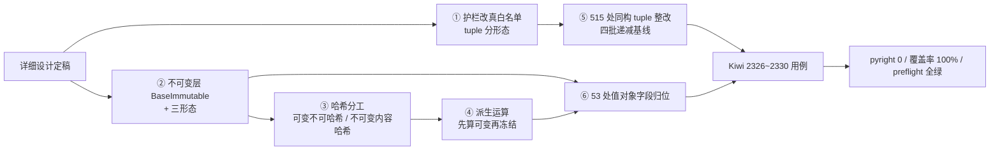

# 01 实施记录：元组注解分形态治理与不可变集合形态

> 认证与安全 · 08 裸无序集合治理 · 子任务 05（需求 08-5，补充需求）· 实施记录

[文档首页](../../../../../../文档首页.md) › [08 裸无序集合治理](../../08_裸无序集合治理.md) › [05 元组注解分形态治理与不可变集合形态](../08_裸无序集合治理_05_元组注解分形态治理与不可变集合形态.md) › 实施记录

## 1. 实施信息 <a id="meta"></a>

| 项 | 值 |
| --- | --- |
| 任务 | 08-5 元组注解分形态治理与不可变集合形态 |
| 对应需求 | [08-5](../../../../需求/08_需求_裸无序集合治理.md#r08-5) |
| 详细设计 | [01 详细设计](../设计/01_详细设计_05_元组注解分形态治理与不可变集合形态.md) |
| 实施日期 | 2026-10-20 |
| 实施人 | minjian |
| 实施环境 | Windows 11 / Python 3.14.4 / ruff 0.16.6 / pyright 1.1.411 / `backend/.venv`（uv 工作区） |
| 提交 | 见 §6（代码与文档分开提交） |
| 结论 | 已完成：护栏改真白名单 + 不可变层与三形态 + 哈希分工 + **515 处**同构 tuple 整改 + **53 处**值对象字段归位；pyright 全仓 **0 诊断**、`preflight` 全部通过 |

## 2. 实施概览 <a id="overview"></a>



**结果小结**：三个集合形态落地后，`BaseValueObject`（frozen dataclass）的集合字段有了正确落点，
`eq` 相等而 `hash` 不同这一不变量破坏被消除；护栏由黑名单改为**白名单语义**后，`tuple` 按形态判定
（同构判违规、固定元数显式豁免），存量 515 处整改完毕、基线归零。

## 3. 实施过程 <a id="process"></a>

### 3.1 护栏改真白名单 + `tuple` 分形态（`scripts/tools/base-check/check-bare-collections.py`）

原实现里 `WHITELIST_FORMS` 是**死常量**——判定处只读 `BANNED_FORMS`（黑名单），所以 `tuple` 从未进入
治理范围，早期「基线归零」并不代表集合声明收敛。本次改为：

- **判定语义反转**：命中 `WHITELIST_FORMS`（`ConcurrentStable*` / `ConcurrentStableFrozen*`）放行；
  命中 `WHITELIST_FORMS` 之外的已登记形态 → 报「未登记形态」；**未命中任何白名单即违规**。
- **`tuple` 分形态**（关键修正，避免误伤）：
  - 同构 `tuple[X, ...]` → **视为集合声明，判违规**（值形态落 `ConcurrentStableList[X]`，
    值对象字段落 `ConcurrentStableFrozenList[X]`）；
  - 固定元数 `tuple[A, B]`（含混合 `tuple[A, ...]` 之外的定长形态）→ **显式豁免**：Pydantic 对定长
    tuple 生成 `prefixItems` + `minItems` / `maxItems`，是**元组语义**（不可变定长记录），非集合语义；
  - 裸 `tuple` → 判违规。
- `--self-test` 矩阵补四类断言：同构 tuple 报 / 固定元数不报 / 新形态报 / 未登记形态报。
- `check-system-fields.py` 补 `_unwrap_collection()`，使目录解析接受
  `ConcurrentStableList((...))` / `ConcurrentStableFrozenList((...))` 包装形态。

### 3.2 不可变层 `BaseImmutable` 与三形态（`core/collections.py` + `core/concurrent.py`）

`BaseImmutable` 承 `BaseConcurrent`（而非 `BaseSorted`）的依据是实测的：三形态 `__init__` 末行是
`self.update(items)`，`update` 内部持分段写锁与全局序号锁——把 `_frozen` 置 True 再调 `super().__init__`
会直接抛 `TypeError`，反证「构造期即写路径」。故本层在构造末尾直接置 `_frozen = True`，**不复用
`freeze()`**（其实质是 `_freeze_clone` → `constructor(...)` 完整重构造，付两遍写路径成本）。

三形态：`ConcurrentStableFrozenList` / `ConcurrentStableFrozenSet` / `ConcurrentStableFrozenDict`，
`collection_kind = "stable_frozen"`，`freeze()` 返回自身。

### 3.3 哈希分工（不变量修正）

| 形态 | `__hash__` | 依据 |
| --- | --- | --- |
| `ConcurrentStable*`（可变） | `None` | 与内置 `list` / `dict` / `set` 一致；内容变化后作键会「凭空消失」 |
| `ConcurrentStableFrozen*`（不可变） | 内容哈希（缓存于 `_hash_cache`） | 与 `__eq__` 语义对齐：列表按序、集合与映射用 `frozenset` |

`hash_payload()` 的**判定顺序不可调换**：先判 `Mapping`、再判 `set` / `frozenset`、最后判序列——
`ConcurrentStableDict` 同时是 `Mapping` 与 `BaseCollection`，`ConcurrentStableSet` 同时是 `Set` 与
`BaseCollection`，顺序颠倒会把集合当成有序序列，导致哈希与 `eq` 语义不一致。

**实测证据**（frozen dataclass 字段对比）：

```text
字段形态                  eq 相等   hash()                  set 去重 / dict 键
ConcurrentStableList      True      TypeError: unhashable  ✗
ConcurrentStableFrozenList True     相等                    ✓ 去重为 1、键命中
```

### 3.4 派生运算口径（不撞冻结）

不可变形态的 `|` / `union` / `intersection` / `difference` / `symmetric_difference` / `+` 改为
「**先算可变临时实例（`_mutable_spawn()`）、最后一次 `_spawn` 冻结**」。原实现 `copy()` 后 `update()`
会撞冻结（`copy()` 保类型 ⇒ 新实例构造完即冻结），实测三处派生运算失败。

### 3.5 结构性问题：打破导入环（`core/roots.py`）

`core.concurrent → core.locking / core.holder → core.objects → 各链模块 → core.concurrent` 成环。
按「结构性破环」处置：把三个体系根（`BaseValueObject` / `BaseDataContract` / `BaseFrameworkObject` +
`FRAMEWORK_OBJECT_KIND`）下沉到新建的 `core/roots.py`；`core/objects/roots.py` 改为薄再导出（既有
导入路径不变）；`core/locking.py` / `core/holder.py` 改从 `core.roots` 导入。

### 3.6 存量整改：515 处同构 `tuple`（四批递减基线）

| 批次 | 范围 | 处数 |
| --- | --- | --- |
| 1 | `libs` 源侧（`backend/libs/**/src`） | 约 294 |
| 2 | `services` 源侧 + `ops` | 约 82 |
| 3 | `scripts/tools` | 83 |
| 4 | `libs` 测试侧 | 约 56 |
| **合计** | | **515** |

口径：同一文件只被一批触碰；批内先类字段、后函数签名、后局部变量；每批 `--update-baseline` 递减，
最终 `deploy/boundaries/bare_collections_baseline.json` **归零**。

### 3.7 值对象字段归位：由 16 处扩到 **53 处**

详细设计原定 16 处，实施中发现值对象字段实际影响面更大（同族 frozen dataclass 的集合字段均需归位，
否则仍不可哈希）。经用户确认「**扩到全部 frozen 值对象集合字段**」后，实际归位 **53 处**，涉及
`audit/hashchain`、`db/migration`、`idp/registry`、`permission/engine`、`query/base`、`search/base`、
`servicecall/base`、`tracing/base`、`transaction/base`、`transfer/importer`、`ws/base`、
`services/platform/.../role_grant` 等，以及 `core/objects/options.py::_mapping_option` 返回值。

**关键纪律**：归位只针对 **frozen 值对象**字段。可变 `@dataclass`（如 `PermissionSubjectData`、
`PermissionSnapshot`）与业务可变累加器（如 `_Granted` 的 `.add()`）**必须保留可变形态**——实施中
曾误将两者迁到不可变形态，运行期抛「为只读快照（已 freeze），禁止写入」，已回退。

### 3.8 pyright 收尾（90 诊断 → 0，分 5 批）

字段类型收紧后暴露 90 条 `reportArgumentType` / `reportPrivateUsage` / `reportUnknown*` 诊断，全部
成因是「可变形态实参传入不可变形态形参」。按模块分 5 批收尾，每批独立跑该批用例后提交：

| 批次 | 模块 | 主要处置 |
| --- | --- | --- |
| 1 | `captcha` | 轨迹构造返回形态归位 |
| 2 | `bms_core` 源侧小模块群 | 契约调用载荷（`ServiceRequest` 三类字段）在调用点转只读快照；模块级 `_SCOPES` 常量改不可变形态 |
| 3 | `bms_core` 测试侧 | 测试构造点归位；`reportPrivateUsage` 用带理由的行内 ignore 标注；顺带修正一处 codemod 误替换（`ConcurrentStableDict()` 被误改成 `ConcurrentStableFrozenList()`） |
| 4 | `services/identity` | `_PERMISSION_SCOPES` / `_PROFILE_SCOPES` 改不可变；IdP `config` 归位 |
| 5 | `services/platform` 等 | 分支载荷 `_platform_args` 返回值归位；跨服务 `json_body` / `headers` 归位 |

### 3.9 顺带落地：两道防浪费守卫

实施过程中用户两次指出「测试粒度太粗」「预检跑了两遍」，故把口头纪律落成机器门禁：

- **全量测试守卫**（`full_test_guard.py`，Kiwi 2329）：本地非 CI 裸跑全量 pytest 立即报错、零用例执行；
- **重命令包装守卫**（`heavy_command_guard.py` + `heavy_guard_boot.py`，Kiwi 2330）：本地非 CI 未经
  `run-once.py` 包装跑重命令（预检 / 全量·多目录 pytest / 全仓 pyright·ruff）立即报错、命令零执行。
  三条放行通道：`BMS_RUN_ONCE=1`（包装器注入）、`BMS_ALLOW_UNWRAPPED=1`（显式绕过）、CI 环境变量。
  挂接两条通道：pytest 插件（`bms_testing_plugin.py`）+ `.pth` 启动钩子
  （`install-guard-hook.py` 安装，覆盖 `pyright` 这类 Python 启动器）。
  **已知技术边界**：`ruff.exe` 是原生 Rust 二进制（约 26MB），不经过 Python 解释器，钩子无法覆盖，
  已在文档中明写、不谎称覆盖。

## 4. 问题与处置 <a id="issues"></a>

| # | 问题 | 处置 |
| --- | --- | --- |
| 1 | `core.concurrent` 与 `core.locking` / `core.holder` / `core.objects` 成环，`import` 即失败 | 新增 `core/roots.py` 下沉三个体系根，`core/objects/roots.py` 改薄再导出（既有路径不变） |
| 2 | Pydantic 契约字段用 `Field(default_factory=CONTRACT_STABLE_LIST)` 后 JSON Schema 丢 `default: []`，契约快照漂移 | 回退为 `Field(default=())` + `# pyright: ignore[reportAssignmentType]`；快照零漂移是硬门禁 |
| 3 | `dataclass` 拒绝可变默认值（`ValueError: mutable default ... use default_factory`） | 改 `field(default_factory=lambda: ConcurrentStableXxx[...]())` |
| 4 | 误把 `_Granted`（`.add()` 累加器）与 `PermissionSnapshot`（`BaseDataContract`）迁到不可变形态 | 回退为可变形态——不可变化只针对 frozen 值对象字段 |
| 5 | `ruff --fix --select RUF100` 删掉合法 `noqa`（`F401` / `RUF012` / `SIM115` 共 3 处） | 用 `git checkout` 逐文件恢复；**不再对 `RUF100` 做全仓 `--fix`** |
| 6 | `# noqa: B008（中文说明）` 被 ruff 判非法（只接受大写字母 + 数字） | 改裸 `# noqa: B008`，说明另起行内注释 |
| 7 | 批量 codemod 误替换一处 `ConcurrentStableDict()` → `ConcurrentStableFrozenList()` | pyright 收尾时发现并修正（`tests/query/test_query.py`） |
| 8 | 主线存量红：合并 `357071b5` 后 `register_static_field_provider` 被删、`test_menu_module_states.py` 仍导入 | 经用户确认本任务顺带修复（删死导入 + 更新 docstring） |
| 9 | `pyright` 在 `.pth` 启动期抛 `SystemExit` 被 `site` 捕获、打印 traceback 且退出码不可控 | 钩子拆成 `check()`（抛 `SystemExit`，可单测）+ `boot()`（捕获后 `os._exit(1)` 硬退出） |
| 10 | `check-preflight.py` 若靠 `.pth` 无法拦截（它用系统 Python，不加载 venv 的 `.pth`） | 改为脚本入口自检（`_heavy_guard_blocker()`），不依赖 `.pth` |
| 11 | `.pth` 位于外置依赖仓，`还原依赖` / `重装依赖` / `uv sync` 后会丢失，守卫静默失效 | 新增 `install-guard-hook.py`（`--check` / `--remove` 幂等可重复执行），并在规范中写明重装后需重跑 |

## 5. 验证结果 <a id="verify"></a>

| 门禁 | 结果 |
| --- | --- |
| 裸集合护栏 `check-bare-collections.py` | **通过**：集合声明无新增违规，基线内 **0 处**存量 |
| 基座校验 `check-base.py` | **通过**（清单与磁盘一致、无跨层引用） |
| `pyright`（全仓，`libs` + `services`） | **0 errors, 0 warnings, 0 informations**（由 90 降至 0） |
| `ruff check` / `ruff format --check`（全仓） | 通过 |
| `pytest`（全量，`--full` 显式声明） | **3336 passed / 57 skipped**（53.56s） |
| 变更源文件覆盖率门禁（行 + 分支 100%） | `core/concurrent.py`：896 语句 / 266 分支，**全 100%** |
| `preflight`（定向档，经 `run-once` 包装） | **全部通过**（116.3s，缓存键 `d6fdf4b0`） |
| 契约快照 / 事件契约 / api-types | **零漂移** |
| 文档链接 `check-links.py` / 文档范围 `check-docs-scope.py` | 断链 0 / 失效锚点 0；1648 份文档违规 0 |

新增用例（Kiwi 已登记）：

| Kiwi | 用例文件 | 数量 |
| --- | --- | --- |
| 2326 | `tests/boundary/test_bare_collections_guard.py` | 3 |
| 2327 | `tests/core/test_concurrent_frozen.py` | 31 |
| 2328 | `tests/core/test_value_object_hash_placement.py` | 16 |
| 2329 | `tests/boundary/test_full_test_guard.py` | 20 |
| 2330 | `tests/boundary/test_heavy_command_guard.py` | 22 |

## 6. 偏差与遗留 <a id="deviations"></a>

| # | 偏差 / 遗留 | 说明 |
| --- | --- | --- |
| 1 | 值对象字段归位 **16 处 → 53 处** | 实施发现同族 frozen dataclass 字段实际影响面更大；经用户确认「扩到全部 frozen 值对象集合字段」。已回写详细设计 §3.4 / §8 |
| 2 | 同构 `tuple` 存量 **524 处 → 515 处** | 设计盘点口径含嵌套去重前重复计数；实施按实际 AST 命中为准 |
| 3 | 结构性破环新增 `core/roots.py` | 详细设计未预见该环；经用户确认「结构性破环」处置，已回写设计 §3.4 |
| 4 | 基线文件曾出现「按目录 checkout 误回滚」 | 已重写 `check-bare-collections.py`；纪律：**不对整个目录做 `git checkout`** |
| 5 | `ruff` 全仓调用不在重命令守卫覆盖内 | 原生二进制无法注入 Python 钩子；靠规范约束 + 预检兜底，已在规范与本文件明写 |
| 6 | 基座模块变更时选测必然退化为工程级全量 | `bms_core` 基础模块改动影响 208/250 测试文件，超阈值（100 个 / 60%）；属正确行为，非缺陷 |
| 7 | 遗留：本任务未处理前端 TS 侧集合形态、跨副本异步形态的不可变化 | 与详细设计 §1 的「不在本任务」一致 |
