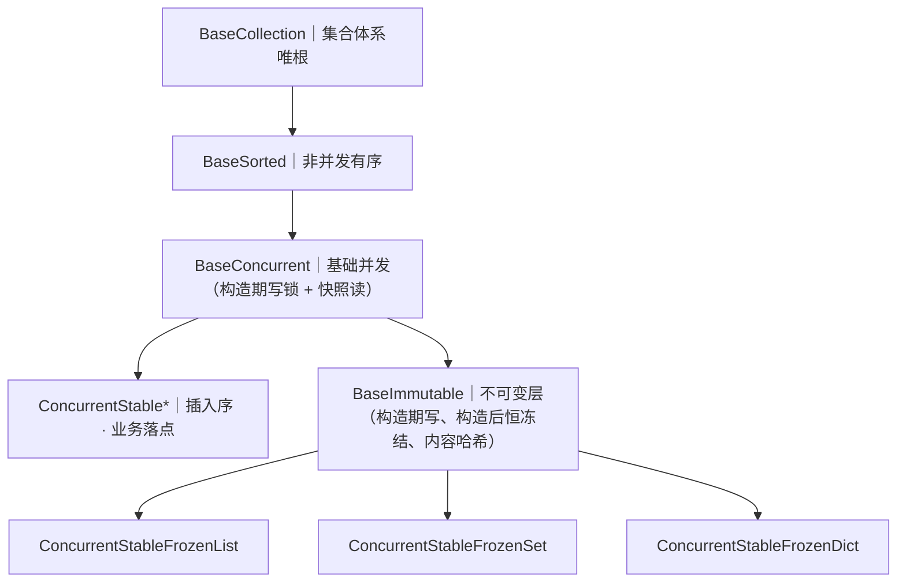
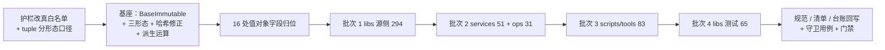

# 01 详细设计 · 元组注解分形态治理与不可变集合形态

> 认证与安全 · 08 裸无序集合治理 · 子任务 05（需求 08-5，补充需求）· 详细设计

[文档首页](../../../../../../文档首页.md) › [08 裸无序集合治理](../../08_裸无序集合治理.md) › [05 元组注解分形态治理与不可变集合形态](../08_裸无序集合治理_05_元组注解分形态治理与不可变集合形态.md) › 详细设计

## 1. 设计目标与范围 <a id="goal"></a>

把 08 域遗留的两处口径缺口一并收口：① **护栏实现与规范口径分叉**——规范写「集合字段一律使用集合类」（白名单语义），护栏实现却是黑名单（`BANNED_FORMS`），`tuple` 从未列入，导致 **769 处 `tuple` 注解**（同构 524 / 固定元数 370，实测含嵌套去重前口径）长期不在治理范围内，「基线归零」并不代表集合声明已收敛；② **集合体系缺不可变形态**——值对象（`BaseValueObject`，frozen dataclass）的集合字段无合适落点，只能落可变集合类，造成 `eq` 相等而 `hash` 不同。

- **本任务范围**：① 护栏改**真白名单判定**（`WHITELIST_FORMS` 参与判定）+ `tuple` 分形态口径；② 新增**不可变层 `BaseImmutable`**（承 `BaseConcurrent`）与三形态 `ConcurrentStableFrozenList` / `FrozenSet` / `FrozenDict`；③ **哈希不变量修正**（可变形态不可哈希、不可变形态内容哈希）；④ 派生运算口径（先算可变再冻结）；⑤ **16 处值对象字段归位**；⑥ **524 处同构元组**分四批整改递减基线；⑦ 规范 / 清单 / 台账回写；⑧ 守卫用例。
- **不在本任务**：固定元数 `tuple[A, B]`（**显式豁免**，见 §3.1）；前端 TS 侧集合形态；跨副本异步形态的不可变化（`RedisSortedSet` 无同步读入口，不适用）。
- **安全影响（SDL）**：本任务不直接处理敏感数据；价值在于消除「相等即同哈希」不变量破坏——该缺陷会让值对象在 `set` / `dict` 键场景**静默失效**（同内容实例查不到、去重不生效），属正确性风险而非安全问题。

### 1.1 存量实测与分布（2026-10-20） <a id="baseline"></a>

**测量方式**：AST 遍历护栏扫描面（`backend/libs/bms_core/src` + `tests`、`backend/services/*/src` + `tests`、`backend/ops`、`scripts/tools`，1244 个 Python 文件），按 `ast.Subscript` 且 `value.id == "tuple"` 统计，按 slice 是否为 `Tuple` 且末元素为 `Ellipsis` 区分同构 / 固定元数。

| 位置 \ 形态 | 同构 `tuple[X, ...]` | 固定元数 `tuple[A, B]` | 小计 |
| --- | --- | --- | --- |
| 类字段 | 94 | 5 | 99 |
| 签名参数 | 86 | 46 | 132 |
| 签名返回 | 132 | 200 | 332 |
| 局部变量 / 模块级常量 | 212 | 119 | 331 |
| **合计** | **524** | **370** | **894** |

> 上表为**逐处计数**（同一注解内的嵌套 tuple 分别计入）；按「顶层注解」口径（一个注解只计一次）为同构 447 / 固定元数 174 = 621 处，其中 148 处 tuple 嵌在已合规容器内（如 `ConcurrentStableList[tuple[str, str]]`）。**整改面以 524 处同构为准**（含嵌套，因嵌套内层同样需要落集合类）。

按区域分布（同构 / 固定元数）：

| 区域 | 同构 | 固定元数 |
| --- | --- | --- |
| `libs` 源侧 | **294** | 105 |
| `libs` 测试 | **65** | 80 |
| `services` | **51** | 100 |
| `scripts/tools` | **83** | 56 |
| `ops` | **31** | 29 |
| **合计** | **524** | **370** |

**契约与值对象类字段**（最需谨慎的一批）：同构元组类字段 94 处中，71 处落在契约 / 值对象类上（`BaseValueObject` 37 / `BaseSchema` 13 / 各 `Base*Contract` 21），例如 `DataSourceResponse.allowlist`、`AuthContext.scopes`、`CursorPayload.specs`、`EmbeddingResult.vectors`、`ImportResult.rows`、`QueryResult.rows`。

### 1.2 现状与缺口 <a id="gap"></a>

| # | 缺口 | 影响 |
| --- | --- | --- |
| 1 | 护栏判定用**黑名单**（`BANNED_FORMS`），`WHITELIST_FORMS` 定义了但从未被引用（死常量） | 任何未列入黑名单的形态自动放行；`tuple` / `deque` / `Counter` / `OrderedDict` 全部漏网，今天补一个明天还有下一个 |
| 2 | 规范与实现**口径分叉**：规范前半句「一律使用集合类」是白名单语义，后半句「禁止裸无序集合」是黑名单语义，实现按后半句落地 | `tuple` 有序且不可变，动机上被默认排除，但规范与设计从未写明「tuple 不查」 |
| 3 | 集合体系**缺不可变形态**，值对象集合字段只能落可变集合类 | frozen dataclass 生成的 `__hash__` 依赖字段可哈希；可变集合类用身份哈希 ⇒ `eq` 相等而 `hash` 不同 ⇒ 放 `set` / 作 `dict` 键**静默失效** |
| 4 | 可变集合类**可哈希**（身份哈希），与内置 `list` / `dict` / `set` 不一致 | 对象放进 `set` / 作 `dict` 键后内容变化即「凭空消失」；内置容器根本不允许这种用法 |
| 5 | `freeze()` 是**完整重构造**（`_freeze_clone` → `constructor(...)` → 再走一遍写路径） | 若不可变形态靠「先可变构建再 `freeze()`」，每次构建付两遍成本（2 万项实测 35.2ms/遍） |
| 6 | 派生运算在冻结实例上**撞冻结**：`set \| other` / `set.union()` / `dict \| other` 内部是 `copy()` 后 `update()`，而 `copy()` 保类型 ⇒ 新实例构造完即冻结 ⇒ `update()` 抛 `TypeError` | 不可变形态无法做集合运算 |

## 2. 交付物清单 <a id="deliver"></a>

| # | 交付物 | 落点 |
| --- | --- | --- |
| 1 | **护栏改真白名单**（`WHITELIST_FORMS` 参与判定、未命中即违规、`tuple` 分形态口径） | `scripts/tools/base-check/check-bare-collections.py`（修改） |
| 2 | `--self-test` 矩阵补四类断言（同构 tuple 报 / 固定元数不报 / 新形态报 / 未登记形态报） | 同上 |
| 3 | **不可变层 `BaseImmutable`**（承 `BaseConcurrent`，`collection_kind = "stable_frozen"`） | `core/collections.py`（新增） |
| 4 | **三形态** `ConcurrentStableFrozenList` / `ConcurrentStableFrozenSet` / `ConcurrentStableFrozenDict` | `core/concurrent.py`（新增） |
| 5 | **哈希不变量修正**：可变形态 `__hash__ = None`；不可变形态内容哈希（与 `eq` 对齐 + 缓存） | `core/collections.py` / `core/concurrent.py`（修改） |
| 6 | **派生运算口径**：先算可变临时实例、最后一次冻结 | `core/concurrent.py`（修改） |
| 7 | **16 处值对象字段归位**（可变集合类 → 不可变形态） | `audit/hashchain.py`、`db/migration.py`、`idp/registry.py`、`permission/engine.py`、`query/base.py`、`search/base.py`、`servicecall/base.py`、`tracing/base.py`、`transaction/base.py`、`transfer/importer.py`、`ws/base.py`、`services/platform/.../role_grant.py`（修改） |
| 8 | **存量整改 524 处同构元组**（分四批递减基线） | `backend/**`、`scripts/tools/**`（改注解与 import） |
| 9 | 基线快照递减至归零 | `deploy/boundaries/bare_collections_baseline.json` |
| 10 | 规范回写（tuple 分形态、白名单判定语义、哈希分工） | `bms文档/规范/后端开发规范.md`「集合与排序」（修改） |
| 11 | 清单回写（`BaseImmutable` 新层 + 三形态 + 哈希口径 + 派生运算） | `bms文档/后端基类清单.md`「集合体系」节（修改） |
| 12 | 台账回写（白名单判定与豁免口径） | `bms文档/设计/基类体系/后端基类治理台账.md`（修改） |
| 13 | 守卫回归用例（Kiwi 先登记） | `backend/libs/bms_core/tests/`（新增用例文件） |
| 14 | 实施 / 测试记录（含 524 处逐条处置） | 本目录 `实施/`、`测试/`（新增） |

## 3. 口径与落点 <a id="rules"></a>

### 3.1 tuple 分形态口径 <a id="tuple"></a>

| 形态 | 判定 | 处置 |
| --- | --- | --- |
| 同构 `tuple[X, ...]` | **视为集合声明** | 判违规，落 `ConcurrentStableList[X]`（值对象字段落 `ConcurrentStableFrozenList[X]`） |
| 固定元数 `tuple[A, B]` / `tuple[A, B, C]` | **视为「多返回值 / 元组值」** | **豁免**，不判违规、不整改 |
| 裸 `tuple`（无下标） | 无元素类型信息 | 判违规（要求写明元素类型后再按上两行判定） |

**固定元数豁免的依据**（不是图省事）：

1. **契约形态不可替代**：Pydantic 对 `tuple[float, float]` 生成 `prefixItems` + `minItems: 2` / `maxItems: 2`；改 `list` 会变成普通 `array`，契约快照与前端 `api-types` 直接漂移（实测见 §1.2 缺口 2 的对照）。
2. **语义不同**：固定元数是**位置语义**（第 1 位是新增行数、第 2 位是更新行数），集合类是**同类元素的多值容器**；强行统一会丢失位置约束，且调用方按索引解包（`new, updated = result`）的写法全部失效。
3. **数量级不同**：固定元数 370 处中 200 处是签名返回（多为 `(结果, 总数)` / `(码, 输出, 错误)` 形态），整改会把「解包」全部改成「索引取值」，可读性倒退。

> **与 08-2 的口径关系**：08-2 的落点映射表（`list` → `ConcurrentStableList` 等）不涉及 tuple，本任务**补充**该映射；08-2 的「裸容器 / 抽象 / 升序形态判违规」口径不变。

### 3.2 护栏判定改为真白名单 <a id="guard"></a>

**现状缺陷**：`WHITELIST_FORMS` 定义在脚本第 127 行，但判定函数 `_annotation_containers` 只用 `BANNED_FORMS`（第 191 / 193 行），白名单从未参与判定。

**改法**：

```python
def _annotation_violations(node: ast.expr | None) -> ConcurrentStableList[str]:
    """递归取注解中的违规集合声明。

    判定改为**白名单**：命中白名单形态（插入序 / 不可变）放行；命中显式豁免形态
    （固定元数 tuple）放行；其余集合声明（裸容器 / 只读可变抽象 / 升序形态 /
    **未登记的集合形态**）一律违规。
    """
```

判定顺序（**短路，先白名单后黑名单**）：

1. 注解节点命中 `WHITELIST_FORMS`（`ConcurrentStable*` + `ConcurrentStableFrozen*`）→ **放行**；
2. 注解节点为 `tuple[...]` 且 slice 为固定元数（`Tuple` 且末元素非 `Ellipsis`）→ **放行**（显式豁免）；
3. 注解节点为 `tuple[...]` 且为同构 / 裸 tuple → **违规**；
4. 注解节点命中 `BANNED_FORMS` → **违规**；
5. **其余集合形态**（`deque` / `Counter` / `OrderedDict` / `ChainMap` / 未登记的新形态）→ **违规**，错误信息提示「未登记形态，请先登记白名单或改用插入序集合类」。

> 第 5 条是本次改动的核心价值——从「列黑名单」转为「列白名单」，漏网口子一次性堵住。

**不查（口径不变）**：迭代与调用协议（`Iterable` / `Iterator` / `Generator` / `AsyncIterator` / `Callable`）；框架边界豁免（`# bare-collections:allow` 行级标记，限框架强制内置类型并附理由）；集合体系实现文件（不属约束对象）。

**`--self-test` 矩阵新增**：

| 用例 | 断言 |
| --- | --- |
| 同构 tuple 注解 | **报违规** |
| 固定元数 tuple 注解 | **不报** |
| 裸 tuple 注解 | **报违规** |
| 已登记白名单形态（`ConcurrentStable*` / `ConcurrentStableFrozen*`） | 不报 |
| 未登记集合形态（`deque[int]` / `Counter[str]`） | **报违规**（白名单生效） |
| 迭代 / 调用协议 | 不报 |

### 3.3 不可变层与三形态 <a id="immutable"></a>

**为什么挂 `BaseConcurrent` 而不是 `BaseSorted`**（实测依据，见 §1.2 缺口 3~5）：

1. **构造期即写路径**：`ConcurrentStableList.__init__` 末行是 `self.update(items)`，`update` 内部持**分段写锁**与**全局序号锁**；把 `_frozen` 置 True 再调 `super().__init__` 会直接抛 `TypeError: 为只读快照（已 freeze），禁止写入`——反证构造即写。
2. **构造完成前若被共享仍需锁**：不可变只保证「构造完成后不再变」，构造期与「发布前」的可见性仍需锁；`BaseSorted` 无锁设施。
3. **数据布局完全一致**：不可变形态与 `ConcurrentStable*` 同为「分段 + 插入序号」，挂 `BaseConcurrent` 下直接复用分段与归并，不另写一套。

**唯一继承链（新增层）**：



**构造口径（不复用 `freeze()`）**：

```python
class ConcurrentStableFrozenList[ItemT](ConcurrentStableList[ItemT], BaseImmutable[ItemT]):
    """不可变插入序列表：构造期写、构造后恒冻结、内容哈希。"""

    def __init__(self, items: Iterable[ItemT] = (), *, strategy: LockStrategy = LockStrategy.SHARDED, shard_count: int = 16) -> None:
        super().__init__(items, strategy=strategy, shard_count=shard_count)  # 构造期走写路径（有锁）
        self._frozen = True  # 构造完成即冻结
```

- **不调用 `freeze()`**：其实质是 `_freeze_clone` → `constructor(...)` → 完整重构造（2 万项 35.2ms），会付两遍写路径成本；
- **`_frozen = True` 在构造末尾**：`super().__init__` 内部的 `update` 必须能写，故标记只能在构造完成后置位；
- **`_freeze_clone` 仍需实现**：`BaseCollection` 要求抽象方法，供「可变实例转冻结快照」场景使用（返回同类冻结实例）。

### 3.4 哈希不变量修正 <a id="hash"></a>

**问题**：现有 `ConcurrentStable*` 用 `__hash__ = BaseObject.__hash__`（身份哈希），而 `__eq__` 是**内容相等**——违反 Python 的「`a == b` ⇒ `hash(a) == hash(b)`」不变量。实测：

| 类 | `eq` 内容相等 | `hash` 相同 | 作 `dict` 键查同内容 |
| --- | --- | --- | --- |
| `ConcurrentStableList` | True | **False** | 查不到（静默失效） |
| `ConcurrentStableSet` | True | **False** | 查不到 |
| `ConcurrentStableDict` | True | **False** | 查不到 |

**为什么不能给可变形态加内容哈希**（实测）：

| 场景 | 结果 |
| --- | --- |
| 放入 `dict` 后修改内容 | 键的 hash 改变，字典内部桶位置失效；触发扩容或换 CPython 版本即查不到 |
| 放入 `set` 后修改内容 | `member in bucket` 变成 `False`，元素「凭空消失」且无法删除 |
| 同一实例两次 `hash` | 必然不同，违反「对象生命周期内 hash 恒定」 |

**修法（Python 的既定分工）**：

| 形态 | 哈希 | 依据 |
| --- | --- | --- |
| `ConcurrentStable*`（可变） | **`__hash__ = None`**（不可哈希） | 与内置 `list` / `dict` / `set` 一致（三者均不可哈希） |
| `ConcurrentStableFrozen*`（不可变） | **内容哈希** | 与内置 `frozenset` / `tuple` 一致 |

**内容哈希的构造（与 `eq` 语义对齐）**：

```python
def _hash_payload(value: object) -> object:
    """递归规范化为可哈希形态（与各形态 __eq__ 语义对齐）。"""
    if isinstance(value, (ConcurrentStableList, list, tuple)):
        return ("seq", tuple(_hash_payload(x) for x in value))   # 序列：按序（eq 序敏感）
    if isinstance(value, (ConcurrentStableSet, frozenset, set)):
        return ("set", frozenset(_hash_payload(x) for x in value))  # 集合：无序（eq 序无关）
    if isinstance(value, (ConcurrentStableDict, dict)):
        return ("map", frozenset((_hash_payload(k), _hash_payload(v)) for k, v in value.items()))
    return value
```

- **列表按序、集合与映射用 `frozenset`**：实测 `ConcurrentStableList([1,2]) != ConcurrentStableList([2,1])`（序敏感），而 `ConcurrentStableSet([1,2]) == ConcurrentStableSet([2,1])`、`ConcurrentStableDict({'a':1,'b':2}) == ConcurrentStableDict({'b':2,'a':1})`（序无关）——哈希必须与各自 `eq` 对齐；
- **哈希值缓存**：首次计算后存 `_hash_cache`，二次调用 3.77ms → 0.002ms（2 万项实测）；不可变形态内容不变，缓存安全；
- **嵌套一致**：`ConcurrentStableFrozenList([ConcurrentStableFrozenDict({'a': 1})])` 同内容 hash 相同、可作 `dict` 键（实测通过）。

**16 处值对象字段归位**（`BaseValueObject` 是 `@dataclass(frozen=True)`，其生成 `__hash__` 依赖字段可哈希）：

| 文件 | 类.字段 |
| --- | --- |
| `audit/hashchain.py` | `HashChainEntry.record` |
| `db/migration.py` | `MigrationChain.tables` |
| `idp/registry.py` | `IdentityProviderSpec.config` |
| `permission/engine.py` | `_Granted.permission_codes` / `.menu_ids` / `.form_ids` |
| `query/base.py` | `QueryResult.rows` |
| `search/base.py` | `SearchHit.highlight` |
| `servicecall/base.py` | `ServiceRequest.query` / `.headers` / `.json_body` |
| `tracing/base.py` | `SpanContext.attributes` |
| `transaction/base.py` | `BranchOp.args` |
| `transfer/importer.py` | `ImportResult.rows` |
| `ws/base.py` | `RealtimeEvent.data` |
| `services/platform/.../role_grant.py` | `DataScopeGrantEntry.config` |

归位后实测：`eq` True、`hash` 相同、`len({同内容两实例}) == 1`（当前为 2）。

> **契约侧零影响**：`BaseSchema`（Pydantic）本身不可哈希（实测 `hash(model)` 抛 `TypeError`），契约字段用可变集合类无副作用——**只有 `BaseValueObject` 需要内容哈希**。

### 3.5 派生运算口径 <a id="derived"></a>

**问题**：不可变形态的派生运算内部是 `copy()` 后 `update()`，而 `copy()` / `_spawn` **保类型**（`type(self)(...)`）⇒ 新实例构造完即冻结 ⇒ `update()` 抛 `TypeError`。实测失败三处：`set | other`、`set.union()`、`dict | other`；列表侧（`+` / `sorted` / `merge` / 切片）正常（走 `_spawn` 一次性构造，不再写）。

**改法**：派生运算改为「**先算可变临时实例、最后一次冻结**」：

```python
def __or__(self, other: Mapping[KeyT, ValueT]) -> Self:
    merged = self._mutable_spawn()   # 构造可变同类实例（未冻结）
    merged.update(other)             # 可变期写入
    return merged.freeze()           # 一次性冻结
```

- `_mutable_spawn()` 为受保护助手：按「可变基类 + 同策略 + 同段数」构造；
- 冻结**一次**，不逐项冻结；
- 列表侧走 `_spawn`（一次性构造目标内容）**不改**——它本就不需要中间可变态；
- 语义保证：派生结果仍是同类不可变实例、保插入序、原实例不变。

### 3.6 存量整改批次 <a id="batches"></a>

| 批次 | 范围 | 同构元组 | 整改要点 |
| --- | --- | --- | --- |
| 1 | `libs` 源侧 | **294** | 契约 / 值对象类字段优先（71 处）；集合体系自身公共契约一并整改 |
| 2 | `services` **51** + `ops` **31** | **82** | 服务契约与仓储返回；`ops` 种子脚本常量 |
| 3 | `scripts/tools` | **83** | 构建期工具（护栏脚本自身也遵守同一口径） |
| 4 | `libs` 测试 | **65** | 测试常量与夹具 |

- **同一文件只被一批触碰**（沿用 08-2 区域口径）；批内**先类字段、后签名、后局部变量**（契约影响面优先）；
- 每批结束跑 `check-bare-collections.py --report`（观察递减）与 `--update-baseline`（**不得手工增删条目**）；
- 每批定向 `pytest` + `ruff` + `pyright`，**不逐批跑全量**。

### 3.7 执行序与提交 <a id="order"></a>



- **先护栏后基座**：白名单判定先落地，整改才有可验证的尺子；**基座先于存量**：不可变形态可用后值对象才有落点；
- 提交粒度：**代码一次 `feat`**（护栏、基座、值对象归位、存量整改、基线快照、守卫用例）+ **文档一次 `docs`**（设计先行单独提交；规范 / 清单 / 台账与实施 / 测试记录随文档提交）。

### 3.8 失败分支与错误语义 <a id="failures"></a>

| 场景 | 行为 / 处置 |
| --- | --- |
| 不可变形态构造后写入 | `TypeError`（`_ensure_mutable` 守卫，与 `freeze()` 同文案） |
| 可变形态作 `dict` 键 / `set` 元素 | `TypeError: unhashable type`（与内置 `list` / `dict` / `set` 一致） |
| 不可变形态内容含不可哈希且不可规范化的元素 | 递归规范化后 `hash()` 抛 `TypeError`（透传，不包装） |
| 派生运算结果类型错误 | 属实现缺陷：断言「同类 + 冻结 + 插入序」 |
| 固定元数被误判为违规 | `--self-test` 矩阵断言兜底；错误信息提示「固定元数豁免」 |
| 存量整改后 pyright 报错 | 按 §3.6 适配；确需可变语义者落可变形态、值对象落不可变形态 |
| 基线复跑出现「残留」 | 属正常递减提示（不失败）；跑 `--update-baseline` 完成递减后复校 |

## 4. 兼容性与影响 <a id="compat"></a>

- **运行期形态变化（预期）**：16 处值对象字段由可变集合类变不可变形态，写操作从「可用」变「抛 `TypeError`」；524 处同构元组字段 / 参数 / 返回由 `tuple` 变 `ConcurrentStableList`（或值对象的不可变形态），**顺序为插入序、加锁属预期行为**。
- **哈希语义变化（重要）**：可变形态 `ConcurrentStable*` 由「可哈希（身份）」变「不可哈希」。**已实测全扫描面无依赖**：集合类实例作 `set` 元素 / `dict` 键 / `frozenset` 成员的用法 **0 处**，值对象 `hash()` 调用 **0 处**（1244 文件 AST 扫描）。回归面仅为「既有用例中依赖集合类可哈希的断言」。
- **契约面零漂移**：同构元组改 `ConcurrentStableList` 时 Pydantic JSON Schema 与 `list[X]` 逐字节一致（均为 `array`）；**固定元数豁免**正是为避免 `prefixItems` + `minItems` / `maxItems` 漂移。`contract_snapshot check` 与前端 `api-types --check` 作为门禁。
- **性能**：不可变形态构造与可变形态同价（一遍写路径，**不付 `freeze()` 的第二遍**）；内容哈希首次 O(n)、后续 O(1)（缓存）；派生运算一次可变构造 + 一次冻结。
- **分层**：`BaseImmutable` 与三形态落 `core/`，只依赖标准库（与 `core/collections.py` / `core/concurrent.py` 同属「无依赖面」，CI 精简镜像可导入）。
- **下游**：`08_02` / `08_03` / `08_04` 已交付，本任务复用其插入序形态、唯一链与通用功能面；后续新增集合形态须同步护栏白名单与《后端基类清单》。
- **回退**：护栏与基座同批；按 `git revert` 或按文件回退；基线快照随代码同提交，回退后重跑 `--update-baseline` 恢复。

## 5. 测试设计与验收映射 <a id="test"></a>

用例**先登记 Kiwi TCMS 再编码**（本任务 **3 条**，取号待登记）。

| # | 用例 / 断言 | 落点 | 对应完成标准 |
| --- | --- | --- | --- |
| 1 | **护栏真白名单**：同构 tuple 报 / 固定元数不报 / 裸 tuple 报 / 白名单形态不报 / 未登记形态报 / 迭代协议不报；基线复跑「新增 0 / 残留 0」 | `tests/boundary/test_bare_collections_guard.py`（扩展） | 护栏为真白名单判定 |
| 2 | **不可变形态与哈希不变量**：三形态构造期写、构造后写抛 `TypeError`；内容哈希与 `eq` 对齐（列表按序、集合与映射无序）；嵌套一致；可作 `dict` 键 / `set` 去重；哈希缓存生效；派生运算不撞冻结且结果同类冻结 | `tests/core/test_concurrent_frozen.py`（新增） | 不可变形态可用、哈希不变量成立 |
| 3 | **可变形态不可哈希 + 值对象归位**：`ConcurrentStable*` 三者 `hash()` 抛 `TypeError`（与内置一致）；16 处值对象字段 `len({同内容两实例}) == 1`；frozen 赋值仍抛 `FrozenInstanceError` | `tests/core/test_objects.py`（扩展）+ 各值对象所在模块用例 | 哈希分工与值对象语义正确 |
| 4 | 定向回归：`pytest backend/libs/bms_core/tests` + 受影响服务用例全绿；`ruff check` / `ruff format --check` / `pyright`（backend 全量）全绿 | 门禁 | 定向回归全绿 |
| 5 | 基座校验与本地预检：`check-base` / `check-backend-base(+--self-test)` / `check-service-boundaries` / `check-status` / `preflight --fast` 全绿；`check-links.py` 无断链 | 门禁 | 基座校验与 preflight 全绿 |
| 6 | 清单与规范一致性：《后端基类清单》「集合体系」节（`BaseImmutable` 新层 / 三形态 / 继承链 / 哈希口径 / 派生运算）与《后端开发规范》「集合与排序」与代码、基线零漂移 | 文档核对 | 清单 / 规范 / 代码一致 |

**验收映射**：任务 §3「完成标准」逐条落用例 1~6。本任务含基座能力新增，**新增能力须有用例覆盖**（用例 2 / 3）；基座新增文件覆盖率按 100%（行 + 分支）门禁。

## 6. 登记落点 <a id="registry"></a>

| 内容 | 落点 |
| --- | --- |
| tuple 分形态口径（同构纳入 / 固定元数豁免）与白名单判定语义 | 《[后端开发规范](../../../../../../规范/后端开发规范.md)》「集合与排序」 |
| `BaseImmutable` 新层 + 三形态 + 继承链 + 哈希分工 + 派生运算 | 《[后端基类清单](../../../../../../后端基类清单.md)》「集合体系」节与「体系根清单」表 |
| 白名单判定与豁免口径（含 `--self-test` 矩阵） | 《[后端基类治理台账](../../../../../../设计/基类体系/后端基类治理台账.md)》「裸无序集合护栏与基线」节 |
| 需求 / 任务 / 父任务 / 计划回写 | [需求 08-5](../../../../需求/08_需求_裸无序集合治理.md#r08-5)、[需求总览](../../../../需求/00_需求_认证与安全.md)、[本任务](../08_裸无序集合治理_05_元组注解分形态治理与不可变集合形态.md)、[父任务](../../08_裸无序集合治理.md)、[计划](../../../../计划/01_计划_认证与安全.md) |
| 实施 / 测试记录（含 524 处逐条处置） | 本目录 `实施/`、`测试/` |

## 7. 边界与开放项 <a id="boundary"></a>

- **固定元数 tuple 的长期口径**：本任务显式豁免。若将来契约侧允许 `prefixItems` 漂移，可另立子项评估；当前不改。
- **可变形态不可哈希的影响面**：已实测零依赖，但**后续新增代码**若试图把集合类作 `dict` 键会立刻 `TypeError`（这是期望行为——内置容器同样如此）。
- **内容哈希的成本**：首次 O(n)（递归规范化 + 构建 `frozenset`）。超大不可变集合（万级以上）首次哈希有毫秒级成本，已用缓存摊薄；若将来出现「高频新建 + 高频哈希」场景，另立子项评估增量哈希。
- **`BaseImmutable` 是否也覆盖跨副本形态**：不覆盖——`RedisSortedSet` / `RedisSortedDict` 无同步读入口（`to_list` 恒抛 `NotImplementedError`），无法计算内容哈希；如需跨副本不可变快照，另立子项。
- **不可变形态的写糖**：`append` / `d[k]=v` 等在冻结后抛 `TypeError`（构造期可用）。是否需要「构造期专用写糖 API」另立子项评估。
- **护栏白名单的维护成本**：改为白名单后，**每新增一个集合形态都必须同步脚本白名单**，否则立即判违规。这是刻意的——迫使新增形态先登记《后端基类清单》再落代码（规范「无合适形态时先新增并回写清单，不得链外自造」）。
- **嵌套 tuple 的整改粒度**：`ConcurrentStableList[tuple[str, str]]` 内层 tuple 若为固定元数则豁免（保持 `ConcurrentStableList[tuple[str, str]]`），若为同构则整改为 `ConcurrentStableList[ConcurrentStableList[str]]`。

## 8. 对齐记录 <a id="align"></a>

| # | 事项 | 结论（2026-10-20 逐项拍板） |
| --- | --- | --- |
| 1 | tuple 是否纳入集合口径 | **分形态处置**：同构纳入（落 `ConcurrentStableList`）、固定元数豁免（写入规范） |
| 2 | 值对象 frozen 字段怎么落 | **基座补不可变有序集合形态**，值对象字段落它，再整改 |
| 3 | 护栏实现 | **改真白名单**（未命中即违规），堵住 tuple / `deque` / `Counter` / `OrderedDict` 同类口子 |
| 4 | 立项方式 | **新开需求 08-5 + 任务 `08_05`**（与 08_02~08_04 边界清晰） |
| 5 | 新形态命名 | `ConcurrentStableFrozenList` / `FrozenSet` / `FrozenDict` |
| 6 | 新形态覆盖范围 | **List / Set / Dict 三种都补** |
| 7 | 新形态挂哪层 | **新增独立层 `BaseImmutable`**；**修正**：挂 `BaseConcurrent` 之下（构造期即写路径，实测反证挂 `BaseSorted` 不成立） |
| 8 | 哈希不变量 | **可变改不可哈希 + 不可变内容哈希**（可变做内容哈希会破坏 dict / set 语义，实测三场景） |
| 9 | 16 处值对象字段 | **全部改落不可变形态** |
| 10 | 构建方式 | **构造期直接写 + 构造后冻结**，不复用 `freeze()`（其本质是完整重构造） |
| 11 | 派生运算 | **改为「先算可变再冻结」** |
| 12 | 整改批次 | **沿用区域口径四批**（`libs` 源侧 294 → `services` 51 + `ops` 31 → `scripts/tools` 83 → `libs` 测试 65） |

> 本设计定稿后按《[AI开发规范](../../../../../../规范/AI开发规范.md)」「单任务交付一条龙」自动续行：实施 → 测试（Kiwi 先登记）→ 验证 → 登记回写 → 记录 → 提交。
