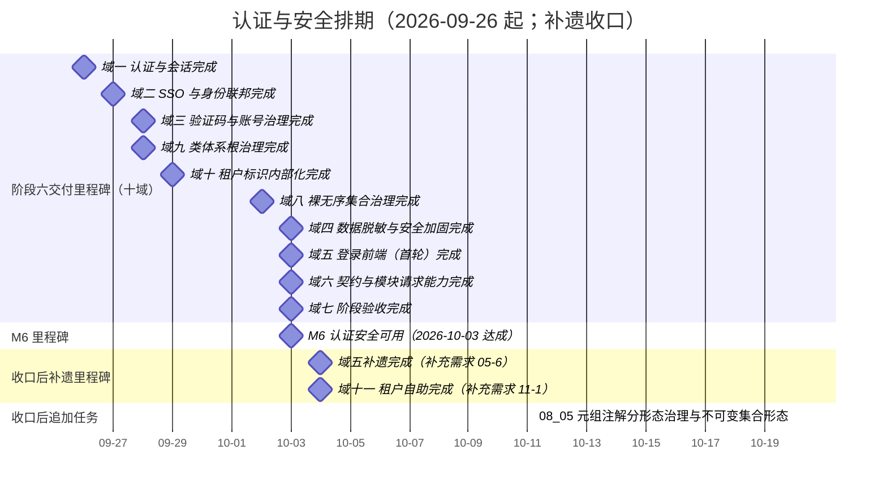

# 认证与安全计划

[文档首页](../../../文档首页.md) › 认证与安全计划　|　[任务基线 →](../任务/01_认证与会话/01_认证与会话.md)　[需求基线 →](../需求/00_需求_认证与安全.md)

## 1. 计划说明 

- **排期对象**：阶段六 45 条需求、51 个子任务（域 01 认证与会话 7 / 域 02 SSO 与身份联邦 6 / 域 03 验证码与账号治理 8 / 域 04 数据脱敏与安全加固 4 / 域 05 登录前端 6 / 域 06 契约与模块请求能力 3 / 域 07 阶段验收 1 / 域 08 裸无序集合治理 5 / 域 09 类体系根治理 5 / 域 10 租户标识内部化 5 / 域 11 租户自助与用户租户关系 1）。
- **排期口径**：自 2026-09-26 起串行排期（单人兼职，沿用阶段六 4 周基线），国庆假期不计入。
- **工时**：已完成 940h；剩余 0h；阶段合计 940h。
- **里程碑锚点**：M6 = 认证安全可用（《总体项目规划》「里程碑」节）。
- **负责人**：minjian（兼职，单人）。

## 2. 已完成任务（2026-09-26 ~ 2026-10-03） 

| 编号 | 任务 | 工时（重估） | 完成日期 | 任务文件 | 偏差与遗留 |
| --- | --- | --- | --- | --- | --- |
| 01_01 | 安全原语真实实现与配置定稿（PBKDF2 / 令牌编解码 / 会话黑名单） | 12h | 2026-09-26 | [01_01](../任务/01_认证与会话/01_认证与会话_01_安全原语真实实现与配置定稿/01_认证与会话_01_安全原语真实实现与配置定稿.md) | 偏差：迭代次数配置落 `[password_hasher].options.iterations`、`[security].keys` 空允许装配但使用时 fail-closed… |
| 01_02 | 用户令牌自签与网关校验源切换 | 16h | 2026-09-26 | [01_02](../任务/01_认证与会话/01_认证与会话_02_用户令牌自签与网关校验源切换/01_认证与会话_02_用户令牌自签与网关校验源切换.md) | 遗留：登录 / 刷新 / 登出（01_03 / 01_04）、`require_auth`（01_05）、SSO 复用（02_05）、生产密钥治理（运维阶段） |
| 01_03 | 本地登录 / 刷新 / 登出链路 | 24h | 2026-09-26 | [01_03](../任务/01_认证与会话/01_认证与会话_03_本地登录刷新登出链路/01_认证与会话_03_本地登录刷新登出链路.md) | 偏差：会话错误码由概要 14 的 `20001~20006` 避让至 `20011~20016`（登录类占 `20002~20004`，已回写）；遗留：会话管理 / 踢出… |
| 01_04 | 会话管理与强制踢出 | 16h | 2026-09-26 | [01_04](../任务/01_认证与会话/01_认证与会话_04_会话管理与强制踢出/01_认证与会话_04_会话管理与强制踢出.md) | 偏差：概要 14 §5 幂等口径改 `revoked_at` 语义（Idempotency-Key 归后续）、`max_active` 落 `[session]` 配置… |
| 01_05 | 登录态依赖真实化与租户解析接线 | 12h | 2026-09-26 | [01_05](../任务/01_认证与会话/01_认证与会话_05_登录态依赖与租户解析接线/01_认证与会话_05_登录态依赖与租户解析接线.md) | 偏差：新增 `X-Session-Id` 身份头（网关生成件重生成）、`require_auth` 改异步返回 `AuthContext`、会话失效错误码取 `20012`/401… |
| 02_01 | SSO 登录完整链路（OIDC 授权码） | 16h | 2026-09-27 | [02_01](../任务/02_SSO与身份联邦/02_SSO与身份联邦_01_SSO登录完整链路/02_SSO与身份联邦_01_SSO登录完整链路.md) | 偏差：设计 §9 实施回写 8 项… |
| 02_02 | JIT 建号与身份映射 | 12h | 2026-09-27 | [02_02](../任务/02_SSO与身份联邦/02_SSO与身份联邦_02_JIT建号与身份映射/02_SSO与身份联邦_02_JIT建号与身份映射.md) | 偏差：设计 §9 实施回写 3 项… |
| 02_03 | CAS 兼容适配（mock CAS 联调） | 12h | 2026-09-27 | [02_03](../任务/02_SSO与身份联邦/02_SSO与身份联邦_03_CAS兼容适配/02_SSO与身份联邦_03_CAS兼容适配.md) | 偏差：设计 §9 实施回写 3 项… |
| 02_04 | 企业微信 / 钉钉免登适配（PC 扫码 + 单测） | 14h | 2026-09-27 | [02_04](../任务/02_SSO与身份联邦/02_SSO与身份联邦_04_企业微信钉钉免登适配/02_SSO与身份联邦_04_企业微信钉钉免登适配.md) | 偏差：设计 §9 实施回写… |
| 02_05 | BMS 兼作 IdP 与客户端注册（OIDC Provider + `sys_client` 最小接口） | 24h | 2026-09-27 | [02_05](../任务/02_SSO与身份联邦/02_SSO与身份联邦_05_BMS兼作IdP与客户端注册/02_SSO与身份联邦_05_BMS兼作IdP与客户端注册.md) | 偏差：设计 §9 实施回写 8 项… |
| 02_06 | 外部 IdP 配置管理（`sys_identity_provider` CRUD / 连通性测试） | 12h | 2026-09-27 | [02_06](../任务/02_SSO与身份联邦/02_SSO与身份联邦_06_外部IdP配置管理/02_SSO与身份联邦_06_外部IdP配置管理.md) | 偏差：设计 §9 实施回写 10 项… |
| 03_01 | 图形验证码真实实现（Pillow + Redis 一次性校验） | 8h | 2026-09-27 | [03_01](../任务/03_验证码与账号治理/03_验证码与账号治理_01_图形验证码真实实现/03_验证码与账号治理_01_图形验证码真实实现.md) | 偏差：失败回写 TTL 保留方式由 `KEEPTTL` 改「`PTTL` + `SET ... PX`」（设计已回写）；遗留：滑块 / 短信（03_02 / 03_03）、场景策略… |
| 03_02 | 滑块挑战真实实现（服务端合成出图 + 轨迹判定） | 10h | 2026-09-27 | [03_02](../任务/03_验证码与账号治理/03_验证码与账号治理_02_滑块挑战真实实现/03_验证码与账号治理_02_滑块挑战真实实现.md) | 偏差：滑块判定失败码按错误码语义定为 `20101`（任务 / 需求原写 `20102`，设计 §8 回写）、前端件归属按父任务端范围归 `03_04`（任务文档已回写）；遗留：前… |
| 03_03 | 短信验证码真实实现（脱敏回显 / 冷却频次 / 通道占位） | 8h | 2026-09-27 | [03_03](../任务/03_验证码与账号治理/03_验证码与账号治理_03_短信验证码真实实现/03_验证码与账号治理_03_短信验证码真实实现.md) | 偏差：脱敏沿用 `mask_phone`、改经 `BaseMasker` 归 `04_02`（任务文档已回写）、`generate(kind=sms)` 改判 ParamErro… |
| 03_08 | 系统参数（`sys_config`）读取基座 | 16h | 2026-09-27 | [03_08](../任务/03_验证码与账号治理/03_验证码与账号治理_08_系统参数读取基座/03_验证码与账号治理_08_系统参数读取基座.md) | 遗留：管理面（CRUD / 页面 / 审计 / 平台默认下发）归阶段八 |
| 03_04 | 场景策略与失败计数联调 | 16h | 2026-09-27 | [03_04](../任务/03_验证码与账号治理/03_验证码与账号治理_04_场景策略与失败计数联调/03_验证码与账号治理_04_场景策略与失败计数联调.md) | 遗留：宿主登录页接线（归 05_01）、真实通道可用性探测（归阶段八）、验证码校验失败是否纳入风控评分（归后续安全强化） |
| 03_05 | 密码策略真实实现 | 10h | 2026-09-27 | [03_05](../任务/03_验证码与账号治理/03_验证码与账号治理_05_密码策略真实实现/03_验证码与账号治理_05_密码策略真实实现.md) | 遗留：`fail_limit` / `manual` 两型与解锁（归 03_07）、Celery 定时调度（归阶段八）、改密 / 强度提示前端页面（归阶段十五） |
| 03_06 | 找回密码流程（Redis 单次 token + 重置失效会话） | 10h | 2026-09-28 | [03_06](../任务/03_验证码与账号治理/03_验证码与账号治理_06_找回密码流程/03_验证码与账号治理_06_找回密码流程.md) | 遗留：真实邮件 / 企微 / 钉钉 / 短信渠道与模板（归阶段八）、找回 / 重置前端页面（归阶段十五）、`email` / `phone` 维护入口与唯一性 / 格式校验… |
| 03_07 | 账号锁定与解锁管理（三型锁定 + 手动解锁 + 审计） | 12h | 2026-09-28 | [03_07](../任务/03_验证码与账号治理/03_验证码与账号治理_07_账号锁定与解锁管理/03_验证码与账号治理_07_账号锁定与解锁管理.md) | 遗留：锁定管理页面（归阶段七）、Celery 定时与操作日志真实落库（归阶段八）、解锁不回调清 identity Redis 失败计数（归后续评估） |
| 04_01 | 脱敏基座真实实现（规则分派 / 自定义策略 / 明文揭示） | 12h | 2026-09-28 | [04_01](../任务/04_数据脱敏与安全加固/04_数据脱敏与安全加固_01_脱敏基座真实实现/04_数据脱敏与安全加固_01_脱敏基座真实实现.md) | 遗留：序列化 / 日志 / 导出接入与 `mask_phone` 回接（归 04_02）、`data:plain` 真实权限（归阶段七）、加密字段解密（归 04_03）、既有 2… |
| 08_01 | 裸无序集合护栏与存量盘点（AST 护栏 / 基线快照 / 盘点报告） | 16h | 2026-09-28 | [08_01](../任务/08_裸无序集合治理/08_裸无序集合治理_01_护栏与基线盘点/08_裸无序集合治理_01_护栏与基线盘点.md) | 遗留：存量整改分批（归后续分批任务）、`scripts/tools` 长期口径评估（批次 4）、`scripts/tools` 已纳入 CI lint… |
| 09_01 | 后端类体系根治理（三体系基类 / 继承链四段 / 直继承护栏与基线 / 盘点） | 16h | 2026-09-28 | [09_01](../任务/09_类体系根治理/09_类体系根治理_01_后端类体系根治理/09_类体系根治理_01_后端类体系根治理.md) | 遗留：160 处存量归位分批（归后续分批任务）、前端框架层对称（归 09_02） |
| 09_02 | 前端框架层对称（框架对象层 / 组件链四段 / 清单与守卫对账） | 8h | 2026-09-28 | [09_02](../任务/09_类体系根治理/09_类体系根治理_02_前端框架层对称/09_类体系根治理_02_前端框架层对称.md) | 遗留：前端数据契约体系层与「禁止直挂根系」前端护栏（归后续任务） |
| 09_03 | 值对象存量归位（批次 1）+ 体系根口径治理与角色链分层 | 32h | 2026-09-28 | [09_03](../任务/09_类体系根治理/09_类体系根治理_03_值对象存量归位/09_类体系根治理_03_值对象存量归位.md) | 遗留：租户编码字段名分叉（转 09_04）、数据契约 3 + 框架对象 47 处归位（已由 09_05 完成） |
| 09_04 | 术语统一（命名规则 + 租户视图对象自身编码 / 契约键隔离） | 8h | 2026-09-28 | [09_04](../任务/09_类体系根治理/09_类体系根治理_04_术语统一/09_类体系根治理_04_术语统一.md) | 无 |
| 09_05 | 框架对象与数据契约存量归位（批次 2/3） | 24h | 2026-09-28 | [09_05](../任务/09_类体系根治理/09_类体系根治理_05_框架对象与数据契约存量归位/09_类体系根治理_05_框架对象与数据契约存量归位.md) | 无 |
| 10_01 | 租户标识内部化：详细设计与口径定稿（库键 / 库名落点、兼容窗口、迁移策略） | 8h | 2026-09-28 | [10_01](../任务/10_租户标识内部化/10_租户标识内部化_01_详细设计与口径定稿/10_租户标识内部化_01_详细设计与口径定稿.md) | 偏差：实施日期早于计划窗口（提前实施）；遗留：`sys_event_consumed` 是否加租户列与 `ai_chat_log` 半成品（开放项 / 后续）、sys_tenan… |
| 10_02 | 令牌 claim + 请求态键 + 边界 `code → id` 解析 | 16h | 2026-09-28 | [10_02](../任务/10_租户标识内部化/10_租户标识内部化_02_令牌与请求态键/10_租户标识内部化_02_令牌与请求态键.md) | 遗留：事件 / 发件箱 / 缓存与限流键（10_03）、对照表与 DB 列迁移（10_04）、收口（10_05） |
| 10_03 | 事件信封 / 发件箱 / 缓存与限流键租户位改 `tenant_id` | 16h | 2026-09-29 | [10_03](../任务/10_租户标识内部化/10_租户标识内部化_03_事件与缓存键/10_租户标识内部化_03_事件与缓存键.md) | 遗留：产品仓库消费方契约标注（消费方实现时补「前置契约」）、`sys_outbox` / 死信 / `sys_user_identity` 列类型迁移与对照表（归 10_04）、收… |
| 10_04 | DB 列迁移（`code→id`）+ 模型 + `sys_tenant_database` 对照表 + 数据库设计回写 | 16h | 2026-09-29 | [10_04](../任务/10_租户标识内部化/10_租户标识内部化_04_DB列迁移与模型/10_租户标识内部化_04_DB列迁移与模型.md) | 遗留：达梦列注释变更（后续评估）、产品消费方前置契约标注（消费方实现时补）、收口（归 10_05） |
| 10_05 | 租户标识内部化收口回归与记录 | 8h | 2026-09-29 | [10_05](../任务/10_租户标识内部化/10_租户标识内部化_05_收口回归与记录/10_租户标识内部化_05_收口回归与记录.md) | 遗留：`ops/backfill_tenant_id_columns.py` 单测覆盖率 62%… |
| 08_02 | 裸无序集合存量整改（批次 1~4） | 232h | 2026-10-02 | [08_02](../任务/08_裸无序集合治理/08_裸无序集合治理_02_bms_core存量整改/08_裸无序集合治理_02_bms_core存量整改.md) | 无 |
| 08_03 | 集合体系收链（跨副本形态回链） | 16h | 2026-09-29 | [08_03](../任务/08_裸无序集合治理/08_裸无序集合治理_03_集合体系收链/08_裸无序集合治理_03_集合体系收链.md) | 遗留：`collection_kind` 用途边界与更深异步公共段待后续评估（设计 §8） |
| 04_02 | 脱敏接入与明文权限口径（序列化自动掩码 / 日志脱敏配置化 / 导出脱敏 / `data:plain` 口径） | 8h | 2026-10-02 | [04_02](../任务/04_数据脱敏与安全加固/04_数据脱敏与安全加固_02_脱敏接入与明文权限口径/04_数据脱敏与安全加固_02_脱敏接入与明文权限口径.md) | 遗留：`data:plain` 真实权限判定（归阶段七）、`ai_chat_log` 真实落库前掩码与导出大文件审计（归阶段八 / AI 阶段） |
| 04_03 | 基础防护与密钥管理落地 | 6h | 2026-10-02 | [04_03](../任务/04_数据脱敏与安全加固/04_数据脱敏与安全加固_03_基础防护与密钥管理落地/04_数据脱敏与安全加固_03_基础防护与密钥管理落地.md) | 遗留：生产 TLS / HSTS 真机验证、SBOM 上报与分发策略、`secret:` 与 `reveal` 解密归口（均归后续） |
| 06_01 | 认证契约快照与前端类型生成（含服务契约路由覆盖护栏） | 10h | 2026-10-02 | [06_01](../任务/06_契约与模块请求能力/06_契约与模块请求能力_01_认证契约快照与前端类型生成/06_契约与模块请求能力_01_认证契约快照与前端类型生成.md) | 遗留：框架惰性路由结构随框架大版本复核（开放项，现以「提取为空即判失败」兜底）、契约版本自动回写（归契约门禁需求）、CI 远程实证（推送后手动触发） |
| 06_03 | 契约响应 schema 完整性与门禁 | 8h | 2026-10-02 | [06_03](../任务/06_契约与模块请求能力/06_契约与模块请求能力_03_契约响应schema完整性与门禁/06_契约与模块请求能力_03_契约响应schema完整性与门禁.md) | 遗留：19 处原始 `Response` 端点响应契约缺失（§7 第 37 项，域六后续子任务 `06_05` 待立项）、`handler.mode` 取法随 pydantic 大… |
| 01_06 | 当前用户概要端点（`GET /auth/me`） | 8h | 2026-10-02 | [01_06](../任务/01_认证与会话/01_认证与会话_06_当前用户概要端点/01_认证与会话_06_当前用户概要端点.md) | 遗留：强制改密动作页面（归阶段十五）、`/auth/me` 缓存与访问审计（归性能 / 阶段八）、权限码装载（归阶段七 RBAC） |
| 05_02 | token 与 401 静默刷新接线（单例刷新 + 重放 + 登出 + 首屏续期） | 12h | 2026-10-02 | [05_02](../任务/05_登录前端/05_登录前端_02_token与401静默刷新接线/05_登录前端_02_token与401静默刷新接线.md) | 遗留：多标签页登出与 token 失效同步（归阶段十五）、`redirect` 站内校验与守卫等待态（已由 05_03 交付）、错误码 → 文案映射与宿主国际化… |
| 05_03 | 路由守卫默认开启与登录回跳（默认开启 / 公开页与 `redirect` 回跳 / `meta.perm` 占位 403 / 首屏等待态 / 守卫决策观测） | 6h | 2026-10-02 | [05_03](../任务/05_登录前端/05_登录前端_03_路由守卫默认开启与登录回跳/05_登录前端_03_路由守卫默认开启与登录回跳.md) | 遗留：`meta.perm` 真实权限装载与真实菜单下发（归阶段七 RBAC）、`/403` 页增强（归阶段七 / 十五）、多标签页会话同步（归阶段十五） |
| 05_01 | 登录页真实实现（表单 / 验证码延迟提交 / SSO 入口 / 错误码文案） | 14h | 2026-10-02 | [05_01](../任务/05_登录前端/05_登录前端_01_登录页真实实现/05_登录前端_01_登录页真实实现.md) | 遗留：找回 / 重置页面与「忘记密码」入口、改密页面与强制改密流转（均归阶段十五）、租户品牌资源（归品牌化阶段）、扫码入口（归 05_04）、记住我（归 05-5） |
| 05_04 | 扫码登录前端（四态状态机 / 可插拔状态源 / 过期重取 / 退避 / 换取会话） | 8h | 2026-10-03 | [05_04](../任务/05_登录前端/05_登录前端_04_扫码登录前端/05_登录前端_04_扫码登录前端.md) | 遗留：真实平台适配（企微 `@wecom/jssdk` / 钉钉内嵌登录或后端状态端点）与真实企业凭据 E2E（归阶段十七）、移动端内嵌 H5 免登（归阶段十七）、宿主国际化… |
| 05_05 | 记住我（登录保留时长选项） | 8h | 2026-10-03 | [05_05](../任务/05_登录前端/05_登录前端_05_记住我/05_登录前端_05_记住我.md) | 遗留：SSO / 扫码跟随选项（另立任务）、会话列表展示 `remember_me`（归阶段十五）、超时无操作退出（归后续安全强化）、多标签页同步（归阶段十五）、宿主国际化… |
| 04_04 | 安全专项用例与覆盖率门槛（七类专项集中套件 / 认证模块覆盖率 接 CI） | 8h | 2026-10-03 | [04_04](../任务/04_数据脱敏与安全加固/04_数据脱敏与安全加固_04_安全专项用例与覆盖率门槛/04_数据脱敏与安全加固_04_安全专项用例与覆盖率门槛.md) | 遗留：后端 HTML 净化基座、上传安全控制真实实现（归后续安全强化）、跨用户越权归属校验（归阶段七 RBAC） |
| 06_02 | 模块请求能力 `api` 与契约版本升 2 | 12h | 2026-10-03 | [06_02](../任务/06_契约与模块请求能力/06_契约与模块请求能力_02_模块请求能力api与契约版本升2/06_契约与模块请求能力_02_模块请求能力api与契约版本升2.md) | 遗留：`api` 服务白名单（§7 第 31 项）、模块请求观测 / 审计（§7 第 32 项）、模块真实后端登录态浏览器实测（本地无应用账号，§7 第 34 项）、VITE_A… |
| 07_01 | 阶段验收门禁核对与测试报告 | 8h | 2026-10-03 | [07_01](../任务/07_阶段验收/07_阶段验收_01_阶段验收门禁核对与测试报告/07_阶段验收_01_阶段验收门禁核对与测试报告.md) | 遗留：阶段六窗口 18 条开放自动缺陷单（iid 49 ~ 66，只登记归口不关闭）（测试资产仓用例台账已于 2026-10-13 退役，编号与批次以平台为准） |
| 11_01 | 用户↔租户关系与租户自助真实化（关系表 / 写入全量覆盖 / `my_tenants` 与 `switch`） | 40h | 2026-10-04 | [11_01](../任务/11_租户自助与用户租户关系/11_租户自助与用户租户关系_01_用户租户关系与租户自助真实化/11_租户自助与用户租户关系_01_用户租户关系与租户自助真实化.md) | 遗留：未实现写入路径（管理员建号 / 批量导入 / 自助注册 / 租户开通建超管 / 用户停用删除）功能本体按「统一建号入口 + `source`」接入… |
| 08_04 | 集合类通用功能补齐（写糖 / 通用方法 / 输出可读性 / `freeze()` 只读快照） | 16h | 2026-10-20 | [08_04](../任务/08_裸无序集合治理/08_裸无序集合治理_04_集合类通用功能补齐/08_裸无序集合治理_04_集合类通用功能补齐.md) | 无 |
| 05_06 | 登录页租户标识与「需选择租户」语义（默认隐藏 / `20007` 触发展开 / 唯一启用租户解析） | 20h | 2026-10-04 | [05_06](../任务/05_登录前端/05_登录前端_06_登录页多租户选择/05_登录前端_06_登录页多租户选择.md) | 遗留：验证码场景策略在租户未解析时的租户级读取细化（后续评估）、`deferred_paths` 长期治理（新增免登录公开面须同步登记，口径提醒） |
| 08_05 | 元组注解分形态治理与不可变集合形态（护栏真白名单 / `BaseImmutable` / 内容哈希不变量） | 40h | 2026-10-20 | [08_05](../任务/08_裸无序集合治理/08_裸无序集合治理_05_元组注解分形态治理与不可变集合形态/08_裸无序集合治理_05_元组注解分形态治理与不可变集合形态.md) | 无 |
| 01_07 | 会话续期真实可用与登录入口可达性（refresh cookie 作用域 / 账号种子 / 宿主边界） | 20h | 2026-10-04 | [01_07](../任务/01_认证与会话/01_认证与会话_07_会话续期真实可用与登录入口可达性/01_认证与会话_07_会话续期真实可用与登录入口可达性.md) | 遗留：真机整链续期随开发环境部署窗口… |

## 3. 剩余任务排期（自 2026-09-26） 

| 编号 | 任务 | 状态 | 工时 | 依赖 | 排期窗口 | 备注 | 偏差与遗留 |
| --- | --- | --- | --- | --- | --- | --- | --- |

## 4. 排期甘特图 

## 5. M6 验收门禁 

门禁定义见《[总体项目规划](../../../规划/总体项目规划.md)》「阶段内容与完成标准」节（阶段六行）与「里程碑」节；**逐项结论与证据索引见下表（10 行）**，阶段汇总见《[阶段测试报告](../01_测试报告_认证与安全.md)》。判定口径：本阶段门禁判「**机制与产物就位 + 真实链路实证**」，真实业务链路 / 部署形态留后续阶段的项在结论后以「（限定：… → 计划 §7 第 N 项）」注明归口；**10 行全部达标，无未达标项**（2026-10-03 收口）。 **收口后补遗（2026-10-04）**：补充需求 11-1 追加 `11_01`（40h）、补充需求 05-6 追加 `05_06`（20h），均属 M6 基线**外**增量，上表 10 行结论不受影响；两项的门禁结论随任务完成单独核对并回写本节。

**补遗门禁结论 —— `11_01`（2026-10-04 完成）**：多租户用户的 `my_tenants` 能列出其可访问租户且 `multi_tenant=true`；`switch` 仅对可访问租户生效、越权目标被拒（`80003` / 403）；六条写入路径以「统一建号入口 + `source`」承接（本期接线 SSO JIT，其余登记接入点）；登录前链路无任何账号反查（关系数据源不入免认证面）；契约快照与 `@bms/api-types` 零漂移；新增 / 变更模块行覆盖率 100%；后端定向 `pytest`、`ruff`、`pyright` 与 `preflight --fast` 全通过。**（限定：对账巡检定时化 → 阶段八；未实现写入路径功能本体 → 各功能立项时按统一建号入口接入；Kiwi 用例编号待平台登记回填；三库真库迁移随部署窗口）**

**补遗门禁结论 —— `05_06`（2026-10-04 完成，补遗收尾）**：单租户 / 子域名部署下登录页**不渲染**租户标识、留空提交即可直接登录（唯一启用租户解析）；多租户同域留空提交返回认证段 **`20007`**（HTTP 200、`data=null`）且**不消费验证码、不计失败**，前端展开租户标识输入框并聚焦、填写后提交成功；本机已记住租户编码时**静默随请求携带且不显示该项**；登录前链路**无任何**按账号查询租户 / 账号存在性的请求（安全规范 §3）；`20007` 响应体不含租户清单；免登录公开面经 `[tenant].deferred_paths` 延迟解析（生产无来源不硬拒、`20007` 可达）；SSO 入口按唯一启用租户回落；契约四道门禁全绿（identity 端点说明含 `20007`、tenant 含内部 `active-single` 且生成类型零漂移）；新增 / 变更代码路径覆盖率 100%；前端 `vue-tsc` / ESLint / Vitest 与后端定向 `pytest` / `ruff` / `pyright` / `preflight --fast` 全通过。**（限定：验证码场景策略在租户未解析时的租户级读取细化 → 后续评估；`deferred_paths` 长期治理为口径提醒；Kiwi 用例 2239 / 2240 已登记）**

| 验收点 | 对应任务 | 达成路径（结论与证据索引） |
| --- | --- | --- |
| 本地登录链路 E2E 通过（含验证码与限流） | 01_03 / 01_04 / 01_06 / 05_01 / 05_02 / 05_03 | **达标（2026-10-03）**：登录 → 受保护接口 → 刷新（首屏概要恢复）→ 登出链路落地（identity 双 token 自签 + `sys_session` 落库 + Redis 标记；01_03 / 01_04），`require_auth` 恒定强制 + 每请求会话标记校验 `20012`（01_05 / 01_06），前端登录页真实表单 / 401 单例静默刷新 / 守卫默认开启（05_01 / 05_02 / 05_03）；错误与锁定分支用例齐备（Kiwi 2194 / 2195 / 2229 / 2232 / 2230 / 2231） |
| SSO 登录链路 E2E 通过（OIDC 真联调） | 02_01 / 02_02 / 02_06 | **达标（2026-10-03）**：OIDC 授权码完整链路（state / nonce / PKCE / 一次性回调）+ Keycloak integration 用例实测通过 + **真机部署态 E2E 冒烟通过（2026-09-27）**（Kiwi 2197）；CAS / 企微 / 钉钉适配与单测（Kiwi 2199 / 2200 / 2201）；外部 IdP 配置管理（Kiwi 2203）。**（限定：企微 / 钉钉真实企业凭据与移动端内嵌免登 → 计划 §7 第 1 / 15 项）** |
| JIT 建号落库正确 | 02_02 | **达标（2026-10-03）**：首登建号 + `sys_user_identity` 写路径与唯一约束 + 分布式锁并发防护 + 域名 / 租户白名单（Kiwi 2198）；新增模块覆盖率 100%，事件同事务与契约校验用例用真实 SQLite 平台库（`SqlOutboxStore(enforce)`） |
| 前端登录与按服务寻址联通 | 05_01 / 05_02 / 05_03 / 05_04 / 06_01 / 06_03 | **达标（2026-10-03）**：登录页真实表单经 `api/identity` 联通 + 按服务段寻址；契约类型零漂移（响应侧 schema 完整：`components.schemas` 无空对象 + 成功响应 schema 非空，Kiwi 2227 / 2228）；守卫默认开启与登录回跳（Kiwi 2231）；扫码登录四态状态机 / 过期重取 / 退避 / 换取会话（Kiwi 2233）。**（限定：模块真实后端登录态浏览器实测 → 计划 §7 第 34 项；真实平台适配 → 阶段十七）** |
| 策略强制生效（验证码 / 密码 / 锁定） | 03_04 / 03_05 / 03_07 / 01_03 | **达标（2026-10-03）**：图形 / 滑块 / 短信三形态真实实现（Kiwi 2204 / 2205 / 2206）；场景策略按租户 + 连续失败强制验证码 + 渠道降级（Kiwi 2208）；密码四规则（复杂度 / 90 天 / 近 5 次 / 180 天）与登录置标志（Kiwi 2209）；三型锁定 + 手动解锁（Kiwi 2211）；登录链路接线（Kiwi 2194） |
| 会话强制踢出即时生效 | 01_04 | **达标（2026-10-03）**：统一撤销原语（黑名单 + `revoked_at` 落库 + 删 Redis 标记）+ 踢出后下一请求 401 + refresh 失效 + 多端上限自动作废最旧（Kiwi 2195）；2026-09-27 真机冒烟验证踢出即时 401。**（限定：`session.revoked` 实时广播真实推送 → 计划 §7 第 2 项）** |
| 账号锁定与手动解锁可用（MVP 验收点） | 03_07 | **达标（2026-10-03）**：三型锁定落库 + `fail_limit` 到期自动解锁 + 手动锁定幂等 + 手动解锁恢复登录 + 列表详情 + 审计占位（Kiwi 2211）。**（限定：锁定列表 / 解锁管理页面 → 计划 §7 第 5 项）** |
| BMS 作 IdP 通过（MVP 验收点） | 02_05 | **达标（2026-10-03）**：OIDC Provider 内核 + `sys_client` 最小注册 + 授权码流程 / PKCE / Discovery / JWKS 合规（Kiwi 2202）。**（限定：客户端管理页面与调用审计 → 计划 §7 第 9 项）** |
| 数据脱敏生效（安全专项） | 04_01 / 04_02 / 04_04 | **达标（2026-10-03）**：掩码策略分派 / 自定义策略 / 明文揭示 fail-closed（Kiwi 2212）；序列化自动掩码 + 日志脱敏配置化（含 PII 键名）+ 导出脱敏 + `mask_phone` 回接（Kiwi 2225）；响应 / 日志 / 导出无敏感明文用例（Kiwi 2235）。**（限定：`data:plain` 真实权限判定 → 计划 §7 第 4 项）** |
| 安全与覆盖率门槛 | 04_04 | **达标（2026-10-03）**：七类安全专项集中套件全绿（限流爆破 / 脱敏泄露 / 会话劫持 / 越权 / 注入 / XSS / 上传绕过，Kiwi 2235）；路径级覆盖率门禁脚本落地并实测——认证（identity 服务）99.3% / 认证（`bms_core` 横切）99.5%，挂 CI `backend-test` 与本地预检；全量行覆盖率 96.28%，快照 `backend/coverage.json` 以 artifact 归档（Kiwi 2235） |

**里程碑对照**（《总体项目规划》「里程碑」节）：

| 里程碑 | 基线（《总体项目规划》） | 本计划实际 | 说明 |
| --- | --- | --- | --- |
| M6 认证安全可用 | 阶段六（4 周基线，累计 30 周） | **2026-10-03 达成**（窗口原估 2026-09-26 ~ 2026-12-04；提前达成） | 10 行门禁全部达标；阶段测试报告归档；阶段六首轮 46 项 / 804h 完成（2026-10-04 收口后追加补充需求 11-1 → `11_01` 40h，窗口 2026-10-08 ~ 2026-10-14；补充需求 05-6 → `05_06` 20h，域五置部分完成，窗口 2026-10-15 ~ 2026-10-17）。窗口顺延起因：补充需求 08-2（存量整改 92h → **264h**，2026-09-29 二次拍板：口径扩为「全覆盖 + 业务只落插入序集合类」并把基座形态新增并入 `08_02`）与 08-3（集合体系收链 16h）（2026-09-29 立项 / 二次拍板） |

**门禁对照**（《总体项目规划》阶段六行基线 ↔ 本计划实际）：

| 阶段六行基线（《总体项目规划》） | 本计划门禁覆盖 | 实际达成 |
| --- | --- | --- |
| 登录链路（本地 + SSO，均基于 `sys_user` 最小模型）E2E 通过 | 第 1 / 2 / 3 行（本地登录链路 / SSO 链路 / JIT 建号） | **2026-10-03 达标** |
| 前端登录与按服务寻址联通 | 第 4 行（前端登录与按服务寻址联通） | **2026-10-03 达标** |
| 策略强制生效 | 第 5 行（验证码 / 密码 / 锁定） | **2026-10-03 达标** |
| 本计划按 MVP 验收点与安全专项扩充（阶段六行未单列） | 第 6 ~ 10 行（会话踢出 / 账号锁定 / BMS 作 IdP / 数据脱敏 / 安全与覆盖率门槛） | **2026-10-03 达标** |

## 6. 风险与对策 

| 风险 | 影响 | 对策 |
| --- | --- | --- |
| 令牌签发方切换（外部 IdP → BMS 自签）连带网关与边缘回归面 | 既有 forward-auth / 边缘信任失效或漏改 | `01_02` 一次性切换并全量回归网关 / 边缘 / 身份头用例；架构 14 / 36 与阶段二配置同步回写 |
| `sys_user` 落 org 服务引入登录跨服务调用 | 登录链路延迟与故障面增加 | 内部接口契约先行冻结；超时与失败语义明确；缓存与索引按登录热路径设计 |
| 企微 / 钉钉与 CAS 缺真实凭据 / 环境 | 联调证据不足，M6 门禁受限 | 按拍板口径交付适配 + mock / 单测，遗留明确登记归口阶段十七；凭据就绪即补真联调 |
| 验证码与失败计数强依赖 Redis | Redis 故障时登录不可用或策略失效 | 验证码 fail-closed（明确报错）；限流 memory 降级；健康检查与告警沿用既有口径 |
| 滑块轨迹判定阈值偏差 | 误拒真人或放行机器人 | 真机取样调参；轨迹合理性双因子（落点 + 时间分布）；阈值常量集中维护 |
| 覆盖率门槛对既有代码不达标 | CI 门禁红，阻塞收口 | 认证模块路径子阈值单列（新增代码达标为准）；既有缺口登记遗留不扩面 |
| `data:plain` 过渡口径被误用（默认放行） | 敏感数据泄露 | 「无权限码一律掩码」写入实现与用例；阶段七接真实权限后回归 |
| 模块契约版本升 2 影响既有模块 | demo / sample 加载失败或行为不一致 | 版本门禁拒绝旧模块并明确提示；双模块回归纳入任务完成标准 |
| 单人兼职投入不稳 | M6 延期 | 串行保守基线 + 里程碑门禁；先打通「登录链路 → 会话 → SSO」主链，协议扩展与安全加固可顺延补 |
| 裸无序集合护栏误报（白名单漏列新形态 / 误判迭代协议） | 护栏噪声高、被绕过或弃用 | 白名单与《后端基类清单》「集合体系」逐条对齐 + `--self-test` 覆盖新规则（迭代 / 调用协议不查）；误报即修口径并同步基线快照 |
| 裸无序集合存量整改（**1711 处**：`libs` 1036 / `services` 348 / `scripts/tools` 224 / `ops` 103，含测试目录与函数体局部变量）落点一律为**插入序集合类**（含契约字段、配置字段与参数位） | 运行期加锁与插入序为预期变化，契约序列化与调用方（含 `services` 传参）适配面大；豁免取消后整改面显著扩大 | 基座能力（只读 API / `ConcurrentStable*` 含分段写 / `CONTRACT_COLLECTION`）先行落地并过用例；契约 JSON Schema 与前端类型**零漂移**为门禁；升序形态退为体系内部基础实现、排序走排序契约；批内先类字段后签名后局部变量、逐批递减基线 + 定向回归与 `preflight --fast` 把关 |
| 集合体系收链（`08_03` / `08_02` 唯一链收口）改动集合体系公共段（`BaseCollection` 为 7 个体系根之一） | 波及全部集合类与依赖集合的模块，清单/护栏易再度漂移 | 设计先行并逐项确认；结构收敛为唯一链（`BaseCollection` 唯根，`RedisSnapshot` 归通用缓存层）；实施后全链回归 + `check-backend-base` 继承链对账与清单 §1/§4/§10 零漂移核对 |
| 继承链四段改动波及全部能力域基类与前端组件链 | 后端与前端基座回归面大、易漏改 | 09_01 / 09_02 全链回归 + 契约用例同步；后端 `check-backend-base` / `check-base` 与前端 `npm run check` 双门禁把关 |

## 7. 后续阶段待办 

| # | 事项 | 来源 | 归口 |
| --- | --- | --- | --- |
| 1 | 企业微信 / 钉钉真实凭据联调与移动端内嵌 H5 免登 | 02_04 / 05_04 排期口径 | 阶段十七（移动端 H5） |
| 2 | `session.revoked` 实时广播真实推送（Socket.IO） | 01_04 拍板口径 | 阶段八（通知中心 / 实时推送） |
| 3 | 登录日志（`sys_login_log` 分片 + 哈希链 + 异步落库）与操作日志审计 | 01_03 拍板口径（本期不落表） | 阶段八（通用能力 / 审计） |
| 4 | `data:plain` 明文权限真实判定（RBAC 权限码） | 04_02 排期口径 | 阶段七（RBAC） |
| 5 | 锁定列表 / 解锁管理页面 | 03_07 拍板口径 | 阶段七（用户管理） |
| 6 | 会话管理页面（在线会话查看 / 踢出） | 01_04 排期口径 | 阶段十五（前端全页面） |
| 7 | 找回密码 / 修改密码前端页面与个人中心 | 域三排期口径 | 阶段十五（前端全页面） |
| 8 | 多标签页登出与 token 失效同步口径 | 05_02 排期口径 | 阶段十五（随布局与体验收口） |
| 9 | BMS 兼作 IdP 客户端管理页面、调用审计（`sys_open_log`）与开放接口 OAuth2 | 02_05 拍板口径 | 阶段十（系统集成与消息） |
| 10 | 认证内部端点独立鉴权、mTLS、票据与网关令牌缓存优化 | 架构 31 / 36 口径 | K8s / 性能阶段 |
| 11 | 移动端宿主与模块请求能力（`api`）适配 | 06_02 范围外 | 阶段十七（移动端 H5） |
| 12 | ~~测试资产仓《Kiwi 用例台账》本阶段用例登记补齐~~（**范围扩展（2026-10-03 `07_01` 核对发现）**：阶段六策展编号 2192 ~ 2237 逐条入台账… | **已取消（2026-10-13 拍板：台账停记，编号与批次以平台为准）**；阶段五计划 §7 第 13 项同口径；0… | 已取消 |
| 13 | Kiwi 33 历史用例（安全基座占位抛错）随占位退役，待平台标记停用 | 01_01 实施记录 §6 | 平台标记停用（台账已退役，编号以平台为准） |
| 14 | 登录态真机端到端冒烟（网关生成件与后端同步发布：`X-Session-Id` 注入 → 每请求会话标记校验 → 踢出即时 401） | 01_05 拍板口径 | 已闭环（2026-09-27） |
| 15 | 真实 CAS IdP 联调；CAS 单点登出（SLO）/ proxy 代理票 / SAML | 02_03 边界口径 | 真联调凭据就绪时（与 02_04 同口径） |
| 16 | 企微敏感信息（手机 / 邮箱，需 `mode=oauth` + `snsapi_privateinfo` + `getuserdetail`）、钉钉旧版（`oapi` / sns… | 02_04 边界与开放项 | 需求就绪时另立任务 |
| 17 | `secret:` 密钥加密存取（`sys_identity_provider.config` 密钥类加密值入库 + 解密供出站使用） | 02_06 边界（当前仅 `env:` 引用） | 后续安全强化（04_03 经 2026-10-02 拍板不纳入，见其详细设计 §7） |
| 18 | IdP 配置管理页面与菜单、`idp:manage` 真实 RBAC 判定 | 02_06 边界（管理面仅后端接口） | 阶段七（RBAC / 用户管理） |
| 19 | SSRF 域名解析后私网校验 / 出站白名单 / egress 代理、配置变更事件广播与操作日志真实落库 | 02_06 边界与开放项 | 后续安全强化 / 阶段八（通用能力与审计） |
| 20 | 系统参数（`sys_config`）管理面（CRUD 接口 / 页面 / `config:manage` 权限 / 字段级审计 / 平台默认向租户种子下发流程） | 03-8 边界口径（本轮仅读取链路 + 失效方法） | 阶段八（通用能力 / 系统参数模块） |
| 21 | 短信 / 邮件 / 企微 / 钉钉真实发送通道接入与模板体系（含找回密码重置通知）、通道可用性探测（连通性判定） | 03_03 / 03_04 / 03_06 边界与开放项（本轮经 `BaseNotifier` 占位、以 captch… | 阶段八（通用能力 / 通知中心） |
| 23 | `email` / `phone` 维护入口（用户管理编辑 / 导入）与唯一性、格式校验、验证码绑定（含 SSO 邮箱落库） | 03_06 边界与开放项（本轮字段仅作找回通道，无写入口） | 阶段七（用户管理） |
| 24 | 找回密码重置 token 主动撤销（发起重发 / 管理侧作废）与找回 / 重置审计落表 | 03_06 边界与开放项 | 阶段八（通用能力 / 审计） |
| 25 | 裸无序集合存量整改（1711 处：`libs` 1036 / `services` 348 / `scripts/tools` 224 / `ops` 103，在 `08_02`… | 需求 08-2（2026-09-29 立项；同日二次拍板：口径扩为「全覆盖 + 业务只落插入序集合类 + 参数位也落… | 已完成（2026-10-02） |
| 26 | 直继承 `BaseObject` 存量归位（按体系与模块分批）+ 值对象体系角色链分层 | 09_01 边界口径（首轮仅体系基类 + 护栏 + 基线 + 盘点）；批次 1 值对象 110 处归位已完成（[09_0… | 已闭环（2026-09-28） |
| 27 | `scripts/tools` 是否纳入 CI lint（ruff / pyright） | 08_01 边界（脚本暂以 `--self-test` 保障） | 已收口（2026-10-02）：`scripts/tools` 纳入 ruff（check + format）——新增 CI job to… |
| 25 | 防枚举时序侧信道（不存在账号路径更短）等时化处理 | 03_06 边界与开放项 | 后续安全强化 |
| 22 | 验证码校验失败是否纳入风控评分（当前仅记挑战内 `fails`，不驱动锁定与风控） | 03_04 边界与开放项 | 后续安全强化 |
| 28 | `ai_chat_log` 真实落库前敏感文本掩码（消费基座 `mask_text`；真实落库实现随该阶段） | 04_02 边界与开放项 | AI 阶段 |
| 29 | 宿主 `VITE_AUTH_GUARD=off`（或任何未装配守卫的宿主）时会话就绪无人触发（`session.ready` 恒假）→ 应用停在骨架屏 | 06_02 联调实测（先存缺陷，非本任务引入） | 已闭环（2026-10-04） |
| 30 | 模块注入上下文既有 5 项（`router` / `store` / `i18n` / `user` / `tenant`）基类化 | 06_02 拍板口径（界线＝宿主实例透传留注入项） | 独立重构：须先解决 `i18n` / `tenant` / `user` 与 `BaseLocale` / `BaseTenant` / … |
| 31 | 模块请求能力服务白名单（按模块限定可访问服务键） | 06_02 边界（本期不加，9 服务键全开放） | 治理增强：属模块清单字段语义变更（契约再升级），随模块治理需求立项 |
| 32 | 模块请求观测 / 审计（按模块归因请求量、失败率、耗时） | 06_02 边界与开放项 | 可观测阶段（`BaseModuleTelemetry` 扩展） |
| 33 | `sampleService` 内存占位数据服务去留（后端示例端点或改经 `api` 消费真实接口） | 06_02 边界（本任务不动） | 需求就绪时另立（后端示例端点 + 契约 / 类型生成） |
| 34 | 模块经 `api` 的**真实后端登录态**浏览器实测（成功路径；401 分支与整链已由用例 + 真实网关 curl 覆盖） | 06_02 验证口径（本地资源未记录 BMS 应用账号，未登录直达模块页被守卫重定向）；`07_01` 核对确认本地仍无… | 已具备推进条件（2026-10-04，`01_07`）：`ops/seed_user.py` 提供建号入口、§7 第 50 / 29 项闭环 |
| 29 | 导出大文件记录审计（导出路径审计占位；消费 `mask_rows` 的调用方登记） | 04_02 边界与开放项 | 阶段八（通用能力 / 审计） |
| 28 | `sys_event_consumed` 是否加租户列（当前每服务每租户独立库已隔离） | 10_01 边界与开放项 | 出现同库多租户场景时再评估 |
| 29 | `ai_chat_log.tenant_id` 半成品（`BigInteger` 但无写入） | 10_01 边界与开放项 | 阶段十九（AI 能力） |
| 30 | `sys_tenant.db_key` 废弃列物理删列 | 10_01 边界与开放项 | 另立运维 / 迁移任务 |
| 31 | 跨服务事件负载键 `tenant_code` → `tenant_id` 的产品仓库消费方协调 | 10_01 边界（口径 9）；契约快照与计划登记已随 10_03 交付（2026-09-29，Kiwi 2218） | 消费方实现时按其任务文档补「前置契约（已交付）」标注（订阅 `supported_majors` 含 2） |
| 32 | 达梦列 / 表注释变更 DDL 支持（Alembic `ColumnComment` 无 `dm` 方言编译处理器）；由此遗留 `sys_user_identity.tenant_… | 10_04 真库实测（方言文档 `03_DM8.md 标「待验」）；10_05 命名复查确认该注释陈旧并归并本条（20… | 后续如需在达梦变更列 / 表注释时评估（迁移兼容补丁） |
| 33 | `ops/backfill_tenant_id_columns.py` 单测覆盖率 62%（达梦同步分支 `_tenant_records_sync` / `_run_sync`… | 10_05 收口核对（2026-09-29，Kiwi 2220；真库路径由 10_04 三库 9 项 drill 承接） | 如需达单模块覆盖率门槛，另立测试资产任务（归 `test/` 仓库口径）（该回填脚本已随 06_05「建表方式切换与迁移脚本清空」整体删除… |
| 34 | 加密字段 `reveal` 解密路径与密钥来源（`BaseMasker.reveal` 解密分支） | 04_01 / 04_02 边界（原挂 04_03）；04_03 经 2026-10-02 拍板不纳入 | 后续安全强化（出现加密存储字段时连同 17 项 `secret:` 一并立项） |
| 35 | 契约门禁：框架惰性路由结构（FastAPI `_IncludedRouter` / `_EffectiveRouteContext`）随框架大版本变化的复核 | 06_01 边界与开放项（需求 06-3） | 框架升级时复核（现以「提取为空即判失败」兜底） |
| 36 | 契约版本自动回写（CI 取 OpenAPI 版本写入服务目录） | 06_01 边界（阶段二 `09_03` 开放项） | 契约门禁需求后续 |
| 37 | 原始 `Response` 端点响应契约缺失（19 处内联空 schema：`/readyz` × 9 + identity 的 `/oidc/jwks`、`/oidc/.well… | 06_03 实施期实测（2026-10-02；这些路由直接返回 `Response` / `JSONResponse`… | 域六后续子任务（`06_05，待立项）或归后续 |
| 38 | SSO / 扫码登录跟随「记住我」选项（本轮仅扩展本地登录契约，SSO / 扫码沿用 14 天） | 05_05 边界与开放项（2026-10-03） | 需求就绪时另立任务（需求侧扩展 + 前端载体） |
| 39 | `sys_session.remember_me` 在会话管理页列表展示 | 05_05 边界（未进会话列表响应契约） | 阶段十五（会话管理页面） |
| 40 | 会话级「超时无操作退出」（绝对强制下线）与多标签页会话级 / 持久切换同步 | 05_05 边界与开放项 | 后续安全强化 / 阶段十五 |
| 41 | 后端 HTML 净化基座（`BaseRichText` 类：富文本白名单清洗）与后端 XSS 面被测物 | 04_04 边界与开放项（2026-10-03） | 后续安全强化（立项时补需求与设计 |
| 42 | 上传安全控制真实实现（类型白名单 / 大小上限 / 魔数 / 随机存储名；当前仅路径穿越与契约层格式校验） | 04_04 边界与开放项（2026-10-03） | 后续安全强化（文件管理上层立项时一并落地） |
| 43 | 跨用户越权归属校验（会话 `list/get/kick` 的 actor 归属判定；当前 `require_permission` 为 Null，平台超管口径） | 04_04 边界（2026-10-03） | 阶段七（RBAC） |
| 44 | 阶段六推送窗口 18 条开放自动缺陷单（`defect-auto` iid 49 ~ 66，对应流水线 #395 ~ #565；失败岗位分布 `backend-typecheck… | `07_01 收口核对（2026-10-03） | 缺陷治理（关闭须人工确认，本任务只登记归口） |
| 45 | `backend-typecheck` 类型门禁**先存失败**：72 处 pyright 报错（8 个文件，源自 04_04 41 / 06_03 25 / 04_02 11 /… | `07_01` 收口核对（2026-10-03） | 已闭环（2026-10-03） |
| 46 | 多服务 `service-release` **并发共享** `trivy-cache` 卷 → Trivy 缓存 / 漏洞库**锁竞争超时**（`Failed to acquir… | `07_01 收口盯守（2026-10-03，流水线 #571） | 已闭环（2026-10-03） |
| 47 | 验证码场景策略在租户未解析（多启用租户 / 无租户）时的租户级读取细化（当前按平台 / 演示缺省读取） | `05_06` 边界与开放项（2026-10-04） | 需求就绪时另立（登录页租户已知后可重拉策略） |
| 48 | 免登录公开面新增时同步登记 `[tenant].deferred_paths`（否则生产无来源请求将被租户中间件先行拒绝） | `05_06` 边界（口径提醒，2026-10-04） | 后续新增免登录端点时按此登记（部署 / 接入评审关注项） |
| 49 | **布局族样式缺口验收漏检（旧账）**：`ui-ep` 布局族（`layout/` 18 件）**无任何样式实现**、宿主主框架外壳呈裸骨架，却一路通过阶段四 / 五 / 六验收未… | 2026-10-04 阶段七 `03_01` 前置排查发现（属阶段四交付缺口）；对照原型新增准出项后回溯确认 | 已立项（阶段七需求 `07-9` / 任务域 `06_01`，先行于 `03_01`） |
| 50 | **refresh cookie `Path` 与前端外部路径不匹配 → 真实浏览器静默续期失效**：常量 `REFRESH_COOKIE_PATH = "/api/v1/auth… | 2026-10-04 阶段七 `03_01` 排查实测（playwright 真实浏览器：`document.cooki… | 已闭环（2026-10-04） |
| 51 | **租户注册快照丢失字符串 `tenant_id` → 按 code 解析租户的链路全挂**：`TenantSnapshot.from_payload` 只接受 `int`（`te… | 2026-10-04 本机裸跑全套实测（消费侧解析真实响应复现：载荷 `"tenant_id":"80159937076… | 已闭环（2026-10-04） |
| 52 | **服务间调用请求体含集合体系对象 → httpx 无法序列化**：`servicecall/http.py` 直接 `json=request.json_body`，而请求体常为… | 2026-10-04 本机裸跑全套实测（登录链路触发 identity → org 调用即报）；经拍板与 01_07… | 已闭环（2026-10-04） |
| 53 | **登录页被套进主框架外壳（登录入口呈现错误）**：宿主 `App.vue` 把 `router-view` **无条件**包在 `<MainLayout>` 内（侧栏 / 页签… | 2026-10-04 阶段七 `03_01` 收尾时**用户复核实测发现**（`LoginView.vue` 头部即写明… | 已修（2026-10-04） |
| 54 | **登录页滑块验证码「图形不对 + 拖拽校验必失败」**：件侧把块图渲染成 **179×179 全高方块并钉在左上**（`.bms-slider-captcha__piece {… | 后端真实出图定稿载荷时，件侧（04 域 `06_04 验证码字段）**未同步块图几何口径**——该任务遗留条目原即写着… | 已修（2026-10-04） |
| 55 | **登录页滑块「图形正确但总是报操作失败」**：后端滑块轨迹**时长作单独否决项**（300ms）把人类正常手速（快速甩动 ~150ms、落点准确）判为**机器轨迹** ⇒ 拖到位… | 2026-10-04 用户复核实测发现（图形修复后仍失败），并**由用户校正判据**：「瞬间对准的是机器人，可以报错拒绝… | 已修（2026-10-04） |
| 56 | **登录页报「会话已失效」**：密码错误（或任何登录失败）时提示「会话已失效」，误导为会话过期 | 2026-10-04 用户复核实测发现（在 55 项修复后暴露） | 根因：请求层 `api/http.ts` 把任何 401 一律转 `SessionExpiredError`… |
