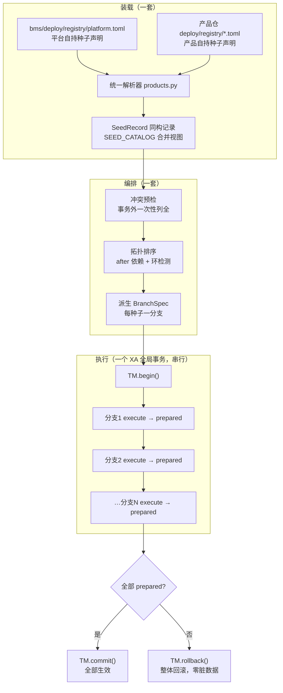
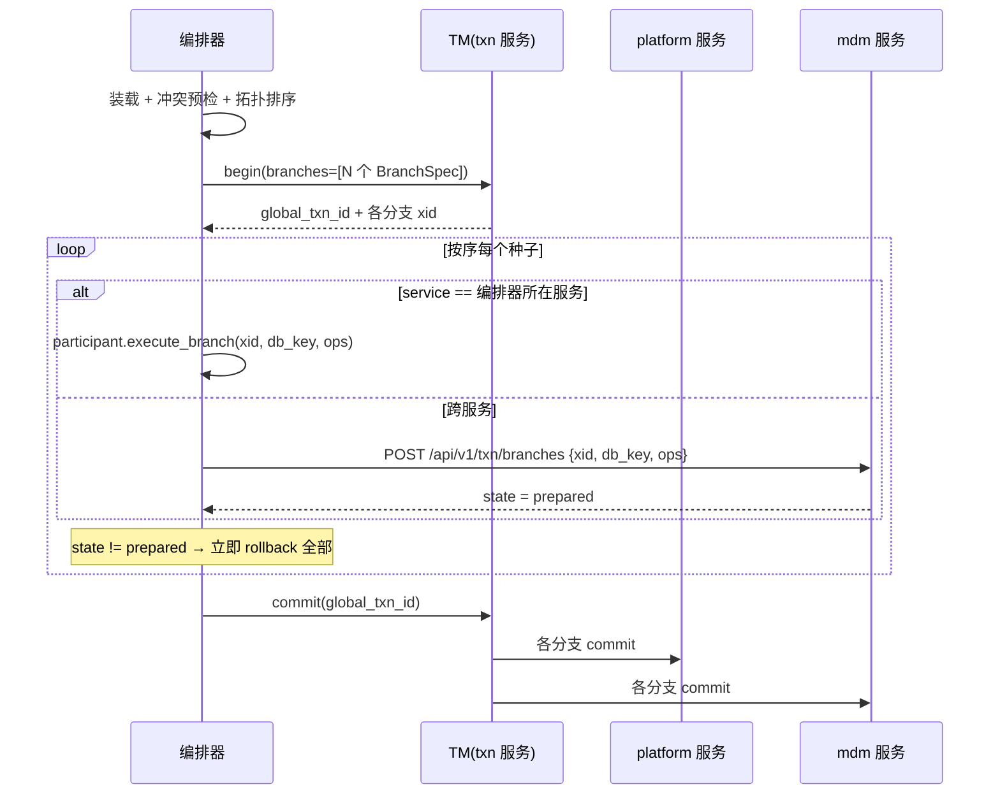

# 种子声明与平台调度详细设计

> 跨产品协同 · 02 协同基座 · 03 种子声明与平台调度 · 详细设计（开发核心文档）

[文档首页](../../../../../../文档首页.md) › [03 种子声明与平台调度](../02_协同基座_03_种子声明与平台调度.md) › 设计

## 1. 目标与边界 <a id="scope"></a>

**目标**：全部默认数据种子（平台自身 + 各产品）走**同一套装载注册机制**，由平台**统一编排**在**一个 XA 全局事务**内串行执行、统一提交或整体回滚——既杜绝「产品 A 执行到一半、产品 B 读到半成品」，也杜绝「A 成功、B 失败后 A 无法回滚留下脏数据」。

**范围内**：

1. 种子声明的统一形态（平台与产品同构，均走自持声明）；
2. 平台种子声明外置（`deploy/registry/platform.toml`）与装载器统一发现规则；
3. XA 统一编排：冲突预检 → 拓扑排序 → 串行分支 prepare → 统一 commit / 整体 rollback；
4. 种子入口契约（沿用分支处理器范式）与逐项报告口径；
5. mdm 种子真实播种（业务码 + 4 条权限码）；
6. 部署流程改造（先起服务、再跑种子、通过后开流量）。

**范围外**：平台种子去产品化（`03_03`）、能力分配（`02_04`）、错误码（`02_05`）、种子执行记录表（开放项）。

**交付物清单**：

| # | 交付物 | 落点 |
| --- | --- | --- |
| D1 | 平台种子自持声明 | `bms/deploy/registry/platform.toml`（新增） |
| D2 | `SeedRecord` 扩展（`service` / `db_key` / `op` / `tables`） | `bms_core/services/module_registry.py` |
| D3 | 声明装载统一发现（本仓 + 外部产品） | `bms_core/registry/products.py` |
| D4 | XA 种子编排器 | `bms_core/tenant/seed/orchestrator.py`（新增） |
| D5 | 种子分支处理器注册表 + 平台侧处理器 | `bms_core/tenant/seed/branch.py`、`bms_platform/services/seed_branch_handlers.py`（均新增） |
| D6 | 编排入口 CLI | `bms_core/tenant/seed/cli.py`（新增）、`ops/seed_platform.py`（薄壳转发） |
| D7 | mdm 种子真实播种 | `mdm/backend/services/org/src/mdm/seeds/permissions.py`、mdm 侧分支处理器 |
| D8 | 部署流程改造 | `scripts/tools/deploy/release.py`、部署文档 |
| D9 | 设计与实施 / 测试记录 | 本目录 `设计/`、`实施/`、`测试/` |

## 2. 现状与问题 <a id="current"></a>

### 2.1 现状事实

| 项 | 现状（代码落点） |
| --- | --- |
| 种子入口 | 10 个独立 CLI：`seed_platform` / `seed_module` / `seed_menu` / `seed_rbac` / `seed_tables` / `seed_tenant` / `seed_user` / `seed_config` / `seed_sso` / `seed_oidc_client` |
| 平台种子声明 | **代码常量**（`seed_menu.py::BUSINESS_SEEDS`、`seed_rbac.py::BUILTIN_ADMIN_ROLES` 等），不落声明文件 |
| 产品种子声明 | 自持清单 `[[seeds]]`（`SeedRecord`：`name` / `module` / `entry` / `after`） |
| 平台种子视图 | `SEED_CATALOG` **留空**（注释写明「平台自身种子归 `02_03`」），`seed_catalog_view()` 只含清单声明 |
| 编排 | **无统一编排**——部署时按文档手工逐个执行，漏跑靠人工发现 |
| 幂等 | 各脚本内部自实现，**四种口径并存**：存在即跳过（menu / tenant / config / platform / rbac / user）、存在即更新（module / sso / oidc_client）、更新+清退（tables）、跳过或重置（user） |
| 冲突 | 有的报错、有的覆盖，**未统一** |
| 事务 | 各脚本自建 engine / session，**互不相关**；一个失败不影响已成功的 |
| XA 能力 | **已完整具备**（`bms_core/transaction/`：TM + 参与方 + 分支处理器注册表；恢复器在 `txn` 服务），但**未用于种子** |

### 2.2 草案原方案为什么被否 <a id="rejected"></a>

草案 §3.2 曾主张「平台侧用可调用引用、产品侧用模块路径」，执行上则是「平台编排器产出计划、产品在自己镜像内执行」。该方案被**明确否决**，原因：

| # | 问题 | 后果 |
| --- | --- | --- |
| 1 | **两套机制**：平台种子写代码常量、产品种子写清单 | 与架构 38 §9「协同层只增加记录种类，不增加机制种类」直接冲突 |
| 2 | **两个事务**：平台种子在平台进程跑、产品种子在产品进程跑 | 产品 A 提交后产品 B 才执行，**中间窗口其他进程可读到半成品** |
| 3 | **无法整体回滚**：B 失败时 A 已提交 | A 回滚不了，**脏数据留在库里** |
| 4 | 依赖 `after` 只表达顺序、不表达事务边界 | 跨库一致性无保证，只能靠「顺序 + 幂等」事后收敛 |

> **拍板**：改为**一套装载 + 一个 XA 全局事务**——见 §3。

## 3. 统一机制设计 <a id="design"></a>

### 3.1 总览 <a id="overview"></a>



### 3.2 统一的四个维度 <a id="unified"></a>

| 维度 | 统一口径 |
| --- | --- |
| **声明** | 平台与产品**同一形态**：均为 `deploy/registry/*.toml` 的 `[[seeds]]` 段；平台不再写代码常量声明 |
| **装载** | 同一解析器 `products.py`、同一 `SeedRecord`、同一 `SEED_CATALOG` 合并视图；平台声明在前、产品在后 |
| **编排** | 平台统一编排：冲突预检 → 拓扑排序 → 派生分支 → 一个 XA 全局事务；**无第二个播种入口** |
| **执行** | 每种子声明 `service` + `db_key`，编排器按声明派生 `BranchSpec`；跨服务分支经 `/api/v1/txn/branches` 远程驱动，同进程分支直接调参与方 |

### 3.3 种子声明字段 <a id="fields"></a>

在 `02_01` 已定的 `name` / `module` / `entry` / `after` / `description` / `status` 之上**新增四个字段**：

| 字段 | 必填 | 说明 |
| --- | --- | --- |
| `service` | 是 | **在哪个服务执行**（决定 XA 分支的参与方）。平台种子为 `platform`；产品种子为其服务键（如 `mdm`） |
| `db_key` | 是 | **写哪个库**（XA 分支目标库键）。形如 `platform_platform` / `tenant_platform_demo`；支持 `{tenant}` 占位由运行时展开 |
| `op` | 否 | XA 分支操作名，**缺省取 `name`**（全局唯一，与 `SEED_CATALOG` 同键） |
| `tables` | 否 | **真实表名 → 自然键**映射（多列逗号分隔），供编排器做「执行前后对比」生成逐项统计（见 §3.10）；值列按表结构派生，不写进声明 |

> **`source` 不是声明字段**（2026-10-27 补充）：种子来源（`platform` / 产品键）由**装载期注入**——`products.py` 解析清单时取该清单的 `product_key` 填入 `SeedRecord.source`，声明文件不写、也不允许写（写了即与清单归属冲突）。原实现按「名字首段」推断来源，把 `seed-module` 误判为 `seed`，故改为装载期注入（§8 #25）。

**平台种子声明示例**（`bms/deploy/registry/platform.toml`）：

```toml
# 平台自持种子声明（与产品 deploy/registry/<product>.toml 同一形态、同一解析器）
product_key = "platform"

[[seeds]]
name = "seed-module"
service = "platform"
db_key = "platform_platform"
module = "ops.seed_module"
entry = "seed_modules_entry"
after = []
description = "服务目录与产品档案（sys_module + sys_product）"

[seeds.tables]
module = { table = "sys_module", key = "module_key" }
product = { table = "sys_product", key = "product_key" }

[[seeds]]
name = "seed-tables"
service = "platform"
db_key = "platform_platform"
module = "ops.seed_tables"
entry = "seed_tables_entry"
after = ["seed-module"]
description = "表归属登记（sys_table_ownership，含退役清退）"

[seeds.tables]
ownership = { table = "sys_table_ownership", key = "table_name" }

[[seeds]]
name = "seed-menu"
service = "platform"
db_key = "platform_platform"
module = "ops.seed_menu"
entry = "seed_menu_entry"
after = ["seed-module"]
description = "业务码 / 动作码 / 权限码 / 菜单 / 表单 / 按钮 / 字段"

[seeds.tables]
business = { table = "sys_business", key = "code" }
action = { table = "sys_action", key = "code" }
permission = { table = "sys_permission", key = "business_id,action_id" }
menu = { table = "sys_menu", key = "path" }

[[seeds]]
name = "seed-tenant"
service = "tenant"
db_key = "platform_tenant"
module = "ops.seed_tenant"
entry = "seed_tenants_entry"
after = []
description = "租户注册库（sys_tenant + sys_tenant_database）"

[seeds.tables]
tenant = { table = "sys_tenant", key = "code" }

[[seeds]]
name = "seed-config"
service = "tenant"
db_key = "tenant_platform_{tenant}"
module = "ops.seed_config"
entry = "seed_configs_entry"
after = ["seed-tenant"]
description = "系统参数默认值"

[[seeds]]
name = "seed-platform"
service = "platform"
db_key = "tenant_platform_{tenant}"
module = "bms_core.tenant.seed.platform"
entry = "seed_platform_rbac_entry"
after = ["seed-menu"]
description = "平台租户 RBAC（platform_admin / platform_ops）"

[[seeds]]
name = "seed-rbac"
service = "platform"
db_key = "tenant_platform_{tenant}"
module = "bms_core.tenant.seed.rbac"
entry = "seed_rbac_entry"
after = ["seed-menu", "seed-platform"]
description = "三类内置管理员角色与授权"
```

> **`seed_user` / `seed_sso` / `seed_oidc_client` 不纳入编排**：前两者需账号 / 口令参数，后者仅 dev / E2E 使用，均属显式运维或演示动作。

### 3.4 装载：统一发现规则 <a id="load"></a>

| 来源 | 路径 | 说明 |
| --- | --- | --- |
| **本仓声明** | `<仓根>/deploy/registry/*.toml` | 自动发现，无需配置。bms 仓为 `platform.toml`；产品仓为其自持声明 |
| **外部产品声明** | ~~`[registry].product_manifests` 配置项~~ | **已退役（07B `04_02`）**：清单取源固定为本仓 `deploy/registry/*.toml` 自动发现 + `--manifest` 显式追加；跨仓声明改由注册通道承载（`02_06`），平台进程不再装载别家清单 |

**合并顺序**：本仓声明在前（平台种子）、外部产品声明在后（产品种子），插入序稳定，供报告与排障复现。

**统一性保证**：两条来源**同一解析器**（`_seed_record`）、**同一记录类型**（`SeedRecord`）、**同一视图**（`SEED_CATALOG` + `_INJECTED_SEEDS` 合并）。不新增第二套注册表。

**`SEED_CATALOG` 语义变更**：由「留空待填」改为「平台种子声明装载后的合并视图基座」——装载 `platform.toml` 时经 `register_seed_records` 注入，与产品种子同一通道。

**新校验（并入 `inspect_product_manifests`）**：

| # | 校验 | 判定 |
| --- | --- | --- |
| 1 | `service` / `db_key` 必填 | 缺失即拒 |
| 2 | 产品种子名前缀 | 产品种子的 `name` 须以 `<product_key>-` 开头 |
| 3 | `name` 全局唯一 | 平台与产品、产品与产品之间重名即拒（同值合并放行） |
| 4 | `after` 引用存在 | 引用的种子名须在合并视图中 |
| 5 | `db_key` 形态 | 须匹配 `platform_*` / `tenant_*` 或含 `{tenant}` 占位 |

### 3.5 编排：冲突预检 <a id="precheck"></a>

**时机**：事务开始**之前**（`TM.begin()` 之前），一次性扫描全部种子。

| 校验 | 判定 | 失败处置 |
| --- | --- | --- |
| 重名 | 平台种子与产品种子同名，或跨产品同名 | 拒绝，退出码 3，列出冲突双方 |
| 循环依赖 | `after` 拓扑排序出现环 | 拒绝，退出码 3，报出环上种子名 |
| 依赖缺失 | `after` 引用了不存在的种子名 | 拒绝，退出码 3 |
| 前缀约束 | 产品种子名不以 `<product_key>-` 开头 | 拒绝，退出码 3 |
| **数据冲突** | 目标行已存在且字段值与种子期望值不一致 | 汇总列出**全部**冲突（种子名 + 键 + 现有值 + 期望值），拒绝，退出码 1 |
| 入口可解析 | `module:entry` 不可导入 / 不可调用 | 拒绝，退出码 3 |

**数据冲突如何预检**（2026-10-27 补齐实现口径）：编排器在事务外**只读**查询 `tables` 段声明的目标表，与种子期望值比对。期望值来源：

| 种子类型 | 期望值来源 |
| --- | --- |
| 代码常量型（`seed-menu` 等） | 实现模块暴露 `expected_rows() -> list[ExpectedRow]` |
| 数据驱动型（`mdm-admin-codes`） | 同上，由产品侧实现 |

**`expected_rows()` 契约**（q9 拍板：9 个平台种子 + mdm 种子**全部实现**）：

```python
@dataclass(frozen=True)
class ExpectedRow:
    """种子期望行（预检比对用）。"""
    table: str                 # 目标表名（与声明 tables 段的键对应）
    key: ConcurrentStableFrozenDict[str, object]   # 自然键（列名 → 值）
    values: ConcurrentStableFrozenDict[str, object]  # 期望字段值（列名 → 值；空表示只校验存在性）
```

- **可选实现**：模块未暴露 `expected_rows` 时跳过该种子的数据预检（仅靠唯一约束兜底），不报错；
- **只读**：`expected_rows()` 必须纯函数（不连库、不写库），期望值来自代码常量；
- **比对口径**：按 `key` 查目标表 → 无行 = 待新建（不算冲突）；有行且 `values` 中任一字段与期望不等 = **冲突**；有行且全等 = 跳过。

**读库方式**（q10 拍板）：按 `db_key` 取**同步引擎**（`EngineRegistry.get_sync`）只读查询——与 XA 分支同一套引擎解析，`db_key` 语义一致。预检在 `ensure_structure` **之后**、`TM.begin()` **之前**执行（表须先就绪）。

**冲突输出**：汇总列出**全部**冲突（种子名 + 表 + 键 + 现有值 + 期望值），退出码 1，不进入事务。

> **设计取舍**：预检是**乐观**的——预检通过后到实际执行之间，数据仍可能被改。为防此窗口，分支执行时由数据库唯一约束兜底（同键异值插入会失败 → 分支 rejected → 整体回滚）。预检的价值是**快速失败 + 一次看全**，不是唯一防线。

### 3.6 编排：拓扑排序与分支派生 <a id="sort"></a>

1. **排序**：按 `after` 拓扑排序；同层无依赖者按**登记顺序**（平台在前、产品按清单顺序）稳定排序。
2. **筛选**：`--only NAME`（可多次）/ `--skip NAME`（可多次）。`--only` **不自动补依赖**，缺依赖时输出提示。
3. **派生分支**：每种子派生一个 `BranchSpec(branch_id=种子名哈希, service=种子.service, db_key=展开后的种子.db_key)`。
4. **`branch_id` 约束**：`≤ MAX_BRANCH_ID_LENGTH`（16 字符）。种子名可能超长，故 `branch_id` 取 **`sha1(name)[:16]`**；报告与日志仍用种子名。
5. **`--require NAME`**（人工强制前置）：该种子必须在本批**全部之前**完成；不在执行集合内 → 退出码 3。

   **排序口径**（2026-10-27 q12 拍板，补实现）：
   - **分组优先**：被 `--require` 的种子归入「强制前置组」，其余归入「常规组」；执行序 = 强制前置组 → 常规组；
   - **组内仍守依赖**：两组各自按 `after` 拓扑排序，被 require 的种子若自身有 `after` 依赖，**依赖仍须先于它**（优先级不能压过依赖正确性）；
   - **依赖跨组时以依赖为准**：若常规组某种子是强制前置组某项的 `after` 依赖，则该依赖被**提升进强制前置组**（闭包展开），保证「require 项在本批全部之前」成立；
   - **依赖无法满足即拒**：提升后的强制前置组若引用了本批**不存在**的种子（被 `--skip` 或未 `--only` 选中），退出码 3 并列出缺失依赖——强制前置无法兑现时不静默降级。

### 3.7 执行：串行 prepare 与统一提交 <a id="execute"></a>

**核心约束（用户拍板）**：种子**严格串行**，前一分支 `prepared` 完成才开下一分支。同一时刻只有一个分支在执行，无并发干扰、无互锁。



**分支操作清单**：每个种子派生一个 `BranchOp(op=种子名, args=种子参数)`。`args` 内容：

| 参数 | 来源 |
| --- | --- |
| `tenant` | 运行时（`--tenant` 或配置 `[platform_tenant].code`） |
| `db_key` | 声明 `db_key` 展开 `{tenant}` 后 |
| 种子自定义参数 | 声明 `params` 段（键值对） |

### 3.8 失败与回滚 <a id="rollback"></a>

| 情形 | 处置 | 退出码 |
| --- | --- | --- |
| 预检失败（重名 / 环 / 入口 / 前缀 / 依赖） | 不进入事务，直接报告 | 3 |
| 预检发现数据冲突 | 不进入事务，列出全部冲突 | 1 |
| 某分支 `rejected`（op 未登记） | 立即 `rollback` 全部已 prepare 分支 | 2 |
| 某分支执行抛异常 | 立即 `rollback` 全部 | 2 |
| `commit` 阶段失败 | TM 重试；仍失败则进恢复器（`txn` 服务 `PollTransactionRecovery`） | 2 |
| 全局事务超时 | 中止并 `rollback` | 2 |
| 全部成功 | `commit` | 0 |

**报告口径（用户拍板）**：失败时**全部种子标「已回滚」**，并**突出失败那一个的根因**。例：

```text
种子                来源     状态      说明
seed-module         platform 已回滚    —
seed-tables         platform 已回滚    —
seed-menu           platform 已回滚    —
mdm-admin-codes     mdm      已回滚    ← 失败：ParamError（业务码 mdm 已存在且名称不同）
seed-rbac           platform 未执行    （因前序失败，该分支未提交）
→ 整体未生效（全局事务已回滚），无脏数据。
```

### 3.9 种子入口契约 <a id="contract"></a>

**沿用既有分支处理器范式**（`bms_core/transaction/base.py::BranchHandler`），不新增第二套执行范式：

```python
# 签名与 BranchHandler 一致：handler(session, args) -> None
async def seed_admin_codes(session: DbSession, args: ConcurrentStableDict[str, object]) -> None:
    """管理面业务码与权限码种子（在 XA 分支事务内执行）。

    Args:
        session: 已绑定 XA 分支连接的会话（写入自动并入分支事务）。
        args: 分支参数（tenant / db_key / 声明 params）。
    """
    ...
```

| 契约点 | 口径 |
| --- | --- |
| 签名 | `async def <entry>(session: DbSession, args: ConcurrentStableDict[str, object]) -> None` |
| 会话 | 由执行器传入，**已绑定 XA 分支连接**；种子不得自建 engine / session |
| 事务 | 种子不得自行 `commit`；写入由执行器在分支内统一 `flush` + `prepare` |
| 返回值 | `None`；统计由编排器统一采集（见 §3.10） |
| 异常 | 抛出即分支失败 → 整体回滚；异常信息进入报告 |
| 幂等 | 种子实现须按自然键判存（存在且同值 → 跳过；存在且异值 → 抛错，由预检提前拦截） |
| 期望值 | **实现 `expected_rows()`**（q9 拍板：9 平台种子 + mdm 全部实现），供预检比对；契约见 §3.5 |

**兼容既有实现**：现有 `ops/seed_*.py` 的 `async def seed_*(url)` 需**加一层适配**——保留原函数，新增符合契约的入口包装：

```python
# ops/seed_menu.py 新增（原 seed_menu(url) / main() 保留不动）
async def seed_menu_entry(session: DbSession, args: ConcurrentStableDict[str, object]) -> None:
    """XA 分支入口：把执行器传入的 session 交给既有实现。"""
    await seed_menu_in_session(session)
```

> **改造原则**：既有 `main()` / `seed_*(url)` **一律保留**（内部单步排障仍可用），只新增符合新契约的入口函数。既有调用方零改动。

### 3.10 逐项报告 <a id="report"></a>

**数据来源（用户拍板）**：编排器统一采集，**种子不报数**。

**采集时机（2026-10-27 q11 拍板，补实现）**：在**分支连接内**、handler 执行**前后各查一次**目标表——同一连接能看到本分支未提交的写入，统计必然准确；分支外采集（`TM.begin` 前 / `commit` 后）只能算「本批净增」且失败时恒为 0，不可用。

**目标表与值列（2026-10-29 `03_03` 对齐）**：探针不再由平台侧硬编码表维护，改为**按种子声明的 `tables` 段派生**——`tables` 为「真实表名 → 自然键」，值列（判定 `updated` 的列）按表结构自动派生：排除主键列、自然键列与系统列（`tenant_id` / 审计列 / 时间戳 / `version`）。登记时机随之下移到**种子记录装载之后**、执行之前（产品种子须已可见）；未知表名记警示进报告 `warnings`，不阻断编排。

| 指标 | 采集方式 |
| --- | --- |
| `created` | 分支内 handler 执行前后对比目标表行数差 |
| `updated` | 分支内对比自然键命中行的字段值变化 |
| `skipped` | 分支内对比后无变化的行数 |
| `conflicts` | 预检阶段已列出（事务外），执行阶段由唯一约束兜底 |
| `failed` | 分支 `rejected` 或抛异常 |

**执行器契约扩展**：分支执行器 `execute_branch` 在返回分支状态的同时返回**逐 op 统计**（`SeedStats`：`created` / `updated` / `skipped`）。编排器只做汇总（按计划序填进 `SeedReport`），种子实现仍不报数——统计口径唯一。

> **实现落点**：统计采集在 `XaTransactionParticipant.execute_branch` 内（分支连接上），编排器经 `branch_runner` 拿回；测试替身只需返回同构 `SeedStats`。

**输出形态**：

| 模式 | 形态 |
| --- | --- |
| 缺省 | 人类可读表格（逐种子一行 + 汇总行） |
| `--json` | 机器可读 JSON（供 CI / 验收脚本断言） |

### 3.11 退出码 <a id="exit"></a>

| 码 | 含义 |
| --- | --- |
| 0 | 全部成功（含 skipped） |
| 1 | 数据冲突（预检发现异值，未进入事务） |
| 2 | 执行失败（分支 rejected / 抛异常 / commit 失败 / 超时），已整体回滚 |
| 3 | 编排前置错误（重名 / 环 / 依赖缺失 / 前缀违规 / 入口不可解析 / `--require` 目标不在集合） |
| 64 | 参数错误（`EX_USAGE`；避开 argparse 缺省的 2，防与「执行失败」混淆） |

**退出码 64 的落点**（2026-10-27 q13 拍板，补实现）：

| 位置 | 行为 |
| --- | --- |
| CLI 参数解析 | 覆盖 `argparse.ArgumentParser.error()` 使其 `exit(64)`（不改 argparse 缺省的 2） |
| CLI 收到 HTTP 400 | 编排端点对参数非法（`--only` / `--skip` / `--require` 引用不存在的种子）返回 400，CLI 捕获后映射为退出码 64 |
| 服务端 | 仍用 HTTP 400 + 业务码 `10001`（**不**在 HTTP 契约里返回 64——64 是 POSIX `EX_USAGE` 语义，属命令行约定） |

### 3.12 CLI 参数 <a id="cli"></a>

| 参数 | 说明 |
| --- | --- |
| `--tenant CODE` | 目标租户（展开 `{tenant}` 占位）；缺省取 `[platform_tenant].code` |
| `--only NAME` | 只执行指定种子（可多次）；不自动补依赖 |
| `--skip NAME` | 跳过指定种子（可多次） |
| `--require NAME` | 人工强制：该种子必须在本批**全部之前**完成（可多次）；排序口径见 §3.6.5；不在执行集合内 → 退出码 3 |
| `--dry-run` | 只做装载 + 排序 + 冲突预检，**不开事务不执行** |
| `--json` | 机器可读报告 |
| `--timeout SECONDS` | 全局事务超时（缺省 300s，防长锁窗口挂死） |

### 3.13 与既有 10 个命令的关系 <a id="legacy"></a>

| 命令 | 处置 |
| --- | --- |
| `seed_platform` | **升级为唯一编排入口**（薄壳转发 `bms_core.tenant.seed.cli:main`） |
| 其余 9 个 | **保留 CLI**，文档标注「内部单步（排障用）」；新增符合新契约的 `*_entry` 入口供编排调用 |

> 口径：编排入口为**唯一推荐**调用方式；单步命令保留但不对外推荐（彻底下线另立任务）。

### 3.14 部署流程改造 <a id="deploy"></a>

**拍板（前提①A）**：部署分两步——先起全部服务（healthy），再跑种子编排，通过后才开流量。

| 步骤 | 现状 | 改造后 |
| --- | --- | --- |
| 1 | 建库授权 | 不变 |
| 2 | 建表 | 不变 |
| 3 | 起容器 | 不变 |
| 4 | 健康门禁 | 不变 |
| 5 | 种子（`seed_module` → `seed_tables` → `seed_tenant`） | **改为一条编排命令** `python -m ops.seed_platform --tenant <租户>` |
| 6 | 网关可达 / 开流量 | **移到种子之后**（种子失败即中止，不切流量） |

**关键约束**：种子编排要求 XA 参与方**在线可达**（跨服务分支经 `/api/v1/txn/branches` 驱动），因此顺序必须是「**起服务 → 跑种子 → 开流量**」，不能沿用现在的「建表 → 种子 → 起服务」。

**部署脚本改造**（`scripts/tools/deploy/release.py::cmd_bootstrap`）：

| 变更 | 说明 |
| --- | --- |
| 种子段 | 由 3 条独立 `_compose_run` 改为 1 条编排入口 |
| 顺序 | 种子步骤**移到 `deploy` 之后**；或拆出 `bootstrap --seed-only` 供部署流程第二阶段调用 |
| 失败处置 | 退出码非 0 即中止部署，不进入网关切流 |

### 3.15 mdm 种子真实播种 <a id="mdm"></a>

| 项 | 内容 |
| --- | --- |
| 声明 | `mdm/deploy/registry/mdm.toml` 的 `[[seeds]]` 补 `service` / `db_key` / `tables` |
| 实现 | `mdm/backend/services/org/src/mdm/seeds/permissions.py::seed_admin_codes(session, args)` |
| 写入 | 业务码 `mdm`（`sys_business`）+ 4 条权限码 `mdm:query/create/update/delete`（`sys_permission`） |
| 幂等 | 按自然键判存：`sys_business.code` / `sys_permission(business_id, action_id)` |
| 冲突 | 存在且名称 / 动作不同 → 抛 `ParamError`，由预检提前拦截 |
| 分支处理器 | mdm 侧新增 `mdm/services/seed_branch_handlers.py`，注册 `op = "mdm-admin-codes"` |

> **跨库事实**：mdm 种子写 `sys_business` / `sys_permission` / `sys_action`，这些表归**平台服务库**。故该种子 `db_key = "platform_platform"`（不是 mdm 自己的库）——声明须如实写，XA 分支按此连接；**服务身份仍是 `mdm`**（`service = "mdm"`），体现「产品声明、平台调度、产品执行」。

## 4. 影响面 <a id="impact"></a>

| 类别 | 对象 | 变更 |
| --- | --- | --- |
| 新增 | `bms/deploy/registry/platform.toml` | 平台 7 个种子的自持声明 |
| 新增 | `bms_core/tenant/seed/orchestrator.py` | XA 种子编排器（预检 / 排序 / 分支派生 / 执行 / 报告） |
| 新增 | `bms_core/tenant/seed/branch.py` | 种子分支处理器注册表 + 执行器适配 |
| 新增 | `bms_core/tenant/seed/cli.py` | 编排入口 CLI（参数 / 退出码 / 报告渲染） |
| 新增 | `bms_platform/services/seed_branch_handlers.py` | 平台侧种子分支处理器 |
| 修改 | `bms_core/services/module_registry.py` | `SeedRecord` 增 `service` / `db_key` / `op` / `tables` 字段 |
| 修改 | `bms_core/registry/products.py` | `[[seeds]]` 解析新字段 + 本仓 `deploy/registry/*.toml` 自动发现 + 前缀 / 重名 / `after` / `db_key` 校验 |
| 修改 | `ops/seed_platform.py` | 薄壳转发编排入口 |
| 修改 | `ops/seed_*.py`（7 个纳入编排的） | 新增符合新契约的 `*_entry` 包装（原 `main` / `seed_*` 保留） |
| 修改 | `mdm/backend/services/org/src/mdm/seeds/permissions.py` | 真实播种实现 |
| 修改 | `mdm/deploy/registry/mdm.toml` | 补 `service` / `db_key` / `tables` |
| 修改 | `scripts/tools/deploy/release.py` | 种子段改编排入口 + 顺序调整 |
| 修改 | 部署文档 | 更新种子执行顺序与命令 |
| 修改 | `bms_core/services/module_registry.py`（二轮） | `SeedRecord` 增 `source` 字段 + `ExpectedRow` 契约（§3.3 / §3.5） |
| 修改 | `bms_core/registry/products.py`（二轮） | 装载期按清单 `product_key` 注入 `source` |
| 修改 | `bms_core/tenant/seed/orchestrator.py`（二轮） | `precheck_conflicts` / require 排序 / 统计汇总 / 来源取 `record.source` |
| 修改 | `bms_core/tenant/seed/cli.py`（二轮） | `argparse.error` 退 64 + HTTP 400 映射 64 |
| 修改 | `bms_core/transaction/xa.py`（二轮） | 分支内统计采集（`execute_branch` 返回 `SeedStats`） |
| 修改 | 9 个种子实现模块 + mdm `seeds/permissions.py` | 各增 `expected_rows()` |
| 不变 | `bms_core/transaction/*` 的 XA 协议能力 | 两阶段协议复用，不改；仅扩统计返回 |

## 5. 测试设计 <a id="test"></a>

| # | 用例 | 断言 |
| --- | --- | --- |
| 1 | 平台声明装载 | `platform.toml` 的 7 条种子进入 `SEED_CATALOG`，字段逐一正确 |
| 2 | 平台 + 产品合并视图 | 平台在前、产品在后；同一 `SeedRecord` 类型 |
| 3 | 声明自动发现 | 本仓 `deploy/registry/*.toml` 无需配置即被装载 |
| 4 | 冲突预检：重名 | 平台与产品同名 → 退出码 3，列出双方 |
| 5 | 冲突预检：数据异值 | 目标行已存在且名称不同 → 退出码 1，列出**全部**冲突（不止第一个）；不进入事务 |
| 6 | 冲突预检：循环依赖 | `after` 成环 → 退出码 3，报出环上种子名 |
| 7 | 冲突预检：前缀违规 | 产品种子名不以 `<product_key>-` 开头 → 退出码 3 |
| 8 | 冲突预检：入口不可解析 | `module:entry` 不存在 / 不可调用 → 退出码 3 |
| 9 | 冲突预检：`after` 引用不存在 | 退出码 3 |
| 10 | 冲突预检：`db_key` 形态非法 | 退出码 3 |
| 11 | 拓扑排序 | 执行顺序满足 `after`；同层按登记顺序稳定 |
| 12 | 分支派生 | 每种子一个 `BranchSpec`；`branch_id` ≤ 16 字符且稳定；`service` / `db_key` 与声明一致 |
| 13 | **串行执行** | 前一分支 `prepared` 完成后才开下一分支（断言执行时序） |
| 14 | 全部成功 | 退出码 0；所有分支 `committed`；报告逐项 |
| 15 | 某分支失败 | 退出码 2；**全部已 prepare 分支回滚**；报告全部标「已回滚」+ 突出失败根因 |
| 16 | **无脏数据** | 失败后查询目标表，**无任何种子写入**（对比执行前快照） |
| 17 | **中间态不可见** | 分支 prepare 后、commit 前，另一连接查询**看不到**未提交数据 |
| 18 | 重复执行（幂等） | 第二次执行 `created=0`，无重复行，退出码 0 |
| 19 | `--dry-run` | 不开事务、不写库；输出预检结果 |
| 20 | `--only` / `--skip` | 只执行指定项；缺依赖时输出提示 |
| 21 | `--require` | 被 require 项排在全部之前；其自身依赖仍先满足；依赖不在本批 → 退出码 3；不在集合内 → 退出码 3 |
| 22 | 参数错误 | 退出码 64（不是 2） |
| 23 | 逐项报告 | `created` / `updated` / `skipped` 与目标表实际变化一致（分支内采集，同一连接可见未提交写入） |
| 24 | `--json` 报告 | 结构可解析，字段齐全 |
| 25 | mdm 种子真实播种 | 业务码 `mdm` + 4 条权限码写入；重复执行幂等 |
| 26 | mdm 种子冲突 | 业务码已存在且名称不同 → 预检拦截，退出码 1（`expected_rows()` 比对命中） |
| 27 | 单步命令兼容 | `python -m ops.seed_menu` 行为不变（原 `main` 保留） |
| 28 | 跨服务分支 | mdm 种子经 `/api/v1/txn/branches` 远程驱动，`prepared` 后参与全局提交 |
| 29 | 事务超时 | 超过 `--timeout` → 中止并回滚，退出码 2 |

**验收映射**（需求 02-3 完成标准 → 用例）：

| 完成标准 | 用例 |
| --- | --- |
| 平台种子清单不含产品标识 | `03_03`（本任务只保证机制不代写） |
| 产品种子按声明执行后权限码正确入库 | 25 |
| 重复执行幂等 | 18 |
| 人为构造冲突时非零退出并给出差异 | 5、26 |
| 逐项结果输出可核对 | 23、24 |
| 种子入口不可解析时拒启 | 8 |
| 单产品失败不影响其他产品且整体非零 | 15、16（统一事务下改为「整体回滚」，比原口径更强） |

## 6. 风险与边界 <a id="risk"></a>

| 风险 | 处置 |
| --- | --- |
| **长锁窗口**：串行 prepare 到 commit 之间所有行锁不释放 | 部署窗口内无业务流量；加 `--timeout`（缺省 300s）；文档明确「编排执行窗口内不接流量」 |
| **XA 参与方不在线** | 部署顺序强制「先起服务 → 跑种子」；分支驱动失败即整体回滚，不留半成品 |
| 种子实现自行 commit 破坏分支 | 契约明确禁止；执行器在分支内统一 flush + prepare；用例断言 |
| 预检与执行之间数据被改 | 预检是乐观的，数据库唯一约束兜底（同键异值插入失败 → 整体回滚） |
| `branch_id` 超 16 字符 | 取 `sha1(name)[:16]`；报告与日志仍用种子名 |
| 平台声明与代码常量漂移 | 声明外置后**代码不再有种子清单常量**（只保留实现），无漂移可能 |
| 既有单步命令被误用 | 保留但标注「内部单步」；部署脚本与文档统一用编排入口 |
| mdm 种子写平台库（跨库） | 声明如实写 `db_key = "platform_platform"`；文档说明「权限码表归平台库」 |
| 种子数量增长后串行过慢 | 当前强制串行是正确性优先；见开放项 5 |

## 7. 开放项 <a id="open"></a>

| # | 事项 | 归口 |
| --- | --- | --- |
| 1 | 种子执行记录表（记录上次执行版本、支持增量） | 种子数量与数据量显著增长时评估；当前靠幂等重跑 |
| 2 | 单步命令何时彻底下线 | 所有部署脚本切换完成后评估 |
| 3 | 产品种子是否按租户铺种（多租户循环） | 首个多租户产品需求出现时定 |
| 4 | 冲突是否支持 `--force` 覆盖 | 暂不提供（覆盖会掩盖声明与实现不一致） |
| 5 | 种子并发执行（当前强制串行） | 出现「种子数量大到串行过慢」时评估；需先解决依赖与锁冲突 |
| 6 | `expected_rows()` 是否强制实现 | **已定为必做**（9 平台种子 + mdm 全部实现，Q9）；新增种子须同步实现，由用例 5 覆盖 |
| 7 | 统计口径的「更新」判定粒度 | 当前按自然键命中行逐字段比对；大表（万行级）时全表扫描开销需评估，必要时改按 `tables` 声明的自然键范围裁剪 |
| 8 | 预检读库与结构前置的耦合 | 预检须在 `ensure_structure` 之后（表须先就绪），故 `--dry-run` 不建表时不查数据冲突，只做声明级预检 |

## 8. 对齐记录 <a id="alignment"></a>

> 2026-10-27 开工核对（代码现状 vs 草案）后与用户逐项拍板。草案原方案（两套机制、两个事务）**被明确否决**，据决策重写设计。

| # | 原设计 / 原草案 | 回写后 | 理由 |
| --- | --- | --- | --- |
| 1 | §3.2「平台用可调用引用、产品用模块路径」 | 统一为 `module + entry` 字符串（同一 `SeedRecord`） | 一套类型一套校验；可序列化、可 dry-run 打印（Q2） |
| 2 | 平台种子写代码常量 | 外置为 `deploy/registry/platform.toml` | 与产品完全同构，真正一套机制（前提②A） |
| 3 | 「平台编排器产出计划、产品在自己镜像内执行」 | **平台统一编排、一个 XA 全局事务内串行执行** | 用户否决两套机制：中间态可见 + 无法整体回滚（Q1） |
| 4 | §3.5「每种子一个事务，不跨种子合并」 | 改为**一个全局事务、每种子一分支** | 与「整体回滚、零脏数据」目标一致（Q3） |
| 5 | §3.4「`--only` 不自动补依赖」 | 保留 | 显式优于隐式（Q6） |
| 6 | §3.6 退出码 0/1/2/3，参数错误未定 | 参数错误改 64（`EX_USAGE`） | argparse 缺省 2 与「执行失败」撞车（Q5） |
| 7 | §3.5「失败隔离：单种子失败继续后续」 | 改为**整体回滚**（失败即回滚全部） | 用户要求：不允许脏数据；「失败隔离」在统一事务下语义升级（Q3） |
| 8 | §3.3 `SeedContext` / `SeedResult` 契约 | 改为**分支处理器范式** `async def seed_x(session, args) -> None` | 复用既有 `BranchHandler`，不新增第二套范式（Q8） |
| 9 | §3.6「种子返回 SeedResult 自带统计」 | 改为**编排器统一采集**（前后对比） | 统计口径唯一、种子无法作弊（Q9） |
| 10 | 未定「冲突何时检测」 | 事务前统一预检 | 快速失败、一次看全、不浪费 XA 开销（Q4） |
| 11 | §3.5「dry-run 全链路不写库」 | 只做装载 + 排序 + 预检，不开事务 | 零写入零风险（Q5） |
| 12 | 未定「失败报告形态」 | 全部标「已回滚」+ 突出根因 | 避免误读为「其余成功了」（Q10） |
| 13 | 未定「分支粒度」 | 每种子一分支，**严格串行** | 用户明确：串行无并发干扰、精确定位失败点（Q3 自定义） |
| 14 | 未定「锁窗口处置」 | 接受长锁（部署窗口无流量）+ 全局超时 | 简单、符合串行要求（Q6） |
| 15 | 未定「op 命名」 | `op = 种子名` | 一物一名，报告 / 日志 / 分支状态直接对应（Q13） |
| 16 | 未定「平台声明落点」 | `bms/deploy/registry/platform.toml` | 与产品同目录约定（Q11） |
| 17 | 未定「声明如何发现」 | 自动发现本仓 `deploy/registry/*.toml` + 外部 `product_manifests` | 一套扫描规则，新增产品零配置（Q12） |
| 18 | §3.7「10 个命令保留、标注内部单步」 | 保留，另新增 `*_entry` 包装供编排调用 | 既有调用方零改动 |
| 19 | §3.5「事务边界：每种子一事务」 | 每种子一**分支**（非独立事务），全局一事务 | 见 #4 |
| 20 | 原估工作量 8 | 重估为 24 | 统一机制改动面显著扩大（Q7；数值见阶段计划表） |
| 21 | §3.2「`SEED_CATALOG` 留空、平台种子走独立登记表」 | `SEED_CATALOG` 改为平台声明装载的合并视图基座 | 一个视图一个类型，不建第二套登记表 |
| 22 | 未定「种子入口在线性」 | 部署顺序改为「起服务 → 跑种子 → 开流量」 | XA 参与方须在线（前提①A） |
| 23 | 未定「mdm 种子写哪个库」 | `db_key = "platform_platform"`（权限码表归平台库） | 代码事实：`sys_business` / `sys_permission` 归平台服务库 |
| 24 | 「Kiwi 先登记再编码」 | 用例先落地，编号归 `05_01` 回填 | 与 `02_01` / `02_02` / `02_04` / `02_05` 既定口径一致 |
| 25 | 种子来源按「名字首段」推断（`_source_of`） | `SeedRecord` 增 `source` 字段，装载期由清单 `product_key` 注入 | 名字首段把 `seed-module` 判成 `seed`，报告误导；来源是装载期事实，存进记录最准（Q15） |
| 26 | 冲突预检 / `expected_rows()` / 逐项统计 / 退出码 64 仅停留在设计 | **本次补齐实现**（预检读库、`expected_rows` 契约、分支内统计采集、CLI 退 64） | 用户 2026-10-27 拍板「补齐实现后再落用例」：设计与实现不一致时用例无法按设计断言（Q1、Q9~Q13） |
| 27 | `--require` 只校验「在执行集合内」、不参与排序 | 改为**分组优先 + 依赖闭包提升**（§3.6.5） | 设计原口径「必须在本批全部之前完成」未落地；补排序后语义才成立（Q12） |
| 28 | 统计「执行前后对比」未说明在哪个连接采集 | 明确为**分支连接内** handler 前后各查一次 | 分支 prepare 后数据对其他连接不可见，分支外采集统计恒 0（Q11） |
| 29 | §3.10 统计探针的目标表由平台侧硬编码表维护（含产品种子条目） | 改为**按种子声明的 `tables` 段构造**（值列按表结构派生），登记时机移到记录装载之后 | 平台侧不应持有产品种子的统计口径；原登记早于装载，产品种子尚不可见（`03_03`） |
| 30 | §3.1 `tables` 只写「目标表 + 自然键」，声明侧出现逻辑名 | 明确为**真实表名 → 自然键**；`platform.toml` / `mdm.toml` 的逻辑名一并对齐 | `SeedRecord.tables` 契约原写真实表名，声明与契约需一致（`03_03`） |
| 31 | 平台种子 `tables` 段覆盖不全（缺系统参数种子）、授权种子自然键只写单列 | 补齐 `seed-config`，授权种子改三列组合键（`role_id,perm_type,target_id`） | 保持逐项统计口径与改造前一致（`03_03`） |

**未变口径**：种子为第六类记录、与既有五类同源同通道；校验并入既有 `ops.check_modules`；不新增第二套注册表 / 播种入口 / 校验入口；`mdm` 种子真实播种（业务码 + 4 权限码）。

> 本文档依《[文档生成规范](../../../../../../规范/文档生成规范.md)》与《[任务文档规范](../../../../../../规范/任务文档规范.md)》编写