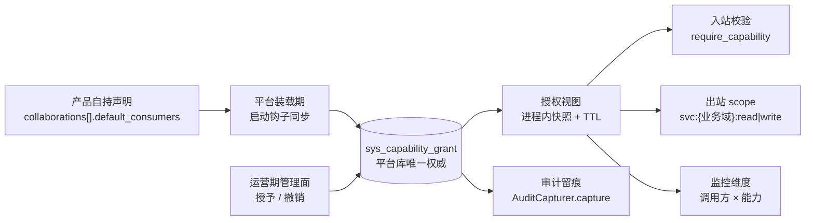
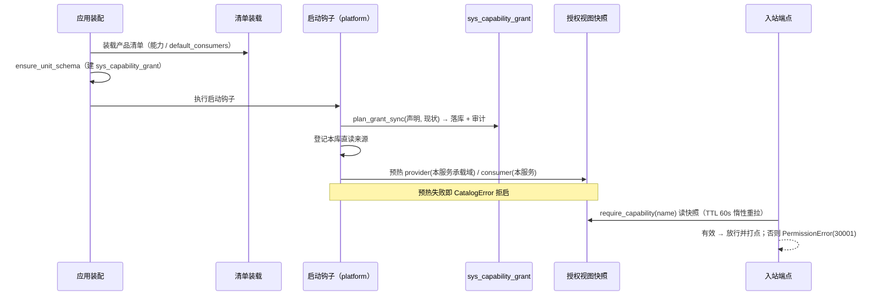

# 能力分配与授权详细设计

> 跨产品协同 · 02 协同基座 · 04 能力分配与授权 · 详细设计（开发核心文档）

[文档首页](../../../../../../文档首页.md) › [04 能力分配与授权](../02_协同基座_04_能力分配与授权.md) › 设计

## 1. 目标与边界 <a id="scope"></a>

**目标**：把「谁能用谁的能力」落成**授权记录**（能力 × 消费方），并由此派生**出站 scope**、**入站校验**与**监控维度**——使「有有效分配即合法（直连或经平台中转均可）、无分配即越界」可判定、可审计、可归因。

**范围内**：

1. 授权记录落库（`sys_capability_grant`）与两层来源（产品声明默认 / 平台人工授予）及其优先级、声明回归语义；
2. 三类派生：出站 scope、入站校验、监控维度；
3. 合法性判定、拒绝语义、撤销与有效期、缓存有界生效；
4. 授权视图的**跨进程分发**（平台内部出口 + 基座拉取缓存）与失败语义；
5. 审计留痕（占位契约）与指标打点；
6. 管理面三端点（查询 / 授予 / 撤销）与权限码、种子补登；
7. 与既有 `require_service` 白名单的**迁移口径**（本任务只交付机制，端点切换归 `03_01`）。

**范围外**：能力声明与装载校验（`02_01`）、能力取用与降级语义（`02_02`）、租户拓扑解析（07C `02_02`）、各消费方收编与端点切换（`03_01` / `03_02`）、审计日志真实落库（29-审计合规）、可观测面板（08 阶段）。

## 2. 现状 <a id="current"></a>

| 项 | 事实（代码落点） |
| --- | --- |
| 授权 | **无记录**。跨产品调用靠代码里的调用方白名单：`require_service("platform")`（mdm 内部写通道）、`require_service(MDM_SERVICE)` / `require_service("identity")`（platform 内部端点，共 6 文件 7 处） |
| 出站 | `ServiceCallPolicy.scopes` 由**调用方自填**（形如 `user:read`），无「是否被授权」的来源与校验；服务 JWT 由各服务自签，scope 属自报 |
| 入站 | `bms_core/api/base.py::require_service`（`aud=service` 全校验 + 白名单），越界抛 `AuthError`（20001/401） |
| 归因 | 通用请求指标 `bms_request_total{route, method, status}`，无「调用方 × 能力」维度，越权尝试无专门指标 |
| 审计 | `AuditCapturer` 占位契约（`bms_core/audit/base.py`，缺省 `NullAuditCapturer`）；`sys_data_audit_log` 表**尚未设计落地**（属 29-审计合规阶段） |
| 目录 | `collaboration_catalog_view()` 已带 `default_consumers` / `status` / `kind` / `domain` / `path`（`02_01` / `02_02` 交付）；`default_consumers` 已在装载期校验「消费方已登记」 |
| 表设计 | `sys_capability_grant` **表文件已定稿**（状态「待落库」），总览已登记 |

## 3. 目标设计 <a id="design"></a>



### 3.1 记录与表 <a id="record"></a>

**表结构只认表文件**：[sys_capability_grant](../../../../../../设计/数据库设计/数据表设计/sys_capability_grant.md)（字段、索引与约束一律以该文件为准，本设计不复制字段清单，见《[AI 开发规范](../../../../../../规范/AI开发规范.md)》「数据库与表设计的处理方式」节）。

本设计只补三条表文件未覆盖的**行为语义**：

- **一行 = 一个「能力 × 消费方」的有效授权**；唯一键 `(capability_name, consumer_key, deleted_at)`，撤销不删行、不新增行；
- **不按租户**：授权是平台级全局数据，落 `tenant_id` 之外（服务实例跨租户共享）；
- **不设「直连许可」字段**：架构 §4.1「直连的唯一判据是有效分配」，无独立于分配的第二维度（原总览表 `direct_allowed` 列按此删除，见 §8-17）。

**为什么落库而非只靠声明**：声明是部署期产物（随产品发版），授权需要**运营期调整与撤销即时生效**并留审计——两者性质不同，故「声明给默认、库表管现状」。

### 3.2 两层来源与优先级 <a id="priority"></a>

| 场景 | 处置 |
| --- | --- |
| 启动装载：声明中有、库中 `source=declared`（`enabled`） | 幂等更新 `status=enabled`（不改人工字段，不重置 `granted_at`） |
| 启动装载：声明中有、库中 `source=declared` 且 `disabled` 且 `note="声明移除"` | **恢复** `enabled`、清 `revoked_at`、`note` 清空（声明是基线，回归即恢复；人工介入过的记录不受影响） |
| 启动装载：声明中有、库中无记录 | 新建 `source=declared` / `status=enabled` / `granted_at=now` / `note="产品声明默认消费方"` |
| 启动装载：声明中移除、库中 `source=declared` 且 `enabled` | 置 `status=disabled` + `revoked_at=now` + `note="声明移除"`（**保留历史**，不物理删） |
| 启动装载：库中 `source=manual`（无论声明有无） | **不覆盖、不禁用**；仅在装载报告中输出「声明与人工不一致」`WARNING` |
| 人工授予 | UPSERT 为 `source=manual` / `status=enabled`，清 `revoked_at`，记 `granted_by` / `granted_at` / `note` |
| 人工撤销 | `status=disabled` + `revoked_at` + `source=manual`（声明装载不会把它重新打开） |

**一句话**：**声明是基线，人工是覆盖**；人工一旦介入该条记录，声明不再改动它。

> 差异计算落 `bms_core` **纯函数**（`plan_grant_sync(declared, current, now)`，无 IO、无进程级状态），落库执行落 platform 服务（决策 2）——保证「同一套判定」且共享库不依赖服务包。

### 3.3 三类派生 <a id="derive"></a>

| 派生 | 输入 | 输出 | 落点 |
| --- | --- | --- | --- |
| **出站 scope** | `consumer` = 当前服务（`settings.app.service`） | 该消费方被授权的 `(提供方业务域, 访问面类别)` 集合 → scope 串集合 | `granted_scopes(consumer)`；`build_capability_request()` 缺省自动填入 `policy.scopes` |
| **入站校验** | `capability` = 端点在提供方侧声明的能力名 | 允许的 `consumer` 集合 | `granted_consumers(capability)` + FastAPI 依赖 `require_capability(name)` |
| **监控维度** | 调用发生时的 `(capability, consumer)` | 指标标签 | §3.7 三个指标 |

**scope 命名口径**（决策 5）：`svc:{业务域}:{read|write}`——加服务段前缀，与开放接口 `product_scopes()` 的 `{product_key}:read|write` 彻底分区（否则 `platform` 业务域与 `platform` 产品键撞同一串）。

**类别映射**：`read` / `dataset` → `:read`；`write` / `txn-branch` → `:write`；`codes` 无访问面 → **不产生 scope**（仅参与目录与业务语义要素下发）。

**用法**：

```python
request = build_capability_request(endpoint, method="GET")   # policy.scopes 已按授权自动填好
```

`build_capability_request` 保持**同步**（消费方构造请求不放宽为异步）：scope 来自进程内授权快照（§3.4），TTL 过期不阻断构造——出站 scope 是**声明性背书**，入站判定以提供方侧视图为准（见 §3.5）。

### 3.4 授权视图与跨进程分发 <a id="distribution"></a>

**单一权威在平台库**；提供方（`provider` 维度）与消费方（`consumer` 维度）按需拉取，不在本地建第二份事实源。

**平台内部出口**（决策 9）：

| 项 | 口径 |
| --- | --- |
| 路径 | `GET /api/v1/platform/internal/capability-grants`（沿用平台内部面 `/{服务}/internal/...` 命名） |
| 参数 | `provider=<业务域>` 或 `consumer=<服务键>`，**二选一**（都缺 / 都给 → `ParamError` 10001） |
| 返回 | 授权对数组：`{capability_name, consumer_key, domain, kind, expire_at}`（仅 `status=enabled`；**是否过期由调用方本地判定**，以便区分「未授权」与「已过期」） |
| 鉴权 | 双模 `require_auth_or_service`：① 服务身份——`provider` 必须是**本服务承载的业务域**（域布局判定）、`consumer` 必须是**本服务标识**，越界即拒（`PermissionError` 30001）；② 登录态——需权限码 `capability-grant:query` |
| 边界 | 只读、无写接口；不含 `note` / `granted_by` 等运营字段（运营面走管理面端点） |

**基座侧（`bms_core/collaboration/grant.py`）**：

| 入口 | 语义 |
| --- | --- |
| `register_capability_grant_source(source)` | 登记授权视图来源（协议：`async def load(*, provider=None, consumer=None) -> Sequence[GrantPair]`）；进程级登记一次，同键同值覆盖、异值即拒 |
| `ensure_grant_view(*, provider=None, consumer=None)` | 异步：快照缺失或超过 TTL → 调来源重拉并替换；失败保留旧快照 + `WARNING`（不静默） |
| `capability_grant_pairs(*, provider=None, consumer=None)` | 同步读快照（出站 scope 用） |
| `reset_capability_grants()` | 清空快照与来源（测试隔离用；生产路径不调用） |

**来源实现**：platform 服务登记「本库直读」来源（`session_scope` 查 `sys_capability_grant`）；产品服务登记 HTTP 来源（基座提供 `RemoteCapabilityGrantSource`，经 `BaseServiceClient` 调上述内部出口）——产品侧注册与启动预热归 `03_01` / 产品仓，本任务只交付实现与协议。

**刷新口径**（决策 10）：启动**必拉**（platform 启动钩子预热本服务承载域的 `provider` 视图与自身 `consumer` 视图），随后 TTL **60 秒**惰性重拉；撤销在 TTL 内有界生效，不承诺跨实例强一致。

**失败语义**：

| 时点 | 情形 | 处置 |
| --- | --- | --- |
| 启动 | 声明同步 / 预热失败（声明不一致、出口不可达等） | **拒绝启动**（`CatalogError`；断链不留到运行期） |
| 启动 | **库不可读 / 未建表**（`SQLAlchemyError`） | **降级放行** + `WARNING`（`capability_grant_sync_unavailable`）+ `app.state.grant_sync_degraded`——与「表归属接库校验」同口径，不因「库还没初始化」把服务拒之门外 |
| 运行期 | 刷新失败 | 保留旧快照 + `WARNING`（`capability_grant_refresh_failed`），**不**因刷新失败拒绝请求 |
| 运行期 | 快照从未加载且端点挂了 `require_capability` | 按**未授权**处理（fail-closed，不静默放行） |

### 3.5 合法性判定与拒绝 <a id="decide"></a>

```
授权有效 ⇔ 存在 (capability, consumer) 记录 且 status=enabled 且 (expire_at 为 NULL 或 expire_at > now)
```

- **未授权**：`PermissionError`（30001 / 403，决策 7），消息含 `capability` 与 `consumer`；同时 `bms_capability_denied_total{capability, consumer}` + `bms_capability_call_total{capability, consumer, result="denied"}` + `WARNING` 日志；
- **已过期**：按未授权处置，消息标注「授权已过期」，`result="expired"`；
- **直连的唯一判据是有无有效分配**：有分配则直连与中转都合法；无分配只能经平台中转——不设独立的「直连许可」维度；
- **消费方标识**：统一用**服务键**（服务 JWT `sub`）；前端应用不持有服务令牌、**不参与分配**；
- 入站依赖形态（决策 3）：提供方在自身端点显式声明能力名——

```python
router = BaseRouter(
    key="internal_users",
    prefix="/internal/users",
    dependencies=[Depends(require_capability("platform.user.query"))],
)
```

### 3.6 撤销与有效期 <a id="revoke"></a>

| 项 | 口径 |
| --- | --- |
| 撤销 | `status=disabled` + `revoked_at=now` + `source=manual`；**不删行**、不改唯一键 |
| 撤销即时性 | 视图快照失效（授予 / 撤销后主动清对应快照）+ TTL 重拉，**有界生效**（不超过 60s） |
| 有效期 | `expire_at` 到期后运行时判定为无效；不依赖定时任务扫描 |
| 临时授权 | `expire_at` 与 `note` **成对必填**（只给其一即 `ParamError`）——避免长期留存的排障授权 |
| 重授 | 已有行重新置 `enabled`、清 `revoked_at`、刷新 `granted_*` 与 `note` |

### 3.7 审计与指标 <a id="audit"></a>

| 项 | 要求 |
| --- | --- |
| 审计 | 授予 / 撤销 / 声明装载引发的状态变更三类动作均调 `AuditCapturer.capture(table="sys_capability_grant", model_id=row.id, changes=[FieldChange(field="status", old=…, new=…)], actor=…)`；当前为 `NullAuditCapturer` 占位，**真实落库归 29-审计合规**（遗留登记） |
| 指标 | `bms_capability_call_total{capability, consumer, result}`（`result ∈ allowed / denied / expired`，覆盖调用量、失败率与越权）、`bms_capability_denied_total{capability, consumer}`（越权专项）、`bms_capability_grant_active{capability}`（有效授权数，授予 / 撤销 / 同步后刷新）；三者登记 `METRIC_NAMES` |
| 日志 | 拒绝 `WARNING`（结构化字段：`capability` / `consumer` / `reason`）；声明与人工不一致 `WARNING`；声明移除 / 恢复 `INFO` |

### 3.8 管理面与内部视图端点 <a id="api"></a>

| 方法 | 路径 | 语义 | 鉴权 |
| --- | --- | --- | --- |
| GET | `/api/v1/capability-grants` | 分页查询（按 `capability` / `consumer` / `status` / `source` 筛选） | `require_auth` + `capability-grant:query` |
| POST | `/api/v1/capability-grants` | 授予（幂等 UPSERT；`expire_at` 与 `note` 成对） | `require_auth` + `capability-grant:manage` |
| DELETE | `/api/v1/capability-grants/{grant_id}` | 撤销（软撤销、保留历史） | `require_auth` + `capability-grant:manage` |
| GET | `/api/v1/platform/internal/capability-grants` | 授权视图（`provider` / `consumer` 二选一） | `require_auth_or_service` + 域 / 自身校验，或 `capability-grant:query` |

> 网关代发的服务票据（`sub=gateway`）**不得作为能力消费方**，入站依赖直接按未授权拒绝（前端不参与分配）。

**权限码与种子**（决策 8）：新增平台自身业务码 `capability-grant`（能力分配授权）+ 动作码 `query` / `manage`，补 `ops/seed_menu.py` 的 `BUSINESS_SEEDS` / `PERMISSION_SEEDS`（平台自身种子，不涉产品码，与 `02_03` 无冲突）。

**写入校验**（管理面，入库前一次性做全）：

1. `capability_name` 必须已在能力视图（`collaboration_catalog_view()`）中登记，否则 `ParamError`；
2. `consumer_key` 必须是**已登记的服务键或产品键**（服务目录 ∪ 产品档案），否则 `ParamError`；
3. `expire_at` 必须晚于当前时间；临时授权 `note` 必填。

> 本任务**不新增**第二个校验入口：声明侧的「消费方须已登记」已在 `02_01` 的 `_validate_manifest_entries` 落地，这里只是同一判据的入库前应用。

### 3.9 与既有 `require_service` 的迁移口径 <a id="migrate"></a>

| 阶段 | 入站校验来源 |
| --- | --- |
| 本任务（机制就位、**不接线**，决策 4） | 全部端点**保持**既有 `require_service(...)` 白名单；交付物是 `require_capability` + 派生 + 用例，行为零变化 |
| `03_01`（收编后） | `platform.*` 能力先按登记清单声明；三处内部端点（用户只读出口 / 权限失效 / 系统参数）改挂 `require_capability(...)`，删除调用方字面量 |

**退场说明**：详设原文的「迁移期按端点是否声明能力分流（已声明走授权表、未声明走白名单）」**不做**——今日 `platform.*` 三能力尚未声明（登记清单 §2 状态「设计已定（待收编）」），分流逻辑必然空转，且会在同一端点留下两套判定口径；改为 `03_01` 一次性切换。

### 3.10 落地时序 <a id="lifecycle"></a>



## 4. 影响面与登记落点 <a id="impact"></a>

| 类别 | 对象 | 变更 |
| --- | --- | --- |
| 新增 | `bms_core/models/platform/capability_grant.py` | `SysCapabilityGrant(BaseModel)`（字段以表文件为准） |
| 修改 | `bms_core/models/platform/__init__.py` | `MODEL_MODULES` 增该模块 |
| 修改 | `deploy/boundaries/domain_layout.json` | `platform_registry` 的 `paths` 增该模型文件（域模型派生与「服务文件全覆盖」断言） |
| 修改 | `bms_core/services/table_registry.py` | `TABLE_OWNERSHIP` 增 `sys_capability_grant`（`owner=platform` / `domain=platform_registry` / `platform` 库） |
| 新增 | `bms_core/collaboration/grant.py` | 授权值对象与常量、有效判定、声明纯函数、差异计划、`granted_scopes` / `granted_consumers` / `require_capability` 的判定内核；授权视图快照 + 来源登记 + TTL 刷新 + 远端来源实现 |
| 修改 | `bms_core/collaboration/__init__.py`、`bms_core/collaboration/request.py` | 导出新入口；`build_capability_request` 缺省按授权填 `policy.scopes` |
| 修改 | `bms_core/api/base.py`（或 `collaboration/grant.py` 内依赖工厂） | `require_capability(name)` 依赖工厂（服务身份 + 判定 + 打点） |
| 修改 | `bms_core/metrics/base.py` | `METRIC_NAMES` 增三个指标名 |
| 新增 | `services/platform/.../platform_registry/repositories/capability_grant.py` | 读写：按条件分页、按 `(capability, consumer)` 取行、UPSERT、撤销、按 provider / consumer 取有效对 |
| 新增 | `services/platform/.../platform_registry/services/capability_grant.py` | 声明同步（调用基座纯函数 + 审计 + gauge 刷新）、人工授予 / 撤销、写入校验、快照失效 |
| 新增 | `services/platform/.../platform_registry/schemas/capability_grant.py` | 响应模型、授予请求、内部视图项 |
| 新增 | `services/platform/.../platform_registry/api/capability_grants.py`（管理面）、`api/internal_capability_grants.py`（内部视图） | 4 个端点 |
| 修改 | `services/platform/src/bms_platform/main.py` | `startup_hooks()`：声明同步 + 登记直读来源 + 预热视图（失败拒启） |
| 修改 | `ops/seed_menu.py` | 业务码 `capability-grant` + 动作 `query` / `manage` |
| 修改 | `deploy/contracts/platform.json`（及基线按需） | 新增端点后重新 `ops.contract_snapshot export`；`contract_gate` 判为兼容新增 |
| 不改 | 能力声明与视图、快照端点、`require_service` 与三处端点 | 本任务只读能力视图；迁移期白名单原样 |
| 登记 | [数据库设计总览](../../../../../../设计/数据库设计/01_数据库设计_总览.md#tables-registry)「已设计数据表登记」+ 表文件状态 | 「待落库」→「已落库」；删总览 `direct_allowed` 列 |
| 登记 | 《[跨产品协同登记清单](../../../../../../跨产品协同登记清单.md)》§4 / §8 | 分配状态、`direct_allowed` 口径、实现落点 |
| 登记 | 《[跨产品协同计划](../../../../计划/01_计划_跨产品协同.md)》§2 / §3 / §7 | 进度（唯一落点）、遗留（审计真实落库、产品侧远端来源接线、Kiwi 编号） |
| 登记 | [需求 02-4](../../../../需求/02_需求_协同基座.md#r02-4) 注块 | 不回写进度，只补「实现落点」一句 |

## 5. 测试设计 <a id="test"></a>

用例编号统一归 `05_01` 登记（决策 15，延续 `02_01` / `02_02` 口径）；本任务先落用例、代码内不标 `kiwi_id`。

| # | 用例 | 断言 |
| --- | --- | --- |
| 1 | 声明默认装载（库中无记录） | 插入 `source=declared` / `status=enabled` 行，`note` 为默认说明 |
| 2 | 重复装载（幂等） | 不产生重复行、`granted_at` 不重置 |
| 3 | 声明移除消费方 | 行置 `disabled` + `revoked_at` + `note="声明移除"`，行仍在（历史保留） |
| 4 | 声明回归（曾因移除被 disabled） | 恢复 `enabled`、清 `revoked_at`、`note` 清空 |
| 5 | 人工撤销后又装载声明 | 不覆盖，仍 `disabled`，装载报告含不一致警示 |
| 6 | 人工授予后再装载声明 | 行保持 `source=manual`，`note` / `granted_by` 不被声明覆盖 |
| 7 | 出站 scope 派生 | `read` / `dataset` → `svc:{domain}:read`；`write` / `txn-branch` → `svc:{domain}:write`；`codes` 不产生 scope；同域去重 |
| 8 | `build_capability_request` 自动带 scope | 构造出的 `policy.scopes` 与 `granted_scopes` 一致；显式传入的 `policy` 不被覆盖 |
| 9 | 入站：有授权 | 放行；`bms_capability_call_total{result="allowed"}` +1 |
| 10 | 入站：无授权 | `PermissionError`（30001 / 403），消息含能力名与消费方；`denied_total` + `call_total{result="denied"}` 各 +1 |
| 11 | 入站：授权已过期 | 拒绝并标注「已过期」；`call_total{result="expired"}` +1 |
| 12 | 有效期边界 | `expire_at == now` 视为无效；`expire_at > now` 有效 |
| 13 | 撤销后 TTL 内失效 | 清快照后重新拉取，调用变为拒绝；TTL 未到则沿用旧快照（有界生效可断言） |
| 14 | 临时授权参数成对 | 只给 `expire_at` 或只给 `note` → `ParamError` |
| 15 | 授予未登记能力 | `ParamError`（能力名可定位） |
| 16 | 授予未登记消费方 | `ParamError` |
| 17 | 管理面三端点 | 分页筛选 / 授予幂等 / 撤销软删行为正确；响应字段与表一致 |
| 18 | 审计留痕 | 授予 / 撤销 / 声明同步各产出一次 `capture`（表名、`model_id`、`status` 变更、actor） |
| 19 | 指标 `grant_active` | 授予后按能力 +1、撤销后 -1（或刷新为当前有效数） |
| 20 | 内部视图出口 | `provider` 维度只回该域、`consumer` 维度只回该服务；二者都缺 / 都给 → 10001；服务身份查非承载域 → 30001 |
| 21 | 启动预热失败 | 来源抛错 → `CatalogError` 拒启（消息含失败原因） |
| 22 | 表归属与建表 | `sys_capability_grant` 在 `platform` 链、`ops.seed_tables` 对账通过；域模型派生覆盖该表 |
| 23 | 迁移期零行为变化 | 既有三处 `require_service` 端点用例回归通过（白名单口径未变） |

**门禁**：后端 `pytest`（定向）全绿 + `ruff` / `pyright` + 契约四道 + `preflight` 定向档；覆盖率 100%（行 + 分支，口径见《[AI 开发规范](../../../../../../规范/AI开发规范.md)》「覆盖率要求」节）。

## 6. 风险与边界 <a id="risk"></a>

| 风险 | 处置 |
| --- | --- |
| 声明与人工授权互相打架 | 优先级固定「人工覆盖声明」，装载报告输出不一致清单；不静默择一 |
| 撤销不即时 | 授予 / 撤销主动清快照 + TTL 60s 重拉；文档与错误信息不含「立即失效」承诺 |
| 跨进程视图与权威不一致 | 视图只做投影、不落库；刷新失败保留旧快照并告警，不写本地副本 |
| 出站 scope 是自报值 | 服务 JWT 自签、scope 自报，**入站判定一律以提供方侧授权视图为准**，不把 token scope 当授权凭证（scope 是背书与观测口径） |
| 授权行数增长（能力 × 消费方） | 唯一索引 + 两个方向复合索引；量级受能力数约束，不分片 |
| 端点新增导致契约漂移 | 新增 4 个端点后重新导出 `deploy/contracts/platform.json`，`contract_snapshot check` 与 `check_contracts` 同时过 |
| 启动钩子拖慢启动 | 同步只做「差异 + 单表 UPSERT」，行数受「能力数 × 消费方数」约束；不做全表重建 |

## 7. 开放项 <a id="open"></a>

| # | 事项 | 归口 |
| --- | --- | --- |
| 1 | 审计日志真实落库（`sys_data_audit_log` 分片 + 哈希链） | 29-审计合规；本任务只调占位契约 |
| 2 | 产品侧远端授权来源的注册与启动预热（mdm 等） | `03_01` / 产品仓（基座已交付实现与协议） |
| 3 | 授权变更事件化（多实例即时失效） | 多实例部署后评估；当前靠主动清快照 + TTL |
| 4 | 按租户的授权差异（同能力 A 租户授权 / B 不授权） | 当前不支持（授权全局）；出现诉求时再评估 |
| 5 | 出站 scope 的真实运行期校验（`BaseScopeChecker` 落到业务链路） | 开放接口阶段；本任务只定命名与派生 |
| 6 | 用例 Kiwi 编号与测试记录回填 | `05_01` 统一登记 |
| 7 | **02_02 开放项 2 评估结论：快照不按消费方裁剪** | 授权是服务间概念、前端可见性由用户权限决定；能力目录全量下发且**不含**授权信息，保持 `02_02` 契约零变更。本项**闭环** |

## 8. 对齐记录 <a id="alignment"></a>

实施前逐项确认 16 项决策与 7 条文档冲突，据此回写设计原文（决策 → 变更）：

| # | 原设计 / 原文档 | 回写后 | 理由 |
| --- | --- | --- | --- |
| 1 | 授权数据仅在平台库，跨进程不可见 | 平台内部出口 + 基座拉取缓存（`register_capability_grant_source` / `ensure_grant_view`），提供方启动预热、失败拒启 | 授权表在平台库，提供方另进程读不到；机制先就位，`03_01` 只挂端点 |
| 2 | §4「修改装载流程（`application.py` 装配期）同步入库」 | 平台服务 `startup_hooks()` 执行落库；差异计算与判定为 `bms_core` 纯函数 | 共享库不得依赖服务包；同步只对持有该表的 platform 有意义 |
| 3 | §3.7「按 path+method 反查能力」 | 显式 `require_capability("<能力名>")` | 零推导、可静态护栏；路径调整不会静默失配 |
| 4 | §3.7 迁移期「已声明端点走授权表、未声明走白名单」 | **不接线**，保持既有白名单；端点切换归 `03_01` | `platform.*` 三能力尚未声明，分流必然空转且留两套判定口径 |
| 5 | §3.3 出站 scope 用 `{业务域}:read\|write` | `svc:{业务域}:read\|write` | 与开放接口 `product_scopes()` 同形会撞串（`platform` 业务域 vs 产品键） |
| 6 | 出站 scope 由调用方填 `policy.scopes` | `build_capability_request` 缺省自动填 | 消费方零感知，杜绝漏填 |
| 7 | 「错误码沿用服务身份未授权语义」 | `PermissionError`（30001 / 403） | 已认证未授权属 403，与「身份不认」的 401 区分 |
| 8 | §3.8「权限码归平台注册与目录业务域，实施时定码」 | 新增业务码 `capability-grant` + `query` / `manage`，补 `ops.seed_menu` | 《后端开发规范》「接口开发规范 · 鉴权与权限」节要求新增接口声明权限码；早定码免返工 |
| 9 | 未定授权视图出口 | `GET /api/v1/platform/internal/capability-grants`，按 `provider` / `consumer` 二选一取 | 管理面与内部面职责分开；域 / 自身校验避免越权可见 |
| 10 | §3.3「缓存键含授权版本号」 | 启动预热 + TTL 60s 惰性重拉 + 授予 / 撤销主动清快照 | 单进程版本号不足以跨进程，TTL 有界生效最简且可验 |
| 11 | 未定「声明移除后又被声明加回」 | 恢复 `enabled`、清 `revoked_at` | 声明是基线；人工介入过的记录不受影响 |
| 12 | `02_02` 开放项 2「快照是否按消费方裁剪」 | 不裁剪，维持现状 | 授权是服务间概念，前端不参与分配；保持契约零变更 |
| 13 | §3.6「进审计链（`sys_data_audit_log`）」 | 改述为 `AuditCapturer.capture()` 占位契约，真实落库归 29-审计合规 | 该表尚未设计落地，自建写入会与审计基座重复实现 |
| 14 | §3.6 两个指标（denied / grant_active 可选） | 三个指标：`call_total{result}` / `denied_total` / `grant_active` | 完成标准要求「调用量 / 失败率 / 越权」按「调用方 × 能力」打点 |
| 15 | 规范要求先登记 Kiwi 取号 | 用例先落地，编号统一归 `05_01` | 延续 `02_01` / `02_02` 既定口径，避免平台编号被分散占用 |
| 16 | §3.8 撤销接口 | `DELETE /api/v1/capability-grants/{grant_id}` 软撤销 | 与平台既有 DELETE 软撤风格一致，按行 ID 定位更稳 |
| 17 | 总览表列 `direct_allowed`；详设 §3.2「幂等更新状态、直连许可」 | 删该列与该表述 | 架构 §4.1「不设独立于分配的第二维度」——冲突按铁律以架构为准 |
| 18 | §3.1 表结构留空 | 改为相对链接引用表文件 `sys_capability_grant.md` | 《AI 开发规范》§3.2：表结构只认表文件，不复制字段清单 |
| 19 | §4「改 `ops.check_modules` 加授权引用完整性校验」 | 不新增校验入口；声明侧已在 `02_01` 校验，本任务只做入库前同判据校验 | 协同层不增加机制种类，避免第二个校验入口 |

> 本文档依《[文档生成规范](../../../../../../规范/文档生成规范.md)》与《[任务文档规范](../../../../../../规范/任务文档规范.md)》编写
