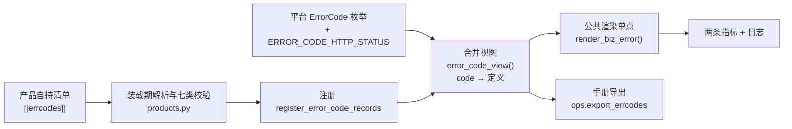

# 产品错误码自持与装载详细设计

> 跨产品协同 · 02 协同基座 · 05 产品错误码自持与装载 · 详细设计（开发核心文档）

[文档首页](../../../../../../文档首页.md) › [05 产品错误码自持与装载](../02_协同基座_05_产品错误码自持与装载.md) › 设计

## 1. 目标与边界 <a id="scope"></a>

**目标**：把错误码从「段自持、码只在产品代码里」改为「段与码同一份自持声明」，平台装载后与自身错误码合并成单一 `码 → 定义` 视图，用于统一渲染、撞码与越段检测、契约反向对账与手册导出。

**范围内**：

1. 错误码段（**第七类记录**）的字段与清单结构；
2. 记录模型、合并视图（平台枚举 + 产品声明）与冲突拒绝；
3. 三类校验：段位归属、全局唯一、契约反向（两档）；
4. 渲染路径改造（公共渲染单点：异常未显式给状态与文案时由视图补全）；
5. 手册导出（`export` / `check`）与登记清单回写；
6. mdm 同批落地：清单 `errcodes` 段、产品进程装载自身清单、声明 ↔ 代码对账断言。

**范围外**：产品异常类改造（各产品自行把声明与异常对齐，属 `03_01` 类收编工作）、文案翻译本体（产品语言包，i18n 阶段）、平台 `ErrorCode` 枚举迁移（拍板：不迁）、错误码视图下发到目录快照（拍板：本期不下发，见开放项）、各产品端点补 `x-error-codes` 扩展（`04_02`）。

**交付物清单**：

| # | 交付物 | 落点 |
| --- | --- | --- |
| D1 | 第七类记录、注册与合并视图 | `bms_core/services/module_registry.py` |
| D2 | 平台码状态映射表 | `bms_core/core/error_codes.py`（`ERROR_CODE_HTTP_STATUS`） |
| D3 | 清单 `[[errcodes]]` 解析 + 三类校验 | `bms_core/registry/products.py` |
| D4 | 公共渲染单点 + 文案分档 + 两条指标 | `bms_core/api/errors.py`、`bms_core/metrics/base.py` |
| D5 | 手册导出 CLI | `ops/export_errcodes.py`（新增） |
| D6 | mdm 声明与自载 | `mdm/deploy/registry/mdm.toml`、`mdm/backend/config*.toml`、mdm 对账用例 |
| D7 | 设计与实施 / 测试记录 | 本目录 `设计/`、`实施/`、`测试/` |

## 2. 现状 <a id="current"></a>

| 项 | 现状事实（代码落点） |
| --- | --- |
| 段位 | 服务行 `errcode_segment` 已自持（平台各服务 `01` ~ `04`、产品 `mdm` = `33`），`ModuleRegistry.validate()` 已校验段位格式与**段唯一**（限平台清单） |
| 具体码 | 平台在 `bms_core/core/error_codes.py` 的 `ErrorCode` 枚举（**115 条**，5 位、万位为段，**无** `message_key` / `severity` / `http_status` 字段）；产品在各自仓代码（mdm `OrgErrorCode` 26 条，形如 `330051`，6 位 = 2 位段 + 4 位序号） |
| 状态 | `http_status` 只写在异常子类（平台 78 条非 200，集中在 `core/exceptions.py`；mdm 由 `OrgError.http_status_` 承载），枚举本身无该信息 |
| 渲染 | `api/errors.py` 的 `build_error_response()` 与全局处理器直接取 `exc.code / exc.message / exc.http_status`，**不查任何表**；缺文案时回落字符串 `error.{code}` |
| 文案 | 前端按**码**映射 i18n `error.{code}`（`ERROR_TEXTS`）；后端 `BaseTranslator` 仍是 `NullTranslator`（`translate` 原样返回 key），`settings.translator.provider` 缺省空 → 解析到 `null` |
| 校验 | 无「码不得落平台区」的机器校验；无跨产品撞码检测；无契约与码定义的双向对账 |
| 契约 | `deploy/contracts/*.json` 是 **OpenAPI 直出快照**（`ops.contract_snapshot`），operation 级**无** `x-error-codes` 声明；mdm 契约 38 条 paths |
| 产品进程 | mdm `backend/config*.toml` **无** `[registry]` 段 → 产品进程**不装载**自身清单，其错误码在自身进程内不可见 |
| 边界 | 规范已写「业务模块扩展段由产品仓库各自定义，不得占用平台段」——**文档有约束、机器无校验** |

## 3. 目标设计 <a id="design"></a>



### 3.1 清单段与字段 <a id="format"></a>

```toml
[[errcodes]]
code = 330051
domain = "org"
http_status = 404
message_key = "mdm.error.dept_not_found"
severity = "warning"
description = "部门不存在"
```

| 字段 | 必填 | 说明 |
| --- | --- | --- |
| `code` | 是 | 整数；产品码 **6 位**，前两位 = 本清单服务行 `errcode_segment` |
| `domain` | 是 | 归属业务域；**只做形态校验**（`^[a-z][a-z0-9_]*$`），不要求在域布局登记 |
| `http_status` | 是 | 传输层状态；整数 `100` ~ `599`（业务失败仍可为 `200`） |
| `message_key` | 是 | 文案键，须为 `<product>.error.<snake_case>`，`<product>` 段 == 清单 `product_key` |
| `severity` | 是 | `info` / `warning` / `error`（本期**仅登记与导出**，不改日志级别） |
| `description` | 是 | 默认中文描述（文案缺失时兜底，并供手册导出）；非空 |
| `status` | 否 | `enabled` / `disabled`，缺省 `enabled`；`disabled` **仅影响手册口径**（渲染仍参与，码位保留不复用） |

**派生字段（不手写）**：`product_key` = 清单 `product_key`；`segment` = 同清单服务行的 `errcode_segment`。段位**单一事实源在服务行**，清单不重复声明。

**约束**：同一清单内 `code` 不得重复；`errcode` **不是**能力里的业务码 / 权限码（见 §3.6）。

### 3.2 记录模型与合并视图 <a id="view"></a>

**记录** `ErrorCodeRecord`（`@dataclass(frozen=True)`，`BaseValueObject`；不落库故不实现 `from_row`），唯一键 `code`：

| 字段 | 类型 | 来源 |
| --- | --- | --- |
| `code` | `int` | 声明 / 平台枚举值 |
| `domain` | `str` | 声明；平台码固定 `platform` |
| `http_status` | `int` | 声明；平台码取 `ERROR_CODE_HTTP_STATUS`（缺省 200） |
| `message_key` | `str` | 声明；平台码 `error.{code}` |
| `severity` | `str` | 声明；平台码固定 `error` |
| `description` | `str` | 声明；平台码取枚举名（`enum.name`，见开放项 3） |
| `status` | `str` | 声明（缺省 `enabled`）；平台码 `enabled` |
| `product_key` | `str` | 装载期注入；平台码 `platform` |
| `segment` | `str` | 装载期注入（服务行段位）；平台码 `str(code)[0]` |

**注册与视图**（与能力 / 种子同族，落在 `services/module_registry.py`）：

| 函数 | 语义 |
| --- | --- |
| `register_error_code_records(records)` | 装载产品错误码；同 `code` 同值合并、异值即拒（`CatalogError`） |
| `reset_error_code_records()` | 测试隔离用 |
| `error_code_view()` | **合并视图**：平台码（枚举适配）在前 + 已装载产品码在后，返回 `code → ErrorCodeRecord`；视图构建后只读（每次返回新字典，调用方不得写回） |
| `platform_error_code_records()` | 平台码适配（枚举 → 记录），供视图与导出复用 |

**平台码适配**：`message_key = f"error.{code}"`（与前端 `ERROR_TEXTS` / 《国际化规范》一致，平台端零改造）；`http_status` 取 `core/error_codes.py` 新增的 `ERROR_CODE_HTTP_STATUS`（**只列非 200 的码**，缺省 200，现状 78 条）；`description` 取枚举名。

**视图不变式**：`code` 全局唯一；任一 `code` 在视图中**有且仅有一条**定义；平台码形态（5 位、首位 1~9）由**用例**断言，不在视图构建期做运行期校验。

### 3.3 三类校验（并入 `inspect_product_manifests`） <a id="validate"></a>

校验入口唯一：装载期（`load_product_manifests`）与离线门禁（`ops.check_modules`）复用同一函数；不新增第二套校验入口。

| # | 校验 | 判定 | 失败处置 |
| --- | --- | --- | --- |
| 1 | 段位前提（N2） | 清单有 `errcodes` ⇒ 同清单服务行须声明 `errcode_segment` | 拒启：「服务行须声明 `errcode_segment`」 |
| 2 | 段位归属 | `str(code)` 前两位 == 本清单段位，且总长 6 位 | 拒启，信息含 `code` 与段 |
| 3 | 平台码区禁入 | 5 位码（首位 1~9）一律拒（产品不得声明平台码形态） | 拒启 |
| 4 | 段跨产品唯一 | 同一段位被两个不同 `product_key` 声明（含平台服务行段位） | 拒启，信息含两侧提供方 |
| 5 | 全局唯一 | 与平台 `ErrorCode` 值撞码即拒；跨清单同码**异值**拒、**同值**放行（幂等） | 拒启 |
| 6 | 文案键格式 | `^<product>\.error\.[a-z][a-z0-9_]*$` 且 `<product>` == 清单 `product_key` | 拒启 |
| 7 | 字段形态 | `domain` 标识符 / `http_status` 100~599 / `severity` 枚举 / `description` 非空 / `status` 枚举 | 拒启 |
| 8 | 契约反向（两档） | 契约 `paths.*.<method>.x-error-codes` 已声明 ⇒ 其中每个码**必须已在本清单登记**且属于本产品；未声明的端点 ⇒ 只计入「未声明错误码的端点」报告 | 已声明不符即拒启；未声明只输出 `WARNING`（软提示，不阻断） |

**契约反向的数据来源**：`_contract_paths()` 扩为同时收集 operation 级 `x-error-codes`（整数数组，见 §3.3.1）；契约缺失时的行为沿用既有 `SKIP_CONTRACT_ENV` 口径（缺失即拒，显式跳过则警示）。

**为什么只比「码已登记」不比 `http_status`**：状态与文案的唯一事实源在清单，契约再写一份会形成双源（拍板 Q10）；契约只承担「本端点可能返回哪些码」的清单作用。

#### 3.3.1 契约扩展形态

```json
"/api/v1/mdm/depts": {
  "get": {
    "x-error-codes": [330101],
    "responses": { "...": {} }
  }
}
```

端点声明方式（`04_02` 及产品仓按此推进）：FastAPI 路由 `openapi_extra={"x-error-codes": [...]}`，随 `ops.contract_snapshot export` 进快照。

### 3.4 统一渲染路径 <a id="render"></a>

**单点**：新增 `async def build_error_response(scope, exc)`（原同步签名改为异步，便于记录指标），全局异常处理器（含参数校验 / 库不可用 / 未捕获分支）与中间件两处调用**全部**走它——状态与文案补全、日志与指标只此一处。

| 环节 | 规则 |
| --- | --- |
| 视图命中 | `http_status` **以视图为准**（声明状态为权威）；异常显式状态与视图不一致时记 `WARNING`（暴露声明漂移，正常由对账用例兜住） |
| 视图未命中 | **保留异常自带的 `http_status` 与 `message`**（不兜底 10000/500），记 `ERROR` + `bms_error_code_unknown_total{code}` |
| 文案（显式） | 异常显式给了 `message` ⇒ **用显式值**（既有代码零改动，存量文案不受影响） |
| 文案（视图） | 异常未给文案 ⇒ 用记录 `message_key`；**分档**：装配真实 translator（`settings.translator.provider` 非空且非 `null`）时调 `translate()` 取译文，未命中 ⇒ 回退 `description` + `WARNING` + `bms_error_code_unresolved_total{code}`；**占位期**（`NullTranslator`）直接输出 `message_key` 原串，不告警不计指标 |
| `severity` | 本期不参与日志级别（见 §3.1） |

**指标**（登记进 `METRIC_NAMES`，经 `app.state.metrics`（`BaseMetrics`）记录）：

| 指标 | 标签 | 语义 |
| --- | --- | --- |
| `bms_error_code_unknown_total` | `code` | 渲染时视图未命中的码 |
| `bms_error_code_unresolved_total` | `code` | 真实 translator 下文案缺失（回退 `description`） |

**为什么不在异常构造点查表**：构造点分散在业务深处，查表会引入视图依赖与启动顺序问题；补全放渲染单点天然覆盖所有抛出点，且保持 `BizError` 结构不变。

### 3.5 手册导出 <a id="export"></a>

`ops/export_errcodes.py`（CLI，与 `ops.contract_snapshot` 同风格）：

| 子命令 | 语义 |
| --- | --- |
| `export [--format md\|json] [--out PATH]` | 按 `error_code_view()` 导出；缺省打印 stdout；`--out` 落文件（建议工作区 `tmp/`，不写仓库树） |
| `check PATH [--format md\|json]` | 比对已导出文件与当前视图是否逐项一致（不一致退出码 1，供预检 / CI 调用） |

**列**：`code` / 段 / 业务域 / 提供方 / `http_status` / `message_key` / `severity` / `description` / 状态（`disabled` 标「已停用（码位保留不复用）」）。排序按 `code` 升序，输出确定性（同视图同文本）。

**装载来源**：读 `[registry].product_manifests` 后 `load_product_manifests()`（与装配期同源），未配置清单时导出仅含平台码并打印提示。

### 3.6 与能力 `codes` 的边界 <a id="boundary"></a>

| 概念 | 含义 | 段 / 命名空间 |
| --- | --- | --- |
| 能力 `kind = "codes"` 的 `permission_codes` | **业务码 / 权限码**（如 `mdm:query`） | 权限体系，与错误码无关 |
| 错误码（本任务） | **失败语义**（如 `330051`） | 错误码段（服务行 `errcode_segment`） |

两者不共用段、不共用命名空间，也不互相引用。既有 `kind` 要素匹配校验已覆盖 `codes` 类无访问面，本期不新增白名单格式校验（避免与权限码格式演进耦合）。

## 4. 影响面 <a id="impact"></a>

| 类别 | 对象 | 变更 |
| --- | --- | --- |
| 修改 | `bms_core/services/module_registry.py` | `ErrorCodeRecord`、注册 / 视图 / 平台码适配、文档串「第五六类」升「第七类」 |
| 修改 | `bms_core/core/error_codes.py` | 新增 `ERROR_CODE_HTTP_STATUS`（78 条非 200，实测自异常类）；文档串补第七类口径 |
| 修改 | `bms_core/registry/products.py` | `ProductManifest.error_codes`、`_error_code_record()`、`_validate_error_codes()`、`_contract_error_codes()`、`register_manifest()` 注册；文档串「七段并列 / 七类校验」 |
| 修改 | `bms_core/api/errors.py` | `build_error_response` 改异步 + 视图补全 + 文案分档 + 日志与指标；各处理器统一调用 |
| 修改 | `bms_core/api/middleware.py` | 两处调用改为 `await build_error_response(...)` 后发送 |
| 修改 | `bms_core/metrics/base.py` | `METRIC_NAMES` 增两条 |
| 新增 | `ops/export_errcodes.py` | 手册导出 CLI（`export` / `check`） |
| 修改 | `ops/check_modules.py` | 输出「未声明错误码的端点」软提示（来自 `inspection.warnings`） |
| 修改 | mdm `deploy/registry/mdm.toml` | 增 26 条 `[[errcodes]]`（与 `OrgErrorCode` + 异常类逐条对齐） |
| 修改 | mdm `backend/config.toml` / `config.dev.toml` / `config.test.toml` | 增 `[registry].product_manifests = ["../deploy/registry/mdm.toml"]`（产品进程装载自身清单） |
| 新增 | mdm `backend/tests/test_error_code_declaration.py` | 声明 ↔ `OrgErrorCode` 逐条对账（码集合 / `http_status` / 描述非空 / 文案键格式） |
| 不改 | 产品异常类 | 各产品自行对齐（`03_01` 类工作） |

**连带行为变更**（须在实施记录登记）：

1. 占位期产品错误响应的 `message` 由 `error.330051` 变为 `mdm.error.dept_not_found`（前端按 `code` 映射，不受影响；若存量用例断言 `message` 需同步更新）。
2. mdm 进程启动即装载自身清单 → 触发七类校验（契约 / 域布局 / 种子入口均在同仓，已核对齐备）；测试会话装载后服务行记录与 `service_records()` 注入**同值去重**。
3. 平台异常状态改为「以视图为准」后，与异常类不一致的情形会多一条 `WARNING`（正常应为零，由对账用例兜底）。

## 5. 测试设计 <a id="test"></a>

用例编号统一在 `05_01` 登记后回填（沿用 `02_01` / `02_02` / `02_04` 口径），先落用例代码。

| # | 用例 | 断言 | 验收映射 |
| --- | --- | --- | --- |
| 1 | 合法错误码装载 | 视图含该码，字段与声明一致（含注入的 `product_key` / `segment`） | 完成标准① |
| 2 | 段位不符（前两位 ≠ 声明段） | 报错，信息含码与段 | 完成标准④ |
| 3 | 产品声明 5 位码 | 报错（平台区禁入） | 完成标准④ |
| 4 | 跨产品撞码（同码异义） | 报错，信息含两侧提供方 | 完成标准④ |
| 5 | 跨产品同码同值 | 放行（幂等） | §3.3-5 |
| 6 | 与平台 `ErrorCode` 撞码 | 报错 | 完成标准④ |
| 7 | 同段被两个产品声明 | 报错（段跨产品唯一） | §3.3-4 |
| 8 | 有 `errcodes` 无 `errcode_segment` | 报错 | N2 |
| 9 | `message_key` 格式非法 / 产品段不符 | 报错 | §3.3-6 |
| 10 | 合并视图完整性 | 平台码（115）+ 产品码齐备；每码仅一条；平台码 `message_key = error.{code}`；平台码 5 位且首位 1~9 | 完成标准② |
| 11 | 平台码状态映射 | `ERROR_CODE_HTTP_STATUS` ↔ 异常类实测一致（遍历可无参实例化的子类） | N1 |
| 12 | 异常未给状态与文案 | 由视图补全（状态取声明、文案取 `message_key`） | 完成标准③ |
| 13 | 异常显式给状态与文案 | 以显式值为准（既有行为不变） | 既有回归 |
| 14 | 文案缺失回退 | 真实 translator 下回退 `description` + `WARNING` + `bms_error_code_unresolved_total` +1 | 完成标准③ |
| 15 | 占位期文案分档 | `NullTranslator` 下输出 `message_key`、无告警无指标 | Q6 |
| 16 | 未登记码渲染 | 保留异常自带状态与文案 + `ERROR` + `bms_error_code_unknown_total` +1 | Q5 |
| 17 | 契约反向：已声明但未登记 | 报错 | 完成标准④ |
| 18 | 契约反向：未声明端点 | 计入报告不阻断（软提示） | §3.3-8 |
| 19 | 手册导出 | `md` / `json` 两种格式与视图逐项一致；`check` 一致通过、篡改后失败 | 完成标准⑤ |
| 20 | mdm 声明 ↔ 代码对账 | 码集合、`http_status`、描述、文案键格式逐条一致 | Q16 |
| 21 | 既有平台错误码行为回归 | 平台各异常状态与文案与改造前一致（`services/platform/tests/api/test_errors.py` 等） | 完成标准②③ |

## 6. 风险与边界 <a id="risk"></a>

| 风险 | 处置 |
| --- | --- |
| 产品码与代码实际抛出不一致（声明了但没用、用了但没声明） | 契约反向校验 + mdm 对账用例 + 手册导出对照；跨产品代码级扫描见开放项 2 |
| 文案键大面积缺失导致回退 | 回退有日志与指标，长期高位视为文案欠账；不做静默兜底 |
| 视图与 `ErrorCode` 枚举双源 | 枚举是平台码唯一事实源，视图只是适配展示；不反向写回枚举 |
| 状态双源（清单声明 vs 异常类） | 渲染以视图为准并记 `WARNING` 暴露漂移；mdm 对账用例把漂移挡在测试期 |
| 产品进程未装载自身清单 | mdm 配置显式装载 + 未命中时保留自值（不 500），并在文档说明「未装载 = 走异常自带状态」 |
| 契约 `x-error-codes` 覆盖不全 | 两档校验（已声明强校验、未声明统计），避免一上线就全红 |
| 产品码段调整 | 段随服务行登记，调整即触发码段位校验失败，属预期（段一经发布稳定不变） |

## 7. 开放项 <a id="open"></a>

| # | 事项 | 归口 |
| --- | --- | --- |
| 1 | 契约 `x-error-codes` 补齐后转为全量强校验 | `04_02` / 各产品补齐后评估 |
| 2 | 「代码中出现的错误码必须已登记」护栏（AST / 检索） | 可与 `04_01` 字面量护栏合并实现 |
| 3 | 平台码中文 `description` 补齐（现取枚举名，中文文案仍由前端 `error.{code}` 提供） | 国际化 / 开放平台文档阶段 |
| 4 | 错误码是否纳入能力契约版本语义（破坏性变更判定） | 与契约版本门禁一并评估 |
| 5 | 错误码视图下发到目录快照（`?with=errcodes`）供前端运行期取定义 | 开放平台文档阶段（本期拍板不下发） |

## 8. 对齐记录 <a id="alignment"></a>

开工前逐项确认 23 项决策，据此回写设计原文（决策 → 变更）；另记 6 条文档冲突的处置与 2 条派生项。

| # | 原设计 / 原文档 | 回写后 | 理由 |
| --- | --- | --- | --- |
| 1 | §4「新增 `registry/error_codes.py`」 | 记录 / 注册 / 视图并入 `services/module_registry.py` | 与第五、六类记录同族同文件，新增记录类只有一处落点（Q1） |
| 2 | §4「`ops/check_modules` 增三类校验」 | 校验并入 `inspect_product_manifests()`，门禁只做输出 | 校验入口唯一，装配期与离线门禁同源（Q2） |
| 3 | §3.5「`ops.export_errcodes --format md\|json`」 | 明确 `export` / `check` 两子命令、缺省 stdout、`--out` 落文件 | 可命令行复验「导出与视图一致」（Q3、Q18） |
| 4 | §4 只列 mdm 清单段 | 加「mdm 配置装载自身清单 + 对账用例」 | 产品进程不装载则自渲染取不到视图（Q4） |
| 5 | §3.4「未登记码兜底 10000 + 500」 | 保留异常自带状态与文案，另记 `ERROR` + 指标 | 兜底会让未装载清单的产品进程全量 500（Q5、冲突 2） |
| 6 | §3.4「命中语言偏好即用 `message_key` 解析，缺失回退」 | 分档：真实 translator 才解析；占位期输出键名、不告警不计指标 | i18n 尚未实现，恒解析会全量回退 + 日志噪音（Q6） |
| 7 | §3.2「平台码 `message_key` 由枚举名生成 `platform.error.<name>`」 | 平台码 `message_key = error.{code}` | 与前端 `ERROR_TEXTS` / 《国际化规范》一致，平台端零改造（Q7、冲突 4） |
| 8 | §3.4「补全放在处理器（单点）」+ 表格「异常构造时补全」 | 统一为**渲染单点**（`build_error_response` 改异步，处理器与中间件共用） | 消除原文自相矛盾（Q8、冲突 1） |
| 9 | §3.3-4「契约列出的码必须已登记 + 定义须一致」 | 两档：已声明强校验（码已登记 + 归属本产品）、未声明只统计 | 存量端点无声明，全量强校验不可行（Q9） |
| 10 | §3.3-4 契约扩展形态未定 | `x-error-codes` 为**整数数组**，只列码 | 状态与文案事实源在清单，避免双源（Q10、冲突 3） |
| 11 | §3.1「`domain` 须在业务域清单登记」 | 改为形态校验，不要求域布局登记 | 域布局是能力寻址基准且仅在含能力时加载（Q11、冲突 5） |
| 12 | §3.2「同 `code` 同值合并、异值即拒」 | 保留，并明示跨清单同值放行 | 与其余五类唯一性纪律同构（Q12） |
| 13 | §3.2 记录字段未含归属 | 追加 `product_key` / `segment`（装载期注入，不手写） | 段位单一事实源在服务行；导出可直接取提供方（Q13） |
| 14 | §3.1「`severity` 用于日志级别与告警分级」 | 本期仅登记与导出 | 不动存量日志语义（Q14） |
| 15 | §3.4 指标 `error_code_unresolved_total` / `error_code_unknown_total` | 加 `bms_` 前缀并登记进 `METRIC_NAMES` | 与 `02_02` / `02_04` 指标口径一致（Q15） |
| 16 | §6「后续可加代码护栏」 | mdm 侧本期即落对账用例 | 两仓不漂移，成本低（Q16） |
| 17 | 平台码状态无来源 | 新增 `ERROR_CODE_HTTP_STATUS`（只列非 200）+ 用例对齐异常类 | 手册可给真实状态，双源有护栏（N1） |
| 18 | 未定「有 `errcodes` 无段位」 | 拒启 | 段位是码段校验前提（N2） |
| 19 | §3.1 `status` 字段语义未定 | `disabled` 仅影响手册口径，渲染仍参与 | 码位保留不复用，避免旧客户端被计为异常（N3） |
| 20 | §3.1「`code` 不允许重复声明（含同一清单内）」 | 保留 + 补「平台区禁入」「段跨产品唯一」两条 | 段唯一纪律从平台清单扩展到产品清单 |
| 21 | §5 用例 15 条 | 扩为 21 条（含平台码形态、契约两档、mdm 对账、分档文案） | 与新增决策对齐 |
| 22 | 未定「视图是否下发目录快照」 | 本期不下发，登记开放项 5 | 需求只要求渲染 + 手册导出（Q19） |
| 23 | 未定「平台码是否加运行期形态校验」 | 只在用例断言，视图构建不校验 | 零运行期开销，开发期问题由用例暴露（Q17） |
| 24 | 「Kiwi 先登记再编码」 | 用例先落地，编号归 `05_01` 回填 | 与 `02_01` / `02_02` / `02_04` 既定口径一致（Q20） |
| 25 | `products.py` / `module_registry.py` 文档串「六段并列 / 六类校验」 | 升为「七段并列 / 七类校验」 | 冲突 6 |
| 26 | §3.2 平台码 `http_status` 无来源 | `ERROR_CODE_HTTP_STATUS` 实测生成（78 条非 200）+ 用例交替断言 | 实施期落地（N1） |
| 27 | §3.4 三种文案来源未定序 | 显式 `message` > 视图 `message_key` > 回退 `description`；占位期不解析 | 存量文案零改动 |
| 28 | §3.4 单点需记录指标（异步） | `build_error_response` 改 `async`，中间件两处同步改 `await` 后发送 | 指标可 `await`，不留 fire-and-forget |
| 29 | 部署态清单分发未覆盖（mdm 镜像构建上下文为 `backend/`） | 登记为遗留，部署方案待拍板（见实施记录 §5-2） | 机制不在本任务扩范围 |

> 本文档依《[文档生成规范](../../../../../../规范/文档生成规范.md)》与《[任务文档规范](../../../../../../规范/任务文档规范.md)》编写
