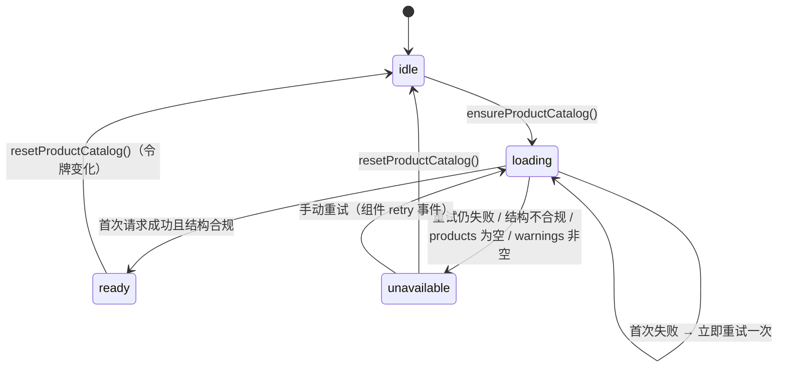

# 前端目录消费详细设计

> 跨产品协同 · 03 消费方收编 · 02 前端目录消费 · 详细设计（开发核心文档）

[文档首页](../../../../../../文档首页.md) › [02 前端目录消费](../03_消费方收编_02_前端目录消费.md) › 设计

## 1. 目标与边界 

**目标**：前端的「产品键」「服务键」「产品命名空间」全部改为消费平台目录快照（`GET /api/v1/modules/snapshot?with=modules,products,collaborations`）的**运行期**结果，使**新增产品零前端改动**；目录不可用时显式降级并提示，不静默拼错地址。

**范围内**：

1. 目录快照的前端消费（请求、结构校验、缓存、失败与重试语义）；
2. 产品键与服务键的运行时化（删除 `PRODUCT_KEYS` 常量、类型放宽、校验分「已加载按目录 / 未加载按形态」两段）；
3. 组织数据源默认端点的运行期取址（按业务域 + 能力种类推导，前端不持有产品键与产品命名空间）；
4. 页面端点常量（`ORG_PRODUCT_ENDPOINT`）的移除；
5. 引导装配（认证守卫新增目录钩子）与令牌联动的缓存失效；
6. **后端契约补充**：能力段补 `kind` 字段、带参快照 `snapshot_version` 升版；
7. 契约快照与前端生成类型的重生成；
8. 降级形态与「新增产品零改动」夹具；
9. 受影响文件的注释口径归一与产品字面量基线递减。

**范围外**：目录快照的后端实现主体（`02_02`）、按消费方裁剪快照与授权（`02_04`）、组织选择组件本身的交互形态（组件设计节点）、真实租户拓扑（07C）、平台种子去产品化（`03_03`）。

## 2. 现状与实测 

### 2.1 前端落点 

| # | 落点 | 现有写法 |
| --- | --- | --- |
| 1 | `packages/core/src/contracts/service-endpoint.ts` | `PRODUCT_KEYS = ['mdm'] as const`；`ProductKey` 为字面量联合；`ServiceKey` 为九个服务键的联合；`isProductKey` / `isServiceKey` 查静态数组；`productPrefix` / `productUrl` / `serviceUrl` 静态校验后拼串 |
| 2 | `packages/ui_ep/src/utils/orgSource.ts` | `orgSourceEndpoint()` 返回 `productPrefix('mdm', 'mdm')`（即 `/api/mdm/v1/mdm`）；`HttpOrgSource` 的 `#get` 以 `options.endpoint ?? orgSourceEndpoint()` 取前缀 |
| 3 | `packages/core/src/capabilities/org-source.ts` | 选项 `endpoint?` 可覆盖默认端点（**天然注入点**，改造复用）；文档注释含产品命名空间样例 |
| 4 | `apps/desktop/src/api/endpoints.ts` | `ORG_PRODUCT_ENDPOINT = '/api/mdm/v1/mdm'` 常量；`orgSourceOptions()` 返回固定端点 |
| 5 | `apps/desktop/src/main.ts` | 装配 Pinia / 路由 / 守卫 / 模块宿主；`session.$subscribe` 已有「令牌变化」联动分支 |
| 6 | `apps/desktop/src/router/guard.ts` | 守卫依赖为「会话就绪 / 动态路由 / 权限 / 观测」四项，无目录钩子 |

**实测口径（2026-10-28）**：

- `PRODUCT_KEYS` 仅被 `service-endpoint.ts`、`capabilities/module-api.ts`、`core/tests/service-endpoint.spec.ts` 引用；产品键类型放宽的影响面封闭在 core 包内。
- `ServiceKey` 类型被 `contracts/module-api.ts`、`capabilities/module-api.ts`、`index.ts` 与宿主 `api/{endpoints,request,http}.ts` 引用，共 6 个源文件 + 2 个用例文件。
- **产品侧运行时依赖**：mdm 前端模块经宿主注入的 `context.api.product('mdm', 'mdm')` 取址（`mdm/frontend/modules/org/src/services/org-service.ts`）。产品侧持有自己的产品键是合规的，但**平台侧校验策略直接决定它能否工作**——这是「未加载按形态放行」决策的根因。

### 2.2 后端契约现状 

| 项 | 事实 |
| --- | --- |
| 端点 | `GET /api/v1/modules/snapshot`；带参分支 `?with=modules,products,collaborations`；`with` 含未支持段名即 `ParamError`（10001） |
| 响应 | `{modules, products, collaborations, snapshot_version, warnings}`；无参仍为 `ModuleResponse` 数组（契约不变） |
| 产品段 | `product_key` / `name` / `status` |
| 能力段 | `name` / `domain` / `product_key` / `frontend_prefix` / `contract_version` / `status` / `replacement`；**不含 `path`**、不含授权信息；`codes` 类与 `disabled` 不下发 |
| 服务段 | `ModuleResponse` 含 `module_key` / `service_key` / `service_group`（`foundation` / `capability` / `product`）/ `status` 等，足以派生服务键 |
| 版本 | `snapshot_version` 现为 `"1"`；能力段无 `kind`，前端无法区分「数据源类」与「事务分支类」能力 |

### 2.3 契约与生成类型 

| 项 | 实测 |
| --- | --- |
| 契约快照 | `deploy/contracts/platform.json` 与实时公开契约**零漂移**（`ops.contract_snapshot check` 通过，9 个启用服务） |
| 契约门禁 | `ops.contract_gate` 以 `oasdiff breaking` 比对**基线**；「只加不删」属兼容变更，**加可空字段不判破坏**，无需更新基线 |
| 前端类型 | `frontend/packages/api_types/src/platform.ts` 由 `deploy/contracts/*.json` 生成；**当前不含** `CatalogSnapshotResponse` / 产品段 / 能力段类型（任务文档「前置契约」第 6 条所述「类型已生成」与实测不符） |

### 2.4 产品字面量基线 

| 面 | 基线条目 | 说明 |
| --- | --- | --- |
| 前端 | **54 条 / 15 个文件** | `ui_ep/src/utils/orgSource.ts` 14、`apps/desktop/src/dev/OrgCheck.vue` 9、`apps/desktop/src/api/endpoints.ts` 8、`core/src/capabilities/org-source.ts` 5、`core/src/contracts/service-endpoint.ts` 2、`apps/desktop/src/module/registries.ts` 2、其余 9 个视图与 `api/role.ts` 合计 14 |
| 后端 | 95 条 | 本任务只触碰能力段与快照代码，后端条目**不在本次递减范围**（归 `03_03` 与 `05_01`） |

**判定口径**：护栏 `include_comments = true`、`literals = ["mdm"]`、测试与生成物在允许面 / 排除面内。上述 54 条中约 14 条是「与 mdm 岗位 / 部门插件同槽」类**注释描述**，其余为常量、类型、端点与用例相关注释。

## 3. 设计 

### 3.1 目录快照请求与数据形态 

| 项 | 口径 |
| --- | --- |
| 请求 | `request({ method: 'GET', url: serviceUrl('platform', '/modules/snapshot'), params: { with: 'modules,products,collaborations' } })`，经宿主已注入的请求适配器（令牌注入 / 401 刷新 / 统一解包沿用既有链路） |
| **自举** | 目录请求本身**不能依赖目录判定**：`serviceUrl('platform', …)` 走「未加载按形态校验」分支（§3.3），保证引导期可用 |
| 数据源 | 三段全取：`modules` 用于服务键派生，`products` 用于产品键集合，`collaborations` 用于取址 |
| 缓存 | 进程内存（模块级），不落 `localStorage` / `sessionStorage`（避免陈旧目录与陈旧授权） |

**前端消费的数据形态**（只保留实际消费字段；类型来源见 §3.5 / §4）：

| 段 | 字段 | 用途 |
| --- | --- | --- |
| `modules[]` | `module_key` / `service_key` / `service_group` / `status` | 派生服务键集合（`service_group ≠ product`、`status = enabled`、`service_key` 非空） |
| `products[]` | `product_key` / `status` | 产品键集合 |
| `collaborations[]` | `name` / `domain` / `product_key` / `frontend_prefix` / `kind` / `status` / `replacement` | 能力取址（`kind` 为本任务新增，§3.5） |
| 顶层 | `snapshot_version` / `warnings` | 形态版本与降级提示 |

**结构校验**：`modules` / `products` / `collaborations` 必须为数组、`snapshot_version` 必须为字符串、`warnings` 必须为数组；任一不合规即按**不可用**处置（不静默用空数组兜底）。

### 3.2 目录层状态机与接口 

新增 `packages/core/src/catalog/product-catalog.ts`（框架无关，只依赖 `contracts/request` 与 `contracts/service-endpoint`）：

| 接口 | 语义 |
| --- | --- |
| `ensureProductCatalog()` | 幂等：并发调用共享同一 Promise；返回终态 `ready` / `unavailable`；异常不外抛（内部收敛为 `unavailable` 并记录原因） |
| `productKeys()` | `ready` 时返回目录产品键（只读数组）；其余返回空数组 |
| `serviceKeys()` | `ready` 时返回派生服务键；其余返回编译期 `SERVICE_KEYS` 基线（§3.3） |
| `resolveCapabilityTarget(domain, kind)` | 返回 `{ status, productKey?, frontendPrefix?, endpoint? }`；`status ∈ ok / catalog-unavailable / capability-missing / ambiguous` |
| `catalogState()` / `catalogWarnings()` | 状态与降级原因（供提示与观测） |
| `resetProductCatalog()` | 清空缓存与状态（同步、纯内存、不发请求） |

**失败判定（四类，全部按不可用）**：请求失败（含重试一次后）、结构与字段不合规、`products` 为空、`warnings` 非空。

**重试**：首次失败后**立即重试一次**（不引入定时器，保证确定性；也不做退避轮询，避免请求风暴）。仍失败即 `unavailable`。

**服务键对账**：`ready` 后把派生集合与编译期 `SERVICE_KEYS` 比对；不一致仅**告警 + 观测**（不改状态、不阻断产品取址），一致性由用例断言（§5.1 第 12 例）保证——运行期硬失败会因「新增平台服务」而连带禁用全部产品取址，代价与收益不成比例。

### 3.3 产品键与服务键运行时化 

| 项 | 改造前 | 改造后 |
| --- | --- | --- |
| `PRODUCT_KEYS` | `['mdm'] as const` | **删除**（无静态回退，避免双事实源） |
| `ProductKey` | 字面量联合 | `type ProductKey = string` |
| `ServiceKey` | 九个服务键联合 | `type ServiceKey = string`；`SERVICE_KEYS` 保留为**编译期基线清单**（未加载回退 + 用例对账基准） |
| 标识形态 | 无统一校验 | `IDENTIFIER_PATTERN = /^[a-z][a-z0-9-]*$/`（产品键与服务键共用） |
| `isProductKey()` | 查静态数组 | 非字符串 / 形态不符 → `false`；目录 `ready` → 查 `productKeys()`；未 `ready` → **形态通过即 `true`** |
| `isServiceKey()` | 查静态数组 | 同上，`ready` 时查 `serviceKeys()` |
| `productPrefix()` / `productUrl()` / `servicePrefix()` / `serviceUrl()` | 静态校验后拼串 | 组装规则**不变**，校验改走上述运行时判定（未登记即抛 `CAPABILITY_VIOLATION`） |

**为什么未加载只校验形态**：产品侧插件在目录就绪前即可发起取址（`context.api.product('mdm','mdm')`），单测也普遍不装目录；若未加载一律拒绝，会把「目录时序」变成产品功能的前置条件。形态校验保证地址拼装不会错位，目录就绪后再按目录严格判定。

**不新增 `assertProductKey`**：原稿提出的强制断言入口本轮**不落地**——无真实调用点时属死代码，且与行 + 分支覆盖率口径冲突；关键路径的严格性由「目录就绪后的目录判定」承担（§9 第 8 条）。

**类型放宽的补偿**：① 运行时校验保留（非法键抛错，不静默拼串）；② 结构校验保证目录数据形态；③ 夹具用例覆盖「新增产品无需改代码」（§3.9）；④ 受影响包 `typecheck` 纳入门禁。

### 3.4 组织数据源取址 

| 项 | 口径 |
| --- | --- |
| 选域依据 | 常量 `ORG_SOURCE_DOMAIN = 'org'`（**业务域标识**，非产品键；平台可持有业务域） |
| 选择规则 | 在 `collaborations` 中筛 `domain = org` 且 `kind = dataset` 且 `product_key` / `frontend_prefix` 非空（即**数据源类**能力），按 `(product_key, frontend_prefix)` 去重 |
| 唯一性 | 去重后**恰一组** → 组装 `/api/{product_key}/v1/{frontend_prefix}`；零组 → `capability-missing`；多组 → `ambiguous`（均按降级，不猜） |
| 返回值 | `orgSourceEndpoint(): string \| null`（`null` 表示不可用，调用方进入降级） |
| 注入点 | `OrgSourceOptions.endpoint?` **保留**：显式端点优先（宿主与用例可固定地址，不依赖目录） |
| 请求行为 | `HttpOrgSource` 解析端点：显式端点 → 用之；否则取 `orgSourceEndpoint()`；为 `null` 时**不发请求**、返回 `undefined` 并只告警一次（不拼默认地址） |

**取址为何不用能力名**：能力名形如 `{产品键}.{业务域}.{能力}`，在平台代码里写死能力名等于写死产品键，与本次门禁目标相抵。按「业务域 + 能力种类」推导，产品改名 / 新增产品都不影响平台代码。

### 3.5 后端契约补充 

| # | 变更 | 落点 |
| --- | --- | --- |
| 1 | `CollaborationSnapshotItem` 增 `kind: str`（取值 `read` / `dataset` / `txn-branch`；`codes` 类与 `disabled` 仍不下发） | `bms_core/schemas/module.py` |
| 2 | 能力段下发时带上 `kind`（来源 `CollaborationRecord.kind`） | `bms_platform/domains/platform_registry/api/modules.py` |
| 3 | 带参快照 `snapshot_version` 由 `"1"` 升为 `"2"`（形态变更即升版，沿用既有口径） | 同上 |
| 4 | 契约快照重生成（`platform.json`） | `deploy/contracts/platform.json` |
| 5 | 前端生成类型重生成（含 `CatalogSnapshotResponse` / 产品段 / 能力段） | `frontend/packages/api_types/src/platform.ts` |
| 6 | `02_02` 设计回写：§3.5 能力段字段表加 `kind`、`snapshot_version` 升版说明，§8 追加对齐记录 | `02_协同基座_02_能力寻址与失败语义/设计/01_详细设计_02_能力寻址与失败语义.md` |

**兼容性**：新增字段属「只加不删」，`oasdiff breaking` 不判破坏，**契约基线不更新、契约版本不 bump**；前端对未知多字段天然容忍（结构校验只要求必需段存在）。

**前端类型来源**：`packages/core/src/catalog/product-catalog.ts` 直接引用生成类型 `components['schemas']['CatalogSnapshotResponse']` 的收敛别名（`CatalogSnapshot` / `ProductSnapshotItem` / `CollaborationSnapshotItem` / `ModuleSnapshotItem`），**不另手写同构类型**；生成链路断裂（契约未重生成）由 `typecheck` 直接暴露。

### 3.6 引导装配 

| 项 | 口径 |
| --- | --- |
| 契约变更 | `AuthGuardDeps` 新增**可选**依赖 `ensureCatalog?: () => void \| Promise<void>` |
| 调用时机 | 守卫内「会话就绪（`ready` 为真）之后、动态路由装载（`ensureRoutes`）之前」 |
| 失败语义 | 钩子抛错**不阻断导航**：捕获后写入观察（守卫 `record` 的 `reason` 记 `catalog-failed`），其余判定照常 |
| 宿主注入 | `main.ts` 注入 `ensureCatalog: () => ensureProductCatalog()` |
| 关闭守卫 | 守卫关闭时仍触发一次 `ensureCatalog?.()`（与既有 `ensureSession` 同口径），保证目录可用 |

**为何不改 `ensureRoutes`**：目录装载与菜单路由是两件事，混在一处会让「菜单装载失败」与「目录不可用」共用同一失败信号；独立钩子可分别观测、分别降级。

### 3.7 缓存失效（令牌联动） 

| 场景 | 处置 |
| --- | --- |
| 登录成功 / 令牌变化 | `resetProductCatalog()`（下次导航由守卫钩子重新加载） |
| 登出 / 会话失效（令牌置空） | `resetProductCatalog()`（同时清菜单与路由，沿用既有分支） |
| 页面刷新 | 进程内存自然重建（无需额外处理） |

实现落在 `main.ts` 既有 `session.$subscribe` 的令牌变化分支（该分支已按「令牌是否变化」去抖，避免菜单装载回环）；`resetProductCatalog()` 为同步纯内存操作，**不发请求、不触发令牌变化**，无回环风险。

### 3.8 降级形态 

| 情形 | 状态 | 表现 |
| --- | --- | --- |
| 目录不可用（四类之一） | `catalog-unavailable` | 依赖产品目录的能力禁用；字段组件显示「组织数据暂不可用，请稍后重试」并提供重试（触发 `resetProductCatalog()` + `ensureProductCatalog()`） |
| 目录可用但组织数据源能力缺失 | `capability-missing` | 同上禁用，文案「未接入组织主数据」 |
| 同域多组数据源目标 | `ambiguous` | 同上禁用，文案「组织数据源配置不唯一」（不猜、不挑选） |
| 能力可用但请求失败 | 组件原有错误提示 | 不新增静默降级 |

**实现落点**：文案常量化到 `packages/core/src/domain/org.ts`（与既有 `ORG_PLACEHOLDER_TEXT` / `ORG_EMPTY_TEXT` 同处）；字段组件**沿用既有** `ready` + `degradeText` + `retry` 机制，**不新增界面组件、不改交互形态**（无新增原型需求）。宿主把目录状态映射为 `ready` 与 `degradeText` 传入。

**禁止**：拼一个默认地址继续请求（把「未接入」伪装成 404）；用空数组冒充「无组织数据」。

### 3.9 零改动夹具 

在 core 用例内注入**伪请求适配器**，返回含虚构产品（如 `demo`）的快照：

1. `productKeys()` 含 `demo`；
2. `resolveCapabilityTarget('org', 'dataset')` 取到虚构产品的数据源能力，组装出 `/api/demo/v1/demo`；
3. 经 `BaseModuleApi.product('demo', 'demo')` 发起的请求地址为 `/api/demo/v1/demo/...`；
4. 全程**未修改任何前端代码**（只改夹具数据）——这一条是计划门禁「前端新增产品零改动」的直接证据。

### 3.10 与相邻任务的边界 

| 任务 | 分工 |
| --- | --- |
| `02_02` | 目录快照主体与本任务所需字段（`kind` 为本次补充，见 §3.5） |
| `02_04` | 快照按消费方裁剪、授权可见性；本任务消费的是「已下发即可见」的集合 |
| `03_01` | 后端消费方（权限解析 / 写通道 / 白名单）的能力化；与本任务同源不同面，互不改动 |
| `03_03` | 平台种子去产品化（后端 17 条基线） |
| `04_01` | 产品字面量护栏与基线「只减不增」断言；本任务按实跑递减（§2.4 / §9） |
| 07C `02_01` / `02_02` | 真实租户拓扑与能力第二段解析；本任务只做**前端**取址，不引拓扑 |

## 4. 交付物清单 

| # | 仓 / 面 | 交付物 | 类型 |
| --- | --- | --- | --- |
| 1 | 基座 | `backend/libs/bms_core/src/bms_core/schemas/module.py`：能力段增 `kind` | 修改 |
| 2 | 平台服务 | `backend/services/platform/src/bms_platform/domains/platform_registry/api/modules.py`：下发 `kind`、`snapshot_version` 升为 `2` | 修改 |
| 3 | 基座 / 平台服务 | 对应用例（`bms_core/tests`、`services/platform/tests/api/test_modules_snapshot.py`） | 测试 |
| 4 | 契约 | `deploy/contracts/platform.json` 重生成（`ops.contract_snapshot export`） | 生成物 |
| 5 | 前端类型 | `frontend/packages/api_types/src/platform.ts` 重生成（`pnpm run api_types:gen`） | 生成物 |
| 6 | 前端 core | `packages/core/src/catalog/product-catalog.ts`：目录层（状态机 / 结构校验 / 取址 / 复位） | 新增 |
| 7 | 前端 core | `packages/core/src/contracts/service-endpoint.ts`：删 `PRODUCT_KEYS`、类型放宽、校验运行时化 | 修改 |
| 8 | 前端 core | `packages/core/src/capabilities/module-api.ts` / `contracts/module-api.ts`：类型放宽后的签名与注释 | 修改 |
| 9 | 前端 core | `packages/core/src/domain/org.ts`：降级文案常量 | 修改 |
| 10 | 前端 core | `packages/core/src/index.ts`：目录层与常量导出 | 修改 |
| 11 | 前端 ui_ep | `packages/ui_ep/src/utils/orgSource.ts`：端点按目录解析、`null` 不请求、注释归一 | 修改 |
| 12 | 前端宿主 | `apps/desktop/src/api/endpoints.ts`：删 `ORG_PRODUCT_ENDPOINT`，端点改解析结果 | 修改 |
| 13 | 前端宿主 | `apps/desktop/src/router/guard.ts`：新增 `ensureCatalog` 可选依赖与调用 | 修改 |
| 14 | 前端宿主 | `apps/desktop/src/main.ts`：注入 `ensureCatalog`、令牌联动复位 | 修改 |
| 15 | 前端宿主 | `apps/desktop/src/dev/OrgCheck.vue`：改按目录状态断言（含降级两档） | 修改 |
| 16 | 前端用例 | core / ui_ep / desktop 受影响用例改造与新增（§5.1） | 测试 |
| 17 | 护栏 | `deploy/boundaries/product_literals_baseline.json`：前端 54 条递减（按实跑结果） | 修改 |
| 18 | 文档 | `02_02` 设计回写（§3.5 字段表 + `snapshot_version` + §8 对齐记录）；本任务前置契约第 6 条口径修正 | 文档 |
| 19 | 文档 | 本任务实施记录、测试记录（含 Kiwi 编号）、计划表进度回写 | 文档 |

## 5. 测试设计与验收映射 

### 5.1 测试设计 

| # | 用例 | 断言 |
| --- | --- | --- |
| 1 | 目录加载成功 | 状态 `ready`；`productKeys()` 与快照一致；服务键按 `modules` 派生 |
| 2 | 首次失败 → 重试成功 | 共两次请求，终态 `ready` |
| 3 | 两次均失败 | 状态 `unavailable`；`productKeys()` 为空；不抛异常 |
| 4 | 并发调用 | 只发一次请求（共享 Promise） |
| 5 | 结构不合规（缺 `products` / `collaborations`） | 按不可用处置，不静默用空数组 |
| 6 | `products` 为空 | 状态 `unavailable` |
| 7 | `warnings` 非空 | 状态 `unavailable`，原因可取 |
| 8 | 服务键派生 | 仅取 `service_group ≠ product` 且 `status = enabled` 且 `service_key` 非空的项 |
| 9 | `isProductKey` 未加载 | 形态合法即 `true`；形态非法（大写 / 数字开头 / 下划线）→ `false`；非字符串 → `false` |
| 10 | `isProductKey` 已加载 | 目录内为 `true`、目录外为 `false` |
| 11 | `isServiceKey` 未加载 / 已加载 | 同 9 / 10（未加载回退编译期基线） |
| 12 | 编译期 `SERVICE_KEYS` 与目录派生集合一致 | 用例断言相等（漂移即红） |
| 13 | `productPrefix` 非法产品键（已加载） | 抛 `CAPABILITY_VIOLATION`，不拼串 |
| 14 | `productPrefix` 非法域段 | 抛 `CAPABILITY_VIOLATION` |
| 15 | `serviceUrl` 未加载 | 形态合法即拼出正确地址（自举可用） |
| 16 | 组织源取址（正常） | 返回 `/api/{product}/v1/{prefix}`，与快照一致 |
| 17 | 组织源取址（目录不可用） | 返回 `null`，原因 `catalog-unavailable` |
| 18 | 组织源取址（能力缺失） | 返回 `null`，原因 `capability-missing` |
| 19 | 组织源取址（多组目标） | 返回 `null`，原因 `ambiguous`（不挑选） |
| 20 | 端点 `null` 时不发请求 | `fetch` 未被调用，告警只出一次 |
| 21 | 显式 `endpoint` 覆盖 | 优先使用显式值（测试与宿主场景） |
| 22 | 零改动夹具（虚构产品） | 不改代码即可取址；`api.product('demo','demo')` 地址正确 |
| 23 | 令牌变化复位 | 复位后再取目录会重新请求；未变化不重复请求 |
| 24 | 守卫钩子调用 | `ensureCatalog` 在会话就绪后、`ensureRoutes` 前被调用一次 |
| 25 | 守卫钩子抛错 | 导航不被阻断，观测记录 `catalog-failed` |
| 26 | 既有断言改造 | 原引用 `PRODUCT_KEYS` / 固定端点的用例改夹具后全绿 |
| 27 | 后端能力段下发 | 能力段每条含 `kind`；`codes` 类与 `disabled` 仍不下发；`snapshot_version == "2"` |
| 28 | 类型检查 | 受影响包 `typecheck` 通过（类型放宽不引发逃逸错误） |
| 29 | 契约零漂移 | `ops.contract_snapshot check` 通过（重生成后） |

> 用例编号以 Kiwi 平台自增主键为准：**先登记取得编号**，再在测试记录回填（见《AI开发规范》「编号对齐」）。

### 5.2 验收映射 

| 验收要求 | 来源 | 设计项 | 用例 | 证据 |
| --- | --- | --- | --- | --- |
| 前端源码不再出现产品标识与产品命名空间字面量（护栏通过） | 需求 `03-2` 完成标准 | §3.3 / §3.4 / §9 | 13 / 16 / 29 | `engkit base product-literals` 实跑输出（前端 0 命中、基线递减条数） |
| 产品键与端点均由目录快照驱动 | 需求 `03-2` 完成标准 | §3.1 ~ §3.4 | 1 ~ 8 / 16 | 目录层用例 + 宿主接线 |
| 快照不可用时有明确降级与提示 | 需求 `03-2` 完成标准 | §3.8 | 3 / 5 ~ 7 / 17 ~ 20 | 组件降级占位 + 文案断言 |
| 新增产品夹具用例通过 | 需求 `03-2` 完成标准 | §3.9 | 22 | core 夹具用例 |
| 受影响包类型检查与用例全绿 | 需求 `03-2` 完成标准 | §3.3 / §4 | 26 / 28 | 受影响包 `typecheck` + Vitest 结果 |
| 前端新增产品零改动 | 专项验收门禁 | §3.9 | 22 | 同一夹具用例（门禁直接证据） |
| 零产品字面量（前端常量面） | 专项验收门禁 | §3.3 / §3.4 / §9 | 13 / 16 | 规则实跑 + 基线条目递减记录；「基线为空且全仓零命中」归 `05_01` |
| 能力声明与快照字段一致（`kind` 补齐） | 需求 `02-2` 契约面 | §3.5 | 27 / 29 | 后端用例 + 契约零漂移检查 |

## 6. 风险与边界 

| 风险 | 处置 |
| --- | --- |
| 类型放宽后「产品键拼错」不再在编译期暴露 | 运行时校验保留（已加载按目录）+ 结构校验 + 夹具用例；评审关注新增裸字符串拼接 |
| 目录不可用导致组织选择整体不可用 | 显式降级 + 两档文案 + 重试动作；不阻塞首屏（守卫钩子失败不阻断导航） |
| 引导阶段多一次请求 | 单次请求 + 幂等缓存 + 令牌变化才重取；失败不重试多轮 |
| 服务键派生与编译期基线漂移 | 用例断言一致；运行期仅告警不阻断（避免连带禁用产品取址） |
| mdm 等产品插件在目录未就绪时取址 | 未加载按形态放行（§3.3）；目录就绪后按目录严格判定 |
| 契约字段补充引发前端类型漂移 | 契约快照与 `api_types` 同批重生成；`ops.contract_snapshot check` 纳入预检，漂移即红 |
| 快照 `snapshot_version` 升版被消费方误解 | 仅形态识别用，无消费逻辑依赖；`02_02` 设计同步说明 |
| 注释归一误改语义 | 仅改注释措辞（产品插件描述），不改代码与文案语义；逐文件复核 + 用例兜底 |
| 覆盖率缺口（新增目录层的失败分支） | 用例覆盖四类不可用与三类取址失败；行 + 分支 100% 收口 |

## 7. 决策记录 

| # | 事项 | 结论 |
| --- | --- | --- |
| 1 | 目录装载装配点 | **守卫新增 `ensureCatalog` 可选钩子**（会话就绪后、动态路由前；失败不阻断），不在 `ensureRoutes` 内耦合 |
| 2 | 未加载 / 加载失败时的键判定 | **已加载按目录、未加载只校验形态**；产品侧插件的运行期取址不受目录时序影响 |
| 3 | 组织源取址口径 | **后端补 `kind`**，前端按 `domain = org` + `kind = dataset` 推导并**要求唯一目标**；不在平台代码写能力名 |
| 4 | 目录缓存失效 | **令牌变化即复位**（登录 / 登出 / 切号），不落持久化缓存 |
| 5 | 不可用判定 | **四类均不可用**：请求失败（重试后）、结构不合规、`products` 为空、`warnings` 非空 |
| 6 | 降级提示形态 | **复用字段组件 `ready` / `degradeText` / `retry`**；两档文案 + 歧义一档；不新增界面形态 |
| 7 | 基线递减范围 | **代码与注释一并归一**，前端 54 条清零；后端 95 条不在本次范围 |
| 8 | 快照类型来源 | **重生成契约类型**（`platform.json` + `api_types`），core 直接引用生成类型 |
| 9 | `SERVICE_KEYS` 范围 | **一并运行时化**：运行期派生 + 编译期基线回退 + 用例对账断言 |
| 10 | 范围归属 | 后端契约补充等并入本任务；`02_02` 设计补对齐记录，不新立任务 |
| 11 | 带参快照版本 | `snapshot_version` `"1"` → `"2"`（形态变更即升版，沿用既有口径） |
| 12 | `PRODUCT_KEYS` 去留 | **删除**（无静态回退）；`SERVICE_KEYS` 保留为基线回退（服务键与后端服务目录同源且数量增长慢，回退价值高于双事实源成本） |

## 8. 开放项 

| # | 事项 | 归口 |
| --- | --- | --- |
| 1 | 目录运行期刷新（TTL / 推送，不必刷新页面） | 与 `02_02` §8 缓存项、`02_06` 视图刷新一并评估 |
| 2 | 前端只看得到自己可用的能力（按消费方裁剪） | `02_04` 分配落地后评估 |
| 3 | 平台服务键的编译期基线何时彻底退役 | 服务数量增长或服务键需要按租户裁剪时评估 |
| 4 | 组织数据源「多组目标」的治理（同域多提供方如何裁决） | 出现第二个同域数据源提供方时评估（当前不猜、直接降级） |
| 5 | 降级文案的国际化 key 化 | 随国际化接入统一处理 |
| 6 | 快照 `snapshot_version` 的消费侧升版兼容策略 | 出现形态不兼容变更时细化（当前只用于识别） |

## 9. 对齐记录 

| # | 事项 | 处置 |
| --- | --- | --- |
| 1 | 原稿 §3.1 消费 `collaborations[].path` | 前置契约明确**不下发 `path`**；改为「前端按 `product_key` + `frontend_prefix` 自行组装」，`path` 相关表述全部删除 |
| 2 | 原稿 §3.1 请求 `?with=collaborations` 却依赖 `products` 段 | 改为 `?with=modules,products,collaborations`（`modules` 供服务键派生），并写明 `with` 缺段即空数组 |
| 3 | 原稿 §3.3 以能力名 `mdm.org.dept-data` 取址 | 能力名内含产品键，与门禁目标相抵；改为「业务域 + `kind`」推导（决策 3），能力名不落平台代码 |
| 4 | 任务文档「前置契约」第 6 条称前端类型已生成 | 实测 `api_types` 与 `deploy/contracts/platform.json` 均无 `CatalogSnapshotResponse`；本任务同批重生成（决策 8），并回写该条口径 |
| 5 | 原稿 §3.2 提出 `assertProductKey()` | 无真实调用点即死代码且影响分支覆盖；本轮取消（§3.3），严格性由「目录就绪后按目录判定」承担 |
| 6 | 原稿 §3.5 空白（未定义降级文案与判定） | 补四类不可用判定（决策 5）、三档降级表现与文案常量（§3.8） |
| 7 | 原稿未提及服务键 | 服务键一并运行时化（决策 9），并补「编译期基线与目录派生一致」用例（§5.1 第 12 例） |
| 8 | 原稿未提及 `snapshot_version` | 补能力段字段属形态变更 → 升为 `"2"`（决策 11），并回写 `02_02` 设计 |
| 9 | 基线口径 | 前端 54 条 / 15 个文件（apps 33 + packages 21），其中约 14 条为产品插件描述注释；本轮按「代码与注释一并归一」递减，实跑结果回写基线并记入实施记录（消耗条数以实跑为准） |
| 10 | 任务文档依赖仅列 `02_02` | 后端契约补充并入本任务后，依赖不变（`02_02` 仍为前置）；范围扩张记入计划表偏差列 |
| 11 | 用例编号 | 设计用例 1 ~ 29 为**设计编号**；Kiwi 编号先登记后回填，两者不混用 |

> 本文档依《[文档生成规范](../../../../../../规范/文档生成规范.md)》与《[任务文档规范](../../../../../../规范/任务文档规范.md)》编写
