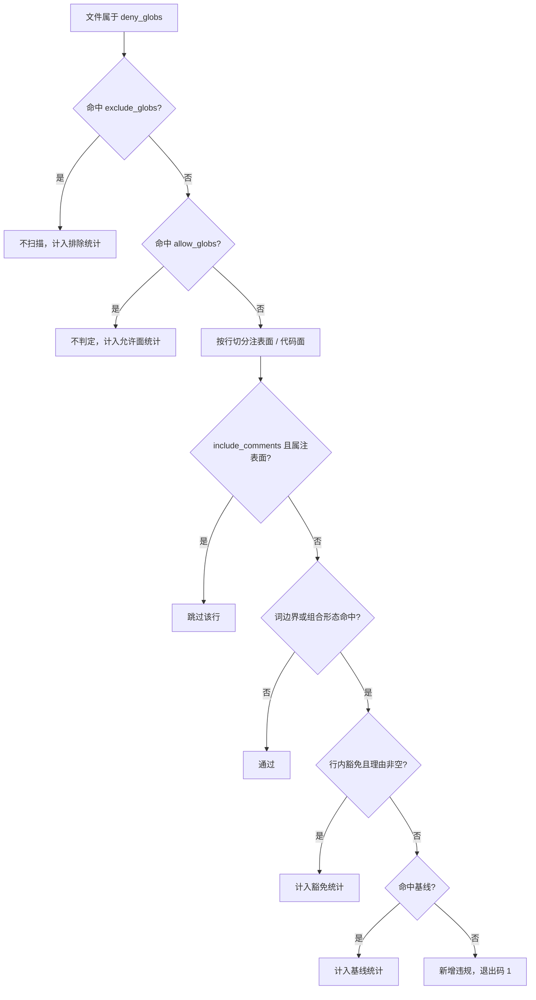

# engkit 产品字面量规则详细设计

> 跨产品协同 · 04 护栏与 CI · 01 engkit 产品字面量规则 · 详细设计（开发核心文档）

[文档首页](../../../../../../文档首页.md) › [01 engkit 产品字面量规则](../04_护栏与CI_01_engkit产品字面量规则.md) › 设计

## 1. 目标与边界 <a id="scope"></a>

**目标**：在 engkit 中新增一条**通用**护栏规则——「平台类仓的禁入面不得出现产品标识」，判定面、标识清单、允许面与排除面**全部由各仓配置声明**（engkit 包内零仓名、零产品名），从机制上阻止“改一处、漏五处”的复发。

**范围内**：

1. 规则模块与 CLI 子命令（`product-literals`）；
2. 配置字段（禁入面 / 允许面 / 排除面 / 标识清单 / 注释开关 / 组合后缀 / 基线 / 豁免标记）；
3. 匹配规则（词边界、组合形态、注释与 docstring 口径）；
4. 基线与「只减不增」机器约束，以及“收编完成后转硬门禁”的切换路径；
5. 自测与包内元校验；接入 bms 预检秒级档与 CI 基座完整性作业；
6. engkit 文档「配置字段全表」补节。

**范围外**：bms 侧的具体收编（`03_01` / `03_02` / `03_03`）、CI 拉取产品仓清单与注册表一致性校验（`04_02`）、文档类护栏（已有 `docs-scope`）、产品仓反向护栏（本期不实现，见 §8）。

## 2. 现状与实测 <a id="current"></a>

### 2.1 engkit 侧 <a id="current-engkit"></a>

| 项 | 事实 |
| --- | --- |
| 结构 | `src/engkit/*.py` 模块级规则（`docs_scope.py` / `docs_links.py` / `coverage.py` / `guard.py` / `preflight.py` 等），CLI 在 `cli.py` 注册子命令 |
| 规则风格 | **规则通用、白名单由各仓 `engkit.toml` 声明**（如 `[docs.scope]` 的 `whitelist_dirs` / `whitelist_files`），规则代码不出现仓名 |
| 配置校验 | 缺段取缺省值；**未知键、类型不符一律 `ConfigError`**（配置是唯一事实源）；`_TOP_KEYS` 与 `[rules.*]` 键集均显式登记，新增段必须同步登记 |
| 自测 | 规则模块提供 `--self-test`（内置正反夹具，`preflight` 的 `[[preflight.self_tests]]` 调用） |
| 豁免标记 | 行级标记（如 `docs-scope:allow`），理由可缺省 |
| 缺口 | **无产品标识护栏**——本次跨仓漂移（`org` → `mdm`）无任何机器拦截，靠人工发现 |

### 2.2 bms 侧实测存量 <a id="current-bms"></a>

| 面 | 实测（2026-10-28，`git grep`） | 说明 |
| --- | --- | --- |
| 后端非测试源码 | **37 个文件 / 98 行**含 `mdm` | 约八成是**注释与 docstring**（如 `db/keys.py` 库名类比、`db/migration.py` 前缀去重说明）；真实代码面约 20 行：`tenant/seed/menu.py` 6 行、`tenant/seed/probe.py` 1 行、`services/platform/src/bms_platform/capabilities.py` 5 个能力名（**契约级**）、其余为零散标识 |
| 前端非测试源码 | **39 行** | 实质命中集中在 `core/src/contracts/service-endpoint.ts`、`core/src/capabilities/org-source.ts`、`ui_ep/src/utils/orgSource.ts`、`apps/desktop/src/api/*.ts`、`module/registries.ts`、`views/system/**/*.vue`（`mdm_org` 模块键）；`packages/ui_ep/src/assets/maps/china.ts` 为**误报样本**（长串内出现 `mdm`），须靠词边界排除 |
| 生成物（应排除） | `frontend/packages/api_types`、`frontend/releases/**`、`frontend/apps/desktop/public/modules.json` | 由构建 / 发布生成，非人工维护，纳入扫描只会制造噪音 |
| 测试与测试支撑 | `**/tests/**`、`**/*.spec.ts`、`frontend/packages/core/testing/**` | 夹具必须写产品标识才是“零改动”验证的前提 |

**问题**：产品标识同时以「类型」「常量数组」「字面量字符串」「注释旧口径」四种形态存在于平台仓；产品改名或新增时必漏改（阶段七收口时组织选择与回显即因命名空间过期不可用）。

## 3. 设计 <a id="design"></a>

### 3.1 规则定位 <a id="position"></a>

| 项 | 口径 |
| --- | --- |
| 通用性 | 规则本体只认「配置给的标识清单」与「配置给的路径面」，不内置任何仓名 / 产品名 / 目录名 |
| 插件形态 | 实现模块 `base/product_literals.py` + CLI 子命令 `engkit base product-literals`，与 `bare-collections` 等 `[rules.*]` 校验器同一挂载方式（复用 `require()` 缺段退 2 与 `--self-test` / `--update-baseline` 既有参数） |
| 适用仓 | 任何“平台类”仓（声明 `[rules.product_literals]` 且 `enabled = true` 即启用）；**本期只服务平台仓**，产品仓不声明即不生效 |

### 3.2 配置字段 <a id="config"></a>

```toml
# 产品字面量护栏（`engkit product-literals`）：平台类仓的禁入面不得出现产品标识
[rules.product_literals]
enabled = true
# 禁入面：平台源码、平台种子、前端常量（相对仓根，posix glob）
deny_globs = [
  "backend/libs/**/*.py",
  "backend/services/**/*.py",
  "backend/ops/**/*.py",
  "frontend/packages/**/*.ts",
  "frontend/packages/**/*.vue",
  "frontend/apps/**/*.ts",
  "frontend/apps/**/*.vue",
  "frontend/modules/**/*.ts",
  "frontend/modules/**/*.vue",
]
# 允许面：合规出现位置（测试夹具、产品自持声明、文档、契约级能力声明）
allow_globs = [
  "**/tests/**",
  "**/testing/**",
  "**/*.spec.ts",
  "deploy/registry/**",
  "bms文档/**",
  "backend/services/platform/src/bms_platform/capabilities.py",
]
# 排除面：生成物 / 构建产物（不计入扫描、不进统计）
exclude_globs = [
  "frontend/packages/api_types/**",
  "frontend/releases/**",
  "frontend/apps/desktop/public/modules.json",
]
# 标识清单（各仓自声明；不写进规则代码）
literals = ["mdm"]
# 注释与 docstring 是否计入（决策 1：计入）
include_comments = true
# 组合形态后缀：标识紧邻这些字符仍算违规（`mdm_` / `mdm.` / `mdm:` / `mdm-`）
combine_suffixes = ["_", ".", ":", "-"]
# 存量基线（JSON；只减不增）
baseline = "deploy/boundaries/product_literals_baseline.json"
# 只减不增断言基准 ref（预检带此参数；空 = 不校验）
baseline_ref = "origin/main"
# 行内豁免标记前缀（理由必须非空）
exempt_marker = "product-literal:allow:"
```

| 字段 | 必填 | 语义 |
| --- | --- | --- |
| `enabled` | 是 | 关闭时子命令直接返回 0（保留给产品仓） |
| `deny_globs` | 是 | 禁入面；命中即违规 |
| `allow_globs` | 否 | 允许面；**优先于**禁入面判定（合规出现位置） |
| `exclude_globs` | 否 | 排除面；**根本不进扫描**（生成物），与“允许面”语义分开统计 |
| `literals` | 是 | 需拦截的标识清单（非空，否则 `ConfigError`） |
| `include_comments` | 否 | 注释 / docstring 是否计入；缺省 `true` |
| `combine_suffixes` | 否 | 组合形态后缀；缺省 `["_", ".", ":", "-"]` |
| `baseline` | 否 | 存量基线 JSON；为空表示零容忍 |
| `baseline_ref` | 否 | 只减不增断言的比较基准（`git` ref）；为空不校验 |
| `exempt_marker` | 否 | 行内豁免标记前缀；理由为空视为无效豁免（按违规报） |

### 3.3 匹配规则 <a id="match"></a>

| 形态 | 判定 | 例 |
| --- | --- | --- |
| 裸标识（词边界） | 违规 | `service = "mdm"`、`data_source_key="mdm.org.dept"` |
| 组合形态（标识 + `combine_suffixes`） | 违规 | `mdm_dept`（表前缀）、`mdm.org.*`（事件域 / 能力名）、`mdm:query`（权限码） |
| 长串内出现（非词边界） | **不违规** | `mdma`、`xmdm`、`china.ts` 坐标串内的 `mdm` |
| 注释 / docstring（`include_comments = true`） | 违规 | `# 组织关系归 mdm`、docstring 里的旧口径 |
| 注释 / docstring（`include_comments = false`） | 不判定 | — |
| 允许面命中 | 不判定（计入允许面统计） | `tests/**`、`deploy/registry/**`、`capabilities.py` |
| 排除面命中 | 不扫描（不计统计） | `api_types/**`、`releases/**` |
| 行内豁免 | 不判定，但**理由必须非空**；空理由按违规报 | `... # product-literal:allow:兼容历史事务分支` |

**匹配口径细化**：

1. **词边界**：左边界必为“非标识符字符或行首”，右边界为“非标识符字符或行尾”**或 `combine_suffixes` 中的字符**；**区分大小写**（产品键在代码中恒小写；不区分大小写会把地图坐标串里的 `Cw` 判成产品标识，实测 `frontend/packages/ui_ep/src/assets/maps/china.ts`）。
2. **为什么组合形态也算违规**：本次漂移正是“服务键变了、表前缀 / 事件域 / 权限码跟着变”，只拦裸标识会漏掉 `mdm_`、`mdm.`、`mdm:` 三种最常见的引用形态。
3. **注释与 docstring 的实现口径**（决策 1）：Python 走 `tokenize` + `ast`——`COMMENT` token 与“模块 / 类 / 函数 docstring 区间的字符串 token”记为注表面，其余字符串字面量属代码面；TypeScript / Vue 走状态机剥离 `//` 行注释与 `/* … */` 块注释（字符串内的引号不当作注释起始）。**解析失败**（语法错误 / 模板片段）时退化为全文扫描，并在输出的该文件行尾标注 `（降级：全文扫描）`。
4. **为什么允许面含文档**：登记清单与架构节点**必须**写产品名（否则无法表达），护栏只约束代码与种子；文档口径另有 `docs-scope`。
5. **为什么能力声明文件进允许面**：`03_01` 已拍板「能力名属契约级允许位置」——能力名是跨产品契约的一部分，声明处必须写产品段，靠**路径级允许面**表达，不散落行内豁免。

判定顺序（逻辑图形）：



### 3.4 基线与递减 <a id="baseline"></a>

**基线文件形态**（决策 4）：`deploy/boundaries/product_literals_baseline.json`，与既有 `domain_boundary_baseline.json` / `bare_collections_baseline.json` 同目录、同「版本号 + 条目」风格：

```json
{
  "version": 1,
  "entries": [
    {
      "path": "backend/libs/bms_core/src/bms_core/tenant/seed/menu.py",
      "fingerprint": "9f2c1ab7d3e45c60",
      "count": 6,
      "samples": ["mdm", "mdm:query"]
    }
  ]
}
```

| 要素 | 口径 |
| --- | --- |
| `fingerprint` | **行内容规范化后的哈希**（去首尾空白 + 折叠内部空白，`sha256` 取前 16 位）；**不存行号**——上游插删行不会让基线整体失效 |
| `count` | 同一 `(path, fingerprint)` 的命中行数（同一行多标识按 1 计） |
| `samples` | 最多 2 个命中片段，供人工审阅，不参与判定 |
| 生成 | 仅 `--update-baseline` 生成 / 更新；命令输出「新增 X / 移除 Y」差异 |
| 匹配 | 命中行的 `(path, fingerprint)` 在基线条目中即视为存量，`count` 只用于统计与只减不增断言 |

**只减不增**（决策 6，机器断言）：

| 场景 | 行为 |
| --- | --- |
| 预检 / CI（带 `--baseline-ref`） | 读取该 ref 下的基线文件，断言「当前条目集合 ⊆ ref 条目集合」且「逐条 `count` ≤ ref `count`」；违反即退出码 1，提示「基线只减不增：确需新增请人工 `--update-baseline` 并在提交说明写明理由」 |
| 人工确认存量 | `--update-baseline` 重算并写回；CI 一律不传该参数（不自动更新） |
| 基线清空（收编完成） | 删除条目后规则等价硬门禁；`05_01` 验收以「基线为空且全仓零命中」为准 |
| ref 不存在（浅克隆 / 无远端） | **告警不失败**（`--baseline-ref` 仅在可解析时断言），避免新克隆本地无法预检 |

### 3.5 CLI 与退出码 <a id="cli"></a>

```
engkit base product-literals [--self-test] [--update-baseline] [--baseline-ref REF] [--json]
```

| 参数 | 语义 |
| --- | --- |
| `--self-test` | 跑内置夹具（临时目录，不依赖仓内文件） |
| `--update-baseline` | 重算并写回基线（受控动作，输出新增 / 移除差异） |
| `--baseline-ref` | 只减不增断言的比较基准；预检步骤传 `origin/main` |
| `--json` | 以 JSON 输出结果（沿用校验器既有参数，供 CI / 工具消费） |

> 输出文案沿用校验器惯用前缀 `[check_product_literals]`，不另设 `--quiet`（预检侧只跑一条步骤，输出本就只有汇总行与命中行）。

| 退出码 | 含义 |
| --- | --- |
| 0 | 无新增违规（含全部命中基线 / 豁免 / 允许面） |
| 1 | 存在新增违规，或基线只减不增断言失败 |
| 2 | 配置错误（缺 `literals`、`baseline` 不可读、glob 非法、`enabled` 非布尔） |

### 3.6 输出 <a id="output"></a>

**逐条**：`相对路径:行号  命中片段  → 建议`，建议文案固定为「改为按能力名 / 服务目录取用，或登记到产品自持声明」（细化建议见 §8 开放项 1）。

**汇总**：`检查 N 个文件（排除 E / 允许 A），命中 M 处（新增 X / 基线 Y / 豁免 Z）`；有新增时末尾追加「基线只减不增：本仓基线 X 条，基准 ref Y 条」。

### 3.7 自测与包内元校验 <a id="selftest"></a>

| 项 | 要求 |
| --- | --- |
| `--self-test` | 夹具落临时目录，覆盖：裸标识、四种组合后缀、词边界（`mdma` / `xmdm`）、注释开关两态、docstring、允许面、排除面、豁免（含空理由判违规）、基线抑制、只减不增（构造条目增长即失败）、配置错误、关闭开关、退出码 |
| 包内元校验 | 自测中临时注入哨兵标识 + 扫描 `src/engkit`，断言**规则包自身零命中**（防止产品名被写进工具包）；bms 侧沿用既有「engkit 包内零仓名 / 目录字面量」机器断言 |
| 与 `preflight` 集成 | `[[preflight.self_tests]]` 增加一条（`deps` 指向 `product_literals.py`），`--fast` / `--full` 全跑、定向档按变更触及才跑 |
| engkit 自身门禁 | 新模块纳入 engkit 的 `pytest` + `ruff` + `pyright` + 覆盖率口径（见《AI开发规范》「覆盖率要求」节），自测即测试主体，不另建 `pragma: no cover` |

### 3.8 与既有规则的边界 <a id="boundary"></a>

| 已有规则 | 分工 |
| --- | --- |
| `check_service_boundaries`（bms 自研） | 断言服务包之间的 import 与目录边界；本规则断言**标识字面量** |
| `docs-scope` | 文档进度字段落点；本规则默认不碰文档（`bms文档/**` 在允许面） |
| `check_backend_base` / `check_bare_collections` | 继承链与集合声明；与本规则无交集 |
| `04_02` CI 跨仓契约校验 | 断言「声明 ↔ 对端契约」一致；本规则断言「平台仓不得出现产品标识」，两者不重叠（能力名在 `capabilities.py` 属允许面，其契约一致性由 `04_02` 守） |

## 4. 交付物清单 <a id="deliverables"></a>

| # | 仓 | 交付物 | 类型 |
| --- | --- | --- | --- |
| 1 | engkit | `src/engkit/base/product_literals.py`（规则 + 自测 + 基线读写） | 新增 |
| 2 | engkit | `src/engkit/config.py`：`[rules.product_literals]` 段解析 + 严格键校验 | 修改 |
| 3 | engkit | `src/engkit/cli.py`：`base` 子命令表登记 `product-literals` 与 `--baseline-ref`，分派到规则模块 | 修改 |
| 4 | engkit | `engkit文档/概述/工程化工具包说明.md`「配置字段全表」补节 + 文档首页导航 | 文档 |
| 5 | engkit | `tests/` 侧补充（若既有测试组织需要独立用例文件，则复用自测夹具） | 测试 |
| 6 | bms | `engkit.toml`：`[rules.product_literals]` 段 + `[[preflight.steps]]` + `[[preflight.self_tests]]` | 修改 |
| 6b | bms | `scripts/tools/base_check/check_product_literals.py`（薄包装：参数转发 + 退出码透传） | 新增 |
| 7 | bms | `deploy/boundaries/product_literals_baseline.json`（首版基线） | 新增 |
| 8 | bms | `.gitlab-ci.yml`：`base-integrity` 作业增加规则与自测两行 | 修改 |
| 9 | bms | 需求 `04-1` 第 2 条措辞回写（注释口径，见 §9） | 文档 |
| 10 | bms | 本任务实施记录、测试记录、测试记录中的 Kiwi 编号 | 文档 |
| 11 | bms | 计划表进度回写（状态 / 完成日期等，唯一落点见计划表） | 文档 |

## 5. 测试设计与验收映射 <a id="test"></a>

### 5.1 测试设计 <a id="test-cases"></a>

| # | 用例 | 断言 |
| --- | --- | --- |
| 1 | 裸标识命中 | 报违规、退出码 1、含路径 / 行号 / 建议 |
| 2 | 组合形态（`_` / `.` / `:` / `-`） | 四种均命中 |
| 3 | 词边界 | `mdma` / `xmdm` / 坐标长串内的 `mdm` 不命中 |
| 4 | 注释命中（`include_comments = true`） | Python `#` 注释与 docstring 均命中 |
| 5 | 注释不判（`include_comments = false`） | 注释 / docstring 跳过，同文件代码面仍命中 |
| 6 | 允许面 | `tests/**` / `testing/**` / `deploy/registry/**` / `capabilities.py` 不报 |
| 7 | 排除面 | `api_types/**` / `releases/**` / `public/modules.json` 不扫描、计入排除统计 |
| 8 | 行内豁免（有理由） | 不报，计入豁免计数 |
| 9 | 行内豁免（空理由） | 按违规报 |
| 10 | 基线抑制 | 基线内命中不报，退出码 0 |
| 11 | 新增违规（不在基线） | 报并退出码 1 |
| 12 | 基线只减不增（条目增加） | `--baseline-ref` 断言失败、退出码 1、提示人工确认 |
| 13 | 基线只减不增（条目减少） | 通过（递减合法） |
| 14 | ref 不可解析 | 告警不失败，退出码按新增违规计 |
| 15 | `--update-baseline` | 生成 / 更新基线并输出新增 / 移除差异 |
| 16 | 配置错误（缺 `literals` / 非法 glob / `baseline` 不可读） | 退出码 2，信息定位到字段 |
| 17 | 关闭开关 | `enabled = false` 直接返回 0 |
| 18 | `--self-test` | 全通过；含哨兵标识的包内零命中断言 |
| 19 | 降级路径 | Python 语法错误文件退化为全文扫描并在输出标注 |
| 20 | 性能 | bms 全量扫描在预检秒级档内完成（预算内） |

> 用例编号以 Kiwi 平台自增主键为准：**先登记取得编号**，再在测试记录回填（见《AI开发规范》「编号对齐」）。

### 5.2 验收映射 <a id="accept-map"></a>

| 需求 `04-1` 完成标准 | 设计项 | 用例 | 证据 |
| --- | --- | --- | --- |
| 规则自带正反用例并通过自测 | §3.7 | 1 ~ 20 | `engkit product-literals --self-test` 输出 |
| 平台仓启用后命中给出可操作提示 | §3.2 / §3.6 | 1 / 2 / 11 | 预检实跑输出（含路径、行号、建议文案） |
| 收编完成后全仓零命中且纳入预检（`--fast` 即可拦截） | §3.4 / §3.7 | 10 ~ 14 | `preflight --fast` 中含该步骤；基线条目递减至 0 由 `05_01` 验收 |
| 包内无任何仓名 / 目录字面量（engkit 自身断言通过） | §3.7 | 18 | 自测的哨兵扫描断言 + engkit 既有包内红线断言 |

## 6. 风险与边界 <a id="risk"></a>

| 风险 | 处置 |
| --- | --- |
| 误伤（表前缀、事件域合法使用场景） | 组合形态**故意**计入违规（这些正是要迁移的引用）；确需保留时用带理由的豁免，评审关注豁免增长 |
| 注释命中导致基线偏大（约 +80 行） | 基线只存指纹不存行号，维护成本低；注释清理随 `03_02` / `03_03` 与专门注释回写递减，基线只减不增由机器断言 |
| 豁免滥用导致规则失效 | 理由必填 + 统计豁免数量 + 评审；基线只减不增 |
| 标识清单遗漏（新产品未加入） | 产品接入流程（《项目规划说明》接入步骤）增加“登记到 `literals`”；清单与产品目录对账写入 `04_02` |
| 规则分散在多仓难以升级 | 规则在 engkit 单一实现，各仓只声明配置 |
| 与产品仓冲突（产品仓内出现自己名字是正常的） | 规则只对 `enabled = true` 且声明了禁入面的仓生效；产品仓本期不声明 |
| 解析器误判（Python 语法错误 / Vue 模板片段） | 退化为全文扫描并显式标注，宁可多报不漏报 |

## 7. 决策记录 <a id="decisions"></a>

| # | 事项 | 结论 | 影响 |
| --- | --- | --- | --- |
| 1 | 注释 / docstring 是否计入 | **计入**，独立开关 `include_comments`（缺省 true） | 基线条目约 +80；注释口径漂移同时被拦 |
| 2 | 标识清单来源 | **配置静态清单**；**本期只配 `mdm`**（`biz` / `cw` 与 `biz_type` / `biz_id` / `biz_error` 等通用命名撞车，实测 164 处泛化命中），随产品真正接入时再登记 | 新产品接入只需加一行；避免基线被噪音稀释 |
| 3 | 能力名等契约级标识放行 | **路径白名单**（`allow_globs` 含 `capabilities.py`） | 与 `03_01` 决策一致；不在代码里散落豁免 |
| 4 | 基线落点与形态 | **`deploy/boundaries/product_literals_baseline.json`**，路径 + 内容指纹 + 计数 | 与既有基线同口径；行漂移不失效 |
| 5 | 接入档位 | **预检 `--fast` 档 + CI `base-integrity` 作业** | 本地即可拦截；每次预检约 +1s |
| 6 | 基线递减约束 | **机器断言只减不增**（`--baseline-ref` 与 ref 条目比较） | 规则不能被悄悄放宽；新增需人工确认 |
| 7 | 扫描面 | **前后端源码**，排除生成物（`exclude_globs`） | 覆盖真实人工维护面，噪音可控 |
| 8 | 子命令与产品仓用法 | **`engkit base product-literals`**（挂 `base` 下，与 `[rules.*]` 校验器同一约定）；本期只服务平台仓 | 与 `bare-collections` 等一致；反向护栏留开放项 |
| 9 | 配置段位置（对齐既有约定，不单独拍板） | `[rules.product_literals]`（原稿为顶层 `[product_literals]`） | 校验器类规则统一落 `[rules.*]`，与 `[rules.bare_collections]` 等一致 |
| 10 | 匹配大小写 | **区分大小写**（实施首轮按基线误报调整） | 产品键恒小写；避免数据串（地图坐标等）误报 |

## 8. 开放项 <a id="open"></a>

| # | 事项 | 归口 |
| --- | --- | --- |
| 1 | 是否按“标识 → 建议动作”给出更细的整改提示（如“改为 `resolve_capability('mdm.org.user-roles')`”） | 规则稳定后评估；当前给统一建议文案 |
| 2 | 是否扩展到“平台源码不得出现产品表前缀”的独立规则 | 当前已由组合形态覆盖，出现误判再拆分 |
| 3 | 产品仓是否启用“反向护栏”（不得直连其他产品） | 产品间直连真实出现时评估 |

## 9. 对齐记录 <a id="align"></a>

| # | 事项 | 处置 |
| --- | --- | --- |
| 1 | 需求 `04-1` 内容第 2 条把「注释」列为**允许位置**示例，与决策 1（注释计入）冲突 | **回写需求**：允许位置示例改为「产品自持声明、测试夹具、文档」，并写明「注释按 `include_comments` 开关判定，缺省计入」 |
| 2 | 原稿 §3.4 基线为 `scripts/tools/base_check/product-literals-baseline.txt`（路径 + 行号） | 按决策 4 改为 `deploy/boundaries/*.json` + 内容指纹；原开放项 4 随之关闭 |
| 3 | 原稿配置段为顶层 `[product_literals]` | 按 engkit 既有约定改 `[rules.product_literals]`（决策记录第 9 条） |
| 4 | 原稿未区分「允许面」与「排除面」，生成物无处安放 | 新增 `exclude_globs`；`china.ts` 误报样本同时验证词边界口径 |
| 5 | 计划表备注「能力名列为契约级允许位置（`03_01` 决策）」 | 落为 `allow_globs` 路径白名单（决策 3），不散落行内豁免 |
| 6 | 与 `04_02` 的边界：注册表一致性 / 清单对账 | 本任务只做标识护栏；`04_02` 负责拉取产品仓清单并校验一致性（其详细设计另行落定） |
| 7 | 估工 | 与计划表登记值一致（规则本体 + 配置 + 首版基线 + 预检 / CI 接入 + 文档与记录） |
| 8 | 命令挂载：设计初稿为顶层 `engkit product-literals`（与 `docs-scope` 平级） | 实施时确认改为 `engkit base product-literals`（决策 8 已同步回写）：配置落 `[rules.product_literals]`，与既有校验器复用同一套 `require()` / `--self-test` / `--update-baseline` 约定；§3.1 / §3.5 / §4 交付物已随之更新 |
| 9 | 标识清单臂 `biz` / `cw` 与通用命名撞车（实测 164 处 `biz_type` / `biz_id` / `biz_error` 等） | 决策 2 改为**本期只配 `mdm`**；`biz` / `cw` 随产品接入登记（接入流程已要求登记 `literals`） |
| 10 | 大小写不敏感导致数据串误报（`china.ts` 的 `Cw`） | 决策 10 改为**区分大小写**；产品键在代码中恒小写 |
| 11 | 首版基线实测 | 149 条（110 个文件：`backend/libs` 68 / `frontend/apps` 33 / `backend/services` 22 / `frontend/packages` 21 / `backend/ops` 5）；生成物（`api_types` / `releases` / `modules.json`）零命中，排除面生效 |
| 12 | bms 侧接入方式补全 | 按既有口径新增**薄包装** `scripts/tools/base_check/check_product_literals.py`（只转发参数与退出码），预检步骤与 CI 均调它，不在配置里直接写 `engkit` 命令 |

> 本文档依《[文档生成规范](../../../../../../规范/文档生成规范.md)》与《[任务文档规范](../../../../../../规范/任务文档规范.md)》编写
