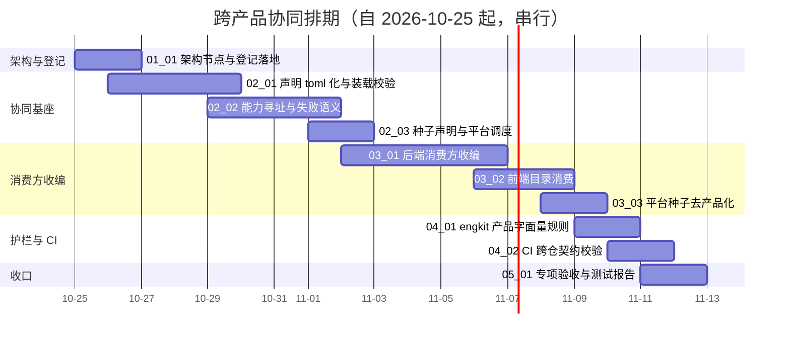

# 跨产品协同计划

[文档首页](../../../文档首页.md) › 跨产品协同计划　|　[任务基线 →](../任务/01_架构与登记/01_架构与登记.md)　[需求基线 →](../需求/00_需求_跨产品协同.md)

> 进度唯一落点（本文档）：**已完成 0 项，剩余 10 项**（专项于 2026-10-24 立项；门禁见 §5，遗留台账见 §7）

## 1. 计划说明 

- **排期对象**：专项 10 条需求、10 个子任务（域 01 架构与登记 1 / 域 02 协同基座 3 / 域 03 消费方收编 3 / 域 04 护栏与 CI 2 / 域 05 阶段验收 1）。
- **排期口径**：自 2026-10-25 起串行排期（单人兼职），窗口按实际滚动调整。
- **工时**：已完成 0h；剩余 100h；阶段合计 100h。
- **里程碑锚点**：M7B = 跨产品协同基座可用（产品改名 / 改路径不再触发平台侧改动；断链在启动期暴露）。不进入《总体项目规划》里程碑表，作为阶段七与阶段八之间的衔接专项。
- **负责人**：minjian（兼职，单人）。

## 2. 已完成任务 

| 编号 | 任务 | 工时（重估） | 完成日期 | 任务文件 | 偏差与遗留 |
| --- | --- | --- | --- | --- | --- |

## 3. 剩余任务排期（自 2026-10-25） 

| 编号 | 任务 | 状态 | 工时 | 依赖 | 排期窗口 | 备注 | 偏差与遗留 |
| --- | --- | --- | --- | --- | --- | --- | --- |
| 01_01 | 架构节点与登记落地 | 未开始 | 8h | — | 2026-10-25 ~ 2026-10-26 | 架构节点 + 规划节 + 接入流程 + 登记清单 | 无 |
| 02_01 | 声明 toml 化与装载校验 | 未开始 | 16h | 01_01、产品仓同批 | 2026-10-26 ~ 2026-10-29 | 两仓直接切换 | 遗留：产品仓 CI 中间窗口可能变红（已知并接受，§7 第 1 项） |
| 02_02 | 能力寻址与失败语义 | 未开始 | 12h | 02_01 | 2026-10-29 ~ 2026-11-01 | 能力视图 + 三档失败语义 + 目录快照出口 | 无 |
| 02_03 | 种子声明与平台调度 | 未开始 | 8h | 02_01、02_02 | 2026-11-01 ~ 2026-11-02 | 声明入口 + 统一调度 | 无 |
| 03_01 | 后端消费方收编 | 未开始 | 20h | 02_02 | 2026-11-02 ~ 2026-11-06 | 解析器 / 两处编排 / 三处白名单 / 恒开通清单 | 无 |
| 03_02 | 前端目录消费 | 未开始 | 8h | 02_02 | 2026-11-06 ~ 2026-11-08 | 产品键与端点改运行期取 | 无 |
| 03_03 | 平台种子去产品化 | 未开始 | 4h | 02_03 | 2026-11-08 ~ 2026-11-09 | 平台种子移除产品码 | 无 |
| 04_01 | engkit 产品字面量规则 | 未开始 | 8h | 可与 03 并行 | 2026-11-09 ~ 2026-11-10 | 规则 + 自测 + 各仓配置 | 无 |
| 04_02 | CI 跨仓契约校验 | 未开始 | 8h | 02_01、04_01 | 2026-11-10 ~ 2026-11-11 | CI 拉产品仓清单 + 本地等价 | 无 |
| 05_01 | 专项验收与测试报告 | 未开始 | 8h | 01_01 ~ 04_02 | 2026-11-11 ~ 2026-11-12 | 收口 | 无 |

## 4. 排期甘特图 

## 5. 专项验收门禁 

| 验收点 | 对应任务 | 达成路径（结论与证据索引） |
| --- | --- | --- |
| 零产品字面量（平台源码 / 平台种子 / 前端常量） | 03_01 / 03_02 / 03_03 / 04_01 | engkit 规则在平台仓启用后全仓零命中，纳入预检秒级档；登记清单状态全部回写「已收编」 |
| 能力声明缺失或与对端契约不符即拒启 | 02_01 / 02_02 | 装载校验六类反例（缺能力 / 重名 / 提供方不符 / 访问面不在契约 / 版本不兼容 / 种子入口不可解析）均拒绝启动 |
| 写路径 fail-closed、读路径降级仅限显式声明 | 02_02 / 03_01 | 写路径失败用例断言无半写；读路径降级用例仅覆盖被声明能力，且有日志与指标断言 |
| 产品种子由平台统一调度（幂等 / 冲突报错） | 02_03 / 03_03 | 重复执行幂等；构造冲突非零退出并输出差异；单产品失败不影响其他产品 |
| 前端新增产品零改动 | 03_02 | 以夹具模拟新增产品，前端不改代码即可取址；目录快照不可用时有明确降级 |
| 与既有注册机制统一（第五类记录同源同通道、快照扩既有端点、种子并入既有编排、校验并入既有脚本） | 02_01 / 02_02 / 02_03 / 04_02 | 代码检索确认无第二套注册表 / 目录出口 / 播种入口 / 校验入口；登记清单 §8 对应表与实现一致 |
| CI 能取产品仓清单并校验 | 04_02 | CI 作业拉取清单完成装载与契约定位校验；构造不一致即失败并定位能力名；拉取失败不静默跳过 |

**门禁对照**（与阶段七遗留的衔接）：

| 项 | 来源 | 说明 |
| --- | --- | --- |
| 跨仓口径漂移 | 阶段七计划 §7 第 44 项 | 该项已闭环（一次性对齐 + 锁定断言）；本专项负责**根治**——不再产生同类漂移 |
| 三库真库与网关联调 | 阶段七计划 §7 第 34 项 | 不在本专项范围；部署窗口执行 |

## 6. 风险与对策 

| 风险 | 影响 | 对策 |
| --- | --- | --- |
| 清单格式直接切换导致产品仓 CI 中间窗口变红 | 短暂红灯，可能掩盖真实问题 | 两仓同一窗口内切换并同步推送；切换后立即各跑一次完整预检；中间窗口不介入其他改动 |
| 装载校验过严误拦合法声明 | 产品无法启动 | 必填 / 按需两档声明；按需要素缺失不拒启但要求显式标注；校验失败信息定位到能力名 |
| 收编引入权限或分配行为漂移 | 「权限少一半」或「分配写一半」 | 逐处配「改声明 → 行为随之变化」用例；沿用既有权限与分配全量用例回归 |
| 前端改运行期取址后目录不可用 | 组织选择等能力不可用 | 明确降级：禁用相关能力并提示，不静默拼错地址；目录出口纳入健康检查 |
| CI 依赖产品仓可达性 | 平台流水线因外部仓不稳而红 | 固定稳定分支 + 浅克隆 + 缓存；拉取失败即失败并给出原因（不静默跳过），必要时人工以显式变量跳过并留痕 |
| 护栏误伤注释与测试夹具 | 到处加豁免，规则形同虚设 | 允许位置分类可配；豁免须写明理由（行内标记），评审检查豁免增长 |

## 7. 后续阶段待办 

| # | 事项 | 来源 | 归口 |
| --- | --- | --- | --- |
| 1 | 两仓清单格式直接切换的中间窗口（产品仓 CI 短暂变红） | 2026-10-24 拍板（直接切换） | 已知风险：随 `02_01` 收口消除 |
| 2 | 产品间直连的仲裁方机制（谁裁定“允许直连”） | 架构 38 节点 §10 开放项 | 首个真实直连需求出现时细化 |
| 3 | 能力分档治理（基座级 / 产品级能力的稳定性承诺差异） | 架构 38 节点 §10 演进项 | 第三个产品接入时评估 |
| 4 | 已部署库的补种口径（平台种子 + 各产品种子） | 需求 `03-3`、阶段七 §7 第 35 项 | 部署窗口（运维步骤） |
| 5 | 产品仓侧种子入口与能力声明的实际维护责任 | 需求 `02-1` / `02-3` | 各产品仓（mdm 先行，biz / cw 随其接入） |

> 本文档依《[计划文档规范](../../../规范/计划文档规范.md)》编写 · 进度以本表为唯一落点
