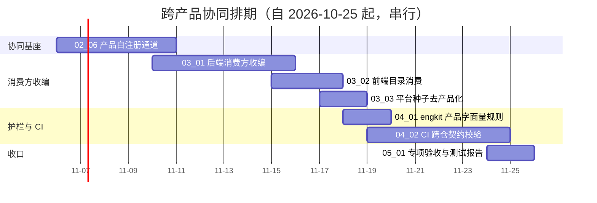

# 跨产品协同计划

[文档首页](../../../文档首页.md) › 跨产品协同计划　|　[任务基线 →](../任务/01_架构与登记/01_架构与登记.md)　[需求基线 →](../需求/00_需求_跨产品协同.md)

> 进度唯一落点（本文档）：**已完成 6 项，剩余 7 项**（专项于 2026-10-24 立项；门禁见 §5，遗留台账见 §7）

## 1. 计划说明 

- **排期对象**：专项 12 条需求、13 个子任务（业务域 01 架构与登记 1 / 业务域 02 协同基座 6 / 业务域 03 消费方收编 3 / 业务域 04 护栏与 CI 2 / 业务域 05 阶段验收 1）。
- **排期口径**：自 2026-10-25 起串行排期（单人兼职），窗口按实际滚动调整。
- **工时**：已完成 98h；剩余 96h；阶段合计 194h（`02_01` 因 mdm 收编范围扩张由 16h 重估为 22h；`02_03` 因改「一套装载 + 一个 XA 全局事务」由 8h 重估为 24h；`02_06` 为 2026-10-27 补充需求，按四类声明上报落库 + 三处口径重写估 40h）。
- **里程碑锚点**：M7B = 跨产品协同基座可用（产品改名 / 改路径不再触发平台侧改动；断链在启动期暴露）。不进入《总体项目规划》里程碑表，作为阶段七与阶段八之间的衔接专项。
- **负责人**：minjian（兼职，单人）。

## 2. 已完成任务 

| 编号 | 任务 | 工时（重估） | 完成日期 | 任务文件 | 偏差与遗留 |
| --- | --- | --- | --- | --- | --- |
| 01_01 | 架构节点与登记落地 | 8h | 2026-10-24 | [01_架构与登记_01_架构节点与登记落地](../任务/01_架构与登记/01_架构与登记_01_架构节点与登记落地/01_架构与登记_01_架构节点与登记落地.md) | 状态回写滞后：四份交付物 2026-10-24 落地、2026-10-25 复核修订，2026-10-26 复核三项门禁后回写；Kiwi 编号归 `05_01` 统一登记 |
| 02_01 | 声明 toml 化与装载校验 | 22h | 2026-10-26 | [02_协同基座_01_声明toml化与装载校验](../任务/02_协同基座/02_协同基座_01_声明toml化与装载校验/02_协同基座_01_声明toml化与装载校验.md) | 偏差：范围扩张（决策 16）——mdm 前移 `bms-core` rev 同时暴露 07C 按域 API 漂移，一并收编（迁移清单 `org:*`、表归属补 `domain`、版本表名 `alembic_version_org`），工时 16h 重估为 22h。遗留：种子真实播种（`02_03`）、平台能力声明（`03_01`）、能力取用与降级（`02_02`）、Kiwi 编号（`05_01`）、mdm engkit rev（mdm 窗口）。证据见[实施记录](../任务/02_协同基座/02_协同基座_01_声明toml化与装载校验/实施/01_实施记录_02_声明toml化与装载校验.md) |
| 02_02 | 能力寻址与失败语义 | 12h | 2026-10-27 | [02_协同基座_02_能力寻址与失败语义](../任务/02_协同基座/02_协同基座_02_能力寻址与失败语义/02_协同基座_02_能力寻址与失败语义.md) | 偏差（6 条，已回写设计 §8）：包名 `capability/`→`collaboration/`；默认拓扑「同名服务键」→按域布局 `service_key` 派生（mdm 实测 `org→mdm`）；指标名加 `bms_` 前缀；快照 §3.5 矛盾统一为 `enabled`+`deprecated` 下发；未装载告警改 `warnings` 数组 + `snapshot_version`；请求构造落 `collaboration/request.py`（破导入环）。遗留：消费方收编（`03_01`/`03_02`）、真实拓扑与 `db_keys`（07C `02_02`）、护栏基线递减（随 `03_01`）、快照按消费方裁剪（`02_04`）、平台能力声明（`03_01`）、Kiwi 编号（`05_01`）。证据见[实施记录](../任务/02_协同基座/02_协同基座_02_能力寻址与失败语义/实施/01_实施记录_02_能力寻址与失败语义.md) |
| 02_04 | 能力分配与授权 | 16h | 2026-10-27 | [02_协同基座_04_能力分配与授权](../任务/02_协同基座/02_协同基座_04_能力分配与授权/02_协同基座_04_能力分配与授权.md) | 偏差（4 条，已回写设计 §8）：迁移期「按端点分流」退场（`platform.*` 能力未声明，分流必然空转）；出站 scope 改 `svc:{业务域}:{read\|write}`（与开放接口 scope 分区）；授权视图出口落 `/api/v1/platform/internal/capability-grants`（沿用内部面命名）；库不可读 / 未建表由「拒启」改「降级放行 + 标记」（与表归属接库校验同口径，避免未初始化库把服务拒之门外）。遗留：审计真实落库（29-审计合规）、产品侧远端来源接线（`03_01`）、出站 scope 运行期校验（开放接口阶段）、Kiwi 编号（`05_01`）。证据见[实施记录](../任务/02_协同基座/02_协同基座_04_能力分配与授权/实施/01_实施记录_04_能力分配与授权.md) |
| 02_03 | 种子声明与平台调度 | 24h | 2026-10-27 | [02_协同基座_03_种子声明与平台调度](../任务/02_协同基座/02_协同基座_03_种子声明与平台调度/02_协同基座_03_种子声明与平台调度.md) | 偏差（7 条，已回写设计 §8 #25~#28）：种子来源改装载期注入 `source`（原按名字首段推断误判）；**二轮补齐设计缺口**（冲突预检 / `expected_rows` / 分支内统计 / 退出码 64 / `--require` 排序）；修复 `execute_plan` 零参调取用器必抛 `TypeError`（编排端点此前从未跑通）。遗留：真库 XA 验证（环境变量就绪，CI 集成 job / 部署窗口）、端到端部署验证（部署窗口）、Kiwi 编号（`05_01`）。证据见[实施记录](../任务/02_协同基座/02_协同基座_03_种子声明与平台调度/实施/01_实施记录_03_种子声明与平台调度.md) |
| 02_05 | 产品错误码自持与装载 | 16h | 2026-10-27 | [02_协同基座_05_产品错误码自持与装载](../任务/02_协同基座/02_协同基座_05_产品错误码自持与装载/02_协同基座_05_产品错误码自持与装载.md) | 偏差（4 条，已回写设计 §8）：平台码状态改实测映射表；文案来源排序（显式 > 视图键 > 描述）；渲染单点改异步以便记录指标；部署态清单分发登记遗留（mdm 镜像上下文为 `backend/`）。遗留（均已闭环或已归口）：~~mdm `bms-core` rev 前移~~（**已闭环** `7279b8f`）、~~部署态清单供给~~（**已闭环**：镜像上下文改仓根）、各端点补 `x-error-codes` 与全量强校验（`04_02`）、平台码中文描述（开放项）、Kiwi 编号（`05_01`）。证据见[实施记录](../任务/02_协同基座/02_协同基座_05_产品错误码自持与装载/实施/01_实施记录_05_产品错误码自持与装载.md) |

## 3. 剩余任务排期（自 2026-10-25） 

| 编号 | 任务 | 状态 | 工时 | 依赖 | 排期窗口 | 备注 | 偏差与遗留 |
| --- | --- | --- | --- | --- | --- | --- | --- |
| 02_06 | 产品自注册通道与平台权威视图 | 未开始 | 40h | 02_01、02_02、02_03 | 2026-11-06 ~ 2026-11-10 | 四类声明上报落库 + 权威视图出口 + 消费方拉取 + 装载口径重写 | 2026-10-27 补充需求（02-6）：原「文件装载」口径退役；`03_01` 依赖本任务 |
| 03_01 | 后端消费方收编 | 未开始 | 20h | 02_02、02_04、**02_06** | 2026-11-10 ~ 2026-11-15 | 解析器 / 两处编排 / 三处白名单 / 恒开通清单 | 已按复核回写设计；因 02_06 前置而暂停、顺延（取数源一次到位改平台视图） |
| 03_02 | 前端目录消费 | 未开始 | 8h | 02_02 | 2026-11-15 ~ 2026-11-17 | 产品键与端点改运行期取 | 无 |
| 03_03 | 平台种子去产品化 | 未开始 | 4h | 02_03 | 2026-11-17 ~ 2026-11-18 | 平台种子移除产品码 | 无 |
| 04_01 | engkit 产品字面量规则 | 未开始 | 8h | 可与 03 并行 | 2026-11-18 ~ 2026-11-19 | 规则 + 自测 + 各仓配置 | 能力名列为契约级允许位置（`03_01` 决策） |
| 04_02 | CI 跨仓契约校验 | 未开始 | 8h | 02_01、04_01 | 2026-11-19 ~ 2026-11-24 | CI 拉产品仓清单 + 本地等价 | 若 `02_06` 交付后注册表成为权威，本任务改为校验注册表一致性（待详细设计） |
| 05_01 | 专项验收与测试报告 | 未开始 | 8h | 01_01 ~ 04_02 | 2026-11-24 ~ 2026-11-25 | 收口 | 无 |

## 4. 排期甘特图 

## 5. 专项验收门禁 

| 验收点 | 对应任务 | 达成路径（结论与证据索引） |
| --- | --- | --- |
| 零产品字面量（平台源码 / 平台种子 / 前端常量） | 03_01 / 03_02 / 03_03 / 04_01 | engkit 规则在平台仓启用后全仓零命中，纳入预检秒级档；登记清单状态全部回写「已收编」 |
| 能力声明缺失或与对端契约不符即拒启 | 02_01 / 02_02 | 装载校验六类反例（缺能力 / 重名 / 提供方不符 / 访问面不在契约 / 版本不兼容 / 种子入口不可解析）均拒绝启动 |
| 平台权威视图零文件依赖（产品注册即生效、重启仍成立） | 02_06 | 平台在无产品清单文件时视图完整且重启可恢复；改声明即改视图（用例）；注册异值拒收并报差异；消费方拉取失败拒启 |
| 写路径 fail-closed、读路径降级仅限显式声明 | 02_02 / 03_01 | 写路径失败用例断言无半写；读路径降级用例仅覆盖被声明能力，且有日志与指标断言 |
| 产品种子由平台统一调度（幂等 / 冲突报错） | 02_03 / 03_03 | 重复执行幂等；构造冲突非零退出并输出差异；单产品失败不影响其他产品 |
| 前端新增产品零改动 | 03_02 | 以夹具模拟新增产品，前端不改代码即可取址；目录快照不可用时有明确降级 |
| 错误码可渲染、可对账 | 02_05 | 段位越界 / 跨产品撞码 / 契约与登记不一致三类反例均被拒；合并视图含平台码与产品码且无重复；错误响应按视图渲染状态与文案键，缺失时回退并告警；手册导出与视图一致 |
| 能力分配：有分配即合法、无分配即越界 | 02_04 / 03_01 | 分配记录由产品声明装载落库、可调整 / 撤销并进审计；入站白名单与出站 scope 均由分配派生；无分配时运行期拒绝且装载期拒启；指标按「调用方 × 能力」打点 |
| 与既有注册机制统一（第五类记录同源同通道、快照扩既有端点、种子并入既有编排、校验并入既有脚本） | 02_01 / 02_02 / 02_03 / 04_02 | 代码检索确认无第二套注册表 / 目录出口 / 播种入口 / 校验入口；登记清单 §8 对应表与实现一致 |
| CI 能取产品仓清单并校验 | 04_02 | CI 作业拉取清单完成装载与契约定位校验；构造不一致即失败并定位能力名；拉取失败不静默跳过 |

**门禁对照**（与阶段七遗留的衔接）：

| 项 | 来源 | 说明 |
| --- | --- | --- |
| 跨仓口径漂移 | 阶段七计划 §7 第 44 项 | 该项已闭环（一次性对齐 + 锁定断言）；本专项负责**根治**——不再产生同类漂移 |
| 三库真库与网关联调 | 阶段七计划 §7 第 34 项 | 不在本专项范围；部署窗口执行 |

## 6. 风险与对策 

| 风险 | 影响 | 对策 |
| --- | --- | --- |
| 清单格式直接切换导致产品仓 CI 中间窗口变红 | 短暂红灯，可能掩盖真实问题 | 两仓同一窗口内切换并同步推送；切换后立即各跑一次完整预检；中间窗口不介入其他改动 |
| 装载校验过严误拦合法声明 | 产品无法启动 | 必填 / 按需两档声明；按需要素缺失不拒启但要求显式标注；校验失败信息定位到能力名 |
| 收编引入权限或分配行为漂移 | 「权限少一半」或「分配写一半」 | 逐处配「改声明 → 行为随之变化」用例；沿用既有权限与分配全量用例回归 |
| 前端改运行期取址后目录不可用 | 组织选择等能力不可用 | 明确降级：禁用相关能力并提示，不静默拼错地址；目录出口纳入健康检查 |
| CI 依赖产品仓可达性 | 平台流水线因外部仓不稳而红 | 固定稳定分支 + 浅克隆 + 缓存；拉取失败即失败并给出原因（不静默跳过），必要时人工以显式变量跳过并留痕 |
| 护栏误伤注释与测试夹具 | 到处加豁免，规则形同虚设 | 允许位置分类可配；豁免须写明理由（行内标记），评审检查豁免增长 |

## 7. 后续阶段待办 

| # | 事项 | 来源 | 归口 |
| --- | --- | --- | --- |
| 1 | 两仓清单格式直接切换的中间窗口（产品仓 CI 短暂变红） | 2026-10-24 拍板（直接切换） | **已闭环（2026-10-26）**：推送不再触发流水线（2026-10-26 拍板），且平台侧已解绑产品清单路径（`config.dev.toml` 清空，改 `.env` 注入），两仓切换无中间窗口故障 |
| 2 | 产品间直连的仲裁方机制（谁裁定“允许直连”） | 架构 38 节点 §10 开放项 | 首个真实直连需求出现时细化 |
| 3 | 能力分档治理（基座级 / 产品级能力的稳定性承诺差异） | 架构 38 节点 §10 演进项 | 第三个产品接入时评估 |
| 4 | 已部署库的补种口径（平台种子 + 各产品种子） | 需求 `03-3`、阶段七 §7 第 35 项 | **统一为一条编排命令** `python -m ops.seed_platform --tenant <租户>`（`02_03`）；部署顺序改为「起服务 → 跑种子 → 开流量」 |
| 5 | 产品仓侧种子入口与能力声明的实际维护责任 | 需求 `02-1` / `02-3` | 各产品仓（mdm 先行，biz / cw 随其接入） |
| 6 | 授权变更审计的真实落库（`sys_data_audit_log` 分片 + 哈希链） | `02_04` 遗留 | 29-审计合规（本任务只调 `AuditCapturer` 占位契约） |
| 7 | 产品侧远端授权来源登记与启动预热（mdm 等提供方入站判定） | `02_04` 遗留 | `03_01` / 产品仓（基座已提供 `RemoteCapabilityGrantSource`） |
| 8 | 出站服务令牌 scope 的运行期校验（`BaseScopeChecker` 落业务链路） | `02_04` 遗留 | 开放接口阶段（当前 scope 只作背书与观测口径） |
| 9 | 产品部署镜像的清单分发（`deploy/registry/<产品>.toml` 不在 `backend/` 构建上下文内，容器内装载被跳过） | `02_05` 遗留 | **已闭环（2026-10-27）**：拍板构建上下文改**工作区根**（随基座路径依赖一并调整）：Dockerfile 自带基座源码与 `mdm/deploy/{registry,boundaries,contracts}`，排除规则落工作区根 `.dockerignore`；新接入产品沿用同一口径 |
| 10 | 跨仓依赖「git 源 + 锁 SHA」使同工作区改动不能即时生效（本地改基座须推送 + 改 rev） | `02_05` 期间暴露（2026-10-27 拍板） | **已闭环**：产品仓对 `bms-core` 一律改**路径依赖**（editable）+ `BMS_BACKEND_ROOT` 覆盖 + CI 克隆 `../bms`（`BMS_REF` 锁 ref）；`engkit` 仍 git 源锁 SHA。口径见工作区 `AGENTS.md`「依赖管理」节与 mdm《依赖外置说明》5.2 |
| 11 | ~~`02_03` 设计用例 29 条未落地、覆盖率未达标~~ | `02_03` 实施阶段 | **已闭环（2026-10-27）**：29 条用例全部落地（新增 256 项），覆盖率 100%（行 + 分支）；同批补齐 7 项设计缺口（冲突预检 / `expected_rows` / 分支内统计 / 退出码 64 / `--require` 排序 / 依赖注入修复 / `source` 字段） |
| 12 | 种子编排未做真库（MySQL / PostgreSQL / 达梦）与端到端部署验证 | `02_03` 实施阶段 | 真库用例已按 `BMS_TEST_*_URL` 环境变量就绪（未配置即 skip），归 CI 集成 job；端到端部署验证归部署窗口 |
| 13 | 装载口径由「文件装载」改「注册 + 拉取」后，产品仓部署不再需要挂清单路径（部署说明与 `deploy/.env.example` 待回写） | `02_06` 补充需求（2026-10-27） | `02_06` 实施时回写部署说明；`04_02` 的「CI 拉产品仓清单」改为校验注册表一致性 |
| 14 | 消费方能力视图的刷新语义（启动期一次 + 运行期刷新 / TTL） | `02_06` 补充需求（2026-10-27） | 与 `02_02` 详细设计 §8 第 4 项（解析结果缓存与刷新）合并评估 |
| 15 | `03_01` 已完成的一版代码（本地装载口径）暂停时以 `git stash` 收起（`stash@{0}`：`wip(03_01)`） | `02_06` 前置拍板（2026-10-27） | `02_06` 交付后 `git stash pop` 取回，按平台权威视图口径续改；若决定不沿用则丢弃并删除 stash |

> 本文档依《[计划文档规范](../../../规范/计划文档规范.md)》编写 · 进度以本表为唯一落点