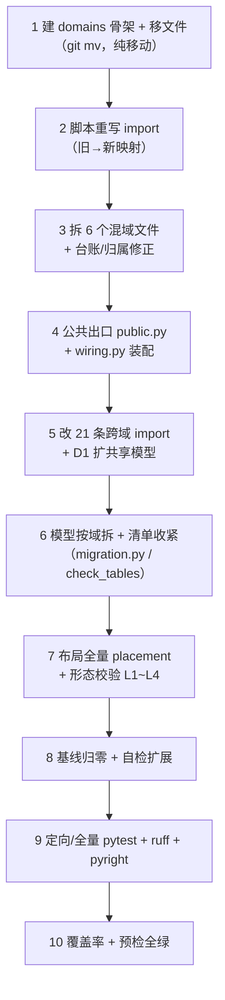

# 按域分包与基线递减详细设计

> 产品与服务划分 · 03 边界与数据 · 03 按域分包与基线递减 · 详细设计（开发核心文档）

[文档首页](../../../../../../文档首页.md) › [03 按域分包与基线递减](../03_边界与数据_03_按域分包与基线递减.md) › 设计

## 1. 目标与边界 <a id="scope"></a>

**目标**：把「业务域」从**登记**变成**代码事实**——每个域有自己的代码载体（域子包）、唯一的跨域出口（`public.py`）、按域拆开的模型模块与清单导入；同时把 `03_01` 留下的 30 条存量跨域基线**逐项清零**，并把登记型标识里残留的连字符形态一次收口。

**范围内**：

1. 九个平台服务（platform / identity / tenant / txn / ai / notification / file / search / report）按业务域分包（域子包 `domains/<domain_key>/`，服务内分层保持 `api → services → repositories → schemas/models`）；
2. 模型按域拆模块（文件级混域清零），`db/migration.py::domain_model_modules` 由「承载服务全量模型」收紧为「逐域模型」；
3. `deploy/boundaries/domain_layout.json` 全量 `legacy` → `placement`（目录 glob），`shared_paths` 收敛为装配面，未归属域文件数归 0；
4. `deploy/boundaries/domain_boundary_baseline.json` 30 条（21 `import` + 9 `table_declare`）**清零**，护栏「条目不再命中即失败」继续生效；
5. 域级断言补齐：D1 判定范围扩到共享库模型 import、`placement` 形态校验、公共出口（D2）落地；
6. 登记型标识 sweep：能力键、注册表键、区域项 / 具名插槽标识、模块键与 `MODULE_NAME_PATTERN`、i18n pack key 形态（语言段保留 IETF 标签），同步契约用例与 `modules.json`。

**范围外**：

| 项 | 归口 |
| --- | --- |
| 域间契约 DTO 化（公共出口只导出实现，不做数据契约重构） | `02_02` 进程内直调 / 能力契约 |
| 拓扑记录与解析、部署单元装配 | `02_01` / `02_02` |
| 平台巨型服务按阈值**拆分为独立服务**（本期只在服务内分包） | 专项计划 §7 第 1 项（另立任务） |
| 产品仓（mdm / biz）域布局与分包 | `01_01` 设计开放项 4（产品仓自建） |
| 图标键（`el:User` / `van:todo-o` / `custom:{code}`）改 snake | 本任务登记为命名例外（见 §3.10.6） |
| 观测按域打标（D5 业务代码打点） | `04_03` |

## 2. 现状核对 <a id="current"></a>

### 2.1 数量事实（2026-10-25 实测） <a id="facts"></a>

| 项 | 现状 |
| --- | --- |
| 域布局 | 16 域，**全部 `legacy`**；域实现文件 140 个，域外文件 110 个；`public_api` 全为空 |
| 域级基线 | 30 条 = `import` 21 + `table_declare` 9（`table_ref` 0） |
| 跨域 import 分布 | 4 组域对：`identity_federation→auth` 3、`user↔role` 10、`permission_meta→{role,menu_form}` 6、`role→{user,menu_form}` 3 |
| 混域源文件 | 6 个（`api/menu.py`、`repositories/menu.py`、`schemas/menu.py`、`services/menu.py`、`models/platform/menu.py`、`models/platform/system.py`） |
| 服务内实现规模 | platform 6 域 / identity 2 域 / 其余 7 服务各 1 域 |
| 测试受影响 | 约 146 个测试文件含服务包 import 语句；22 处字符串形式的模块路径（`monkeypatch` 目标等） |
| 能力键 | `CAPABILITY_MANIFEST` 79 键（其中 50 键带连字符），`identifier` 声明 79 处（50 处带连字符），`depends` 声明 34 处 |
| 注册表键残留 | 生产 6 处（`sys:user-detail-roles`、`sys:role-detail-users`、`demo:toolbox-entry`、`sample:header-badge`、`slot-sample` 区域项 2 处）+ i18n pack key 4 处 |

### 2.2 必须拆开的混域文件 <a id="mixed"></a>

| 文件 | 混了什么 | 拆分后归属 |
| --- | --- | --- |
| `models/platform/menu.py`（12 表） | 业务码 / 动作码 / 权限码（`permission_meta`）+ 菜单 / 表单 / 按钮 / 字段（`menu_form`） | `models/platform/permission_meta.py` + `models/platform/menu_form.py` |
| `models/platform/system.py`（6 表） | 任务（`task`）+ 用户偏好 / 用户扩展（`user`）+ 图标（`permission_meta`） | `models/platform/task.py` + `models/platform/user.py` + `models/platform/icon.py` |
| `api/menu.py` | 菜单 / 表单 / 按钮 / 字段端点 + 业务码 / 动作码 / 权限码端点 | `menu_form/api/menu.py` + `permission_meta/api/permission_meta.py` |
| `repositories/menu.py` | 菜单 / 表单 / 按钮 / 字段仓储 + 业务码 / 动作码 / 权限码仓储 + 角色权限引用仓储（`role`）+ i18n 通用助手 | `menu_form/repositories/menu.py` + `permission_meta/repositories/business.py` + `role/repositories/reference.py` + 基座通用 i18n 助手 |
| `schemas/menu.py` | 菜单类 schema + 权限元数据类 schema | `menu_form/schemas/menu.py` + `permission_meta/schemas/permission_meta.py` |
| `services/menu.py`（`MenuMetadataService`，1600 行） | 菜单类 CRUD + 权限元数据类 CRUD + 元数据快照 + 引用探测 | `menu_form/services/menu.py`（`MenuFormService` + 快照）+ `permission_meta/services/permission_meta.py`（`PermissionMetadataService`） |

另有两处**归属放错**（不是混域，而是挂在了主域文件里）：`permission/field_provider.py` 现登记在 `role` 域（字段权限 provider 属角色授权侧），`repositories/menu.py::MetadataReferenceRepository` 操作 `sys_role_permission`（属 `role` 域）。本次随拆分各归其域。

### 2.3 跨域 import 21 条逐条映射 <a id="baseline-imports"></a>

| # | 源域 → 目标域 | 源文件:行 | 导入对象 | 收敛方式（详见 §3.5） |
| --- | --- | --- | --- | --- |
| 1 | identity_federation → auth | `api/sso.py:50` | `api.cookies.set_refresh_cookie` | `auth.public` |
| 2 | identity_federation → auth | `api/sso.py:54` | `services.session_issuer.build_session_issuer` | `auth.public` |
| 3 | identity_federation → auth | `services/sso.py:54` | `session_issuer` 的 `IssuedSession` / `SessionIssuer` | `auth.public` |
| 4 | role → user | `api/role.py:60` | `repositories.user.UserRepository` | `user.public` |
| 5 | role → user | `services/role_assign.py:26` | 同上 | `user.public` |
| 6 | role → user | `services/role_assignments.py:58` | 同上 | `user.public` |
| 7 | user → role | `api/users.py:54` | `repositories.role.RoleRepository`、`UserRoleRepository` | `role.public` |
| 8 | user → role | `api/users.py:73` | `services.separation.SeparationGuard` | `role.public` |
| 9 | user → role | `services/user_assignments.py:60` | 角色仓储 | `role.public` |
| 10 | user → role | `services/user_assignments.py:68` | `SeparationGuard` | `role.public` |
| 11 | user → role | `services/users_admin.py:48` | 角色仓储 | `role.public` |
| 12 | permission_meta → role | `permission/checker.py:35` | `permission.field_provider`（字段权限 provider 工厂） | 该文件归 `role` 域，改从 `role.public` 取 |
| 13 | permission_meta → role | `permission/checker.py:40` | `repositories.role.UserRoleRepository` | `role.public` |
| 14 | permission_meta → role | `permission/checker.py:41` | `services.permission_subject` 两个解析器 | `role.public` |
| 15 | permission_meta → menu_form | `permission/metadata.py:14` | 菜单类仓储（8 个） | `menu_form.public` |
| 16 | permission_meta → menu_form | `permission/metadata.py:24` | `services.menu.MenuMetadataService` | `menu_form.public` |
| 17 | permission_meta → menu_form | `permission/source.py:41` | `services.menu.MenuSnapshot` | `menu_form.public` |
| 18 | permission_meta → role | `permission/source.py:40` | `repositories.role` 的 `RoleRepository` / `RolePermissionRepository` / `DataScopeRepository` | `role.public` |
| 19 | permission_meta → menu_form | `repositories/icon.py:13` | `_load_i18n_all` / `_replace_i18n`（通用助手） | 下沉基座 `bms_core/repositories/i18n.py`（域无关工具，不再跨域） |
| 20 | role → menu_form | `permission/field_provider.py:23` | `repositories.menu.FieldRepository` | `menu_form.public` |
| 21 | role → menu_form | `services/separation.py:34` | `repositories.menu.BusinessRepository` / `PermissionRepository` | 两者随仓库拆分归 `permission_meta`，改经 `permission_meta.public` |

`table_declare` 9 条全部由 §2.2 的模型拆分消除：`models/platform/menu.py` 5 条（`sys_business(+_i18n)`、`sys_action(+_i18n)`、`sys_permission` 声明在 `menu_form` 文件里）+ `models/platform/system.py` 4 条（`sys_icon(+_i18n)` 声明在 `task` 文件里、`sys_user_preference` / `sys_user_extension` 声明在 `task` 文件里）。

### 2.4 清单收紧缺口 <a id="modules-gap"></a>

`domain_model_modules(domain)` 现返回**承载服务的全量模型**；`COMMON_MODEL_MODULES` 又把三套共享模型子包全量拼进每条清单的导入面。两者叠加的结果是：任一清单导入**全部**模型，建表集只靠 `series_tables` 事后过滤——域内模型漏登记 / 跨域模型误声明都不会暴露（`03_02` 设计 §8-3 已登记此对齐项）。

另有一处必须一并处理：**镜像内没有 `deploy/`**（构建上下文是 `backend/`，`Dockerfile` 只 COPY `libs/bms_core/src` + `services/${SERVICE}/src` + `alembic` + `ops`），域布局在容器内不可读。因此「按域模型模块」必须带**无布局回退**，否则容器启动建表会得到空表集。

### 2.5 登记标识残留 <a id="naming-gap"></a>

| 登记面 | 位置 | 残留形态 |
| --- | --- | --- |
| 模块键 | `frontend/modules/slot_sample`（`manifest.name`）、`vite.config.ts`、`modules.json`、发布归档路径 | `slot-sample` |
| 模块名形态 | `core/src/module/define.ts::MODULE_NAME_PATTERN`、`scripts/release-module.mjs` 同值常量 | `/^[a-z][a-z0-9-]*$/` |
| 注册表键 | `core/src/registries/providers.ts::REGISTRY_KEY_PATTERN` 及其生产用例（`sys:user-detail-roles` 等 6 处） | 两段均允许连字符 |
| 区域项 / 具名插槽 | `PAGE_AREA_ID_PATTERN`、`NAMED_SLOT_ID_PATTERN` | 各段允许连字符 |
| i18n pack key | `REGISTRY_KEY_PATTERN` 复用到 `<命名空间>:<语言>` | 命名空间段带连字符（`slot-sample:zh-cn`） |
| 能力键 | `core/src/capabilities/manifest.ts` 79 键（50 带连字符）、各能力基类 `identifier` / `depends`、`KEBAB_KEY` 正则 | kebab |

## 3. 设计 <a id="design"></a>

### 3.0 决策记录（2026-10-25 逐项确认） <a id="decisions"></a>

| # | 事项 | 结论 |
| --- | --- | --- |
| 1 | 多域服务域子包形态 | `domains/<domain_key>/<层>/…`（域内再分层） |
| 2 | 单域服务是否建域子包 | **统一建**（九服务同形，护栏规则单一） |
| 3 | 模型落点 | `bms_core/models/<来源服务>/<域>.py`、服务侧 `domains/<域>/models/<模块>.py` |
| 4 | 跨域收敛与出口数量 | 每域 1 个 `public.py`，导出被需要的实现（模型 / 仓储 / 服务）；DTO 化归 `02_02` |
| 5 | D1 判定范围 | 扩到 `bms_core.models.*`（跨域模型 import 同样拦截） |
| 6 | 旧路径兼容 | 不留转发层，一次改齐 |
| 7 | 布局 paths 写法 | `placement` 用目录 glob |
| 8 | 公共模型清单收紧 | 拆「基座基础设施模型」+「按域模型」；无布局时回退全量 |
| 9 | 域→模型模块映射来源 | 从域布局 paths 派生（声明 `__tablename__` 的文件即模型模块） |
| 10 | 能力键 sweep | 一次全改（manifest / depends / identifier / 正则 / 用例） |
| 11 | 组件类名 | `identifier` 改 snake，`nsClass` 仍输出 kebab（`_`→`-`） |
| 12 | i18n pack key | 命名空间段 snake，语言段保留 IETF BCP-47（`zh-cn`） |
| 13 | 图标键 | 本批不改，回写《命名规范》例外（上游图标库键名不可改） |
| 14 | 模块产物 | 重建并 `publish --force` 重发，清单入口改 `/<模块键>/<版本>/` |
| 15 | 测试目录 | 保持按功能，只改 import |
| 16 | Kiwi | 新增 2 条（批 1 / 批 2 各一），先登记后编码 |
| 17 | 文档回写 | 全量（01_01 / 01_02 / 03_01 / 03_02 / 规范 / 知识档案 / 计划 / 需求注块 / 任务文件） |

### 3.1 目录形态：域子包 + 域内分层 <a id="shape"></a>

```text
backend/services/<服务>/src/bms_<服务>/
├── __init__.py / __main__.py / asgi.py / main.py          # 装配（shared_paths）
├── api/
│   ├── __init__.py
│   └── router.py                                         # 路由聚合（shared_paths）
├── repositories/__init__.py、schemas/__init__.py、services/__init__.py   # 层包标记（shared_paths）
├── wiring.py                                             # 新增：域服务构造（跨域装配，shared_paths）
└── domains/                                               # 域根（新增）
    ├── __init__.py
    └── <domain_key>/
        ├── __init__.py
        ├── public.py                                      # 域唯一公共出口（D2）
        ├── api/<资源>.py
        ├── services/<聚合>.py
        ├── repositories/<聚合>.py
        ├── schemas/<资源>.py
        └── models/<模块>.py                               # 仅服务自有表（有表服务）
```

**规则**：

1. **域内分层与层间方向不变**：`domains/<域>/api → services → repositories → schemas/models` 单向，护栏第 3 项按「跳过 `domains/<域>` 段后的层名」判定（本任务改 `_subpackage`）。
2. **域目录只放本域实现**：装配（`main` / `asgi` / `api/router.py` / 层 `__init__.py` / `wiring.py`）、基座横切、基础设施与不归域文件留服务包根，登记在 `shared_paths`。
3. **一域一目录、一文件一域**：同一文件不得同时承载两个域的实现（混域文件按 §3.4 拆开）；模型模块同样一域一文件。
4. **单域服务同形**：即使只有一个域，也建 `domains/<域>/`（九服务形态一致，护栏与布局规则无须区分单域 / 多域）。
5. **命名**：目录与模块 snake_case；域目录名 = `domain_key`（与布局一致，由护栏断言）。

### 3.2 装配面与 `shared_paths` 收敛 <a id="shared"></a>

| 类别 | 内容 | 布局落点 |
| --- | --- | --- |
| 服务装配 | `main.py` / `asgi.py` / `__main__.py` / `__init__.py` / `api/router.py` / 各层 `__init__.py` / `domains/__init__.py` | `shared_paths` |
| 跨域装配 | `wiring.py`（构造域服务、注入跨域只读依赖）、`services/branch_handlers.py`（跨域分支编排） | `shared_paths` |
| 平台级 / 基础设施端点 | `api/codecheck.py` / `api/demo.py` / `api/outbox.py` / `api/plugins.py` / `schemas/demo.py` / `schemas/outbox.py` / `repositories/demo_repository.py` / `services/demo_service.py` | `shared_paths` |
| 基座横切 | `bms_core` 非模型文件（`core` / `db` / `boundary` / `permission` / …） | 不入布局（不计覆盖度） |
| 基座共享模型 | `models/base.py` / `models/outbox.py` / `models/platform/demo.py` / 各模型子包 `__init__.py` | `shared_paths` |
| 身份服务的租户切换 | `identity/api/tenancy.py` / `permission/`（身份侧权限数据来源）/ `services/platform_client.py` | `shared_paths` |

**为什么跨域装配放 shared**：`wiring.py` 与 `branch_handlers.py` 天然同时依赖多个域（如 `MenuMetadataService` 需要菜单类仓储 + 权限元数据类仓储），放进任一域都会造成域间环。装配面不承载业务规则、只做构造与调用编排，登记为域外路径由评审看住；域实现之间仍只经 `public.py`。

**收敛口径**：`shared_paths` 由 110 条收敛为「装配 / 基础设施」文件（约 90 条，逐服务显式列出），域实现文件 140 条变为按域 glob 的 16 条 + 模型文件条目；未归属域文件数（软指标）由当前值归 0。

### 3.3 域公共出口 `public.py` <a id="public"></a>

**形态**：每个域一个 `bms_<服务>.domains.<domain_key>.public` 模块，`public_api` 字段登记该模块名；D2 只放行「导入目标域的 `public` 模块」（现有判定已按目标域出口放行，无需改判据）。

**导出内容**（本任务口径）：跨域**必需**的模型类、仓储类、服务类与纯函数，用 `from … import X as X` + `__all__` 显式声明，模块 docstring 写清「谁在什么场景使用」。

| 域 | 对外导出（本任务） | 使用方 |
| --- | --- | --- |
| `auth` | `set_refresh_cookie`、`build_session_issuer`、`SessionIssuer`、`IssuedSession` | `identity_federation` |
| `user` | `UserRepository`、`SysUser` | `role` |
| `role` | `RoleRepository`、`UserRoleRepository`、`SeparationGuard`、`DirectRoleResolver`、`OrgRoleResolver`、`SysRole`、`PERM_TYPE_*`、字段权限 provider 工厂 | `user`、`permission_meta` |
| `menu_form` | 菜单类仓储（8 个）、`MenuMetadataService`、`MenuSnapshot`、`FieldRepository`、菜单模型类（`SysMenu` / `SysForm` / `SysField` / `SysButton`…） | `permission_meta`、`role` |
| `permission_meta` | `BusinessRepository`、`PermissionRepository`、业务码 / 动作码 / 权限码模型类、`PermissionMetadataService` | `role` |
| `platform_config` / `platform_registry` / `task` / `tenant` / `ai` / `txn` / `notification` / `file` / `search` / `report` | 暂无跨域使用方；建空 `public.py`（`__all__ = []` + 说明），保持「每域一个出口」的形态一致 | — |

**为什么导出实现而不是 DTO**：本任务的目标是「边界显式且机器可查」，导出面收敛到 1 个文件即可让 D1/D2 真实生效；DTO 化会同时改动跨域编排与返回结构，风险与周期不匹配，且 `02_02` 进程内直调 / 能力契约本就是域间数据契约的落点（设计 §8 开放项 1 已登记「出口数量」按首个域迁移时定，本次定为 1）。

**禁止**：`public.py` 只做再导出与极薄的构造辅助，**不得写业务规则**；域内其他模块不得被跨域导入（D1 拦截）。

### 3.4 混域文件拆分方案 <a id="split"></a>

| 源文件 | 拆分动作 | 目标 |
| --- | --- | --- |
| `models/platform/menu.py` | 按表归属拆两个模块（`SysBusiness` / `SysBusinessI18n` / `SysAction` / `SysActionI18n` / `SysPermission` → 权限元数据；其余 7 表 → 菜单表单） | `models/platform/permission_meta.py`、`models/platform/menu_form.py` |
| `models/platform/system.py` | 三向拆分（`SysTask` / `SysTaskLog` → `task.py`；`SysUserPreference` / `SysUserExtension` 并入既有 `user.py`；`SysIcon` / `SysIconI18n` → `icon.py`） | `models/platform/task.py`、`models/platform/user.py`、`models/platform/icon.py` |
| `api/menu.py` | 端点按域拆两个模块：菜单 / 表单 / 按钮 / 字段 → `menu_form`；业务码 / 动作码 / 权限码 → `permission_meta`；各自保留独立 router 并从 `api/router.py` 组装 | `menu_form/api/menu.py`、`permission_meta/api/permission_meta.py` |
| `repositories/menu.py` | ① `BusinessRepository` / `ActionRepository` / `PermissionRepository` → `permission_meta/repositories/business.py`；② `MetadataReferenceRepository`（`sys_role_permission`）→ `role/repositories/reference.py`；③ `_load_i18n` / `_load_i18n_all` / `_replace_i18n` → 基座 `bms_core/repositories/i18n.py`（域无关工具，供菜单 / 图标共用）；④ 其余菜单类仓储留 `menu_form/repositories/menu.py` | 四向 |
| `schemas/menu.py` | 菜单类 schema 留 `menu_form/schemas/menu.py`；业务码 / 动作码 / 权限码 schema → `permission_meta/schemas/permission_meta.py` | 两向 |
| `services/menu.py` | `MenuMetadataService` 拆两类：`MenuFormService`（菜单 / 表单 / 按钮 / 字段 CRUD + 元数据快照）与 `PermissionMetadataService`（业务码 / 动作码 / 权限码 CRUD + 删除前引用探测）；快照所需的权限元数据经**构造注入的只读读取器**获得（不 import 权限元数据域），引用探测经注入的 `role` 只读探测获得 | `menu_form/services/menu.py`、`permission_meta/services/permission_meta.py` |
| `permission/field_provider.py` | 归属纠正：从 `permission_meta` 迁到 `role`（字段权限 provider 属角色授权侧） | `role/permission/field_provider.py` |

**快照服务的依赖注入**：`MenuFormService` 的快照需要「业务码 / 动作码 / 权限码」三类元数据与「角色引用」探测，但 `menu_form` 不得 import `permission_meta` / `role`。做法是构造参数接收两个**只读协议**（`MetadataReader` / `ReferenceProbe`，以 `typing.Protocol` 定义在 `menu_form` 侧），由 `wiring.py` 传入 `permission_meta` / `role` 的实现。这样依赖方向为「装配 → 域」，域间零 import。

### 3.5 跨域收敛逐条处置 <a id="converge"></a>

| 组 | 处置 |
| --- | --- |
| identity_federation → auth（3 条） | SSO 登录需要签发会话 + 写刷新 cookie：`auth/public.py` 导出 `build_session_issuer` / `set_refresh_cookie` / 相关类型，`identity_federation` 改从 `bms_identity.domains.auth.public` 取；会话写入仍由 auth 的实现执行（跨域写不发生） |
| role → user（3 条） | 角色分配要校验用户存在 / 展示用户名：`user/public.py` 导出 `UserRepository` 与 `SysUser`，`role` 侧改经公共出口 |
| user → role（5 条） | 用户侧要读写「用户-角色绑定」（`sys_user_role` 属 `role` 域）：`role/public.py` 导出角色仓储与 `SeparationGuard`；写操作仍在 role 的实现内执行（D4 不触发），user 侧只编排 |
| permission_meta → role（5 条） | 权限校验要解析主体角色、读角色权限：`role/public.py` 导出解析器 / 角色仓储 / 常量 / 字段权限 provider |
| permission_meta → menu_form（4 条） | 权限聚合要菜单快照与字段元数据：`menu_form/public.py` 导出 `MenuMetadataService` / `MenuSnapshot` / 菜单类仓储 / 模型类 |
| role → menu_form（2 条） | 授权校验要读菜单 / 表单 / 字段元数据：经 `menu_form.public`；`separation` 原导入的业务码 / 权限码仓储已随拆分归 `permission_meta`，改经 `permission_meta.public` |
| i18n 助手（1 条） | `_load_i18n*` / `_replace_i18n` 下沉 `bms_core/repositories/i18n.py`，供菜单与图标两侧共用（域无关工具，不算跨域） |

**收敛后不变量**：域实现文件对同服务其他域的 import，目标模块 ∈ 目标域 `public_api`；基线文件 `entries` 为空数组；`domain_baseline_used` 恒 0。

### 3.6 D1 判定范围扩到共享库模型 <a id="d1-scope"></a>

现状 `_check_domain_imports` 只判「同服务包」import（`module.split(".")[0] == package`），因此 `from bms_core.models.platform.role import SysRole` 这类**跨域模型 import** 完全不在断言内；模型拆分后，模型文件已是「一域一文件」，判定条件成熟。

**改法**：判定面在「同服务包」之外增加「共享库 `bms_core.models.*`」——目标模块解析到布局里属另一域的文件即违规（同域 / 未登记文件放行）。`bms_core` 其余目录（`core` / `db` / `boundary` / …）不属任何域，天然放行。

**新增需处置的跨域模型 import（拆分后仍存在）**：

| 源域 → 目标域 | 文件 | 处置 |
| --- | --- | --- |
| role → user（2 处文件） | `role/api/role.py`、`role/repositories/role.py` 等读 `SysUser` | 经 `user.public` 导出 `SysUser` |
| user → role（2 处文件） | `user/api/users.py`、`user/services/{user_assignments,users_admin}.py` 读 `SysRole` | 经 `role.public` |
| role → menu_form | `role/services/role_grant.py` 读 `SysMenu` / `SysForm` / `SysField` / `SysPermission` | 经 `menu_form.public`（`SysPermission` 归权限元数据，经 `permission_meta.public`） |
| permission_meta → role | `permission_meta/permission/source.py` 读角色常量 | 经 `role.public` |
| platform_registry → role | `platform_registry/sources/dict_source.py` 读 `SysRole`（平台字典内建数据源） | 经 `role.public` |
| permission_meta → menu_form | `permission_meta/services/icon_store.py` 读 `SysMenu`（图标使用中判定） | 经 `menu_form.public` |

模型拆分后 `repositories/icon.py`、`user_extension*`、`icon_store.py` 的部分跨域 import 自动消失（`sys_icon` → `icon.py` 归权限元数据、`sys_user_extension` → `user.py` 归用户）。

### 3.7 模型按域拆分与清单收紧 <a id="modules"></a>

**模型文件目标**：

| 来源 | 现状 | 目标 |
| --- | --- | --- |
| platform 共享模型 | `catalog.py`（注册目录）、`menu.py`（12 表混域）、`role.py`、`system.py`（6 表混域）、`user.py`、`demo.py` | `catalog.py`（`platform_registry`）、`menu_form.py` + `permission_meta.py`、`role.py`、`task.py` + `icon.py`、`user.py`（并入偏好 / 扩展）、`demo.py`（不归域） |
| identity 共享模型 | `client.py` / `identity_provider.py` / `user_identity.py`（联邦）、`session.py`（认证） | 不变（已是一域一文件） |
| tenant 共享模型 | 5 文件 | 不变（同域） |
| 基座功能包内的模型 | `models/ownership.py`（`platform_registry`）、`config/models.py` + `listing/models.py`（`platform_config`） | **不迁**：模型模块按「声明 `__tablename__`」识别，位置不参与判定（避免无收益搬迁） |
| 服务自有模型 | `bms_ai/models/ai.py`、`bms_notification/models/notification.py`、`bms_txn/models/ledger.py` | `<服务>/domains/<域>/models/<模块>.py`；服务 `models/` 包删除（`MODEL_MODULES` 清单随之退休，改由布局派生） |

**`db/migration.py` 改造**：

| 项 | 改造后 |
| --- | --- |
| `BASE_MODEL_MODULES`（新增） | `("bms_core.models.outbox",)`——基础设施模型（发件箱三表，不归域，每库一份） |
| `COMMON_MODEL_MODULES`（保留，语义改为「无布局时的全量回退」） | 三条基座模型模块 + 三套共享模型子包全量清单（容器内无布局时兜底，行为与今天一致） |
| `domain_model_modules(domain)` | 有布局 → 从布局 paths 派生：该域登记文件里**声明了 `__tablename__`** 的模块（模块名由路径推出，`backend/{libs,services}/<工程>/src/` 前缀剥离）；无布局 → `COMMON_MODEL_MODULES + service_model_modules(承载服务)`。结果按进程缓存（布局只读一次） |
| `import_models(domain)` | `BASE_MODEL_MODULES + domain_model_modules(domain)`（不再全量拼 `COMMON`） |
| `import_service_models(service)` | `BASE + 该服务承载域的模型模块并集（布局派生）`；无布局 → `COMMON + service_model_modules(service)` |
| `ops/check_tables.py::imported_model_tables` | 「已声明模块集」改为 `BASE + 全量域模型模块 + 各启用服务自声明模型`（无布局时即今天口径） |

**建表集不变的保证**：`series_metadata` / `unit_metadata` 仍以 `series_tables` / `unit_tables` 过滤 `Base.metadata`，只要「域模型模块 ∪ 基座模型 ⊇ 各域表集」，建表集逐表相同。为此新增两条机器断言（§7 用例 4 / 5）：逐域「派生模型表的集合 == 归属登记该域表集」、逐单元「`unit_metadata` 表集 == 归属登记派生的单元表集」。

### 3.8 域布局推进与 `placement` 形态校验 <a id="layout"></a>

**布局写法**（每个域一条；示例）：

```json
{
  "domain_key": "user",
  "service_key": "platform",
  "status": "placement",
  "paths": [
    "backend/services/platform/src/bms_platform/domains/user/**",
    "backend/libs/bms_core/src/bms_core/models/platform/user.py"
  ],
  "public_api": ["bms_platform.domains.user.public"]
}
```

**字段语义澄清（回写 03_01 设计）**：`service_key` 恒为**承载服务标识**（`platform` / `identity` / …），用于「表归属 `owner` == 域承载服务」一致性判定与部署单元反推；分包后「域子包」由 `paths` 表达，**不改 `service_key` 含义**。

**新增形态校验**（落 `check_service_boundaries.py`，属 bms 侧策略，不进 `bms_core.boundary.domains` 契约）：

| # | 校验 | 判定 |
| --- | --- | --- |
| L1 | `placement` 路径形态 | 每条路径要么是「域子包目录 glob」`/domains/<domain_key>/**`，要么是「单个模型模块文件」（该文件声明 `__tablename__` 且归属该域） |
| L2 | 域目录名 | 路径中的 `domains/<段>` 段必须 == `domain_key` |
| L3 | 公共出口 | `placement` 域必须声明恰好 1 条 `public_api`，且该模块文件存在、位于该域目录内 |
| L4 | 覆盖完整 | 服务包内非测试 `.py` 文件必须落在某域 `paths` 或 `shared_paths`（未归属数 > 0 即失败，由软指标转硬门禁） |

**为什么 L4 转硬**：`legacy` 时代允许「未归属文件只计数」，因为扁平目录里装配文件多；分包后域载体明确，未归属文件只剩「忘了登记」，软指标会长期挂着噪声。转硬后 `domain_files_unregistered == 0` 成为可验收事实。

**状态字段说明**：`DOMAIN_STATUSES` 三态不变；`placement` 语义在文档与 `domains.py` docstring 中明确为「域实现已有明确域载体（`domains/<域>/`），路径可用目录 glob」，`legacy` 只作过渡（本任务收尾后 bms 布局无 `legacy` 条目）。

### 3.9 基线递减节奏（只减不增） <a id="baseline"></a>


| 步 | 动作 | 基线状态 |
| --- | --- | --- |
| S1 | 文件移动 / 混域拆分（行为不变），跑 `--update-baseline` 重建：条目数与域名对按新路径重算（`table_declare` 应为 0，模型已按域拆开） | 仅作为中间态，**不提交**中间基线 |
| S2 | 同一次提交内逐组改 import 至目标域 `public`；每改一组跑定向 pytest | 条目递减 |
| S3 | 删至 0 后人工把 `entries` 置空数组（不靠 `--update-baseline` 自动清空，保留人工审阅环节） | 0 |
| S4 | 提交前跑护栏全量：`domain_baseline_total=0`、`used=0`、无陈旧条目 | 0 |
| S5 | 自检补 2 例：`placement` 形态违规、公共出口缺失（沿用既有「陈旧基线拦截」样例） | — |

**实现顺序要求**：S1（纯移动）与 S2（改 import）必须是**同一个可编译状态内的连续步骤**——移动后立刻改被移动文件的相对 import 与全部引用方（脚本批量重写 + pyright），不把「移动一半」的中间态留在工作区过夜。

### 3.10 登记标识 sweep <a id="sweep"></a>

**顺序原则**：先改**形态约束**（正则 / 常量）再改**键值**，最后跑契约与前端全量；每步保持可编译。

#### 3.10.1 能力键（前端基座） <a id="sweep-capability"></a>

| 对象 | 改法 |
| --- | --- |
| `core/src/capabilities/manifest.ts` | 79 键与依赖数组全部 snake_case（如 `placeholder-state` → `placeholder_state`、`module-telemetry` → `module_telemetry`）；`KEBAB_KEY` 更名 `CAPABILITY_KEY` 并改 `^[a-z][a-z0-9_]*$` |
| 各能力基类 | `identifier` 79 处、`depends` 34 处同步；`depends` 值必须命中新 manifest 键 |
| 组件类名 | `BaseComponent.nsClass` 改为 `` `${namespace}-${identifier.replaceAll('_','-')}` ``（CSS 类名守 kebab 惯例，样式零改动） |
| 用例 | `core/tests/{capabilities-*,chart,report-designer,…}.spec.ts` 断言键同步；`capability-manifest.spec.ts` 反例改用 `Bad_Key` 之外的非法形态（如 `bad key` / 数字开头） |

#### 3.10.2 注册表键与区域项 / 具名插槽 <a id="sweep-registry"></a>

| 对象 | 改法 |
| --- | --- |
| `registries/providers.ts` | `REGISTRY_KEY_PATTERN` → `^[a-z][a-z0-9_]*:[a-z][a-z0-9_]*$`；`PAGE_AREA_ID_PATTERN` 与 `NAMED_SLOT_ID_PATTERN` 各段改 `[a-z0-9_]*` |
| 生产键值 | `sys:user-detail-roles` → `sys:user_detail_roles`、`sys:role-detail-users` → `sys:role_detail_users`、`demo:toolbox-entry` → `demo:toolbox_entry`、`sample:header-badge` → `sample:header_badge`、`slot-sample:user-extension(-detail)` → `slot_sample:user_extension(_detail)` |
| 区域标识 | 现有 `layout.header` / `sys.user.detail.tabs` / `sys.role.detail.assign` 无连字符，**值不变**，仅形态约束收紧 |
| 用例 | 各 `*.spec.ts` 中的键值同步（含 `unknown.area` 等反例保留） |

#### 3.10.3 i18n pack key <a id="sweep-i18n"></a>

`i18nPacks[].key` 形态改为 `<命名空间 snake>:<语言 IETF>`，新增 `I18N_PACK_KEY_PATTERN = ^[a-z][a-z0-9_]*:[a-z]{2,3}(-[a-z0-9]{2,8})*$` 并在 `I18nPackRegistry.register` 使用（不再复用 `assertNamespacedKey`）；`I18nPackProvider.locale` 仍取冒号后段小写。生产键：`demo:zh-cn`、`sample:zh-cn`、`slot_sample:zh-cn`、`platform:zh-cn`（仅命名空间段可带连字符的 `slot-sample:` 需改）。

#### 3.10.4 模块键与产物 <a id="sweep-module"></a>

| 对象 | 改法 |
| --- | --- |
| `core/src/module/define.ts`、`scripts/release-module.mjs` | `MODULE_NAME_PATTERN` → `^[a-z][a-z0-9_]*$`（两处同值，注释同步） |
| 模块定义 | `slot_sample/src/index.ts::manifest.name`、区域项键、i18n pack 键；`vite.config.ts::MODULE_NAME` |
| 清单 | `frontend/apps/desktop/public/modules.json` 的 `name` 与 `entry`（`/slot_sample/0.1.0/remoteEntry.js`） |
| 产物 | `pnpm --filter @bms/module_slot_sample run build` → `node frontend/scripts/release-module.mjs publish --module slot_sample --force`（写 `releases/slot_sample/0.1.0/`、追加 `republish` 记录） |
| 表单键 | `SlotExtensionTab.vue` 的 `form-key="slot-sample_extension"` → `slot_sample_extension` |
| 用例 | `modules/slot_sample/tests/*.spec.ts`、`apps/desktop/tests/{module-boundary-scope,module-registration,module-fixture}.spec.ts`、`core/tests/{assemble,module-contract,guard-unregistered-provider}.spec.ts` 的模块键 / 区域键 / i18n 键 |
| 文档 | `frontend/modules/slot_sample/README.md`、知识档案《微前端 · 业务模块接入指南》示例键 |

**CSS 类名不改**：`slot-sample__hint` 等属 CSS 类名（《命名规范》明文例外），保持现状；`data-test` 属性不动。

#### 3.10.5 发布记录 <a id="sweep-release-log"></a>

`frontend/releases/release-log.{json,md}` 为**历史事实**：旧记录中 `slot-sample` 原样保留；本次重发追加新记录（模块名 `slot_sample`、动作 `republish`）。`check-module-manifest` 的「最近一条记录版本 = 清单版本」判定因此仍成立（版本同为 `0.1.0`，`republish` 记录在最后）。

#### 3.10.6 图标键：登记为命名例外（回写规范） <a id="sweep-icon"></a>

图标键 `el:User` / `van:todo-o` / `custom:{code}` 的上游段来自 Element Plus / Vant 图标库（键名不可改），自建段 `sys_icon.code` 与多语言/表单标识绑定。本批**不改**，回写《命名规范》§2.1：

- 「登记型标识」表中图标键一条加注「前缀为图标库标识、后缀为上游图标名，按上游生态保留；自建图标键的**业务码**段（`custom:{code}` 的 `code`）沿用 kebab 并纳入后续图标体系任务评估」；
- 例外清单增一条「图标库图标名（`el:User` / `van:todo-o`）」。

理由：改上游键等于重建图标映射与全部使用点（页面图标配置、种子数据、前端用例），属图标体系重构，超本任务范围；且该类键不是「被本系统登记后按路径解析」的标识，而是**第三方资源名**。

### 3.11 迁移与兼容策略 <a id="compat"></a>

| 面 | 策略 |
| --- | --- |
| 仓内 import | **不留转发层**：用脚本按「旧模块 → 新模块」映射批量重写 import 与 22 处字符串路径，再跑 pyright + 全量 pytest 收口 |
| 仓外消费方 | bms 服务包不被其他仓 import（护栏规则 10 已禁止）；`mdm` 以 git 源依赖 `bms_core`，本次只改 `bms_core` 内部实现与新增函数，`service_model_modules` 等既有签名保持——`mdm` 升级 rev 时无破坏性改动 |
| 容器内布局缺失 | `domain_model_modules` 走全量回退（§3.7），建表集与今天一致 |
| 迁移 / 版本记录表 | 不动：清单名、目录、`alembic_version_{domain}` 均不变；`alembic.ini` 段不变 |
| 表结构 / 表名 | 不动：本任务零 DDL、零表名变化 |
| 前端契约 | 模块键与注册表键属**内部登记标识**，随本批一次切换；`modules.json` 与产物同批重发，不保留双键兼容 |
| 回滚 | 按批提交：批 1（后端分包 + 基线 + 清单）与批 2（标识 sweep）各自可独立 revert；批 2 回滚需同时回滚 `modules.json` 与发布记录 |

## 4. 各服务目标目录 <a id="layout-target"></a>

### 4.1 platform（6 域） <a id="target-platform"></a>

```text
backend/services/platform/src/bms_platform/
├── __init__.py / __main__.py / asgi.py / main.py
├── wiring.py                                               # 域服务构造（跨域装配）
├── api/{__init__.py,router.py,codecheck.py,demo.py,outbox.py,plugins.py}
├── repositories/{__init__.py,demo_repository.py}
├── schemas/{__init__.py,demo.py,outbox.py}
├── services/{__init__.py,branch_handlers.py,demo_service.py}
└── domains/
    ├── user/{__init__.py,public.py}
    │   ├── api/{account_locks,internal_account_locks,internal_credentials,internal_users,preference,user_extensions,users}.py
    │   ├── repositories/{account_lock,user,user_extension}.py
    │   ├── schemas/{account_lock,credentials,user_extension,users}.py
    │   └── services/{account_lock,credentials,user_assignments,user_extension,user_sessions,users,users_admin}.py
    ├── role/{__init__.py,public.py}
    │   ├── api/role.py
    │   ├── permission/field_provider.py                     # 由 permission/ 迁入
    │   ├── repositories/{role,reference}.py                 # reference.py = MetadataReferenceRepository
    │   ├── schemas/role.py
    │   └── services/{permission_subject,role,role_assign,role_assignments,role_grant,separation}.py
    ├── permission_meta/{__init__.py,public.py}
    │   ├── api/{icon,permission,permission_meta}.py
    │   ├── icon/{__init__,registry}.py
    │   ├── permission/{__init__,checker,metadata,source}.py
    │   ├── repositories/{business,icon}.py
    │   ├── schemas/permission_meta.py
    │   └── services/{icon_store,permission_meta}.py
    ├── menu_form/{__init__.py,public.py}
    │   ├── api/{form_key,menu}.py
    │   ├── repositories/menu.py
    │   ├── schemas/menu.py
    │   └── services/{menu,my_menu}.py
    ├── platform_config/{__init__.py,public.py}
    │   └── api/{internal_config,query_scheme}.py
    └── platform_registry/{__init__.py,public.py}
        ├── api/{data_source,dict,modules,products}.py
        ├── repositories/{module_repository,product_repository}.py
        └── sources/{catalog_source,dict_source}.py
```

模型（基座侧）：`bms_core/models/platform/{catalog,menu_form,permission_meta,role,task,icon,user}.py`（`demo.py` 不归域），`bms_core/models/{ownership.py,config/models.py,listing/models.py}` 位置不变（分属 `platform_registry` / `platform_config`）。

### 4.2 identity（2 域） <a id="target-identity"></a>

```text
backend/services/identity/src/bms_identity/
├── __init__.py / __main__.py / asgi.py / main.py
├── wiring.py
├── api/{__init__.py,router.py,tenancy.py}
├── permission/{__init__.py,source.py}                      # 身份侧权限数据来源（shared）
├── repositories/__init__.py / schemas/{__init__.py,permission.py}
├── services/{__init__.py,platform_client.py}
└── domains/
    ├── auth/{__init__.py,public.py}
    │   ├── api/{auth,captcha,cookies,internal_sessions,password_reset,session,wellknown}.py
    │   ├── repositories/session.py
    │   ├── schemas/{auth,password_reset,session}.py
    │   └── services/{auth,password_reset,session,session_issuer}.py
    └── identity_federation/{__init__.py,public.py}
        ├── api/{clients,identity_providers,oidc,sso,users}.py
        ├── repositories/{client,identity_provider,user_identity}.py
        ├── schemas/{identity_provider,oidc,sso}.py
        └── services/{clients,identity_providers,jit,oidc_provider,provider_registry,sso}.py
```

模型（基座侧）：`bms_core/models/identity/{session}.py`（`auth`）、`{client,identity_provider,user_identity}.py`（`identity_federation`），位置不变。

### 4.3 单域服务（7 个，同形） <a id="target-single"></a>

```text
backend/services/<服务>/src/bms_<服务>/
├── __init__.py / __main__.py / asgi.py / main.py
├── api/{__init__.py,router.py}
├── repositories/__init__.py / schemas/__init__.py / services/__init__.py
└── domains/<domain_key>/
    ├── __init__.py / public.py
    └── api/ services/ repositories/ schemas/ models/ sources/   # 按实际有则建
```

| 服务 | 域 | 域内文件 |
| --- | --- | --- |
| tenant | `tenant` | `api/{membership,tenant,tenant_admin,tenant_internal,tenant_registry}.py`、`repositories/{tenant_membership,tenant_module,tenant_quota,tenant_registry}.py`、`schemas/tenant_admin.py`、`services/{membership,platform_tenant,provisioning,tenant_admin,tenant_module,tenant_quota}.py`、`sources/{membership,tenant_source}.py` |
| txn | `txn` | `api/ledger.py`、`models/ledger.py`、`repositories/ledger.py`、`schemas/ledger.py`、`services/{coordinator,driver,ledger_cleanup,recovery,recovery_poll}.py` |
| ai | `ai` | `api/chat.py`、`models/ai.py` |
| notification | `notification` | `api/notification.py`、`models/notification.py` |
| file | `file` | `api/file.py` |
| search | `search` | `api/search.py` |
| report | `report` | `api/print.py` |

服务侧 `models/` 包（ai / notification / txn 的 `MODEL_MODULES` 清单）随模型迁入域内删除；无表域（file / search / report）不建 `models/`。

## 5. 实施顺序与批次 <a id="order"></a>

### 5.1 批 1：分包与基线（后端） <a id="batch1"></a>



要点：

1. **移动用 `git mv`**，保持重命名可追溯；移动清单由脚本从「源 → 目标」映射生成，脚本同时产出 import 重写映射；
2. **import 重写**按最长前缀匹配（`bms_platform.services.users` 先于 `bms_platform.services`），覆盖 `from … import`、`import …`、字符串字面量（`monkeypatch` 目标）；
3. 每完成一步跑**定向** pytest（对应域测试目录），不留半可编译态；
4. 布局与护栏同一步改完：布局先按新目录写 `placement`，护栏补 L1~L4 与 D1 范围，再跑 `--update-baseline` 确认无新增（此时基线应为 0 或仅剩待改 import）。

### 5.2 批 2：登记标识 sweep（前端 + 契约） <a id="batch2"></a>

| 步 | 内容 | 验证 |
| --- | --- | --- |
| 1 | 能力键：manifest → 基类 `identifier` / `depends` → `KEBAB_KEY` → `nsClass` | `pnpm --filter @bms/core run test` |
| 2 | 注册表键 / 区域项 / 具名插槽形态 + 生产键值 | `pnpm --filter @bms/core run test`、`pnpm --filter @bms/ui_ep run test` |
| 3 | i18n pack key 形态 + 生产键 | `@bms/core` i18n 用例 |
| 4 | 模块键 + `MODULE_NAME_PATTERN` + 清单 + 用例 | 各模块工程 test、`apps/desktop` test |
| 5 | 重建并重发 `slot_sample` 产物 | `release-module publish --force`、`check-module-manifest.mjs` |
| 6 | 前端全量：`pnpm -r test` / `lint` / `build`（desktop） | 覆盖率门禁 100% |
| 7 | 文档回写（命名规范例外、知识档案示例、README） | `check_links` / `check_base` |

### 5.3 每批收尾（不变） <a id="batch-close"></a>

实施记录 + 测试记录 + 计划表回写（进度唯一落点）+ 需求注块/任务文件登记 + 偏差遗留闭环；代码与文档分开提交（`feat` / `docs`），**不推送**（按用户指令）。

## 6. 影响面 <a id="impact"></a>

| 类别 | 对象 | 变更 |
| --- | --- | --- |
| 新增 | 九服务的 `domains/<域>/` 骨架、每域 `public.py`、platform/identity 的 `wiring.py` | 代码载体 |
| 新增 | `bms_core/repositories/i18n.py` | 域无关 i18n 助手（由菜单仓储下沉） |
| 移动 | 服务内实现文件（约 190 个 `.py`，含 3 服务自有模型） | 扁平层目录 → 域子包 |
| 拆分 | 6 个混域文件（§3.4） | 一文件一域 |
| 修改 | `bms_core/models/platform/{menu,system}.py` → 5 个模块 | 模型按域 |
| 修改 | `db/migration.py`（`BASE_MODEL_MODULES` / `domain_model_modules` / `import_models` / `import_service_models`） | 清单收紧 |
| 修改 | `scripts/tools/base_check/check_service_boundaries.py`（`_subpackage` / D1 范围 / L1~L4 / 自检） | 护栏 |
| 修改 | `backend/ops/{check_tables,check_modules,check_plugins}.py`、`bms_core/tests/core/test_service_catalog_startup.py` | 服务外包的引用路径 |
| 修改 | 约 146 个测试文件 + 22 处字符串模块路径 | import 重写 |
| 修改 | `deploy/boundaries/domain_layout.json`、`domain_boundary_baseline.json` | 布局与基线 |
| 修改（批 2） | 前端能力基座 / 注册表 / 模块定义 / 三个模块工程 / 清单 / 发布脚本 / 用例 | 标识 sweep |
| 修改（文档） | 01_01 §5.1/§6、01_02、03_01 §3.1/§3.5/§8、03_02 §8-3、命名规范、后端开发规范、知识档案、计划、需求注块、任务文件 | 回写 |

## 7. 测试设计 <a id="test"></a>

**Kiwi 用例**（先登记后编码，编号回填 `@pytest.mark.kiwi_id`）：

| 批次 | 用例 | 断言要点 |
| --- | --- | --- |
| 批 1 | 「业务域分包与基线归零」 | 布局 16 域全 `placement`、`public_api` 各 1、`domain_files_unregistered=0`、基线 `entries=[]`、跨域 import / 表声明反例仍被拦截（D1~D4）、`domain_model_modules` 逐域且建表集不变 |
| 批 2 | 「登记型标识 snake_case 收口」 | 能力键 / 依赖键 / `identifier` 全 snake、注册表键与区域项形态、模块键与清单一致、i18n pack key 命名空间 snake + 语言段 IETF、图标键例外不误伤 |

**用例落点与断言**：

| # | 用例 | 落点 | 断言 |
| --- | --- | --- | --- |
| 1 | 布局全量 placement | `libs/bms_core/tests/boundary/test_domain_boundary.py` | 读真实布局：16 域、全 `placement`、`public_api` 恰 1、模型路径为单文件 |
| 2 | 基线归零 | 同上 | 基线文件 `entries == []`；护栏计数 `domain_baseline_total == 0` |
| 3 | 跨域 import 反例（含共享模型） | `check_service_boundaries.py --self-test` + 用例 | 同服务跨域 import、`bms_core.models` 跨域 import 均失败；经 `public` 放行 |
| 4 | 逐域模型 == 逐域表集 | `libs/bms_core/tests/alembic/test_alembic_series.py` | 对每域：派生模型模块声明的表集合 == `series_tables(domain, ds)` 中实际有模型的表集合（差集为空） |
| 5 | 逐单元建表集不变 | `libs/bms_core/tests/alembic/test_auto_create_tables.py` | `set(unit_metadata(unit, ds).tables) ==` 归属登记派生集合（严格相等，替换现「⊆」断言） |
| 6 | 服务包内不再有跨域 import | 用例扫描真实布局 | 对每个域实现文件：同服务 / 共享模型的跨域 import 为 0（护栏同口径，冗余断言便于定位） |
| 7 | 公共出口可用 | `tests/boundary` | 每个 `public_api` 模块可导入、`__all__` 非空或显式声明为空 |
| 8 | 清单导入面收紧 | `test_alembic_series.py` | 任取两域：`domain_model_modules` 交集为空；`import_models(domain)` 后 `Base.metadata` 不含他域表 |
| 9 | 能力键形态 | `core/tests/capability-manifest.spec.ts` | 79 键全 snake；非法键（空格 / 连字符 / 数字开头）报 `bad-key` |
| 10 | 注册表键形态 | `core/tests/registry*.spec.ts` | 连字符键被拒、snake 键通过；区域项 / 具名插槽同理 |
| 11 | 模块键与清单一致 | `core/testing/module.ts` + 模块用例 | `manifest.name` 合 `MODULE_NAME_PATTERN`、与清单条目同名、i18n 键前缀同名 |
| 12 | 既有服务维断言回归 | `--self-test` | 规则 1~10 全部仍生效 |

**验证命令**（批次收尾顺序）：

```bash
python scripts/tools/base_check/check_service_boundaries.py . --self-test
python scripts/tools/preflight/run-once.py -- uv run pytest            # 全量（默认并行）
python scripts/tools/preflight/run-once.py -- uv run ruff check .
python scripts/tools/preflight/run-once.py -- uv run pyright
python scripts/tools/base_check/check_base.py .
python scripts/tools/base_check/check_links.py .
python scripts/tools/base_check/check_docs_scope.py .
python scripts/tools/check_docs/check_status.py --root . --stage 07C_产品与服务划分
python scripts/tools/preflight/check_preflight.py --fast
pnpm -r test && pnpm run lint && pnpm --filter @bms/app_desktop run build   # 批 2
```

**覆盖率**：口径见《AI开发规范》「覆盖率要求」节；本次改动模块（`bms_core/db/migration.py`、`boundary/*`、前端 `core` 改动文件）必须本地跑满，不达标不提交。

## 8. 风险与边界 <a id="risk"></a>

| 风险 | 处置 |
| --- | --- |
| 大规模移动导致漏改 import / 字符串路径 | 脚本重写 + pyright 全量 + `rg` 残留扫描（旧模块前缀清零）+ 全量 pytest |
| 拆分 `MenuMetadataService` 改变行为 | 拆分只做「方法搬家 + 依赖注入」，不改编排；权限 / 菜单用例全量回归；`wiring.py` 保持同一构造参数 |
| 域间环依赖（public 互引） | 依赖方向固定：`wiring`（shared）→ 域；域 → 目标域 `public`；`public` 只再导出、不反向 import |
| 容器内布局缺失导致建表为空 | 全量回退 + 用例断言「布局缺失时 `domain_model_modules` 返回全量」 |
| 模型模块派生漏文件（新增模型忘登记） | 用例 4 断言「逐域模型表集 == 登记表集」，漏登记即红 |
| `placement` 形态校验误伤模型路径 | L1 只允许「域子包 glob」与「声明表的单文件」；新增域时同步登记模型文件 |
| sweep 改动面大、契约用例连锁 | 分批：形态 → 键值 → 用例；每步 `pnpm --filter <包> test`；最后全量 |
| 模块产物重发失败（构建环境） | 先本地 `pnpm --filter @bms/module_slot_sample run build` 确认产物与 sourcemap，再 publish；失败则回滚清单与目录（批 2 可独立 revert） |
| 外部仓（mdm）随 `bms_core` rev 升级受影响 | 本次不改 `service_model_modules` 等既有签名；`mdm` 升级前按其任务走自身预检 |

## 9. 开放项与遗留 <a id="open"></a>

| # | 事项 | 归口 |
| --- | --- | --- |
| 1 | 域间公共出口的 DTO 化（当前导出实现） | `02_02` 进程内直调 / 能力契约 |
| 2 | 图标键（含自建 `custom:{code}`）形态统一 | 图标体系任务（出现独立需求时） |
| 3 | 产品仓（mdm / biz）域布局与分包 | 各产品接入任务 |
| 4 | 平台巨型服务按阈值拆独立服务（本任务只做服务内分包） | 专项计划 §7 第 1 项 |
| 5 | D5 观测按域打标转硬门禁 | `04_03` |
| 6 | 跨域 ORM 读写的运行期检测（D3/D4 只覆盖原始 SQL / 表名 token） | `02_02`（进程内直调后由契约通道收敛） |

## 10. 交付物与验收映射 <a id="deliver"></a>

| 交付物 | 验收要点（任务完成标准） |
| --- | --- |
| 九服务域子包 + `public.py` + `wiring.py` | 每域有唯一代码载体与唯一公共出口；服务内扁平实现清零 |
| 布局 `placement` 全量 + `shared_paths` 收敛 | 16 域全 `placement`、`public_api` 各 1、`domain_files_unregistered=0`、L1~L4 通过 |
| 基线归零 | `domain_boundary_baseline.json` `entries=[]`；护栏 `domain_baseline_total=0`、无陈旧条目 |
| 模型按域 + 清单收紧 | `domain_model_modules` 逐域、两域交集为空；逐单元建表集与今天逐表相同（用例 4/5） |
| 登记标识 snake | `check_base.py` 第 6 项、能力键 / 注册表键用例、模块清单与产物一致；`modules.json` 指向 `slot_sample` |
| 记录与回写 | 实施 / 测试记录、计划表、需求注块、任务文件、相关设计与规范回写完成；偏差与遗留有归口 |

## 11. 对齐记录（实施回写） <a id="align"></a>

| # | 设计项 | 实施结论（2026-10-25，批 1） |
| --- | --- | --- |
| 1 | §3.1 目录形态 | 九服务统一 `domains/<域>/<层>/`；`git mv` 移动 **124** 个文件；域包与层包标记齐备 |
| 2 | §3.2 装配面 | platform 新增 `wiring.py`（两个构造入口）；共享横切助手 `services/i18n_text.py` / `services/metadata_cache.py` / `api/locale.py`；`shared_paths` 115 条 |
| 3 | §3.3 公共出口 | 16 个 `public.py`（5 个有导出、11 个空占位）；`public_api` 每域 1 条 |
| 4 | §3.4 混域拆分 | 6 个文件拆为 11 个模块；`i18n` 助手与 `MetadataReferenceRepository` 归位；`scope/__init__.py` 删除（零引用） |
| 5 | §3.5 跨域收敛 | 21 条 import 全经目标域 `public`；额外收敛 9 处跨域模型 import（D1 扩展后） |
| 6 | §3.6 D1 范围 | 判定面增加 `bms_core.models.*`；其余 `bms_core` 目录不归域、放行 |
| 7 | §3.7 清单收紧 | `BASE_MODEL_MODULES` + 布局派生 + 无布局回退；新增「逐域模型 ⊇ 登记表集」「逐单元建表集严格相等」两条断言 |
| 8 | §3.8 布局与校验 | 16 域全 `placement`、登记文件 224、未归属 0；L1~L4 落地并把未归属转硬 |
| 9 | §3.9 基线 | 30 条 → **0 条**；`--update-baseline` 未用于清空（人工置空，保留审阅环节） |
| 10 | §7 测试 | Kiwi 2355；新增 7 条真实布局 / 模型断言 + 自检 4 例 |
| 11 | §3.10 sweep | 批 2 待实施 |

> 本文档依《[文档生成规范](../../../../../../规范/文档生成规范.md)》与《[任务文档规范](../../../../../../规范/任务文档规范.md)》编写
