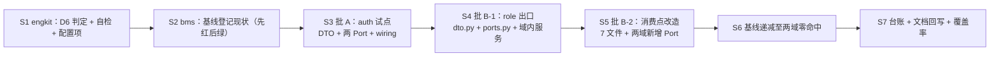

# 域间出口 DTO 化详细设计

> 产品与服务划分 · 03 边界与数据 · 04 域间出口 DTO 化 · 详细设计（开发核心文档）

[文档首页](../../../../../../文档首页.md) › [03 域间出口 DTO 化](../03_边界与数据_04_域间出口DTO化.md) › 设计

## 1. 目标与边界 <a id="scope"></a>

**目标**：把「每域一个 `public.py`」从**出口数量收敛**推进到**出口形态收敛**——域公共出口只交**不可变数据（DTO）**与**领域服务接口**，不交 ORM 模型、仓储与 API 层函数；跨域消费方按字段取值、按接口调用，不再能改他域字段、按关系懒加载、或借他域仓储绕过域内校验。

**范围内**：

1. 出口口径成文（允许 / 禁止 / 例外三类，含常量与能力插件这类需求未覆盖的边角）；
2. 机器护栏 D6「出口导出面」并入 `check_service_boundaries` 域级断言，含例外白名单与递减基线、自检正反例；
3. 低消费试点域 `auth`（identity 服务）出口 DTO 化；
4. 高消费域 `role`（platform 服务）出口 DTO 化，覆盖用户编排、权限解析、字典数据源三类真实消费点；
5. 已迁 / 待迁台账，剩余域在计划偏差列跟踪。

**范围外**：

| 项 | 归口 |
| --- | --- |
| 「组织」域出口 DTO 化 | 组织主数据在 mdm（bms `services/org` 已退役），且 mdm 尚未按域分包（`public_api = ["mdm.org"]` 是端口契约包，非域出口）；随 mdm 域分包落地后另迁 |
| `user` / `menu_form` / `permission_meta` 三域迁移 | 本轮登记为「待迁」，随各域改动递减（台账见 §4.8） |
| 常量类出口收口（`PERM_TYPE_*` / `ROLE_TYPE_*` 等） | 白名单保留（§4.1 第 3 类），选项集 / 字典口径收口归项目骨架 `01_08` |
| 字段权限 provider 等能力插件实现类出口 | 白名单保留（§4.1 第 3 类），能力注册通道收口另评 |
| 跨域 ORM 读写的**运行期**检测 | `03_03` 遗留 3：D3/D4 只覆盖原始 SQL / 表名 token；本轮消除的是「消费方持他域仓储」这条静态通路 |
| 产品仓（mdm / biz）域分包与出口 | 各产品接入任务 |

## 2. 现状核对 <a id="current"></a>

### 2.1 出口面（16 域，2026-10-29 实测） <a id="public-facts"></a>

| 域 | 服务 | 导出数 | 其中模型 | 其中仓储 | 其他 |
| --- | --- | --- | --- | --- | --- |
| `role` | platform | 20 | 5（`SysRole` / `SysRoleField` / `SysRolePermission` / `SysUserRole` / `SysDataScope`） | 5 | 常量 5、解析器 2、`SeparationGuard`、字段权限 provider 类 + 工厂、`MetadataReferenceRepository`（实为仓储） |
| `menu_form` | platform | 18 | 7 | 5 | `MenuFormService`、`MenuSnapshot` + 4 个 `Snapshot*`（Pydantic `BaseSchema`） |
| `permission_meta` | platform | 11 | 5 | 3 | `PermissionMetadataService` |
| `user` | platform | 10 | 2（`SysUser` / `SysAccountLock`） | 1 | 常量 7 |
| `auth` | identity | 4 | 0 | 0 | `IssuedSession`（frozen 值对象）、`SessionIssuer`、`build_session_issuer`、`set_refresh_cookie` |
| 其余 11 域 | — | 0 | — | — | `__all__ = []` 空占位（`task` / `platform_config` / `platform_registry` / `tenant` / `txn` / `ai` / `notification` / `file` / `search` / `report` / `identity_federation`） |

### 2.2 跨域消费点（21 处） <a id="consumers"></a>

| 消费域 → 目标域 | 文件数 | 文件 |
| --- | --- | --- |
| `role` → `user` | 4 | `role/api/role.py`、`role/repositories/role.py`、`role/services/role_assign.py`、`role/services/role_assignments.py` |
| `user` → `role` | 3 | `user/api/users.py`、`user/services/users_admin.py`、`user/services/user_assignments.py` |
| `permission_meta` → `role` | 2 | `permission_meta/permission/checker.py`、`permission_meta/permission/source.py` |
| `permission_meta` → `menu_form` | 3 | `permission_meta/permission/metadata.py`、`permission_meta/permission/source.py`、`permission_meta/services/icon_store.py` |
| `role` → `menu_form` | 2 | `role/permission/field_provider.py`、`role/services/role_grant.py` |
| `role` → `permission_meta` | 2 | `role/services/role_grant.py`、`role/services/separation.py` |
| `menu_form` → `permission_meta` | 1 | `menu_form/services/menu.py` |
| `platform_registry` → `role` | 1 | `platform_registry/sources/dict_source.py` |
| `identity_federation` → `auth` | 2 | `identity_federation/api/sso.py`、`identity_federation/services/sso.py` |

**入度**（被消费文件数 / 消费域数）：`role` 7 / 3 > `menu_form` 5 / 2 > `user` 4 / 1 > `permission_meta` 3 / 2 > `auth` 2 / 1。

### 2.3 消费形态：三类，不止读字段 <a id="shapes"></a>

| 形态 | 实例 | DTO 化的实质动作 |
| --- | --- | --- |
| ① 读字段做展示 | `role/api/role.py::_assigned_user(user: SysUser)` | 换成 UserSummary DTO，行为不变 |
| ② **直接构造他域仓储** | `role/api/role.py` 里 `UserRepository(session)`；`user/api/users.py` 里 `RoleRepository(session)` / `UserRoleRepository(session)` 并注入服务 | 换成「领域服务接口 + 装配面构造」，消费方不再持 session 构造他域仓储 |
| ③ **跨域 SQL 子查询 / 跨域写** | `role/repositories/role.py::_assignment_conditions` 里 `select(SysUser.id).where(...)`；`user/services/user_assignments.py` 对 `sys_user_role` 做 `create` / `soft_delete` / `restore` | 读：改为向他域服务取 id 集合；**写：`sys_user_role` 的写必须回到 `role` 域执行**（D4「跨域写无例外」，现由仓储方法绕过检测） |

**形态 ③ 是本任务的真实难点**，也是「行为等价」要守住的地方（事务边界、软删恢复、职责分离校验都在 `role` 侧）。

### 2.4 类型体系事实 <a id="types"></a>

| 基类 | 体系 | 冻结 | 现状用途 |
| --- | --- | --- | --- |
| `BaseValueObject`（`core/roots.py`） | 值对象体系根，`@dataclass(frozen=True)` | 是（dataclass 生成） | 202 处命中，`IssuedSession` / `SsoAuthorizeResult` 即此形态 |
| `BaseSchema` / `ServiceDto`（`schemas/`） | 数据契约体系（Pydantic） | **否**（`model_config` 无 `frozen=True`） | 全部请求 / 响应模型；跨服务契约 DTO |
| `menu_form` 的 `MenuSnapshot` / `Snapshot*` | Pydantic `BaseSchema` | 否 | 域内读模型，**当前由 `public.py` 当出口导出** |

即：现状出口里已经并存「frozen dataclass 值对象」与「可变 Pydantic 契约」两套体系，DTO 口径必须先二选一（§3 第 1 条）。

### 2.5 护栏现状 <a id="guard-facts"></a>

`check_service_boundaries` 域级断言已覆盖 D1（跨域 import）、D2（跨域只经 `public_api`）、D3（跨域表引用）、D4（跨域写）、布局形态 L1~L4 与域级基线；**出口内部形态无任何断言**——`public.py` 里 `from bms_core.models.platform.role import SysRole` 完全合法。护栏实现在 engkit（`src/engkit/base/service_boundaries.py`），bms 侧 `scripts/tools/base_check/check_service_boundaries.py` 只转发。

## 3. 决策记录 <a id="decisions"></a>

### 3.1 四项拍板（2026-10-29 逐项确认） <a id="picks"></a>

| # | 事项 | 结论 |
| --- | --- | --- |
| 1 | 出口 DTO 口径 | **frozen DTO + Protocol**：DTO 用 `BaseValueObject` 冻结 dataclass、落 `domains/<域>/dto.py`（附 `from_model` 转换）；`public.py` 只导出 DTO 与领域服务 **Protocol**，实现类不出（装配面构造）；`schemas` 层 Pydantic 模型不动，一致性由字段集合对账用例守 |
| 2 | 低消费试点域 | **`auth`**（identity 服务）：消费方 2 文件 / 1 域，出口已含 frozen 值对象，跨服务独立、不沾 `user↔role` 环；顺带定 API 层函数（`set_refresh_cookie`）的归属 |
| 3 | 护栏强度 | **`__all__` + AST 双向**：`__all__` 与模块级绑定双向一致（含 `as` 别名与属性导出），导出对象解析到域模型文件 / `repositories` 目录即失败；不追跨模块再导出链 |
| 4 | 迁移顺序与批次 | **`auth` → `role`**，本轮两域；`user` / `menu_form` / `permission_meta` 入台账，随各域改动递减 |

### 3.2 口径修订（需求 / 任务原文与现状冲突，按现状执行并回写） <a id="revisions"></a>

| # | 原文口径 | 修订后 | 理由 |
| --- | --- | --- | --- |
| 1 | 「不得导出 `MODEL_MODULES` 内的 ORM 类」 | 判定依据改为**域布局登记的模型文件**（`paths` 里的模型单文件 + `bms_core.models.<来源服务>.<域>` 模块，按 `__tablename__` 识别），与 `domain_model_modules()` 同源 | `03_03` 已将域 → 模型模块的权威派生改为布局派生；`MODEL_MODULES` 只剩共享模型子包清单，覆盖面不全（服务侧域模型不在其中） |
| 2 | 「高消费域（组织 / 角色）」 | 本轮高消费域取 **`role`**；「组织」按范围外登记 | bms 组织域已退役、组织主数据在 mdm；mdm 未按域分包，`mdm.org` 是端口契约包（`public_api = ["mdm.org"]`，包内无 `public.py`），当「高消费域」迁等于先建 mdm 域分包 |
| 3 | 「现有用例零改动通过」 | 修正为「**断言与行为不变**；允许测试内 import 与构造随之调整」 | DTO 化必然改服务构造签名（仓储不再由消费方 new），单测里构造服务的代码不改就编译不过；把「零改动」理解成断言不变才与新形态自洽 |
| 4 | 「出口 DTO 字段与能力契约响应模型**一致**」 | 修正为「**`DTO 字段集合 ⊇ 响应模型字段集合`**，差集逐条登记并由用例断言」 | DTO 是域间数据面、响应模型是对外契约面：`IssuedSession.session_id` / `remember_me` 等内部字段不出响应体，严格相等做不到；`role` 侧的条目类 DTO 反而完全相等 |
| 5 | 需求未覆盖「常量」「能力插件实现类」出口 | 列为**白名单第三类**：登记条目（理由 + 归口）后放行，只减不增 | `PERM_TYPE_*` 是运行期不可变值域、字段权限 provider 是能力插件实现，两者都不是「实现数据面」；不留白名单就会逼着用 DTO 包常量，属形式主义 |

## 4. 设计 <a id="design"></a>

### 4.1 出口口径（`public.py` 允许导出什么） <a id="rule"></a>

| 类别 | 允许 | 说明 |
| --- | --- | --- |
| ① 数据 DTO | `BaseValueObject` 派生的 `@dataclass(frozen=True)` | 落 `domains/<域>/dto.py`；只读、按字段取值、不挂关系 |
| ② 领域服务接口 | `typing.Protocol`（域内定义） | 落 `domains/<域>/ports.py`；实现类在域内、由装配面（`wiring.py`）构造后注入 |
| ③ 白名单例外 | 常量、能力插件实现类 | 逐条登记（`symbol` / `kind` / `reason` / `owner`），命中计数、**只减不增** |

**明确禁止**：ORM 模型（含 `bms_core.models.*` 里的域模型文件）、仓储类（`<域>/repositories/**` 的类）、API 层函数（`<域>/api/**` 的函数，耦合 `Request` / `Response`）、任何带 `session` 句柄的可变对象。

**「领域服务接口」形态**：消费方只依赖 Protocol；实现类留在域内、由装配面构造。为什么不让实现类进出口：实现类一进出口，后续在实现类上加方法就等于静默扩出口面，护栏（判的是导出符号）管不住；Protocol 是显式契约，改它必须改 `ports.py`。

**装配方向不变**：`wiring.py`（`shared_paths` 覆盖）→ 域实现 → 目标域 `public`（Protocol / DTO）。域实现之间仍零 import。

### 4.2 DTO 形态与落点 <a id="dto"></a>

```text
domains/<域>/
├── dto.py        # DTO：@dataclass(frozen=True)，继承 BaseValueObject
├── ports.py      # 领域服务 Protocol（消费方依赖的唯一类型）
└── services/     # 实现类（域内，public 不导出）
```

**写法约束**：

1. 字段用**下划线命名**（与 `schemas` 一致，便于对账与序列化同源），不用别名；
2. 集合字段一律基座插入序集合（`ConcurrentStableList` / `ConcurrentStableSet`），不落裸 `list` / `dict`（裸集合护栏）；
3. 提供 `@classmethod from_model(cls, row: <ORM>) -> Self` 作为**唯一**的模型 → DTO 转换入口，转换只做字段拷贝，不做查询、不做关系遍历（懒加载在跨域即隐式读表）；
4. 不提供任何 setter / 可变方法；改动即 `FrozenInstanceError`（由 `@dataclass(frozen=True)` 保证，用例断言）；
5. 嵌套 DTO 只嵌 DTO，不嵌模型、不嵌 Pydantic 模型。

**为什么不复用 `schemas` 的响应模型**：`BaseSchema` 未冻结（`model_config` 无 `frozen=True`），且对外契约字段与域间数据面字段本就不同集（§3.2 第 4 条）；复用会让「改一个响应字段」直接变成「改域间契约」，把契约面与数据面绑死。代价是要写 `from_model`，收益是两个面各自演进、冻结语义由 dataclass 天然保证。

### 4.3 机器护栏 D6「出口导出面」 <a id="guard"></a>

**落点**：`engkit/src/engkit/base/service_boundaries.py`（新增 D6 判定 + 自检 + 计数键），配置项落各仓 `engkit.toml` 的 `[rules.service_boundaries]`；bms 薄包装 `scripts/tools/base_check/check_service_boundaries.py` **不改逻辑**（只转发参数与退出码）。

**判定算法**：

```text
for 每个 placement 域（布局 domains[]，public_api 恰 1 由 L3 保证）:
    module = public_api[0]                          # 如 bms_platform.domains.role.public
    tree   = AST(public.py)
    declared = __all__ 的字符串元素（无 __all__ 时为空）
    bound    = 顶层 ImportFrom 绑定名（含 as 别名）+ 顶层 ClassDef / FunctionDef / Assign / AnnAssign 名
    # ① 双向一致
    声明不在 bound → violation(public_export_undeclared)
    bound（非 _ 前缀）不在 declared 且无 __all__ → 记入导出面（属性导出同样可达）
    # ② 来源判定（ImportFrom 的 module）
    来源 ∈ 该域模型模块（布局单文件 + bms_core.models.<svc>.<域>，按 __tablename__ 识别） → violation(public_export_orm)
    来源路径含 /repositories/                                                → violation(public_export_repository)
    来源路径含 /api/                                                         → violation(public_export_api_layer)
    # ③ 白名单
    命中 baseline 条目 → 放行 + used+1
```

**「属性导出」也判**：`from … import SysRole` 之后即使不写进 `__all__`，跨域仍可 `public.SysRole` 取到；只判 `__all__` 等于留后门（这也是 §3.1 第 3 条选「双向」的原因）。

**不做的**（归强档，开放项）：沿 import 链解析符号的最终定义模块（≤2 跳）、按类继承（`BaseModel` / `BaseRepository`）判定。理由：本轮的反例（导出模型 / 仓储 / API 函数）在 `public.py` 的 import 来源处即可见，加解析只会抬高误报与实现成本。

**例外白名单与递减基线**：单文件 `deploy/boundaries/domain_public_export_baseline.json`（与域级基线同口径：命中即放行计数，**条目不再命中即失败**）。

```json
{
  "version": 1,
  "entries": [
    {
      "domain": "role",
      "symbol": "PERM_TYPE_MENU",
      "kind": "constant",
      "reason": "运行期不可变值域，非实现数据面",
      "owner": "项目骨架 01_08（选项集 / 字典口径收口）"
    }
  ]
}
```

**新增计数键**（进 `counters`，护栏输出与预检摘要可见）：`public_export_violation`、`public_export_exempt_total`、`public_export_exempt_used`。

**上线顺序（先红后绿）**：护栏先接入 → 对现状全量跑一次，把 5 个有导出域的全部命中条目写进基线（auth 4 / user 10 / role 20 / menu_form 18 / permission_meta 11 中不合规者）→ 迁移域逐条删基线 → 两域零命中。基线从首日就存在，避免「新护栏一上线就红」或「先关后开」。

**自检用例**（`--self-test`，与现有 L1~L4 同风格）：正例（导出 `dto.py` 的 DTO 通过）、反例三型（导出模型 / 导出仓储 / 导出 `api` 函数）、`__all__` 与绑定不一致、白名单命中与陈旧条目不命中。

### 4.4 试点域 `auth`（identity 服务） <a id="auth"></a>

**出口目标形态**：

| 现符号 | 来源 | 处置 |
| --- | --- | --- |
| `IssuedSession` | `services/session_issuer.py` | **DTO**：移入 `domains/auth/dto.py`，保持 `@dataclass(frozen=True)`（现继承 `BaseRefreshableTokenContract` → `BaseValueObject`）；`session_issuer.py` 改为从 `dto` 导入 |
| `SessionIssuer` | `services/session_issuer.py` | **领域服务接口**：新增 `ports.py::SessionIssuerPort`（方法 `issue(...) -> IssuedSession`），`public.py` 导出 Port；`SessionIssuer` 实现类不出 |
| `build_session_issuer` | 同上（工厂） | **移出出口**：出口不再导出；构造入口保留在域内 `services/session_issuer.py`，由新建的 `bms_identity/wiring.py`（服务包根，布局 `backend/services/*/src/*/*.py` 骨架已覆盖，无需改布局）再导出给跨域消费方 |
| `set_refresh_cookie` | `api/cookies.py` | **收敛为端口**：`ports.py::SessionCookiePolicy`（`apply_refresh(response, request, issued)` / `clear_refresh(response)`），实现 `HttpSessionCookiePolicy` 落 `domains/auth/services/cookie_policy.py`，原 `api/cookies.py` 保留为同域内部薄封装（本域路由继续直接用） |

**消费方改造**（`identity_federation`，2 文件）：

| 文件 | 现状 | 改后 |
| --- | --- | --- |
| `api/sso.py` | `from …auth.public import build_session_issuer, set_refresh_cookie`；`build_session_issuer(session=…, uow=…, …)`；`set_refresh_cookie(response, request, …)` | 从 `bms_identity.wiring` 取 `build_session_issuer` 与 `build_cookie_policy`；签发后 `policy.apply_refresh(response, request, result.issued)`；类型标注用 `SessionIssuerPort` / `SessionCookiePolicy` |
| `services/sso.py` | `from …auth.public import IssuedSession, SessionIssuer`；参数类型 `session_issuer: SessionIssuer` | `IssuedSession` 仍来自 `public`（DTO）；参数类型改 `SessionIssuerPort` |

**行为等价**：cookie 的属性、`max_age` 语义、`Secure` / `SameSite` 开关原样搬入实现类；会话签发路径不变（仍是 auth 域实现执行写，跨域写不发生）。

**契约对账**：`IssuedSession` ↔ `schemas/auth.py` 的登录响应模型。差集登记（`session_id` / `remember_me` / `refresh_token` / `refresh_expires_in` 为域间内部字段，不出响应体）。

### 4.5 高消费域 `role`（platform 服务） <a id="role"></a>

#### 4.5.1 出口目标形态（20 符号） <a id="role-exports"></a>

| 现符号 | 类别 | 处置 |
| --- | --- | --- |
| `SysRole` / `SysRoleField` / `SysRolePermission` / `SysUserRole` / `SysDataScope` | ORM | **移出**，由 DTO 替代 |
| `RoleRepository` / `UserRoleRepository` / `RolePermissionRepository` / `DataScopeRepository` / `MetadataReferenceRepository` | 仓储 | **移出**，由 `ports.py` 的服务接口替代 |
| `DirectRoleResolver` / `OrgRoleResolver` | 服务实现 | 改为 `RoleSubjectResolverPort` 导出（两个实现由装配面按配置选择后注入） |
| `SeparationGuard` | 服务实现 | 改为 `SeparationPort` 导出 |
| `StaticFieldPermissionProvider` / `build_static_field_provider` | 能力插件 | **白名单保留**（`kind=capability_plugin`，归口：能力注册通道收口） |
| `DEFAULT_FIELD_PERMISSION_PROVIDER_KEY` / `PERM_TYPE_FORM` / `PERM_TYPE_MENU` / `PERM_TYPE_PERMISSION` / `ROLE_TYPE_CUSTOM` | 常量 | **白名单保留**（`kind=constant`，归口：`01_08` 选项集 / 字典收口） |

#### 4.5.2 新增 DTO（`domains/role/dto.py`） <a id="role-dto"></a>

| DTO | 字段 | 对应响应模型 |
| --- | --- | --- |
| `RoleSummary` | `id` / `code` / `name` / `status` / `role_type` / `builtin` | `RoleItem`（去掉 `subject_count`，计数由调用方另取） |
| `RoleDetail` | `RoleSummary` 全部 + `version` / `created_at` / `created_by` / `updated_at` / `updated_by` | `RoleDetail` |
| `RoleRef` | `id` / `code` / `name` | 字典数据源 / 下拉回显 |
| `RolePermissionEntry` | `id` / `perm_type` / `target_id` / `source_menu_id` | `RolePermissionEntryItem` |
| `RoleFieldGrant` | `id` / `form_id` / `field_id` / `visible` / `editable` / `source_menu_id` | `RoleFieldEntryItem` |
| `RoleDataScopeEntry` | `id` / `scope_type` / `scope_value` | 数据范围条目 |
| `UserRoleBinding` | `role_id` / `role_code` / `role_name` | 用户详情里的角色行 |
| `AssignedUser` | `user_id` / `username` / `name` / `status` | `AssignedUserItem`（由 user 域 DTO 投影而来） |

#### 4.5.3 新增领域服务接口（`domains/role/ports.py`） <a id="role-ports"></a>

| Port | 方法（语义） | 替代的原调用 |
| --- | --- | --- |
| `RoleQueryPort` | `get(role_id) -> RoleDetail \| None`；`list_by_ids(ids) -> [RoleRef]`；`list_by_code(code) -> RoleRef \| None` | `RoleRepository.get` / `list_by_ids` / `get_by_code` |
| `RoleAssignmentPort` | `list_role_ids_of_user(user_id) -> [int]`；`list_roles_of_user(user_id) -> [UserRoleBinding]`；**`set_user_roles(user_id, role_ids, operator_id) -> [UserRoleBinding]`** | `UserRoleRepository.list_role_ids_by_user` / `list_by_ids` + `soft_delete_by_user_except` / `get_by_role_user` / `get_deleted_by_role_user` / `restore` / `create`（**跨域写回域内执行**） |
| `RoleGrantPort` | `list_permissions(role_id) -> [RolePermissionEntry]`；`list_field_grants(role_id) -> [RoleFieldGrant]`；`list_data_scopes(role_id) -> [RoleDataScopeEntry]` | `RolePermissionRepository` / `SysRoleField` / `DataScopeRepository` 读 |
| `RoleSubjectPort` | `resolve_subject(user_id, tenant_id) -> [UserRoleBinding]`；`permission_types_of(role_ids) -> [str]` | `DirectRoleResolver` / `OrgRoleResolver` / `checker.py` 现用法 |
| `RoleReferencePort` | `role_references(role_ids) -> [RoleRef]`；`list_options() -> [RoleRef]` | `MetadataReferenceRepository` 引用探测、`dict_source.py` 读 `SysRole` |
| `SeparationPort` | `assert_assignable(user_id, role_ids) -> None` | `SeparationGuard` |
| `UserDirectoryPort`（**role 作为消费方**，定义在 role 侧、由 user 域实现） | `list_summaries(user_ids) -> [UserSummary]`；`search_ids(keyword, status) -> [int]` | `UserRepository.list_by_ids` / `get_by_id`；`role/repositories/role.py` 的 `select(SysUser.id)` 子查询 |

`UserSummary` DTO 定义在 **role 侧**（消费方定义数据需求）还是 user 侧（提供方定义）？取**提供方定义**（user 域 `dto.py::UserSummary`），role 侧 `ports.py` 引用它——同一份 DTO 两个方向共用，避免两份形状漂移。本轮 `user` 域虽未整体迁移，但 `dto.py` 与 `UserSummary` 可先立（只增不改）。

#### 4.5.4 消费点改造（7 文件） <a id="role-consumers"></a>

| 消费方 | 现状 | 改后 | 行为等价要点 |
| --- | --- | --- | --- |
| `role/api/role.py` | `UserRepository(session)` 注入 `RoleAssignService` / `RoleAssignmentsService`；`_assigned_user(user: SysUser)` | 经 `wiring` 注入 `UserDirectoryPort`；`_assigned_user` 收 `UserSummary` | 已分配用户行字段不变 |
| `role/repositories/role.py` | `_assignment_conditions` 内 `select(SysUser.id)` 子查询 | 过滤前先调 `UserDirectoryPort.search_ids(keyword, status)`，再 `user_id.in_(ids)` | **分页语义变化**：原 DB 子查询、现两段查询；id 集合规模设上限（超限回退为「不分页全量 + 内存过滤」不可取，改为显式 `ParamError` 或走 user 域分页接口，见 §8 风险 2） |
| `role/services/role_assign.py` | `self._users.list_by_ids(...)` 返回 `SysUser` | `UserDirectoryPort.list_summaries(...)` 返回 `UserSummary` | 排序按 `user_id` 去重后同序 |
| `role/services/role_assignments.py` | `get_by_id` / `list_by_ids` | 同上 | 单用户校验改为 `list_summaries([id])` 判空 |
| `user/api/users.py`、`user/services/users_admin.py`、`user/services/user_assignments.py` | 直接 new `RoleRepository` / `UserRoleRepository` / `SeparationGuard` | 注入 `RoleAssignmentPort` / `RoleQueryPort` / `SeparationPort` | **写路径**：`set_user_roles` 一次性完成「软删 + 恢复 + 新建」，事务边界从 user 侧移到 role 域服务内（`uow` 仍由调用方传入，保持同一事务） |
| `permission_meta/permission/checker.py`、`source.py` | `UserRoleRepository` / `RoleRepository` / `RolePermissionRepository` / 解析器 | `RoleSubjectPort` / `RoleGrantPort` | 权限解析结果与缓存版本语义不变 |
| `platform_registry/sources/dict_source.py` | 读 `SysRole` | `RoleReferencePort.list_options()` | 字典选项顺序 / 过滤条件不变 |

`role` 作为消费方的 4 处（`role/permission/field_provider.py`、`role/services/role_grant.py`、`role/services/separation.py`、`menu_form/services/menu.py`）同步改为目标域的 Port；`menu_form` / `permission_meta` 本轮**不迁出口**，但要为其**新增**本轮用到的 Port 与 DTO（只增不改，不影响其现有导出面）。

> 说明：`menu_form` / `permission_meta` 若不新增 Port，`role` 侧无法去掉对它们仓储 / 模型的依赖——两域「出口迁移」可以推后，但「消费面收口」必须同批完成。这也是为什么本轮工作量的重心在 `role` 而不是 `auth`。

#### 4.5.5 契约对账 <a id="role-reconcile"></a>

`role` 的条目类 DTO 与响应模型**字段完全相等**（`RolePermissionEntry` ↔ `RolePermissionEntryItem`、`RoleFieldGrant` ↔ `RoleFieldEntryItem`、`AssignedUser` ↔ `AssignedUserItem`）；`RoleSummary` 与 `RoleItem` 差 `subject_count`（计数由 API 层另取，不入域间契约）、`RoleDetail` 与 `RoleDetail` 相等。差集逐条登记进对账用例的期望表。

### 4.6 字段对账用例形态 <a id="reconcile"></a>

一条对账用例 + 一张期望表（用例内常量）：

```text
cases = [
    (AuthDomain, "IssuedSession", "bms_identity.domains.auth.schemas.auth:LoginResult",
     expected_missing_in_dto=frozenset()),
    ...
]
断言：set(dto.__dataclass_fields__) ⊇ set(response_model.model_fields)
     且 set(dto) - set(response_model) == expected_extra（登记差集，多一个少一个即红）
```

对账必须**双向可解释**：DTO 多出的字段只能是 §3.2 第 4 条登记的内部字段；响应模型多出的字段（DTO 缺）一律失败。

### 4.7 迁移台账 <a id="ledger"></a>

| 状态 | 域 | 出口违规条目（迁移前） | 备注 |
| --- | --- | --- | --- |
| 已迁（本轮） | `auth` | 4 | DTO 1 + Port 2 + 装配 1 |
| 已迁（本轮） | `role` | 20 | 模型 5 / 仓储 5 清零；常量 5 + 插件 2 入白名单 |
| 待迁 | `user` | 10 | 消费方仅 `role` 1 域；`UserSummary` 本轮已提前落地 |
| 待迁 | `menu_form` | 18 | 现有 `MenuSnapshot` 为 Pydantic，迁时一并定「快照 → DTO」口径 |
| 待迁 | `permission_meta` | 11 | 与 `menu_form` 互相消费，迁时两域同批 |
| 已达标（零导出） | 其余 11 域 | 0 | `__all__ = []`，护栏天然零命中；新增导出即受 D6 约束 |
| 待产品仓 | mdm `org` | — | mdm 未按域分包，随其域分包落地 |

台账与基线文件是**同一份事实的两种视图**：待迁域的条目留在 `domain_public_export_baseline.json`，迁完即删；计划偏差列只引用台账，不复述条目。

## 5. 实施顺序与批次 <a id="order"></a>



| 批 | 内容 | 可独立回滚 |
| --- | --- | --- |
| 批 A | engkit 护栏 + bms 基线 + `auth` 迁移 | 是（护栏与试点互不依赖；回滚护栏需同时回滚基线文件） |
| 批 B | `role` 出口 + 消费点改造 | **否**——域间契约变更无兼容层，role 出口与 7 处消费点必须一次成型；回滚按批整体 revert |

要点：

1. **批 B 不许留半可编译态**：先加 DTO / Port（只增），再改消费点，最后删旧导出；每步 `pyright` + 定向 pytest；
2. 护栏判定面基于布局，因此 `public.py` 的导出删减与基线递减必须同一步完成，否则 `public_export_exempt` 陈旧条目会失败（这是设计意图：只减不增）；
3. `wiring.py` 由骨架 glob `backend/services/*/src/*/*.py` 覆盖，新增文件**无需改布局**（改动后仍要跑 L4 确认未归属数为 0）。

## 6. 影响面 <a id="impact"></a>

| 类别 | 对象 | 变更 |
| --- | --- | --- |
| 新增（engkit） | `src/engkit/base/service_boundaries.py` | D6 判定、计数键、自检样例、基线读写 |
| 新增（engkit） | `tests/test_base_boundaries*.py` | D6 单测（正例 / 反例三型 / 双向不一致 / 白名单陈旧） |
| 修改（engkit） | `engkit.toml`（engkit 自身）、`engkit文档/概述`（配置字段全表） | 新增 `public_export_baseline` 字段与计数键文档 |
| 新增（bms） | `deploy/boundaries/domain_public_export_baseline.json` | 例外白名单 + 递减基线 |
| 修改（bms） | `engkit.toml` 的 `[rules.service_boundaries]` | 新增 `public_export_baseline` |
| 新增（bms） | `domains/auth/{dto,ports}.py`、`domains/auth/services/cookie_policy.py`、`bms_identity/wiring.py` | 试点形态 |
| 新增（bms） | `domains/role/{dto,ports}.py`、`domains/role/services/{role_query,role_assignment}.py` | 高消费域形态 |
| 新增（bms） | `domains/user/dto.py`（`UserSummary`）、`domains/menu_form/ports.py`、`domains/permission_meta/ports.py` | 消费面收口所需（只增，不改其出口） |
| 修改（bms） | `domains/auth/public.py`、`domains/role/public.py` | 出口收敛 |
| 修改（bms） | 消费方 9 文件（`identity_federation` 2、`role` 侧 4、`user` 3）+ `platform_registry/sources/dict_source.py` | 改接口调用 |
| 修改（bms） | 相关测试（构造与 import；断言不变） | 行为等价回归 |
| 不改 | `schemas` 层 Pydantic 模型、能力契约快照、表结构、迁移链 | 零 DDL、零契约变更 |

**本轮不动 mdm**：组织域留在台账；`uv run` 顺带改的 `backend/uv.lock` 需在提交前 `git checkout --`（见工作区约定）。

## 7. 测试设计 <a id="test"></a>

**Kiwi**：先登记取得编号再编码（批 A / 批 B 各一条），编号回填本节与代码 `@pytest.mark.kiwi_id`。

| # | 用例 | 落点 | 断言 |
| --- | --- | --- | --- |
| 1 | D6 正例：导出 DTO | `engkit` 自检 + `bms` 用例 | 导出 `dto.py` 的冻结 DTO 通过，`public_export_violation == 0` |
| 2 | D6 反例：导出 ORM / 仓储 / API 函数 | 同上 | 三型各命中一条，消息含域 / 符号 / 来源 |
| 3 | D6 双向一致 | 同上 | `__all__` 列了但未绑定、绑定了但未列（无 `__all__` 时视为导出）均按违规 / 声明处理 |
| 4 | D6 白名单与陈旧条目 | 同上 | 命中条目 `used+1`；条目不再命中 → 失败（只减不增） |
| 5 | 布局 16 域出口 | `libs/bms_core/tests/boundary/test_domain_public_exports.py` | `auth` / `role` 零违规，其余域条目与基线一致 |
| 6 | 出口对象冻结 | 每域 `tests/` | 对 DTO 赋值抛 `FrozenInstanceError`；`from_model` 后字段逐个相等 |
| 7 | 字段对账 | `tests/boundary/test_public_dto_contract.py` | `DTO 字段 ⊇ 响应模型字段`，差集 == 登记差集（双向可解释） |
| 8 | 消费方无 ORM 依赖 | 布局扫描用例 | `auth` / `role` 的消费点不 import 模型 / 仓储；D1 仍零命中 |
| 9 | 行为等价：SSO 登录 | `identity/tests/`（既有） | 断言不变通过；cookie 属性与 `max_age` 语义不变 |
| 10 | 行为等价：角色分配 / 授权 / 权限解析 | `platform/tests/{api,permission,role}/`（既有） | 断言不变通过；`set_user_roles` 的软删 / 恢复 / 新建路径逐条覆盖 |
| 11 | 写路径回域 | 定向用例 | `sys_user_role` 的写只发生在 `role` 域实现内（user 侧只调 Port） |
| 12 | 台账一致 | 文档校验 | 已迁域零命中、待迁域条目与基线一致（台账漏登记即红） |

**验证命令**（批 A / 批 B 收尾各跑一遍；重命令一律经 `run_once.py` 包装）：

```bash
python scripts/tools/preflight/run_once.py --force -- python scripts/tools/base_check/check_service_boundaries.py . --self-test
python scripts/tools/preflight/run_once.py --force -- python scripts/tools/base_check/check_service_boundaries.py .
python scripts/tools/preflight/run_once.py --force -- uv run pytest services/identity/tests services/platform/tests   # backend 下
python scripts/tools/preflight/run_once.py --force -- uv run pyright
cd ../engkit && uv run pytest && uv run ruff check . && uv run pyright
```

**覆盖率**：口径见《[AI开发规范](../../../../../../规范/AI开发规范.md)「覆盖率要求」节；新增 DTO / Port / 服务实现与护栏分支须本地跑满。纯声明模块（`dto.py` / `ports.py` 的 `from_model` 之外）按同一节「可导入 / 可解析护栏用例」处理，**不得**用 `pragma: no cover` 或 `omit`。

## 8. 风险与边界 <a id="risk"></a>

| # | 风险 | 处置 |
| --- | --- | --- |
| 1 | 批 B 无法分步回滚（契约变更无兼容层） | 一次成型 + 先增后删 + 每步 pyright / 定向 pytest；回滚按批整体 revert |
| 2 | `role` 按关键字过滤已分配用户：原 DB 子查询 → 两段查询，`search_ids` 返回集合可能过大 | 设 id 集合上限（超限 `ParamError`）；分页语义在 role 侧先算 id 集合再 count + 分页；压测在测试记录登记 |
| 3 | `sys_user_role` 的写迁回 role 域，事务边界变化 | `uow` 仍由调用方传入（同一事务）；`set_user_roles` 内部保持「软删 → 恢复 → 新建」原顺序；用例覆盖三条路径 |
| 4 | 消费方改造漏一处 → D1/D6 仍绿但留 ORM 依赖 | 判据冗余：D1（import）+ D6（出口）+ 用例 8（消费点扫描）三重；`rg` 残留扫描 |
| 5 | 白名单变成垃圾桶 | 每条必须带 `reason` 与 `owner`；条目不再命中即失败；常量与插件两类归口已定（`01_08` / 能力注册） |
| 6 | `menu_form` / `permission_meta` 只加 Port 不迁出口，出现「新旧两套形状」 | Port 只做适配（内部仍用其现有仓储 / 快照），不改其 `public.py`；两域迁移时再把 Port 落到 DTO，避免一次动两个面 |
| 7 | 对账用例把「差集」写成硬编码清单后长期不更新 | 差集登记在用例常量并附理由列；新增差集必须同时改登记表，评审可见 |
| 8 | engkit 判定逻辑误报（如 `__all__` 写在 `if` 块内、条件导入） | 只认模块顶层绑定；条件导入按「无 `__all__` 时视为导出」保守处理；自检覆盖一条条件导入样例 |

## 9. 开放项与遗留 <a id="open"></a>

| # | 事项 | 归口 |
| --- | --- | --- |
| 1 | `user` / `menu_form` / `permission_meta` 三域出口迁移 | 台账递减，随各域改动推进 |
| 2 | 常量与能力插件两类出口的正式收口（选项集 / 字典 / 能力注册通道） | 项目骨架 `01_08`、能力注册任务 |
| 3 | 强档护栏：沿 import 链解析符号定义模块 + 按类继承判定 | 出现「服务层再导出模型」实例时启用 |
| 4 | 跨域 ORM 读写的运行期检测（D3/D4 只覆盖原始 SQL / 表名 token） | `03_03` 遗留 3；本轮消除静态通路后重新评估 |
| 5 | mdm `org` 域分包与出口 DTO 化 | mdm 域分包任务；本轮台账已登记 |
| 6 | DTO → 响应模型的自动投影（减少 API 层手写映射） | 出现第三处重复映射时评估 |

## 10. 交付物与验收映射 <a id="deliver"></a>

| 交付物 | 验收要点（任务完成标准） |
| --- | --- |
| D6 护栏 + 自检 + 基线 | 正例（DTO）通过、反例三型（模型 / 仓储 / API 函数）失败；条目只减不增；已并入域级断言 |
| `auth` / `role` 出口 DTO 化 | 两域 `public.py` 零违规；消费方 9 文件无 ORM 依赖；`sys_user_role` 写回 role 域 |
| 冻结语义 | DTO 赋值抛 `FrozenInstanceError`，用例断言 |
| 字段对账 | `DTO ⊇ 响应模型`，差集登记且用例双向可解释 |
| 台账 | 已迁 / 待迁登记齐备，与基线同源；计划偏差列有归口 |
| 记录与回写 | 实施 / 测试记录、计划表、需求注块、任务文件、engkit 配置文档、后端开发规范「业务域级断言」节 |

## 11. 对齐记录 <a id="alignment"></a>

实施（批 A：护栏 + `auth`）相对设计稿的修订与补充：

| # | 设计稿 | 实施后 | 理由 |
| --- | --- | --- | --- |
| 1 | `build_session_issuer` 搬到 `wiring.py` | 构造入口留在域内 `services/session_issuer.py`，`wiring` 只**再导出** | 工厂构造的是域内对象（域内装配细节）；域内 `api/auth.py` 继续按域内路径使用，少一次跨包依赖。跨域消费方仍只从装配面取 |
| 2 | 未提 cookie 策略实现的基类 | `HttpSessionCookiePolicy` 继承 `BaseFrameworkObject` | 基座断言「自定义类须继承基类」；策略对象是**框架对象**（不参与值语义与序列化），不是数据对象，故不挂 `BaseValueObject` |
| 3 | 未提 `api/cookies.py` 与实现的关系 | cookie 读写逻辑下沉 `services/cookie_policy.py`，`api/cookies.py` 改为薄转发 | 分层方向 `services` 不可 import `api`；逻辑单一落点放 services，端点保留原函数名以兼容本域路由 |
| 4 | D6 目录判定写「来源路径含 `/repositories/` 等」 | 判定落在**包内相对路径** | 仓根路径自带 `services/` 段（服务分组目录），直接匹配会把任何服务文件误判成「域内实现类」；共享库包只判模型（`bms_core.permission.field` 这类能力接口不算域内实现） |
| 5 | D6 违规种类原为 orm / repository / api_layer 三类 | 增 `service_impl`（`services/` 与 `permission/` 目录） | 需求口径禁的是「可变服务对象」，实现类导出口同样违约；不加这一类，`SessionIssuer` / `MenuFormService` 等实现类会漏判 |
| 6 | 护栏首日即绿 | 先登记 60 条现状基线（`auth` 4 / `user` 10 / `role` 20 / `menu_form` 18 / `permission_meta` 8+），迁移后逐域删 | 与域级基线同口径：先让护栏可上线，再按域递减；「先关后开」会让出口形态长期无人守 |

实施（批 B：`role`）相对设计稿的修订与补充：

| # | 设计稿 | 实施后 | 理由 |
| --- | --- | --- | --- |
| 7 | 改 7 处消费点（含 `role` 读 `user` 的 4 处） | 只改**消费 `role`** 的 6 个文件（`user` 3 / `permission_meta` 2 / `platform_registry` 1）；`role` 作为消费方读 `user` 的 4 处保留 | 完成标准要求的是「本域出口合规 + 本域消费方无 ORM 依赖」；`role` 读 `user` 属下一域（`user`）迁移时的消费面收口，同批改会把两域绑成一个不可回滚的变更 |
| 8 | DTO 列 `RoleRef` 与 `UserRoleBinding` 两种引用形状 | 合并为 `RoleSummary` 一种 | `user` 侧展示需要 `role_type`（内置判定），`RoleRef` 不够用；两种形状并存只会让 `user` 侧按需挑一个，反而是新的不一致来源 |
| 9 | 字典源 / 权限数据源在域内直接调装配面构造 | 改为**注入工厂**：`PlatformDictDataSource(role_options=…)`、`PlatformPermissionDataSource(grants_factory=…)`，权限装配经 `app.state.role_*_factory` 取 | 域实现 import `wiring` 是「域 → 装配」的反向依赖；注入工厂让方向仍是「装配 → 域」，也让测试能换替身而不动装配面 |
| 10 | `SeparationGuard.ensure_user_roles_exclusive(roles: SysRole)` | 参数改 `RoleSummary`（DTO） | 守卫是跨域消费方调用的校验面，收模型等于把模型又漏回出口路径；改 DTO 后守卫实现不碰 ORM 属性（只用 `role_type`） |
| 11 | 写入口护栏（三权校验早于写入）断言在 `user_assignments.py::_apply_roles` | 断言移到 `role_assignment.py::set_user_roles` | `sys_user_role` 的写已收回角色域，断言必须跟着写入口走；`_apply_roles` 现在只做用户状态前置判定 + 编排调用 |
| 12 | 未提测试改造 | 测试替身按 Port 方法名对齐（`list_role_ids_of_user`）、构造改经 `wiring` 工厂、`grants_factory` 换成 `_Grants` 替身 | 「断言不变、构造与 import 随形态调整」（§3.2 第 3 条）的具体落法；不改成替身就无法覆盖 Port 分支 |


> 本文档依《[文档生成规范](../../../../../../规范/文档生成规范.md)》与《[任务文档规范](../../../../../../规范/任务文档规范.md)》编写
