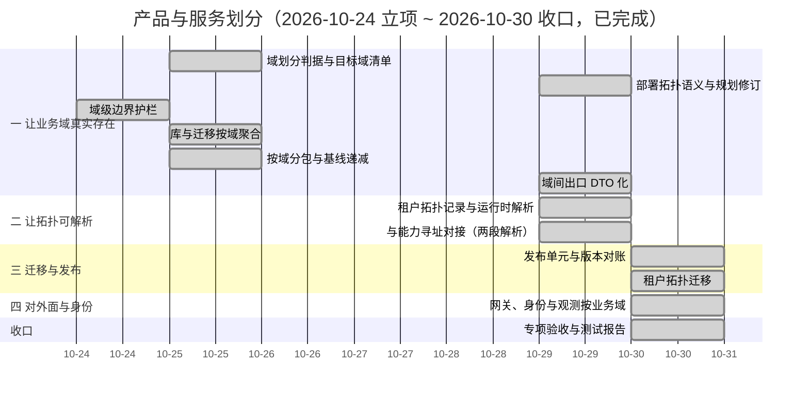

# 产品与服务划分计划

[文档首页](../../../文档首页.md) › 产品与服务划分计划　|　[任务基线 →](../任务/01_域划分与拓扑语义/01_域划分与拓扑语义.md)　[需求基线 →](../需求/00_需求_产品与服务划分.md)

> 进度唯一落点（本文档）：**已完成 12 项，剩余 0 项**（专项于 2026-10-24 立项、2026-10-30 收口；门禁见 §5，遗留台账见 §7，专项测试报告见 [01_测试报告_产品与服务划分](../01_测试报告_产品与服务划分.md)）

## 1. 计划说明 

- **排期对象**：专项 11 条需求、12 个子任务（业务域 01 业务域划分与拓扑语义 2 / 业务域 02 拓扑机制 2 / 业务域 03 边界与数据 4 / 业务域 04 发布与迁移 3 / 业务域 05 阶段验收 1）。
- **排期口径**：自 2026-11-15 起串行排期（单人兼职，接 07B 收口之后），窗口按实际滚动调整。
- **工时**：已完成 204h；剩余 0h；阶段合计 204h（2026-10-29 补充 `03_04`，按「口径 + 护栏 + 两域试点」口径重估 24h）。
- **里程碑锚点**：M7C = 业务域与部署解耦可用（同一套业务域模型在合并与拆分两种拓扑下均可运行，边界纪律在合并部署下仍成立）。
- **负责人**：minjian（兼职，单人）。
- **前置**：07B 跨产品协同（能力两段解析的第一段由 07B 提供，本专项补第二段）。
- **四阶段划分**（2026-10-24 拍板：先让业务域真实存在，再上拓扑）：
  | 阶段 | 目标 | 任务 |
  | --- | --- | --- |
  | 一 让业务域真实存在 | 业务域登记 + 服务内按业务域分包 + 表归属按业务域 + 业务域级护栏（延伸：域间出口 DTO 化） | `01_01`、`01_02`、`03_01`、`03_02`、`03_04` |
  | 二 让拓扑可解析 | 租户拓扑记录与解析 + 能力第二段解析 + 进程内直调 | `02_01`、`02_02` |
  | 三 迁移与发布 | 链按业务域、发布对账、拓扑迁移 | `04_01`、`04_02` |
  | 四 对外面与身份 | 路由按业务域、令牌带业务域、观测与配置按业务域 | `04_03` |
- **说明**：上表阶段为**工作量分组的推进次序**，§3 排期表仍按依赖与窗口串行排定（阶段一的任务分散在窗口前段）。

## 2. 已完成任务 

| 编号 | 任务 | 工时（重估） | 完成日期 | 任务文件 | 偏差与遗留 |
| --- | --- | --- | --- | --- | --- |
| 03_01 | 业务域级边界护栏 | 16h | 2026-10-24 | [03_边界与数据_01_域级边界护栏](../任务/03_边界与数据/03_边界与数据_01_域级边界护栏/03_边界与数据_01_域级边界护栏.md) | ① **已由 `03_03` 闭环**（混域文件拆分、基线 30 → 0）；② 运行期「当前域」装配点与库键单元段归 `03_02` / `02_01`；③ D5 全域日志 / 指标按域打标归 `04_03`；④ **已由 `03_03` 闭环**（按域分包 `legacy` → `placement`）；⑤ 顺带修复三处既有红灯，详见其实施记录 §2.6；⑥ 见其记录 §6 遗留 7（ORM 级跨域读写归 `02_02`）；⑦ **域布局口径修订（2026-10-29 重开，随 07B `04_02` 同窗口）**：域布局由「独立 `domain_layout.json` 文件」改为「**产品自持清单第九类 `[[domains]]` 声明 + 生成物**」——原口径下域布局是文件，平台注册通道取不到产品仓文件，产品声明的业务域在平台侧无登记（实测 mdm 8 条 `org` 域能力被拒）；修订后域信息随声明走注册通道，`domain_layout.json` 降为清单渲染的生成物（与 `apisix.yaml` 同构，`--check` 守漂移），07C 六处消费点零改动。**已实施并验证**：平台 16 域 / 127 条 `domain_shared_paths` 迁入 `platform.toml`，重新渲染与迁移前**零差异**；`sys_domain` 注册表落地（两进程实测 17 行：平台 16 + mdm `org`）；mdm 启动 `/healthz` `/readyz` 均 200。详见 `03_01` 详设 §3.1 / §8 第 13 条与实施记录 §2.8 |
| 03_02 | 库与迁移按业务域 | 24h | 2026-10-25 | [03_边界与数据_02_库与迁移按域聚合](../任务/03_边界与数据/03_边界与数据_02_库与迁移按域聚合/03_边界与数据_02_库与迁移按域聚合.md) | ① 真库（MySQL / PostgreSQL / DM8）上的基线写入随 CI 集成档与 `04_02` 复验；② `domain_model_modules` 已由 `03_03` 收紧；③ ~~表文件「归属库」行仍写服务库名~~——**已由 `05_01` 闭环**：56 份表文件 + 总览 + 数据规范 §8 统一改「归属部署单元」（默认单元＝服务，既有库名零变化），并补「单元段即部署单元」口径注 |
| 01_01 | 域划分判据与目标业务域清单 | 16h | 2026-10-25 | [01_域划分与拓扑语义_01_域划分判据与目标域清单](../任务/01_域划分与拓扑语义/01_域划分与拓扑语义_01_域划分判据与目标域清单/01_域划分与拓扑语义_01_域划分判据与目标域清单.md) | ① biz / cw 产品业务域清单随各自接入补录；② 平台巨型服务按阈值拆独立服务属后续任务（本任务只给判据与候选池）；③ 清单定期复核归 `05_01` 收口核对；④ 产品仓（mdm）域布局随其仓自建 |
| 03_03 | 按域分包与基线递减 | 16h | 2026-10-25 | [03_边界与数据_03_按域分包与基线递减](../任务/03_边界与数据/03_边界与数据_03_按域分包与基线递减/03_边界与数据_03_按域分包与基线递减.md) | ① 产品仓 mdm 前端模块键需改 `mdm_org` 并重发（新 `MODULE_NAME_PATTERN` 拒 kebab）；② 字段控件语义键与业务码 / 动作码形态仍 kebab，待拍板是否另立任务收紧；③ 存量失败 `identity/tests/oidc/test_clients.py`（OAuth scope 取导入期常量）已随本任务修复并补回归用例；④ 域间出口 DTO 化归 `02_02` |
| 01_02 | 部署拓扑语义与规划修订 | 8h | 2026-10-29 | [01_域划分与拓扑语义_02_部署拓扑语义与规划修订](../任务/01_域划分与拓扑语义/01_域划分与拓扑语义_02_部署拓扑语义与规划修订/01_域划分与拓扑语义_02_部署拓扑语义与规划修订.md) | ① 拓扑记录存储与解析归 `02_01`（本任务只定语义形态）；② 参照拓扑的分组型在 `biz` 域登记前等同单体型，`grp-purchase` / `grp-ops` 为接入时新增单元（设计 §3.4 已澄清，`02_01` 模板校验按「只引用已登记域」）；③ 单元标识对外可见性归 `04_03`；④ 库派生核对结论：`03_02` 已把服务段语义改为部署单元（`unit` 别名 + `AppSettings.unit` 回落），既有库名零改动 |
| 02_02 | 与能力寻址对接（两段解析） | 12h | 2026-10-29 | [02_拓扑机制_02_与能力寻址对接（两段解析）](../任务/02_拓扑机制/02_拓扑机制_02_与能力寻址对接（两段解析）/02_拓扑机制_02_与能力寻址对接（两段解析）.md) | ① **已闭环 `02_01` 遗留 1**（跨进程分发：平台内部出口 + 装配层拉取，失败降级）；② `mode=local` 的**本地 ASGI 直调已交付**（第二批：不经网络、不重试、不参与熔断；纯函数直调留作热点优化）；③ 运行期拓扑刷新（不重启生效）归 `04_02` 评估；④ `[topology].units` 暂无运维入口（单实例组不需要声明，随实例组形态定）；⑤ 域间出口 DTO 化：口径已定并**已立项** `03_04`（需求 `03-3`）；⑥ 07B 远端授权视图路径常量与真实路由不一致（归 07B 修复，本轮未擅动）；⑦ 真机跨进程拉取随部署窗口复验 |
| 02_01 | 租户拓扑记录与运行时解析 | 24h | 2026-10-29 | [02_拓扑机制_01_租户拓扑记录与运行时解析](../任务/02_拓扑机制/02_拓扑机制_01_租户拓扑记录与运行时解析/02_拓扑机制_01_租户拓扑记录与运行时解析.md) | ① 其它服务进程取不到本进程快照，拓扑分发 / `local`·`colocated` 判定归 `02_02`（此前沿用 07B 过渡实现，行为不变）；② 租户库键 `tenant_{unit}_{db_basis}` 由调用方派生（`db_basis` 属 `tenant` 域，跨域读被 D1/D3 拦）；③ `grouped` 模板在 `biz` 域登记前与 `single` 展开相同，登记后自动拆 `grp-purchase` / `grp-ops`；④ 真库（MySQL / PostgreSQL / DM8）整批替换与唯一键行为随 CI 集成档复验；⑤ `ops` 入口 `RUN_IMAGE = platform` |
| 03_04 | 域间出口 DTO 化 | 24h | 2026-10-29 | [03_边界与数据_04_域间出口DTO化](../任务/03_边界与数据/03_边界与数据_04_域间出口DTO化/03_边界与数据_04_域间出口DTO化.md) | ① `user` / `menu_form` / `permission_meta` 三域待迁（台账见其设计 §4.7，基线 43 条中 36 条属此三域）；② **Kiwi 用例未登记**（编号未取得，下轮平台窗口补登记并回填）；③ 常量与能力插件实现类走白名单（归口项目骨架 `01_08` / 能力注册通道）；④ 强档护栏（沿 import 链 + 类型级判定）未做（开放项）；⑤ `role` 按关键字过滤改「先取 id 集合再 `in_`」，大结果集分页未压测（风险 2） |
| 04_01 | 发布单元与版本对账 | 16h | 2026-10-30 | [04_发布与迁移_01_发布单元与版本对账](../任务/04_发布与迁移/04_发布与迁移_01_发布单元与版本对账/04_发布与迁移_01_发布单元与版本对账.md) | ① **Kiwi 用例未登记**（编号未取得，下轮平台窗口补登记并回填）；② 契约兼容判定按「主版本兜底 + 显式放行」，不内联 oasdiff（设计 §8 第 2 条）；③ **部署流水线仍按服务发布**，按单元发布与发布锁随部署窗口切换；④ 并发保护仅由清单唯一键兜底，未另做分布式锁；⑤ 真库（MySQL / PostgreSQL / DM8）与租户专属单元（`tenant_scope != 0`）未验证 |
| 04_02 | 租户拓扑迁移 | 24h | 2026-10-30 | [04_发布与迁移_02_租户拓扑迁移](../任务/04_发布与迁移/04_发布与迁移_02_租户拓扑迁移/04_发布与迁移_02_租户拓扑迁移.md) | ① **Kiwi 用例未登记**（编号未取得，下轮平台窗口补登记并回填）；② **B 档双写未接线**：`--strategy dual` 只做到「回填 + 反复对账追平」，应用侧同写两库属运行期写路径改造（设计 §8 第 5 条 / §9 开放项 5）；③ **真库未验证**：MySQL / PostgreSQL / DM8 的复制、对账与限速只在 SQLite 上跑通，随 CI 集成档与部署窗口复验；④ **回滚数据补偿未实现**：切换后旧库已停写且新库有新数据时只量化差异（`extra`），补偿搬回或书面丢弃由租户等级约定后补；⑤ **S1 / S3 未端到端演练**：合并（整单元）与换库（拓扑版本不变）只有部分覆盖；⑥ **目标单元须先登记服务目录**（否则租户库键服务段不可识别），未登记单元只能走 `--to-url`（设计 §8 第 12 条）；⑦ 迁移进度与审计为文件形态，落库归设计 §7 开放项 2；⑧ ~~表文件「归属库」行批改未做~~——已由 `05_01` 闭环（见 `03_02` 遗留 3） |
| 04_03 | 网关、身份与观测按业务域 | 16h | 2026-10-30 | [04_发布与迁移_03_网关身份与观测按业务域](../任务/04_发布与迁移/04_发布与迁移_03_网关身份与观测按业务域/04_发布与迁移_03_网关身份与观测按业务域.md) | ① **Kiwi 用例未登记**（编号未取得，下轮平台窗口补登记并回填）；② **按租户路由未做**：边缘路由全局，只用默认拓扑（`tenant_id = 0`）生成，其它租户的域落点差异只告警（设计 §9 开放项 5）；③ **域级条件装配未做**：未启用域「不装配处理器」这一层未落地，现由「不生成路由 + 入站被拒」两层保证（设计 §9 开放项 6）；④ **跨仓调用方未升级**：外仓（mdm 等）服务令牌不带 `domains` 时调用带能力声明的端点会被 403，须随其 `bms_core` 依赖升级一起上线（设计 §9 开放项 8）；⑤ 审计真实实现未接入（只把 `domain_key` 写进捕获契约与占位实现，归阶段六）；⑥ 指标面板按域下钻归可观测性阶段；真机 `apisix.yaml` 未重载验证（默认拓扑下生成物未变） |
| 05_01 | 专项验收与测试报告 | 8h | 2026-10-30 | [05_阶段验收_01_专项验收与测试报告](../任务/05_阶段验收/05_阶段验收_01_专项验收与测试报告/05_阶段验收_01_专项验收与测试报告.md) | ① **Kiwi 用例未登记**（编号未取得，见 §7 第 10 项）；② 门禁第 5 行判**限定达标**（S1 合并 / S3 换库未端到端、真库未验证、切换后数据补偿未实现，归 §7 第 5 / 11 项）；③ **收口轮修 4 条**：全仓 pyright 私有导入 2 处、`MigrationProgress` 误用 `@dataclass`（框架对象）、选测 `closure` 深度漏 identity `auth` 测试目录致覆盖率门禁缺行、`get_audit_capturer` 无用例；④ 按域分包后的选测规则需逐域声明（本轮已补 identity `auth`，见 §7 第 9 项）；⑤ 本轮改动以文档为主，前端与全量后端未现场重跑（报告 §4 已注明口径差异） |
## 3. 剩余任务排期 

| 编号 | 任务 | 状态 | 工时 | 依赖 | 排期窗口 | 备注 | 偏差与遗留 |
| --- | --- | --- | --- | --- | --- | --- | --- |

_无（12 项全部完成，2026-10-30 收口）。_

## 4. 排期甘特图 

## 5. 专项验收门禁 

| 验收点 | 对应任务 | 达成路径（结论与证据索引） |
| --- | --- | --- |
| 业务域划分判据与目标业务域清单齐备 | 01_01 / 01_02 | **达标**：判据四条 + 反例清单成文；目标业务域清单 17 域（平台 16 + `org`），每域给数据所有权与表前缀；清单被能力目录、表归属与域布局三处直接引用（`deploy/boundaries/domain_layout.json` 16 域与 `platform.toml [[domains]]` 逐域一致；`01_01` / `01_02` 测试记录 6 项核对全过） |
| 租户拓扑可记录、可解析、可校验 | 02_01 | **达标**：拓扑按租户登记、变更留审计；同域双映射 / 未登记域 / 未登记单元 / 默认拓扑缺域均被拒（10001 / 10003）；模板可用（`services/platform/tests/api/test_tenant_topologies.py` 22 例 + `test_internal_tenant_topologies.py` 4 例 + `registry/test_tenant_topology_bootstrap.py` 7 例） |
| 能力两段解析在两种拓扑下均正确 | 02_02 | **达标**：合并与拆分两组夹具下同一能力取址一致（`local` / `colocated` / `remote` 三态判定）；拓扑快照缺失时解析抛 `not_loaded`、启动期拒启（`tests/collaboration/test_topology_mode.py` 10 例 + `test_capability_resolution.py` 12 例） |
| 合并部署下边界纪律仍成立 | 03_01 / 03_02 / 03_04 | **达标**：跨业务域 import / 直接读表 / 写 / 表声明在同进程同库下仍被拦（`check_service_boundaries.py .` 四类计数均 0、域级基线 0 条、自测 32 例）；跨域写走契约或事件；**域公共出口只暴露不可变 DTO**（D6 出口违规 0、白名单 43 条命中 43） |
| 两套拓扑迁移可复现且可回滚 | 04_02 | **限定达标** — 限定：S1 合并 / S3 换库未端到端演练、真库未验证、切换后数据补偿未实现（归口 §7 第 5 项、第 11 项）。已达成部分：S2 拆分五阶段端到端可复现（复制 / 四类对账 / 切换 / 清理），P5 拓扑替换与发布清单写入同事务、校验不过整体回滚，`cleanup` 须备份凭据（`tests/ops/test_topology_migration.py` 14 例 + `test_migrate_topology.py` 25 例） |
| 对外路径与身份按业务域稳定 | 04_03 | **达标**：同域在合并与拆分下对外路径一致（仅上游从服务变部署单元，默认拓扑生成件零漂移）；令牌携带业务域并与分配对账；访问日志与指标按业务域可过滤；未启用域不生成路由、拓扑缺行即拒（`tests/services/test_gateway_catalog.py` 36 例 + `tests/collaboration/test_domain_scope.py` 12 例 + `tests/api/test_require_capability.py` 12 例 + `tests/api/test_request_domain_labels.py` 6 例） |
| 发布对账可给出结论 | 04_01 | **达标**：合并部署输出逐域版本清单与契约兼容结论；不兼容拒绝发布并定位到业务域与能力；按部署单元（= 发布清单）批次整体回滚（新行 `rolled_back` 不改原行）（`services/platform/tests/release` 24 例 + `tests/ops/test_release_cli.py` 3 例） |

**门禁对照**：

| 项 | 来源 | 说明 |
| --- | --- | --- |
| 能力寻址第一段（能力 → 业务域） | 07B `02_02` | 由 07B 交付；本专项补第二段（业务域 → 部署单元） |
| 平台巨型服务与单服务多业务域 | 2026-10-24 讨论 | 本专项给判据与候选拆分池，**不在本期实际拆分**（拆分随阈值触发另立任务） |
| 租户业务重心差异（采购 / 仓储 / 销售） | 2026-10-24 讨论 | 通过租户拓扑表达，不通过代码分支表达 |

## 6. 风险与对策 

| 风险 | 影响 | 对策 |
| --- | --- | --- |
| 业务域清单按现状服务反推 | 把既有粒度固化为“架构”，该拆的没拆、该合的没合 | 判据先行；清单逐业务域按所有权与扩缩需求复核，允许与现状不同并记录差异 |
| 拓扑机制与部署工具各一套 | 两处事实源，改一处不生效 | 拓扑记录为唯一权威，部署编排由记录生成；工具侧不手写拓扑 |
| 合并部署被当成“可以随便跨业务域” | 边界失效，后续无法再拆 | 业务域级护栏先行（03_01）、按业务域断言；合并场景反例用例必须覆盖 |
| 迁移期双写导致数据不一致 | 拆分/合并事故 | 先加后切 + 数据先行 + 能力地址不变 + 可回滚；迁移演练在夹具或演练库完成 |
| 平台服务拆分风险 | 已收口的阶段七代码与表归属被动 | 本期只给阈值与候选池，不实际拆分；拆分另立任务并单独排期 |

## 7. 后续阶段待办 

| # | 事项 | 来源 | 归口 |
| --- | --- | --- | --- |
| 1 | 平台巨型服务（platform）按阈值拆分（权限元数据 / 菜单 / 参数等） | 2026-10-24 讨论；本专项 §5 门禁对照 | 拆分候选池，达阈值后另立任务（不在本期） |
| 2 | 跨租户共享部署单元（多租户共用一套服务与库） | 架构 39 节点 §10 开放项 | 出现强隔离与成本诉求冲突时再论证 |
| 3 | 业务域级版本号对外可见（按业务域单独承诺可用性） | 架构 39 节点 §10 开放项 | 需求出现时细化 |
| 4 | 拓扑模板治理（模板数量收敛为标准档位） | 架构 39 节点 §10 演进项 | 模板超过三套时收敛 |
| 5 | 真实多租户拓扑演练（真库 + 真部署） | 需求 `04-2` | 部署窗口 |
| 6 | 字段控件语义键（`org-select` 等）与业务码 / 动作码 / 自建图标码形态收紧（登记型标识 snake） | 03_03 登记 | **已立项**：项目骨架需求 `01-8` / 任务 `01_08`（进度见项目骨架计划表） |
| 7 | ~~域间公共出口 DTO 化~~ | `03_03` 遗留 2 → `02_02` 定口径 | **已交付**（`03_04`）：D6 护栏 + `auth` / `role` 两域出口 DTO 化；剩余 `user` / `menu_form` / `permission_meta` 三域随各域改动递减（台账见其设计 §4.7） |
| 8 | ~~`mode=local` 的进程内传输~~ | `02_02` 开放项 1 | **已交付**（2026-10-29 第二批：本地 ASGI 直调）；纯函数直调（绕开中间件栈）留作热点调用的性能优化 |
| 9 | 按域分包后的选测规则需逐域声明（改域实现时只按导入闭包推导会漏同域用例） | `05_01` 收口核对 | 本轮已为 identity `auth` 域补 `[[rules.backend.extra_tests]]`；其余服务按域分包后同类补声明，条目增多则推动通用推导 |
| 10 | Kiwi 用例编号未登记（`03_04` / `04_01` / `04_02` / `04_03`） | 各任务测试记录「遗留」节 | 平台窗口开放后补登记并回填各任务记录 |
| 11 | 切换后旧库数据补偿（回滚时搬回或书面丢弃） | `04_02` 遗留 4 | 与第 5 项同窗口（部署窗口），按租户等级约定 |

> 本文档依《[计划文档规范](../../../规范/计划文档规范.md)》编写 · 进度以本表为唯一落点
