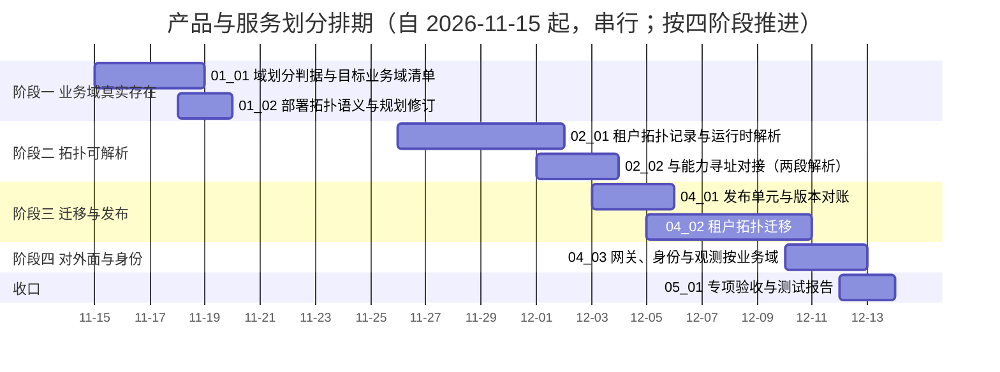

# 产品与服务划分计划

[文档首页](../../../文档首页.md) › 产品与服务划分计划　|　[任务基线 →](../任务/01_域划分与拓扑语义/01_域划分与拓扑语义.md)　[需求基线 →](../需求/00_需求_产品与服务划分.md)

> 进度唯一落点（本文档）：**已完成 3 项，剩余 8 项**（专项于 2026-10-24 立项，排在 07B 之后；门禁见 §5，遗留台账见 §7）

## 1. 计划说明 

- **排期对象**：专项 9 条需求、10 个子任务（业务域 01 业务域划分与拓扑语义 2 / 业务域 02 拓扑机制 2 / 业务域 03 边界与数据 3 / 业务域 04 发布与迁移 2 / 业务域 05 阶段验收 1）。
- **排期口径**：自 2026-11-15 起串行排期（单人兼职，接 07B 收口之后），窗口按实际滚动调整。
- **工时**：已完成 56h；剩余 124h；阶段合计 180h。
- **里程碑锚点**：M7C = 业务域与部署解耦可用（同一套业务域模型在合并与拆分两种拓扑下均可运行，边界纪律在合并部署下仍成立）。
- **负责人**：minjian（兼职，单人）。
- **前置**：07B 跨产品协同（能力两段解析的第一段由 07B 提供，本专项补第二段）。
- **四阶段划分**（2026-10-24 拍板：先让业务域真实存在，再上拓扑）：
  | 阶段 | 目标 | 任务 |
  | --- | --- | --- |
  | 一 让业务域真实存在 | 业务域登记 + 服务内按业务域分包 + 表归属按业务域 + 业务域级护栏 | `01_01`、`01_02`、`03_01`、`03_02` |
  | 二 让拓扑可解析 | 租户拓扑记录与解析 + 能力第二段解析 + 进程内直调 | `02_01`、`02_02` |
  | 三 迁移与发布 | 链按业务域、发布对账、拓扑迁移 | `04_01`、`04_02` |
  | 四 对外面与身份 | 路由按业务域、令牌带业务域、观测与配置按业务域 | `04_03` |
- **说明**：上表阶段为**工作量分组的推进次序**，§3 排期表仍按依赖与窗口串行排定（阶段一的任务分散在窗口前段）。

## 2. 已完成任务 

| 编号 | 任务 | 工时（重估） | 完成日期 | 任务文件 | 偏差与遗留 |
| --- | --- | --- | --- | --- | --- |
| 03_01 | 业务域级边界护栏 | 16h | 2026-10-24 | [03_边界与数据_01_域级边界护栏](../任务/03_边界与数据/03_边界与数据_01_域级边界护栏/03_边界与数据_01_域级边界护栏.md) | ① **已由 `03_03` 闭环**（混域文件拆分、基线 30 → 0）；② 运行期「当前域」装配点与库键单元段归 `03_02` / `02_01`；③ D5 全域日志 / 指标按域打标归 `04_03`；④ **已由 `03_03` 闭环**（按域分包 `legacy` → `placement`）；⑤ 顺带修复三处既有红灯，详见其实施记录 §2.6；⑥ 见其记录 §6 遗留 7（ORM 级跨域读写归 `02_02`） |
| 03_02 | 库与迁移按业务域 | 24h | 2026-10-25 | [03_边界与数据_02_库与迁移按域聚合](../任务/03_边界与数据/03_边界与数据_02_库与迁移按域聚合/03_边界与数据_02_库与迁移按域聚合.md) | ① 真库（MySQL / PostgreSQL / DM8）上的基线写入随 CI 集成档与 `04_02` 复验；② `domain_model_modules` 已由 `03_03` 收紧；③ 表文件「归属库」行仍写服务库名，随 `04_01` 回写 |
| 03_03 | 按域分包与基线递减 | 16h | 2026-10-25 | [03_边界与数据_03_按域分包与基线递减](../任务/03_边界与数据/03_边界与数据_03_按域分包与基线递减/03_边界与数据_03_按域分包与基线递减.md) | ① 产品仓 mdm 前端模块键需改 `mdm_org` 并重发（新 `MODULE_NAME_PATTERN` 拒 kebab）；② 字段控件语义键与业务码 / 动作码形态仍 kebab，待拍板是否另立任务收紧；③ 存量失败 `identity/tests/oidc/test_clients.py`（OAuth scope 取导入期常量）已随本任务修复并补回归用例；④ 域间出口 DTO 化归 `02_02` |
## 3. 剩余任务排期（自 2026-11-15） 

| 编号 | 任务 | 状态 | 工时 | 依赖 | 排期窗口 | 备注 | 偏差与遗留 |
| --- | --- | --- | --- | --- | --- | --- | --- |
| 01_01 | 域划分判据与目标业务域清单 | 未开始 | 16h | — | 2026-11-15 ~ 2026-11-18 | 阶段一：判据 + 目标清单 + 现状差距评估 | 无 |
| 01_02 | 部署拓扑语义与规划修订 | 未开始 | 8h | 01_01 | 2026-11-18 ~ 2026-11-19 | 阶段一：架构节点 39 定稿 + 规划补节 | 无 |
| 02_01 | 租户拓扑记录与运行时解析 | 未开始 | 24h | 01_02、03_02 | 2026-11-26 ~ 2026-12-01 | 阶段二：拓扑记录 + 解析 + 模板 + 校验 | 无 |
| 02_02 | 与能力寻址对接（两段解析） | 未开始 | 12h | 02_01、07B `02_02` | 2026-12-01 ~ 2026-12-03 | 阶段二：业务域 → 部署单元 + 进程内直调 | 无 |
| 04_01 | 发布单元与版本对账 | 未开始 | 16h | 02_01、03_02 | 2026-12-03 ~ 2026-12-05 | 阶段三：业务域版本清单 + 契约兼容 + 整体回滚 | 无 |
| 04_02 | 租户拓扑迁移 | 未开始 | 24h | 02_01、03_02、04_01 | 2026-12-05 ~ 2026-12-10 | 阶段三：先加后切 + 数据搬迁 + 可回滚 | 无 |
| 04_03 | 网关、身份与观测按业务域 | 未开始 | 16h | 02_01、04_01 | 2026-12-10 ~ 2026-12-12 | 阶段四：路由按业务域 + 令牌带业务域 + 观测 | 无 |
| 05_01 | 专项验收与测试报告 | 未开始 | 8h | 01_01 ~ 04_03 | 2026-12-12 ~ 2026-12-13 | 收口 | 无 |

## 4. 排期甘特图 

## 5. 专项验收门禁 

| 验收点 | 对应任务 | 达成路径（结论与证据索引） |
| --- | --- | --- |
| 业务域划分判据与目标业务域清单齐备 | 01_01 / 01_02 | 判据四条 + 反例清单成文；目标业务域清单覆盖现有全部服务与产品，每业务域给出数据所有权与表前缀；清单被能力目录与表归属直接引用 |
| 租户拓扑可记录、可解析、可校验 | 02_01 | 拓扑按租户登记、变更留审计；同业务域双映射被拒；引用未登记业务域 / 部署单元被拒；模板可用 |
| 能力两段解析在两种拓扑下均正确 | 02_02 | 合并与拆分两组夹具下同一能力取址正确；拓扑缺失时启动拒启、运行期明确报错 |
| 合并部署下边界纪律仍成立 | 03_01 / 03_02 | 跨业务域 import、跨业务域直接读表在同进程同库场景下仍被拦截（反例用例）；跨业务域写必须走契约或事件 |
| 两套拓扑迁移可复现且可回滚 | 04_02 | 合并→拆分、拆分→合并各有迁移与回滚步骤；迁移期取址不中断；迁移后数据完整性与表归属校验通过 |
| 对外路径与身份按业务域稳定 | 04_03 | 同一业务域在合并与拆分两种拓扑下对外路径一致；令牌携带业务域并与分配记录对账；指标可按业务域过滤；未启用业务域的路由不生成 |
| 发布对账可给出结论 | 04_01 | 合并部署输出业务域版本清单与契约兼容结论；不兼容拒绝发布并定位到业务域与能力；按部署单元整体回滚 |

**门禁对照**：

| 项 | 来源 | 说明 |
| --- | --- | --- |
| 能力寻址第一段（能力 → 业务域） | 07B `02_02` | 由 07B 交付；本专项补第二段（业务域 → 部署单元） |
| 平台巨型服务与单服务多业务域 | 2026-10-24 讨论 | 本专项给判据与候选拆分池，**不在本期实际拆分**（拆分随阈值触发另立任务） |
| 租户业务重心差异（采购 / 仓储 / 销售） | 2026-10-24 讨论 | 通过租户拓扑表达，不通过代码分支表达 |

## 6. 风险与对策 

| 风险 | 影响 | 对策 |
| --- | --- | --- |
| 业务域清单按现状服务反推 | 把既有粒度固化为“架构”，该拆的没拆、该合的没合 | 判据先行；清单逐业务域按所有权与扩缩需求复核，允许与现状不同并记录差异 |
| 拓扑机制与部署工具各一套 | 两处事实源，改一处不生效 | 拓扑记录为唯一权威，部署编排由记录生成；工具侧不手写拓扑 |
| 合并部署被当成“可以随便跨业务域” | 边界失效，后续无法再拆 | 业务域级护栏先行（03_01）、按业务域断言；合并场景反例用例必须覆盖 |
| 迁移期双写导致数据不一致 | 拆分/合并事故 | 先加后切 + 数据先行 + 能力地址不变 + 可回滚；迁移演练在夹具或演练库完成 |
| 平台服务拆分风险 | 已收口的阶段七代码与表归属被动 | 本期只给阈值与候选池，不实际拆分；拆分另立任务并单独排期 |

## 7. 后续阶段待办 

| # | 事项 | 来源 | 归口 |
| --- | --- | --- | --- |
| 1 | 平台巨型服务（platform）按阈值拆分（权限元数据 / 菜单 / 参数等） | 2026-10-24 讨论；本专项 §5 门禁对照 | 拆分候选池，达阈值后另立任务（不在本期） |
| 2 | 跨租户共享部署单元（多租户共用一套服务与库） | 架构 39 节点 §10 开放项 | 出现强隔离与成本诉求冲突时再论证 |
| 3 | 业务域级版本号对外可见（按业务域单独承诺可用性） | 架构 39 节点 §10 开放项 | 需求出现时细化 |
| 4 | 拓扑模板治理（模板数量收敛为标准档位） | 架构 39 节点 §10 演进项 | 模板超过三套时收敛 |
| 5 | 真实多租户拓扑演练（真库 + 真部署） | 需求 `04-2` | 部署窗口 |
| 6 | 字段控件语义键（`org-select` 等）与业务码 / 动作码形态收紧（登记型标识 snake） | 03_03 登记 | 字段类型体系任务（跨前后端与种子）；出现独立需求时另立 |

> 本文档依《[计划文档规范](../../../规范/计划文档规范.md)》编写 · 进度以本表为唯一落点
