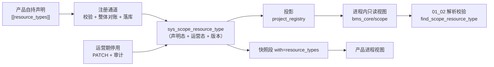

# 作用域模型与注册详细设计

> 产品租户与安全接入 · 01 通用三级作用域 · 01 作用域模型与注册 · 详细设计（开发核心文档）

[文档首页](../../../../../../文档首页.md) › [01 作用域模型与注册](../01_通用三级作用域_01_作用域模型与注册.md) › 设计

## 1. 目标与边界 <a id="scope"></a>

**目标**：把「产品资源归属」固化为 `tenant_id / module_key / resource_key` 三级，并给出唯一的类型注册入口与运行期只读视图——`module_key` 复用模块注册、`resource_key` 类型由产品自持声明登记，未登记即拒绝（fail-closed）。

**范围内**：

1. 三级作用域值对象的语义与构造约束（`tenant_id` 不可变、`module_key` 复用注册键、`resource_key` 由类型约束）；
2. 作用域资源类型注册记录的结构、状态与版本（声明态 + 运营态分离）；
3. 注册校验：`module_key` 已登记且启用、类型标识全局唯一、命名规则可校验、产品归属；
4. 与产品自持声明同源装载（第十类 `[[resource_types]]`）与运行期只读视图；
5. 注册记录的查询（快照段）与运营期停用；停用留审计；
6. 与业务域 / 部署单元的关系固化（示例，不建清单）。

**范围外**：

- `tenant_id` 的解析与来源（HTTP / 数据面 / 异步三路径）→ `01_02`；
- 六类失败语义与错误码登记 → `01_03`（本任务不占 82 段码，装载期只用 `CatalogError`）；
- 租户生命周期事件与产品资源清理、保留期消费 → `01_04`；
- 产品自定义作用域规则（资源级 ACL）→ `02_01` / `02_05`；
- 产品业务资源语义（主题 / 存储桶 / 组织树的含义）→ 各产品文档。

**交付物清单**：

| # | 交付物 | 落点 |
| --- | --- | --- |
| D1 | 值对象 `ResourceScopeKey` 与类型记录 `ScopeResourceTypeRecord`、只读视图与查询函数 | `backend/libs/bms_core/src/bms_core/resource_scope/{__init__,base}.py`（新增） |
| D2 | 注册记录 ORM 模型 `SysScopeResourceType` | `backend/libs/bms_core/src/bms_core/models/platform/declaration.py` |
| D3 | 第十类声明 `[[resource_types]]` 解析与七项注册校验 | `bms_core/registry/products.py`、`bms_core/registry/declarations.py` |
| D4 | 落库与投影（含 `declaration_version` 派生、运营态不被声明覆盖） | `platform_registry/repositories/declaration_repository.py`、`bms_core/registry/projection.py` |
| D5 | 快照下发段 `with=resource_types`（`snapshot_version` 递增） | `bms_core/schemas/module.py`、`platform_registry/api/modules.py` |
| D6 | 运营期停用接口（权限 + 审计 + 视图重建） | `platform_registry/api/scope_resources.py`（新增）、`.../services/scope_resource.py`（新增） |
| D7 | 数据表文件与总览登记、表归属登记、架构 41 待定项回填 | `数据表设计/sys_scope_resource_type.md`（新增）、`01_数据库设计_总览.md`、`bms_core/services/table_registry.py`、架构 41 §11 |
| D8 | 详细设计 / 实施记录 / 测试记录 | 本目录 `设计/`、`实施/`、`测试/` |

## 2. 现状 <a id="current"></a>

| 项 | 现状事实（代码落点） |
| --- | --- |
| 租户身份 | `TenantContext`（`code` / `db_key` / `tenant_id` / `status`）已含雪花主键；`TenantTarget`（id / code / domain 恰一非空）供异步路径定位租户——**均无 `module_key` / `resource_key` 维度** |
| 作用域模型 | 全仓 `resource_key` 零命中：无值对象、无注册记录、无校验，产品各自定义命名空间 |
| `module_key` | `sys_module`（`ModuleStatus` = enabled / disabled / planned / retired）；启动与 CI 校验唯一性；**`status` 是登记态**，运行期租户开关在 `sys_tenant_module` |
| 产品自持声明 | 九类记录（`DECLARATION_KINDS`）+ 产品档案；`content_hash` 未变不写、未声明即 `retired`、运营期只读；注册通道 `PUT /api/v1/platform/internal/declarations` |
| 次先例 | `[[jobs]]` → `sys_job_type` 只读投影，**但自举只读本仓清单**（产品 jobs 进不来），故不作为本任务口径 |
| 快照 | `GET /api/v1/modules/snapshot?with=products,collaborations`（`snapshot_version = "2"`），`with` 集合外的值按 10001 拒绝 |
| 审计 | `AuditCapturer` + `FieldChange` 已可用于运营期变更；注册类写操作目前只记日志，不写审计链 |

## 3. 目标设计 <a id="design"></a>



### 3.1 值对象语义 <a id="value"></a>

`ResourceScopeKey`（`@dataclass(frozen=True)`，`BaseValueObject`）——**只承载值，不查任何登记表**：

| 字段 | 类型 | 约束 | 说明 |
| --- | --- | --- | --- |
| `tenant_id` | `int` | `> 0`，构造后不可改 | 雪花内部身份；**不得用租户编码**参与标识（架构 41 §4.1） |
| `module_key` | `str` | `^[a-z][a-z0-9_]*$`，≤32 | 已登记且启用的模块键（启用判定不在此处，见 §3.5） |
| `resource_key` | `str \| None` | 非空时 `^[a-z][a-z0-9_]*$`，≤255 | 产品定义、必须已注册类型；模块级作用域可为 `None` |

- **不可变**：`frozen`，无 setter；派生新作用域用 `with_resource(resource_key)` 返回**新实例**（父对象不变）；
- **构造期只做形态校验**（非法即 `ParamError`，10001）；「是否已登记 / 是否启用」属运行期判定，归 `01_02`；
- **不承载产品扩展位**：产品自定义扩展由 `01_03` 的作用域上下文承载，值对象保持三级最小集，避免每加一个扩展就要改基座。

### 3.2 注册记录与表结构 <a id="table"></a>

**运营态与声明态分列**，解决「运营期停用被下一次声明重放冲掉」：

| 列 | 语义 | 谁写 |
| --- | --- | --- |
| `status` | **声明态**：`enabled` / `disabled` / `retired` | 声明装载（注册通道） |
| `admin_status` | **运营态**：`enabled` / `disabled` | 仅运营期停用接口 |

有效态 = `status == enabled 且 admin_status == enabled`。`admin_status` **不进内容指纹要素**，声明重放既不会把它改回 `enabled`，也不会因它而变化指纹（否则每次注册都判「内容已变」）。

表 `sys_scope_resource_type`（平台库 `bms_platform`，归属部署单元 `platform`、业务域 `platform_registry`）：

| 字段 | 类型 | 可空 | 约束 / 默认 | 说明 |
| --- | --- | --- | --- | --- |
| `resource_type_key` | VARCHAR(128) | 否 | 与 `deleted_at` 复合唯一（业务键） | 类型标识 `{module_key}.{kind}`，如 `msg.topic`（全局唯一） |
| `name` | VARCHAR(64) | 否 | — | 显示名（人读，如「主题」） |
| `name_pattern` | VARCHAR(128) | 否 | — | `resource_key` 取值正则（装载期校验可编译、长度与嵌套量词受限） |
| `max_length` | INT | 否 | 默认 64 | `resource_key` 最大长度（与正则双重约束） |
| `retention_days` | INT | 否 | 默认 0 | 保留期（天；0 = 永久保留），供 `01_04` 消费 |
| `removal_policy` | VARCHAR(16) | 否 | 默认 `archive` | 到期处置：`archive` 归档 / `purge` 物理删除 |
| `product_key` | VARCHAR(32) | 否 | — | 声明方（跨库逻辑外键 → `sys_product.product_key`） |
| `status` | VARCHAR(16) | 否 | 默认 `enabled` | 声明态（enabled / disabled / retired） |
| `admin_status` | VARCHAR(16) | 否 | 默认 `enabled` | 运营态（enabled / disabled；声明不写） |
| `disabled_at` | DATETIME | 是 | — | 最近运营期停用时间（UTC） |
| `disabled_by` | DECIMAL(38,0) | 是 | — | 停用操作人（平台 `sys_user.id`） |
| `declaration_version` | INT | 否 | 默认 1 | 声明版本（内容变更 +1，注册通道派生，不手写） |
| `content_hash` | CHAR(64) | 否 | — | 声明要素稳定哈希（未变不写） |
| 公共字段 | — | — | 继承 `BaseModel` | 雪花 ID / 审计 / 软删除 / 乐观锁（`version` 为乐观锁，与 `declaration_version` 不是一回事） |

索引：`uq_sys_scope_resource_type_key_deleted_at (resource_type_key, deleted_at)`（业务键唯一，同时承担按类型取行）；不另建 `module_key` 列与索引——`module_key` 由 `resource_type_key` 前缀派生（见 §3.3），避免两处事实源。

### 3.3 声明段与载荷 <a id="format"></a>

```toml
[[resource_types]]
key = "msg.topic"
name = "主题"
name_pattern = "^[a-z][a-z0-9_]{0,63}$"
max_length = 64
retention_days = 30
removal_policy = "purge"
status = "enabled"
```

| 字段 | 必填 | 说明 |
| --- | --- | --- |
| `key` | 是 | 类型标识 `{module_key}.{kind}`；第一段必须等于**本产品**已登记且启用的 `module_key` |
| `name` | 是 | 显示名，非空、≤64 |
| `name_pattern` | 否 | 缺省 `^[a-z][a-z0-9_]{0,63}$`（登记型标识 snake_case） |
| `max_length` | 否 | 缺省 64，取值 1~255 |
| `retention_days` | 否 | 缺省 0（永久） |
| `removal_policy` | 否 | 缺省 `archive` |
| `status` | 否 | 缺省 `enabled`；只接受 `enabled` / `disabled`（退役由「未声明」表达） |

**派生字段（不手写）**：`product_key` = 清单 `product_key`；`module_key` / `kind` = `key.split(".", 1)`（属性派生，不落列）；`declaration_version` 由落库路径按内容变更 +1；`content_hash` 由要素序列化派生。

**命名与《命名规范》的关系**：注册制标识按「命名空间 + 对象」点分小写；`module_key` 即命名空间（`msg` / `mdm`），故类型标识为**两段**而不是三段——`module_key` 之后不再插一层域，避免与业务域混淆（§3.8）。

### 3.4 注册校验（装载期，fail-closed） <a id="validate"></a>

校验入口唯一：`inspect_product_manifests()`（装配期与离线门禁 `ops.check_modules` 复用同一函数），不新增并行校验入口。

| # | 校验 | 判定 | 失败处置 |
| --- | --- | --- | --- |
| V1 | 类型标识形态 | `^[a-z][a-z0-9_]*\.[a-z][a-z0-9_]*$`，总长 ≤128 | `CatalogError` 拒注册 |
| V2 | 所属模块键归属 | 第一段 ∈ 本清单服务行的 `module_key` **或** 本产品已在注册表登记的模块键（不得挂别的产品的模块键） | 拒注册，信息含两侧归属 |
| V3 | `module_key` 已登记且启用 | 注册表 `services` 类中该键存在且 `status == enabled`（**登记态**；租户开关不在此判定） | 拒注册 |
| V4 | 类型全局唯一 | 业务键跨产品唯一（`plan_declarations` 的 owner 校验）；同一清单内重复同样拒 | 拒注册（409 级） |
| V5 | 命名规则可校验 | `name_pattern` 可 `re.compile`、长度 ≤128、量词数 ≤16 且不含嵌套量词形态（`)+` / `)*` / `){` 紧跟内层量词） | 拒注册（防 ReDoS，启发式而非完备分析） |
| V6 | 命名规则与长度自洽 | 空串与长度 `max_length + 1` 的样本必须**不**被 `fullmatch` 命中（防止 pattern 过宽形同虚设） | 拒注册 |
| V7 | 字段形态 | `name` 非空 ≤64；`max_length` 1~255；`retention_days` ≥0；`removal_policy` ∈ {archive, purge}；`status` ∈ {enabled, disabled} | 拒注册 |

**服务行缺失的处理**：声明了 `[[resource_types]]` 却没有任何服务行（无 `module_key`）⇒ V2 直接拒，信息提示「须先声明服务行」——与九类「有 `errcodes` 必须有 `errcode_segment`」同口径。

### 3.5 视图与查询 <a id="view"></a>

`bms_core/resource_scope/base.py` 导出（**只读**，调用方不得写回）：

| 函数 / 常量 | 语义 |
| --- | --- |
| `SCOPE_RESOURCE_STATUSES` / `SCOPE_RESOURCE_ADMIN_STATUSES` / `REMOVAL_POLICIES` | 取值清单（`ConcurrentStableList`） |
| `DEFAULT_RESOURCE_KEY_PATTERN` / `MAX_RESOURCE_KEY_LENGTH` | 缺省命名规则与长度 |
| `register_scope_resource_types(records)` | 装载注册：同键同值合并、同键异值即拒（`CatalogError`） |
| `reset_scope_resource_types()` | 视图复位（投影整表重建与用例隔离用） |
| `scope_resource_type_view()` | `{resource_type_key: record}` 只读副本（每次返回新字典） |
| `find_scope_resource_type(module_key, kind)` | 按模块键 + 类型短名取记录；未登记返回 `None` |
| `scope_resource_types_of(module_key)` | 某模块下全部类型（插入序，供平台运营视图） |

**投影口径（与其余九类的差异，须显式记住）**：投影**只排除 `retired`**，保留 `disabled`——`01_02` 要区分「未注册」与「已停用」（`01_03` 两类错误码不同）；其余九类投影只收 `enabled`。判定入口是记录上的 `is_active()`（= 声明态 enabled 且运营态 enabled），不靠视图过滤。

**请求期只用视图**：`01_02` 的校验只调 `find_scope_resource_type()`，**不回源 DB、不自建 TTL 缓存**；未命中即 fail-closed（拒绝语义与码由 `01_02` / `01_03` 接线，本任务只提供查询与 `is_active()`）。

### 3.6 快照下发 <a id="snapshot"></a>

复用既有带参快照，**不新开端点**：

- `GET /api/v1/modules/snapshot?with=resource_types` → `CatalogSnapshotResponse` 增 `resource_types` 段；
- `SNAPSHOT_SEGMENTS` 增 `resource_types`；`CATALOG_SNAPSHOT_VERSION` `"2"` → `"3"`（形态变更递增，消费方据此识别）；
- 段要素：`resource_type_key` / `name` / `name_pattern` / `max_length` / `retention_days` / `removal_policy` / `product_key` / `status`（**声明态**）/ `admin_status`（**运营态**）/ `declaration_version`——两态分开下发，有效态由消费方用记录上的 `is_active()` 派生（与表口径一致，不在快照里另造第三种状态值）；
- 内部声明快照（`GET /api/v1/platform/internal/declarations/snapshot`）随 `DECLARATION_KINDS` 自动带出第十类，`record_from_wire()` 增 `resource_types` 分支并**回填 `admin_status`**，使产品进程视图与平台一致。

### 3.7 运营期停用 <a id="disable"></a>

| 项 | 设计 |
| --- | --- |
| 端点 | `PATCH /api/v1/scope-resource-types/{resource_type_key}`，body `{"admin_status": "enabled" \| "disabled"}`（幂等：同值直接返回当前记录） |
| 权限 | `require_permission("scope-resource:manage")`（查询端点走 `require_auth_or_service`，与 `/modules` 同口径） |
| 写入 | 只改 `admin_status` / `disabled_at` / `disabled_by` + 乐观锁 `version`；**不碰** `status`（声明态） |
| 审计 | `AuditCapturer.capture(table="sys_scope_resource_type", model_id=row.id, changes=[FieldChange(field="admin_status", old, new)], actor=当前用户)` |
| 生效 | 写库后重建进程内视图（`reset` + 按库重载注册），使同进程立刻按新有效态判定；跨进程靠下次注册 / 启动快照收敛（**不引入状态缓存与推送通道**，与其他注册数据一致） |
| 与声明的关系 | 声明重放只写声明要素，`admin_status` 原值保留；产品要恢复须显式 `enabled` 或再次停用，不靠重发声明「碰运气」 |

### 3.8 与业务域 / 部署单元的关系 <a id="domain"></a>

| 概念 | 归属 | 与三级作用域的关系 |
| --- | --- | --- |
| `module_key` | 模块注册（`sys_module`） | 作用域第二级；**不等于业务域** |
| 业务域 | 域布局声明（`sys_domain`，07C） | 一个业务域可由一个或多个 `module_key` 对外提供能力 |
| 部署单元 | 租户拓扑 / 单元登记（07C） | `resource_key` 归属 `module_key`，**不归属部署单元**；拆库 / 合库 / 换单元不改三级标识 |

示例（写进本节，作为「不混用」的固化，不另建清单）：

| 产品 | 业务叫法 | 三级映射 |
| --- | --- | --- |
| msg 消息平台 | `namespace` / `topic` | `namespace → module_key`（`msg`）、`topic → resource_key`（类型 `msg.topic`） |
| mdm 主数据 | 组织树 / 主数据对象 | `module_key = mdm`；组织节点类型登记为 `mdm.org_node` |
| file 文件平台 | 存储桶 | `module_key = file`；`bucket → resource_key`（类型 `file.bucket`） |

## 4. 影响面 <a id="impact"></a>

| 类别 | 对象 | 变更 |
| --- | --- | --- |
| 新增 | `bms_core/scope/__init__.py`、`bms_core/scope/base.py` | 值对象、记录、状态常量、视图与查询函数 |
| 修改 | `bms_core/models/platform/declaration.py` | 增 `SysScopeResourceType`（与九类同文件同族） |
| 修改 | `bms_core/services/table_registry.py` | 表归属登记（`platform` / `platform_registry` / `Datasource.PLATFORM`） |
| 修改 | `bms_core/registry/products.py` | `ProductManifest.resource_types`、`[[resource_types]]` 解析、V1~V7 校验、文档串（九类 → 十类） |
| 修改 | `bms_core/registry/declarations.py` | `DECLARATION_KINDS` / `_KIND_KEYS` / 载荷字段 / `from_manifest` / `record_from_wire` / `declaration_wire` / `_ELEMENT_FIELDS` |
| 修改 | `bms_core/registry/projection.py` | 投影增第十类（排除 `retired`，保留 `disabled`） |
| 修改 | `bms_core/schemas/module.py` | `ScopeResourceTypeSnapshotItem` + `CatalogSnapshotResponse.resource_types` |
| 修改 | `platform_registry/api/modules.py` | `SNAPSHOT_SEGMENTS` 增段、版本 `"3"`、段取数 |
| 新增 | `platform_registry/api/scope_resources.py`、`.../services/scope_resource.py` | 运营期停用 + 视图重建 |
| 修改 | `platform_registry/repositories/declaration_repository.py` | 第十类模型映射、`declaration_version` 派生、`admin_status` 不参与覆盖 |
| 新增 | `数据表设计/sys_scope_resource_type.md`、总览两处登记 | 表结构事实源 |
| 修改 | `设计/架构设计/41_...产品租户与安全接入.md` §11 待定项 1 | 回填「字段级结构见 07D 01_01 详设与表文件」 |
| 新增 | `libs/bms_core/tests/scope/test_scope_resource_registration.py` 等 | 用例 |

**连带行为变更**（须在实施记录登记）：① 平台与产品进程启动即装载第十类，声明非法会**拒启**（此前无此校验）；② 快照 `snapshot_version` 由 `"2"` 升 `"3"`，消费方若做严格相等判定需同步（仓内消费方按「有该字段即带参形态」判定，不受影响）；③ 注册通道载荷多一段，旧产品清单不声明该段即为空（向后兼容，不强制）。

## 5. 测试设计 <a id="test"></a>

用例编号在 Kiwi 登记后回填（本任务**一条**用例，代码以 `@pytest.mark.kiwi_id(<编号>)` 标注；多条断言共用同一编号）。

| # | 用例 | 断言 | 验收映射 |
| --- | --- | --- | --- |
| 1 | 合法声明装载 | 视图含该类型；`module_key` / `kind` 由 `key` 派生正确；`declaration_version = 1` | 完成标准① |
| 2 | 类型标识形态非法 | 拒注册（V1），信息含 `key` | 完成标准② |
| 3 | 挂别的产品模块键 | 拒注册（V2），信息含两侧归属 | 完成标准② |
| 4 | `module_key` 未登记 / 未启用 | 拒注册（V3），信息含模块键与状态 | 完成标准② |
| 5 | 跨产品同键 | 拒注册（V4，409 级） | 完成标准② |
| 6 | 同清单重复声明 | 拒注册（V4） | §3.4 |
| 7 | 正则可编译但与长度不自洽 | 拒注册（V6） | §3.4 |
| 8 | 嵌套量词正则 | 拒注册（V5） | §3.4 |
| 9 | 字段形态非法（`removal_policy` / `max_length` / `status`） | 逐项拒注册（V7） | §3.4 |
| 10 | 未登记类型查询 | `find_scope_resource_type` 返回 `None`（fail-closed 前提） | 完成标准② |
| 11 | 内容未变重注册 | `declaration_version` 不变、不写库（`unchanged`） | 完成标准③ |
| 12 | 内容变更重注册 | `declaration_version` +1，`status` 随声明更新 | 完成标准③ |
| 13 | 运营期停用 | `admin_status = disabled`，`is_active()` 为假，有效态下发为 `disabled`；**再注册内容未变时停用仍保留** | 完成标准④ |
| 14 | 运营期停用审计 | `AuditCapturer.capture` 被调用一次，含 `admin_status` 变更与操作人 | 完成标准④ |
| 15 | 快照带参形态 | `with=resource_types` 返回该段；未请求时为空数组；`snapshot_version = "3"`；集合外段名 10001 | 完成标准③ |
| 16 | 未声明即退役 | 再次注册不带该类型 → `status = retired`，投影不含该类型 | §3.5 |
| 17 | 值对象不可变 | `frozen` 赋值抛错；`with_resource()` 返回新实例、父实例不变；`tenant_id <= 0` 抛 `ParamError` | 完成标准① |
| 18 | 装配冒烟 | 平台与产品进程启动装载第十类不报错（`pytest services/*/tests -k "plugin_assembly or storage or shape"`） | §4 连带变更 |

**自动化落点**（同一 Kiwi 编号 `2445`，多条断言共用）：

| 文件 | 覆盖 |
| --- | --- |
| `backend/libs/bms_core/tests/resource_scope/test_scope_resource_type.py` | 用例 1~12、16~17（纯逻辑：值对象 / 清单解析与装载校验 / 注册期校验 / 视图 / 投影 / 快照要素） |
| `backend/services/platform/tests/registry/test_scope_resource_registration.py` | 用例 1、11、12、13、14、16 的落库面（声明版本派生、运营态不被重放冲掉、幂等 + 审计一次、退役不删行） |
| `backend/services/platform/tests/api/test_scope_resource_types.py` | 用例 13~15 的端点面（查询 / 停用恢复 / 失败码 / 快照段与 `snapshot_version`） |

## 6. 风险与边界 <a id="risk"></a>

| 风险 | 处置 |
| --- | --- |
| 声明重放冲掉运营期停用 | 运营态与声明态分列，`admin_status` 不进指纹要素；用例 13 专测 |
| 停用只在平台进程生效，产品进程滞后 | 与既有注册数据同口径（下次注册 / 启动收敛），**不引推送通道**；滞后窗口在文档写明，`01_02` 以租户可用性等强语义字段兜安全底线 |
| 正则 ReDoS | 装载期限长度、限量词、拒嵌套形态；请求期只 `fullmatch` 已登记 pattern（产品提供的正则，风险面收窄到装载期一次校验） |
| `declaration_version` 与乐观锁 `version` 混淆 | 列名与文档双重区分；`version` 只由仓储乐观锁维护 |
| 类型标识两段与《命名规范》三段惯例不一致 | 口径写进 §3.3：`module_key` 即命名空间，第二段是对象，不插域段 |
| 新增第十类导致注册通道载荷变化 | 旧清单不声明即为空（向后兼容）；`snapshot_version` 递增告知消费方 |
| 表未落库时平台启动 | 与既有注册表同口径：`ops.init_schema` / 启动期自动建表；库不可用时注册降级放行（取用路径仍 fail-closed） |

## 7. 开放项 <a id="open"></a>

| # | 事项 | 归口 |
| --- | --- | --- |
| 1 | 类型标识与 `resource_key` 的「形态护栏」（代码里硬编码字符串 vs 登记值对账） | `04_01` 护栏规则设计 |
| 2 | 运营期停用的跨进程即时生效（推送 / 版本戳） | 出现「停用必须秒级全局生效」的诉求时论证，不默认支持 |
| 3 | 类型级配额维度（每类型条数 / 容量） | `02_03` 配额只读回显 |
| 4 | `name_pattern` 完备 ReDoS 分析（当前启发式） | 平台安全审计阶段 |
| 5 | 第四级作用域（业务域 / 部署单元） | 架构 41 §10，出现普遍诉求时论证 |

## 8. 对齐记录 <a id="alignment"></a>

开工前逐项确认 12 项决策（值对象落点 / 表落点 / 登记通道 / 数据库体系 / 校验时点 / 失败语义 / 类型标识 / 命名规则 / 版本 / 保留期 / 接口范围 / 审计），据此定稿：

| # | 原设想 / 备选 | 定稿 | 理由 |
| --- | --- | --- | --- |
| 1 | 值对象放 tenant 服务或 platform 服务 | `bms_core/resource_scope/` 进程内契约 | 产品与平台共用、零 RPC；不因「调用不方便」在本地复制。**实施期改名**：`bms_core/scope/` 已被数据范围（RBAC）占用，按架构 41 §4.2-1「作用域与数据权限正交」另立目录 |
| 2 | 表放 tenant 库 / 不落库 | 平台库 `sys_scope_resource_type` | 注册是产品级全局数据，与九类同库同链；不把注册权威塞进租户服务 |
| 3 | 仿 `[[jobs]]` 独立投影 / 独立管理面接口 | 第十类声明走既有注册通道 | `[[jobs]]` 自举只读本仓清单，产品进不来；独立接口会造第二套注册源 |
| 4 | 不进数据库设计体系 | 进体系（表文件 → 总览 → 模型 → 建表） | 表结构唯一事实源 + 一致性校验；避免「未定稿表」 |
| 5 | 只装载期 / 只请求期 | 装载期强校验 + 请求期只读视图 | 请求期回源既违反「注册在先」也拖垮可用性 |
| 6 | 业务错误码 / 告警放行 | `CatalogError` 拒注册 | 注册是服务身份、无终端语义；不占 01_03 六类码 |
| 7 | 类型短名 / 三元组唯一 | `{module_key}.{kind}` 全局唯一 | 与命名规范一致、跨产品天然不冲突 |
| 8 | 预设模板枚举 / 自由文本 | 正则 + `max_length` | 表达力与机器校验兼得 |
| 9 | semver / 只用 `content_hash` | `declaration_version` 整数自增 | 需求要「版本」，且要能与指纹同源派生、不手写 |
| 10 | 仅保留天数 / 留 01_4 | `retention_days` + `removal_policy` | 01_4 直接消费，不回改表 |
| 11 | 只查询 / 停用走声明 | 查询 + 运营期停用（覆盖列） | 完成标准要求「可停用」，且运营期不能靠发版 |
| 12 | 只记日志 / 不做审计 | 运营期停用写审计链，声明变更记指纹差异 + 日志 | 需求要「注册变更留审计」，服务身份无用户语义不硬套审计链 |

| 13 | §3.6 快照段 `status` 原写「有效态」 | 改为**声明态 + 运营态分列下发**，有效态由 `is_active()` 派生 | 快照与表 / 记录三处口径一致；避免同一字段在快照与库中语义不同 |
| 14 | 运营面响应原计划带 `disabled_at` / `disabled_by` / `id` | 只下发业务字段 + `effective_status` 派生值 | 「谁在何时停用」的唯一出处是审计链（按记录主键可查），避免两处留痕 |

> 本文档依《[文档生成规范](../../../../../../规范/文档生成规范.md)》与《[任务文档规范](../../../../../../规范/任务文档规范.md)》编写
