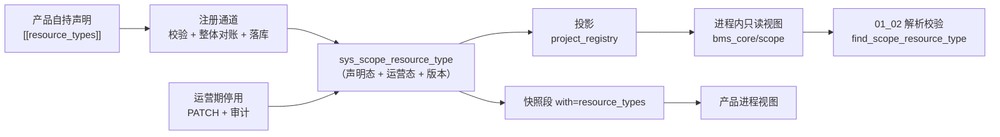
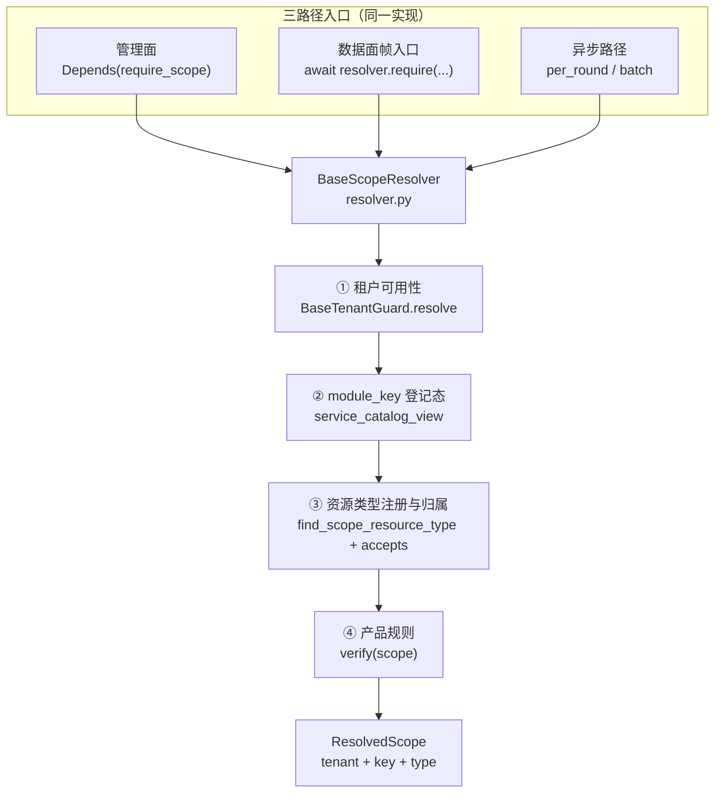
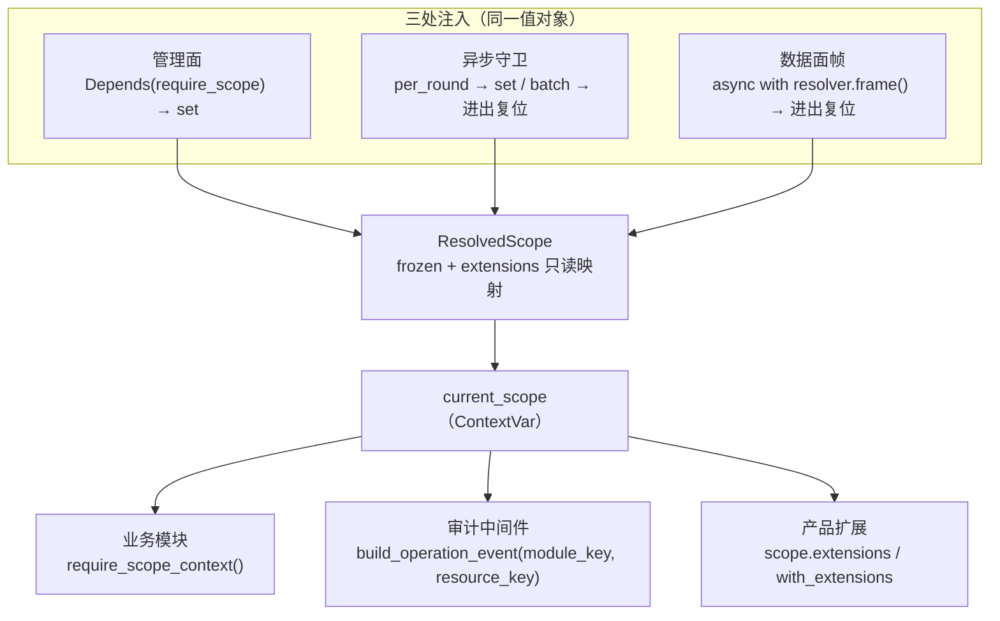

# 01 详细设计 · 通用三级作用域

> 07D 任务 01 · 需求 01-1 ~ 01-4 · 详细设计（开发核心文档）

[文档首页](../../../../../文档首页.md) › [01 通用三级作用域](../01_通用三级作用域.md) › 设计

## 0. 分章导航 <a id="toc"></a>

本文档是**任务 01 的唯一详细设计**，按需求条目分章——一个任务一份设计，不按条目拆多份；未开工章节只标范围与约束，开工前补写并定稿。

| 需求 | 章节 | 内容 | 状态 |
| --- | --- | --- | --- |
| 01-1 作用域模型与注册 | §1 | 三级值对象、类型注册记录、装载校验、快照与运营期停用 | 已定稿 |
| 01-2 作用域解析与校验 | §2 | 三路径同源解析、四步固定校验、六类失败码、产品规则钩子 | 已定稿 |
| 01-3 作用域上下文与错误码 | §3 | 不可变上下文、三处注入、i18n 文案键、审计字段 | 已定稿 |
| 01-4 租户生命周期与资源清理 | §4 | 事件消费契约、状态动作矩阵、失败与死信 | 待定稿 |

**任务级边界**：本文档只覆盖 `tenant_id / module_key / resource_key` 三级作用域的注册、解析、校验、上下文与清理；产品业务资源语义（主题 / 存储桶 / 组织树含义）归各产品文档，作用域与数据范围（RBAC）正交（见 §1.1）。

## 1. 需求 01-1 作用域模型与注册

### 1.1 目标与边界 <a id="scope"></a>

**目标**：把「产品资源归属」固化为 `tenant_id / module_key / resource_key` 三级，并给出唯一的类型注册入口与运行期只读视图——`module_key` 复用模块注册、`resource_key` 类型由产品自持声明登记，未登记即拒绝（fail-closed）。

**范围内**：

1. 三级作用域值对象的语义与构造约束（`tenant_id` 不可变、`module_key` 复用注册键、`resource_key` 由类型约束）；
2. 作用域资源类型注册记录的结构、状态与版本（声明态 + 运营态分离）；
3. 注册校验：`module_key` 已登记且启用、类型标识全局唯一、命名规则可校验、产品归属；
4. 与产品自持声明同源装载（第十类 `[[resource_types]]`）与运行期只读视图；
5. 注册记录的查询（快照段）与运营期停用；停用留审计；
6. 与业务域 / 部署单元的关系固化（示例，不建清单）。

**范围外**：

- `tenant_id` 的解析与来源（HTTP / 数据面 / 异步三路径）→ `01_02`；
- 六类失败语义与错误码登记 → `01_03`（本任务不占 82 段码，装载期只用 `CatalogError`）；
- 租户生命周期事件与产品资源清理、保留期消费 → `01_04`；
- 产品自定义作用域规则（资源级 ACL）→ `02_01` / `02_05`；
- 产品业务资源语义（主题 / 存储桶 / 组织树的含义）→ 各产品文档。

**交付物清单**：

| # | 交付物 | 落点 |
| --- | --- | --- |
| D1 | 值对象 `ResourceScopeKey` 与类型记录 `ScopeResourceTypeRecord`、只读视图与查询函数 | `backend/libs/bms_core/src/bms_core/resource_scope/{__init__,base}.py`（新增） |
| D2 | 注册记录 ORM 模型 `SysScopeResourceType` | `backend/libs/bms_core/src/bms_core/models/platform/declaration.py` |
| D3 | 第十类声明 `[[resource_types]]` 解析与七项注册校验 | `bms_core/registry/products.py`、`bms_core/registry/declarations.py` |
| D4 | 落库与投影（含 `declaration_version` 派生、运营态不被声明覆盖） | `platform_registry/repositories/declaration_repository.py`、`bms_core/registry/projection.py` |
| D5 | 快照下发段 `with=resource_types`（`snapshot_version` 递增） | `bms_core/schemas/module.py`、`platform_registry/api/modules.py` |
| D6 | 运营期停用接口（权限 + 审计 + 视图重建） | `platform_registry/api/scope_resources.py`（新增）、`.../services/scope_resource.py`（新增） |
| D7 | 数据表文件与总览登记、表归属登记、架构 41 待定项回填 | `数据表设计/sys_scope_resource_type.md`（新增）、`01_数据库设计_总览.md`、`bms_core/services/table_registry.py`、架构 41 §1.11 |
| D8 | 详细设计 / 实施记录 / 测试记录 | 本目录 `设计/`、`实施/`、`测试/` |

### 1.2 现状 <a id="current"></a>

| 项 | 现状事实（代码落点） |
| --- | --- |
| 租户身份 | `TenantContext`（`code` / `db_key` / `tenant_id` / `status`）已含雪花主键；`TenantTarget`（id / code / domain 恰一非空）供异步路径定位租户——**均无 `module_key` / `resource_key` 维度** |
| 作用域模型 | 全仓 `resource_key` 零命中：无值对象、无注册记录、无校验，产品各自定义命名空间 |
| `module_key` | `sys_module`（`ModuleStatus` = enabled / disabled / planned / retired）；启动与 CI 校验唯一性；**`status` 是登记态**，运行期租户开关在 `sys_tenant_module` |
| 产品自持声明 | 九类记录（`DECLARATION_KINDS`）+ 产品档案；`content_hash` 未变不写、未声明即 `retired`、运营期只读；注册通道 `PUT /api/v1/platform/internal/declarations` |
| 次先例 | `[[jobs]]` → `sys_job_type` 只读投影，**但自举只读本仓清单**（产品 jobs 进不来），故不作为本任务口径 |
| 快照 | `GET /api/v1/modules/snapshot?with=products,collaborations`（`snapshot_version = "2"`），`with` 集合外的值按 10001 拒绝 |
| 审计 | `AuditCapturer` + `FieldChange` 已可用于运营期变更；注册类写操作目前只记日志，不写审计链 |

### 1.3 目标设计 <a id="design"></a>



#### 1.3.1 值对象语义 <a id="value"></a>

`ResourceScopeKey`（`@dataclass(frozen=True)`，`BaseValueObject`）——**只承载值，不查任何登记表**：

| 字段 | 类型 | 约束 | 说明 |
| --- | --- | --- | --- |
| `tenant_id` | `int` | `> 0`，构造后不可改 | 雪花内部身份；**不得用租户编码**参与标识（架构 41 §1.4.1） |
| `module_key` | `str` | `^[a-z][a-z0-9_]*$`，≤32 | 已登记且启用的模块键（启用判定不在此处，见 §1.3.5） |
| `resource_key` | `str \| None` | 非空时 `^[a-z][a-z0-9_]*$`，≤255 | 产品定义、必须已注册类型；模块级作用域可为 `None` |

- **不可变**：`frozen`，无 setter；派生新作用域用 `with_resource(resource_key)` 返回**新实例**（父对象不变）；
- **构造期只做形态校验**（非法即 `ParamError`，10001）；「是否已登记 / 是否启用」属运行期判定，归 `01_02`；
- **不承载产品扩展位**：产品自定义扩展由 `01_03` 的作用域上下文承载，值对象保持三级最小集，避免每加一个扩展就要改基座。

#### 1.3.2 注册记录与表结构 <a id="table"></a>

**运营态与声明态分列**，解决「运营期停用被下一次声明重放冲掉」：

| 列 | 语义 | 谁写 |
| --- | --- | --- |
| `status` | **声明态**：`enabled` / `disabled` / `retired` | 声明装载（注册通道） |
| `admin_status` | **运营态**：`enabled` / `disabled` | 仅运营期停用接口 |

有效态 = `status == enabled 且 admin_status == enabled`。`admin_status` **不进内容指纹要素**，声明重放既不会把它改回 `enabled`，也不会因它而变化指纹（否则每次注册都判「内容已变」）。

表 `sys_scope_resource_type`（平台库 `bms_platform`，归属部署单元 `platform`、业务域 `platform_registry`）：

| 字段 | 类型 | 可空 | 约束 / 默认 | 说明 |
| --- | --- | --- | --- | --- |
| `resource_type_key` | VARCHAR(128) | 否 | 与 `deleted_at` 复合唯一（业务键） | 类型标识 `{module_key}.{kind}`，如 `msg.topic`（全局唯一） |
| `name` | VARCHAR(64) | 否 | — | 显示名（人读，如「主题」） |
| `name_pattern` | VARCHAR(128) | 否 | — | `resource_key` 取值正则（装载期校验可编译、长度与嵌套量词受限） |
| `max_length` | INT | 否 | 默认 64 | `resource_key` 最大长度（与正则双重约束） |
| `retention_days` | INT | 否 | 默认 0 | 保留期（天；0 = 永久保留），供 `01_04` 消费 |
| `removal_policy` | VARCHAR(16) | 否 | 默认 `archive` | 到期处置：`archive` 归档 / `purge` 物理删除 |
| `product_key` | VARCHAR(32) | 否 | — | 声明方（跨库逻辑外键 → `sys_product.product_key`） |
| `status` | VARCHAR(16) | 否 | 默认 `enabled` | 声明态（enabled / disabled / retired） |
| `admin_status` | VARCHAR(16) | 否 | 默认 `enabled` | 运营态（enabled / disabled；声明不写） |
| `disabled_at` | DATETIME | 是 | — | 最近运营期停用时间（UTC） |
| `disabled_by` | DECIMAL(38,0) | 是 | — | 停用操作人（平台 `sys_user.id`） |
| `declaration_version` | INT | 否 | 默认 1 | 声明版本（内容变更 +1，注册通道派生，不手写） |
| `content_hash` | CHAR(64) | 否 | — | 声明要素稳定哈希（未变不写） |
| 公共字段 | — | — | 继承 `BaseModel` | 雪花 ID / 审计 / 软删除 / 乐观锁（`version` 为乐观锁，与 `declaration_version` 不是一回事） |

索引：`uq_sys_scope_resource_type_key_deleted_at (resource_type_key, deleted_at)`（业务键唯一，同时承担按类型取行）；不另建 `module_key` 列与索引——`module_key` 由 `resource_type_key` 前缀派生（见 §1.3.3），避免两处事实源。

#### 1.3.3 声明段与载荷 <a id="format"></a>

```toml
[[resource_types]]
key = "msg.topic"
name = "主题"
name_pattern = "^[a-z][a-z0-9_]{0,63}$"
max_length = 64
retention_days = 30
removal_policy = "purge"
status = "enabled"
```

| 字段 | 必填 | 说明 |
| --- | --- | --- |
| `key` | 是 | 类型标识 `{module_key}.{kind}`；第一段必须等于**本产品**已登记且启用的 `module_key` |
| `name` | 是 | 显示名，非空、≤64 |
| `name_pattern` | 否 | 缺省 `^[a-z][a-z0-9_]{0,63}$`（登记型标识 snake_case） |
| `max_length` | 否 | 缺省 64，取值 1~255 |
| `retention_days` | 否 | 缺省 0（永久） |
| `removal_policy` | 否 | 缺省 `archive` |
| `status` | 否 | 缺省 `enabled`；只接受 `enabled` / `disabled`（退役由「未声明」表达） |

**派生字段（不手写）**：`product_key` = 清单 `product_key`；`module_key` / `kind` = `key.split(".", 1)`（属性派生，不落列）；`declaration_version` 由落库路径按内容变更 +1；`content_hash` 由要素序列化派生。

**命名与《命名规范》的关系**：注册制标识按「命名空间 + 对象」点分小写；`module_key` 即命名空间（`msg` / `mdm`），故类型标识为**两段**而不是三段——`module_key` 之后不再插一层域，避免与业务域混淆（§1.3.8）。

#### 1.3.4 注册校验（装载期，fail-closed） <a id="validate"></a>

校验入口唯一：`inspect_product_manifests()`（装配期与离线门禁 `ops.check_modules` 复用同一函数），不新增并行校验入口。

| # | 校验 | 判定 | 失败处置 |
| --- | --- | --- | --- |
| V1 | 类型标识形态 | `^[a-z][a-z0-9_]*\.[a-z][a-z0-9_]*$`，总长 ≤128 | `CatalogError` 拒注册 |
| V2 | 所属模块键归属 | 第一段 ∈ 本清单服务行的 `module_key` **或** 本产品已在注册表登记的模块键（不得挂别的产品的模块键） | 拒注册，信息含两侧归属 |
| V3 | `module_key` 已登记且启用 | 注册表 `services` 类中该键存在且 `status == enabled`（**登记态**；租户开关不在此判定） | 拒注册 |
| V4 | 类型全局唯一 | 业务键跨产品唯一（`plan_declarations` 的 owner 校验）；同一清单内重复同样拒 | 拒注册（409 级） |
| V5 | 命名规则可校验 | `name_pattern` 可 `re.compile`、长度 ≤128、量词数 ≤16 且不含嵌套量词形态（`)+` / `)*` / `){` 紧跟内层量词） | 拒注册（防 ReDoS，启发式而非完备分析） |
| V6 | 命名规则与长度自洽 | 空串与长度 `max_length + 1` 的样本必须**不**被 `fullmatch` 命中（防止 pattern 过宽形同虚设） | 拒注册 |
| V7 | 字段形态 | `name` 非空 ≤64；`max_length` 1~255；`retention_days` ≥0；`removal_policy` ∈ {archive, purge}；`status` ∈ {enabled, disabled} | 拒注册 |

**服务行缺失的处理**：声明了 `[[resource_types]]` 却没有任何服务行（无 `module_key`）⇒ V2 直接拒，信息提示「须先声明服务行」——与九类「有 `errcodes` 必须有 `errcode_segment`」同口径。

#### 1.3.5 视图与查询 <a id="view"></a>

`bms_core/resource_scope/base.py` 导出（**只读**，调用方不得写回）：

| 函数 / 常量 | 语义 |
| --- | --- |
| `SCOPE_RESOURCE_STATUSES` / `SCOPE_RESOURCE_ADMIN_STATUSES` / `REMOVAL_POLICIES` | 取值清单（`ConcurrentStableList`） |
| `DEFAULT_RESOURCE_KEY_PATTERN` / `MAX_RESOURCE_KEY_LENGTH` | 缺省命名规则与长度 |
| `register_scope_resource_types(records)` | 装载注册：同键同值合并、同键异值即拒（`CatalogError`） |
| `reset_scope_resource_types()` | 视图复位（投影整表重建与用例隔离用） |
| `scope_resource_type_view()` | `{resource_type_key: record}` 只读副本（每次返回新字典） |
| `find_scope_resource_type(module_key, kind)` | 按模块键 + 类型短名取记录；未登记返回 `None` |
| `scope_resource_types_of(module_key)` | 某模块下全部类型（插入序，供平台运营视图） |

**投影口径（与其余九类的差异，须显式记住）**：投影**只排除 `retired`**，保留 `disabled`——`01_02` 要区分「未注册」与「已停用」（`01_03` 两类错误码不同）；其余九类投影只收 `enabled`。判定入口是记录上的 `is_active()`（= 声明态 enabled 且运营态 enabled），不靠视图过滤。

**请求期只用视图**：`01_02` 的校验只调 `find_scope_resource_type()`，**不回源 DB、不自建 TTL 缓存**；未命中即 fail-closed（拒绝语义与码由 `01_02` / `01_03` 接线，本任务只提供查询与 `is_active()`）。

#### 1.3.6 快照下发 <a id="snapshot"></a>

复用既有带参快照，**不新开端点**：

- `GET /api/v1/modules/snapshot?with=resource_types` → `CatalogSnapshotResponse` 增 `resource_types` 段；
- `SNAPSHOT_SEGMENTS` 增 `resource_types`；`CATALOG_SNAPSHOT_VERSION` `"2"` → `"3"`（形态变更递增，消费方据此识别）；
- 段要素：`resource_type_key` / `name` / `name_pattern` / `max_length` / `retention_days` / `removal_policy` / `product_key` / `status`（**声明态**）/ `admin_status`（**运营态**）/ `declaration_version`——两态分开下发，有效态由消费方用记录上的 `is_active()` 派生（与表口径一致，不在快照里另造第三种状态值）；
- 内部声明快照（`GET /api/v1/platform/internal/declarations/snapshot`）随 `DECLARATION_KINDS` 自动带出第十类，`record_from_wire()` 增 `resource_types` 分支并**回填 `admin_status`**，使产品进程视图与平台一致。

#### 1.3.7 运营期停用 <a id="disable"></a>

| 项 | 设计 |
| --- | --- |
| 端点 | `PATCH /api/v1/scope-resource-types/{resource_type_key}`，body `{"admin_status": "enabled" \| "disabled"}`（幂等：同值直接返回当前记录） |
| 权限 | `require_permission("scope-resource:manage")`（查询端点走 `require_auth_or_service`，与 `/modules` 同口径） |
| 写入 | 只改 `admin_status` / `disabled_at` / `disabled_by` + 乐观锁 `version`；**不碰** `status`（声明态） |
| 审计 | `AuditCapturer.capture(table="sys_scope_resource_type", model_id=row.id, changes=[FieldChange(field="admin_status", old, new)], actor=当前用户)` |
| 生效 | 写库后重建进程内视图（`reset` + 按库重载注册），使同进程立刻按新有效态判定；跨进程靠下次注册 / 启动快照收敛（**不引入状态缓存与推送通道**，与其他注册数据一致） |
| 与声明的关系 | 声明重放只写声明要素，`admin_status` 原值保留；产品要恢复须显式 `enabled` 或再次停用，不靠重发声明「碰运气」 |

#### 1.3.8 与业务域 / 部署单元的关系 <a id="domain"></a>

| 概念 | 归属 | 与三级作用域的关系 |
| --- | --- | --- |
| `module_key` | 模块注册（`sys_module`） | 作用域第二级；**不等于业务域** |
| 业务域 | 域布局声明（`sys_domain`，07C） | 一个业务域可由一个或多个 `module_key` 对外提供能力 |
| 部署单元 | 租户拓扑 / 单元登记（07C） | `resource_key` 归属 `module_key`，**不归属部署单元**；拆库 / 合库 / 换单元不改三级标识 |

示例（写进本节，作为「不混用」的固化，不另建清单）：

| 产品 | 业务叫法 | 三级映射 |
| --- | --- | --- |
| msg 消息平台 | `namespace` / `topic` | `namespace → module_key`（`msg`）、`topic → resource_key`（类型 `msg.topic`） |
| mdm 主数据 | 组织树 / 主数据对象 | `module_key = mdm`；组织节点类型登记为 `mdm.org_node` |
| file 文件平台 | 存储桶 | `module_key = file`；`bucket → resource_key`（类型 `file.bucket`） |

### 1.4 影响面 <a id="impact"></a>

| 类别 | 对象 | 变更 |
| --- | --- | --- |
| 新增 | `bms_core/scope/__init__.py`、`bms_core/scope/base.py` | 值对象、记录、状态常量、视图与查询函数 |
| 修改 | `bms_core/models/platform/declaration.py` | 增 `SysScopeResourceType`（与九类同文件同族） |
| 修改 | `bms_core/services/table_registry.py` | 表归属登记（`platform` / `platform_registry` / `Datasource.PLATFORM`） |
| 修改 | `bms_core/registry/products.py` | `ProductManifest.resource_types`、`[[resource_types]]` 解析、V1~V7 校验、文档串（九类 → 十类） |
| 修改 | `bms_core/registry/declarations.py` | `DECLARATION_KINDS` / `_KIND_KEYS` / 载荷字段 / `from_manifest` / `record_from_wire` / `declaration_wire` / `_ELEMENT_FIELDS` |
| 修改 | `bms_core/registry/projection.py` | 投影增第十类（排除 `retired`，保留 `disabled`） |
| 修改 | `bms_core/schemas/module.py` | `ScopeResourceTypeSnapshotItem` + `CatalogSnapshotResponse.resource_types` |
| 修改 | `platform_registry/api/modules.py` | `SNAPSHOT_SEGMENTS` 增段、版本 `"3"`、段取数 |
| 新增 | `platform_registry/api/scope_resources.py`、`.../services/scope_resource.py` | 运营期停用 + 视图重建 |
| 修改 | `platform_registry/repositories/declaration_repository.py` | 第十类模型映射、`declaration_version` 派生、`admin_status` 不参与覆盖 |
| 新增 | `数据表设计/sys_scope_resource_type.md`、总览两处登记 | 表结构事实源 |
| 修改 | `设计/架构设计/41_...产品租户与安全接入.md` §1.11 待定项 1 | 回填「字段级结构见 07D 01-1 详设与表文件」 |
| 新增 | `libs/bms_core/tests/scope/test_scope_resource_registration.py` 等 | 用例 |

**连带行为变更**（须在实施记录登记）：① 平台与产品进程启动即装载第十类，声明非法会**拒启**（此前无此校验）；② 快照 `snapshot_version` 由 `"2"` 升 `"3"`，消费方若做严格相等判定需同步（仓内消费方按「有该字段即带参形态」判定，不受影响）；③ 注册通道载荷多一段，旧产品清单不声明该段即为空（向后兼容，不强制）。

### 1.5 测试设计 <a id="test"></a>

用例编号在 Kiwi 登记后回填（本任务**一条**用例，代码以 `@pytest.mark.kiwi_id(<编号>)` 标注；多条断言共用同一编号）。

| # | 用例 | 断言 | 验收映射 |
| --- | --- | --- | --- |
| 1 | 合法声明装载 | 视图含该类型；`module_key` / `kind` 由 `key` 派生正确；`declaration_version = 1` | 完成标准① |
| 2 | 类型标识形态非法 | 拒注册（V1），信息含 `key` | 完成标准② |
| 3 | 挂别的产品模块键 | 拒注册（V2），信息含两侧归属 | 完成标准② |
| 4 | `module_key` 未登记 / 未启用 | 拒注册（V3），信息含模块键与状态 | 完成标准② |
| 5 | 跨产品同键 | 拒注册（V4，409 级） | 完成标准② |
| 6 | 同清单重复声明 | 拒注册（V4） | §1.3.4 |
| 7 | 正则可编译但与长度不自洽 | 拒注册（V6） | §1.3.4 |
| 8 | 嵌套量词正则 | 拒注册（V5） | §1.3.4 |
| 9 | 字段形态非法（`removal_policy` / `max_length` / `status`） | 逐项拒注册（V7） | §1.3.4 |
| 10 | 未登记类型查询 | `find_scope_resource_type` 返回 `None`（fail-closed 前提） | 完成标准② |
| 11 | 内容未变重注册 | `declaration_version` 不变、不写库（`unchanged`） | 完成标准③ |
| 12 | 内容变更重注册 | `declaration_version` +1，`status` 随声明更新 | 完成标准③ |
| 13 | 运营期停用 | `admin_status = disabled`，`is_active()` 为假，有效态下发为 `disabled`；**再注册内容未变时停用仍保留** | 完成标准④ |
| 14 | 运营期停用审计 | `AuditCapturer.capture` 被调用一次，含 `admin_status` 变更与操作人 | 完成标准④ |
| 15 | 快照带参形态 | `with=resource_types` 返回该段；未请求时为空数组；`snapshot_version = "3"`；集合外段名 10001 | 完成标准③ |
| 16 | 未声明即退役 | 再次注册不带该类型 → `status = retired`，投影不含该类型 | §1.3.5 |
| 17 | 值对象不可变 | `frozen` 赋值抛错；`with_resource()` 返回新实例、父实例不变；`tenant_id <= 0` 抛 `ParamError` | 完成标准① |
| 18 | 装配冒烟 | 平台与产品进程启动装载第十类不报错（`pytest services/*/tests -k "plugin_assembly or storage or shape"`） | §1.4 连带变更 |

**自动化落点**（同一 Kiwi 编号 `2445`，多条断言共用）：

| 文件 | 覆盖 |
| --- | --- |
| `backend/libs/bms_core/tests/resource_scope/test_scope_resource_type.py` | 用例 1~12、16~17（纯逻辑：值对象 / 清单解析与装载校验 / 注册期校验 / 视图 / 投影 / 快照要素） |
| `backend/services/platform/tests/registry/test_scope_resource_registration.py` | 用例 1、11、12、13、14、16 的落库面（声明版本派生、运营态不被重放冲掉、幂等 + 审计一次、退役不删行） |
| `backend/services/platform/tests/api/test_scope_resource_types.py` | 用例 13~15 的端点面（查询 / 停用恢复 / 失败码 / 快照段与 `snapshot_version`） |

### 1.6 风险与边界 <a id="risk"></a>

| 风险 | 处置 |
| --- | --- |
| 声明重放冲掉运营期停用 | 运营态与声明态分列，`admin_status` 不进指纹要素；用例 13 专测 |
| 停用只在平台进程生效，产品进程滞后 | 与既有注册数据同口径（下次注册 / 启动收敛），**不引推送通道**；滞后窗口在文档写明，`01_02` 以租户可用性等强语义字段兜安全底线 |
| 正则 ReDoS | 装载期限长度、限量词、拒嵌套形态；请求期只 `fullmatch` 已登记 pattern（产品提供的正则，风险面收窄到装载期一次校验） |
| `declaration_version` 与乐观锁 `version` 混淆 | 列名与文档双重区分；`version` 只由仓储乐观锁维护 |
| 类型标识两段与《命名规范》三段惯例不一致 | 口径写进 §1.3.3：`module_key` 即命名空间，第二段是对象，不插域段 |
| 新增第十类导致注册通道载荷变化 | 旧清单不声明即为空（向后兼容）；`snapshot_version` 递增告知消费方 |
| 表未落库时平台启动 | 与既有注册表同口径：`ops.init_schema` / 启动期自动建表；库不可用时注册降级放行（取用路径仍 fail-closed） |

### 1.7 开放项 <a id="open"></a>

| # | 事项 | 归口 |
| --- | --- | --- |
| 1 | 类型标识与 `resource_key` 的「形态护栏」（代码里硬编码字符串 vs 登记值对账） | `04_01` 护栏规则设计 |
| 2 | 运营期停用的跨进程即时生效（推送 / 版本戳） | 出现「停用必须秒级全局生效」的诉求时论证，不默认支持 |
| 3 | 类型级配额维度（每类型条数 / 容量） | `02_03` 配额只读回显 |
| 4 | `name_pattern` 完备 ReDoS 分析（当前启发式） | 平台安全审计阶段 |
| 5 | 第四级作用域（业务域 / 部署单元） | 架构 41 §1.10，出现普遍诉求时论证 |

### 1.8 对齐记录 <a id="alignment"></a>

开工前逐项确认 12 项决策（值对象落点 / 表落点 / 登记通道 / 数据库体系 / 校验时点 / 失败语义 / 类型标识 / 命名规则 / 版本 / 保留期 / 接口范围 / 审计），据此定稿：

| # | 原设想 / 备选 | 定稿 | 理由 |
| --- | --- | --- | --- |
| 1 | 值对象放 tenant 服务或 platform 服务 | `bms_core/resource_scope/` 进程内契约 | 产品与平台共用、零 RPC；不因「调用不方便」在本地复制。**实施期改名**：`bms_core/scope/` 已被数据范围（RBAC）占用，按架构 41 §1.4.2-1「作用域与数据权限正交」另立目录 |
| 2 | 表放 tenant 库 / 不落库 | 平台库 `sys_scope_resource_type` | 注册是产品级全局数据，与九类同库同链；不把注册权威塞进租户服务 |
| 3 | 仿 `[[jobs]]` 独立投影 / 独立管理面接口 | 第十类声明走既有注册通道 | `[[jobs]]` 自举只读本仓清单，产品进不来；独立接口会造第二套注册源 |
| 4 | 不进数据库设计体系 | 进体系（表文件 → 总览 → 模型 → 建表） | 表结构唯一事实源 + 一致性校验；避免「未定稿表」 |
| 5 | 只装载期 / 只请求期 | 装载期强校验 + 请求期只读视图 | 请求期回源既违反「注册在先」也拖垮可用性 |
| 6 | 业务错误码 / 告警放行 | `CatalogError` 拒注册 | 注册是服务身份、无终端语义；不占 01_03 六类码 |
| 7 | 类型短名 / 三元组唯一 | `{module_key}.{kind}` 全局唯一 | 与命名规范一致、跨产品天然不冲突 |
| 8 | 预设模板枚举 / 自由文本 | 正则 + `max_length` | 表达力与机器校验兼得 |
| 9 | semver / 只用 `content_hash` | `declaration_version` 整数自增 | 需求要「版本」，且要能与指纹同源派生、不手写 |
| 10 | 仅保留天数 / 留 01_4 | `retention_days` + `removal_policy` | 01_4 直接消费，不回改表 |
| 11 | 只查询 / 停用走声明 | 查询 + 运营期停用（覆盖列） | 完成标准要求「可停用」，且运营期不能靠发版 |
| 12 | 只记日志 / 不做审计 | 运营期停用写审计链，声明变更记指纹差异 + 日志 | 需求要「注册变更留审计」，服务身份无用户语义不硬套审计链 |

| 13 | §1.3.6 快照段 `status` 原写「有效态」 | 改为**声明态 + 运营态分列下发**，有效态由 `is_active()` 派生 | 快照与表 / 记录三处口径一致；避免同一字段在快照与库中语义不同 |
| 14 | 运营面响应原计划带 `disabled_at` / `disabled_by` / `id` | 只下发业务字段 + `effective_status` 派生值 | 「谁在何时停用」的唯一出处是审计链（按记录主键可查），避免两处留痕 |
## 2. 需求 01-2 作用域解析与校验

### 2.1 目标与边界 <a id="w012-scope"></a>

**目标**：把「租户 → 模块 → 资源」三级解析与四步校验做成**基座唯一实现**，管理面、数据面帧入口、异步路径三条路径共用同一函数与同一结论；未登记即拒（fail-closed），租户源不可达按 503 拒绝。

**范围内**：

1. `ResolvedScope` 值对象（租户上下文 + 三级标识 + 命中类型记录）；
2. 解析顺序与来源统一：`tenant_id` → `module_key` → `resource_key`；
3. 四步校验顺序：租户可用性 → 模块登记态 → 资源类型注册与归属 → 产品自定义规则；
4. 六类失败语义与四个新错误码（`82009` ~ `82012`）、租户两类沿用 `80001` / `80002`、租户源不可达沿用 `10007`；
5. 三路径接入：HTTP 依赖工厂、数据面帧入口调用契约、异步守卫三入口；
6. 产品扩展钩子 `verify(scope)` 与禁止清单。

**范围外**：

- 不可变作用域上下文（含产品扩展位）与三处注入、审计上下文字段、i18n 文案键 → `01_03`；
- 租户生命周期事件与资源清理 → `01_04`；
- 资源级 ACL 语义（产品授权模型）→ `02_01` / `02_05`；
- 数据面真实帧入口（msg h2 帧）→ `03_01` 接入，本期只在 bms 侧出契约与一致性用例；
- 数据范围（RBAC 行级过滤）→ `bms_core/scope/`，与本研究正交。

**交付物清单**：

| # | 交付物 | 落点 |
| --- | --- | --- |
| D1 | `ResolvedScope` 值对象、`BaseScopeResolver` 契约、`SourceScopeResolver` 默认实现与工厂 | `backend/libs/bms_core/src/bms_core/resource_scope/resolver.py`（新增） |
| D2 | `NullScopeResolver` 空实现（调用即 `ConfigError`，fail-closed） | `backend/libs/bms_core/src/bms_core/resource_scope/null.py`（新增） |
| D3 | 四个错误码与四个异常类 | `bms_core/core/error_codes.py`、`bms_core/core/exceptions.py` |
| D4 | 管理面依赖工厂 `require_scope()` | 同 D1 文件内导出 |
| D5 | 装配登记与配置项 `[scope_resolver].provider` | `bms_core/core/assembly.py`、`bms_core/core/config.py`、`config*.toml` |
| D6 | 插件键登记（crosscut 快照） | `backend/services/platform/tests/crosscut/test_plugin_registration.py` |
| D7 | 用例四组 | `libs/bms_core/tests/resource_scope/test_scope_resolver.py`（新增）等 |
| D8 | 详细设计 / 实施记录 / 测试记录 | 本目录 `设计/`、`实施/`、`测试/` |

### 2.2 现状 <a id="w012-current"></a>

| 项 | 现状事实（代码落点） |
| --- | --- |
| 管理面租户解析 | `TenantMiddleware`（`api/middleware.py`）→ `resolve_request_tenant()`（`db/tenant.py`，子域名 → `X-Tenant-ID` → token 租户位）；未知 / 停用就地转统一错误响应 |
| 异步租户守卫 | `BaseTenantGuard`（`tenant/guard.py`）：`require` / `per_round` / `batch` / `require_sync` 四入口共用 `resolve()`，`verify(context, scope)` 为产品钩子；`scope` 只是 `str`，装不下三级 |
| 数据面帧入口 | **bms 仓内不存在**（msg 的 h2 帧在 msg 仓，bms 侧只有 `msgclient` 客户端库） |
| `module_key` 登记态 | `service_catalog_view()`（`services/module_registry.py`）返回进程内 `ModuleRecord` 列表，含 `status`（`ModuleStatus`）；**无运行期校验入口** |
| 租户级模块开关 | `BaseTenantModuleGate`（`tenant_module/base.py`）：`sys_tenant_module` 状态，停用 / 未开通抛 `TenantModuleDisabledError`（82008 / 403）；回源失败 **fail-open + WARNING** |
| `resource_key` | `01-1` 已交付 `find_scope_resource_type(module_key, kind)` / `ScopeResourceTypeRecord.is_active()` / `accepts()` / `scope_resource_types_of()`（`resource_scope/base.py`），**尚无人调用** |
| 错误码 | `ErrorCode`（`core/error_codes.py`）：`80001` 租户不存在、`80002` 租户停用、`82007` 模块未注册或未启用（**两类合一**）、`82008` 租户模块停用；资源两类无码 |
| 插件装配 | `core/assembly.py` 第 481 行 `register_plugin("tenant_guard", "source", SourceTenantGuardFactory(app))`；插件键快照在 `services/platform/tests/crosscut/test_plugin_registration.py` |

### 2.3 目标设计 <a id="w012-design"></a>



#### 2.3.1 返回值 `ResolvedScope` <a id="w012-value"></a>

`@dataclass(frozen=True)`，`BaseValueObject`——**解析成功的事实凭证**：

| 字段 | 类型 | 说明 |
| --- | --- | --- |
| `tenant` | `TenantContext` | 已通过可用性判定的租户上下文（`tenant_id` / `code` / `db_key` / `status`） |
| `key` | `ResourceScopeKey` | 三级标识（`01-1` 已定稿的不可变值对象） |
| `resource_type` | `ScopeResourceTypeRecord \| None` | 命中的类型记录；模块级作用域（`resource_key is None`）为 `None` |

派生属性：`tenant_id` / `module_key` / `resource_key`（转取 `key`）、`effective_status`（无类型时恒 `enabled`，有类型时取 `resource_type.is_active()` 派生的 `enabled` / `disabled`——**已通过校验的值必为 `enabled`**，保留该属性是给 `01-3` 的上下文与审计取值，不另造第三种状态值）。

**为什么不在本期定义上下文**：`ResolvedScope` 只承载「解析已通过」这一事实；`01-3` 要在其上追加产品扩展位并做三处注入，届时以它为底座扩展，不另起一个上下文类型。

#### 2.3.2 解析与校验契约 <a id="w012-contract"></a>

`BaseScopeResolver`（插件键 `scope_resolver`）唯一判定方法：

```
resolve(
    target: TenantTarget | None,        # None = 取当前请求租户上下文（与 BaseTenantGuard 同口径）
    *,
    module_key: str,
    resource_type: str | None = None,   # 类型标识 {module_key}.{kind}
    resource_key: str | None = None,    # 资源标识；None = 模块级作用域
    owner_tenant_id: int | None = None, # 可选：调用方声明的资源归属租户
) -> ResolvedScope
```

语义入口（与 `BaseTenantGuard` 同名同序，全部委托 `resolve`，不复制判定）：

| 入口 | 用途 | 语义 |
| --- | --- | --- |
| `resolve(...)` | 唯一判定点 | 六步顺序执行，首个失败即抛；成功返回 `ResolvedScope` |
| `require(...)` | 单次校验 | 等价 `resolve`（语义显式，供数据面帧入口逐帧调用） |
| `per_round(...)` | 异步循环 | 每轮调用一次；结论与 `require` 相同 |
| `batch(...)` | 批处理前置 | `asynccontextmanager`，进入时校验一次、批内不重复回源 |
| `require_sync(...)` | 同步执行体 | 运行中事件循环内调用抛 `ConfigError`（不降级） |

**参数自洽**（形态层，归 `ParamError` 10001，不占六类码）：

- `resource_key` 非空而 `resource_type` 为空 ⇒ `ParamError`（无法定位类型，不得退化为「猜」）；
- `resource_type` 非空而 `resource_key` 为空 ⇒ 允许（模块级作用域可声明所关注类型，返回 `resource_type` 记录但 `key.resource_key` 为 `None`）。

#### 2.3.3 解析顺序（第一步：来源与形态） <a id="w012-parse"></a>

| 步 | 输入 | 来源 | 处理 |
| --- | --- | --- | --- |
| 1 | 租户定位 | 显式 `target`；缺省取 `get_tenant_context()`（要求含 `tenant_id`，拒演示兜底） | 交 `BaseTenantGuard.resolve()` 取数与判定（**不复制租户解析链**） |
| 2 | `module_key` | 调用方显式传入（产品不得从请求头自报） | 形态 `MODULE_KEY_RE`（复用 `01-1` 常量）；形态非法 ⇒ `ParamError` |
| 3 | `resource_type` | 调用方显式传入 | 形态 `RESOURCE_TYPE_KEY_RE`；两段拆分得 `kind` |
| 4 | `resource_key` | 调用方显式传入（管理面常来自路径 / 查询参数） | 形态 `RESOURCE_KEY_RE`（`01-1` 常量）；长度与 pattern 由类型记录的 `accepts()` 复核 |

**为什么三段显式**：`module_key` 与类型标识的前缀关系必须由调用方声明、由基座核对——否则「跨 `module_key` 的访问」在基座侧无法判定。`01-1` 已定类型标识为 `{module_key}.{kind}` 两段，本设计只是核对前缀相等。

#### 2.3.4 校验顺序（第二至五步：四步固定） <a id="w012-validate"></a>


| 步 | 判定 | 依据 | 失败 |
| --- | --- | --- | --- |
| ① | 租户存在且启用 | `BaseTenantGuard.resolve()`（租户源 + 全局版本戳，停用即时生效） | `TenantNotFoundError` / `TenantSuspendedError` / `ServiceUnavailableError` |
| ② | `module_key` 已登记且启用 | `service_catalog_view()` 中该键存在且 `status == enabled`（**登记态**，进程内视图，不回源） | `82009` / `82010` |
| ③ | 资源类型已注册且归属本模块 | 类型标识前缀 `== module_key`；`find_scope_resource_type(module_key, kind)` 命中；记录 `is_active()` 为真（声明态与运营态均为 `enabled`） | `82011` |
| ④ | `resource_key` 未越界 | 记录 `accepts(resource_key)`（pattern + `max_length`）；`owner_tenant_id` 传入时须等于当前 `tenant_id` | `82012` |
| ⑤ | 产品自定义规则 | `verify(scope)`（子类覆写，缺省空实现） | 产品自定义异常原样冒泡 |

**顺序不可调、不可跳**：`01-1` 已交付但无人调用的 `is_active()` / `accepts()` 在此接线；租户级模块开关（`tenant_module` 门禁，82008）**不在本链**——它由 `require_permission` 链路按权限码业务段判定，属「租户是否开通该产品」，与「模块键是否已登记」是两层，不重复判定（避免作用域判定依赖一个 fail-open 的远端契约）。

**②的登记态数据源**：`service_catalog_view()` 是进程内视图（平台常量 + 已装载产品行），与 `01-1` 请求期只读视图同口径；未装载产品清单的进程（如租户服务）调用本 resolver 时，产品模块键一律判为未登记（fail-closed），这是预期行为——该类服务本身不承载产品资源。

#### 2.3.5 失败语义 <a id="w012-fail"></a>

| 情形 | 异常类 | 码 / HTTP | 消息口径 |
| --- | --- | --- | --- |
| 租户不存在 | `TenantNotFoundError` | `80001` / 404 | 沿用既有 |
| 租户已停用 | `TenantSuspendedError` | `80002` / 403 | 沿用既有 |
| 租户源不可达 | `ServiceUnavailableError` | `10007` / 503 | fail-closed，不静默放行、不回退旧缓存 |
| `module_key` 未登记 | `ScopeModuleNotRegisteredError` | `82009` / 400 | 含模块键，不含产品清单内容 |
| `module_key` 未启用 | `ScopeModuleDisabledError` | `82010` / 403 | 含模块键与登记状态 |
| 资源类型未注册 | `ScopeResourceTypeNotRegisteredError` | `82011` / 400 | 含模块键与类型标识；**不区分「从未登记」与「已停用」** |
| `resource_key` 越界 | `ScopeResourceOutOfBoundsError` | `82012` / 403 | 含类型标识，**不回显登记的 pattern**（防探测） |

**不泄露存在性**：对外消息不出现「是否存在」的表述差异（如不写「该资源不存在」而写「作用域不可用」）；「类型已停用」与「类型未注册」同码同文案（决策 8），内部日志用 `scope_resource_type_inactive` 与 `scope_resource_type_unknown` 两个事件区分，供排障。

**对外状态码的既有事实**：`80001` / `80002` 已按「不存在 404 / 停用 403」区分（`04_02` 定稿口径），本设计不改；新增四码按「未登记 400 / 不可用 403」分组，不引入新的存在性泄露面。

#### 2.3.6 错误码与异常类 <a id="w012-codes"></a>

`ErrorCode` 新增（`82` 段开放 / 租户段内顺延，`82007` 保留原义「`sys_tenant_module` 引用校验」不动）：

| 常量 | 值 | 说明 |
| --- | --- | --- |
| `SCOPE_MODULE_NOT_REGISTERED` | `82009` | 作用域模块键未在模块注册中登记 |
| `SCOPE_MODULE_DISABLED` | `82010` | 作用域模块键已登记但未启用 |
| `SCOPE_RESOURCE_TYPE_NOT_REGISTERED` | `82011` | 资源类型未注册或已停用 |
| `SCOPE_RESOURCE_OUT_OF_BOUNDS` | `82012` | 资源取值越界或归属不符 |

四个异常类继承 `OpenTenantError`（`8xxxx` 段基类），与 `TenantModuleDisabledError` 同族；文案键与 i18n 登记交 `01_03`，本期异常消息为中文兜底（与既有异常一致）。

#### 2.3.7 三路径接入 <a id="w012-paths"></a>

| 路径 | 接入方式 | 本期交付 |
| --- | --- | --- |
| 管理面（HTTP） | 依赖工厂 `require_scope(module_key, resource_type, *, resource_from="path", resource_param="resource_key", owner=False)`，路由 `Depends(...)` 取 `ResolvedScope` | 完整实现 + 用例 |
| 数据面（帧入口） | 产品在帧入口 `await resolver.require(target, module_key=..., resource_type=..., resource_key=...)` | **契约 + 同结论用例**；真实帧入口由 `03_01` 接入 |
| 异步（消费 / 任务 / 批处理） | `per_round(...)` / `batch(...)` / `require_sync(...)` | 完整实现 + 用例 |

**管理面取参口径**：`resource_from` 只支持 `path` / `query`（缺省 `path`）；请求体里的资源标识**不由依赖工厂自动取**——依赖工厂读体会消费请求流，且 FastAPI 的 body 依赖与业务 DTO 解析顺序耦合；此类场景由业务处理函数直调 `resolver.require(...)`（仍走同一实现，不算第二套解析）。

**帧入口为什么不在 bms 侧写**：bms 仓内没有数据面帧实现（msg 的 h2 帧在 msg 仓），在此处造一个「通用帧入口」只能是空壳；本期把「同结论」以用例固定（同一组输入经 `require` / `per_round` / `batch` / HTTP 依赖四种调用方式断言 `ResolvedScope` 相等），`03_01` 接入时按用例口径断言。

#### 2.3.8 产品扩展点 <a id="w012-ext"></a>

`BaseScopeResolver.verify(scope: ResolvedScope) -> None`：前四步全部通过后调用，缺省空实现；产品继承 `SourceScopeResolver` 覆写并注册自有实现名（`register_plugin("scope_resolver", "<name>", ...)`），**不改基座文件**。

- 钩子只拿得到已通过的 `ResolvedScope`，拿不到租户源与视图句柄——产品无法借此绕过前四步；
- 抛出的异常原样冒泡（产品自定义码由 `02_02` 映射）；
- 与 `BaseTenantGuard.verify(context, scope)` 并存：租户级规则留在 `tenant_guard`，作用域级（模块 / 资源）规则写在这里，两者不互替。

#### 2.3.9 空实现与装配 <a id="w012-null"></a>

| 项 | 设计 |
| --- | --- |
| 插件键 / 实现名 | `scope_resolver` / `source`（默认）、`null`（空实现） |
| 空实现 | `NullScopeResolver`：`resolve` 调用即 `ConfigError`——占位恒放行会让「配置写错」变成「作用域全放行」，与 `NullTenantGuard` 同口径 |
| 装配 | `core/assembly.py`：`register_plugin("scope_resolver", SOURCE_SCOPE_RESOLVER, SourceScopeResolverFactory(app))` |
| 配置 | `[scope_resolver].provider = "source"`（`Settings` 增 `ScopeResolverSettings`）；放行取值 `source` / `null`，其余名装配期报错 |
| 依赖注入提供者 | `get_scope_resolver(request)` → `resolve_plugin("scope_resolver", settings.scope_resolver.provider, expected_version=...)` |
| 插件键登记 | `_EXPECTED_PLUGIN_KEYS` 增 `scope_resolver`（crosscut 快照用例同步；`NullScopeResolver` 继承 `BaseNullObject` 由快照自动收集，不另登记） |

#### 2.3.10 禁止清单与护栏输入 <a id="w012-forbid"></a>

进 `04_01` 护栏规则设计，本期只登记口径：

| 禁止 | 基座侧的对应保障 |
| --- | --- |
| 产品自建解析（自己读 `X-Tenant-ID` / 自己查 `sys_module`） | 本能力域是唯一实现；`01_1` 视图只读、`BaseTenantGuard` 唯一取数点 |
| 信任客户端自报头 | `EdgeGuardMiddleware` 在租户解析前无条件剥除伪造身份头（既有） |
| 自建状态缓存覆盖基座判定 | resolver 不缓存，每次判定走租户源与进程内视图 |
| 数据面用连接建立时的租户覆盖后续请求 | 帧入口要求逐帧 `require`（`03_01` 的评审项） |
| 在业务层拼 HTTP 响应 | 依赖工厂抛异常，由统一渲染单点转响应（渲染接线在 `02_02`） |

### 2.4 影响面 <a id="w012-impact"></a>

| 类别 | 对象 | 变更 |
| --- | --- | --- |
| 新增 | `resource_scope/resolver.py` | `ResolvedScope`、`BaseScopeResolver`、`SourceScopeResolver`、工厂、`require_scope`、`get_scope_resolver` |
| 新增 | `resource_scope/null.py` | `NullScopeResolver` |
| 修改 | `resource_scope/__init__.py` | 导出新增符号 |
| 修改 | `core/error_codes.py` | 四个码（`82009` ~ `82012`） |
| 修改 | `core/exceptions.py` | 四个异常类（`OpenTenantError` 子类） |
| 修改 | `core/assembly.py` | 登记 `scope_resolver:source` |
| 修改 | `core/config.py` | `ScopeResolverSettings` + `Settings.scope_resolver` |
| 修改 | `config.toml` 及 `config.{env}.toml` | `[scope_resolver].provider = "source"`（各环境同值，prod 也不得置 `null`） |
| 修改 | `services/platform/tests/crosscut/test_plugin_registration.py` | `_EXPECTED_PLUGIN_KEYS` 增键 |
| 新增 | `libs/bms_core/tests/resource_scope/test_scope_resolver.py` 等 | 用例（见 §2.5） |

**连带行为变更**（须在实施记录登记）：① 新增一个插件端口，装配缺失即 `PluginError`（不再静默）；② `config.toml` 增段 ⇒ 推送预检按「配置变更」退化全量（已知代价，一次提交消化）；③ `82009` ~ `82012` 进码表，撞码检测与码表快照随之变化。

### 2.5 测试设计 <a id="w012-test"></a>

用例编号在 Kiwi 登记后回填（本工作项**一条**用例，代码以 `@pytest.mark.kiwi_id(<编号>)` 标注；多条断言共用同一编号）。

| # | 用例 | 断言 | 验收映射 |
| --- | --- | --- | --- |
| 1 | 三段合法解析 | 返回 `ResolvedScope`，`key` 三字段与入参一致，`resource_type` 为命中记录 | 完成标准① |
| 2 | 模块级作用域 | `resource_key=None` ⇒ `key.resource_key is None`，`effective_status == "enabled"` | 完成标准① |
| 3 | `resource_key` 无 `resource_type` | `ParamError`（10001），不落六类码 | §2.3.2 |
| 4 | 模块键形态非法 | `ParamError` | §2.3.3 |
| 5 | 模块键未登记 | `ScopeModuleNotRegisteredError`（82009） | 完成标准② |
| 6 | 模块键已登记未启用 | `ScopeModuleDisabledError`（82010） | 完成标准② |
| 7 | 类型标识前缀 ≠ `module_key` | `ScopeResourceTypeNotRegisteredError`（82011），消息含两侧 | 完成标准② |
| 8 | 类型未注册 | `82011` | 完成标准② |
| 9 | 类型已停用（声明态 / 运营态） | `82011`；内部日志事件为 `scope_resource_type_inactive` | §2.3.5 |
| 10 | `resource_key` 不匹配 pattern | `ScopeResourceOutOfBoundsError`（82012） | 完成标准② |
| 11 | `resource_key` 超 `max_length` | `82012` | 完成标准② |
| 12 | `owner_tenant_id` 与当前租户不一致 | `82012`（跨租户拒绝） | 完成标准② |
| 13 | `owner_tenant_id` 一致 | 通过，`ResolvedScope` 正常返回 | 完成标准② |
| 14 | 租户不存在 / 已停用 | `80001` / `80002` 原样冒泡（不经 82 段改写） | 完成标准③ |
| 15 | 租户源不可达 | `ServiceUnavailableError`（10007 / 503），不返回 `ResolvedScope` | 完成标准③ |
| 16 | 三路径同结论 | 同一组输入经 `require` / `per_round` / `batch` / HTTP 依赖，`ResolvedScope.key` 与 `tenant_id` 全等 | 完成标准① |
| 17 | 产品规则钩子 | 覆写 `verify` 抛错 ⇒ 原样冒泡；不抛 ⇒ 正常返回；钩子收到已通过校验的 `ResolvedScope` | 完成标准④ |
| 18 | 空实现 fail-closed | `NullScopeResolver.resolve(...)` ⇒ `ConfigError` | §2.3.9 |
| 19 | 装配冒烟 | 未登记实现名 / 契约版本不符 ⇒ `PluginError`；默认配置可解析出 `SourceScopeResolver` | §2.3.9 |

**自动化落点**（同一 Kiwi 编号）：

| 文件 | 覆盖 |
| --- | --- |
| `backend/libs/bms_core/tests/resource_scope/test_scope_resolver.py` | 用例 1~15、17~19（纯逻辑：解析顺序、六类失败、钩子、空实现、装配） |
| `backend/libs/bms_core/tests/resource_scope/test_scope_resolver_paths.py` | 用例 16（三路径同结论 + HTTP 依赖工厂取参：path / query / 缺参） |

### 2.6 风险与边界 <a id="w012-risk"></a>

| 风险 | 处置 |
| --- | --- |
| 与 `tenant_module` 门禁重复判定、口径打架 | 明确两层分工（登记态 vs 租户开通态），resolver 只判登记态；门禁的 fail-open 不进入作用域链 |
| 产品进程未装载服务目录 ⇒ 模块键一律「未登记」 | 文档写明：调用 resolver 的进程必须已装载本产品清单；未装载进程本就不承载产品资源（`03_01` 装配检查项） |
| 依赖工厂自动读体导致请求流被消费 | 只支持 path / query；body 场景由业务层直调 `resolve`，同一实现 |
| `resource_key` 的 pattern 来自产品声明，恶意 pattern 拖慢 `accepts()` | 装载期已限长度、限量词、拒嵌套量词（`01-1` V5 / V6）；请求期只 `fullmatch` 已登记 pattern |
| 新增配置段导致推送预检退化全量 | 已知代价（约 19 分钟）；本任务一次提交消化，不因此改预检策略 |
| 「不泄露存在性」与既有 404/403 区分口径冲突 | 沿用既有租户口径不改；新增四码只按「未登记 / 不可用」分组，文案不写「是否存在」 |

### 2.7 开放项 <a id="w012-open"></a>

| # | 事项 | 归口 |
| --- | --- | --- |
| 1 | 数据面帧入口的真实接入与逐帧校验 | `03_01`（msg 数据面） |
| 2 | 产品自定义规则的批量注册（多规则顺序） | 出现第二个产品提同类规则时论证（`02_01`） |
| 3 | 作用域判定的指标（拒绝次数按码 / 模块） | `02_02` 错误码映射与监控接线 |
| 4 | `owner_tenant_id` 从资源记录自动派生（免调用方传） | 各产品资源表统一带 `tenant_id` 之后论证 |

### 2.8 对齐记录 <a id="w012-alignment"></a>

开工前逐项确认 12 项决策，据此定稿：

| # | 原设想 / 备选 | 定稿 | 理由 |
| --- | --- | --- | --- |
| 1 | 扩展 `tenant_guard` / 新建顶层包 | 新增 `scope_resolver` 能力域（同 `resource_scope` 包内 `resolver.py`） | 能力边界清晰；租户判定仍只有一处；`01_3` 上下文与 `02_01` 规则都挂同一端口 |
| 2 | 登记态 + 租户开关 / 只判租户开关 | **只判登记态**（`service_catalog_view`） | 与 `01_1` V3 同口径；模块门禁回源失败是 fail-open，不能进 fail-closed 链 |
| 3 | 只给 `resource_key` 自动匹配 / `kind:name` | **三段显式**（`module_key` + 类型标识 + `resource_key`） | 跨 `module_key` 越权才可判定；与 `01_1` 的 `find_scope_resource_type(module_key, kind)` 对齐 |
| 4 | 码留 `01_3` / 复用 82007 | **本期定六码 + 异常类** | 校验要抛可断言的具名异常；完成标准要求「映射到已登记错误码」 |
| 5 | `82007` + 两码 / 子段 | **新增 `82009` ~ `82012`** | 六类逐条有定义；`82007` 保留 `sys_tenant_module` 引用校验原义 |
| 6 | 独立 `BaseScopeRule` 多插件 / callable | **子类覆写 `verify(scope)`** | 与 `BaseTenantGuard.verify` 同型；本期只有 msg 一个消费者，多插件属提前抽象 |
| 7 | 基座加全局中间件 / `msgclient` 注入 | **基座只出契约 + 三入口** | bms 无数据面帧实现；中间件拿不到二三级；msgclient 方向相反 |
| 8 | 归「越界」/ 新增第七码 | **归 `82011`**，内部日志区分 | 对外不泄露存在性；不扩需求条目 |
| 9 | 只判形态 / 强制必填 | **可选 `owner_tenant_id`** | 能卡住「声明了归属但写错」，又不强迫无归属概念的场景 |
| 10 | 业务层直调 / 装饰器 | **FastAPI 依赖工厂 `require_scope`** | 与 `require_permission` 同型；路由一处声明，漏接可扫 |
| 11 | 返回元组 / 只返回 `ResourceScopeKey` | **新增 `ResolvedScope`** | 承载「已通过校验」的事实，`01_3` 直接以它为底座 |
| 12 | 新增专用 503 码 | **原样冒泡 `10007`** | 与 HTTP / 异步既有行为一字不差，监控口径不变 |
## 3. 需求 01-3 作用域上下文与错误码

### 3.1 目标与边界 <a id="w013-scope"></a>

**目标**：把 §2 解析出的 `ResolvedScope` 变成**可传递、不可变、不越界**的上下文，让业务模块只从上下文取作用域、不再各自解析；同时把六类失败码的文案键补齐，并让审计条目带作用域字段。

**范围内**：

1. 作用域上下文变量（`core/context.py`）：请求级 / 批次级生命周期，`set` / `reset` / `get` / `require` 四件套 + 同步上下文管理器；
2. `ResolvedScope` 追加**产品扩展位**（只读映射）与 `with_extensions()`，不另造上下文类型；
3. 三处注入：管理面 HTTP 依赖、异步守卫（`per_round` / `batch`）、数据面帧入口（新增 `frame()`）；
4. 六类错误码（`80001` / `80002` / `82009` ~ `82012`）的中英文案键与统一渲染接线核对；
5. 审计上下文：操作日志载荷增 `module_key` / `resource_key` 可选字段，中间件从上下文自动取。

**范围外**：

- 记录级定位字段（`record_ref` 等）的字段级定义 → `02_04`；
- 产品码段映射与产品文案键装载 → `02_02`；
- 审计表列与写入落地（表当前无 `module_key` / `resource_key` 列，写入在阶段六回补）→ 审计落地任务；
- 数据面真实帧入口（msg h2 帧）→ `03_01`，本期只出 `frame()` 契约；
- 租户生命周期事件与资源清理 → §4。

**交付物清单**：

| # | 交付物 | 落点 |
| --- | --- | --- |
| D1 | 作用域上下文变量与四件套 + `scope_context()` | `backend/libs/bms_core/src/bms_core/core/context.py`（修改） |
| D2 | `ResolvedScope.extensions` + `with_extensions()`；`frame()` 入口；三处注入接线 | `bms_core/resource_scope/resolver.py`（修改） |
| D3 | 四类新码文案种子（`82009` ~ `82012`） | `bms_core/i18n/error_seed.py`（修改） |
| D4 | 操作日志载荷两字段 + 中间件取值 | `bms_core/audit/events.py`、`bms_core/api/audit_middleware.py`（修改） |
| D5 | 包导出 | `bms_core/resource_scope/__init__.py`（修改） |
| D6 | 用例两组 | `libs/bms_core/tests/resource_scope/test_scope_context.py`、`test_scope_audit.py`（新增） |
| D7 | 实施记录 / 测试记录补章 | 本目录 `实施/`、`测试/` |

### 3.2 现状 <a id="w013-current"></a>

| 项 | 现状事实（代码落点） |
| --- | --- |
| 请求上下文变量 | `core/context.py` 已有 `current_tenant` / `current_tenant_id` / `current_tenant_context_var` / `current_user_id` / `current_trace_id` 等，均为 `ContextVar` + `set` / `reset` / `get` 三函数模式；**无作用域上下文** |
| `ResolvedScope` | `resolver.py` 的 frozen dataclass：`tenant` / `key` / `resource_type` + 派生属性；**无产品扩展位**，产品要附加语义只能自己包一层 |
| 管理面取用 | `require_scope()` 依赖工厂解析后**只返回**，不写上下文；业务要在函数签名里逐个接 `Depends(...)` 才能拿到 |
| 异步守卫 | `per_round()` / `batch()` 只返回 / `yield` 值，不写上下文；批内取用靠调用方持有局部变量 |
| 数据面帧入口 | `require()` 逐帧判定，**无进出复位的入口**；帧循环里上下文会串帧 |
| 六类错误码 | `80001` / `80002` / `82009` ~ `82012` 已在 `ErrorCode` 与 `exceptions.py` 定义；`i18n/error_seed.py` **只到 `82008`**，四个新码缺中英两行 |
| 文案护栏 | `tests/i18n/test_error_seed_coverage.py`（Kiwi 2404）断言 `ErrorCode` 与 `ERROR_MESSAGES` 一一对应；**实测当前失败**：`82009` ~ `82012` 缺种子 |
| 文案派生 | `i18n/seed.py` 把 `ERROR_MESSAGES` 转成 `error.{code}` 并入 `MESSAGE_SEEDS`；`MESSAGE_SEEDS` 另有「无重复 key」护栏 |
| 渲染单点 | `api/errors.py::build_error_response`：先 `apply_error_mapper` 改码，再 `error_code_view()` 补状态、i18n 补文案；未知码落 `error.{code}` 明文并记 `error_code_unknown` |
| 管理面 / 数据面同码 | 两侧共用同一异常类，码与 `http_status` 在异常类里固定；数据面不经 HTTP 时由产品按同一 `code` 回包 |
| 审计载荷 | `audit/events.py::build_operation_event` 字段含 `tenant_id` / `module` / `action` / `path` / `status` 等；**无 `module_key` / `resource_key`** |
| 审计中间件 | `api/audit_middleware.py` 只从 ASGI `state` 取 `TenantContext` 得 `tenant_id`；`module` 取权限码业务段（与 `module_key` 不同语义） |
| 审计表 | `sys_operation_log` 无 `module_key` / `resource_key` 列；审计写入在阶段六回补（`audit/__init__.py` 注释） |

### 3.3 目标设计 <a id="w013-design"></a>



#### 3.3.1 上下文值与生命周期 <a id="w013-context"></a>

`core/context.py` 追加：

| 符号 | 语义 |
| --- | --- |
| `current_scope: ContextVar[ResolvedScope \| None]` | 当前作用域（缺省 `None`） |
| `set_scope_context(scope) -> Token` | 写入并返回复位令牌（与 `set_tenant_context` 同型） |
| `reset_scope_context(token) -> None` | 按令牌复位 |
| `get_scope_context() -> ResolvedScope \| None` | 读当前作用域（无则 `None`） |
| `require_scope_context() -> ResolvedScope` | 读当前作用域，无则 `ConfigError`（fail-closed，**不得**回落成「放行」或「重新解析」） |
| `scope_context(scope)` | 同步上下文管理器（`with`），进入写、退出复位；供同步调用链与用例使用 |

**类型引用**：`ResolvedScope` 只在 `TYPE_CHECKING` 下导入——`resource_scope.resolver` 间接依赖 `db.tenant` / `tenant.guard`，`core.context` 顶层导入会形成循环；运行期只需 `ContextVar` 的泛型注解字符串（`from __future__ import annotations` 已启用）。

**生命周期**：请求级（HTTP 依赖写入，随请求 task 结束销毁）与批次级（`batch` / `frame` 进出复位）。**禁止**全局单例、模块级缓存或跨请求复用；子任务（`asyncio.create_task`）继承父上下文，因值对象不可变，继承只读安全。

#### 3.3.2 三处注入 <a id="w013-inject"></a>

| 入口 | 写入时机 | 复位时机 | 落点 |
| --- | --- | --- | --- |
| 管理面 HTTP | `require_scope` 依赖解析成功后 `set_scope_context` | 请求 task 结束（不显式 reset） | `resolver.py::require_scope._dependency` |
| 异步守卫 · 单轮 | `per_round` 解析成功后 `set_scope_context` | 同 task 内下一次写入覆盖；批次场景用 `batch` | `resolver.py::per_round` |
| 异步守卫 · 批次 | `batch` 进入时 `set`，退出时 `reset(token)` | `finally` 复位（异常路径同样复位） | `resolver.py::batch` |
| 数据面帧 | `frame()` 进入时 `set`，退出时 `reset(token)` | `finally` 复位 | `resolver.py::frame`（新增） |

**`frame()` 为什么单独存在**：`require()` 是纯判定入口，返回后无法复位；若由它直接写上下文，当前帧失败时上一帧的作用域会残留到下一帧，形成越权面。`frame()` 是 `@asynccontextmanager`，与 `batch` 同型：

```python
async with resolver.frame(target, module_key="msg", resource_type="msg.topic", resource_key=topic) as scope:
    ...  # 帧内 get_scope_context() 即 scope
```

**`per_round` 与 `batch` 的分工**：循环体每轮独立判定、且下一轮会覆盖 → 用 `per_round`；整批共享一次判定、批内不得回源 → 用 `batch`（进出复位，防止批后残留）。

#### 3.3.3 产品扩展位 <a id="w013-extensions"></a>

`ResolvedScope` 追加字段：

| 字段 | 类型 | 说明 |
| --- | --- | --- |
| `extensions` | `Mapping[str, object]` | 产品自定义扩展（组织 id、记录 id、渠道等审计定位语义）；`__post_init__` 冻结为 `MappingProxyType`，`compare=False`（**不参与相等与哈希**） |

方法 `with_extensions(**values) -> ResolvedScope`：返回**新实例**（原实例不变），用于在产品规则通过后附加语义字段；不改 `tenant` / `key` / `resource_type`。

**为什么 `compare=False`**：扩展值可能是不可哈希对象（列表、字典），参与 `__hash__` 会让 frozen dataclass 在哈希时抛 `TypeError`；作用域的相等性应由三级标识 + 租户决定，扩展位是附属信息。该取舍写入本节并在用例中固定。

**禁止**：在产品扩展位里放「可变的第二份状态」（如租户状态缓存、权限判定结果）——扩展位只承载**本次请求的定位语义**，不承载需要失效机制的状态。

#### 3.3.4 六类错误码与文案键 <a id="w013-codes"></a>

| 码 | 异常类 | HTTP | 中文文案 | 英文文案 |
| --- | --- | --- | --- | --- |
| `80001` | `TenantNotFoundError` | 404 | 租户不存在 | Tenant not found |
| `80002` | `TenantSuspendedError` | 403 | 租户已暂停 | Tenant is suspended |
| `82009` | `ScopeModuleNotRegisteredError` | 400 | 模块未登记或不可用 | Module is not registered |
| `82010` | `ScopeModuleDisabledError` | 403 | 模块未启用 | Module is not enabled |
| `82011` | `ScopeResourceTypeNotRegisteredError` | 400 | 资源类型未注册或不可用 | Resource type is not registered |
| `82012` | `ScopeResourceOutOfBoundsError` | 403 | 资源越界 | Resource out of scope |

**文案口径**：`82011` 对「未注册」与「已停用」用同一句、同一码——对外不泄露「存在但被停用」；内部由 §2 的日志事件名（`scope_resource_type_inactive`）区分。`82009` 同理覆盖「未登记」与「登记但已退役」。

**接线**：文案只进 `i18n/error_seed.py::ERROR_MESSAGES`（`i18n/seed.py` 自动派生 `error.{code}` 并进 `MESSAGE_SEEDS`）；渲染仍走 `api/errors.py::build_error_response`，**不新增任何响应拼装**。

#### 3.3.5 管理面与数据面同码 <a id="w013-same-code"></a>

| 路径 | 出口 | 同码保障 |
| --- | --- | --- |
| 管理面 | `BizError` → `register_exception_handlers` → `build_error_response` | 异常类的 `code` / `http_status` 固定 |
| 数据面 | 产品捕获同一 `BizError`，按 `exc.code` 回帧错误（HTTP 状态不参与帧语义） | 与解析器共用异常类，不复制码常量 |
| 异步 | 同上（作业失败按 `exc.code` 落失败原因） | 同上 |

**禁止**：产品把 `82012` 改写成自有码而不在 `[error_mapper]` 登记；把 `10007`（租户源不可达）改写成业务参数错误（架构 41 §5.2 边界）。

#### 3.3.6 审计上下文字段 <a id="w013-audit"></a>

`build_operation_event` 追加两个**可选**关键字参数（置于 `trace_id` 之后，保持既有调用兼容）：

| 参数 | 载荷键 | 写入规则 |
| --- | --- | --- |
| `module_key: str \| None = None` | `module_key` | 为空**不写**（`_put` 语义，契约字段只增不删） |
| `resource_key: str \| None = None` | `resource_key` | 同上；模块级作用域为空 |

`api/audit_middleware.py` 在组装事件时取 `get_scope_context()`：有值则带 `scope.module_key` / `scope.resource_key`，无值则不传（多数路由未声明作用域，不写即正确）。

**与 `module` 字段的区别**：既有 `module` 是「权限码业务段 / 路径首段」，用于筛选；`module_key` 是模块注册键（第三级作用域的第二级），两者语义不同，**不互相赋值**。

**记录级定位**：扩展位可带记录 id，但审计载荷的 `record_ref` 字段定义归 `02_04`，本期不新增该键。

**表列**：`sys_operation_log` 当前无对应列；载荷先按「只增不删」写入，列随审计写入落地（阶段六）一并补，届时同步表文件与总览登记。

#### 3.3.7 禁止清单 <a id="w013-ban"></a>

1. 不新增响应拼装：文案只进 i18n 种子，渲染只走 `build_error_response`；
2. 不越过边界：上下文不得跨请求 / 跨批次复用，不得写入全局单例或模块级变量；
3. 不另造上下文类型：产品扩展一律走 `ResolvedScope.extensions` / `with_extensions`，不新增 `ProductScope` 之类的平行值对象；
4. 不在业务层重新解析：取用只经 `get_scope_context()` / `require_scope_context()`，不得再调 `resolve()` 或自读请求头；
5. 不用扩展位存状态：扩展位只放定位语义，不放需要失效机制的缓存。

### 3.4 影响面 <a id="w013-impact"></a>

| 类别 | 对象 | 变更 |
| --- | --- | --- |
| 修改 | `core/context.py` | `current_scope` + 四个函数 + `scope_context()` |
| 修改 | `resource_scope/resolver.py` | `ResolvedScope.extensions` / `with_extensions`；`frame()`；`require_scope` / `per_round` / `batch` 写上下文 |
| 修改 | `resource_scope/__init__.py` | 导出 `with_extensions` 相关符号（`ResolvedScope` 已导出） |
| 修改 | `i18n/error_seed.py` | `82009` ~ `82012` 中英两行 |
| 修改 | `audit/events.py` | `build_operation_event` 两个可选参数与载荷键 |
| 修改 | `api/audit_middleware.py` | 从上下文取 `module_key` / `resource_key` |
| 新增 | `tests/resource_scope/test_scope_context.py` | 上下文与三处注入（见 §3.5） |
| 新增 | `tests/resource_scope/test_scope_audit.py` | 审计载荷与同码 |

**连带行为变更**：

1. `require_scope` 依赖现在有副作用（写上下文）——同一请求内多次声明依赖时后者覆盖前者，语义为「以最后一次解析为准」，文档写明；
2. `per_round` 写上下文后，同一 task 内上一轮的作用域被覆盖，不再需要调用方手动清理；
3. 文案护栏 `test_error_seed_coverage`（Kiwi 2404）**由红转绿**——闭环 §2 遗留的四码文案缺口。

### 3.5 测试设计 <a id="w013-test"></a>

用例编号在 Kiwi 登记后回填（本需求**一条**用例，代码以 `@pytest.mark.kiwi_id(<编号>)` 标注）。

| # | 用例 | 断言 | 验收映射 |
| --- | --- | --- | --- |
| 1 | 上下文读写复位 | `set_scope_context` 后 `get_scope_context()` 为同一对象；`reset` 后为 `None` | 完成标准① |
| 2 | 无上下文取用 | `require_scope_context()` ⇒ `ConfigError`（不放行、不回落） | 完成标准① |
| 3 | `scope_context()` 进出复位 | 块内可读、块外 `None`；块内抛错同样复位 | 完成标准① |
| 4 | 管理面注入 | `require_scope` 依赖返回后 `get_scope_context()` 等于返回值 | 完成标准① |
| 5 | 异步单轮注入 | `per_round` 后上下文为返回值；第二轮覆盖为第二轮结果 | 完成标准① |
| 6 | 批次注入与复位 | `batch` 块内可读、块外 `None`；块内抛错同样复位 | 完成标准① |
| 7 | 帧入口注入与复位 | `frame` 块内可读、块外 `None`；块内抛错同样复位 | 完成标准① |
| 8 | 扩展位冻结 | `scope.extensions["k"] = ...` ⇒ `TypeError` | 完成标准④ |
| 9 | `with_extensions` 不可变 | 返回新实例、原实例 `extensions` 不变、三级标识不变 | 完成标准④ |
| 10 | 扩展位不参与相等 | 同三级 + 不同扩展 ⇒ 两实例相等 | §3.3.3 |
| 11 | 六码文案键 | `error.80001` / `80002` / `82009` ~ `82012` 中英非空（护栏用例转绿） | 完成标准② |
| 12 | 管理面 / 数据面同码 | 同一失败在 `require` 与 HTTP 依赖上抛同一异常类，`code` / `http_status` 一致 | 完成标准③ |
| 13 | 审计载荷带作用域 | 有上下文时载荷含 `module_key` / `resource_key`，与作用域一致 | 完成标准⑤ |
| 14 | 审计载荷无作用域 | 无上下文时不写这两个键（不是空串、不是 `null`） | 完成标准⑤ |

**自动化落点**：

| 文件 | 覆盖 |
| --- | --- |
| `backend/libs/bms_core/tests/resource_scope/test_scope_context.py` | 用例 1~10（上下文四件套、三处注入、扩展位） |
| `backend/libs/bms_core/tests/resource_scope/test_scope_audit.py` | 用例 11~14（文案键、同码、审计载荷） |
| `backend/libs/bms_core/tests/i18n/test_error_seed_coverage.py` | 既有护栏，作为用例 11 的一部分复跑 |

### 3.6 风险与边界 <a id="w013-risk"></a>

| 风险 | 处置 |
| --- | --- |
| 依赖工厂写上下文后，同请求多依赖互相覆盖 | 语义定为「最后一次解析为准」；需要多个作用域的场景由业务层用 `with scope_context(...)` 显式切换 |
| `per_round` 在长生命周期 task 内写上下文，下一轮前被其他协程读到上一轮值 | `per_round` 只用于「每轮独立判定」的循环；跨轮共享用 `batch`（进出复位）；协程并发场景要求每个 task 自行判定 |
| `frame()` 嵌套（帧内再开子帧）复位错乱 | 用 `Token` 复位（LIFO），嵌套天然正确；用例覆盖嵌套一例 |
| 扩展位 `MappingProxyType` 与 `to_dict` / 序列化不兼容 | 扩展位只为运行期定位，不参与 `to_dict` 输出（`compare=False` 且序列化按显式字段取值）；需要落审计时由中间件显式取两个字段 |
| 上下文在子任务继承导致「已复位仍可读」 | 值不可变、只读安全；文档写明不得据此做权限判定以外的状态缓存 |
| 审计中间件取值时点在异常路径 | 审计在 `finally` 组装，依赖已执行或已失败；失败时上下文可能为空 → 不写两字段，符合「有则写」 |
| 表列缺失导致运维按 `module_key` 查不到 | 开放项登记：列随审计写入落地补齐；当前阶段审计无消费方，不影响可观测性 |

### 3.7 开放项 <a id="w013-open"></a>

| # | 事项 | 归口 |
| --- | --- | --- |
| 1 | `sys_operation_log` 增 `module_key` / `resource_key` 列（含索引） | 审计写入落地（阶段六） |
| 2 | 记录级定位字段 `record_ref` 的字段级定义 | `02_04` |
| 3 | 产品码段文案键（`<product>.error.<snake>`）装载与撞码检测 | `02_02` |
| 4 | 数据面跨进程帧的作用域重建（h2 头 → `ResolvedScope`） | `03_01` |
| 5 | 作用域拒绝的指标维度（码 × 模块 × 入口） | `02_02` 监控接线 |

### 3.8 对齐记录 <a id="w013-alignment"></a>

开工前逐项确认 4 项决策，据此定稿：

| # | 原设想 / 备选 | 定稿 | 理由 |
| --- | --- | --- | --- |
| 1 | 上下文变量放 `resource_scope/context.py` | **放 `core/context.py`** | 与 `current_tenant` / `current_user_id` 同处，产品取用入口统一；类型经 `TYPE_CHECKING` 引入不产生循环 |
| 2 | `require()` 自动写上下文 | **新增 `frame()` 上下文管理器，`require` 保持纯判定** | `require` 返回后无法复位，帧间会残留上一帧作用域，形成越权面 |
| 3 | 扩展位用元组键值对 / 不进值对象 | **只读映射 + `with_extensions`，`compare=False`** | 产品可放任意值且改不了原对象；不参与相等与哈希，避免不可哈希值炸 `__hash__` |
| 4 | 业务显式传审计两字段 | **中间件自动取 + 事件字段可选** | 业务零改造；无作用域的路由不写即正确，不产生空串噪声 |

## 4. 需求 01-4 租户生命周期与产品资源清理（待定稿） <a id="w014"></a>

**状态**：未开工。开工前补写本章。

**已定范围**（[任务文档](../01_通用三级作用域.md#w01-4)、[需求 01-4](../../../需求/01_需求_通用三级作用域.md#r01-4)）：

1. 事件消费契约：`tenant.created` / `disabled` / `enabled` / `deleted`，幂等键 `tenant_id` + 事件类型 + 版本戳；
2. 状态动作矩阵：懒初始化 / 拒绝收发 / 恢复受理 / 按保留期归档或物理删除；
3. 失败与死信：清理失败不反向阻塞基座删除事务，重试耗尽进死信并留日志与指标；
4. 保留期联动：消费 §1.3.2 登记记录里的 `retention_days` 与 `removal_policy`。

**已定约束**：产品不得自建租户状态表 / 状态机、不得轮询基座租户表、不得在删除事件里回调基座改状态。


> 本文档依《[文档生成规范](../../../../../规范/文档生成规范.md)》与《[任务文档规范](../../../../../规范/任务文档规范.md)》编写
